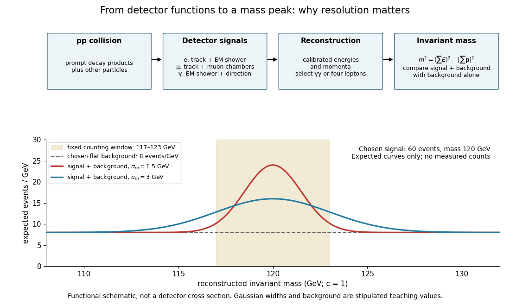

# Higgs resonance resolution and background model

↑ **Parent:** [Higgs boson discovery in 2012](higgs-boson-discovery-in-2012.md)

The bridge from detector readout to a [particle resonance](particle-resonance.md) is [four-momentum](four-momentum.md) conservation. In units $c=1$, sum the measured final-state [four-momenta](four-momentum.md):

$$
m^2=\left(\sum_i E_i\right)^2-\left|\sum_i\mathbf p_i\right|^2.
$$

For two [photons](photon.md) separated by angle $\alpha$, $|\mathbf p_i|=E_i$ gives the displayed diphoton formula. Two back-to-back [photons](photon.md) of $60\,\mathrm{GeV}$ each have $m_{\gamma\gamma}=120\,\mathrm{GeV}$. A four-lepton candidate instead uses four [four-momenta](four-momentum.md) in the same sum. Collision debris outside the selected decay is not included. Since the [partons](parton.md) carry unknown fractions of the incoming [proton](proton.md) momenta, reconstructing the decay products is more informative than assigning the full beam [energy](energy-split.md) to each candidate.

**[Figure 8](#image-detector-functions-reconstructed-mass-and-a-chosen-resolution-comparison). Detector functions, reconstructed mass and a chosen resolution comparison**. Functional schematic followed by an original expectation model: sixty selected signal events at $120\,\mathrm{GeV}$, a flat background of eight events per $10^9$ [electronvolts](electronvolt.md), and chosen [Gaussian](normal-distribution.md) mass widths $1.5$ and $3\,\mathrm{GeV}$. No historical event counts or copied discovery histograms are shown.

Suppose the intrinsic [decay width](decay-width.md) is negligible compared with the stipulated detector spread. Let the reconstructed signal mass follow a [normal distribution](normal-distribution.md) with mean $m_0=120\,\mathrm{GeV}$ and [standard deviation](standard-deviation.md) $\sigma_m$. For a total expected selected signal $S=60$ and flat background density $b=8$ events per $10^9$ [electronvolts](electronvolt.md), the expected count density is

$$
\frac{dN}{dm}=b+\frac{S}{\sqrt{2\pi}\sigma_m}\exp\!\left[-\frac{(m-m_0)^2}{2\sigma_m^2}\right].
$$

This is a deliberately chosen response model, not a fit to either experiment. In the fixed window $m_0-a<m<m_0+a$ with $a=3\,\mathrm{GeV}$, direct integration gives

$$
B_w=2ab=48,\qquad S_w=S\operatorname{erf}\!\left(\frac{a}{\sqrt2\sigma_m}\right).
$$

The expected signal counts are $57.2700$ for $\sigma_m=1.5\,\mathrm{GeV}$ and $40.9614$ for $\sigma_m=3\,\mathrm{GeV}$. Doubling the spread lowers the fraction in the same window without changing the total signal. Detector resolution can therefore change the visibility of a peak even with identical particle production.

As a separate counting example, stipulate an observed integer count $n=70$ and an exactly known background mean $B_w=48$. The [Poisson distribution](poisson-distribution.md) gives a [likelihood](likelihood-function.md) $L(s)=e^{-(48+s)}(48+s)^{70}/70!$ for nonnegative signal mean $s$. Its [maximum-likelihood estimator](maximum-likelihood-estimator.md) is $\widehat s=22$, and the [likelihood ratio](likelihood-ratio.md) statistic against $s=0$ is

$$
q_0=-2\log\frac{L(0)}{L(22)}=2\left[70\log\frac{70}{48}-22\right]\simeq8.82119.
$$

This tests a specified window with a specified background, and is not either experiment's discovery significance. If the background mean is allowed to vary freely, background alone can choose $70$ and fit that count exactly. Control samples, a defensible mass-shape model, [nuisance parameters](nuisance-parameter.md) and corrections for searching many masses are therefore essential to the experimental inference.

## ↑ Ancestors (9)

1. [Higgs boson discovery in 2012](higgs-boson-discovery-in-2012.md)
2. [Higgs boson](higgs-boson.md)
3. [Higgs field](higgs-field.md)
4. [Electroweak interaction](electroweak-interaction.md)
5. [Standard Model](standard-model-split.md)
6. [Quantum field theory](quantum-field-theory-split.md)
7. [Branches of physics](branches-of-physics.md)
8. [Physics](physics-split.md)
9. [Codex Wiki](split.md)
