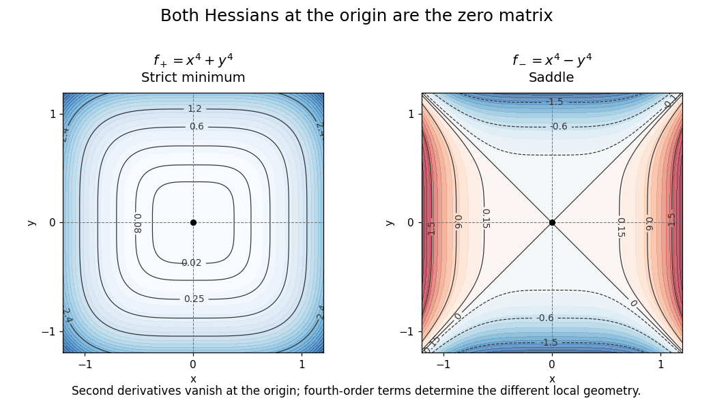

# Higher-order test for separated extrema

↑ **Parent:** [Hessian matrix](hessian-matrix.md)

For $f(x,y)=g(x)+h(y)$, a degenerate [Hessian matrix](hessian-matrix.md) can be supplemented by the first nonzero term of each one-variable displacement. Two negative leading even powers give a strict [local maximum](local-maximum.md), two positive ones a strict [local minimum](local-minimum.md), and opposite signs give a saddle. Looking along the coordinate directions and bounding the separated terms avoids an inconclusive quadratic test.

For an explicit contrast, consider

$$
f_+(x,y)=x^4+y^4,
\qquad
f_-(x,y)=x^4-y^4.
$$

Both have zero [gradient](gradient.md) and the same zero [Hessian matrix](hessian-matrix.md) at the origin:

$$
H_{f_+}(0,0)=H_{f_-}(0,0)=\begin{pmatrix}0&0\\0&0\end{pmatrix}.
$$

Nevertheless, $f_+$ is positive at every nonzero point, so the origin is a strict [global minimum](global-minimum.md). For $f_-$, the restrictions $f_-(t,0)=t^4>0$ and $f_-(0,t)=-t^4<0$ for $t\ne0$ show that the origin is a [saddle point of a scalar function](saddle-point-of-a-scalar-function.md). Identical quadratic information can conceal different geometry when higher-order terms are decisive.

**[Figure 31](#image-the-same-zero-hessian-can-occur-at-a-strict-minimum-or-a-saddle). The same zero Hessian can occur at a strict minimum or a saddle**. The quartic functions $x^4+y^4$ and $x^4-y^4$ both have zero second [partial derivatives](partial-derivative.md) at the origin. Their contour geometry and signs differ, so a singular [Hessian matrix](hessian-matrix.md) alone cannot classify the [critical point](critical-point.md).

## ↑ Ancestors (8)

1. [Hessian matrix](hessian-matrix.md)
2. [Multivariable calculus](multivariable-calculus.md)
3. [Calculus](calculus-split.md)
4. [Real analysis](real-analysis-split.md)
5. [Analysis](analysis-split.md)
6. [Area of mathematics](area-of-mathematics.md)
7. [Mathematics](mathematics-split.md)
8. [Codex Wiki](split.md)

## ← Incoming links (2)

- [Solution](past-exam-of-the-mathematics-course-of-the-university-of-cambridge/2013/ia/paper-2/6a/solution.md)
- [Second-derivative test](second-derivative-test.md)
