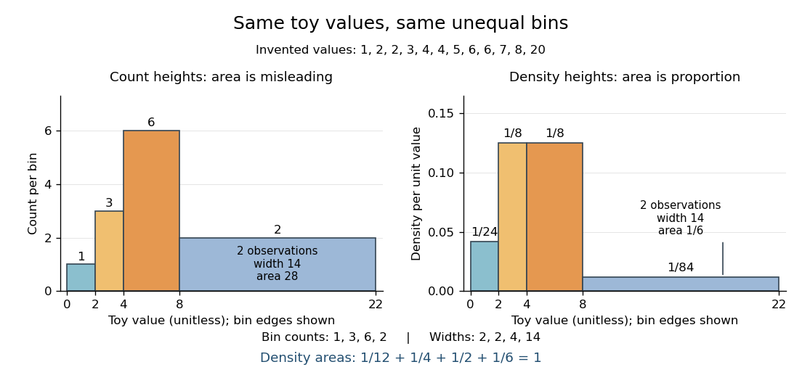

# Histogram

↑ **Parent:** [Descriptive statistics](descriptive-statistics.md)  
ⓦ [Wiki](https://en.wikipedia.org/wiki/Histogram)

A [histogram](histogram.md) groups numerical observations into adjacent [intervals](interval-mathematics.md) called bins and draws one rectangle per bin. Its attraction is that a long list of values becomes a visible pattern of concentration, gaps and [skewness](skewness.md). Specify the bin edges, the treatment of values on those edges, and what the vertical axis means: count, proportion, or density. Those choices are part of the graphic. [NIST/SEMATECH, Histogram, definition and normalization](https://www.itl.nist.gov/div898/handbook/eda/section3/histogra.htm)

Let $n>0$ observations be covered by disjoint bins $B_j$ with positive widths $\Delta_j$ and counts $n_j$, so $\sum_j n_j=n$. For example, use left-closed, right-open bins, closing the final right edge too. The three common height choices have different meanings:

- Count height $n_j$ gives the number in bin $j$; the sum of heights is $n$.
- Proportion height $n_j/n$ gives the fraction in bin $j$; the sum of heights is $1$.
- Density height $n_j/(n\Delta_j)$ makes the area, rather than the height, equal to the fraction in bin $j$.

For the density convention, a [histogram](histogram.md) is a piecewise constant [probability density function](probability-density-function.md) estimate:

$$
\widehat f(x)=\frac{n_j}{n\Delta_j}\quad(x\in B_j),\qquad \widehat f(x)=0\quad\left(x\notin\bigcup_jB_j\right).
$$

Its normalization follows by adding rectangular areas:

$$
\int_{B_j}\widehat f(x)\,dx=\frac{n_j}{n},\qquad \int_{\mathbb R}\widehat f(x)\,dx=\sum_j\frac{n_j}{n}=1.
$$

If the observations have units, density has reciprocal units; a density height is not a [probability](probability.md) and can exceed $1$. With equal bin widths, count heights and density heights differ only by a common scale factor. With unequal widths, count-height areas $n_j\Delta_j$ give wider bins extra visual weight unrelated to their counts. Dividing by width removes that distortion. R's histogram documentation explicitly describes area-one normalization for unequal bins. [R graphics documentation, hist, frequency versus density](https://stat.ethz.ch/R-manual/R-devel/library/graphics/html/hist.html)

Reuse the twelve invented values under [box plot](box-plot.md), with bins $[0,2),[2,4),[4,8),[8,22]$. The counts are $(1,3,6,2)$ and the widths are $(2,2,4,14)$. Hence the density heights and areas are exactly

$$
\left(\frac1{24},\frac18,\frac18,\frac1{84}\right),\qquad \left(\frac1{12},\frac14,\frac12,\frac16\right).
$$

The second and third bars have equal density heights even though the third contains twice as many observations: it is also twice as wide. The last bar contains only two observations; its count-height area would be $2\cdot14=28$, larger than the six-observation bar's $6\cdot4=24$. Its correct density area is only $1/6$.

**[Figure 2](#image-unequal-toy-bins-counts-determine-heights-density-makes-area-represent-proportion). Unequal toy bins: counts determine heights, density makes area represent proportion**. Both panels use the same twelve invented values and bin edges $0,2,4,8,22$. Left: count heights $1,3,6,2$, whose areas are not proportional to counts. Right: density heights $1/24,1/8,1/8,1/84$, with total area $1$. Equal density heights for the second and third bins express equal concentration per unit width. No bars represent measured data.

Bin choice trades detail against stability. Broad bins merge distinctions: the toy bin $[8,22]$ hides the empty stretch between $8$ and $20$. Narrow bins expose gaps but can make each individual observation dominate a bar. With one-unit bins starting at $0$, the bins $[2,3),[4,5),[6,7)$ each contain two values and appear equally prominent; that apparent pattern depends on grouping the repeated integers together. Moving the bin origin also changes membership without changing the observations. For [density estimation](density-estimation.md), this is a form of the [bias-variance tradeoff](bias-variance-tradeoff.md): averaging over broad bins loses local detail, while narrow bins give more variable density estimates across repeated [statistical samples](statistical-sample.md). [Cosma Rohilla Shalizi, Estimating Distributions and Densities, Section 14.1](https://www.stat.cmu.edu/~cshalizi/uADA/24/lectures/ch14.pdf) A useful practice is to compare a few plausible widths and offsets, keeping common edges when comparing groups. Automatic bin selectors are starting points, rather than guarantees of a unique correct picture. [NumPy documentation, histogram\_bin\_edges, Notes on bin selectors](https://numpy.org/doc/stable/reference/generated/numpy.histogram_bin_edges.html)

A [histogram](histogram.md) retains only bin membership. Its density estimate spreads each bin's fraction uniformly across that bin, so our last bar assigns density throughout $[8,22]$ even though the only toy values there are $8$ and $20$. It does not recover within-bin positions or observation order, and a visually convincing shape does not establish a population [probability distribution](probability-distribution.md). A [box plot](box-plot.md) provides a complementary compact summary of [quartiles](quartile.md); neither graphic replaces the original observations.

## ↑ Ancestors (5)

1. [Descriptive statistics](descriptive-statistics.md)
2. [Probability and statistics](probability-and-statistics-split.md)
3. [Area of mathematics](area-of-mathematics.md)
4. [Mathematics](mathematics-split.md)
5. [Codex Wiki](split.md)

## ← Incoming links (14)

- [Box plot](box-plot.md)
- [Descriptive statistics](descriptive-statistics.md)
- [Fermionic atom antibunching](fermionic-atom-antibunching.md)
- [Flow cytometric DNA-content assay](flow-cytometric-dna-content-assay.md)
- [Haar density estimator](haar-density-estimator.md)
- [Histogram](histogram.md)
- [History of kernel density estimation](history-of-kernel-density-estimation.md)
- [Kernel density estimation](kernel-density-estimation.md)
- [Solution](past-exam-of-the-mathematics-course-of-the-university-of-cambridge/2005/iii/paper-45/3/vi/solution.md)
- [Solution](past-exam-of-the-mathematics-course-of-the-university-of-cambridge/2009/iii/paper-33/3/solution.md)
- [Protein](protein.md)
- [Q-Q plot](q-q-plot.md)
- [Return period](return-period.md)
- [Time-correlated single-photon counting](time-correlated-single-photon-counting.md)
