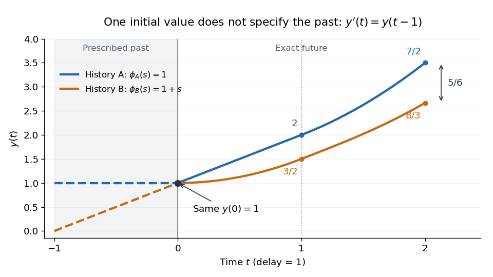

# History function of a delay differential equation

↑ **Parent:** [Retarded delay differential equation](retarded-delay-differential-equation.md)

A [history function of a delay differential equation](history-function-of-a-delay-differential-equation.md) supplies the past interval needed to start a [retarded delay differential equation](retarded-delay-differential-equation.md). A single [initial condition](initial-condition.md) $y(0)=\phi(0)$ generally leaves earlier delayed values unspecified.[Skip Thompson, Delay-differential equations, Initial History Function: prescribing the solution before the starting time](delay-differential-equations-by-skip-thompson.md)

For a [continuous function](continuous-function.md) history, the natural state at time $t$ is the entire segment

$$
y_t(\theta)=y(t+\theta),\qquad -\tau\leq\theta\leq0.
$$

It belongs to the [function space](function-space.md) $C([-\tau,0],\mathbb R)$, an [infinite-dimensional vector space](infinite-dimensional-vector-space.md): the [functions](function-split.md) $1,\theta,\theta^2,\ldots$ are [linearly independent](linear-independence.md). Shifting $y_t$ forward retains the part of the past that the equation can still read. Thus even one [scalar](scalar.md) unknown can require a state in an [infinite-dimensional vector space](infinite-dimensional-vector-space.md).

The insufficiency of one value is visible without any approximation. Consider $y'(t)=y(t-1)$ with the two [history functions of a delay differential equation](history-function-of-a-delay-differential-equation.md)

$$
\phi_A(s)=1,\qquad \phi_B(s)=1+s,\qquad -1\leq s\leq0.
$$

Both give $y(0)=1$, yet on the first step the respective [derivatives](derivative.md) are $1$ and $t$. Direct [integration](integral-split.md) gives

$$
y_A(t)=1+t,\qquad y_B(t)=1+\frac{t^2}{2},\qquad 0\leq t\leq1.
$$

In particular $y_A(1)=2$ while $y_B(1)=3/2$. On the next step,

$$
y_A(t)=1+t+\frac{(t-1)^2}{2},\qquad
y_B(t)=\frac32+(t-1)+\frac{(t-1)^3}{6},\qquad 1\leq t\leq2.
$$

At $t=2$ they are $7/2$ and $8/3$, a gap of $5/6$. These different futures reflect different prescribed histories; each fully specified problem has a unique [solution of a differential equation](solution-of-a-differential-equation.md). More strongly, for $y'(t)=a y(t-1)$ with $a\ne0$, observing the entire first-step [derivative](derivative.md) recovers every history value through $\phi(s)=y'(s+1)/a$ for $-1\leq s\leq0$, using the right [derivative](derivative.md) at $0$. The future can depend on the whole [function](function-split.md), rather than a finite list of its samples.

**[Figure 3](#image-equal-initial-values-and-different-histories-give-different-futures). Equal initial values and different histories give different futures**. Two exact [solutions of a differential equation](solution-of-a-differential-equation.md) for $y'=y(t-1)$. Dashed curves are the prescribed [history functions of a delay differential equation](history-function-of-a-delay-differential-equation.md); solid curves are their exact continuations. Both pass through $(0,1)$. The endpoint values $7/2$ and $8/3$ come from the displayed [polynomials](polynomial-split.md), with no numerical time stepping.

## ↑ Ancestors (7)

1. [Retarded delay differential equation](retarded-delay-differential-equation.md)
2. [Delay differential equation](delay-differential-equation.md)
3. [Differential equation](differential-equation-split.md)
4. [Analysis](analysis-split.md)
5. [Area of mathematics](area-of-mathematics.md)
6. [Mathematics](mathematics-split.md)
7. [Codex Wiki](split.md)

## ← Incoming links (4)

- [Delay differential equation](delay-differential-equation.md)
- [Exact polynomial steps for a delay equation](exact-polynomial-steps-for-a-delay-equation.md)
- [History function of a delay differential equation](history-function-of-a-delay-differential-equation.md)
- [Retarded delay differential equation](retarded-delay-differential-equation.md)
