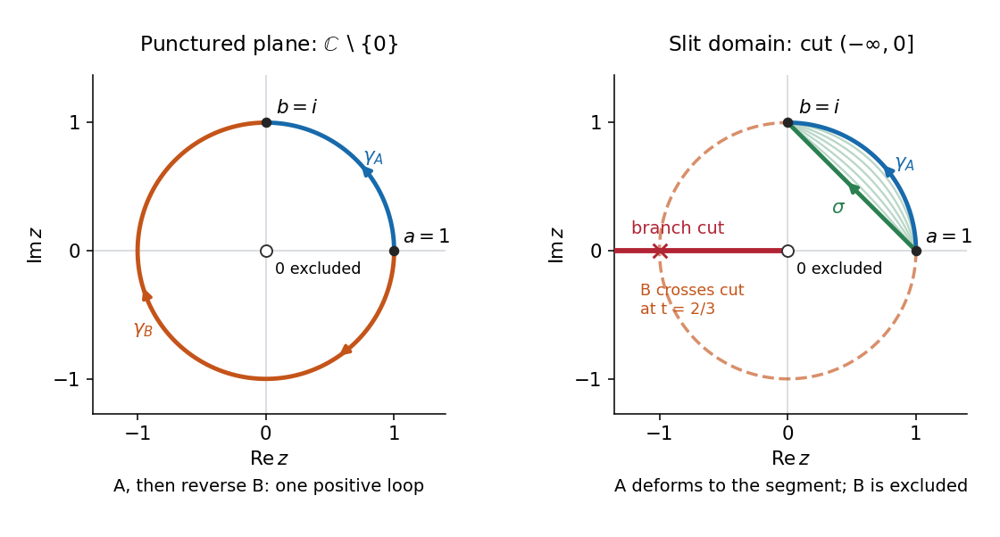
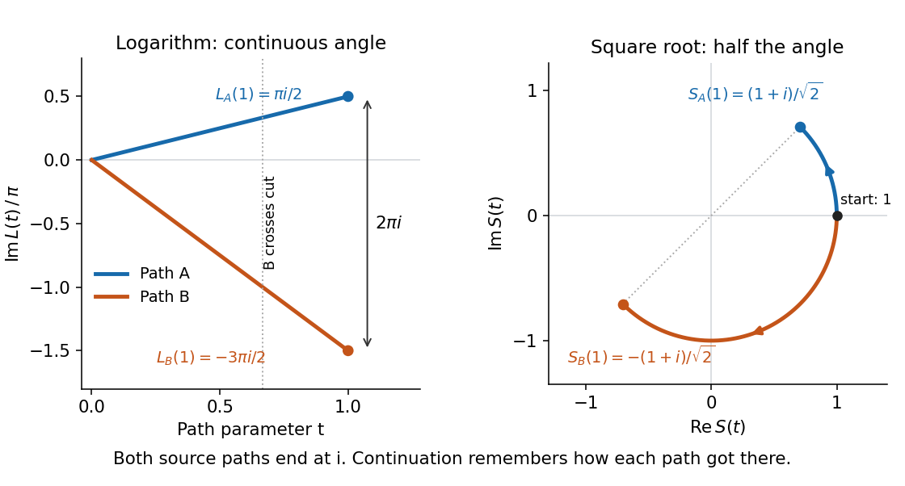

# Holomorphic function

↑ **Parent:** [Complex analysis](complex-analysis.md)  
ⓦ [Wiki](https://en.wikipedia.org/wiki/Holomorphic_function)

A complex-valued [function](function.md) $f:U\to\mathbb C$ is holomorphic on an [open set](topology.md#open-set) $U$ when it has a complex [derivative](calculus.md#derivative) at every point of $U$. Requiring a [derivative](calculus.md#derivative) throughout a neighbourhood is much stronger than [complex differentiability at a point](#complex-differentiability-at-a-point). It forces locally convergent [Taylor series](calculus.md#taylor-series) and [derivatives](calculus.md#derivative) of every order, as follows from the [Cauchy integral formula](analysis.md#cauchy-integral-formula) and [Cauchy derivative formula](complex-analysis.md#cauchy-derivative-formula).

To see the restriction in real coordinates, write $z=x+iy$ and $f(z)=u(x,y)+iv(x,y)$. The real and imaginary increment quotients must agree, giving the [Cauchy-Riemann equations](analysis.md#cauchy-riemann-equations)

$$
u_x=v_y,\qquad u_y=-v_x,\qquad f'=u_x+iv_x.
$$

Conversely, if $u,v$ have continuous [partial derivatives](multivariable-calculus.md#partial-derivative) on $U$ and satisfy the [Cauchy-Riemann equations](analysis.md#cauchy-riemann-equations) there, then $f$ is a [holomorphic function](holomorphic-function.md). The equations at a lone point, without a differentiability hypothesis for the real coordinate map, are insufficient. Their role is to force the [Jacobian matrix](multivariable-calculus.md#jacobian-matrix) to have the special form

$$
Df=\begin{pmatrix}u_x&u_y\\v_x&v_y\end{pmatrix}=\begin{pmatrix}p&-q\\q&p\end{pmatrix},\qquad f'=p+iq.
$$

Such a [matrix](vector-space.md#matrix) represents multiplication by a [complex number](complex-analysis.md#complex-number); it has only two free real entries. [Complex Variables with Applications, MIT 18.04, Spring 2018; Orloff, MIT Topic 2, sections 2.7.2–2.7.4](mathematics-bibliography.md#complex-variables-with-applications-mit-18-04-spring-2018/topic-2-notes)

For $f(z)=z^2$, $u=x^2-y^2$ and $v=2xy$, so $u_x=v_y=2x$ and $u_y=-v_x=-2y$. Directly,

$$
f(z_0+h)-f(z_0)=2z_0h+h^2,\qquad f'(z_0)=2z_0.
$$

At $z_0=1+i$, multiplication by $2+2i$ scales lengths by its [modulus](complex-analysis.md#modulus) $2\sqrt2$ and rotates by its [argument](complex-analysis.md#argument-complex-analysis) $\pi/4$. A horizontal increment $h=0.01$ gives the exact displacement $0.0201+0.02i$; a vertical increment $h=0.01i$ gives $-0.0201+0.02i$. The first-order predictions $0.02+0.02i$ and $-0.02+0.02i$ are perpendicular, and the errors have [modulus](complex-analysis.md#modulus) $10^{-4}$.

At every nonzero $z_0$, this local rotation and scaling makes $z^2$ a local [conformal map](geometry-and-topology.md#conformal-map). At zero, the first-order map vanishes: $re^{i\theta}$ becomes $r^2e^{2i\theta}$, so the [argument](complex-analysis.md#argument-complex-analysis) doubles and the origin is a [critical point](analysis.md#critical-point). Globally $z$ and $-z$ have the same square. Local preservation of [angles](geometry-and-topology.md#angle) therefore coexists with global folding, a useful warning when using [holomorphic functions](holomorphic-function.md) as coordinate changes.

**Table of contents**

- [Complex differentiability](#complex-differentiability)
- [Nevanlinna class](#nevanlinna-class)
  - [Bounded characteristic](#bounded-characteristic)
    - [Quotient characterization of bounded characteristic](#quotient-characterization-of-bounded-characteristic)
- [Multiplicity of a zero](#multiplicity-of-a-zero)
- [Periodic holomorphic descent through the exponential map](#periodic-holomorphic-descent-through-the-exponential-map)
- [Constant-modulus holomorphic function](#constant-modulus-holomorphic-function)
- [Banach-space-valued holomorphic function](#banach-space-valued-holomorphic-function)
  - [Spectral-radius maximum principle](#spectral-radius-maximum-principle)
  - [Norm maximum principle for a Banach-space-valued holomorphic function](#norm-maximum-principle-for-a-banach-space-valued-holomorphic-function)
- [Prescribed zeros in a plane domain via Runge approximation](#prescribed-zeros-in-a-plane-domain-via-runge-approximation)
- [Antiholomorphic function](#antiholomorphic-function)
- [Holomorphic convex hull](#holomorphic-convex-hull)
- [Blaschke product](#blaschke-product)
  - [Interior zero count for a finite Blaschke product minus a constant](#interior-zero-count-for-a-finite-blaschke-product-minus-a-constant)
  - [Hyperbolic zero estimate for a Blaschke product](#hyperbolic-zero-estimate-for-a-blaschke-product)
  - [Vanishing absolute logarithmic mean characterization of Blaschke products](#vanishing-absolute-logarithmic-mean-characterization-of-blaschke-products)
  - [Blaschke factorization of a bounded holomorphic function](#blaschke-factorization-of-a-bounded-holomorphic-function)
  - [Radial logarithmic mean of a Blaschke product](#radial-logarithmic-mean-of-a-blaschke-product)
  - [Automorphy character of an orbit Blaschke product](#automorphy-character-of-an-orbit-blaschke-product)
  - [Blaschke condition](#blaschke-condition)
    - [Blaschke sequence](#blaschke-sequence)
- [Jensen's formula](#jensen-s-formula)
  - [Circle log-mean of a holomorphic function](#circle-log-mean-of-a-holomorphic-function)
    - [Circle geometric mean of a holomorphic function](#circle-geometric-mean-of-a-holomorphic-function)
    - [Polynomial circle log-mean](#polynomial-circle-log-mean)
    - [Log-radius slope of the circle log-mean](#log-radius-slope-of-the-circle-log-mean)
  - [Radial zero-counting function](#radial-zero-counting-function)
    - [Integrated zero count](#integrated-zero-count)
  - [Jensen formula proof outline](#jensen-formula-proof-outline)
  - [Poisson-Jensen formula](#poisson-jensen-formula)
    - [Annular spherical Jensen formula](#annular-spherical-jensen-formula)
  - [Jensen zero-count bound](#jensen-zero-count-bound)
    - [Lattice zeros force quadratic exponential growth](#lattice-zeros-force-quadratic-exponential-growth)
- [Holomorphic primitive](#holomorphic-primitive)
- [Complex differentiability at a point](#complex-differentiability-at-a-point)
  - [Complex derivative](#complex-derivative)
- [Space of holomorphic functions](#space-of-holomorphic-functions)
  - [Weighted holomorphic norm on a shrinking time domain](#weighted-holomorphic-norm-on-a-shrinking-time-domain)
    - [Contraction estimate on a shrinking holomorphic domain](#contraction-estimate-on-a-shrinking-holomorphic-domain)
- [Order of a zero of a holomorphic function](#order-of-a-zero-of-a-holomorphic-function)
  - [Zero sets in the unit disc](#zero-sets-in-the-unit-disc)
  - [Simple zero](#simple-zero)
- [Analytic continuation](#analytic-continuation)
  - [Natural boundary of a holomorphic function](#natural-boundary-of-a-holomorphic-function)
  - [Zeta function regularization](#zeta-function-regularization)
    - [Half-integer zeta-regularized mode sum](#half-integer-zeta-regularized-mode-sum)
  - [Meromorphic continuation](#meromorphic-continuation)
  - [Sokhotski–Plemelj theorem](#sokhotski-plemelj-theorem)
    - [Signed Cauchy boundary operators](#signed-cauchy-boundary-operators)
  - [Monodromy theorem](#monodromy-theorem)
    - [Simply connected corollary of the monodromy theorem](#simply-connected-corollary-of-the-monodromy-theorem)
    - [Logarithm and square-root continuation along different paths](#logarithm-and-square-root-continuation-along-different-paths)
    - [Existence hypothesis of the monodromy theorem](#existence-hypothesis-of-the-monodromy-theorem)
    - [Local continuation proof of the monodromy theorem](#local-continuation-proof-of-the-monodromy-theorem)
    - [Monodromy group of a covering](#monodromy-group-of-a-covering)
      - [Monodromy transposition in a three-sheeted cover](#monodromy-transposition-in-a-three-sheeted-cover)
      - [Monodromy group of z squared plus z to the minus two](#monodromy-group-of-z-squared-plus-z-to-the-minus-two)
  - [Analytic continuation by contour deformation](#analytic-continuation-by-contour-deformation)
    - [Branch phase in a figure-eight analytic continuation integral](#branch-phase-in-a-figure-eight-analytic-continuation-integral)
  - [Multivalued inverse hyperbolic sine](#multivalued-inverse-hyperbolic-sine)
- [Entire function](#entire-function)
  - [Injective entire functions are affine](#injective-entire-functions-are-affine)
  - [Exponential polynomial](#exponential-polynomial)
  - [Order of an entire function](#order-of-an-entire-function)
  - [Entire function of exponential type](#entire-function-of-exponential-type)
  - [Weierstrass factorization theorem](#weierstrass-factorization-theorem)
    - [Canonical product](#canonical-product)
      - [Canonical product construction for zeros escaping to the disk boundary](#canonical-product-construction-for-zeros-escaping-to-the-disk-boundary)
      - [Boundary-adapted holomorphic zero factor](#boundary-adapted-holomorphic-zero-factor)
    - [Hadamard factorization theorem](#hadamard-factorization-theorem)
    - [Entire functions with the same zero divisor](#entire-functions-with-the-same-zero-divisor)
  - [Pointwise vanishing derivative criterion for a polynomial](#pointwise-vanishing-derivative-criterion-for-a-polynomial)
  - [Picard theorem](#picard-theorem)
    - [Omitted value](#omitted-value)
    - [Little Picard theorem](#little-picard-theorem)
      - [Great Picard theorem](#great-picard-theorem)
- [Analytic function with image in an affine real line](#analytic-function-with-image-in-an-affine-real-line)

## Complex differentiability

↑ **Parent:** [Holomorphic function](holomorphic-function.md)

A complex-valued [function](function.md) is complex differentiable at $z_0$ if

$$
f'(z_0)=\lim_{\substack{h\to0\\h\in\mathbb C\setminus\{0\}}}\frac{f(z_0+h)-f(z_0)}{h}
$$

exists. The same limit must hold for every approach, including curved paths. Equivalently,

$$
f(z_0+h)=f(z_0)+f'(z_0)h+o(|h|).
$$

The error divided by $|h|$ tends to zero. Thus the [derivative](calculus.md#derivative) is a single complex multiplier, not an arbitrary real [linear map](vector-space.md#linear-map) of the plane. If the real coordinate map is differentiable, [complex differentiability](#complex-differentiability) is equivalent to its satisfying the [Cauchy-Riemann equations](analysis.md#cauchy-riemann-equations) at that point.

The simplest failure is [complex conjugation](complex-analysis.md#complex-conjugation), $f(z)=\overline z$. At every $z_0$ its increment quotient is $\overline h/h$. For real $h=t\ne0$ it is $1$, while for $h=it$ it is $-1$. More generally, $h=te^{i\theta}$ gives $e^{-2i\theta}$. Although [complex conjugation](complex-analysis.md#complex-conjugation) is a smooth real reflection and has every real [directional derivative](multivariable-calculus.md#directional-derivative), these incompatible quotients rule out a complex [derivative](calculus.md#derivative) everywhere.

Agreement on two axes is necessary, but does not by itself establish a limit over the whole [complex plane](complex-analysis.md#complex-plane). The [Cauchy-Riemann equations](analysis.md#cauchy-riemann-equations) need the real differentiability condition above, or a sufficient regularity condition such as continuous [partial derivatives](multivariable-calculus.md#partial-derivative) near the point. There is a second distinction: $f(z)=|z|^2$ has complex [derivative](calculus.md#derivative) zero at zero because its quotient there is $\overline h\to0$, but its [Cauchy-Riemann equations](analysis.md#cauchy-riemann-equations) fail at every nonzero point. It is complex differentiable at zero without being a [holomorphic function](holomorphic-function.md) on any neighbourhood of zero.

## Nevanlinna class

↑ **Parent:** [Holomorphic function](holomorphic-function.md)

The analytic Nevanlinna class consists of [holomorphic functions](holomorphic-function.md) on the [unit disc](topology.md#unit-disc) with uniformly bounded means of their positive logarithmic modulus. Here $m$ is normalized angular measure. A bounded [holomorphic function](holomorphic-function.md) belongs to this class, but the class also permits unbounded functions. It is the analytic version of [bounded characteristic](#bounded-characteristic).

### Bounded characteristic

↑ **Parent:** [Nevanlinna class](#nevanlinna-class)

A [holomorphic function](holomorphic-function.md) on the [unit disc](topology.md#unit-disc) has bounded characteristic when $\sup_{r<1}\int\log^+|f(r\xi)|\,dm(\xi)<\infty$, where $\log^+t=\max(0,\log t)$. Thus it belongs to the [Nevanlinna class](#nevanlinna-class). A general [meromorphic function](isolated-singularity.md#meromorphic-function) requires the additional pole-counting term in its characteristic; the displayed analytic definition has no such term.

#### Quotient characterization of bounded characteristic

↑ **Parent:** [Bounded characteristic](#bounded-characteristic)

A [meromorphic function](isolated-singularity.md#meromorphic-function) on the [unit disc](topology.md#unit-disc) has [bounded characteristic](#bounded-characteristic) if and only if it has this representation. Its pole [Blaschke product](#blaschke-product) $B$ makes $g=Bf$ analytic with bounded positive logarithmic means. The [least harmonic majorant by expanding disk lifts](partial-differential-equation.md#least-harmonic-majorant-by-expanding-disk-lifts) gives $H\ge\log^+|g|$. A [harmonic conjugate](partial-differential-equation.md#harmonic-conjugate) gives an analytic $A$ with $\operatorname{Re}A=H$, so $u=ge^{-A}$ and $v=Be^{-A}$ are bounded. Conversely the [Nevanlinna first main theorem](isolated-singularity.md#nevanlinna-first-main-theorem) bounds the characteristic of $u/v$ by that of $u$ and $1/v$, hence by a constant.

## Multiplicity of a zero

↑ **Parent:** [Holomorphic function](holomorphic-function.md)

A [holomorphic function](holomorphic-function.md) that is not identically zero has a zero of multiplicity $m$ at $z_0$ if $f(z)=(z-z_0)^m h(z)$ for a [holomorphic function](holomorphic-function.md) $h$ with $h(z_0)\ne0$. Its [Taylor series](calculus.md#taylor-series) identifies $m$ as the first nonzero coefficient index. Logarithmic differentiation gives $f'/f=m/(z-z_0)+h'/h$, so the [residue](analysis.md#residue) of $f'/f$ is $m$. Counting zeros with [zero multiplicity](#multiplicity-of-a-zero) repeats that zero $m$ times.

## Periodic holomorphic descent through the exponential map

↑ **Parent:** [Holomorphic function](holomorphic-function.md)

If a [holomorphic function](holomorphic-function.md) of $w$ is periodic with period one, then $F((\log z)/(2\pi i))$ is independent of the choice of a local logarithm: two choices differ by $2\pi i k$, hence their arguments differ by an integer. Consequently it defines a holomorphic function on the image of the original domain under $w\mapsto e^{2\pi iw}$, provided that domain is invariant under integer shifts. Local logarithms prove holomorphy across an arbitrary global branch cut. Singularities on an integer lattice all map to $z=1$.

## Constant-modulus holomorphic function

↑ **Parent:** [Holomorphic function](holomorphic-function.md)

A [holomorphic function](holomorphic-function.md) with constant modulus on a connected [domain](topology.md#domain-mathematical-analysis) is constant. If $h=u+iv$ and $u^2+v^2=c^2>0$, differentiation and the [Cauchy-Riemann equations](analysis.md#cauchy-riemann-equations) give $uu_x+vv_x=0$ and $-uv_x+vu_x=0$. Their coefficient [determinant](multilinear-algebra.md#determinant) is $-c^2$, so $u_x=v_x=0$, and all first [derivatives](calculus.md#derivative) vanish. When $c=0$, the conclusion is immediate. Consequently two nonvanishing [holomorphic functions](holomorphic-function.md) with equal moduli differ by a single constant phase on a connected [domain](topology.md#domain-mathematical-analysis).

## Banach-space-valued holomorphic function

↑ **Parent:** [Holomorphic function](holomorphic-function.md)

A map from an open subset of $\mathbb C$ to a complex [Banach space](banach-space.md) is holomorphic when the displayed limit exists in the Banach-space norm at every point. A norm-convergent power series is holomorphic inside its radius of convergence: on every smaller disk the series of derivatives converges uniformly by the geometric coefficient bound, allowing differentiation term by term. Applying a [continuous linear functional](topological-vector-space.md#continuous-linear-functional) produces an ordinary scalar [holomorphic function](holomorphic-function.md). Scalar Cauchy identities therefore imply the corresponding vector-integral identities when bounded linear functionals separate points, as they do by the [Hahn-Banach theorem](functional-analysis.md#hahn-banach-theorem).

### Spectral-radius maximum principle

↑ **Parent:** [Banach-space-valued holomorphic function](#banach-space-valued-holomorphic-function)

For a [Banach algebra](banach-algebra.md)-valued [holomorphic function](holomorphic-function.md), set $p_n(w)=\|f(w)^{2^n}\|^{1/2^n}$. These [continuous](calculus.md#continuous-function) functions decrease to the [spectral radius](analysis.md#spectral-radius) by the [spectral radius formula](analysis.md#spectral-radius-formula). If $M=\sup_{\partial K}r(f(w))$, the [continuous](calculus.md#continuous-function) functions $\max\{p_n,M\}$ on $\partial K$ decrease to the [continuous](calculus.md#continuous-function) constant $M$. The [Dini theorem](sequence-and-series.md#dini-s-theorem) gives [uniform convergence](sequence-and-series.md#uniform-convergence). Apply the [norm maximum principle for a Banach-space-valued holomorphic function](#norm-maximum-principle-for-a-banach-space-valued-holomorphic-function) to each power, and then let $n\to\infty$. This proof does not assume [continuity](calculus.md#continuous-function) of [spectral radius](analysis.md#spectral-radius).

### Norm maximum principle for a Banach-space-valued holomorphic function

↑ **Parent:** [Banach-space-valued holomorphic function](#banach-space-valued-holomorphic-function)

For a [compact](topology.md#compact-space) set $K$ in the domain, a norming [bounded linear functional](topological-vector-space.md#continuous-linear-functional) at $f(z)$ reduces the assertion to the scalar [maximum modulus principle](complex-analysis.md#maximum-modulus-principle). If $z$ lies inside $K$, use its [connected](geometry-and-topology.md#connected-space) component of the [interior](topology.md#interior-topology); that component's [boundary](topology.md#boundary-of-a-set) lies in $\partial K$. If $z\in\partial K$, the inequality is immediate. No smoothness or connectedness assumption on $K$ is required.

## Prescribed zeros in a plane domain via Runge approximation

↑ **Parent:** [Holomorphic function](holomorphic-function.md)

Every [closed discrete subset](topology.md#closed-discrete-subset) of a plane [domain](topology.md#domain-mathematical-analysis) is the zero set of a [holomorphic function](holomorphic-function.md), with assigned finite positive multiplicities if desired. Exhaust the domain by relatively filled compact sets. For a prescribed point outside an earlier compact, choose a rational factor with that zero and its possible pole outside the domain in the same complementary component. A slit joining zero and pole allows a [holomorphic logarithm](complex-analysis.md#holomorphic-logarithm) near the earlier compact. Approximate that logarithm by [Runge theorem](complex-analysis.md#runge-s-theorem) and multiply the rational factor by the negative exponential of the approximant. The resulting factors tend to one with summable errors on each compact. Their [infinite product](sequence-and-series.md#infinite-product) has the prescribed zeros and no additional zeros.

// Destination: analysis.bigb

## Antiholomorphic function

↑ **Parent:** [Holomorphic function](holomorphic-function.md)  
ⓦ [Wiki](https://en.wikipedia.org/wiki/Antiholomorphic_function)

A complex-valued function is antiholomorphic when its complex conjugate is a [holomorphic function](holomorphic-function.md). In one complex dimension it locally depends on $\overline z$ and satisfies $\partial_zf=0$. A nonconstant antiholomorphic map reverses the orientation induced by the complex coordinates. Thus complex conjugating a holomorphic sphere map reverses its [topological degree](geometry-and-topology.md#topological-degree) while preserving its Dirichlet energy.

## Holomorphic convex hull

↑ **Parent:** [Holomorphic function](holomorphic-function.md)

For [compact](topology.md#compact-space) $K$ in a plane domain $\Omega$, its [holomorphic convex hull](#holomorphic-convex-hull) is

$$
\widehat K_{\Omega}=\{w\in\Omega:|f(w)|\le\sup_K|f|\text{ for every }f\in\mathcal O(\Omega)\}.
$$

It is $K$ together with the components of $\widehat{\mathbb C}\setminus K$ lying entirely in $\Omega$. Inclusion of those components follows from the [maximum modulus principle](complex-analysis.md#maximum-modulus-principle). For exclusion, suppose $w$ lies in a complementary component meeting $\widehat{\mathbb C}\setminus\Omega$. Choose an allowed [pole](isolated-singularity.md#pole) there. The open-and-closed resolvent argument in the proof of [Runge theorem](complex-analysis.md#runge-s-theorem) approximates $(z-w)^{-1}$ uniformly on $K$ by functions $h$ [holomorphic](holomorphic-function.md) on $\Omega$. Then $1-(z-w)h(z)$ has value one at $w$ and arbitrarily small modulus on $K$, separating $w$ from the hull. For $\Omega=\mathbb C$, this is the [polynomial hull in one complex variable](complex-analysis.md#polynomial-hull-in-one-complex-variable).

## Blaschke product

↑ **Parent:** [Holomorphic function](holomorphic-function.md)  
ⓦ [Wiki](https://en.wikipedia.org/wiki/Blaschke_product)

For zeros $a_n$ in the [unit disc](topology.md#unit-disc) satisfying $\sum_n(1-|a_n|)<\infty$, with $m$ occurrences at zero, a [Blaschke product](#blaschke-product) is

$$
B(z)=\lambda z^m\prod_{a_n\ne0}\frac{|a_n|}{a_n}\frac{a_n-z}{1-\overline{a_n}z},\qquad |\lambda|=1.
$$

For $|z|\le R<1$ and $a\ne0$, the normalized factor $b_a$ satisfies $|1-b_a(z)|\le(1-|a|)(1+R)/(1-R)$. The product therefore converges locally uniformly; outside its prescribed zeros the logarithms of its tail factors converge absolutely, so it has no additional zeros. Every finite product has modulus at most one in the disc, and the limit does too. Since $|b_a(w)|$ is [pseudohyperbolic distance](hyperbolic-geometry.md#pseudohyperbolic-distance) from $w$ to $a$, its modulus can be estimated geometrically.

### Interior zero count for a finite Blaschke product minus a constant

↑ **Parent:** [Blaschke product](#blaschke-product)

A finite [Blaschke product](#blaschke-product) is holomorphic across the unit circle and has modulus one there. For a constant $a$ with $|a|<1$, [Rouché's theorem](complex-analysis.md#rouche-s-theorem) makes $B-a$ and $B$ have the same number of interior zeros, counting [multiplicity](polynomial.md#multiplicity-mathematics). Each factor contributes its prescribed zero; the poles are outside the closed disk.

### Hyperbolic zero estimate for a Blaschke product

↑ **Parent:** [Blaschke product](#blaschke-product)

Use curvature-minus-one [Hyperbolic distance in the Poincare disc](hyperbolic-geometry.md#hyperbolic-distance-in-the-poincare-disc). Each [Blaschke factor](group-theory.md#blaschke-factor) has modulus $\tanh(\rho(w,a)/2)=(1-t)/(1+t)$, with $t=e^{-\rho(w,a)}$. For $0\le t<1$, differentiating shows $\log[(1+t)/(1-t)]\ge2t$. Sum this logarithmic inequality over the zero factors and pass to the [Blaschke product](#blaschke-product) by [locally uniform convergence](sequence-and-series.md#locally-uniform-convergence). At a prescribed zero, its modulus vanishes and the bound is immediate. All sums count [multiplicities](polynomial.md#multiplicity-mathematics).

### Vanishing absolute logarithmic mean characterization of Blaschke products

↑ **Parent:** [Blaschke product](#blaschke-product)

For a [holomorphic function](holomorphic-function.md) on the [unit disc](topology.md#unit-disc), this boundary condition characterizes [Blaschke products](#blaschke-product), including unimodular constants. The nondecreasing radial means of the nonnegative [subharmonic function](partial-differential-equation.md#subharmonic-function) $\log^+|f|$ must vanish, so $|f|\le1$. In the [Blaschke factorization of a bounded holomorphic function](#blaschke-factorization-of-a-bounded-holomorphic-function) $f=Bg$, both logarithmic means tend to zero. The [mean value property for harmonic functions](partial-differential-equation.md#mean-value-property-for-harmonic-functions) applied to $\log|g|$ gives $|g(0)|=1$, and the [maximum modulus principle](complex-analysis.md#maximum-modulus-principle) makes $g$ unimodular constant. The converse follows from the [radial logarithmic mean of a Blaschke product](#radial-logarithmic-mean-of-a-blaschke-product). Omitting the outer absolute value changes the condition: $e^z$ has zero mean logarithmic modulus, but is not a [Blaschke product](#blaschke-product).

### Blaschke factorization of a bounded holomorphic function

↑ **Parent:** [Blaschke product](#blaschke-product)

Every nonzero bounded [holomorphic function](holomorphic-function.md) on the [unit disc](topology.md#unit-disc) has this factorization, with $B$ the [Blaschke product](#blaschke-product) of its zeros and $g$ zero-free and [holomorphic](holomorphic-function.md). The [Blaschke condition](#blaschke-condition) follows from [Jensen's formula](#jensen-s-formula). Dividing by any finite partial zero product gives a [holomorphic function](holomorphic-function.md); the [maximum modulus principle](complex-analysis.md#maximum-modulus-principle) and the finite product's boundary modulus one bound that quotient by $\|f\|_\infty$. [Locally uniform convergence](sequence-and-series.md#locally-uniform-convergence) of the partial products gives the same bound for $g$, with removable extensions at their zeros. This factorization alone does not make $g$ constant or a full inner-outer factorization.

### Radial logarithmic mean of a Blaschke product

↑ **Parent:** [Blaschke product](#blaschke-product)

For $B(z)=\lambda z^m\prod_n b_{a_n}(z)$ with nonzero zeros $a_n$ counted with [multiplicity](polynomial.md#multiplicity-mathematics), [Jensen's formula](#jensen-s-formula) gives the displayed identity. The negative logarithms of partial products increase, so the [monotone convergence theorem](measure-theory.md#monotone-convergence-theorem) permits termwise integration. The [Blaschke condition](#blaschke-condition) implies $\sum_n-\log|a_n|<\infty$, which dominates the absolute summands. The [dominated convergence theorem](measure-theory.md#dominated-convergence-theorem) therefore gives a limit of zero as $r\uparrow1$. Since $|B|\le1$, the mean of $|\log|B||$ tends to zero as well.

### Automorphy character of an orbit Blaschke product

↑ **Parent:** [Blaschke product](#blaschke-product)

Let a [group](group.md) $G$ of [Möbius transformations](group-theory.md#mobius-transformation) of the [unit disk](euclidean-geometry.md#unit-disk) have an orbit satisfying the [Blaschke condition](#blaschke-condition), counted once per distinct orbit point. For its [Blaschke product](#blaschke-product) $B$, invariance of the [pseudohyperbolic distance](hyperbolic-geometry.md#pseudohyperbolic-distance) and permutation of the orbit give $|B(Tz)|=|B(z)|$. The ratio $B(Tz)/B(z)$ extends across its zeros and has modulus one, so the [open mapping theorem](complex-analysis.md#open-mapping-theorem-complex-analysis) makes it a constant $\chi(T)$. Composition gives a [group homomorphism](group-theory.md#group-homomorphism) $\chi:G\to\{\lambda:|\lambda|=1\}$. It is essential to compare moduli of the products: two arbitrary bounded [holomorphic functions](holomorphic-function.md) with identical zeros need not have constant quotient.

### Blaschke condition

↑ **Parent:** [Blaschke product](#blaschke-product)

The [Blaschke condition](#blaschke-condition) for a sequence in the [unit disc](topology.md#unit-disc) is $\sum_n(1-|a_n|)<\infty$. It characterizes the zero sequences, counted with [multiplicity](polynomial.md#multiplicity-mathematics), of nonzero bounded [holomorphic functions](holomorphic-function.md). Sufficiency follows by constructing the [Blaschke product](#blaschke-product). For necessity, [Jensen's formula](#jensen-s-formula) gives $\sum_{|a_n|<r}\log(r/|a_n|)\le\log\|f\|_\infty-\log|f(0)|$ when $f(0)\ne0$. Letting $r\uparrow1$ and using $-\log|a|\ge1-|a|$ proves the condition. A finite zero at zero is factored out first. Equivalently, for the curvature-minus-one [hyperbolic metric](hyperbolic-geometry.md#hyperbolic-metric), $\sum_ne^{-\rho(0,a_n)}<\infty$, since $e^{-\rho(0,a)}=(1-|a|)/(1+|a|)$.

#### Blaschke sequence

↑ **Parent:** [Blaschke condition](#blaschke-condition)

A sequence in the [unit disc](topology.md#unit-disc), counted with [multiplicity](polynomial.md#multiplicity-mathematics), is a Blaschke sequence when it satisfies the [Blaschke condition](#blaschke-condition). The zeros of every nonzero bounded [holomorphic function](holomorphic-function.md) form such a sequence: [Jensen's formula](#jensen-s-formula) bounds $\sum_{|a_n|<r}\log(r/|a_n|)$ uniformly as $r\uparrow1$, and $1-|a|\le-\log|a|$ gives the assertion. There are only finitely many zeros at the origin, which can be factored out first.

<h2 id="jensen-s-formula">Jensen's formula</h2>

↑ **Parent:** [Holomorphic function](holomorphic-function.md)  
ⓦ [Wiki](https://en.wikipedia.org/wiki/Jensen's_formula)

Let $R>0$ and let $f$ be a [holomorphic function](holomorphic-function.md) on an open neighbourhood of the closed [disk](topology.md#disk-mathematics) $\{z:|z|\le R\}$. Assume $f(0)\ne0$ and that $f$ has no [zeros of a function](polynomial.md#zero-of-a-function) on the boundary [circle](topology.md#circle) $|z|=R$. List its interior [zeros of a function](polynomial.md#zero-of-a-function) as $a_1,\ldots,a_N$, repeating each according to its [multiplicity of a zero](#multiplicity-of-a-zero). With the natural [logarithm](calculus.md#logarithm), [Jensen's formula](#jensen-s-formula) states

$$
\frac{1}{2\pi}\int_0^{2\pi}\log|f(Re^{i\theta})|\,d\theta
=\log|f(0)|+\sum_{j=1}^{N}\log\frac{R}{|a_j|}.
$$

The empty sum is zero. This boundary-zero-free version is the holomorphic special case of the general identity in the source.[§1, Theorem 2 and equation (6): neighbourhood of the closed disk, zeros counted with multiplicity, holomorphic special case](mathematics-bibliography.md#246b-notes-1-zeroes-poles-and-factorisation-of-meromorphic-functions-by-terence-tao)

Every interior [zero of a function](polynomial.md#zero-of-a-function) makes a positive contribution; a zero nearer the centre contributes more. Consequently boundary growth relative to $|f(0)|$ limits how many [zeros of a function](polynomial.md#zero-of-a-function) can lie well inside the [disk](topology.md#disk-mathematics). The [Jensen zero-count bound](#jensen-zero-count-bound) makes this quantitative, while the [integrated zero count](#integrated-zero-count) retains the individual radial weights. The boundary statistic here is the [circle log-mean of a holomorphic function](#circle-log-mean-of-a-holomorphic-function); exponentiating gives a [circle geometric mean of a holomorphic function](#circle-geometric-mean-of-a-holomorphic-function).

### Circle log-mean of a holomorphic function

↑ **Parent:** [Jensen's formula](#jensen-s-formula)

Under the hypotheses of [Jensen's formula](#jensen-s-formula), the circle log-mean is the angular average of the natural [logarithm](calculus.md#logarithm) of the [complex modulus](complex-analysis.md#complex-modulus). The factor $1/(2\pi)$ normalizes the [integral](integral.md) to a mean. It averages values at equally weighted angles on the [circle](topology.md#circle), and [Jensen's formula](#jensen-s-formula) computes it from $|f(0)|$ and the interior [zeros of a function](polynomial.md#zero-of-a-function).

#### Circle geometric mean of a holomorphic function

↑ **Parent:** [Circle log-mean of a holomorphic function](#circle-log-mean-of-a-holomorphic-function)

The continuous angular [geometric mean](arithmetic.md#geometric-mean) of the positive boundary [complex modulus](complex-analysis.md#complex-modulus) is

$$
G_f(R)=\exp\left(\frac{1}{2\pi}\int_0^{2\pi}\log|f(Re^{i\theta})|\,d\theta\right)
=|f(0)|\prod_{j=1}^{N}\frac{R}{|a_j|}.
$$

Here the empty product is one. This differs from the angular [arithmetic mean](arithmetic.md#arithmetic-mean) $A_f(R)=(2\pi)^{-1}\int_0^{2\pi}|f(Re^{i\theta})|\,d\theta$. In general $G_f(R)\le A_f(R)$ by the [concavity](real-analysis.md#concave-function) of the [logarithm](calculus.md#logarithm); equality requires constant boundary [complex modulus](complex-analysis.md#complex-modulus). For a [holomorphic function](holomorphic-function.md) with no [zeros of a function](polynomial.md#zero-of-a-function) in the closed [disk](topology.md#disk-mathematics), [Jensen's formula](#jensen-s-formula) gives $G_f(R)=|f(0)|$, even when the boundary [complex modulus](complex-analysis.md#complex-modulus) varies with angle. Thus replacing the mean of a [logarithm](calculus.md#logarithm) by the [logarithm](calculus.md#logarithm) of an [arithmetic mean](arithmetic.md#arithmetic-mean) loses the exact zero identity.

#### Polynomial circle log-mean

↑ **Parent:** [Circle log-mean of a holomorphic function](#circle-log-mean-of-a-holomorphic-function)

For a [polynomial](polynomial.md) $p(z)=c\prod_j(z-a_j)$ with $c\ne0$, no [polynomial root](polynomial.md#root-of-a-polynomial) at zero, and $R>0$ different from every $|a_j|$, [Jensen's formula](#jensen-s-formula) gives the displayed expression. The [polynomial roots](polynomial.md#root-of-a-polynomial) are repeated according to their [multiplicity of a zero](#multiplicity-of-a-zero): an exterior root contributes $\log|a_j|$, whereas an interior root contributes $\log R$.

For an explicit example, take the [polynomial](polynomial.md)

$$
f(z)=3(z-\tfrac14)(z+\tfrac12),\qquad f(0)=-\tfrac38.
$$

Its two [simple zeros](#simple-zero) are $1/4$ and $-1/2$. The [circle log-mean of a holomorphic function](#circle-log-mean-of-a-holomorphic-function) is therefore

$$
L_f(R)=\begin{cases}
\log(3/8),&0<R<1/4,\\
\log(3R/2),&1/4<R<1/2,\\
\log(3R^2),&R>1/2.
\end{cases}
$$

At $R=0.2$ the [open disc](topology.md#open-disc) contains no [zeros of a function](polynomial.md#zero-of-a-function), at $R=0.4$ it contains $1/4$ only, and at $R=0.75$ it contains both. These three [circles](topology.md#circle) avoid the [polynomial roots](polynomial.md#root-of-a-polynomial); the radii $1/4$ and $1/2$ are excluded from the displayed version.

**[Figure 1](#image-the-zeros-of-3-z-1-4-z-plus-1-2-inside-three-concentric-disks). The zeros of $3(z-1/4)(z+1/2)$ inside three concentric disks**. The three boundary [circles](topology.md#circle) enclose respectively zero, one and two [simple zeros](#simple-zero). Each zero contributes to [Jensen's formula](#jensen-s-formula) only after the radius exceeds its [complex modulus](complex-analysis.md#complex-modulus).

The corresponding values of the [circle log-mean of a holomorphic function](#circle-log-mean-of-a-holomorphic-function) and the [circle geometric mean of a holomorphic function](#circle-geometric-mean-of-a-holomorphic-function) are

$$
\begin{array}{c|c|c|c}
R&n_f(R)&L_f(R)&G_f(R)\\\hline
0.2&0&\log(3/8)\approx-0.980829&3/8\\
0.4&1&\log(3/5)\approx-0.510826&3/5\\
0.75&2&\log(27/16)\approx0.523248&27/16
\end{array}
$$

For example, at $R=0.4$ the contribution of the sole interior [zero of a function](polynomial.md#zero-of-a-function) is $\log(0.4/0.25)=\log(8/5)$; adding it to $\log(3/8)$ gives $\log(3/5)$. The second [polynomial root](polynomial.md#root-of-a-polynomial) still affects $f(0)$, but contributes no additional interior-zero term at this radius.

**[Figure 2](#image-circle-log-mean-versus-log-radius-for-3-z-1-4-z-plus-1-2). Circle log-mean versus log-radius for $3(z-1/4)(z+1/2)$**. The [log-radius slope of the circle log-mean](#log-radius-slope-of-the-circle-log-mean) is zero, one and two in the three intervals, matching the [radial zero-counting function](#radial-zero-counting-function). Open markers exclude the boundary-zero radii $1/4$ and $1/2$; filled markers show the three computed examples.

#### Log-radius slope of the circle log-mean

↑ **Parent:** [Circle log-mean of a holomorphic function](#circle-log-mean-of-a-holomorphic-function)

Fix a [holomorphic function](holomorphic-function.md) on a neighbourhood of a closed [disk](topology.md#disk-mathematics), with $f(0)\ne0$. On an interval of positive radii whose [circles](topology.md#circle) contain no [zeros of a function](polynomial.md#zero-of-a-function), differentiating [Jensen's formula](#jensen-s-formula) with respect to $x=\log R$ gives

$$
\frac{d}{dx}L_f(e^x)=n_f(e^x).
$$

Each interior [zero of a function](polynomial.md#zero-of-a-function) contributes slope one for each unit of its [multiplicity of a zero](#multiplicity-of-a-zero). Between consecutive zero moduli, $L_f(e^x)$ is an [affine function](vector-space.md#affine-function); passing the modulus of a zero of [multiplicity of a zero](#multiplicity-of-a-zero) $m$ increases the adjacent slopes by $m$. The finite sum $\log|f(0)|+\sum_j\max(0,x-\log|a_j|)$ defines a continuous [convex function](real-analysis.md#convex-function) of $x$ whose values agree with the [circle log-mean of a holomorphic function](#circle-log-mean-of-a-holomorphic-function) at every boundary-zero-free radius. This describes the adjacent line segments without asserting a boundary-singularity extension of the [integral](integral.md).

### Radial zero-counting function

↑ **Parent:** [Jensen's formula](#jensen-s-formula)

For a nonzero [holomorphic function](holomorphic-function.md), $n_f(r)$ counts its [zeros of a function](polynomial.md#zero-of-a-function) in the centred [open disc](topology.md#open-disc) of radius $r$, with [multiplicity of a zero](#multiplicity-of-a-zero). Thus a double zero counts twice, even though it is a single point. On every smaller closed [disk](topology.md#disk-mathematics) in the domain the count is finite. The strict inequality $|a|<r$ specifies the convention at a zero modulus; elsewhere it agrees with counting in the closed [disk](topology.md#disk-mathematics). In the [polynomial circle log-mean](#polynomial-circle-log-mean) example the count is zero, one and two on the three displayed intervals.

#### Integrated zero count

↑ **Parent:** [Radial zero-counting function](#radial-zero-counting-function)

Under the hypotheses of [Jensen's formula](#jensen-s-formula), $f(0)\ne0$ ensures that the [radial zero-counting function](#radial-zero-counting-function) vanishes for sufficiently small positive $t$. Integrating each zero's contribution separately gives

$$
N_f(R)=\int_0^R\frac{n_f(t)}{t}\,dt
=\sum_{|a|<R}\operatorname{ord}_a f\int_{|a|}^{R}\frac{dt}{t}
=\sum_{|a|<R}\operatorname{ord}_a f\log\frac{R}{|a|}
=L_f(R)-\log|f(0)|.
$$

The values of $n_f$ at its finitely many jump points do not change the [integral](integral.md). For $0<r<R$, every zero in the smaller [open disc](topology.md#open-disc) supplies at least $\log(R/r)$ per unit of [multiplicity of a zero](#multiplicity-of-a-zero), so

$$
n_f(r)\log(R/r)\le N_f(R)\le\log M_f(R)-\log|f(0)|,
\qquad M_f(R)=\max_{|z|=R}|f(z)|.
$$

The second inequality bounds the [circle log-mean of a holomorphic function](#circle-log-mean-of-a-holomorphic-function) by the [logarithm](calculus.md#logarithm) of the largest boundary [complex modulus](complex-analysis.md#complex-modulus), recovering the [Jensen zero-count bound](#jensen-zero-count-bound). An upper bound on boundary growth and a fixed nonzero centre value therefore constrain interior zeros. The factor $\log(R/r)$ also explains why the same estimate becomes weaker as the smaller radius approaches the boundary.

### Jensen formula proof outline

↑ **Parent:** [Jensen's formula](#jensen-s-formula)

Divide $f$ by its finitely many interior zero factors, with each factor repeated according to its [multiplicity of a zero](#multiplicity-of-a-zero). The resulting [holomorphic function](holomorphic-function.md) $g$ has no [zeros of a function](polynomial.md#zero-of-a-function) in the closed [disk](topology.md#disk-mathematics), so $\log|g|$ is a [harmonic function](partial-differential-equation.md#harmonic-function) and its circle average is $\log|g(0)|$ by the [mean value property for harmonic functions](partial-differential-equation.md#mean-value-property-for-harmonic-functions). For each removed factor $z-a$, with $0<|a|<R$, the circle average of $\log|Re^{i\theta}-a|$ is $\log R$: factor out $Re^{i\theta}$ and apply the [mean value property for harmonic functions](partial-differential-equation.md#mean-value-property-for-harmonic-functions) to $\log|1-(a/R)w|$ on a neighbourhood of the closed unit [disk](topology.md#disk-mathematics). Reassembling the factors gives $\log(R/|a|)$ for each zero, proving [Jensen's formula](#jensen-s-formula).

### Poisson-Jensen formula

↑ **Parent:** [Jensen's formula](#jensen-s-formula)

For a [meromorphic function](isolated-singularity.md#meromorphic-function) with no zero or [pole](isolated-singularity.md#pole) on $|w|=R$, set $G_R(z,a)=\log|(R^2-\overline az)/(R(z-a))|$. At source points that are neither zeros nor [poles](isolated-singularity.md#pole), the displayed identity expresses its logarithmic modulus as the Poisson integral of its boundary values, minus its zero Green potentials plus its [pole](isolated-singularity.md#pole) Green potentials. The Poisson kernel is $(R^2-|z|^2)/|Re^{i\theta}-z|^2$ with normalized angular measure. Subtracting the corresponding logarithmic singularities leaves a harmonic function, so the harmonic Poisson formula proves the identity. At zero it reduces to [Jensen's formula](#jensen-s-formula).

#### Annular spherical Jensen formula

↑ **Parent:** [Poisson-Jensen formula](#poisson-jensen-formula)

For a [meromorphic function](isolated-singularity.md#meromorphic-function) near $0<|z|\le1$, and a target $a$ off its image of the unit circle, let $u_a=-\log k(f,a)$ for the [chordal metric](riemann-surfaces.md#chordal-metric), $M_a(s)$ its normalized angular mean, and $I(a)=M_a'(1)$. The weighted spherical area $T(r)=(4\pi)^{-1}\int_{r<|z|<1}\log(|z|/r)(f^{\#}_{\mathrm{round}})^2\,dA$ satisfies the displayed formula, where $N$ counts $a$-points with [multiplicity](polynomial.md#multiplicity-mathematics) and weight $\log(|z|/r)$ and $\overline m=M_a(r)-M_a(1)$. Indeed $\Delta u_a=(f^{\#}_{\mathrm{round}})^2/2-2\pi\sum\deg_z(f)\delta_z$, and [Green's second identity](partial-differential-equation.md#green-second-identity) with the radial logarithmic weight proves the formula. The angular mean must include $1/(2\pi)$.

### Jensen zero-count bound

↑ **Parent:** [Jensen's formula](#jensen-s-formula)

Every zero in the smaller disk contributes at least $\log(R/r)$ in [Jensen's formula](#jensen-s-formula). Bounding the outer circle average by its maximum proves the estimate. With $R=2r$, an exponential $O(r\log r)$ maximum bound gives an $O(r\log r)$ zero count.

#### Lattice zeros force quadratic exponential growth

↑ **Parent:** [Jensen zero-count bound](#jensen-zero-count-bound)

A nonzero [entire function](#entire-function) vanishing at every nonzero point of the integer lattice has at least a constant times $R^2$ zeros in the disc of radius $R/2$. Each contributes at least $\log2$ to [Jensen's formula](#jensen-s-formula) at radius $R$. Therefore the circle mean of $\log|F|$, and hence the logarithm of its maximum modulus, is bounded below by $cR^2$ for all sufficiently large boundary-zero-free radii. Choosing maximizing points yields $|F(z_j)|>e^{c'|z_j|^2}$ for some $c'>0$ and $|z_j|\to\infty$. If zero is also a zero, first factor out its finite multiplicity; the additional $m\log R$ term does not weaken the quadratic lower bound.

## Holomorphic primitive

↑ **Parent:** [Holomorphic function](holomorphic-function.md)

A holomorphic primitive of $f$ is a [holomorphic function](holomorphic-function.md) $F$ with $F'=f$. A holomorphic $f$ on a domain has such a primitive exactly when its integrals around all closed piecewise smooth curves vanish. Integrating from a fixed starting point then constructs a path-independent primitive.

## Complex differentiability at a point

↑ **Parent:** [Holomorphic function](holomorphic-function.md)

A function is complex differentiable at $p$ when

$$
f(p+h)=f(p)+f'(p)h+o(|h|).
$$

If $f'(p)\ne0$, the real derivative is multiplication by a nonzero complex number, hence a rotation and scaling; this is the local source of angle preservation by holomorphic maps.

### Complex derivative

↑ **Parent:** [Complex differentiability at a point](#complex-differentiability-at-a-point)

The complex derivative exists when this [limit](calculus.md#limit-of-a-function) has the same finite value for increments $h$ approaching zero from every complex direction. For $f=u+iv$, real and imaginary increments give the necessary [Cauchy-Riemann equations](analysis.md#cauchy-riemann-equations). Existence of those [partial derivatives](multivariable-calculus.md#partial-derivative) at one point alone is not sufficient for [complex differentiability at a point](#complex-differentiability-at-a-point); continuous [partial derivatives](multivariable-calculus.md#partial-derivative) in a neighbourhood, together with the [Cauchy-Riemann equations](analysis.md#cauchy-riemann-equations) there, give a standard sufficient condition for $f$ to be a [holomorphic function](holomorphic-function.md).

## Space of holomorphic functions

↑ **Parent:** [Holomorphic function](holomorphic-function.md)

For an [open set](topology.md#open-set) $U\subseteq\mathbb C$, the space $\mathcal O(U)$ consists of all [holomorphic functions](holomorphic-function.md) on $U$. Its standard topology is locally uniform convergence, equivalently the [compact-open topology](sequence-and-series.md#compact-open-topology) defined by the seminorms $f\mapsto\sup_{z\in K}|f(z)|$ for compact $K\subset U$.

### Weighted holomorphic norm on a shrinking time domain

↑ **Parent:** [Space of holomorphic functions](#space-of-holomorphic-functions)

Let $R,\alpha>0$ and $\mathcal C_\alpha=\{(x,t)\in\mathbb C^2:|x|<R,\;|t|<\alpha(1-|x|/R)\}$. The displayed [norm](normed-vector-space.md#norm) makes the [holomorphic functions](holomorphic-function.md) with finite norm a [Banach space](banach-space.md). Finiteness forces $u(x,0)=0$: for fixed $x$, the weight grows like $1/|t|$ near zero. A Cauchy sequence in this norm converges uniformly on every compact subset of $\mathcal C_\alpha$, including at $t=0$. Its limit is holomorphic by [locally uniform convergence of holomorphic functions](complex-analysis.md#locally-uniform-convergence-of-holomorphic-functions), and the pointwise norm bounds show convergence in the original norm. The shrinking domain compensates for loss of an $x$-[derivative](calculus.md#derivative) in a [Cauchy-Kovalevskaya theorem](partial-differential-equation.md#cauchy-kovalevskaya-theorem) argument.

#### Contraction estimate on a shrinking holomorphic domain

↑ **Parent:** [Weighted holomorphic norm on a shrinking time domain](#weighted-holomorphic-norm-on-a-shrinking-time-domain)

Write $N=\|u\|_\alpha$, $r=|t|$ and $A=\alpha(1-s)>r$. Along the straight integration segment, choose $\sigma(\tau)=s+(A-\tau)/(2\alpha)$. A [Cauchy estimate](analysis.md#cauchy-estimate) on a disc of radius $R(\sigma-s)$ bounds the integrand by $4\alpha N\tau/[R(A-\tau)^2]$. Therefore

$$
\frac{A-r}{r}\left|\int_0^t\partial_xu(x,z)\,dz\right|
\leq\frac{4\alpha N}{R}\left[1+\frac{A-r}{r}\log(1-r/A)\right]
\leq\frac{4\alpha N}{R}.
$$

The integral is taken at fixed $x$, and the disc and segment lie inside the shrinking domain. Consequently $u\mapsto\int_0^t(iu_x+f)\,dz$ is a [contraction mapping](analysis.md#contraction-mapping) when $0<\alpha<R/4$ and the holomorphic source $f$ is bounded on the relevant closed polydisc. The source term has weighted norm at most $\alpha\sup|f|$, so the [Banach fixed-point theorem](analysis.md#contraction-mapping-theorem) gives a holomorphic solution with zero initial data.

## Order of a zero of a holomorphic function

↑ **Parent:** [Holomorphic function](holomorphic-function.md)

If a nonzero holomorphic function has expansion

$$
f(z)=(z-z_0)^m g(z),
\qquad g(z_0)\ne0,
$$

then $m$ is the order or multiplicity of its zero at $z_0$.

### Zero sets in the unit disc

↑ **Parent:** [Order of a zero of a holomorphic function](#order-of-a-zero-of-a-holomorphic-function)

A nonzero [holomorphic function](holomorphic-function.md) on the [unit disc](topology.md#unit-disc) can have exactly a prescribed sequence of zeros, counted with [multiplicity](polynomial.md#multiplicity-mathematics), if and only if that sequence is locally finite in the disc. Necessity is the [identity theorem for holomorphic functions](complex-analysis.md#identity-theorem). For sufficiency, remove a finite number $m$ of zeros at zero and enumerate the others as $a_n$, so $|a_n|\to1$. Use the [Weierstrass elementary factors](sequence-and-series.md#weierstrass-elementary-factor) $E_n(t)=(1-t)\exp(\sum_{j=1}^nt^j/j)$. On every [compact](topology.md#compact-space) subdisc, eventually $|z/a_n|\le q<1$ and $|\log E_n(z/a_n)|\le q^{n+1}/((n+1)(1-q))$. Hence $z^m\prod_nE_n(z/a_n)$ converges locally uniformly and has exactly the prescribed zeros. Finite sequences simply give finite products.

### Simple zero

↑ **Parent:** [Order of a zero of a holomorphic function](#order-of-a-zero-of-a-holomorphic-function)

A simple zero has order one, equivalently $f(z_0)=0$ and $f'(z_0)\ne0$.

## Analytic continuation

↑ **Parent:** [Holomorphic function](holomorphic-function.md)  
ⓦ [Wiki](https://en.wikipedia.org/wiki/Analytic_continuation)

An analytic continuation extends a [holomorphic function](holomorphic-function.md) beyond its original domain without changing its existing values. Formally, if $U\subset V$ are domains and $f$ is [holomorphic](holomorphic-function.md) on $U$, a [holomorphic function](holomorphic-function.md) $F$ on $V$ with $F|_U=f$ is an analytic continuation. More locally, [holomorphic functions](holomorphic-function.md) on overlapping [open sets](topology.md#open-set) continue one another when they agree on the overlap, allowing a chain of patches along a path. The [identity theorem for holomorphic functions](complex-analysis.md#identity-theorem) forces agreement throughout a [connected](geometry-and-topology.md#connected-space) overlap once they agree on a nonempty [open set](topology.md#open-set) in it. It also makes an extension to a fixed [connected](geometry-and-topology.md#connected-space) domain unique. [Orloff, MIT 18.04 Topic 13, section 13.2 and Theorem 13.2](https://ocw.mit.edu/courses/18-04-complex-variables-with-applications-spring-2018/af8c9c78c3915aaf3fd1695f8d32a3b3_MIT18_04S18_topic13.pdf)

The [geometric series](sequence-and-series.md#geometric-series) illustrates why a formula can reach farther than the [power series](sequence-and-series.md#power-series) that first represents it. For $z\ne1$, its [partial sum](sequence-and-series.md#partial-sum) is

$$
S_N(z)=\sum_{n=0}^Nz^n=\frac{1-z^{N+1}}{1-z}.
$$

When $|z|<1$, $z^{N+1}\to0$, so the [series](sequence-and-series.md#series-mathematics) converges to $f(z)=1/(1-z)$. The [rational function](isolated-singularity.md#rational-function) $F(z)=1/(1-z)$ is [holomorphic](holomorphic-function.md) on $\mathbb C\setminus\{1\}$ and agrees there with the sum on the [unit disc](topology.md#unit-disc). It therefore continues $f$ to every point except its [simple pole](isolated-singularity.md#simple-pole) at $1$. In particular,

$$
f(1/2)=2,\qquad F(2)=-1,\qquad S_N(2)=2^{N+1}-1\longrightarrow+\infty.
$$

Thus [analytic continuation](#analytic-continuation) gives a value at $2$ without making the original [geometric series](sequence-and-series.md#geometric-series) converge there. Its [radius of convergence](sequence-and-series.md#radius-of-convergence) remains $1$: on $|z|\ge1$ the terms $z^n$ do not even tend to zero.

**[Figure 3](#image-the-original-geometric-series-converges-only-inside-the-unit-circle-while-its-rational-continuation-exists-everywhere-except-the-pole-at-1). The original geometric series converges only inside the unit circle, while its rational continuation exists everywhere except the pole at 1**.

The [pole](isolated-singularity.md#pole) at $1$ limits the original [Taylor series](calculus.md#taylor-series), although most points of its convergence circle are regular for $F$. Recentring at $-1$ gives another genuinely convergent [power series](sequence-and-series.md#power-series),

$$
F(z)=\frac1{2-(z+1)}=\frac12\sum_{n=0}^{\infty}\left(\frac{z+1}{2}\right)^n,\qquad |z+1|<2.
$$

At $z=-3/2$ this yields $\tfrac12\sum_{n\ge0}(-1/4)^n=2/5$, even though the original powers of $-3/2$ grow. This is the useful idea: overlapping local descriptions can represent one [holomorphic function](holomorphic-function.md) on a larger region.

Uniqueness on a [connected](geometry-and-topology.md#connected-space) overlap does not imply that every path leads to the same terminal [germ of a holomorphic function](riemann-surfaces.md#germ-of-a-holomorphic-function). Continuing a [complex logarithm](analysis.md#complex-logarithm) around $0$ changes its value by $2\pi i$, giving [monodromy](complex-analysis.md#monodromy); the return patch can carry a different [branch of a multivalued function](complex-analysis.md#branch-of-a-multivalued-function). If two patches have a disconnected overlap, agreement on one component imposes no agreement on the others. [Orloff, section 13.2.1, Example 13.4](https://ocw.mit.edu/courses/18-04-complex-variables-with-applications-spring-2018/af8c9c78c3915aaf3fd1695f8d32a3b3_MIT18_04S18_topic13.pdf) Continuation using the [rational function](isolated-singularity.md#rational-function) $1/(1-z)$ is single-valued: any path avoiding $1$ gives the same terminal [germ of a holomorphic function](riemann-surfaces.md#germ-of-a-holomorphic-function), even if it winds around the [pole](isolated-singularity.md#pole).

### Natural boundary of a holomorphic function

↑ **Parent:** [Analytic continuation](#analytic-continuation)

A boundary of a domain of a [holomorphic function](holomorphic-function.md) is natural if the function has no analytic continuation through any of its points. For $f(z)=\sum_{n\ge1}z^{2^n}$, each root of unity of order a power of two is a singular boundary point: along $z=r\zeta$ all sufficiently late terms equal $r^{2^n}$ and their sum tends to infinity as $r\uparrow1$. These roots are dense on the unit circle, so no boundary arc admits analytic continuation.

### Zeta function regularization

↑ **Parent:** [Analytic continuation](#analytic-continuation)

Zeta function regularization assigns a finite value to a divergent spectral sum by first forming a convergent complex-power series and then using its [analytic continuation](#analytic-continuation). For positive frequencies $\omega_n$, continue $\sum_n\omega_n^{-s}$ to $s=-1$ to define a regulated frequency sum, when that continuation is regular there. This does not turn the divergent positive-term sum into an ordinary convergent sum. It is a useful subtraction convention for the [normal-ordering constant of a string](bosonic-string-theory.md#normal-ordering-constant-of-a-string) and for vacuum energies.

#### Half-integer zeta-regularized mode sum

↑ **Parent:** [Zeta function regularization](#zeta-function-regularization)

For $r=n+1/2$, $n\geq0$, the convergent frequency zeta function, expressed through the [Riemann zeta function](analytic-number-theory.md#riemann-zeta-function), is $\sum_r r^{-s}=(2^s-1)\zeta_R(s)$ when $\operatorname{Re}s>1$. Its [analytic continuation](#analytic-continuation) at $s=-1$ gives $(1/2-1)(-1/12)=1/24$. A common exponential frequency cutoff gives $\sum_r r e^{-\varepsilon r}=\varepsilon^{-2}+1/24+O(\varepsilon^2)$, so the same finite part follows by subtracting the leading divergence. In contrast, integer frequencies have regulated sum $-1/12$.

### Meromorphic continuation

↑ **Parent:** [Analytic continuation](#analytic-continuation)

A [meromorphic continuation](#meromorphic-continuation) extends a [holomorphic function](holomorphic-function.md) from a connected open [set](set.md) to a larger connected domain as a [meromorphic function](isolated-singularity.md#meromorphic-function), allowing isolated poles. Equality on the initial open [set](set.md) determines the extension uniquely by the [identity theorem](complex-analysis.md#identity-theorem). [Integral](integral.md) formulas whose integrands depend holomorphically on a parameter often supply such an extension after contour deformation or subtraction of singular terms.

<h3 id="sokhotski-plemelj-theorem">Sokhotski–Plemelj theorem</h3>

↑ **Parent:** [Analytic continuation](#analytic-continuation)  
ⓦ [Wiki](https://en.wikipedia.org/wiki/Sokhotski–Plemelj_theorem)

As distributions on the real line,

$$
\frac1{x\pm i0}
=\operatorname{PV}\frac1x\mp i\pi\delta(x).
$$

The Sokhotski--Plemelj formula relates the two boundary values of a Cauchy transform across its contour and fixes the spectral delta functions generated by retarded and advanced prescriptions.

#### Signed Cauchy boundary operators

↑ **Parent:** [Sokhotski–Plemelj theorem](#sokhotski-plemelj-theorem)

With $Hv(\rho)=\pi^{-1}\operatorname{PV}\int v(s)/(\rho-s)ds$, the upper and lower limiting [Cauchy integrals](complex-analysis.md#cauchy-transform) are $P^\pm v=\pm v/2+iHv/2$. They obey $P^+-P^-=I$. The actual complementary idempotent [projections](vector-space.md#projection-linear-algebra) are $P^+$ and $-P^-$; confusing this signed convention with two positive projectors changes reconstruction signs. These boundary operators naturally enter the [spectral reconstruction of an attenuated Radon transform](integral-transform.md#spectral-reconstruction-of-an-attenuated-radon-transform).

### Monodromy theorem

↑ **Parent:** [Analytic continuation](#analytic-continuation)  
ⓦ [Wiki](https://en.wikipedia.org/wiki/Monodromy_theorem)

The monodromy theorem says that, when [analytic continuation](#analytic-continuation) exists throughout a [domain](topology.md#domain-mathematical-analysis), its ambiguity depends on [homotopy](homotopy.md). Let $D\subset\mathbb C$ be a [domain](topology.md#domain-mathematical-analysis), $a\in D$, and $g_a$ a [germ of a holomorphic function](riemann-surfaces.md#germ-of-a-holomorphic-function) at $a$. Assume $g_a$ admits [analytic continuation](#analytic-continuation) along every [continuous path](geometry-and-topology.md#continuous-path) in $D$ starting at $a$. Two such [paths](geometry-and-topology.md#continuous-path) ending at $b$ give the same terminal [germ of a holomorphic function](riemann-surfaces.md#germ-of-a-holomorphic-function) if they are [homotopic](homotopy.md) with endpoints fixed in $D$. [Krantz, A Guide to Complex Variables, sections 9.3.4–9.3.5, printed pp. 158–159](mathematics-bibliography.md#a-guide-to-complex-variables-by-steven-g-krantz)

Here a [homotopy](homotopy.md) with endpoints fixed is a [continuous map](topology.md#continuous-map) $H:[0,1]^2\to D$ satisfying

$$
H(0,t)=\gamma_0(t),\quad H(1,t)=\gamma_1(t),\quad H(s,0)=a,\quad H(s,1)=b.
$$

Every intermediate [path](geometry-and-topology.md#continuous-path) must stay in $D$. Equality means agreement on a [neighbourhood](topology.md#neighbourhood-mathematics) of $b$, rather than merely equal values at $b$. [Sections 9.3.1–9.3.3, printed pp. 157–158: terminal elements and fixed endpoint homotopy](mathematics-bibliography.md#a-guide-to-complex-variables-by-steven-g-krantz)

The [identity theorem](complex-analysis.md#identity-theorem) provides local rigidity; the [monodromy theorem](#monodromy-theorem) shows precisely how [topology](topology.md) controls the remaining global freedom. Deforming a route without crossing a forbidden point cannot change the resulting [germ of a holomorphic function](riemann-surfaces.md#germ-of-a-holomorphic-function). Thus a complicated [analytic continuation](#analytic-continuation) calculation can be replaced by one on a simpler [homotopic](homotopy.md) route. Distinct [homotopy classes](homotopy.md#homotopy-class) can still give the same continuation: a [rational function](isolated-singularity.md#rational-function) on its [domain](topology.md#domain-mathematical-analysis) already gives a single-valued answer along every route, even around a [pole](isolated-singularity.md#pole).

#### Simply connected corollary of the monodromy theorem

↑ **Parent:** [Monodromy theorem](#monodromy-theorem)

On a [simply connected domain](complex-analysis.md#simply-connected-domain) $D$, a [germ of a holomorphic function](riemann-surfaces.md#germ-of-a-holomorphic-function) admitting [analytic continuation](#analytic-continuation) along every [path](geometry-and-topology.md#continuous-path) from its base point determines a unique [holomorphic function](holomorphic-function.md) $F:D\to\mathbb C$ with that initial [germ of a holomorphic function](riemann-surfaces.md#germ-of-a-holomorphic-function). [Section 9.3.6, printed p. 159: globally defined holomorphic function](mathematics-bibliography.md#a-guide-to-complex-variables-by-steven-g-krantz)

Indeed, any two [paths](geometry-and-topology.md#continuous-path) with the same endpoints are [homotopic](homotopy.md) with endpoints fixed. Define $F(b)$ using the terminal [germ of a holomorphic function](riemann-surfaces.md#germ-of-a-holomorphic-function). The [monodromy theorem](#monodromy-theorem) makes this independent of the [path](geometry-and-topology.md#continuous-path). In a small [open disc](topology.md#open-disc) about $b$, extend the chosen route by a short segment; the same local representative supplies $F$ throughout the [open disc](topology.md#open-disc), proving [holomorphy](holomorphic-function.md). The [identity theorem](complex-analysis.md#identity-theorem) proves uniqueness. The [existence hypothesis of the monodromy theorem](#existence-hypothesis-of-the-monodromy-theorem) must still be checked.

#### Logarithm and square-root continuation along different paths

↑ **Parent:** [Monodromy theorem](#monodromy-theorem)

Start at $a=1$ with [complex logarithm](analysis.md#complex-logarithm) [germ of a holomorphic function](riemann-surfaces.md#germ-of-a-holomorphic-function) $L(1)=0$ and [holomorphic square root](complex-analysis.md#holomorphic-square-root) [germ of a holomorphic function](riemann-surfaces.md#germ-of-a-holomorphic-function) $S(1)=1$. On the [punctured plane](riemann-surfaces.md#punctured-complex-plane) $D=\mathbb C\setminus\{0\}$, both admit [analytic continuation](#analytic-continuation) along every [path](geometry-and-topology.md#continuous-path). To construct it locally, for any $c\ne0$ choose a small [open disc](topology.md#open-disc) avoiding $0$, select a [holomorphic logarithm](complex-analysis.md#holomorphic-logarithm) there, and select its additive multiple of $2\pi i$ to agree with the arriving [germ of a holomorphic function](riemann-surfaces.md#germ-of-a-holomorphic-function); exponentiating half this logarithm supplies the arriving [holomorphic square root](complex-analysis.md#holomorphic-square-root). A finite chain of these [open discs](topology.md#open-disc) follows any given [path](geometry-and-topology.md#continuous-path).

Compare two [paths](geometry-and-topology.md#continuous-path) from $1$ to $i$, parametrized by $0\le t\le1$:

$$
\gamma_A(t)=e^{i\pi t/2},\qquad \gamma_B(t)=e^{-3i\pi t/2}.
$$

The first follows a counterclockwise quarter-circle; the second follows a clockwise three-quarter-circle. Following $\gamma_A$ and then [path reversal](algebraic-topology.md#path-reversal) of $\gamma_B$ makes one positive turn about $0$. Its [winding number](complex-analysis.md#winding-number) is $1$, so the two [paths](geometry-and-topology.md#continuous-path) cannot be [homotopic](homotopy.md) with endpoints fixed in the [punctured plane](riemann-surfaces.md#punctured-complex-plane).

**[Figure 4](#image-two-paths-from-1-to-i-enclose-the-puncture-while-a-negative-real-axis-cut-excludes-the-clockwise-route-and-permits-a-deformation-between-the-remaining-routes). Two paths from 1 to i enclose the puncture, while a negative-real-axis cut excludes the clockwise route and permits a deformation between the remaining routes**.

The continued values along the chosen [paths](geometry-and-topology.md#continuous-path) are

$$
L_A(t)=\frac{\pi i t}{2},\qquad L_B(t)=-\frac{3\pi i t}{2},\qquad S_A(t)=e^{i\pi t/4},\qquad S_B(t)=e^{-3i\pi t/4}.
$$

At their common endpoint,

$$
L_A(1)=\frac{\pi i}{2},\quad L_B(1)=-\frac{3\pi i}{2},\quad L_A(1)-L_B(1)=2\pi i,
\qquad S_A(1)=\frac{1+i}{\sqrt2},\quad S_B(1)=-\frac{1+i}{\sqrt2}.
$$

Both [complex logarithm](analysis.md#complex-logarithm) values exponentiate to $i$, and both [holomorphic square root](complex-analysis.md#holomorphic-square-root) values square to $i$. These give different terminal [germ of a holomorphic function](riemann-surfaces.md#germ-of-a-holomorphic-function) representatives, consistently obtained from the same starting [germ of a holomorphic function](riemann-surfaces.md#germ-of-a-holomorphic-function). The [monodromy theorem](#monodromy-theorem) applies, but does not equate these two non-[homotopic](homotopy.md) [paths](geometry-and-topology.md#continuous-path).

**[Figure 5](#image-tracking-continuation-from-1-to-i-along-a-quarter-circle-and-a-clockwise-three-quarter-circle-gives-logarithms-separated-by-2-pi-i-and-opposite-square-roots). Tracking continuation from 1 to i along a quarter-circle and a clockwise three-quarter-circle gives logarithms separated by 2 pi i and opposite square roots**.

The closed [path](geometry-and-topology.md#continuous-path) $\lambda(t)=e^{2\pi it}$ instead returns to $1$, with continued values $L_\lambda(t)=2\pi it$ and $S_\lambda(t)=e^{\pi it}$. One counterclockwise turn changes the [complex logarithm](analysis.md#complex-logarithm) by $2\pi i$ and flips the [holomorphic square root](complex-analysis.md#holomorphic-square-root) from $1$ to $-1$. Hence neither initial [germ of a holomorphic function](riemann-surfaces.md#germ-of-a-holomorphic-function) can come from a global [holomorphic logarithm](complex-analysis.md#holomorphic-logarithm) or a global [holomorphic square root](complex-analysis.md#holomorphic-square-root) of $z$ on the [punctured plane](riemann-surfaces.md#punctured-complex-plane). Repeating a [loop](algebraic-topology.md#loop-topology) of [winding number](complex-analysis.md#winding-number) $n$ gives the changes $2\pi in$ and $(-1)^n$. [Rosales, Branch Points and Branch Cuts, section 1, printed pp. 3–8, and Example 2.4, printed p. 15](mathematics-bibliography.md#branch-points-and-branch-cuts-by-rodolfo-r-rosales)

Now restrict to the slit [domain](topology.md#domain-mathematical-analysis) $D_{\mathrm{slit}}=\mathbb C\setminus(-\infty,0]$. The [principal logarithm](analysis.md#principal-complex-logarithm) and $\exp(\operatorname{Log}z/2)$ realize the same initial [germ of a holomorphic function](riemann-surfaces.md#germ-of-a-holomorphic-function) for each expression globally. To see that this is a [simply connected domain](complex-analysis.md#simply-connected-domain), [polar form](complex-analysis.md#polar-form-of-a-complex-number) identifies this [domain](topology.md#domain-mathematical-analysis) with $(0,\infty)\times(-\pi,\pi)$, a [convex set](convex-set.md); every [loop](algebraic-topology.md#loop-topology) contracts there. The [simply connected corollary of the monodromy theorem](#simply-connected-corollary-of-the-monodromy-theorem) now forces equality along every pair of [paths](geometry-and-topology.md#continuous-path) with matching endpoints. In particular, $\gamma_A$ and the segment $\sigma(t)=1-t+it$ both give $L(i)=\pi i/2$ and $S(i)=(1+i)/\sqrt2$. The explicit [homotopy](homotopy.md) $H(s,t)=(1-s)\gamma_A(t)+s\sigma(t)$ stays in the closed first quadrant away from $0$, hence in $D_{\mathrm{slit}}$.

The other route $\gamma_B$ crosses the removed ray at $t=2/3$ and is no longer admissible. In the [punctured plane](riemann-surfaces.md#punctured-complex-plane), that crossing is locally regular: [analytic continuation](#analytic-continuation) passes through $-1$ smoothly, although evaluating the [principal logarithm](analysis.md#principal-complex-logarithm) would reset its [argument](complex-analysis.md#argument-complex-analysis). The [branch cut](analysis.md#branch-cut) changes the allowed [domain](topology.md#domain-mathematical-analysis); it does not create additional [branch points](complex-analysis.md#branch-point) or [poles](isolated-singularity.md#pole). That distinction is the beauty of the obstruction: perfectly compatible local [holomorphic functions](holomorphic-function.md) can fail to make a global choice solely because of the allowed [based loops](algebraic-topology.md#based-loop). The [branches of a multivalued function](complex-analysis.md#branch-of-a-multivalued-function) article develops how moving the [branch cut](analysis.md#branch-cut) changes the selected values.

#### Existence hypothesis of the monodromy theorem

↑ **Parent:** [Monodromy theorem](#monodromy-theorem)

The [monodromy theorem](#monodromy-theorem) gives equality of continuations that exist under its hypothesis. It does not assert that every [holomorphic function](holomorphic-function.md) admits [analytic continuation](#analytic-continuation) everywhere, even within a [simply connected domain](complex-analysis.md#simply-connected-domain).

For an explicit obstruction, take $f(z)=1/(1-z)$ near $a=0$ and attempt to apply the theorem on $D=\mathbb C$. The [path](geometry-and-topology.md#continuous-path) $\eta(t)=t$ ends at $1$, where no terminal [germ of a holomorphic function](riemann-surfaces.md#germ-of-a-holomorphic-function) exists. If a [holomorphic](holomorphic-function.md) representative $G$ near $1$ continued $f$, then the [identity theorem](complex-analysis.md#identity-theorem) would extend $(1-z)G(z)=1$ to that [neighbourhood](topology.md#neighbourhood-mathematics). Substituting $z=1$ would give $0=1$. Thus the [pole](isolated-singularity.md#pole) prevents the existence hypothesis, although $\mathbb C$ is a [simply connected domain](complex-analysis.md#simply-connected-domain). The [analytic continuation](#analytic-continuation) article explains why the same [rational function](isolated-singularity.md#rational-function) does continue throughout $\mathbb C\setminus\{1\}$.

Existence at an endpoint by some route is also weaker than existence along every [path](geometry-and-topology.md#continuous-path) from the base point. Along the real segment from $1$ towards $0$, a [holomorphic square root](complex-analysis.md#holomorphic-square-root) of $z$ tends to $0$, yet cannot continue holomorphically through $0$: a local representative $G$ would satisfy $G^2=z$ by the [identity theorem](complex-analysis.md#identity-theorem), and differentiating at $0$ would give $2G(0)G'(0)=1$ with $G(0)=0$. A finite limiting value therefore does not remove a [branch point](complex-analysis.md#branch-point). More severe obstructions appear at a [natural boundary of a holomorphic function](#natural-boundary-of-a-holomorphic-function).

#### Local continuation proof of the monodromy theorem

↑ **Parent:** [Monodromy theorem](#monodromy-theorem)

Along one [path](geometry-and-topology.md#continuous-path), [analytic continuation](#analytic-continuation) is a chain of [function elements](riemann-surfaces.md#function-element) on overlapping [open discs](topology.md#open-disc), each agreeing with the preceding [germ of a holomorphic function](riemann-surfaces.md#germ-of-a-holomorphic-function) near the crossing point. The [identity theorem](complex-analysis.md#identity-theorem) makes this chain unique along that fixed [path](geometry-and-topology.md#continuous-path). Equality at a crossing means equality on a [neighbourhood](topology.md#neighbourhood-mathematics), not just equality of a single value.

For the deformation step, fix one intermediate [path](geometry-and-topology.md#continuous-path) $t\mapsto H(s_0,t)$ and its continuation. By [compactness](topology.md#compact-space) of $[0,1]$, choose a finite chain of representative [open discs](topology.md#open-disc) and subdivide the parameter so that each subarc fits in its assigned [open disc](topology.md#open-disc), with consecutive junctions in overlap [neighbourhoods](topology.md#neighbourhood-mathematics) where the representatives agree. Joint [continuity](calculus.md#continuous-function) of $H$ ensures that every sufficiently nearby intermediate [path](geometry-and-topology.md#continuous-path) uses that same chain and those same overlaps. The endpoints stay fixed, so the terminal [germ of a holomorphic function](riemann-surfaces.md#germ-of-a-holomorphic-function) stays unchanged. Existence along every intermediate [path](geometry-and-topology.md#continuous-path) supplies this argument at each $s_0$; local constancy and [connectedness](geometry-and-topology.md#connected-space) of $[0,1]$ give equality at $s=0$ and $s=1$. This proves the [monodromy theorem](#monodromy-theorem) without assuming that every [analytic germ projection](riemann-surfaces.md#analytic-germ-projection) is a [covering map](algebraic-topology.md#covering-space).

#### Monodromy group of a covering

↑ **Parent:** [Monodromy theorem](#monodromy-theorem)

For a [covering map](algebraic-topology.md#covering-space) $p:X\to Y$ and base point $y$, the [path lifting theorem](algebraic-topology.md#path-lifting-theorem) lifts each [based loop](algebraic-topology.md#based-loop) from each point of the [fibre](function.md#fiber-of-a-function) $p^{-1}(y)$. Its endpoint defines a [permutation](combinatorics.md#permutation) of that [fibre](function.md#fiber-of-a-function); [path reversal](algebraic-topology.md#path-reversal) gives the inverse. The [homotopy lifting theorem for a covering map](algebraic-topology.md#homotopy-lifting-theorem-for-a-covering-map) makes the permutation depend only on the [based homotopy](algebraic-topology.md#based-homotopy) class. These permutations form the monodromy group, the image of the [fundamental group](algebraic-topology.md#fundamental-group) action

$$
\pi_1(Y,y)\longrightarrow\operatorname{Sym}(p^{-1}(y)).
$$

The image is independent of the convention for composing routes; one may reverse the loop classes to obtain a left [group action](group-action.md) when route multiplication means following the first route and then the second.

For $p(w)=w^2$ on the [punctured plane](riemann-surfaces.md#punctured-complex-plane), the [fibre](function.md#fiber-of-a-function) over $1$ is $\{1,-1\}$, and a once-around [based loop](algebraic-topology.md#based-loop) exchanges its two points. The monodromy group has two elements: only the parity of the [winding number](complex-analysis.md#winding-number) matters. For the [covering map](algebraic-topology.md#covering-space) $p(w)=e^w$ from the [complex plane](complex-analysis.md#complex-plane) to the [punctured plane](riemann-surfaces.md#punctured-complex-plane), the [fibre](function.md#fiber-of-a-function) over $1$ is $2\pi i\mathbb Z$, and a positive turn acts by $2\pi ik\mapsto2\pi i(k+1)$. Its monodromy group is an infinite [cyclic group](group.md#cyclic-group). These are the geometric versions of [logarithm and square-root continuation along different paths](#logarithm-and-square-root-continuation-along-different-paths): the base point returns, while its lifted endpoint can move to another sheet.

##### Monodromy transposition in a three-sheeted cover

↑ **Parent:** [Monodromy group of a covering](#monodromy-group-of-a-covering)

A connected three-sheeted cover has transitive monodromy. If it also has a simple branch point, its monodromy contains a transposition and must be the full symmetric group on three letters. A local triple branch supplies a three-cycle explicitly.

##### Monodromy group of z squared plus z to the minus two

↑ **Parent:** [Monodromy group of a covering](#monodromy-group-of-a-covering)

The degree-four [rational map](isolated-singularity.md#rational-map-complex-analysis) $F(z)=z^2+z^{-2}$ has branch values $-2,2,\infty$. Away from their inverse images, the transformations

$$
z\mapsto-z,
\qquad z\mapsto z^{-1}
$$

are commuting deck involutions. They generate a [Klein four-group](finite-group-theory.md#klein-four-group) acting transitively on each fibre

$$
\{z,-z,z^{-1},-z^{-1}\}.
$$

Consequently the monodromy group is $V_4$, acting by the identity and the three double transpositions.

### Analytic continuation by contour deformation

↑ **Parent:** [Analytic continuation](#analytic-continuation)

If a parameter-dependent contour integral has a moving pole, deforming the integration contour continuously so that the pole never crosses it preserves a holomorphic branch. Returning the contour to its original path after crossing a pole adds or subtracts the corresponding residue contribution.

#### Branch phase in a figure-eight analytic continuation integral

↑ **Parent:** [Analytic continuation by contour deformation](#analytic-continuation-by-contour-deformation)

For a figure-eight contour around $1$ anticlockwise and $-1$ clockwise, start $(t^2-1)^z$ at $t=0$ with argument $-\pi$. Shrinking the two loops gives the displayed identity. If the interval integral instead uses $(t^2-1)^z=e^{-i\pi z}(1-t^2)^z$, the corresponding identity includes the extra factor $e^{i\pi z}$. Omitting this phase changes the value, rather than merely the locations of the meromorphic continuation's poles.

### Multivalued inverse hyperbolic sine

↑ **Parent:** [Analytic continuation](#analytic-continuation)

The solutions of $\sinh w=z$ are

$$
w=\operatorname{Arcsinh}z+2\pi ik
\quad\hbox{or}\quad
w=-\operatorname{Arcsinh}z+(2k+1)\pi i,
\qquad k\in\mathbb Z,
$$

for any chosen local branch $\operatorname{Arcsinh}$.

It is the complex multivalued sine member of the [inverse hyperbolic functions](calculus.md#inverse-hyperbolic-functions).

## Entire function

↑ **Parent:** [Holomorphic function](holomorphic-function.md)  
ⓦ [Wiki](https://en.wikipedia.org/wiki/Entire_function)

An [entire function](#entire-function) is a [holomorphic function](holomorphic-function.md) whose [domain of a function](function.md#domain-of-a-function) is the whole [complex plane](complex-analysis.md#complex-plane). Its [derivative](calculus.md#derivative) exists at every $z\in\mathbb C$. Every [polynomial](polynomial.md), the [complex exponential function](calculus.md#complex-exponential-function) $e^z$, the product $ze^z$, and the [complex sine function](calculus.md#complex-sine-function) $\sin z$ are [entire functions](#entire-function). The [Taylor series](calculus.md#taylor-series) of an [entire function](#entire-function) about any finite centre converges throughout the [complex plane](complex-analysis.md#complex-plane).

The [complex exponential function](calculus.md#complex-exponential-function) is a particularly revealing [entire function](#entire-function). Writing $z=x+iy$, [Euler's formula](complex-analysis.md#euler-s-formula) gives

$$
e^{x+iy}=e^x(\cos y+i\sin y),\qquad |e^{x+iy}|=e^x>0.
$$

Thus the [complex exponential function](calculus.md#complex-exponential-function) never takes the value zero. Conversely, for any $w\ne0$, choose an [argument](complex-analysis.md#argument-complex-analysis) $\theta$ of $w$. All its [preimages](set-theory.md#preimage) under the [complex exponential function](calculus.md#complex-exponential-function) are

$$
z_k=\ln|w|+i(\theta+2\pi k),\qquad k\in\mathbb Z.
$$

Here $\ln|w|$ is the real [natural logarithm](calculus.md#natural-logarithm), and $k$ ranges over the [integers](integer.md). Substitution gives $e^{z_k}=|w|e^{i\theta}=w$; equality of [moduli](complex-analysis.md#modulus) and [arguments](complex-analysis.md#argument-complex-analysis) shows these are all the solutions. The [complex exponential function](calculus.md#complex-exponential-function) therefore has [image](set-theory.md#image-of-a-function) exactly $\mathbb C\setminus\{0\}$, with infinitely many [preimages](set-theory.md#preimage) for each nonzero value.

**[Figure 6](#image-under-the-complex-exponential-vertical-lines-become-circles-horizontal-lines-become-rays-and-inputs-separated-by-2-pi-i-have-the-same-image). Under the complex exponential, vertical lines become circles, horizontal lines become rays, and inputs separated by 2 pi i have the same image**.

In the pictured vertical strip $-1\le x\le1$, the [real part](complex-analysis.md#real-part) sets the [modulus](complex-analysis.md#modulus) between $e^{-1}$ and $e$, while the [imaginary part](complex-analysis.md#imaginary-part) sets the [argument](complex-analysis.md#argument-complex-analysis) modulo $2\pi$. The two drawn bands each make one full turn around the same [annulus](topology.md#annulus-mathematics); their corresponding points differ by $2\pi i$ and have identical [images](set-theory.md#image-of-a-function). Allowing all real $x$ gives every positive [modulus](complex-analysis.md#modulus), so the whole [complex plane](complex-analysis.md#complex-plane) covers every nonzero output.

An [entire function](#entire-function) has exceptionally strong global constraints. The [Liouville theorem](complex-analysis.md#liouville-theorem) says that a [bounded function](function.md#bounded-function) which is also an [entire function](#entire-function) must be a [constant function](function.md#constant-function). Accordingly, the nonconstant [entire functions](#entire-function) above are unbounded somewhere in the [complex plane](complex-analysis.md#complex-plane), even when their restrictions to the real axis are bounded: the [complex sine function](calculus.md#complex-sine-function) satisfies $\sin(iy)=i\sinh y$, growing through the [hyperbolic sine](calculus.md#hyperbolic-sine). The [Little Picard theorem](#little-picard-theorem) adds a different constraint: an unbounded nonconstant [entire function](#entire-function) still cannot leave two distinct complex values out of its [image](set-theory.md#image-of-a-function). These results make [entire functions](#entire-function) useful when global bounds or restrictions on the [image](set-theory.md#image-of-a-function) can establish rigidity without solving for the [function](function.md) explicitly.

In the opening of his 1880 memoir, Émile Picard credits Karl Weierstrass with the terminology of [entire functions](#entire-function) and describes them by everywhere-convergent [power series](sequence-and-series.md#power-series). [Picard, Mémoire sur les fonctions entières (1880), p. 145](https://numdam.org/articles/10.24033/asens.187/)

### Injective entire functions are affine

↑ **Parent:** [Entire function](#entire-function)

An injective [holomorphic function](holomorphic-function.md) cannot have an [essential singularity](isolated-singularity.md#essential-singularity): [Casorati-Weierstrass theorem](isolated-singularity.md#casorati-weierstrass-theorem) would give values from a small punctured neighbourhood inside the open image of a disjoint neighbourhood, contradicting injectivity. Apply this at infinity to an injective [entire function](#entire-function). A removable singularity there would make the function constant by [Liouville's theorem](complex-analysis.md#liouville-theorem). A pole makes it a polynomial by the [Cauchy coefficient formula](analysis.md#cauchy-coefficient-formula); its derivative has no zero, so the [fundamental theorem of algebra](algebra.md#fundamental-theorem-of-algebra) forces degree one.

### Exponential polynomial

↑ **Parent:** [Entire function](#entire-function)

An [exponential polynomial](#exponential-polynomial) is a finite sum of [polynomial](polynomial.md) multiples of exponentials. For distinct exponents, its terms are linearly independent over the [polynomial](polynomial.md) ring: to isolate one term, apply the product of operators $(D-\lambda_j)^{\deg P_j+1}$ for all the other terms. On the remaining [polynomial](polynomial.md) each operator becomes $D+\lambda_0-\lambda_j$, which is injective because its nonzero constant preserves the leading coefficient. A nonzero [exponential polynomial](#exponential-polynomial) is an [entire function](#entire-function) of exponential type. Its maximum-modulus [logarithm](calculus.md#logarithm) is $O(R+\log R)$, and [Jensen's formula](#jensen-s-formula) gives at most $O(R)$ zeros, counted with multiplicity, in a disk of radius $R$.

### Order of an entire function

↑ **Parent:** [Entire function](#entire-function)

For a nonconstant [entire function](#entire-function), put $M_f(R)=\max_{|s|\leq R}|f(s)|$. Its order measures the exponent in its exponential growth. Bounds $\log M_f(R)=O(R\log R)$ imply order at most one; a matching lower bound along the positive real axis proves order exactly one. This distinction is stronger than mere entire analyticity and controls the genus in [Hadamard factorization](#hadamard-factorization-theorem).

// Target: analytic-number-theory.bigb

### Entire function of exponential type

↑ **Parent:** [Entire function](#entire-function)

An [entire function](#entire-function) is of exponential type if constants $A,B>0$ give the displayed bound everywhere. A genus-zero [canonical product](#canonical-product) with $\sum_n|a_n|^{-1}<\infty$ obeys $|\prod_n(1-z/a_n)|\le\exp(|z|\sum_n|a_n|^{-1})$, since $1+u\le e^u$ for $u\ge0$.

### Weierstrass factorization theorem

↑ **Parent:** [Entire function](#entire-function)

A nonzero [entire function](#entire-function) can be described by its discrete zero locations and multiplicities, a product of [Weierstrass elementary factors](sequence-and-series.md#weierstrass-elementary-factor) and a zero-free exponential factor. Conversely, consistent prescribed multiplicities at distinct points escaping every compact subset can be realized by choosing factor orders large enough for [infinite product convergence from logarithmic tails](sequence-and-series.md#infinite-product-convergence-from-logarithmic-tails). Repeated locations with incompatible exact multiplicities are not admissible data, and a finite accumulation of distinct zeros is excluded by the [identity theorem](complex-analysis.md#identity-theorem).

#### Canonical product

↑ **Parent:** [Weierstrass factorization theorem](#weierstrass-factorization-theorem)

A canonical product builds a prescribed discrete zero set from [Weierstrass elementary factors](sequence-and-series.md#weierstrass-elementary-factor). Choose the orders $p_n$ so that the logarithms of tail factors converge uniformly on each compact subset. [Infinite product convergence from logarithmic tails](sequence-and-series.md#infinite-product-convergence-from-logarithmic-tails) then gives an [entire function](#entire-function) with exactly those zeros, counted with the prescribed multiplicities. When $\sum_n|a_n|^{-1}<\infty$, factors of order zero suffice.

##### Canonical product construction for zeros escaping to the disk boundary

↑ **Parent:** [Canonical product](#canonical-product)

For nonzero prescribed zeros $a_n$ with $|a_n|\to1$, the [Weierstrass elementary factors](sequence-and-series.md#weierstrass-elementary-factor) of increasing order give the displayed [holomorphic function](holomorphic-function.md) on the [unit disc](topology.md#unit-disc); $m$ handles finitely many zeros at zero. On any compact disc, eventually $|z/a_n|\le q<1$, and $|\log E_n(z/a_n)|\le q^{n+1}/[(n+1)(1-q)]$. The [infinite product convergence from logarithmic tails](sequence-and-series.md#infinite-product-convergence-from-logarithmic-tails) gives a nonvanishing tail. The finite initial factors supply exactly the prescribed zeros and [multiplicities](polynomial.md#multiplicity-mathematics). No [Blaschke condition](#blaschke-condition) is required unless boundedness is imposed.

##### Boundary-adapted holomorphic zero factor

↑ **Parent:** [Canonical product](#canonical-product)

For a proper plane [domain](topology.md#domain-mathematical-analysis) $D$, choose $a\in D$ and $w\notin D$ attaining $\delta(a)=\operatorname{dist}(a,\mathbb C\setminus D)$. The [holomorphic function](holomorphic-function.md)

$$
E_{a,w,K}(z)=\frac{z-a}{z-w}\exp\left(\sum_{k=1}^K\frac1k\left(\frac{a-w}{z-w}\right)^k\right)
$$

has exactly one zero in $D$, a simple zero at $a$. For $|z-w|>2\delta(a)$ its zero-free [holomorphic logarithm](complex-analysis.md#holomorphic-logarithm) satisfies

$$
\left|\log E_{a,w,K}(z)\right|\leq\sum_{k>K}\frac{2^{-k}}k\leq\frac{2^{-K}}{K+1}.
$$

Thus products of such factors can realize prescribed zeros approaching the boundary. If the zero has multiplicity $m$, choose the logarithmic error smaller by a factor $m$ before taking the $m$th power. On a compact subset of $D$, eventual uniform summability of these logarithms gives a nonvanishing product tail and a [holomorphic function](holomorphic-function.md) with precisely the requested zeros.

#### Hadamard factorization theorem

↑ **Parent:** [Weierstrass factorization theorem](#weierstrass-factorization-theorem)

An [entire function](#entire-function) of finite order factors as its canonical zero product times the exponential of a [polynomial](polynomial.md). For order at most one and nonzero value at zero, it has the form $f(z)=f(0)e^{Bz}\prod_j(1-z/a_j)e^{z/a_j}$. Genus-one factors converge when $\sum_j|a_j|^{-2}<\infty$. A zero-free function of this order is therefore the exponential of an affine [polynomial](polynomial.md).

#### Entire functions with the same zero divisor

↑ **Parent:** [Weierstrass factorization theorem](#weierstrass-factorization-theorem)

If two nonzero [entire functions](#entire-function) have identical zeros and orders, their quotient extends to a nowhere-zero [entire function](#entire-function). Its logarithmic derivative has a primitive on the simply connected plane, producing a [holomorphic logarithm](complex-analysis.md#holomorphic-logarithm) $h$ and the displayed relation. Any two choices differ by one constant integer multiple of $2\pi i$. On a multiply connected domain the logarithm can fail to exist globally.

### Pointwise vanishing derivative criterion for a polynomial

↑ **Parent:** [Entire function](#entire-function)

Suppose that for every $z\in\mathbb C$, at least one derivative $f^{(n)}(z)$ of an [entire function](#entire-function) vanishes. The closed sets $E_n=\{z:f^{(n)}(z)=0\}$ cover $\mathbb C$. By the [Baire category theorem](topological-analysis.md#baire-category-theorem), some $E_N$ has nonempty interior. The [identity theorem](complex-analysis.md#identity-theorem) gives $f^{(N)}=0$ everywhere, so $f$ is a [polynomial](polynomial.md) of degree below $N$.

### Picard theorem

↑ **Parent:** [Entire function](#entire-function)  
ⓦ [Wiki](https://en.wikipedia.org/wiki/Picard_theorem)

The [Picard theorem](#picard-theorem) has two forms concerning the [image](set-theory.md#image-of-a-function) of a [holomorphic function](holomorphic-function.md). The [Little Picard theorem](#little-picard-theorem) permits at most one [omitted value](#omitted-value) for a nonconstant [entire function](#entire-function). The [Great Picard theorem](#great-picard-theorem) is local: near an isolated [essential singularity](isolated-singularity.md#essential-singularity), every complex value except possibly one occurs infinitely often. The [complex exponential function](calculus.md#complex-exponential-function) $e^z$ and the [function](function.md) $e^{1/z}$ show that the possible exception is necessary.

Émile Picard presented the research in 1879 and published proofs in his 1880 memoir. Its opening footnote lists communications to the Académie des Sciences on 28 April, 19 May, and 20 October 1879; sections 3 and 15 contain the global and local results respectively. [Picard, Mémoire sur les fonctions entières (1880), pp. 145, 147-148, 164-166](https://numdam.org/articles/10.24033/asens.187/)

#### Omitted value

↑ **Parent:** [Picard theorem](#picard-theorem)

An [omitted value](#omitted-value) of a [function](function.md) $f:D\to Y$ is a point $w\in Y$ outside its [image](set-theory.md#image-of-a-function): the equation $f(z)=w$ has no solution in $D$. Both $D$ and $Y$ matter. The [complex exponential function](calculus.md#complex-exponential-function) on the [complex plane](complex-analysis.md#complex-plane) has one [omitted value](#omitted-value) in $\mathbb C$, namely zero, and two [omitted values](#omitted-value) when regarded as a map into the [Riemann sphere](riemann-surfaces.md#riemann-sphere), namely zero and infinity. Restricting $D$ can create additional [omitted values](#omitted-value).

#### Little Picard theorem

↑ **Parent:** [Picard theorem](#picard-theorem)

Every nonconstant [entire function](#entire-function) takes every complex value with at most one exception. Equivalently, its [image](set-theory.md#image-of-a-function) is either $\mathbb C$ or $\mathbb C\setminus\{a\}$ for one complex number $a$. The hypothesis of being nonconstant matters: a [constant function](function.md#constant-function) has only one value. The [Little Picard theorem](#little-picard-theorem) guarantees existence of [preimages](set-theory.md#preimage), without requiring infinitely many [preimages](set-theory.md#preimage) for each attained value. [Terence Tao, Math 246A Notes 4 (2016), Theorem 56](https://terrytao.wordpress.com/2016/10/11/math-246a-notes-4-singularities-of-holomorphic-functions/)

For a nonconstant [polynomial](polynomial.md) $p$, the [fundamental theorem of algebra](algebra.md#fundamental-theorem-of-algebra) applied to $p(z)-w$ supplies a [preimage](set-theory.md#preimage) for every $w\in\mathbb C$. The [complex exponential function](calculus.md#complex-exponential-function) has precisely one [omitted value](#omitted-value), zero, as the explicit formula for its [preimages](set-theory.md#preimage) shows. In contrast, the [complex sine function](calculus.md#complex-sine-function) has no [omitted value](#omitted-value). To solve $\sin z=w$, set $u=e^{iz}$ and rearrange to the [quadratic equation](polynomial.md#quadratic-equation)

$$
u^2-2iwu-1=0.
$$

Its roots have product $-1$, so they are nonzero. Every such root has a [preimage](set-theory.md#preimage) under the [complex exponential function](calculus.md#complex-exponential-function), giving a solution for $z$. Adding $2\pi k$ supplies further solutions by the [periodicity of the complex sine](calculus.md#periodicity-of-the-complex-sine).

The force of the [Little Picard theorem](#little-picard-theorem) is that it applies to every nonconstant [entire function](#entire-function), without an explicit formula. The [Liouville theorem](complex-analysis.md#liouville-theorem) already gives a [dense image of a nonconstant entire function](complex-analysis.md#dense-image-of-a-nonconstant-entire-function), but a [dense subset](topology.md#dense-set) could still leave out many individual points. The [Little Picard theorem](#little-picard-theorem) limits these missing points to one. In particular, establishing two [omitted values](#omitted-value) proves that an [entire function](#entire-function) is constant.

For a nonconstant [meromorphic function](isolated-singularity.md#meromorphic-function) on the [complex plane](complex-analysis.md#complex-plane), the corresponding bound is two [omitted values](#omitted-value) in the [Riemann sphere](riemann-surfaces.md#riemann-sphere) $\mathbb C\cup\{\infty\}$, where [poles](isolated-singularity.md#pole) take the value infinity. [Picard, Mémoire sur les fonctions entières (1880), section 7, pp. 152-153](https://numdam.org/articles/10.24033/asens.187/) For example,

$$
m(z)=\frac1{1-e^z}
$$

omits zero and one, and has [poles](isolated-singularity.md#pole) at $2\pi i k$ for $k\in\mathbb Z$. Every other finite value $w$ is attained by solving $e^z=1-1/w$. For an [entire function](#entire-function), infinity is already an [omitted value](#omitted-value) in the [Riemann sphere](riemann-surfaces.md#riemann-sphere), leaving at most one additional finite [omitted value](#omitted-value).

Proof outline: use the version of [Montel's theorem](complex-dynamics.md#montel-s-theorem) for two fixed finite [omitted values](#omitted-value). [Tao, Math 246A Notes 4, Exercise 58](https://terrytao.wordpress.com/2016/10/11/math-246a-notes-4-singularities-of-holomorphic-functions/) It makes the rescaled [holomorphic functions](holomorphic-function.md) $g_n(\zeta)=f(a+n\zeta)$ a [normal family](complex-dynamics.md#normal-family) on the [unit disc](topology.md#unit-disc). The fixed value $g_n(0)=f(a)$ gives [pointwise anchoring of a holomorphic normal family](complex-dynamics.md#pointwise-anchoring-of-a-holomorphic-normal-family), hence a subsequence with a finite [holomorphic function](holomorphic-function.md) as its [locally uniform convergence](sequence-and-series.md#locally-uniform-convergence) limit. The [Cauchy integral formula](analysis.md#cauchy-integral-formula) bounds its [derivatives](calculus.md#derivative) at zero, whereas $g_n'(0)=nf'(a)$. Consequently $f'(a)=0$; arbitrary $a$ makes $f$ constant.

##### Great Picard theorem

↑ **Parent:** [Little Picard theorem](#little-picard-theorem)

Let $f$ be a [holomorphic function](holomorphic-function.md) on $0<|z-a|<R$, and suppose $a$ is an isolated [essential singularity](isolated-singularity.md#essential-singularity). There is a set $E\subseteq\mathbb C$ with at most one element such that, for every $w\notin E$ and every $0<r<R$, the equation $f(z)=w$ has infinitely many distinct solutions with $0<|z-a|<r$. Thus each nonexceptional value has [preimages](set-theory.md#preimage) accumulating at $a$ in every punctured [neighbourhood](topology.md#neighbourhood-mathematics). The same possible exception works for all these [neighbourhoods](topology.md#neighbourhood-mathematics); it need not be a completely [omitted value](#omitted-value), since it could be attained only finitely often near $a$. [Terence Tao, Math 246A Notes 4 (2016), Theorem 57 and the following discussion](https://terrytao.wordpress.com/2016/10/11/math-246a-notes-4-singularities-of-holomorphic-functions/)

The basic example is $f(z)=e^{1/z}$ at $a=0$. It is a [holomorphic function](holomorphic-function.md) for $z\ne0$, and its [Laurent series](analysis.md#laurent-series)

$$
e^{1/z}=\sum_{n=0}^{\infty}\frac{z^{-n}}{n!}
$$

has infinitely many nonzero negative-power terms, making zero an [essential singularity](isolated-singularity.md#essential-singularity). Its sole [omitted value](#omitted-value) is zero. For the value one, its [preimages](set-theory.md#preimage) are exactly

$$
z_k=\frac1{2\pi i k}=-\frac{i}{2\pi k},\qquad k\in\mathbb Z\setminus\{0\}.
$$

They satisfy $e^{1/z_k}=1$ and $|z_k|=1/(2\pi|k|)\to0$. For any $r>0$, every [integer](integer.md) $k$ with $|k|>1/(2\pi r)$ therefore supplies a distinct solution inside $0<|z|<r$.

**[Figure 7](#image-a-finite-sample-of-the-preimages-of-1-under-exp-1-z-with-a-magnified-view-of-their-accumulation-toward-the-excluded-origin). A finite sample of the preimages of 1 under exp(1/z), with a magnified view of their accumulation toward the excluded origin**.

The diagram displays only finitely many [preimages](set-theory.md#preimage); the formula and its [limit](calculus.md#limit-of-a-function), rather than the finite picture, establish that infinitely many occur in every punctured [neighbourhood](topology.md#neighbourhood-mathematics). More generally, for any $w\ne0$, choose an [argument](complex-analysis.md#argument-complex-analysis) $\theta$ of $w$. All its [preimages](set-theory.md#preimage) are

$$
z_k=\frac1{\ln|w|+i(\theta+2\pi k)},\qquad k\in\mathbb Z,
$$

with any zero denominator excluded. Such an exclusion occurs only for $w=1$, with exactly one excluded [integer](integer.md) $k$ for the chosen [argument](complex-analysis.md#argument-complex-analysis). The remaining [preimages](set-theory.md#preimage) are distinct and tend to zero as $|k|\to\infty$.

The isolated [essential singularity](isolated-singularity.md#essential-singularity) hypothesis is crucial. The [function](function.md) $f(z)=z^{-1}$ has a [pole](isolated-singularity.md#pole) at zero; on $0<|z|<r$ its [image](set-theory.md#image-of-a-function) is only $\{w:|w|>1/r\}$. It omits every value in the closed disc $|w|\le1/r$, and each attained value has just one [preimage](set-theory.md#preimage). A [pole](isolated-singularity.md#pole) therefore has entirely different local behaviour from an [essential singularity](isolated-singularity.md#essential-singularity).

The [Casorati-Weierstrass theorem](isolated-singularity.md#casorati-weierstrass-theorem) says that the [image](set-theory.md#image-of-a-function) near an [essential singularity](isolated-singularity.md#essential-singularity) is a [dense subset](topology.md#dense-set) of the [complex plane](complex-analysis.md#complex-plane). The [Great Picard theorem](#great-picard-theorem) replaces arbitrary approximation by exact attainment, and then repeats that attainment infinitely often. This is useful when a local restriction on the [image](set-theory.md#image-of-a-function) can rule out an [essential singularity](isolated-singularity.md#essential-singularity) and reduce the possibilities to a [pole](isolated-singularity.md#pole) or a [removable singularity](isolated-singularity.md#removable-singularity). For a [meromorphic function](isolated-singularity.md#meromorphic-function) viewed as a [holomorphic map](riemann-surfaces.md#holomorphic-map) into the [Riemann sphere](riemann-surfaces.md#riemann-sphere), the corresponding statement has at most two exceptional sphere values, including infinity in the count; it applies when the map has an isolated [essential singularity](isolated-singularity.md#essential-singularity), even if [poles](isolated-singularity.md#pole) accumulate there. Picard's 1880 memoir proves the local result in section 15, treating the cases with and without accumulating [poles](isolated-singularity.md#pole) separately. [Picard, Mémoire sur les fonctions entières (1880), pp. 164-166](https://numdam.org/articles/10.24033/asens.187/)

The [Great Picard theorem](#great-picard-theorem) also explains the [Little Picard theorem](#little-picard-theorem). For a nonconstant [polynomial](polynomial.md), every value is attained by the [fundamental theorem of algebra](algebra.md#fundamental-theorem-of-algebra). For an [entire function](#entire-function) which is not a [polynomial](polynomial.md), the [function](function.md) $g(\zeta)=f(1/\zeta)$ has an [essential singularity](isolated-singularity.md#essential-singularity) at zero: a [removable singularity](isolated-singularity.md#removable-singularity) would force $f$ to be constant by the [Liouville theorem](complex-analysis.md#liouville-theorem), and a [pole](isolated-singularity.md#pole) would force $f$ to be a [polynomial](polynomial.md). Applying the [Great Picard theorem](#great-picard-theorem) to $g$ leaves at most one finite [omitted value](#omitted-value) for $f$.

## Analytic function with image in an affine real line

↑ **Parent:** [Holomorphic function](holomorphic-function.md)

If $f=u+iv$ is a [holomorphic function](holomorphic-function.md) on a connected domain and

$$
au+bv=c,\qquad a^2+b^2\ne0,
$$

then the [Cauchy-Riemann equations](analysis.md#cauchy-riemann-equations) force both components of $f'$ to vanish. Hence $f$ is constant.

## ↑ Ancestors (5)

1. [Complex analysis](complex-analysis.md)
2. [Analysis](analysis.md)
3. [Area of mathematics](mathematics.md#area-of-mathematics)
4. [Mathematics](mathematics.md)
5. [Codex Wiki](README.md)

## ← Incoming links (335)

- [A univalent function has nonzero derivative](complex-analysis.md#a-univalent-function-has-nonzero-derivative)
- [Analytic continuation](#analytic-continuation)
- [Analytic function with image in an affine real line](#analytic-function-with-image-in-an-affine-real-line)
- [Analyticity](sequence-and-series.md#analyticity)
- [Antiholomorphic function](#antiholomorphic-function)
- [Argument principle](complex-analysis.md#argument-principle)
- [Automorphy character of an orbit Blaschke product](#automorphy-character-of-an-orbit-blaschke-product)
- [Banach-space-valued holomorphic function](#banach-space-valued-holomorphic-function)
- [Bargmann-Fock space](hilbert-space.md#bargmann-fock-space)
- [Blaschke condition](#blaschke-condition)
- [Blaschke factor](group-theory.md#blaschke-factor)
- [Blaschke factorization of a bounded holomorphic function](#blaschke-factorization-of-a-bounded-holomorphic-function)
- [Blaschke sequence](#blaschke-sequence)
- [Boundary-adapted holomorphic zero factor](#boundary-adapted-holomorphic-zero-factor)
- [Boundary spectral representation of a holomorphic function on a semistrip](boundary-value-problem.md#boundary-spectral-representation-of-a-holomorphic-function-on-a-semistrip)
- [Bounded characteristic](#bounded-characteristic)
- [Branch of a multivalued function](complex-analysis.md#branch-of-a-multivalued-function)
- [Brownian proof of the fundamental theorem of algebra](algebra.md#brownian-proof-of-the-fundamental-theorem-of-algebra)
- [Canonical product construction for zeros escaping to the disk boundary](#canonical-product-construction-for-zeros-escaping-to-the-disk-boundary)
- [Carathéodory derivative bound for the right half-plane](analysis.md#caratheodory-derivative-bound-for-the-right-half-plane)
- [Casorati-Weierstrass theorem](isolated-singularity.md#casorati-weierstrass-theorem)
- [Cauchy derivative formula](complex-analysis.md#cauchy-derivative-formula)
- [Cauchy theorem for a triangle](complex-analysis.md#cauchy-theorem-for-a-triangle)
- [Circle geometric mean of a holomorphic function](#circle-geometric-mean-of-a-holomorphic-function)
- [Closed discrete subset](topology.md#closed-discrete-subset)
- [Compact connected complex Lie groups are complex tori](lie-theory.md#compact-connected-complex-lie-groups-are-complex-tori)
- [Compactified modular curve](modular-function.md#compactified-modular-curve)
- [Complex analysis](complex-analysis.md)
- [Complex analytic representation of biharmonic functions](multivariable-calculus.md#complex-analytic-representation-of-biharmonic-functions)
- [Complex derivative](#complex-derivative)
- [Complex differentiability](#complex-differentiability)
- [Complex ordinary differential equation](differential-equation.md#complex-ordinary-differential-equation)
- [Complex stress potential for antiplane shear](elasticity-physics.md#complex-stress-potential-for-antiplane-shear)
- [Composition of harmonic conjugate pairs](partial-differential-equation.md#composition-of-harmonic-conjugate-pairs)
- [Conformal invariance of planar Brownian motion](brownian-motion.md#conformal-invariance-of-planar-brownian-motion)
- [Constant-modulus holomorphic function](#constant-modulus-holomorphic-function)
- [Continuity and uniqueness of holomorphic functional calculus](banach-algebra.md#continuity-and-uniqueness-of-holomorphic-functional-calculus)
- [Contour deformation](complex-analysis.md#contour-deformation)
- [Contour integral](complex-analysis.md#contour-integral)
- [Coordinate-integral primitive on a polydisc](complex-geometry.md#coordinate-integral-primitive-on-a-polydisc)
- [Dbar equation](analysis.md#dbar-equation)
- [Dirichlet eta function](analytic-number-theory.md#dirichlet-eta-function)
- [Disconnected spectrum yields a nontrivial invariant subspace](banach-algebra.md#disconnected-spectrum-yields-a-nontrivial-invariant-subspace)
- [Entire function](#entire-function)
- [Equality in hyperbolic Schwarz-Pick contraction](analysis.md#equality-in-hyperbolic-schwarz-pick-contraction)
- [Euler product for a smoothed divisor-square correlation](analytic-number-theory.md#euler-product-for-a-smoothed-divisor-square-correlation)
- [Existence hypothesis of the monodromy theorem](#existence-hypothesis-of-the-monodromy-theorem)
- [Extremal derivative of a disc map into a symmetric annulus](analysis.md#extremal-derivative-of-a-disc-map-into-a-symmetric-annulus)
- [Fatou theorem for bounded holomorphic functions](harmonic-analysis.md#fatou-theorem-for-bounded-holomorphic-functions)
- [Function element](riemann-surfaces.md#function-element)
- [Fundamental strip of a Mellin transform](integral-transform.md#fundamental-strip-of-a-mellin-transform)
- [Gauge kinetic function](supersymmetry.md#gauge-kinetic-function)
- [Germ (mathematics)](function.md#germ-mathematics)
- [Global harmonic conjugate criterion by vanishing periods](partial-differential-equation.md#global-harmonic-conjugate-criterion-by-vanishing-periods)
- [Global holomorphic sections of the complex tautological line bundle vanish](vector-bundle.md#global-holomorphic-sections-of-the-complex-tautological-line-bundle-vanish)
- [Graded weights separate analytic polynomial relations](modular-function.md#graded-weights-separate-analytic-polynomial-relations)
- [Great Picard theorem](#great-picard-theorem)
- [H-infinity space](harmonic-analysis.md#h-infinity-space)
- [H1 space on the unit disk](harmonic-analysis.md#h1-space-on-the-unit-disk)
- [Hardy space](harmonic-analysis.md#hardy-space)
- [Harmonic angle and logarithmic radius](partial-differential-equation.md#harmonic-angle-and-logarithmic-radius)
- [Harmonic function as the real part of a holomorphic function](partial-differential-equation.md#harmonic-function-as-the-real-part-of-a-holomorphic-function)
- [Harmonic Hardy space of the upper half-space](partial-differential-equation.md#harmonic-hardy-space-of-the-upper-half-space)
- [Harmonicity of holomorphic functions on a Kähler manifold](complex-geometry.md#harmonicity-of-holomorphic-functions-on-a-kahler-manifold)
- [Holomorphic closure of chiral superfields](supersymmetry.md#holomorphic-closure-of-chiral-superfields)
- [Holomorphic derivative of a quadrant Dirichlet solution](partial-differential-equation.md#holomorphic-derivative-of-a-quadrant-dirichlet-solution)
- [Holomorphic function](holomorphic-function.md)
- [Holomorphic logarithm](complex-analysis.md#holomorphic-logarithm)
- [Holomorphic map](riemann-surfaces.md#holomorphic-map)
- [Holomorphic need for two Higgs chiral doublets](supersymmetry.md#holomorphic-need-for-two-higgs-chiral-doublets)
- [Holomorphic p-form on a complex manifold](complex-geometry.md#holomorphic-p-form-on-a-complex-manifold)
- [Holomorphic primitive](#holomorphic-primitive)
- [Holomorphic spectral mapping theorem](mathematics.md#holomorphic-spectral-mapping-theorem)
- [Holomorphic square root](complex-analysis.md#holomorphic-square-root)
- [Holomorphy argument for superpotential non-renormalization](supersymmetry.md#holomorphy-argument-for-superpotential-non-renormalization)
- [Holomorphy of a Dirichlet series from bounded partial sums](analytic-number-theory.md#holomorphy-of-a-dirichlet-series-from-bounded-partial-sums)
- [Hyperbolic tube around a radial segment](hyperbolic-geometry.md#hyperbolic-tube-around-a-radial-segment)
- [Hyperbolic zero sequences on a punctured disk](hyperbolic-geometry.md#hyperbolic-zero-sequences-on-a-punctured-disk)
- [Ideal sheaf of a point on a complex manifold](complex-geometry.md#ideal-sheaf-of-a-point-on-a-complex-manifold)
- [Injective entire functions are affine](#injective-entire-functions-are-affine)
- [Irreducible analytic subvariety of a complex manifold](complex-geometry.md#irreducible-analytic-subvariety-of-a-complex-manifold)
- [Jensen formula proof outline](#jensen-formula-proof-outline)
- [Jensen's formula](#jensen-s-formula)
- [Kähler potential (complex geometry)](complex-geometry.md#kahler-potential-complex-geometry)
- [Kähler transformation](supersymmetry.md#kahler-transformation)
- [Laplacian identity for the squared modulus of a holomorphic function](partial-differential-equation.md#laplacian-identity-for-the-squared-modulus-of-a-holomorphic-function)
- [Laurent coefficient](analysis.md#laurent-coefficient)
- [Laurent gluing of Dolbeault primitives on the projective line](complex-geometry.md#laurent-gluing-of-dolbeault-primitives-on-the-projective-line)
- [Little Picard theorem](#little-picard-theorem)
- [Log modulus has no global harmonic conjugate on the punctured plane](partial-differential-equation.md#log-modulus-has-no-global-harmonic-conjugate-on-the-punctured-plane)
- [Log-radius slope of the circle log-mean](#log-radius-slope-of-the-circle-log-mean)
- [Logarithm and square-root continuation along different paths](#logarithm-and-square-root-continuation-along-different-paths)
- [Meromorphic continuation](#meromorphic-continuation)
- [Meromorphic continuation of the Riemann zeta function to the right half-plane](analytic-number-theory.md#meromorphic-continuation-of-the-riemann-zeta-function-to-the-right-half-plane)
- [Meromorphic function](isolated-singularity.md#meromorphic-function)
- [Mittag-Leffler's theorem](isolated-singularity.md#mittag-leffler-s-theorem)
- [Modular form](modular-function.md#modular-form)
- [Modular form on a finite-index subgroup](modular-function.md#modular-form-on-a-finite-index-subgroup)
- [Modulus powers of holomorphic functions are subharmonic](partial-differential-equation.md#modulus-powers-of-holomorphic-functions-are-subharmonic)
- [Multiplicity of a zero](#multiplicity-of-a-zero)
- [Natural boundary of a holomorphic function](#natural-boundary-of-a-holomorphic-function)
- [Nevanlinna class](#nevanlinna-class)
- [Normal-family proof of angular boundary convergence](complex-dynamics.md#normal-family-proof-of-angular-boundary-convergence)
- [Normalized squared Cauchy kernel](harmonic-analysis.md#normalized-squared-cauchy-kernel)
- [Normalized univalent function](complex-analysis.md#normalized-univalent-function)
- [One-point value region of a holomorphic disc map](analysis.md#one-point-value-region-of-a-holomorphic-disc-map)
- [Ordinary point criterion for a second-order equation](complex-analysis.md#ordinary-point-criterion-for-a-second-order-equation)
- [Orientation sign in quadrant harmonic spectral inversion](analysis.md#orientation-sign-in-quadrant-harmonic-spectral-inversion)
- [Orthogonal level curves of harmonic conjugates](partial-differential-equation.md#orthogonal-level-curves-of-harmonic-conjugates)
- [Orthogonality of regular real and imaginary level curves](analysis.md#orthogonality-of-regular-real-and-imaginary-level-curves)
- [Solution](past-exam-of-the-mathematics-course-of-the-university-of-cambridge/2001/ib/paper-3.md#3b/solution)
- [Solution](past-exam-of-the-mathematics-course-of-the-university-of-cambridge/2001/ib/paper-4.md#13b/solution)
- [Solution](past-exam-of-the-mathematics-course-of-the-university-of-cambridge/2001/iii/paper-15.md#1/solution)
- [Solution](past-exam-of-the-mathematics-course-of-the-university-of-cambridge/2001/iii/paper-8.md#5/solution)
- [Solution](past-exam-of-the-mathematics-course-of-the-university-of-cambridge/2001/iii/paper-9.md#1/i/solution)
- [Solution](past-exam-of-the-mathematics-course-of-the-university-of-cambridge/2001/iii/paper-9.md#1/ii/solution)
- [Solution](past-exam-of-the-mathematics-course-of-the-university-of-cambridge/2001/iii/paper-9.md#1/solution)
- [Solution](past-exam-of-the-mathematics-course-of-the-university-of-cambridge/2001/iii/paper-9.md#2/solution)
- [Solution](past-exam-of-the-mathematics-course-of-the-university-of-cambridge/2001/iii/paper-9.md#3/solution)
- [Solution](past-exam-of-the-mathematics-course-of-the-university-of-cambridge/2002/ib/paper-2.md#7b/solution)
- [Solution](past-exam-of-the-mathematics-course-of-the-university-of-cambridge/2002/iii/paper-13.md#2/solution)
- [Solution](past-exam-of-the-mathematics-course-of-the-university-of-cambridge/2002/iii/paper-25.md#3/solution)
- [Solution](past-exam-of-the-mathematics-course-of-the-university-of-cambridge/2002/iii/paper-5.md#1/solution)
- [Solution](past-exam-of-the-mathematics-course-of-the-university-of-cambridge/2002/iii/paper-5.md#2/solution)
- [Solution](past-exam-of-the-mathematics-course-of-the-university-of-cambridge/2002/iii/paper-5.md#4/solution)
- [Solution](past-exam-of-the-mathematics-course-of-the-university-of-cambridge/2002/iii/paper-6.md#3/solution)
- [Solution](past-exam-of-the-mathematics-course-of-the-university-of-cambridge/2002/iii/paper-7.md#2/solution)
- [Solution](past-exam-of-the-mathematics-course-of-the-university-of-cambridge/2003/ib/paper-1.md#7b/solution)
- [Solution](past-exam-of-the-mathematics-course-of-the-university-of-cambridge/2003/ib/paper-3.md#13e/e/solution)
- [Solution](past-exam-of-the-mathematics-course-of-the-university-of-cambridge/2003/iii/paper-22.md#2/solution)
- [Solution](past-exam-of-the-mathematics-course-of-the-university-of-cambridge/2003/iii/paper-22.md#5/solution)
- [Solution](past-exam-of-the-mathematics-course-of-the-university-of-cambridge/2003/iii/paper-53.md#6/solution)
- [Solution](past-exam-of-the-mathematics-course-of-the-university-of-cambridge/2003/iii/paper-70.md#4/a/solution)
- [Solution](past-exam-of-the-mathematics-course-of-the-university-of-cambridge/2003/iii/paper-9.md#4/solution)
- [Solution](past-exam-of-the-mathematics-course-of-the-university-of-cambridge/2004/ib/paper-2.md#16a/solution)
- [Solution](past-exam-of-the-mathematics-course-of-the-university-of-cambridge/2004/ib/paper-2.md#5a/solution)
- [Solution](past-exam-of-the-mathematics-course-of-the-university-of-cambridge/2004/ib/paper-4.md#4e/ii/solution)
- [Solution](past-exam-of-the-mathematics-course-of-the-university-of-cambridge/2004/iii/paper-7.md#5/solution)
- [Solution](past-exam-of-the-mathematics-course-of-the-university-of-cambridge/2004/iii/paper-9.md#2/solution)
- [Solution](past-exam-of-the-mathematics-course-of-the-university-of-cambridge/2004/iii/paper-9.md#3/solution)
- [Solution](past-exam-of-the-mathematics-course-of-the-university-of-cambridge/2004/iii/paper-9.md#4/ii/solution)
- [Solution](past-exam-of-the-mathematics-course-of-the-university-of-cambridge/2005/iii/paper-55.md#2/solution)
- [Solution](past-exam-of-the-mathematics-course-of-the-university-of-cambridge/2005/iii/paper-6.md#3/solution)
- [Solution](past-exam-of-the-mathematics-course-of-the-university-of-cambridge/2005/iii/paper-67.md#2/b/solution)
- [Solution](past-exam-of-the-mathematics-course-of-the-university-of-cambridge/2005/iii/paper-7.md#2/solution)
- [Solution](past-exam-of-the-mathematics-course-of-the-university-of-cambridge/2006/ib/paper-1.md#3d/solution)
- [Solution](past-exam-of-the-mathematics-course-of-the-university-of-cambridge/2006/ib/paper-4.md#4h/solution)
- [Solution](past-exam-of-the-mathematics-course-of-the-university-of-cambridge/2006/ii/paper-2.md#23f/b/solution)
- [Solution](past-exam-of-the-mathematics-course-of-the-university-of-cambridge/2006/iii/paper-10.md#1/solution)
- [Solution](past-exam-of-the-mathematics-course-of-the-university-of-cambridge/2006/iii/paper-10.md#2/solution)
- [Solution](past-exam-of-the-mathematics-course-of-the-university-of-cambridge/2006/iii/paper-10.md#3/solution)
- [Solution](past-exam-of-the-mathematics-course-of-the-university-of-cambridge/2006/iii/paper-10.md#4/solution)
- [Solution](past-exam-of-the-mathematics-course-of-the-university-of-cambridge/2006/iii/paper-10.md#5/solution)
- [Solution](past-exam-of-the-mathematics-course-of-the-university-of-cambridge/2006/iii/paper-18.md#2/solution)
- [Solution](past-exam-of-the-mathematics-course-of-the-university-of-cambridge/2006/iii/paper-54.md#3/solution)
- [Solution](past-exam-of-the-mathematics-course-of-the-university-of-cambridge/2006/iii/paper-6.md#5/solution)
- [Solution](past-exam-of-the-mathematics-course-of-the-university-of-cambridge/2006/iii/paper-86.md#3/c/solution)
- [Solution](past-exam-of-the-mathematics-course-of-the-university-of-cambridge/2006/iii/paper-88.md#4/solution)
- [Solution](past-exam-of-the-mathematics-course-of-the-university-of-cambridge/2006/iii/paper-9.md#1/solution)
- [Solution](past-exam-of-the-mathematics-course-of-the-university-of-cambridge/2007/ia/paper-2.md#5b/i/solution)
- [Solution](past-exam-of-the-mathematics-course-of-the-university-of-cambridge/2007/ib/paper-3.md#14h/solution)
- [Solution](past-exam-of-the-mathematics-course-of-the-university-of-cambridge/2007/ib/paper-3.md#5f/solution)
- [Solution](past-exam-of-the-mathematics-course-of-the-university-of-cambridge/2007/ib/paper-4.md#4h/solution)
- [Solution](past-exam-of-the-mathematics-course-of-the-university-of-cambridge/2007/ii/paper-3.md#22f/i/solution)
- [Solution](past-exam-of-the-mathematics-course-of-the-university-of-cambridge/2007/ii/paper-3.md#2f/solution)
- [Solution](past-exam-of-the-mathematics-course-of-the-university-of-cambridge/2007/ii/paper-3.md#8b/ii/solution)
- [Solution](past-exam-of-the-mathematics-course-of-the-university-of-cambridge/2007/iii/paper-11.md#1/solution)
- [Solution](past-exam-of-the-mathematics-course-of-the-university-of-cambridge/2007/iii/paper-11.md#2/solution)
- [Solution](past-exam-of-the-mathematics-course-of-the-university-of-cambridge/2007/iii/paper-11.md#3/a/solution)
- [Solution](past-exam-of-the-mathematics-course-of-the-university-of-cambridge/2007/iii/paper-11.md#3/b/solution)
- [Solution](past-exam-of-the-mathematics-course-of-the-university-of-cambridge/2007/iii/paper-11.md#3/solution)
- [Solution](past-exam-of-the-mathematics-course-of-the-university-of-cambridge/2007/iii/paper-11.md#6/solution)
- [Solution](past-exam-of-the-mathematics-course-of-the-university-of-cambridge/2007/iii/paper-22.md#2/solution)
- [Solution](past-exam-of-the-mathematics-course-of-the-university-of-cambridge/2007/iii/paper-22.md#3/solution)
- [Solution](past-exam-of-the-mathematics-course-of-the-university-of-cambridge/2007/iii/paper-29.md#2/a/solution)
- [Solution](past-exam-of-the-mathematics-course-of-the-university-of-cambridge/2007/iii/paper-29.md#6/a/solution)
- [Solution](past-exam-of-the-mathematics-course-of-the-university-of-cambridge/2007/iii/paper-29.md#6/c/ii/solution)
- [Solution](past-exam-of-the-mathematics-course-of-the-university-of-cambridge/2007/iii/paper-29.md#6/c/solution)
- [Solution](past-exam-of-the-mathematics-course-of-the-university-of-cambridge/2008/iii/paper-12.md#1/solution)
- [Solution](past-exam-of-the-mathematics-course-of-the-university-of-cambridge/2008/iii/paper-12.md#5/solution)
- [Solution](past-exam-of-the-mathematics-course-of-the-university-of-cambridge/2008/iii/paper-12.md#6/solution)
- [Solution](past-exam-of-the-mathematics-course-of-the-university-of-cambridge/2008/iii/paper-22.md#1/solution)
- [Solution](past-exam-of-the-mathematics-course-of-the-university-of-cambridge/2008/iii/paper-22.md#2/solution)
- [Solution](past-exam-of-the-mathematics-course-of-the-university-of-cambridge/2008/iii/paper-22.md#3/solution)
- [Solution](past-exam-of-the-mathematics-course-of-the-university-of-cambridge/2008/iii/paper-33.md#2/solution)
- [Solution](past-exam-of-the-mathematics-course-of-the-university-of-cambridge/2009/ib/paper-1.md#3d/solution)
- [Solution](past-exam-of-the-mathematics-course-of-the-university-of-cambridge/2009/ib/paper-3.md#14e/solution)
- [Solution](past-exam-of-the-mathematics-course-of-the-university-of-cambridge/2009/ii/paper-2.md#23g/b/solution)
- [Solution](past-exam-of-the-mathematics-course-of-the-university-of-cambridge/2009/ii/paper-3.md#12f/a/solution)
- [Solution](past-exam-of-the-mathematics-course-of-the-university-of-cambridge/2009/ii/paper-3.md#22g/i/solution)
- [Solution](past-exam-of-the-mathematics-course-of-the-university-of-cambridge/2009/iii/paper-11.md#4/solution)
- [Solution](past-exam-of-the-mathematics-course-of-the-university-of-cambridge/2009/iii/paper-19.md#2/solution)
- [Solution](past-exam-of-the-mathematics-course-of-the-university-of-cambridge/2009/iii/paper-19.md#4/solution)
- [Solution](past-exam-of-the-mathematics-course-of-the-university-of-cambridge/2009/iii/paper-71.md#2/solution)
- [Solution](past-exam-of-the-mathematics-course-of-the-university-of-cambridge/2010/ii/paper-1.md#8e/solution)
- [Solution](past-exam-of-the-mathematics-course-of-the-university-of-cambridge/2010/ii/paper-3.md#2f/i/solution)
- [Solution](past-exam-of-the-mathematics-course-of-the-university-of-cambridge/2010/iii/paper-13.md#1/solution)
- [Solution](past-exam-of-the-mathematics-course-of-the-university-of-cambridge/2010/iii/paper-28.md#5/a/solution)
- [Solution](past-exam-of-the-mathematics-course-of-the-university-of-cambridge/2010/iii/paper-28.md#5/c/solution)
- [Solution](past-exam-of-the-mathematics-course-of-the-university-of-cambridge/2010/iii/paper-28.md#5/d/solution)
- [Solution](past-exam-of-the-mathematics-course-of-the-university-of-cambridge/2010/iii/paper-7.md#4/b/solution)
- [Solution](past-exam-of-the-mathematics-course-of-the-university-of-cambridge/2010/iii/paper-8.md#4/i/solution)
- [Solution](past-exam-of-the-mathematics-course-of-the-university-of-cambridge/2012/iii/paper-29.md#3/solution)
- [Solution](past-exam-of-the-mathematics-course-of-the-university-of-cambridge/2012/iii/paper-29.md#5/solution)
- [Solution](past-exam-of-the-mathematics-course-of-the-university-of-cambridge/2013/ib/paper-4.md#4e/solution)
- [Solution](past-exam-of-the-mathematics-course-of-the-university-of-cambridge/2013/iii/paper-17.md#1/solution)
- [Solution](past-exam-of-the-mathematics-course-of-the-university-of-cambridge/2013/iii/paper-17.md#2/solution)
- [Solution](past-exam-of-the-mathematics-course-of-the-university-of-cambridge/2013/iii/paper-43.md#3/solution)
- [Solution](past-exam-of-the-mathematics-course-of-the-university-of-cambridge/2014/ib/paper-1.md#2b/solution)
- [Solution](past-exam-of-the-mathematics-course-of-the-university-of-cambridge/2014/iii/paper-16.md#5/b/solution)
- [Solution](past-exam-of-the-mathematics-course-of-the-university-of-cambridge/2014/iii/paper-17.md#1/c/solution)
- [Solution](past-exam-of-the-mathematics-course-of-the-university-of-cambridge/2014/iii/paper-17.md#2/b/solution)
- [Solution](past-exam-of-the-mathematics-course-of-the-university-of-cambridge/2014/iii/paper-17.md#2/c/solution)
- [Solution](past-exam-of-the-mathematics-course-of-the-university-of-cambridge/2014/iii/paper-23.md#1/b/solution)
- [Solution](past-exam-of-the-mathematics-course-of-the-university-of-cambridge/2014/iii/paper-23.md#2/b/solution)
- [Solution](past-exam-of-the-mathematics-course-of-the-university-of-cambridge/2014/iii/paper-25.md#1/a/solution)
- [Solution](past-exam-of-the-mathematics-course-of-the-university-of-cambridge/2014/iii/paper-43.md#1/solution)
- [Solution](past-exam-of-the-mathematics-course-of-the-university-of-cambridge/2014/iii/paper-69.md#2/i/solution)
- [Solution](past-exam-of-the-mathematics-course-of-the-university-of-cambridge/2015/ii/paper-2.md#20f/solution)
- [Solution](past-exam-of-the-mathematics-course-of-the-university-of-cambridge/2015/ii/paper-2.md#6b/solution)
- [Solution](past-exam-of-the-mathematics-course-of-the-university-of-cambridge/2015/iii/paper-18.md#3/b/solution)
- [Solution](past-exam-of-the-mathematics-course-of-the-university-of-cambridge/2015/iii/paper-48.md#2/b/solution)
- [Solution](past-exam-of-the-mathematics-course-of-the-university-of-cambridge/2015/iii/paper-70.md#2/a/solution)
- [Solution](past-exam-of-the-mathematics-course-of-the-university-of-cambridge/2016/ib/paper-3.md#13g/a/solution)
- [Solution](past-exam-of-the-mathematics-course-of-the-university-of-cambridge/2016/ib/paper-4.md#4g/solution)
- [Solution](past-exam-of-the-mathematics-course-of-the-university-of-cambridge/2016/iii/paper-105.md#1/iii/solution)
- [Solution](past-exam-of-the-mathematics-course-of-the-university-of-cambridge/2016/iii/paper-118.md#2/a/solution)
- [Solution](past-exam-of-the-mathematics-course-of-the-university-of-cambridge/2016/iii/paper-118.md#4/b/solution)
- [Solution](past-exam-of-the-mathematics-course-of-the-university-of-cambridge/2016/iii/paper-118.md#4/d/solution)
- [Solution](past-exam-of-the-mathematics-course-of-the-university-of-cambridge/2016/iii/paper-118.md#5/a/solution)
- [Solution](past-exam-of-the-mathematics-course-of-the-university-of-cambridge/2016/iii/paper-118.md#5/b/solution)
- [Solution](past-exam-of-the-mathematics-course-of-the-university-of-cambridge/2016/iii/paper-124.md#1/c/solution)
- [Solution](past-exam-of-the-mathematics-course-of-the-university-of-cambridge/2016/iii/paper-126.md#1/solution)
- [Solution](past-exam-of-the-mathematics-course-of-the-university-of-cambridge/2016/iii/paper-126.md#2/solution)
- [Solution](past-exam-of-the-mathematics-course-of-the-university-of-cambridge/2016/iii/paper-126.md#3/solution)
- [Solution](past-exam-of-the-mathematics-course-of-the-university-of-cambridge/2016/iii/paper-203.md#2/d/solution)
- [Solution](past-exam-of-the-mathematics-course-of-the-university-of-cambridge/2016/iii/paper-304.md#3/ii/solution)
- [Solution](past-exam-of-the-mathematics-course-of-the-university-of-cambridge/2016/iii/paper-304.md#3/iii/solution)
- [Solution](past-exam-of-the-mathematics-course-of-the-university-of-cambridge/2016/iii/paper-307.md#3/solution)
- [Solution](past-exam-of-the-mathematics-course-of-the-university-of-cambridge/2017/ib/paper-1.md#13a/a/solution)
- [Solution](past-exam-of-the-mathematics-course-of-the-university-of-cambridge/2017/iii/paper-132.md#1/a/solution)
- [Solution](past-exam-of-the-mathematics-course-of-the-university-of-cambridge/2017/iii/paper-137.md#4/solution)
- [Solution](past-exam-of-the-mathematics-course-of-the-university-of-cambridge/2017/iii/paper-203.md#4/c/solution)
- [Solution](past-exam-of-the-mathematics-course-of-the-university-of-cambridge/2017/iii/paper-328.md#1/solution)
- [Solution](past-exam-of-the-mathematics-course-of-the-university-of-cambridge/2017/iii/paper-328.md#3/solution)
- [Solution](past-exam-of-the-mathematics-course-of-the-university-of-cambridge/2018/ib/paper-3.md#13f/a/solution)
- [Solution](past-exam-of-the-mathematics-course-of-the-university-of-cambridge/2018/ii/paper-1.md#24f/solution)
- [Solution](past-exam-of-the-mathematics-course-of-the-university-of-cambridge/2018/ii/paper-3.md#2f/solution)
- [Solution](past-exam-of-the-mathematics-course-of-the-university-of-cambridge/2018/ii/paper-4.md#12f/solution)
- [Solution](past-exam-of-the-mathematics-course-of-the-university-of-cambridge/2018/iii/paper-118.md#2/d/solution)
- [Solution](past-exam-of-the-mathematics-course-of-the-university-of-cambridge/2018/iii/paper-118.md#3/b/solution)
- [Solution](past-exam-of-the-mathematics-course-of-the-university-of-cambridge/2018/iii/paper-118.md#5/b/solution)
- [Solution](past-exam-of-the-mathematics-course-of-the-university-of-cambridge/2018/iii/paper-118.md#5/c/solution)
- [Solution](past-exam-of-the-mathematics-course-of-the-university-of-cambridge/2018/iii/paper-118.md#5/d/solution)
- [Solution](past-exam-of-the-mathematics-course-of-the-university-of-cambridge/2018/iii/paper-137.md#3/ii/solution)
- [Solution](past-exam-of-the-mathematics-course-of-the-university-of-cambridge/2018/iii/paper-137.md#5/solution)
- [Solution](past-exam-of-the-mathematics-course-of-the-university-of-cambridge/2018/iii/paper-307.md#3/solution)
- [Solution](past-exam-of-the-mathematics-course-of-the-university-of-cambridge/2019/ib/paper-4.md#4f/solution)
- [Solution](past-exam-of-the-mathematics-course-of-the-university-of-cambridge/2019/iii/paper-118.md#1/b/solution)
- [Solution](past-exam-of-the-mathematics-course-of-the-university-of-cambridge/2019/iii/paper-150.md#3/a/solution)
- [Solution](past-exam-of-the-mathematics-course-of-the-university-of-cambridge/2020/ii/paper-3.md#2h/solution)
- [Solution](past-exam-of-the-mathematics-course-of-the-university-of-cambridge/2021/ii/paper-1.md#14e/a/solution)
- [Solution](past-exam-of-the-mathematics-course-of-the-university-of-cambridge/2021/ii/paper-1.md#24f/a/solution)
- [Solution](past-exam-of-the-mathematics-course-of-the-university-of-cambridge/2021/ii/paper-2.md#7e/a/i/solution)
- [Solution](past-exam-of-the-mathematics-course-of-the-university-of-cambridge/2021/iii/paper-137.md#2/a/solution)
- [Solution](past-exam-of-the-mathematics-course-of-the-university-of-cambridge/2022/ib/paper-1.md#12g/a/solution)
- [Solution](past-exam-of-the-mathematics-course-of-the-university-of-cambridge/2022/ib/paper-1.md#3g/solution)
- [Solution](past-exam-of-the-mathematics-course-of-the-university-of-cambridge/2022/ii/paper-2.md#7e/solution)
- [Solution](past-exam-of-the-mathematics-course-of-the-university-of-cambridge/2022/iii/paper-137.md#1/a/solution)
- [Solution](past-exam-of-the-mathematics-course-of-the-university-of-cambridge/2023/ib/paper-3.md#13g/solution)
- [Solution](past-exam-of-the-mathematics-course-of-the-university-of-cambridge/2023/ib/paper-3.md#3b/b/solution)
- [Solution](past-exam-of-the-mathematics-course-of-the-university-of-cambridge/2023/ii/paper-1.md#24f/solution)
- [Solution](past-exam-of-the-mathematics-course-of-the-university-of-cambridge/2023/ii/paper-2.md#13e/a/i/solution)
- [Solution](past-exam-of-the-mathematics-course-of-the-university-of-cambridge/2023/ii/paper-3.md#2f/i/solution)
- [Solution](past-exam-of-the-mathematics-course-of-the-university-of-cambridge/2023/ii/paper-3.md#7e/solution)
- [Solution](past-exam-of-the-mathematics-course-of-the-university-of-cambridge/2023/iii/paper-137.md#2/a/solution)
- [Solution](past-exam-of-the-mathematics-course-of-the-university-of-cambridge/2025/iii/paper-105.md#1/b/solution)
- [Solution](past-exam-of-the-mathematics-course-of-the-university-of-cambridge/2025/iii/paper-118.md#1/solution)
- [Solution](past-exam-of-the-mathematics-course-of-the-university-of-cambridge/2026/ib/paper-3.md#13g/solution)
- [Solution](past-exam-of-the-mathematics-course-of-the-university-of-cambridge/2026/iii/paper-150.md#2/c/solution)
- [Solution](past-exam-of-the-mathematics-course-of-the-year-2-of-the-natural-sciences-course-of-the-university-of-cambridge/2001/paper-2.md#3/solution)
- [Solution](past-exam-of-the-mathematics-course-of-the-year-2-of-the-natural-sciences-course-of-the-university-of-cambridge/2003/paper-2.md#4/solution)
- [Solution](past-exam-of-the-mathematics-course-of-the-year-2-of-the-natural-sciences-course-of-the-university-of-cambridge/2005/paper-2.md#3/solution)
- [Solution](past-exam-of-the-mathematics-course-of-the-year-2-of-the-natural-sciences-course-of-the-university-of-cambridge/2006/paper-2.md#3/ii/solution)
- [Solution](past-exam-of-the-mathematics-course-of-the-year-2-of-the-natural-sciences-course-of-the-university-of-cambridge/2007/paper-2.md#3/solution)
- [Solution](past-exam-of-the-mathematics-course-of-the-year-2-of-the-natural-sciences-course-of-the-university-of-cambridge/2009/paper-2.md#4/solution)
- [Solution](past-exam-of-the-mathematics-course-of-the-year-2-of-the-natural-sciences-course-of-the-university-of-cambridge/2010/paper-1.md#7/i/solution)
- [Solution](past-exam-of-the-mathematics-course-of-the-year-2-of-the-natural-sciences-course-of-the-university-of-cambridge/2010/paper-1.md#7/solution)
- [Solution](past-exam-of-the-mathematics-course-of-the-year-2-of-the-natural-sciences-course-of-the-university-of-cambridge/2011/paper-1.md#7/solution)
- [Solution](past-exam-of-the-mathematics-course-of-the-year-2-of-the-natural-sciences-course-of-the-university-of-cambridge/2012/paper-1.md#7/i/b/solution)
- [Solution](past-exam-of-the-mathematics-course-of-the-year-2-of-the-natural-sciences-course-of-the-university-of-cambridge/2012/paper-1.md#7/ii/solution)
- [Solution](past-exam-of-the-mathematics-course-of-the-year-2-of-the-natural-sciences-course-of-the-university-of-cambridge/2013/paper-1.md#7/i/solution)
- [Solution](past-exam-of-the-mathematics-course-of-the-year-2-of-the-natural-sciences-course-of-the-university-of-cambridge/2013/paper-1.md#7/ii/solution)
- [Solution](past-exam-of-the-mathematics-course-of-the-year-2-of-the-natural-sciences-course-of-the-university-of-cambridge/2014/paper-1.md#7/i/solution)
- [Solution](past-exam-of-the-mathematics-course-of-the-year-2-of-the-natural-sciences-course-of-the-university-of-cambridge/2021/paper-1.md#7/a/solution)
- [Solution](past-exam-of-the-mathematics-course-of-the-year-2-of-the-natural-sciences-course-of-the-university-of-cambridge/2025/paper-1.md#7/a/solution)
- [Periodic holomorphic descent through the exponential map](#periodic-holomorphic-descent-through-the-exponential-map)
- [Perturbative gauge-coupling independence of the Wilsonian superpotential](supersymmetry.md#perturbative-gauge-coupling-independence-of-the-wilsonian-superpotential)
- [Phragmén–Lindelöf principle](complex-analysis.md#phragmen-lindelof-principle)
- [Picard theorem](#picard-theorem)
- [Pointwise polynomial approximation of a half-plane sign](complex-analysis.md#pointwise-polynomial-approximation-of-a-half-plane-sign)
- [Prescribed zeros in a plane domain via Runge approximation](#prescribed-zeros-in-a-plane-domain-via-runge-approximation)
- [Primitive of a holomorphic function on a simply connected domain](complex-analysis.md#primitive-of-a-holomorphic-function-on-a-simply-connected-domain)
- [Principal cube root of a Banach-algebra element](banach-algebra.md#principal-cube-root-of-a-banach-algebra-element)
- [Pseudohyperbolic distance](hyperbolic-geometry.md#pseudohyperbolic-distance)
- [Radial zero-counting function](#radial-zero-counting-function)
- [Rational-angle oblique derivative problem on a quadrant](boundary-value-problem.md#rational-angle-oblique-derivative-problem-on-a-quadrant)
- [Reciprocal chart at infinity](riemann-surfaces.md#reciprocal-chart-at-infinity)
- [Recovering an analytic derivative from the boundary real part](complex-analysis.md#recovering-an-analytic-derivative-from-the-boundary-real-part)
- [Regular singular point at infinity](complex-analysis.md#regular-singular-point-at-infinity)
- [Runge exhaustion of a slit disk](complex-analysis.md#runge-exhaustion-of-a-slit-disk)
- [Saddle point](analysis.md#saddle-point)
- [Schwarz conjugation of a spectral function](complex-analysis.md#schwarz-conjugation-of-a-spectral-function)
- [Schwarz integral formula](partial-differential-equation.md#schwarz-integral-formula)
- [Sectorial fundamental solution](asymptotic-expansion.md#sectorial-fundamental-solution)
- [Sheaf of meromorphic functions on a complex manifold](complex-geometry.md#sheaf-of-meromorphic-functions-on-a-complex-manifold)
- [Simply connected corollary of the monodromy theorem](#simply-connected-corollary-of-the-monodromy-theorem)
- [Single-function spectral elimination for a rational-angle quadrant](boundary-value-problem.md#single-function-spectral-elimination-for-a-rational-angle-quadrant)
- [Space of holomorphic functions](#space-of-holomorphic-functions)
- [Spatial root splitting for the dispersive Stokes resolvent](integrable-systems.md#spatial-root-splitting-for-the-dispersive-stokes-resolvent)
- [Spectral idempotent from a separated spectrum](banach-algebra.md#spectral-idempotent-from-a-separated-spectrum)
- [Spectral-radius maximum principle](#spectral-radius-maximum-principle)
- [Steadily moving antiplane shear](elasticity-physics.md#steadily-moving-antiplane-shear)
- [Stein manifold](complex-geometry.md#stein-manifold)
- [Structure sheaf of a complex manifold](complex-geometry.md#structure-sheaf-of-a-complex-manifold)
- [Two-section criterion for holomorphic triviality](complex-geometry.md#two-section-criterion-for-holomorphic-triviality)
- [Vanishing absolute logarithmic mean characterization of Blaschke products](#vanishing-absolute-logarithmic-mean-characterization-of-blaschke-products)
- [Weak modular form](modular-function.md#weak-modular-form)
- [Weighted argument principle](complex-analysis.md#weighted-argument-principle)
- [Weighted holomorphic norm on a shrinking time domain](#weighted-holomorphic-norm-on-a-shrinking-time-domain)
- [Wirtinger derivatives](analysis.md#wirtinger-derivatives)
- [Zero-free Schwarz lemma](analysis.md#zero-free-schwarz-lemma)
- [Zero location bound from Schwarz-Pick](analysis.md#zero-location-bound-from-schwarz-pick)
- [Zero set](polynomial.md#zero-set)
- [Zero sets in the unit disc](#zero-sets-in-the-unit-disc)
