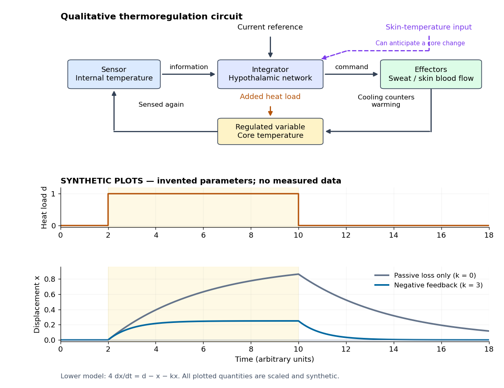

# Homeostasis

↑ **Parent:** [Physiology](physiology-split.md)  
ⓦ [Wiki](https://en.wikipedia.org/wiki/Homeostasis)

[Homeostasis](homeostasis.md) is the maintenance of usable internal conditions despite disturbances. It concerns selected [regulated physiological variables](regulated-physiological-variable.md), rather than keeping every part of an organism unchanged: [core body temperature](core-body-temperature.md) may remain near its usual range while [skin](skin.md) [temperature](temperature-split.md), [sweating](sweating.md) and [blood pressure](blood-pressure.md) change. Regulation makes a relatively dependable environment for [biological cells](biological-cell-split.md) out of a changing external world. [§1.5, opening paragraphs and Negative Feedback: normal ranges and compensatory responses](anatomy-and-physiology-2e-by-j-gordon-betts-and-others/1-5-homeostasis.md)

A useful causal description separates a [physiological sensor](physiological-sensor.md), a [physiological integrator](physiological-integrator.md) and a [physiological effector](physiological-effector.md). The return from the [physiological effector](physiological-effector.md)'s action to the sensed [regulated physiological variable](regulated-physiological-variable.md) closes a [feedback control](closed-loop-control.md) loop. In [negative feedback](negative-feedback.md), that return opposes the disturbance. The [insulin](insulin.md) and [glucagon](glucagon.md) articles already trace the [blood glucose](blood-sugar.md) example; [synaptic integration](synaptic-integration.md) explains how several inputs can jointly influence a [neuron](neuron.md). These are implementations and ingredients, not a requirement that every regulatory loop use one anatomical control center. [§1.5, Negative Feedback, Figure 1.10: sensor, control center and effector](anatomy-and-physiology-2e-by-j-gordon-betts-and-others/1-5-homeostasis.md)

**[Figure 1](#image-homeostasis-sensing-integration-and-action-with-a-synthetic-disturbance-response). Homeostasis: sensing, integration and action, with a synthetic disturbance response**. Original qualitative [thermoregulation](thermoregulation.md) circuit above an explicitly synthetic plot from the [homeostatic temperature model](homeostatic-temperature-model.md). The solid return represents [negative feedback](negative-feedback.md) from [core body temperature](core-body-temperature.md); the dashed [skin](skin.md) input can anticipate a core change. The lower curves use invented [dimensionless variables](dimensionless-variable.md) and arbitrary time units. They are neither experimental measurements nor fitted human responses.

[Homeostasis](homeostasis.md) is useful precisely because internal activity can change: a nearly steady [temperature](temperature-split.md) can conceal a large increase in [heat transfer](heat-transfer.md). Conversely, observing a flat trace alone does not identify a regulatory mechanism. The environment might simply be constant, or the measuring instrument too insensitive; a perturbation and an independent response readout provide stronger evidence. The [skin-temperature perturbation experiment](skin-temperature-perturbation-experiment.md) below makes that distinction tangible.

The historical motivation was the puzzle of stability in changing living material. In his 1932 [The Wisdom of the Body](https://www.panarchy.org/cannon/homeostasis.1932.html), [Walter Bradford Cannon](walter-bradford-cannon.md) emphasized that an organism exchanges material with its surroundings and continually replaces its own structure, yet maintains relatively steady internal conditions. This authored excerpt presents [homeostasis](homeostasis.md) as active compensation for external and internal disturbances, rather than a static body. [Homeostasis excerpt, paragraphs beginning The wonder increases, Resistance to changes and In short; hosting page identifies book and 1932 date](the-wisdom-of-the-body-by-walter-bradford-cannon/homeostasis-excerpt-from-the-wisdom-of-the-body.md)

**Table of contents**

- [Osmoregulation](osmoregulation.md)
  - [Compatible solute](compatible-solute.md)
- [Tissue homeostasis](tissue-homeostasis.md)
- [Regulated physiological variable](regulated-physiological-variable.md)
  - [Blood pressure](blood-pressure.md)
  - [Osmolality](osmolality.md)
- [Physiological sensor](physiological-sensor.md)
- [Physiological integrator](physiological-integrator.md)
  - [Hypothalamus](hypothalamus.md)
- [Physiological effector](physiological-effector.md)
  - [Effector saturation](effector-saturation.md)
- [Physiological set point](physiological-set-point.md)
- [Homeostatic temperature model](homeostatic-temperature-model.md)
- [Thermoregulation](thermoregulation.md)
  - [Thermal conductance of an animal](thermal-conductance-of-an-animal.md)
  - [Thermogenesis](thermogenesis.md)
    - [Non-shivering thermogenesis](non-shivering-thermogenesis.md)
      - [Brown adipose tissue](brown-adipose-tissue.md)
    - [Shivering thermogenesis](shivering-thermogenesis.md)
  - [Heterothermy](heterothermy.md)
  - [Ectothermy](ectothermy.md)
  - [Homeothermy](homeothermy.md)
  - [Core body temperature](core-body-temperature.md)
  - [Skin-temperature perturbation experiment](skin-temperature-perturbation-experiment.md)
  - [Sweating](sweating.md)
    - [Sweat gland](sweat-gland.md)
  - [Shivering](shivering.md)
  - [Vasoconstriction](vasoconstriction.md)
  - [Vasodilation](vasodilation.md)
  - [Fever](fever.md)
  - [Humidity](humidity.md)
    - [Relative humidity](relative-humidity.md)
- [Blood sugar](blood-sugar.md)
- [Synthetic insulin-glucagon response model](synthetic-insulin-glucagon-response-model.md)

## ↑ Ancestors (3)

1. [Physiology](physiology-split.md)
2. [Biology](biology-split.md)
3. [Codex Wiki](split.md)

## ← Incoming links (3)

- [Homeostasis](homeostasis.md)
- [Homeostatic temperature model](homeostatic-temperature-model.md)
- [Insulin](insulin.md)
