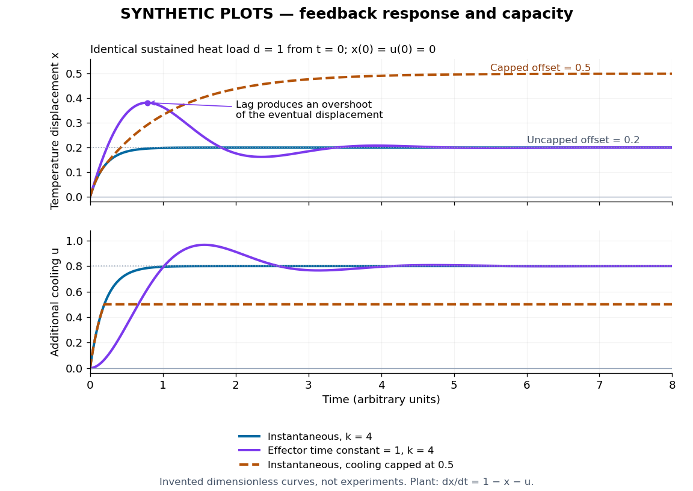

# Homeostatic temperature model

↑ **Parent:** [Homeostasis](homeostasis.md)

Here is an explicitly synthetic [mathematical model](mathematical-model.md) of a warming disturbance and its compensatory cooling. It is a teaching analogy for [thermoregulation](thermoregulation.md), not a measured human heat budget. Write $x=(T-T_r)/\Delta T$, where $T$ is a lumped internal [temperature](temperature-split.md), $T_r$ is a fixed reference and $\Delta T>0$ is a chosen [temperature](temperature-split.md) scale. Let $d$ be an additional heating rate and $u$ an additional cooling rate, both scaled to the same reference rate. All three are [dimensionless variables](dimensionless-variable.md), while $\tau>0$ is a [time constant](time-constant.md) in the chosen time units. The [ordinary differential equation](ordinary-differential-equation.md) is

$$
\tau\dot x=d-x-u,\qquad u=kx,\qquad k\geq0.
$$

The term $-x$ idealizes increased passive [heat transfer](heat-transfer.md) with increased internal [temperature](temperature-split.md), around the baseline. The term $-u$ opposes warming through [proportional control](proportional-control.md) with [feedback gain](feedback-gain.md) $k$. This local signed model does not treat a negative $u$ as negative [sweating](sweating.md): it would represent decreased cooling relative to baseline. Changes of the environment and multiple body compartments are omitted.

For a constant disturbance $d=D$ and [initial condition](initial-condition.md) $x(0)=0$, the [exponential function](exponential-function.md) solution is

$$
x(t)=\frac{D}{1+k}\left(1-e^{-(1+k)t/\tau}\right),\qquad x_*=\frac{D}{1+k},\qquad u_*=\frac{kD}{1+k}.
$$

Substitution checks the [ordinary differential equation](ordinary-differential-equation.md) directly. Increasing $k$ reduces the lasting offset and, in this instantaneous model, shortens the response [time constant](time-constant.md) to $\tau/(1+k)$. It does not make $x_*$ zero for a nonzero disturbance and finite $k$: a persistent cooling command requires a persistent displacement under [proportional control](proportional-control.md). At the [equilibrium point](equilibrium-point-of-a-dynamical-system.md), the extra heating is balanced by passive loss $x_*$ plus active cooling $u_*$. Zero change of [temperature](temperature-split.md) means balanced rates, rather than zero rates, consistent with [conservation of energy](conservation-of-energy.md).

The first diagram uses $D=1$, $\tau=4$, and a pulse from $t=2$ to $t=10$, comparing $k=0$ with $k=3$. The latter approaches $x_*=1/4$ during the pulse, compared with $1$ without active [feedback control](closed-loop-control.md). After the pulse ends, each displacement decays as $x(10)e^{-(1+k)(t-10)/\tau}$. These are computed curves, not physiological measurements. The $k=0$ curve still has passive loss; it is not a claim that an unregulated body warms without limit.

Real [physiological effectors](physiological-effector.md) take time to respond. To isolate that issue, set $\tau=1$ and replace the instantaneous command by another [ordinary differential equation](ordinary-differential-equation.md):

$$
\dot x=1-x-u,\qquad \dot u=4x-u,\qquad x(0)=u(0)=0.
$$

Here the disturbance remains $1$ from $t=0$ onward and the effector [time constant](time-constant.md) is also $1$. The [equilibrium point](equilibrium-point-of-a-dynamical-system.md) is still $(x_*,u_*)=(1/5,4/5)$, but the [characteristic polynomial](characteristic-polynomial.md) is $(\lambda+1)^2+4$. Its [eigenvalues](eigenvalue.md) $-1\pm2i$ give decaying [oscillations](oscillation.md) and [asymptotic stability](asymptotic-stability.md). The exact response is

$$
x(t)=\frac15+e^{-t}\left(-\frac15\cos(2t)+\frac25\sin(2t)\right),\qquad u(t)=\frac45+e^{-t}\left(-\frac45\cos(2t)-\frac25\sin(2t)\right).
$$

In particular, $\dot x=e^{-t}\cos(2t)$, so the first maximum occurs at $t=\pi/4$, with $x=1/5+(2/5)e^{-\pi/4}\simeq0.3824$. The response exceeds its eventual displacement while remaining above its baseline. The return has the same negative sign as before; the extra state changes the timing. A finite effector [time constant](time-constant.md) is distinct from the fixed time lag in the [delayed negative feedback model](delayed-negative-feedback-model.md).

**[Figure 2](#image-synthetic-homeostasis-responses-offset-lag-and-limited-effector-capacity). Synthetic homeostasis responses: offset, lag and limited effector capacity**. Original computed plots from the [homeostatic temperature model](homeostatic-temperature-model.md), all in arbitrary units and explicitly labelled synthetic. Upper panel: displacement under the same sustained disturbance. Lower panel: corresponding cooling command. Instantaneous [proportional control](proportional-control.md), a finite effector [time constant](time-constant.md), and [effector saturation](effector-saturation.md) give different responses despite opposing the same disturbance. No experimental data or clinical limits are shown.

## ↑ Ancestors (4)

1. [Homeostasis](homeostasis.md)
2. [Physiology](physiology-split.md)
3. [Biology](biology-split.md)
4. [Codex Wiki](split.md)

## ← Incoming links (3)

- [Effector saturation](effector-saturation.md)
- [Homeostasis](homeostasis.md)
- [Homeostatic temperature model](homeostatic-temperature-model.md)
