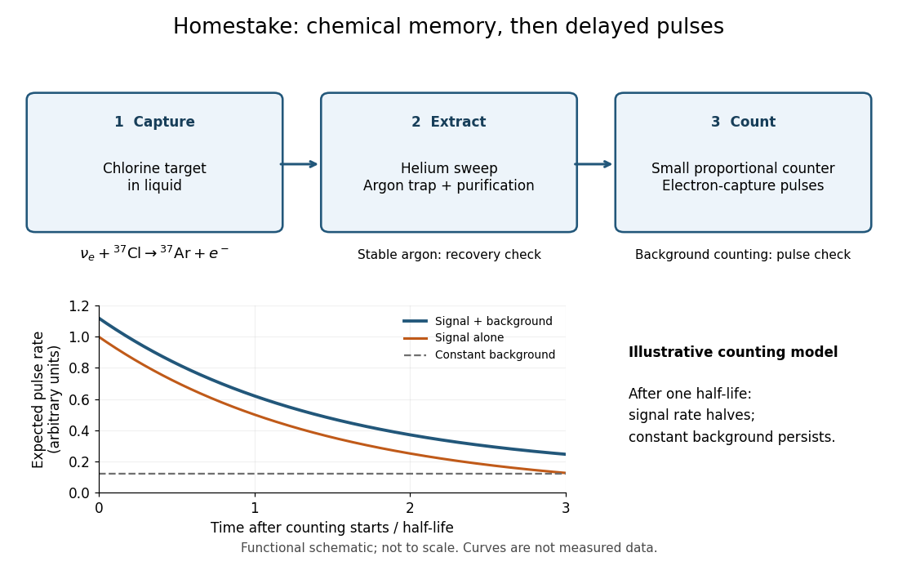

# Homestake experiment

↑ **Parent:** [Solar neutrino detection](solar-neutrino-detection.md)  
ⓦ [Wiki](https://en.wikipedia.org/wiki/Homestake_experiment)

The [Homestake experiment](homestake-experiment.md), led by [Raymond Davis Jr.](raymond-davis-jr.md), used [electron neutrino](electron-neutrino.md) capture on [chlorine](chlorine.md) to produce [argon](argon.md) subject to [radioactive decay](radioactive-decay.md). The 1968 paper reported an upper limit, rather than a resolved positive signal.[Abstract: chlorine reaction and upper-limit result](search-for-neutrinos-from-the-sun-by-raymond-davis-jr-and-others.md)

The underground target contained [tetrachloroethylene](tetrachloroethylene.md). Circulated [helium](helium.md) swept out [argon](argon.md), which was trapped on cooled charcoal, purified, and put into tiny [proportional counters](proportional-counter.md). [Electron capture](electron-capture.md) back to [chlorine](chlorine.md) supplies the delayed readout. Added stable [argon](argon.md) checked extraction recovery; background counting checked spurious pulses. The capture threshold is $0.814\,\mathrm{MeV}$ and the product's [half-life](half-life.md) is about 35 days. The chemical extraction retains neither the original [neutrino](neutrino.md)'s arrival time nor its direction.[pp. 986, 988–991; Figs. 9–14](nobel-lecture-a-half-century-with-solar-neutrinos-by-raymond-davis-jr.md)

**[Figure 2](#image-from-chlorine-capture-to-delayed-radioactive-decay-pulses). From chlorine capture to delayed radioactive-decay pulses**. Functional schematic of the [Homestake experiment](homestake-experiment.md). The plotted curves are an illustrative [radiochemical neutrino counting model](radiochemical-neutrino-counting-model.md), not measured data.

The reaction selects [electron neutrinos](electron-neutrino.md), and its threshold excludes the lowest-energy part of the [solar neutrino](solar-neutrino.md) spectrum. A low count alone cannot distinguish a low source [neutrino flux](neutrino-flux.md), a changed [neutrino flavor](neutrino-flavor.md) mixture, or an underestimated loss in extraction or counting. This is why chemical recovery tests and an independent [water Cherenkov neutrino reconstruction](water-cherenkov-neutrino-reconstruction.md) are scientifically valuable.

**Table of contents**

- [Radiochemical neutrino counting model](radiochemical-neutrino-counting-model.md)

## ↑ Ancestors (9)

1. [Solar neutrino detection](solar-neutrino-detection.md)
2. [Solar neutrino](solar-neutrino.md)
3. [Sun](sun.md)
4. [Star](star.md)
5. [Stellar astrophysics](stellar-astrophysics-split.md)
6. [Astrophysics](astrophysics-split.md)
7. [Branches of physics](branches-of-physics.md)
8. [Physics](physics-split.md)
9. [Codex Wiki](split.md)

## ← Incoming links (6)

- [Homestake experiment](homestake-experiment.md)
- [Kajita-McDonald neutrino flavor-conversion experiments](kajita-mcdonald-neutrino-flavor-conversion-experiments.md)
- [Kamiokande](kamiokande.md)
- [SN 1987A neutrino burst](sn-1987a-neutrino-burst.md)
- [Solar neutrino detection](solar-neutrino-detection.md)
- [Tetrachloroethylene](tetrachloroethylene.md)
