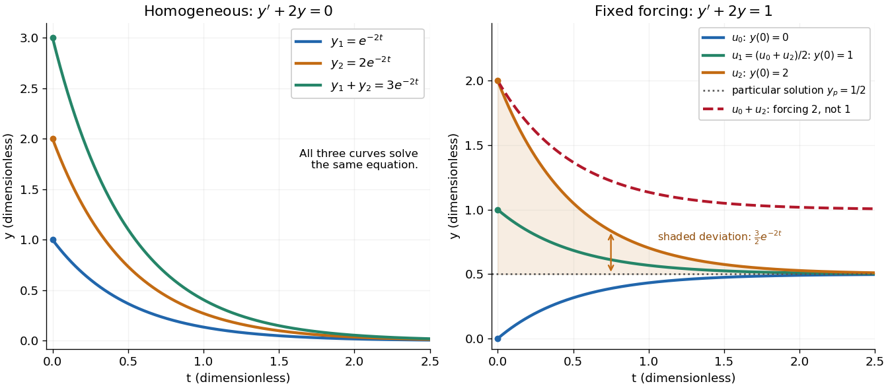

# Homogeneous linear differential equation

↑ **Parent:** [Linear differential equation](linear-differential-equation.md)

A [homogeneous linear differential equation](homogeneous-linear-differential-equation.md) is a [linear differential equation](linear-differential-equation.md) with identically zero [forcing term](forcing-term.md), $L[y]=0$. On a common [interval](interval-mathematics.md), its [solutions of a differential equation](solution-of-a-differential-equation.md) form the [vector space](vector-space-split.md) $\ker L$, the [kernel of a linear map](kernel-of-a-linear-map-split.md). They include the zero [function](function-split.md) and are closed under [addition](addition.md) and [scalar multiplication](scalar-multiplication.md). For any two [solutions of a differential equation](solution-of-a-differential-equation.md) $u,v$ and constant [scalars](scalar.md) $\alpha,\beta$, [linearity](linearity.md) gives $L[\alpha u+\beta v]=\alpha\,0+\beta\,0=0$: this is the [superposition principle](superposition-principle.md). The [scalars](scalar.md) must be constant; variable multipliers introduce extra [derivatives](derivative.md).

For example, $y'+2y=0$ has [general solution](general-solution.md) $y=Ce^{-2t}$, where $C$ is any constant [real number](real-number.md). A short verification uses the [product rule](product-rule.md): $(e^{2t}y)'=e^{2t}(y'+2y)=0$, so $e^{2t}y$ is constant. For $y_1=e^{-2t}$ and $y_2=2e^{-2t}$, the sum is $3e^{-2t}$ and also solves the same [homogeneous linear differential equation](homogeneous-linear-differential-equation.md). At $t=1$, their values are approximately $0.13534$, $0.27067$ and $0.40601$. Every curve is a multiple of one [exponential function](exponential-function.md); the [solution space of a homogeneous linear differential equation](solution-space-of-a-homogeneous-linear-differential-equation.md) has [dimension](dimension-vector-space.md) one. Both $t$ and $y$ in this example and the following diagram are [dimensionless](dimensionless-quantity.md) mathematical variables.

Now keep the same [differential operator](differential-operator.md) $L[y]=y'+2y$ but prescribe the [forcing term](forcing-term.md) $1$. The [inhomogeneous linear differential equation](inhomogeneous-linear-differential-equation.md) $y'+2y=1$ has [particular solution](particular-solution.md) $y_p=1/2$ and [general solution](general-solution.md) $y=1/2+Ce^{-2t}$. The [initial conditions](initial-condition.md) $y(0)=0,1,2$ select, respectively,

$$
u_0(t)=\frac12(1-e^{-2t}),\qquad u_1(t)=\frac12+\frac12e^{-2t},\qquad u_2(t)=\frac12+\frac32e^{-2t}.
$$

At $t=1$, their values are approximately $0.43233$, $0.56767$ and $0.70300$. The midpoint $\frac12(u_0+u_2)=u_1$ solves the same [inhomogeneous linear differential equation](inhomogeneous-linear-differential-equation.md), because $L[\frac12(u_0+u_2)]=\frac12(1+1)=1$. The sum $s=u_0+u_2=1+e^{-2t}$ instead satisfies $s'+2s=2$, so it fails the equation with [forcing term](forcing-term.md) $1$. More generally, a [linear combination](linear-combination.md) of [solutions of a differential equation](solution-of-a-differential-equation.md) for the same fixed nonzero [forcing term](forcing-term.md) retains that [forcing term](forcing-term.md) precisely when its [scalar](scalar.md) weights add to one. This is the [affine space](affine-space.md) structure, rather than unrestricted [superposition](superposition-principle.md) within that fixed family.

**[Figure 16](#image-homogeneous-solutions-obey-superposition-while-a-fixed-forcing-term-gives-a-particular-solution-plus-homogeneous-solutions). Homogeneous solutions obey superposition, while a fixed forcing term gives a particular solution plus homogeneous solutions**.

On the left, all three curves solve the same [homogeneous linear differential equation](homogeneous-linear-differential-equation.md). On the right, $u_0,u_1,u_2$ share the [particular solution](particular-solution.md) $1/2$, and the shaded difference $u_2-1/2$ is the [homogeneous solution](homogeneous-solution.md) $\frac32e^{-2t}$. The dashed sum has twice the [forcing term](forcing-term.md), even though its starting value coincides with that of $u_2$. Adding the two [initial conditions](initial-condition.md) also adds their inputs; taking their midpoint averages both. This distinction makes the [superposition principle](superposition-principle.md) useful for assembling responses to different inputs without mistaking that assembly for a [solution of a differential equation](solution-of-a-differential-equation.md) with the original input. See [MIT's superposition notes, including the particular solution one half](https://ocw.mit.edu/courses/18-03sc-differential-equations-fall-2011/ac7afe1bf9429f8f9ee84592b79aa692_MIT18_03SCF11_s4_5text.pdf).

**Table of contents**

- [Solution space of a homogeneous linear differential equation](solution-space-of-a-homogeneous-linear-differential-equation.md)

## ↑ Ancestors (7)

1. [Linear differential equation](linear-differential-equation.md)
2. [Ordinary differential equation](ordinary-differential-equation.md)
3. [Differential equation](differential-equation-split.md)
4. [Analysis](analysis-split.md)
5. [Area of mathematics](area-of-mathematics.md)
6. [Mathematics](mathematics-split.md)
7. [Codex Wiki](split.md)

## ← Incoming links (25)

- [Abel's identity](abel-s-identity.md)
- [Forcing term](forcing-term.md)
- [Homogeneous first-order differential equation](homogeneous-first-order-differential-equation.md)
- [Homogeneous linear differential equation](homogeneous-linear-differential-equation.md)
- [Homogeneous solution](homogeneous-solution.md)
- [Inhomogeneous linear differential equation](inhomogeneous-linear-differential-equation.md)
- [Integrating factor](integrating-factor.md)
- [Linear differential equation](linear-differential-equation.md)
- [Nonlinear ordinary differential equation](nonlinear-ordinary-differential-equation.md)
- [Solution](past-exam-of-the-mathematics-course-of-the-university-of-cambridge/2002/ia/paper-2/1d/solution.md)
- [Solution](past-exam-of-the-mathematics-course-of-the-university-of-cambridge/2002/ia/paper-2/7d/solution.md)
- [Solution](past-exam-of-the-mathematics-course-of-the-university-of-cambridge/2004/ia/paper-2/2b/solution.md)
- [Solution](past-exam-of-the-mathematics-course-of-the-university-of-cambridge/2011/ia/paper-2/7a/a/solution.md)
- [Solution](past-exam-of-the-mathematics-course-of-the-university-of-cambridge/2011/ia/paper-2/7a/c/solution.md)
- [Solution](past-exam-of-the-mathematics-course-of-the-year-1-of-the-natural-sciences-course-of-the-university-of-cambridge/2018/paper-2/15/a/i/solution.md)
- [Solution](past-exam-of-the-mathematics-course-of-the-year-1-of-the-natural-sciences-course-of-the-university-of-cambridge/2019/paper-2/15/a/i/solution.md)
- [Solution](past-exam-of-the-mathematics-course-of-the-year-1-of-the-natural-sciences-course-of-the-university-of-cambridge/2020/paper-1/13/b/i/solution.md)
- [Solution](past-exam-of-the-mathematics-course-of-the-year-1-of-the-natural-sciences-course-of-the-university-of-cambridge/2021/paper-1/13/a/i/solution.md)
- [Solution](past-exam-of-the-mathematics-course-of-the-year-1-of-the-natural-sciences-course-of-the-university-of-cambridge/2022/paper-2/15/b/solution.md)
- [Solution](past-exam-of-the-mathematics-course-of-the-year-1-of-the-natural-sciences-course-of-the-university-of-cambridge/2022/paper-2/3/solution.md)
- [Solution](past-exam-of-the-mathematics-course-of-the-year-1-of-the-natural-sciences-course-of-the-university-of-cambridge/2024/paper-2/15/b/solution.md)
- [Solution](past-exam-of-the-mathematics-course-of-the-year-1-of-the-natural-sciences-course-of-the-university-of-cambridge/2025/paper-2/13/a/ii/solution.md)
- [Solution](past-exam-of-the-mathematics-course-of-the-year-1-of-the-natural-sciences-course-of-the-university-of-cambridge/2025/paper-2/6/solution.md)
- [Solution](past-exam-of-the-mathematics-course-of-the-year-2-of-the-natural-sciences-course-of-the-university-of-cambridge/2013/paper-1/3/i/solution.md)
- [Wronskian](wronskian.md)
