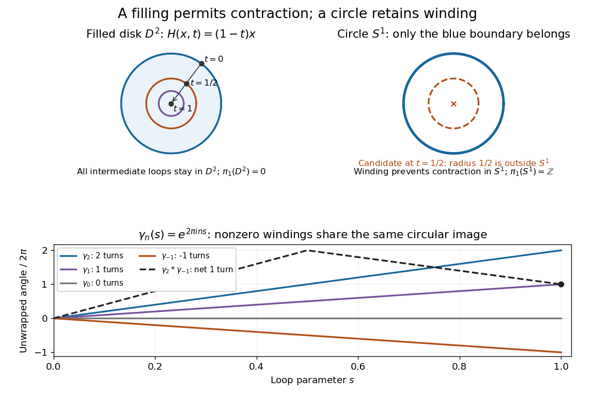

# Homotopy

↑ **Parent:** [Algebraic topology](algebraic-topology.md)  
ⓦ [Wiki](https://en.wikipedia.org/wiki/Homotopy)

A [homotopy](homotopy.md) between [continuous maps](topology.md#continuous-map) $f,g:X\to Y$ is a [continuous map](topology.md#continuous-map) $H:X\times[0,1]\to Y$ satisfying $H(x,0)=f(x)$ and $H(x,1)=g(x)$. Think of $t$ as time: continuity is required jointly in position and time. The target $Y$ specifies where every intermediate point is allowed to go. See [Hatcher, Algebraic Topology, Chapter 0, pp. 3–4](https://pi.math.cornell.edu/~hatcher/AT/ATch0.pdf#page=3).

For the filled [disk](topology.md#disk-mathematics) $D^2=\{x\in\mathbb R^2:\lVert x\rVert\leq1\}$, the formula

$$
H(x,t)=(1-t)x
$$

is a [contraction of a topological space](#contraction-of-a-topological-space): it starts at the [identity map](function.md#identity-function) and ends at the constant map to zero. The [Euclidean norm](normed-vector-space.md#euclidean-norm) obeys $\lVert H(x,t)\rVert=(1-t)\lVert x\rVert\leq1$, so the formula never leaves the [disk](topology.md#disk-mathematics). For $x=(3/5,4/5)$, the midpoint of the deformation is $(3/10,2/5)$, whose [Euclidean norm](normed-vector-space.md#euclidean-norm) is $1/2$.

On the [circle](topology.md#circle) $S^1=\{x:\lVert x\rVert=1\}$, the same formula fails: at $t=1/2$ every image has [Euclidean norm](normed-vector-space.md#euclidean-norm) $1/2$, so lies outside $S^1$. This checks one failed candidate; the nonzero [winding number](complex-analysis.md#winding-number) of a once-around [loop](algebraic-topology.md#loop-topology) proves that no contraction within the [circle](topology.md#circle) exists. The distinction is between allowing the filling and requiring the deformation to stay on its boundary.

**[Figure 1](#image-contraction-inside-a-filled-disk-obstruction-on-its-boundary-circle-and-the-winding-numbers-of-circle-loops). Contraction inside a filled disk, obstruction on its boundary circle, and the winding numbers of circle loops**.

**Table of contents**

- [Homotopy category](#homotopy-category)
  - [Homotopy pushout](#homotopy-pushout)
  - [H-space](#h-space)
    - [H-group](#h-group)
  - [Topological half-exact functor](#topological-half-exact-functor)
    - [Brown's representability theorem](#brown-s-representability-theorem)
- [Homotopy inverse limit of a tower](#homotopy-inverse-limit-of-a-tower)
- [Maps to a sphere above the dimension of a compact smooth manifold are null-homotopic](#maps-to-a-sphere-above-the-dimension-of-a-compact-smooth-manifold-are-null-homotopic)
- [Rational homotopy theory](#rational-homotopy-theory)
  - [Nilpotent space](#nilpotent-space)
  - [Rational space](#rational-space)
    - [Rationalization of a topological space](#rationalization-of-a-topological-space)
      - [Rational homotopy equivalence](#rational-homotopy-equivalence)
        - [Rational homotopy type](#rational-homotopy-type)
  - [Sullivan minimal model](#sullivan-minimal-model)
    - [Relative Sullivan algebra](#relative-sullivan-algebra)
    - [Sullivan fibre-model theorem](#sullivan-fibre-model-theorem)
    - [Sullivan minimal-model classification](#sullivan-minimal-model-classification)
    - [Rational polynomial differential forms](#rational-polynomial-differential-forms)
    - [Minimal model of the fibre of the projective-space collapse map](#minimal-model-of-the-fibre-of-the-projective-space-collapse-map)
    - [Rational model of a collapsed complex projective subspace](#rational-model-of-a-collapsed-complex-projective-subspace)
    - [Minimal model of a wedge of simply connected spheres](#minimal-model-of-a-wedge-of-simply-connected-spheres)
    - [Formal space](#formal-space)
    - [Sullivan model of the connected sum of two complex projective planes](#sullivan-model-of-the-connected-sum-of-two-complex-projective-planes)
- [Reduced suspension](#reduced-suspension)
  - [Suspension-loop adjunction](#suspension-loop-adjunction)
- [Homotopy class](#homotopy-class)
- [Free homotopy](#free-homotopy)
- [Null-homotopic map](#null-homotopic-map)
  - [Extension-null-homotopy criterion for a sphere](#extension-null-homotopy-criterion-for-a-sphere)
- [Contractible space](#contractible-space)
  - [Contraction of a topological space](#contraction-of-a-topological-space)
- [Homotopy equivalence](#homotopy-equivalence)
  - [Homology obstruction to carrying surface curves onto one another](#homology-obstruction-to-carrying-surface-curves-onto-one-another)
  - [Separate homotopy inverses combine into a homotopy equivalence](#separate-homotopy-inverses-combine-into-a-homotopy-equivalence)
  - [Homotopy type](#homotopy-type)
  - [Homotopy inverse](#homotopy-inverse)
- [Retract](#retract)
  - [Deformation retraction](#deformation-retraction)
  - [Retract of a contractible space](#retract-of-a-contractible-space)
- [Homotopy extension property](#homotopy-extension-property)
  - [Cofibration](#cofibration)
  - [Collapsing a contractible cofibration](#collapsing-a-contractible-cofibration)
- [Homotopy group](#homotopy-group)
  - [Whitehead product](#whitehead-product)
    - [Whitehead square](#whitehead-square)
  - [Postnikov tower](#postnikov-tower)
    - [Principal Eilenberg–MacLane fibration](#principal-eilenberg-maclane-fibration)
      - [Postnikov invariant](#postnikov-invariant)
  - [First homotopy group above the dimension of a sphere](#first-homotopy-group-above-the-dimension-of-a-sphere)
  - [Serre finiteness theorem for homotopy groups](#serre-finiteness-theorem-for-homotopy-groups)
  - [Relative homotopy group](#relative-homotopy-group)
    - [Homotopy excision theorem](#homotopy-excision-theorem)
    - [Long exact sequence of relative homotopy groups](#long-exact-sequence-of-relative-homotopy-groups)
  - [Eilenberg–MacLane space](#eilenberg-maclane-space)
    - [Low-degree integral homology of a mod-two Eilenberg–MacLane space](#low-degree-integral-homology-of-a-mod-two-eilenberg-maclane-space)
    - [Serre polynomial generators for mod-two Eilenberg–MacLane cohomology](#serre-polynomial-generators-for-mod-two-eilenberg-maclane-cohomology)
      - [Low-degree mod-two cohomology of an Eilenberg–MacLane space](#low-degree-mod-two-cohomology-of-an-eilenberg-maclane-space)
    - [Rational cohomology of an integral Eilenberg–MacLane space](#rational-cohomology-of-an-integral-eilenberg-maclane-space)
    - [Representability of cohomology by Eilenberg–MacLane spaces](#representability-of-cohomology-by-eilenberg-maclane-spaces)
    - [Universal cohomology class of an Eilenberg–MacLane space](#universal-cohomology-class-of-an-eilenberg-maclane-space)
    - [Aspherical space](#aspherical-space)
  - [Homotopy groups as modules over the fundamental group](#homotopy-groups-as-modules-over-the-fundamental-group)
  - [Freudenthal suspension theorem](#freudenthal-suspension-theorem)
    - [Freudenthal suspension from two cones](#freudenthal-suspension-from-two-cones)
    - [Homology comparison proof of Freudenthal suspension](#homology-comparison-proof-of-freudenthal-suspension)
  - [Hopf invariant](#hopf-invariant)
    - [Cohomology ring of a Hopf attachment with a sphere summand](#cohomology-ring-of-a-hopf-attachment-with-a-sphere-summand)
      - [Third homotopy group of a Hopf attachment with a sphere summand](#third-homotopy-group-of-a-hopf-attachment-with-a-sphere-summand)
    - [Precomposition scales the Hopf invariant by degree](#precomposition-scales-the-hopf-invariant-by-degree)
  - [Weak homotopy equivalence](#weak-homotopy-equivalence)
  - [n-connected map](#n-connected-map)
  - [Loop-space shift of homotopy groups](#loop-space-shift-of-homotopy-groups)
  - [Rational homotopy group](#rational-homotopy-group)
    - [Rational homotopy groups of the connected sum of two complex projective planes](#rational-homotopy-groups-of-the-connected-sum-of-two-complex-projective-planes)
    - [Rational homotopy groups of a sphere](#rational-homotopy-groups-of-a-sphere)
  - [Hurewicz theorem](#hurewicz-theorem)
    - [Hurewicz homomorphism](#hurewicz-homomorphism)
      - [Surjective rational Hurewicz homomorphism gives a wedge of spheres](#surjective-rational-hurewicz-homomorphism-gives-a-wedge-of-spheres)
    - [Relative Hurewicz theorem](#relative-hurewicz-theorem)
    - [Hurewicz theorem modulo a Serre class](#hurewicz-theorem-modulo-a-serre-class)
  - [Whitehead theorem](#whitehead-theorem)
    - [Rational Whitehead theorem](#rational-whitehead-theorem)
    - [Homological Whitehead theorem](#homological-whitehead-theorem)
- [Homotopy fiber](#homotopy-fiber)
  - [Principal fibration](#principal-fibration)
  - [Path-space fibration](#path-space-fibration)
- [Fibration](#fibration)
- [Homotopy fiber sequence](#homotopy-fiber-sequence)
- [Homotopy pullback](#homotopy-pullback)
- [Loop space](#loop-space)
  - [Samelson product](#samelson-product)
  - [Based path space and the path-loop fibration](#based-path-space-and-the-path-loop-fibration)
  - [Integral homology of the loop space of a sphere](#integral-homology-of-the-loop-space-of-a-sphere)
  - [Integral cohomology of an odd-sphere loop space](#integral-cohomology-of-an-odd-sphere-loop-space)
  - [Pontryagin ring](#pontryagin-ring)
    - [Milnor–Moore theorem](#milnor-moore-theorem)
    - [Pontryagin ring of an odd-sphere loop space](#pontryagin-ring-of-an-odd-sphere-loop-space)
    - [Pontryagin product on loop-space homology](#pontryagin-product-on-loop-space-homology)
  - [James reduced product](#james-reduced-product)
    - [Bott–Samelson theorem](#bott-samelson-theorem)
  - [Loop-space homology](#loop-space-homology)
  - [Path-loop fibration](#path-loop-fibration)
    - [Cohomology suspension](#cohomology-suspension)
- [Simplicial homotopy theory](#simplicial-homotopy-theory)
  - [Simplex category](#simplex-category)
  - [Simplicial set](#simplicial-set)
    - [Geometric realization of a simplicial set](#geometric-realization-of-a-simplicial-set)
    - [Singular simplicial set](#singular-simplicial-set)
    - [Standard simplex](#standard-simplex)
      - [Simplicial horn](#simplicial-horn)
        - [Inner horn](#inner-horn)
    - [Quasicategory](#quasicategory)
    - [Kan complex](#kan-complex)
    - [Nerve (category theory)](#nerve-category-theory)
    - [Simplicial mapping space](#simplicial-mapping-space)
  - [Simplicial abelian group](#simplicial-abelian-group)
    - [Normalized chain complex of a simplicial abelian group](#normalized-chain-complex-of-a-simplicial-abelian-group)
      - [Dold–Kan correspondence](#dold-kan-correspondence)
- [Serre spectral sequence](#serre-spectral-sequence)
  - [Cohomological Serre spectral sequence](#cohomological-serre-spectral-sequence)
    - [A sphere cannot fibre over a lower-dimensional odd sphere](#a-sphere-cannot-fibre-over-a-lower-dimensional-odd-sphere)
  - [Serre fibration](#serre-fibration)
    - [Relative homotopy of a Serre fibration](#relative-homotopy-of-a-serre-fibration)
    - [Relative homology of a fibration over a sphere](#relative-homology-of-a-fibration-over-a-sphere)
    - [Splitting of a simply connected Eilenberg–MacLane fibration](#splitting-of-a-simply-connected-eilenberg-maclane-fibration)
    - [Mapping-path fibration replacement](#mapping-path-fibration-replacement)
    - [Homotopy lifting property](#homotopy-lifting-property)
    - [Long exact sequence of homotopy groups of a fibration](#long-exact-sequence-of-homotopy-groups-of-a-fibration)
  - [Wang homomorphism](#wang-homomorphism)
    - [Wang sequence over a sphere](#wang-sequence-over-a-sphere)
  - [Transgression](#transgression)
    - [Transgressive pair](#transgressive-pair)
      - [Kudo transgression theorem](#kudo-transgression-theorem)

## Homotopy category

↑ **Parent:** [Homotopy](homotopy.md)  
ⓦ [Wiki](https://en.wikipedia.org/wiki/Homotopy_category)

The homotopy category of based CW complexes has spaces as objects and based homotopy classes as morphisms. Composition is well-defined because composition with continuous maps preserves homotopies. A based homotopy equivalence becomes an isomorphism. Rational localization instead inverts rational homotopy equivalences, producing a category represented by rational spaces. More general model categories have analogous homotopy categories obtained by inverting their weak equivalences.

### Homotopy pushout

↑ **Parent:** [Homotopy category](#homotopy-category)

For maps $A\to X$ and $A\to Y$, the double [mapping cylinder](algebraic-topology.md#mapping-cylinder) $X\sqcup(A\times I)\sqcup Y$, with each endpoint attached by its given map, models the homotopy pushout. A map out of this model is a pair of maps on $X$ and $Y$ together with a [homotopy](homotopy.md) between their restrictions to $A$. This is why compatible [homotopy classes](#homotopy-class) extend over a homotopy pushout. For a [CW pair](algebraic-topology.md#cw-pair), the inclusion is a [cofibration](#cofibration) and the ordinary pushout gives the same homotopy type.

### H-space

↑ **Parent:** [Homotopy category](#homotopy-category)

A based [topological space](topology.md#topological-space) with a [continuous map](topology.md#continuous-map) $m$ whose left and right restrictions at the basepoint are homotopic to the identity. Associativity and inverses up to [homotopy](homotopy.md) are additional conditions, not part of the bare definition.

#### H-group

↑ **Parent:** [H-space](#h-space)

An [H-space](#h-space) whose multiplication is homotopy associative and admits a homotopy inverse. These operations give $[X,Y]_*$ a [group](group.md) structure for every based [CW complex](algebraic-topology.md#cw-complex) $X$. A [loop space](#loop-space) is the basic example: concatenate paths, use reversal for inversion, and use reparametrization for homotopy associativity. A bare [H-space](#h-space) should not automatically be treated as a group object.

### Topological half-exact functor

↑ **Parent:** [Homotopy category](#homotopy-category)

For a contravariant pointed [functor](functor.md) on based CW [homotopy](homotopy.md) types, half-exactness on a [cofibration](#cofibration) means that $F(X/A)\to F(X)\to F(A)$ is exact at $F(X)$: the image is the inverse image of the distinguished point. This does not demand injectivity or surjectivity at the ends. Set-valued exactness and group-valued exactness must be distinguished.

<h4 id="brown-s-representability-theorem">Brown's representability theorem</h4>

↑ **Parent:** [Topological half-exact functor](#topological-half-exact-functor)

A reduced contravariant [homotopy](homotopy.md) [functor](functor.md) on based [CW complexes](algebraic-topology.md#cw-complex) satisfying the wedge-to-product axiom and the Mayer-Vietoris weak-pullback gluing axiom is represented by $[X,Y]_*$ for a [CW complex](algebraic-topology.md#cw-complex) $Y$. Half-exactness alone is not the full hypothesis. A reduced [generalized cohomology theory](cohomology.md#generalized-cohomology-theory) supplies these axioms; suspension compatibility assembles its representing spaces into an [Omega-spectrum](algebraic-topology.md#omega-spectrum).

## Homotopy inverse limit of a tower

↑ **Parent:** [Homotopy](homotopy.md)

For a sequence of maps $X_n\to X_{n-1}$, its [homotopy inverse limit](#homotopy-inverse-limit-of-a-tower) records points $x_n$ and paths from the image of $x_n$ to $x_{n-1}$, with the usual homotopy-coherent compatibility. A fibrant replacement tower computes it by an ordinary inverse limit. For a tower whose [homotopy groups](#homotopy-group) are eventually constant in each degree, the limit has those stable groups: the Milnor inverse-limit exact sequence has zero derived-limit term. In particular $X\to\operatorname{holim}P_nX$ is a weak equivalence for the [Postnikov tower](#postnikov-tower) of a connected [CW complex](algebraic-topology.md#cw-complex).

## Maps to a sphere above the dimension of a compact smooth manifold are null-homotopic

↑ **Parent:** [Homotopy](homotopy.md)

Approximate a continuous sphere-valued map by smooth real coordinate functions, then normalize. A sufficiently close approximation is homotopic to the original map by normalized straight interpolation. [Sard theorem](differential-geometry.md#sard-s-theorem) implies the smooth map misses a point when its source dimension is smaller than the sphere dimension. The punctured sphere is contractible, so the map is null-homotopic, even if the source is disconnected.

// Target: geometry-and-topology.bigb

## Rational homotopy theory

↑ **Parent:** [Homotopy](homotopy.md)

Study [homotopy](homotopy.md) after killing torsion, especially for [simply connected](algebraic-topology.md#simply-connected-space) spaces of finite type. The [rational Whitehead theorem](#rational-whitehead-theorem) detects rational [homotopy](homotopy.md) equivalences by rational [homology](homology.md), while [Sullivan minimal models](#sullivan-minimal-model) encode rational [homotopy](homotopy.md) generators and cohomological relations.

### Nilpotent space

↑ **Parent:** [Rational homotopy theory](#rational-homotopy-theory)

A connected space is nilpotent when its fundamental group is nilpotent and its action on each higher homotopy group is nilpotent: the module has a finite filtration whose successive quotients have trivial group action. Simply connected spaces satisfy these conditions automatically. They are the natural setting for localization and rationalization, since fibrewise coefficient localization is compatible with the successive untwisted stages of such a filtration.

### Rational space

↑ **Parent:** [Rational homotopy theory](#rational-homotopy-theory)

In the [simply connected](algebraic-topology.md#simply-connected-space) [homotopy category](#homotopy-category), a [rational space](#rational-space) is a [simply connected](algebraic-topology.md#simply-connected-space) [CW complex](algebraic-topology.md#cw-complex) whose positive [homotopy groups](#homotopy-group) are [vector spaces](vector-space.md) over $\mathbb Q$. Multiplication by every nonzero integer on these groups is invertible. More generally one uses nilpotent spaces with localized [fundamental group](algebraic-topology.md#fundamental-group) and higher [homotopy groups](#homotopy-group); the [simply connected](algebraic-topology.md#simply-connected-space) version avoids local-coefficient twisting.

#### Rationalization of a topological space

↑ **Parent:** [Rational space](#rational-space)

For [simply connected](algebraic-topology.md#simply-connected-space) $X$, [rationalization of a topological space](#rationalization-of-a-topological-space) is a map $r:X\to X_{\mathbb Q}$ to a [rational space](#rational-space) inducing $\pi_n(X_{\mathbb Q})=\pi_n(X)\otimes\mathbb Q$. It is also a [rational homology](homology.md#rational-homology) equivalence. Its universal property is the bijection $r^*:[X_{\mathbb Q},Z]\to[X,Z]$ for every [rational space](#rational-space) $Z$. A [Postnikov tower](#postnikov-tower) constructs it by replacing each fibre group with its rational [tensor product](multilinear-algebra.md#tensor-product) and transporting the [Postnikov invariant](#postnikov-invariant) through the resulting [cohomology](cohomology.md) isomorphism, then taking the [homotopy inverse limit](#homotopy-inverse-limit-of-a-tower).

##### Rational homotopy equivalence

↑ **Parent:** [Rationalization of a topological space](#rationalization-of-a-topological-space)

A map between [simply connected](algebraic-topology.md#simply-connected-space) spaces is a [rational homotopy equivalence](#rational-homotopy-equivalence) when it induces isomorphisms $\pi_n(X)\otimes\mathbb Q\to\pi_n(Y)\otimes\mathbb Q$ in every degree. Equivalently it induces an equivalence of their rationalizations, or a [rational homology](homology.md#rational-homology) isomorphism by the [rational Whitehead theorem](#rational-whitehead-theorem). Spaces have the same [rational homotopy type](#rational-homotopy-type) when they are connected by a zigzag of such maps. This is distinct from [rational homotopy equivalence](#rational-homotopy-equivalence) of algebraic cycles.

###### Rational homotopy type

↑ **Parent:** [Rational homotopy equivalence](#rational-homotopy-equivalence)

The [rational homotopy type](#rational-homotopy-type) of a [simply connected](algebraic-topology.md#simply-connected-space) space is its equivalence class under zigzags of [rational homotopy equivalences](#rational-homotopy-equivalence), or equivalently the [homotopy](homotopy.md) type of its [rationalization of a topological space](#rationalization-of-a-topological-space). For the usual finite-type spaces, it is encoded contravariantly by the isomorphism class of the [Sullivan minimal model](#sullivan-minimal-model). Isomorphic [cohomology](cohomology.md) rings determine this type only when additional information, such as [formality of a topological space](#formal-space), makes the cochain algebra equivalent to the [cohomology](cohomology.md) algebra.

### Sullivan minimal model

↑ **Parent:** [Rational homotopy theory](#rational-homotopy-theory)

A free graded-commutative rational [differential graded algebra](commutative-algebra.md#differential-graded-algebra) with decomposable differentials and a [quasi-isomorphism](homology.md#quasi-isomorphism) to the rational polynomial forms of a space. For [simply connected](algebraic-topology.md#simply-connected-space) finite-type spaces, $V^i$ is dual to $\pi_i(X)\otimes\mathbb Q$. A proposed finite model must have its [cohomology](cohomology.md) and representing [quasi-isomorphism](homology.md#quasi-isomorphism) checked; matching a list of relations alone is insufficient.

#### Relative Sullivan algebra

↑ **Parent:** [Sullivan minimal model](#sullivan-minimal-model)

A relative Sullivan algebra is an inclusion $(A,d)\to(A\otimes\Lambda W,D)$ with a well-ordered homogeneous basis of $W$ such that the differential of a generator lies in the algebra on $A$ and earlier generators. It need not be minimal: a differential can have linear terms from earlier generators. Such extensions supply cofibrant replacements for commutative differential graded algebras. A relative acyclic extension of a sphere model represents its path-space fibration and computes a homotopy-fibre model after base change.

#### Sullivan fibre-model theorem

↑ **Parent:** [Sullivan minimal model](#sullivan-minimal-model)

For a map $f:E\to B$ with [simply connected](algebraic-topology.md#simply-connected-space) base and the usual finite-type hypotheses, choose a relative Sullivan algebra $M(B)\to M(B)\otimes\Lambda W$ modelling the path-space fibration, with acyclic total algebra. Tensor it over $M(B)$ with a model of $E$ via $f^*$. The resulting algebra models the [homotopy fibre](#homotopy-fiber). Relative Sullivan extensions are cofibrant replacements, so this [tensor product](multilinear-algebra.md#tensor-product) computes the derived algebraic pushout, contravariantly corresponding to the topological [homotopy pullback](#homotopy-pullback). Linear differential pairs must be cancelled before reading [rational homotopy groups](#rational-homotopy-group) from generators.

#### Sullivan minimal-model classification

↑ **Parent:** [Sullivan minimal model](#sullivan-minimal-model)

For [simply connected](algebraic-topology.md#simply-connected-space) [rational spaces](#rational-space) of finite type, isomorphic minimal Sullivan models are equivalent to the same [rational homotopy type](#rational-homotopy-type). A [quasi-isomorphism](homology.md#quasi-isomorphism) between [minimal models](#sullivan-minimal-model) is an isomorphism, so a zigzag of cochain [quasi-isomorphisms](homology.md#quasi-isomorphism) produces the same [minimal model](#sullivan-minimal-model). Existence and uniqueness come from adjoining closed generators to represent missing [cohomology](cohomology.md) and generators with prescribed decomposable differential to kill kernel classes, degree by degree.

#### Rational polynomial differential forms

↑ **Parent:** [Sullivan minimal model](#sullivan-minimal-model)

For the standard $n$-simplex use $\Omega_n=\mathbb Q[t_0,\ldots,t_n,dt_0,\ldots,dt_n]/(\sum t_i-1,\sum dt_i)$, with $|t_i|=0$, $|dt_i|=1$, and $d(t_i)=dt_i$. Compatible families of these forms on the simplices of a simplicial model of $X$ form the commutative [differential graded algebra](commutative-algebra.md#differential-graded-algebra) $A_{\mathrm{PL}}(X)$. Its [cohomology](cohomology.md) is $H^*(X;\mathbb Q)$: polynomial contraction proves the simplex Poincaré lemma, and extension across faces gives the simplicial de Rham comparison. The contravariant functor takes simplicial pushouts to pullbacks of algebras.

#### Minimal model of the fibre of the projective-space collapse map

↑ **Parent:** [Sullivan minimal model](#sullivan-minimal-model)

For a degree-one map $f:\mathbb{CP}^n\to S^{2n}$ with $n\ge2$, a [minimal model](#sullivan-minimal-model) of its [homotopy fibre](#homotopy-fiber) is $(\Lambda(x_2,a_{2n-1},z_{2n+1},b_{4n-2}),d)$ with $dx=dz=0$, $da=x^n$, $db=x^{n-1}z$. Adjoin suspended sphere generators to the projective-space model to model the path pullback, then put $z=y-xa$; the differential becomes the displayed decomposable one. The [rational homotopy groups](#rational-homotopy-group) are one-dimensional in those four generator degrees and zero otherwise. At $n=1$ the map is a [rational homotopy equivalence](#rational-homotopy-equivalence) and the minimal fibre model is $\mathbb Q$.

#### Rational model of a collapsed complex projective subspace

↑ **Parent:** [Sullivan minimal model](#sullivan-minimal-model)

The quotient $\mathbb{CP}^{5}/\mathbb{CP}^{2}$ is five-connected and has [cohomology](cohomology.md) only in degrees $0,6,8,10$, with positive products zero. Its [minimal model](#sullivan-minimal-model) therefore starts with closed $a_6,b_8,c_{10}$; no decomposable differential can occur below degree twelve. Sending these three generators to the [cohomology](cohomology.md) [basis](vector-space.md#basis) and all later generators to zero is a [chain map](homology.md#chain-map) and a [quasi-isomorphism](homology.md#quasi-isomorphism). Thus its full [minimal model](#sullivan-minimal-model) is the same as that of $S^6\vee S^8\vee S^{10}$. It starts with generators $u_{11},v_{13},w_{15},t_{15}$ satisfying $du=a^2,dv=ab,dw=ac,dt=b^2$, followed by generators killing remaining products and syzygies.

#### Minimal model of a wedge of simply connected spheres

↑ **Parent:** [Sullivan minimal model](#sullivan-minimal-model)

For a finite [wedge sum](topology.md#wedge-sum) of spheres of dimensions $n_i\ge2$, let $L=\mathbb L(e_i)$ with $|e_i|=n_i-1$ and zero differential. Its [Chevalley–Eilenberg cochains of a graded Lie algebra](lie-algebra.md#chevalley-eilenberg-cochains-of-a-graded-lie-algebra) are a minimal commutative [differential graded algebra](commutative-algebra.md#differential-graded-algebra): one generator dual to each Lie [basis](vector-space.md#basis) word has degree one more than that word, and its differential is dual to the Lie bracket. Its [cohomology](cohomology.md) is $\mathbb Q\oplus\bigoplus_i\mathbb Q a_{n_i}$ with all positive products zero. One way to compute this is $U(L)=T(e_i)$; the augmentation module has a length-one free resolution, so the corresponding Ext has only the unit and the dual generating classes.

#### Formal space

↑ **Parent:** [Sullivan minimal model](#sullivan-minimal-model)

A space is formal over $\mathbb Q$ if its rational cochain commutative [differential graded algebra](commutative-algebra.md#differential-graded-algebra) is joined to $(H^*(X;\mathbb Q),0)$ by [quasi-isomorphisms](homology.md#quasi-isomorphism). Equivalently in the usual [simply connected](algebraic-topology.md#simply-connected-space) Sullivan-model setting, its [minimal model](#sullivan-minimal-model) has a [quasi-isomorphism](homology.md#quasi-isomorphism) to its [cohomology](cohomology.md) algebra with zero differential. This says its [rational homotopy type](#rational-homotopy-type) can be recovered from the [cohomology](cohomology.md) algebra; zero [cup products](cohomology.md#cup-product) alone do not imply [formality of a topological space](#formal-space) without an additional argument.

#### Sullivan model of the connected sum of two complex projective planes

↑ **Parent:** [Sullivan minimal model](#sullivan-minimal-model)

The two quadratic relations form a [regular sequence](commutative-algebra.md#regular-sequence) in $\mathbb Q[a,b]$, so their [Koszul complex](homology.md#koszul-complex) has only the quotient-ring [cohomology](cohomology.md). Represent the two degree-two classes by rational polynomial forms and choose primitives for the exact relations to obtain a [quasi-isomorphism](homology.md#quasi-isomorphism). There are no further generators.

## Reduced suspension

↑ **Parent:** [Homotopy](homotopy.md)

The based suspension collapses both ends and the basepoint cylinder of $X\times I$ to one basepoint. The [loop space](#loop-space) and reduced suspension are adjoint in based [homotopy](homotopy.md) theory. For a connected based [CW complex](algebraic-topology.md#cw-complex), the [James reduced product](#james-reduced-product) models the loop space of its reduced suspension.

### Suspension-loop adjunction

↑ **Parent:** [Reduced suspension](#reduced-suspension)

For based spaces there is a natural bijection $[\Sigma X,Y]\cong[X,\Omega Y]$. A map on the suspension sends a point $x$ and suspension coordinate $t$ to a loop $t\mapsto f(x,t)$; the collapsed ends and basepoint give based loops. The reverse construction evaluates such loops. The two constructions commute with based homotopies. Applied to spheres it gives $\pi_{n+1}Y\cong\pi_n\Omega Y$.

## Homotopy class

↑ **Parent:** [Homotopy](homotopy.md)

An equivalence class of [continuous maps](topology.md#continuous-map) under [homotopy](homotopy.md), with any endpoint or boundary restrictions specified. Unbased loop classes are free homotopy classes; periods of a [closed differential form](differential-form.md#closed-differential-form) are constant on such classes.

## Free homotopy

↑ **Parent:** [Homotopy](homotopy.md)

A [free homotopy](#free-homotopy) between maps is an ordinary [homotopy](homotopy.md) with no specified basepoint held fixed. Two loops at the same basepoint are freely homotopic precisely when their elements of the [fundamental group](algebraic-topology.md#fundamental-group) are conjugate: a [homotopy](homotopy.md) traces a connecting basepoint path, and the boundary of its parameter square gives conjugation. Conversely that connecting path can be slid around the loop to realize the conjugation.

## Null-homotopic map

↑ **Parent:** [Homotopy](homotopy.md)

A map is null-homotopic when it is homotopic to a constant map.

### Extension-null-homotopy criterion for a sphere

↑ **Parent:** [Null-homotopic map](#null-homotopic-map)

A map $f:S^{n-1}\to X$ extends to $D^n$ exactly when it is null-homotopic. An extension contracts radially through the disc; conversely, a null-homotopy descends through the cone quotient $CS^{n-1}\cong D^n$.

## Contractible space

↑ **Parent:** [Homotopy](homotopy.md)  
ⓦ [Wiki](https://en.wikipedia.org/wiki/Contractible_space)

A space is contractible when its identity map is homotopic to a constant map. Every map into a contractible space is null-homotopic.

### Contraction of a topological space

↑ **Parent:** [Contractible space](#contractible-space)

A contraction is a [homotopy](homotopy.md) from the identity map of $X$ to a constant map. Its existence says that $X$ is a [contractible space](#contractible-space). For a [tree](tree-graph-theory.md), choosing a root and moving each point along its unique finite path to that root gives a contraction, with continuity understood in the [weak topology of a CW complex](algebraic-topology.md#weak-topology-of-a-cw-complex).

## Homotopy equivalence

↑ **Parent:** [Homotopy](homotopy.md)  
ⓦ [Wiki](https://en.wikipedia.org/wiki/Homotopy_equivalence)

Spaces $X$ and $Y$ are homotopy equivalent when there are continuous maps

$$
f:X\to Y,\qquad g:Y\to X
$$

such that $g\circ f$ is homotopic to $\operatorname{id}_X$ and $f\circ g$ is homotopic to $\operatorname{id}_Y$.

### Homology obstruction to carrying surface curves onto one another

↑ **Parent:** [Homotopy equivalence](#homotopy-equivalence)

A [homotopy equivalence](#homotopy-equivalence) of a [closed surface](smooth-manifold.md#closed-surface) cannot carry a [simple closed curve](geometry-and-topology.md#simple-closed-curve) of nonzero integral [homology class](homology.md#homology-class) onto a contractible [simple closed curve](geometry-and-topology.md#simple-closed-curve). Any map into the latter factors through a circle whose inclusion induces zero on first [homology](homology.md); the former class would be killed by an isomorphism. Such a carrying map can nevertheless exist: project a handle generator onto a circle and compose with the contractible embedded circle.

### Separate homotopy inverses combine into a homotopy equivalence

↑ **Parent:** [Homotopy equivalence](#homotopy-equivalence)

If $f:X\to Y$ has maps $g,h:Y\to X$ with $fg\simeq1_Y$ and $hf\simeq1_X$, then $h\simeq hfg\simeq g$, so $g$ is a two-sided homotopy inverse. More generally, if $fg$ and $hf$ are homotopy equivalences, composing $g$ and $h$ with their respective homotopy inverses supplies a right and a left homotopy inverse of $f$, reducing to the first case.

### Homotopy type

↑ **Parent:** [Homotopy equivalence](#homotopy-equivalence)

Two spaces have the same homotopy type when there is a [homotopy equivalence](#homotopy-equivalence) between them. Their [homology](homology.md) and [homotopy groups](#homotopy-group) are then isomorphic. In [Morse theory](differential-geometry.md#morse-theory), attaching a cell records a change in the homotopy type of a sublevel set.

### Homotopy inverse

↑ **Parent:** [Homotopy equivalence](#homotopy-equivalence)

If $g\circ f\simeq\operatorname{id}_X$ and $f\circ g\simeq\operatorname{id}_Y$, then $g$ is a homotopy inverse of $f$ and conversely.

## Retract

↑ **Parent:** [Homotopy](homotopy.md)

A subspace $A\subseteq X$ is a retract of $X$ when there is a continuous map $r:X\to A$ whose restriction to $A$ is the identity.

### Deformation retraction

↑ **Parent:** [Retract](#retract)

A [deformation retraction](#deformation-retraction) of $X$ onto a subspace $A$ is a [homotopy](homotopy.md) $H:X\times[0,1]\to X$ such that $H(x,0)=x$, $H(x,1)=r(x)\in A$, and $H(a,t)=a$ for every $a\in A$ and every $t$. Thus the [retract](#retract) is fixed pointwise throughout. With inclusion $i:A\hookrightarrow X$, the equations $r\circ i=\operatorname{id}_A$ and $i\circ r\simeq\operatorname{id}_X$ exhibit a [homotopy equivalence](#homotopy-equivalence). See [Hatcher, Algebraic Topology, Chapter 0, pp. 2–3](https://pi.math.cornell.edu/~hatcher/AT/ATch0.pdf#page=2).

Take the closed [annulus](topology.md#annulus-mathematics)

$$
A=\{x\in\mathbb R^2:1\leq\lVert x\rVert\leq2\}.
$$

An exact [deformation retraction](#deformation-retraction) onto its inner [circle](topology.md#circle) is

$$
H(x,t)=\left((1-t)+\frac{t}{\lVert x\rVert}\right)x,
\qquad r(x)=\frac{x}{\lVert x\rVert}.
$$

The denominator is nonzero everywhere on the [annulus](topology.md#annulus-mathematics). If the starting radius is $\rho=\lVert x\rVert$, its radius at time $t$ is $(1-t)\rho+t$. This lies between $1$ and $\rho\leq2$, verifying that the entire [homotopy](homotopy.md) stays in the original [annulus](topology.md#annulus-mathematics). When $\rho=1$, the point is stationary, as required.

For $x=(0,2)$, times $0,1/2,1$ give $(0,2),(0,3/2),(0,1)$. A radius-$3/2$ [loop](algebraic-topology.md#loop-topology) similarly becomes a radius-$5/4$ [loop](algebraic-topology.md#loop-topology) halfway through, then the unit [circle](topology.md#circle). Its angle and [winding number](complex-analysis.md#winding-number) are preserved. This is useful because computing the [fundamental group](algebraic-topology.md#fundamental-group) of the [annulus](topology.md#annulus-mathematics) reduces to computing that of the [circle](topology.md#circle); the explicit [homotopy equivalence](#homotopy-equivalence) establishes why the answer transfers.

**[Figure 2](#image-radial-deformation-of-the-closed-annulus-onto-its-fixed-inner-circle-with-intermediate-radii-staying-in-the-annulus). Radial deformation of the closed annulus onto its fixed inner circle, with intermediate radii staying in the annulus**.

### Retract of a contractible space

↑ **Parent:** [Retract](#retract)

Every retract of a contractible space is contractible. If $i:A\hookrightarrow X$ is the inclusion, $r:X\to A$ is a retraction, and $H$ contracts $X$, then

$$
(a,t)\longmapsto r(H(i(a),t))
$$

contracts $A$.

## Homotopy extension property

↑ **Parent:** [Homotopy](homotopy.md)  
ⓦ [Wiki](https://en.wikipedia.org/wiki/Homotopy_extension_property)

A pair $(X,A)$ has the homotopy extension property when every homotopy on $A$ whose initial map extends to $X$ can itself be extended to a homotopy on $X$.

### Cofibration

↑ **Parent:** [Homotopy extension property](#homotopy-extension-property)  
ⓦ [Wiki](https://en.wikipedia.org/wiki/Cofibration)

A cofibration is a map with the [homotopy extension property](#homotopy-extension-property). An inclusion of a [CW complex](algebraic-topology.md#cw-complex) into another as a subcomplex is a cofibration; collapsing that subcomplex gives the quotient used in the [K-theory six-term exact sequence](algebraic-topology.md#k-theory-six-term-exact-sequence).

### Collapsing a contractible cofibration

↑ **Parent:** [Homotopy extension property](#homotopy-extension-property)

If $A\subseteq X$ is contractible and $(X,A)$ has the homotopy extension property, the quotient map

$$
q:X\to X/A
$$

is a [homotopy equivalence](#homotopy-equivalence). Extend a contraction of $A$ to $X$; its endpoint is constant on $A$ and therefore factors through $q$ to supply a homotopy inverse.

## Homotopy group

↑ **Parent:** [Homotopy](homotopy.md)  
ⓦ [Wiki](https://en.wikipedia.org/wiki/Homotopy_group)

The $n$th homotopy group consists of based homotopy classes of maps $S^n\to X$. It is a group for $n\geq1$ and an [abelian group](group.md#abelian-group) for $n\geq2$.

### Whitehead product

↑ **Parent:** [Homotopy group](#homotopy-group)  
ⓦ [Wiki](https://en.wikipedia.org/wiki/Whitehead_product)

The geometric [Whitehead product](#whitehead-product) of based maps $\alpha:S^p\to Y$, $\beta:S^q\to Y$ is their [wedge sum](topology.md#wedge-sum) map composed with the attaching map $S^{p+q-1}\to S^p\vee S^q$ of the top cell of $S^p\times S^q$. With the usual geometric signs it satisfies $[\alpha,\beta]_{W}=(-1)^{pq}[\beta,\alpha]_{W}$. Regrading $\pi_pY$ to degree $p-1$ and setting $\{\alpha,\beta\}=(-1)^p[\alpha,\beta]_{W}$ gives the [graded Lie bracket](lie-algebra.md#graded-lie-bracket) transported from the [Samelson product](#samelson-product) on the loop space. In degrees $p,q\ge2$ it is bilinear; fundamental-group inputs instead record [commutators](lie-algebra.md#commutator) and the action of $\pi_1$ on higher [homotopy](homotopy.md).

#### Whitehead square

↑ **Parent:** [Whitehead product](#whitehead-product)

The Whitehead square of a class $\alpha\in\pi_mY$ is $[\alpha,\alpha]\in\pi_{2m-1}Y$. For the identity class of an even-dimensional sphere, the [Hopf invariant](#hopf-invariant) is two with the standard product-cell orientation: folding the two sphere summands makes the middle [cohomology class](cohomology.md#cohomology-class) of the mapping cone pull back to $a+b$ on $S^m\times S^m$, and $(a+b)^2=2ab$. For odd $m$, graded symmetry makes the square two-torsion, hence rationally zero.

### Postnikov tower

↑ **Parent:** [Homotopy group](#homotopy-group)

A [Postnikov tower](#postnikov-tower) of a connected [CW complex](algebraic-topology.md#cw-complex) $X$ consists of spaces $P_nX$ with $\pi_i(P_nX)=\pi_i(X)$ for $i\le n$ and zero for $i>n$, together with compatible maps $X\to P_nX\to P_{n-1}X$. For [simply connected](algebraic-topology.md#simply-connected-space) $X$, each stage is a [principal Eilenberg–MacLane fibration](#principal-eilenberg-maclane-fibration) with fibre $K(\pi_nX,n)$, classified by a [Postnikov invariant](#postnikov-invariant). The canonical map $X\to\operatorname{holim}_nP_nX$ is a weak equivalence: in each [homotopy](homotopy.md) degree the tower is eventually constant, so the derived inverse-limit obstruction vanishes.

<h4 id="principal-eilenberg-maclane-fibration">Principal Eilenberg–MacLane fibration</h4>

↑ **Parent:** [Postnikov tower](#postnikov-tower)

For an abelian group $A$, a principal fibration with fibre $K(A,n)$ is a [homotopy pullback](#homotopy-pullback) of the [path fibration](#path-space-fibration) $PK(A,n+1)\to K(A,n+1)$. It is therefore the [homotopy fibre](#homotopy-fiber) of a map $k:B\to K(A,n+1)$ and is classified by $[k]\in H^{n+1}(B;A)$. The fibre acts by translation up to [homotopy](homotopy.md); in this untwisted description the [fundamental group](algebraic-topology.md#fundamental-group) acts trivially on $A$. This is the principal-fibration form used for [simply connected](algebraic-topology.md#simply-connected-space) [Postnikov towers](#postnikov-tower).

##### Postnikov invariant

↑ **Parent:** [Principal Eilenberg–MacLane fibration](#principal-eilenberg-maclane-fibration)

The $n$th [Postnikov invariant](#postnikov-invariant) is the [cohomology class](cohomology.md#cohomology-class) $k_n\in H^{n+1}(P_{n-1}X;\pi_nX)$ whose representing map has [homotopy fibre](#homotopy-fiber) $P_nX$. It specifies how the new [homotopy group](#homotopy-group) is attached to the previous stage. A zero invariant gives the product $P_nX\simeq P_{n-1}X\times K(\pi_nX,n)$. Merely tensoring [homotopy groups](#homotopy-group) with $\mathbb Q$ does not describe [rationalization of a topological space](#rationalization-of-a-topological-space) unless these classes are also transported.

### First homotopy group above the dimension of a sphere

↑ **Parent:** [Homotopy group](#homotopy-group)

The [universal cover](algebraic-topology.md#universal-cover) of $S^1$ gives the first case. The [Hopf fibration](algebraic-topology.md#hopf-fibration) $S^1\to S^3\to S^2$ identifies $\pi_3(S^2)$ with $\pi_3(S^3)=\mathbb Z$. Starting from $\pi_4(S^3)=\mathbb Z/2$, the [Freudenthal suspension theorem](#freudenthal-suspension-theorem) makes every subsequent [suspension](algebraic-topology.md#suspension-topology) in these degrees an isomorphism. The stable range does not include the first step from $\pi_3(S^2)$ to $\pi_4(S^3)$, so the integer group at $n=2$ is not a contradiction.

### Serre finiteness theorem for homotopy groups

↑ **Parent:** [Homotopy group](#homotopy-group)

A simply connected [CW complex](algebraic-topology.md#cw-complex) of finite type has finitely generated [homotopy groups](#homotopy-group) in every degree. More generally, finite generation of its integral [homology](homology.md) groups in each degree suffices. This is a finiteness theorem, not a claim that the groups are finite. A finite [fundamental group](algebraic-topology.md#fundamental-group) allows the same conclusion after passing to a [universal cover](algebraic-topology.md#universal-cover) with finite type: a finite number of base cells lifts to a finite number of covering cells in each degree. It permits higher [homotopy](homotopy.md) to be killed with finitely many cell attachments per dimension.

### Relative homotopy group

↑ **Parent:** [Homotopy group](#homotopy-group)

Based relative maps of a disk into $X$ with its boundary mapped into $A$, modulo homotopies preserving these conditions. Replacing a map by its [mapping cylinder](algebraic-topology.md#mapping-cylinder) gives relative groups for a general map. They fit into the [long exact sequence of relative homotopy groups](#long-exact-sequence-of-relative-homotopy-groups) and detect connectivity of the map.

#### Homotopy excision theorem

↑ **Parent:** [Relative homotopy group](#relative-homotopy-group)

For a based CW triad with connected intersection $A$, if $(B,A)$ is $p$-connected and $(C,A)$ is $q$-connected, $p,q\ge1$, the comparison map is an [isomorphism](algebra.md#isomorphism) for $i<p+q$ and a surjection for $i=p+q$. This connectivity form of the Blakers-Massey theorem controls the failure of ordinary relative [homotopy](homotopy.md) to satisfy unrestricted excision.

#### Long exact sequence of relative homotopy groups

↑ **Parent:** [Relative homotopy group](#relative-homotopy-group)

Inclusion, the map sending an absolute disk class to a relative one, and restriction to the disk boundary give this exact sequence. Its low-dimensional end is interpreted with pointed sets and the usual fundamental-group action. For a mapping-cylinder pair it measures the failure of a map to induce [homotopy](homotopy.md) isomorphisms.

<h3 id="eilenberg-maclane-space">Eilenberg–MacLane space</h3>

↑ **Parent:** [Homotopy group](#homotopy-group)  
ⓦ [Wiki](https://en.wikipedia.org/wiki/Eilenberg–MacLane_space)

A connected Eilenberg–MacLane space $K(G,n)$, $n\geq1$, has $\pi_n\cong G$ and all other positive-degree [homotopy groups](#homotopy-group) trivial. The group $G$ must be abelian when $n\geq2$, but may be nonabelian when $n=1$. For an [abelian group](group.md#abelian-group), the [Dold–Kan correspondence](#dold-kan-correspondence) constructs a simplicial model from the [chain complex](homology.md#chain-complex) concentrated in degree $n$. A [classifying space of a discrete group](fiber-bundle.md#classifying-space-of-a-discrete-group) gives the general $K(G,1)$ case.

<h4 id="low-degree-integral-homology-of-a-mod-two-eilenberg-maclane-space">Low-degree integral homology of a mod-two Eilenberg–MacLane space</h4>

↑ **Parent:** [Eilenberg–MacLane space](#eilenberg-maclane-space)

For $n\geq4$, the first four possible degrees have integral groups $\mathbb Z/2,0,\mathbb Z/2,\mathbb Z/2$ in degrees $n,n+1,n+2,n+3$. Mod-two Betti numbers count cyclic summands, while the nonzero first Bockstein actions on $u,\operatorname{Sq}^2u,\operatorname{Sq}^2\operatorname{Sq}^1u$ show that their orders are two. This prevents mistaking a nonzero mod-two group for a higher-order integral cyclic group.

<h4 id="serre-polynomial-generators-for-mod-two-eilenberg-maclane-cohomology">Serre polynomial generators for mod-two Eilenberg–MacLane cohomology</h4>

↑ **Parent:** [Eilenberg–MacLane space](#eilenberg-maclane-space)

For $n\geq1$, the mod-two cohomology of $K(\mathbb Z/2,n)$ is polynomial on the admissible operations in the displayed strict-excess range, including the empty operation. It is obtained from path-space transgressions and compatibility with [Steenrod squares](cohomology.md#steenrod-square). Products must still be included when listing low-degree vector-space bases.

<h5 id="low-degree-mod-two-cohomology-of-an-eilenberg-maclane-space">Low-degree mod-two cohomology of an Eilenberg–MacLane space</h5>

↑ **Parent:** [Serre polynomial generators for mod-two Eilenberg–MacLane cohomology](#serre-polynomial-generators-for-mod-two-eilenberg-maclane-cohomology)

For $n\geq2$, the positive-degree dimensions in degrees $n,n+1,n+2,n+3$ are $1,1,1,2$. The first three classes are $u,\operatorname{Sq}^1u,\operatorname{Sq}^2u$. In degree $n+3$, use $\operatorname{Sq}^3u$ and $\operatorname{Sq}^2\operatorname{Sq}^1u$ for $n\geq3$; at $n=2$ replace the unstable first class by $u\operatorname{Sq}^1u$. At $n=2$ the degree-four class is $u^2$, and at $n=3$ the degree-six class $\operatorname{Sq}^3u$ is $u^2$.

<h4 id="rational-cohomology-of-an-integral-eilenberg-maclane-space">Rational cohomology of an integral Eilenberg–MacLane space</h4>

↑ **Parent:** [Eilenberg–MacLane space](#eilenberg-maclane-space)

The ring is exterior on its degree-$n$ universal class for odd $n$, and polynomial for even $n$. The path-loop [Serre spectral sequence](#serre-spectral-sequence) alternates these two types by transgression. In the polynomial-fiber case its derivation has nonzero coefficients $k$ on powers, which become invertible over the rationals.

<h4 id="representability-of-cohomology-by-eilenberg-maclane-spaces">Representability of cohomology by Eilenberg–MacLane spaces</h4>

↑ **Parent:** [Eilenberg–MacLane space](#eilenberg-maclane-space)

For a [CW complex](algebraic-topology.md#cw-complex) $X$, abelian $G$ and $n\geq1$, [homotopy](homotopy.md) classes of maps to the [Eilenberg–MacLane space](#eilenberg-maclane-space) correspond to [cohomology](cohomology.md) classes by pullback of the [universal cohomology class of an Eilenberg–MacLane space](#universal-cohomology-class-of-an-eilenberg-maclane-space). Pointed maps give the reduced version. This converts a [cohomology](cohomology.md) class into an actual map realizing its effect on [homotopy](homotopy.md).

<h4 id="universal-cohomology-class-of-an-eilenberg-maclane-space">Universal cohomology class of an Eilenberg–MacLane space</h4>

↑ **Parent:** [Eilenberg–MacLane space](#eilenberg-maclane-space)

For abelian $G$ and $n\geq1$, the identity of $G$ determines this class under $H^n(K(G,n);G)\cong\operatorname{Hom}(G,G)$. Pulling it back realizes [representability of cohomology by Eilenberg–MacLane spaces](#representability-of-cohomology-by-eilenberg-maclane-spaces). A map inducing this class on a fiber induces the identity of its unique positive [homotopy group](#homotopy-group).

#### Aspherical space

↑ **Parent:** [Eilenberg–MacLane space](#eilenberg-maclane-space)  
ⓦ [Wiki](https://en.wikipedia.org/wiki/Aspherical_space)

A path-connected space is aspherical when its higher [homotopy groups](#homotopy-group) vanish, equivalently when its universal cover is contractible. An aspherical space with fundamental group $G$ is a $K(G,1)$, so based homotopy classes of maps into it are controlled by homomorphisms of fundamental groups.

### Homotopy groups as modules over the fundamental group

↑ **Parent:** [Homotopy group](#homotopy-group)

Moving the basepoint around a loop acts on a higher [homotopy group](#homotopy-group). Since $\pi_n(X)$ is an [abelian group](group.md#abelian-group) for $n\geq2$, this action extends linearly to its integral [group ring](commutative-algebra.md#group-ring), making $\pi_n(X)$ a module. For a connected [CW complex](algebraic-topology.md#cw-complex), its [universal cover](algebraic-topology.md#universal-cover) gives an equivalent description by [deck transformations](algebraic-topology.md#deck-transformation), together with change of basepoint upstairs. Left and right conventions are converted by inversion of the loop. The [Hurewicz theorem](#hurewicz-theorem) respects this action whenever it identifies a higher [homotopy group](#homotopy-group) with the corresponding homology of the cover.

### Freudenthal suspension theorem

↑ **Parent:** [Homotopy group](#homotopy-group)  
ⓦ [Wiki](https://en.wikipedia.org/wiki/Freudenthal_suspension_theorem)

If $X$ is an $(n-1)$-connected based [CW complex](algebraic-topology.md#cw-complex), $n\geq2$, suspension induces an isomorphism $\pi_k(X)\to\pi_{k+1}(\Sigma X)$ for $k\leq2n-2$ and a surjection for $k=2n-1$. For a [sphere](euclidean-geometry.md#sphere), $\Sigma S^n\cong S^{n+1}$, giving the stable range $\pi_k(S^n)\cong\pi_{k+1}(S^{n+1})$.

#### Freudenthal suspension from two cones

↑ **Parent:** [Freudenthal suspension theorem](#freudenthal-suspension-theorem)

Write the suspension of an $(n-2)$-connected based [CW complex](algebraic-topology.md#cw-complex) as two cones meeting in the original space. Each cone pair is $(n-1)$-connected because its relative [groups](group.md) shift the original [homotopy groups](#homotopy-group) by one. [Homotopy excision theorem](#homotopy-excision-theorem) compares the cone pair with the suspension relative to the other cone, giving the suspension [homomorphism](algebra.md#homomorphism) as an [isomorphism](algebra.md#isomorphism) for $i<2n-2$ and a surjection at $i=2n-2$ in the indexing $\pi_{i-1}X\to\pi_i\Sigma X$.

#### Homology comparison proof of Freudenthal suspension

↑ **Parent:** [Freudenthal suspension theorem](#freudenthal-suspension-theorem)

The [integral homology of the loop space of a sphere](#integral-homology-of-the-loop-space-of-a-sphere) implies that the unit $S^{r-1}\to\Omega S^r$ has vanishing [relative homology](homology.md#relative-homology) through degree $2r-3$. Both spaces are simply connected for $r\geq3$. The absolute [Hurewicz theorem](#hurewicz-theorem) first identifies their degree-two [homotopy groups](#homotopy-group) with [homology](homology.md); the relative [Hurewicz theorem](#hurewicz-theorem) then rules out a first nonzero [relative homotopy group](#relative-homotopy-group) in degrees three through $2r-3$. The relative [homotopy](homotopy.md) sequence makes the unit an isomorphism on $\pi_i$ through degree $2r-4$. Loop-suspension adjunction identifies this map with [suspension](algebraic-topology.md#suspension-topology), yielding $\pi_i(S^{r-1})\cong\pi_{i+1}(S^r)$ in that range.

### Hopf invariant

↑ **Parent:** [Homotopy group](#homotopy-group)

For $\phi:S^{2q-1}\to S^q$, $q>1$, its mapping cone has integral [cohomology](cohomology.md) generators $a$ in degree $q$ and $b$ in degree $2q$. The integer defined by $a\smile a=H(\phi)b$, with fixed cell orientations, is the Hopf invariant. It measures how an attaching map changes multiplication without changing the additive groups. The complex [Hopf fibration](algebraic-topology.md#hopf-fibration) has invariant one because its mapping cone is $\mathbb{CP}^2$; a constant attaching map has invariant zero.

#### Cohomology ring of a Hopf attachment with a sphere summand

↑ **Parent:** [Hopf invariant](#hopf-invariant)

For the [Hopf map](algebraic-topology.md#hopf-map) $\eta$, the indicated four-cell attachment has cellular boundary multiplication by $f$ from dimension four to three. Its integral [cohomology](cohomology.md) is $\mathbb Z$ in degrees zero and two, $\ker(f:\mathbb Z\to\mathbb Z)$ in degree three, and $\mathbb Z/f\mathbb Z$ in degree four. If $x$ generates degree two and $z$ is the four-cell cochain class, then $x^2=dz$, with every other positive-degree product zero. Collapsing the three-sphere reduces the cup-square calculation to the [Hopf invariant](#hopf-invariant); the induced map on degree-four cohomology reduces its integer coefficient modulo $f$. When $f=0$ there is an extra free degree-three class, whose products still vanish by dimension.

##### Third homotopy group of a Hopf attachment with a sphere summand

↑ **Parent:** [Cohomology ring of a Hopf attachment with a sphere summand](#cohomology-ring-of-a-hopf-attachment-with-a-sphere-summand)

Map $X_{d,f}$ to $K(\mathbb Z,2)=\mathbb{CP}^\infty$ using its degree-two generator. The [homotopy fibre](#homotopy-fiber) is the total space of the corresponding [circle bundle](fiber-bundle.md#circle-bundle), is 2-connected, and has $\pi_3$ equal to that of $X_{d,f}$. Over $S^2\vee S^3$ its total space is $P=S^3\cup_{S^1}(S^1\times S^3)$, with $H_3(P)=\mathbb Z A\oplus\mathbb Z B$. The four-cell bundle is trivial; its relative degree-four generator has boundary $dA+fB$, the lifted attaching map. The [long exact sequence in relative homology](homology.md#long-exact-sequence-in-relative-homology) and [Hurewicz theorem](#hurewicz-theorem) therefore give $\pi_3(X_{d,f})=\mathbb Z^2/\langle(d,f)\rangle$. [Smith normal form](algebra.md#smith-normal-form) gives the displayed expression when $d>0$, including $f=0$.

#### Precomposition scales the Hopf invariant by degree

↑ **Parent:** [Hopf invariant](#hopf-invariant)

Let $\phi:S^{2q-1}\to S^q$ and precompose with a sphere self-map of [topological degree](geometry-and-topology.md#topological-degree) $d$. The resulting map of mapping cones is the identity on the bottom $q$-cell and has degree $d$ on the top $2q$-cell. Pulling back the defining [cup product](cohomology.md#cup-product) relation for the [Hopf invariant](#hopf-invariant) multiplies its coefficient by $d$. In particular the element $d\eta\in\pi_3(S^2)$ has [Hopf invariant](#hopf-invariant) $d$. Postcomposition by a degree-$d$ map of the target sphere instead multiplies the invariant by $d^2$.

### Weak homotopy equivalence

↑ **Parent:** [Homotopy group](#homotopy-group)  
ⓦ [Wiki](https://en.wikipedia.org/wiki/Weak_homotopy_equivalence)

A map is a weak homotopy equivalence when it induces a bijection on path components and isomorphisms on every based homotopy group.

### n-connected map

↑ **Parent:** [Homotopy group](#homotopy-group)

A map is $n$-connected when it induces isomorphisms on homotopy groups below degree $n$ and a surjection in degree $n$. Equivalently, each of its homotopy fibers is $(n-1)$-connected.

### Loop-space shift of homotopy groups

↑ **Parent:** [Homotopy group](#homotopy-group)

For a based space $X$, adjunction gives

$$
\pi_i(\Omega X)\cong\pi_{i+1}(X).
$$

### Rational homotopy group

↑ **Parent:** [Homotopy group](#homotopy-group)  
ⓦ [Wiki](https://en.wikipedia.org/wiki/Rational_homotopy_group)

The rational homotopy group is obtained by tensoring a homotopy group with the [rational numbers](number-theory.md#rational-number). It retains the free part and discards torsion.

#### Rational homotopy groups of the connected sum of two complex projective planes

↑ **Parent:** [Rational homotopy group](#rational-homotopy-group)

The [Sullivan model of the connected sum of two complex projective planes](#sullivan-model-of-the-connected-sum-of-two-complex-projective-planes) has two generators in each of degrees two and three, and none elsewhere. Its rational [homotopy groups](#homotopy-group) are therefore exactly the displayed two copies of $\mathbb Q^2$, with all other positive degrees zero.

#### Rational homotopy groups of a sphere

↑ **Parent:** [Rational homotopy group](#rational-homotopy-group)

For an odd-dimensional sphere $S^{2m+1}$, only $\pi_{2m+1}(S^{2m+1})\otimes\mathbb Q$ is nonzero. For an even-dimensional sphere $S^{2m}$, the nonzero rational homotopy groups occur in degrees $2m$ and $4m-1$, and both are isomorphic to $\mathbb Q$.

### Hurewicz theorem

↑ **Parent:** [Homotopy group](#homotopy-group)  
ⓦ [Wiki](https://en.wikipedia.org/wiki/Hurewicz_theorem)

If a path-connected space is $(n-1)$-connected for $n\geq2$, then its first potentially nonzero homotopy group maps isomorphically to homology:

$$
\pi_n(X)\xrightarrow{\sim}H_n(X;\mathbb Z).
$$

#### Hurewicz homomorphism

↑ **Parent:** [Hurewicz theorem](#hurewicz-theorem)

A sphere map $f:S^n\to X$ is sent to $f_*[S^n]\in H_n(X;\mathbb Z)$. After tensoring with $\mathbb Q$ this gives the rational [Hurewicz homomorphism](#hurewicz-homomorphism). It is natural in $X$, sends [Whitehead products](#whitehead-product) to zero, and is an isomorphism in the first nonzero [homotopy](homotopy.md) degree of a [simply connected](algebraic-topology.md#simply-connected-space) space by the [Hurewicz theorem](#hurewicz-theorem).

##### Surjective rational Hurewicz homomorphism gives a wedge of spheres

↑ **Parent:** [Hurewicz homomorphism](#hurewicz-homomorphism)

If $X$ is [simply connected](algebraic-topology.md#simply-connected-space) and $h_*:\pi_*(X)\otimes\mathbb Q\to\widetilde H_*(X;\mathbb Q)$ is onto, choose a homogeneous [homology](homology.md) [basis](vector-space.md#basis) and representing sphere maps into $X_{\mathbb Q}$. Their [wedge sum](topology.md#wedge-sum) gives a [rational homology](homology.md#rational-homology) equivalence, hence a [rational homotopy equivalence](#rational-homotopy-equivalence) by the [rational Whitehead theorem](#rational-whitehead-theorem). All positive [cup products](cohomology.md#cup-product) therefore vanish. In a [minimal model](#sullivan-minimal-model), the induced map from [cohomology](cohomology.md) to the indecomposable quotient is injective; replacing a set of generators by cocycle representatives produces a [quasi-isomorphism](homology.md#quasi-isomorphism) to the square-zero [cohomology](cohomology.md) algebra, proving [formality of a topological space](#formal-space).

#### Relative Hurewicz theorem

↑ **Parent:** [Hurewicz theorem](#hurewicz-theorem)

If $X$ and $A$ are [simply connected](algebraic-topology.md#simply-connected-space) and the pair is $(r-1)$-connected, with $r\geq3$, its first possible nonzero relative [homotopy group](#homotopy-group) maps isomorphically to relative integral [homology](homology.md). This lets a basis of a free relative [homology](homology.md) group be realized by attaching disks.

#### Hurewicz theorem modulo a Serre class

↑ **Parent:** [Hurewicz theorem](#hurewicz-theorem)

For a [simply connected](algebraic-topology.md#simply-connected-space) space, if lower [homotopy groups](#homotopy-group) lie in an admissible [Serre class](group.md#serre-class), the Hurewicz map in the next degree is an isomorphism modulo that class, and the lower [homology](homology.md) groups lie in the class. This applies to finitely generated groups and to finite groups supported at prescribed primes.

### Whitehead theorem

↑ **Parent:** [Homotopy group](#homotopy-group)  
ⓦ [Wiki](https://en.wikipedia.org/wiki/Whitehead_theorem)

A weak homotopy equivalence between connected CW complexes is a [homotopy equivalence](#homotopy-equivalence). The analogous statement holds for [Kan complexes](#kan-complex).

#### Rational Whitehead theorem

↑ **Parent:** [Whitehead theorem](#whitehead-theorem)

For maps between [simply connected](algebraic-topology.md#simply-connected-space) spaces, a rational [homology](homology.md) equivalence is a rational [homotopy equivalence](#homotopy-equivalence). It follows from the relative Hurewicz theorem modulo torsion, or from rationalization and the [homological Whitehead theorem](#homological-whitehead-theorem).

#### Homological Whitehead theorem

↑ **Parent:** [Whitehead theorem](#whitehead-theorem)

An integral [homology](homology.md) equivalence between [simply connected](algebraic-topology.md#simply-connected-space) spaces is a [weak homotopy equivalence](#weak-homotopy-equivalence). A first nonzero relative [homotopy group](#homotopy-group) would contradict the [Relative Hurewicz theorem](#relative-hurewicz-theorem). Between [CW complexes](algebraic-topology.md#cw-complex) the ordinary [Whitehead theorem](#whitehead-theorem) then gives a [homotopy equivalence](#homotopy-equivalence).

## Homotopy fiber

↑ **Parent:** [Homotopy](homotopy.md)  
ⓦ [Wiki](https://en.wikipedia.org/wiki/Homotopy_fiber)

The homotopy fiber of $f:X\to Y$ over $y_0$ consists of pairs $(x,\gamma)$ where $\gamma$ is a path from $f(x)$ to $y_0$. It replaces an ordinary fiber by a homotopy-invariant construction.

### Principal fibration

↑ **Parent:** [Homotopy fiber](#homotopy-fiber)

A principal fibration, in the homotopy-theoretic sense, is a homotopy pullback of a [path-space fibration](#path-space-fibration) $PC\to C$ along a map $k:B\to C$. Its fibre is $\Omega C$ and acts on the fibre paths by concatenation, freely and transitively up to the relevant homotopies. Principal bundles for a topological group give this construction through its classifying space. When $C=K(A,n+1)$, the fibre is $K(A,n)$ and the principal fibration is classified by $H^{n+1}(B;A)$, yielding a [principal Eilenberg–MacLane fibration](#principal-eilenberg-maclane-fibration).

### Path-space fibration

↑ **Parent:** [Homotopy fiber](#homotopy-fiber)

Let $PX$ consist of paths starting at the chosen basepoint of $X$. Endpoint evaluation is a fibration $\Omega X\to PX\to X$, and $PX$ is contractible by shortening each path. Pulling it back along a map $Y\to X$ gives its [homotopy fibre](#homotopy-fiber), after reversing the chosen path direction if needed. This makes an acyclic relative Sullivan algebra modelling $PX$ useful for explicit rational fibre calculations.

## Fibration

↑ **Parent:** [Homotopy](homotopy.md)  
ⓦ [Wiki](https://en.wikipedia.org/wiki/Fibration)

A fibration is a map with the [homotopy lifting property](#homotopy-lifting-property). A Hurewicz fibration has this property for every source space; a [Serre fibration](#serre-fibration) requires it for [CW complexes](algebraic-topology.md#cw-complex). Replacing a map by a fibration gives a model for its [homotopy fiber sequence](#homotopy-fiber-sequence).

## Homotopy fiber sequence

↑ **Parent:** [Homotopy](homotopy.md)

A [homotopy fiber sequence](#homotopy-fiber-sequence) identifies a fibre after replacing a map by a suitable [fibration](#fibration).

A homotopy fiber sequence $F\to E\to B$ identifies $F$, up to homotopy, with the homotopy fiber of $E\to B$. It induces a long exact sequence of [homotopy groups](#homotopy-group).

## Homotopy pullback

↑ **Parent:** [Homotopy](homotopy.md)  
ⓦ [Wiki](https://en.wikipedia.org/wiki/Homotopy_pullback)

A homotopy pullback is the derived form of a pullback. A strict pullback square of fibrant objects computes a homotopy pullback whenever one of the two maps into the lower-right object is a fibration.

## Loop space

↑ **Parent:** [Homotopy](homotopy.md)  
ⓦ [Wiki](https://en.wikipedia.org/wiki/Loop_space)

The loop space $\Omega X$ is the space of based loops in $X$. It is the homotopy fiber of the inclusion of the base point into $X$.

### Samelson product

↑ **Parent:** [Loop space](#loop-space)

For sphere maps into a loop space or a group-like homotopy-associative space, take their pointwise [commutator](lie-algebra.md#commutator). It is trivial on the [wedge sum](topology.md#wedge-sum) of the two sphere factors, so descends to their smash product and defines $\langle a,b\rangle\in\pi_{p+q}(\Omega Y)$. This product obeys graded antisymmetry and the graded Jacobi identity. [Suspension-loop adjunction](#suspension-loop-adjunction) identifies it with the sign-adjusted [Whitehead product](#whitehead-product). Under the [Hurewicz homomorphism](#hurewicz-homomorphism) it becomes the graded [commutator](lie-algebra.md#commutator) of the [Pontryagin product](#pontryagin-product-on-loop-space-homology).

### Based path space and the path-loop fibration

↑ **Parent:** [Loop space](#loop-space)

The based path space $P_{x_0}X$ consists of continuous paths beginning at $x_0$, with variable endpoint and the compact-open topology. Endpoint evaluation is a [Serre fibration](#serre-fibration) with fiber the based [loop space](#loop-space). Its total space is contractible by $\gamma(t)\mapsto\gamma(st)$ as $s$ decreases to zero. This differs from a space of paths with both endpoints fixed, which need not be contractible. The [long exact sequence of homotopy groups of a fibration](#long-exact-sequence-of-homotopy-groups-of-a-fibration) gives $\pi_i(\Omega X)\cong\pi_{i+1}(X)$ for connected $X$ in the usual based ranges.

### Integral homology of the loop space of a sphere

↑ **Parent:** [Loop space](#loop-space)

For $r\geq3$, the path-loop [Serre fibration](#serre-fibration) has contractible total space. The [relative homology of a fibration over a sphere](#relative-homology-of-a-fibration-over-a-sphere) gives $H_j(\Omega S^r)\cong H_{j-r+1}(\Omega S^r)$ for $j>0$, with negative [homology](homology.md) zero and $H_0=\mathbb Z$. This proves the displayed groups. The unit map $S^{r-1}\to\Omega S^r$, adjoint to the identity of $S^r$, represents the generator of the first nonzero [homotopy group](#homotopy-group). Naturality of the [Hurewicz theorem](#hurewicz-theorem) shows that it induces an integral [homology](homology.md) isomorphism in all degrees through $2r-3$.

### Integral cohomology of an odd-sphere loop space

↑ **Parent:** [Loop space](#loop-space)

For $n\geq1$, there is one integral cohomology generator $a_k$ in every degree $2nk$, and its products are $a_i a_j=\binom{i+j}{i}a_{i+j}$. The [Bott–Samelson theorem](#bott-samelson-theorem) supplies free polynomial [homology](homology.md); its primitive generator gives the binomial diagonal dual to this [divided power algebra](commutative-algebra.md#divided-power-algebra).

### Pontryagin ring

↑ **Parent:** [Loop space](#loop-space)

The [homology](homology.md) ring formed from loop concatenation and the [homology cross product](cohomology.md#homology-cross-product). [Homotopy](homotopy.md) associativity is enough for associativity in [homology](homology.md), and the constant loop is the unit. More generally the same construction applies to a homotopy-associative H-space.

<h4 id="milnor-moore-theorem">Milnor–Moore theorem</h4>

↑ **Parent:** [Pontryagin ring](#pontryagin-ring)

For [simply connected](algebraic-topology.md#simply-connected-space) $Y$, rational [Hurewicz homomorphism](#hurewicz-homomorphism) identifies $\pi_*(\Omega Y)\otimes\mathbb Q$ with the [primitive elements of a Hopf algebra](algebra-over-a-field.md#primitive-element-of-a-hopf-algebra) of $H_*(\Omega Y;\mathbb Q)$ and induces an isomorphism $U(\pi_*(\Omega Y)\otimes\mathbb Q)\cong H_*(\Omega Y;\mathbb Q)$ of graded Hopf algebras. The bracket on [homotopy](homotopy.md) is the [Samelson product](#samelson-product). The underlying algebra theorem says that a connected graded cocommutative [Hopf algebra](algebra-over-a-field.md#hopf-algebra) over [characteristic zero](algebra.md#characteristic-zero) is the [universal enveloping algebra](lie-algebra.md#universal-enveloping-algebra) of its primitive [Lie algebra](lie-algebra.md). These statements let a free [tensor algebra](multilinear-algebra.md#tensor-algebra) of loop-space [homology](homology.md) detect a [free graded Lie algebra](lie-algebra.md#free-graded-lie-algebra) of [homotopy](homotopy.md).

#### Pontryagin ring of an odd-sphere loop space

↑ **Parent:** [Pontryagin ring](#pontryagin-ring)

For $n\geq1$, the [Bott–Samelson theorem](#bott-samelson-theorem) gives a single homology generator of degree $2n$ with no word relations. Its [Pontryagin product](#pontryagin-product-on-loop-space-homology) satisfies $x^i*x^j=x^{i+j}$. Unlike this polynomial [homology](homology.md) product, the [cohomology](cohomology.md) cup product has divided-power coefficients.

#### Pontryagin product on loop-space homology

↑ **Parent:** [Pontryagin ring](#pontryagin-ring)

Apply the [homology cross product](cohomology.md#homology-cross-product) and then the map induced by loop concatenation. This degree-additive bilinear product supplies the [Pontryagin ring](#pontryagin-ring). The [Bott–Samelson theorem](#bott-samelson-theorem) computes it for looped suspensions with free [homology](homology.md).

### James reduced product

↑ **Parent:** [Loop space](#loop-space)

Finite words in a based space, with occurrences of its basepoint deleted. Word concatenation defines a multiplication. For connected based CW spaces, the natural map to $\Omega\Sigma X$ is a [weak homotopy equivalence](#weak-homotopy-equivalence). With free integral [homology](homology.md), the [Bott–Samelson theorem](#bott-samelson-theorem) identifies its [homology](homology.md) algebra with the [tensor algebra](multilinear-algebra.md#tensor-algebra) on reduced [homology](homology.md).

<h4 id="bott-samelson-theorem">Bott–Samelson theorem</h4>

↑ **Parent:** [James reduced product](#james-reduced-product)

For a connected based CW complex with free integral homology, the [Pontryagin ring](#pontryagin-ring) of its looped reduced suspension is the indicated tensor algebra. The generator inclusion comes from $X\to\Omega\Sigma X$, and multiplication corresponds to concatenation of words in the [James reduced product](#james-reduced-product).

### Loop-space homology

↑ **Parent:** [Loop space](#loop-space)

Loop-space homology is the [homology](homology.md) of the based [loop space](#loop-space). It also carries the Pontryagin product induced by concatenation of loops. For $n>2$, a [Morse theory](differential-geometry.md#morse-theory) cell structure on $\Omega S^n$ has one cell in each dimension $j(n-1)$, so its integer homology is $\mathbb Z$ in those dimensions and zero elsewhere.

### Path-loop fibration

↑ **Parent:** [Loop space](#loop-space)

The evaluation map from the based path space gives a fiber sequence

$$
\Omega X\longrightarrow PX\longrightarrow X.
$$

Since $PX$ is contractible, it relates invariants of $X$ to those of its [loop space](#loop-space).

#### Cohomology suspension

↑ **Parent:** [Path-loop fibration](#path-loop-fibration)

Pull back along loop evaluation $S^1\times\Omega B\to B$ and take the slant product with the circle's fundamental class. This degree-lowering operation kills positive-degree cup products. It commutes with stable [cohomology](cohomology.md) operations such as [Steenrod squares](cohomology.md#steenrod-square) and identifies a transgressing base class with its fiber class in the path-loop fibration.

## Simplicial homotopy theory

↑ **Parent:** [Homotopy](homotopy.md)  
ⓦ [Wiki](https://en.wikipedia.org/wiki/Simplicial_homotopy_theory)

Simplicial homotopy theory models spaces and higher categories using [simplicial sets](#simplicial-set).

### Simplex category

↑ **Parent:** [Simplicial homotopy theory](#simplicial-homotopy-theory)  
ⓦ [Wiki](https://en.wikipedia.org/wiki/Simplex_category)

The simplex category has objects the finite nonempty ordered sets $[n]=\{0<\cdots<n\}$ and morphisms the order-preserving maps.

### Simplicial set

↑ **Parent:** [Simplicial homotopy theory](#simplicial-homotopy-theory)  
ⓦ [Wiki](https://en.wikipedia.org/wiki/Simplicial_set)

A simplicial set is a [functor](functor.md) from the opposite of the [simplex category](#simplex-category) to sets. Its face and degeneracy maps satisfy the simplicial identities.

#### Geometric realization of a simplicial set

↑ **Parent:** [Simplicial set](#simplicial-set)

The geometric realization of a simplicial set glues one topological simplex for each simplicial simplex, using the face and degeneracy maps as the gluing relations.

#### Singular simplicial set

↑ **Parent:** [Simplicial set](#simplicial-set)

The singular simplicial set of a topological space $X$ has the continuous maps $\Delta^n\to X$ as its $n$-simplices. Evaluation gives a natural weak homotopy equivalence $|\operatorname{Sing}X|\to X$.

#### Standard simplex

↑ **Parent:** [Simplicial set](#simplicial-set)

The standard simplicial $n$-simplex is the representable simplicial set

$$
\Delta^n_m=\operatorname{Hom}_\Delta([m],[n]).
$$

##### Simplicial horn

↑ **Parent:** [Standard simplex](#standard-simplex)  
ⓦ [Wiki](https://en.wikipedia.org/wiki/Simplicial_horn)

The $i$th horn $\Lambda_i^n\subseteq\Delta^n$ is the union of all codimension-one faces except the face opposite vertex $i$.

###### Inner horn

↑ **Parent:** [Simplicial horn](#simplicial-horn)

A horn $\Lambda_i^n$ is inner when $0<i<n$ and outer when $i=0$ or $i=n$.

#### Quasicategory

↑ **Parent:** [Simplicial set](#simplicial-set)  
ⓦ [Wiki](https://en.wikipedia.org/wiki/Quasicategory)

A quasicategory is a simplicial set in which every [inner horn](#inner-horn) has a filler.

#### Kan complex

↑ **Parent:** [Simplicial set](#simplicial-set)  
ⓦ [Wiki](https://en.wikipedia.org/wiki/Kan_complex)

A Kan complex is a simplicial set in which every [simplicial horn](#simplicial-horn), including every outer horn, has a filler.

#### Nerve (category theory)

↑ **Parent:** [Simplicial set](#simplicial-set)  
ⓦ [Wiki](https://en.wikipedia.org/wiki/Nerve_(category_theory))

The nerve of a category $\mathcal C$ has

$$
N(\mathcal C)_n=\operatorname{Fun}([n],\mathcal C),
$$

so an $n$-simplex is a string of $n$ composable morphisms. Every inner horn in a nerve has a unique filler.

#### Simplicial mapping space

↑ **Parent:** [Simplicial set](#simplicial-set)

The simplicial mapping space is defined by

$$
\underline{\operatorname{Hom}}(A,X)_n
=\operatorname{Hom}(A\times\Delta^n,X).
$$

If $A\hookrightarrow B$ is a monomorphism and $X$ is a [Kan complex](#kan-complex), restriction $\underline{\operatorname{Hom}}(B,X)\to\underline{\operatorname{Hom}}(A,X)$ is a Kan fibration.

### Simplicial abelian group

↑ **Parent:** [Simplicial homotopy theory](#simplicial-homotopy-theory)  
ⓦ [Wiki](https://en.wikipedia.org/wiki/Simplicial_abelian_group)

A simplicial abelian group is a simplicial object in [abelian groups](group.md#abelian-group). Its underlying simplicial set is always a [Kan complex](#kan-complex).

#### Normalized chain complex of a simplicial abelian group

↑ **Parent:** [Simplicial abelian group](#simplicial-abelian-group)

For a simplicial abelian group $A$, one convention for normalized chains is

$$
N_nA=\bigcap_{i=1}^n\ker(d_i:A_n\to A_{n-1}),
\qquad \partial=d_0.
$$

Equivalently, it is the quotient of the unnormalized chain complex by its degenerate subcomplex.

<h5 id="dold-kan-correspondence">Dold–Kan correspondence</h5>

↑ **Parent:** [Normalized chain complex of a simplicial abelian group](#normalized-chain-complex-of-a-simplicial-abelian-group)  
ⓦ [Wiki](https://en.wikipedia.org/wiki/Dold–Kan_correspondence)

The normalized-chain functor gives an equivalence between [simplicial abelian groups](#simplicial-abelian-group) and nonnegatively graded [chain complexes](homology.md#chain-complex) of abelian groups. Its inverse is the Eilenberg–MacLane denormalization functor $K$.

## Serre spectral sequence

↑ **Parent:** [Homotopy](homotopy.md)  
ⓦ [Wiki](https://en.wikipedia.org/wiki/Serre_spectral_sequence)

For a fibration $F\to E\to B$ with suitable connectivity, the cohomological Serre spectral sequence has

$$
E_2^{p,q}=H^p(B;H^q(F;R))
\Longrightarrow H^{p+q}(E;R),
$$

with differential $d_r:E_r^{p,q}\to E_r^{p+r,q-r+1}$.

### Cohomological Serre spectral sequence

↑ **Parent:** [Serre spectral sequence](#serre-spectral-sequence)

For a [Serre fibration](#serre-fibration), this first-quadrant spectral sequence has differential of bidegree $(r,1-r)$ and a fiber-cohomology local coefficient system on the base. A [simply connected](algebraic-topology.md#simply-connected-space) base makes that system constant. Its edge map is restriction to the fiber; a surviving fiber class is the restriction of a total-space class. For commutative ring coefficients it is multiplicative and its differentials are graded derivations.

#### A sphere cannot fibre over a lower-dimensional odd sphere

↑ **Parent:** [Cohomological Serre spectral sequence](#cohomological-serre-spectral-sequence)

There is no [fiber bundle](fiber-bundle.md) $F\to S^m\to S^q$ when $m>q\geq3$ and $q$ is odd. A local trivialization makes $F$ a retract of an open subset of $S^m$, so $H^j(F;\mathbb Q)=0$ for $j>m$; the [long exact sequence of homotopy groups of a fibration](#long-exact-sequence-of-homotopy-groups-of-a-fibration) makes $F$ connected. In the multiplicative rational [Serre spectral sequence](#serre-spectral-sequence), only base columns zero and $q$ occur. Since $H^q(S^m)=0$, a fibre class $a\in H^{q-1}(F;\mathbb Q)$ must satisfy $d_qa=u$, the base generator. Its degree is even. If $a^s=0$ is its first vanishing power, the derivation law gives $0=d_q(a^s)=sua^{s-1}\ne0$ on the $E_q$ page, a contradiction. Bounded fibre cohomology ensures such a vanishing power exists. In particular $S^4$ cannot be the total space of a bundle over $S^3$.

### Serre fibration

↑ **Parent:** [Serre spectral sequence](#serre-spectral-sequence)  
ⓦ [Wiki](https://en.wikipedia.org/wiki/Serre_fibration)

A Serre fibration is a map having the [homotopy lifting property](#homotopy-lifting-property) with respect to every disc, equivalently every CW complex.

#### Relative homotopy of a Serre fibration

↑ **Parent:** [Serre fibration](#serre-fibration)

For a based [Serre fibration](#serre-fibration) with fibre $F$ over the basepoint, lift a based cube in $B$ from its constant bottom face, keeping the side faces fixed. Its final face lies in $F$, giving surjectivity of the relative map. [Homotopies](homotopy.md) in $B$ lift; two lifts of the same cube are relatively homotopic by lifting with both side liftings prescribed. This gives injectivity. For $n\ge2$ this is a [group](group.md) [isomorphism](algebra.md#isomorphism); at $n=1$ it is initially a bijection of [pointed sets](set.md#pointed-set), unless the relative set is endowed with the [group](group.md) law transported through the fibration.

#### Relative homology of a fibration over a sphere

↑ **Parent:** [Serre fibration](#serre-fibration)

For a [Serre fibration](#serre-fibration) over $S^r$, cover the base by a contractible punctured sphere and a contractible ball. [Excision](homology.md#excision-theorem) relative to the preimage of the punctured sphere identifies the relative pair with the product of $F$ and $(D^r,S^{r-1})$ up to [homotopy](homotopy.md). The base pair has a single free [homology](homology.md) group in degree $r$, so the [Künneth theorem](cohomology.md#kunneth-theorem) gives the displayed shift without a torsion term. The relative [long exact sequence](homology.md#long-exact-sequence) then gives $\cdots\to H_i(F)\to H_i(E)\to H_{i-r}(F)\to H_{i-1}(F)\to\cdots$. The connecting map retains the twisting of the original [Serre fibration](#serre-fibration).

<h4 id="splitting-of-a-simply-connected-eilenberg-maclane-fibration">Splitting of a simply connected Eilenberg–MacLane fibration</h4>

↑ **Parent:** [Serre fibration](#serre-fibration)

For a [Serre fibration](#serre-fibration) with this fiber over a simply connected CW base, the fiber identity class has only one possible nonzero outgoing differential in the [cohomological Serre spectral sequence](#cohomological-serre-spectral-sequence), landing in $H^{n+1}(B;G)$. If that group vanishes, the class extends to the CW total space. Its representing map, paired with projection to $B$, is an isomorphism on fiber and base [homotopy groups](#homotopy-group) and hence a [weak homotopy equivalence](#weak-homotopy-equivalence) to the product.

#### Mapping-path fibration replacement

↑ **Parent:** [Serre fibration](#serre-fibration)

For a map $f:X\to B$, let $E_f$ consist of points of $X$ and paths starting at their images, with projection $p(x,\gamma)=\gamma(1)$. Appending segments of a base homotopy proves the [homotopy lifting property](#homotopy-lifting-property), so $p$ is a [Serre fibration](#serre-fibration). The constant-path inclusion $s:X\to E_f$ satisfies $ps=f$ and is a [homotopy equivalence](#homotopy-equivalence): forget the path for an inverse, and shorten paths to prove the homotopy. The homotopy need not preserve the endpoint in $B$, so the statement concerns an equivalence of total spaces over a commuting triangle, not a fibrewise inverse. The fibre over $b_0$ is the [homotopy fibre](#homotopy-fiber) of $f$.

#### Homotopy lifting property

↑ **Parent:** [Serre fibration](#serre-fibration)  
ⓦ [Wiki](https://en.wikipedia.org/wiki/Homotopy_lifting_property)

A map $p:E\to B$ has the homotopy lifting property with respect to $X$ when every homotopy $X\times I\to B$ whose initial map lifts to $E$ has a lift extending that initial lift.

#### Long exact sequence of homotopy groups of a fibration

↑ **Parent:** [Serre fibration](#serre-fibration)

For a based fibration $F\to E\to B$, lifting representatives defines connecting maps and an exact sequence

$$
\cdots\to\pi_k(F)\to\pi_k(E)\to\pi_k(B)
\xrightarrow{\partial}\pi_{k-1}(F)\to\cdots.
$$

### Wang homomorphism

↑ **Parent:** [Serre spectral sequence](#serre-spectral-sequence)

For a fibration over $S^n$, the only possible differential in the homological Serre spectral sequence is $d_n$. Identifying its two nonzero columns with the homology of the fiber gives the Wang homomorphism $\Delta$.

#### Wang sequence over a sphere

↑ **Parent:** [Wang homomorphism](#wang-homomorphism)

For a fibration $F\to E\to S^n$, the [Wang homomorphism](#wang-homomorphism) belongs to the exact sequence

$$
\cdots\to H_j(F)\to H_j(E)\to H_{j-n}(F)
\xrightarrow{\Delta}H_{j-1}(F)\to\cdots.
$$

### Transgression

↑ **Parent:** [Serre spectral sequence](#serre-spectral-sequence)  
ⓦ [Wiki](https://en.wikipedia.org/wiki/Transgression)

A transgression is a spectral-sequence differential from a fiber class on the vertical edge to a base class on the horizontal edge.

#### Transgressive pair

↑ **Parent:** [Transgression](#transgression)

For a fibration $F\to E\to B$, classes $x\in H^r(F)$ and $y\in H^{r+1}(B)$ form a transgressive pair when their images in relative cohomology satisfy $\delta x=\pi^*y$. In the Serre spectral sequence this relation is represented by $d_{r+1}x=y$.

##### Kudo transgression theorem

↑ **Parent:** [Transgressive pair](#transgressive-pair)

Steenrod operations preserve transgressive pairs. With mod-two coefficients, if $(x,y)$ is transgressive, then so is $(\operatorname{Sq}^j x,\operatorname{Sq}^j y)$ whenever the square is defined by the instability range. The corresponding statement holds for odd-primary reduced powers and the Bockstein, with the appropriate page shift.

## ↑ Ancestors (5)

1. [Algebraic topology](algebraic-topology.md)
2. [Geometry and topology](geometry-and-topology.md)
3. [Area of mathematics](mathematics.md#area-of-mathematics)
4. [Mathematics](mathematics.md)
5. [Codex Wiki](README.md)

## ← Incoming links (134)

- [A nowhere-zero section annihilates generalized Euler classes](vector-bundle.md#a-nowhere-zero-section-annihilates-generalized-euler-classes)
- [Algebraic topology](algebraic-topology.md)
- [Boundary sampling can miss winding](complex-analysis.md#boundary-sampling-can-miss-winding)
- [Brown's representability theorem](#brown-s-representability-theorem)
- [C1 openness of diffeomorphisms](geometry-and-topology.md#c1-openness-of-diffeomorphisms)
- [Collar neighbourhood](smooth-manifold.md#collar-neighbourhood)
- [Contraction of a topological space](#contraction-of-a-topological-space)
- [Deformation retraction](#deformation-retraction)
- [Degree and energetic stability of a field configuration](classical-field-theory-soliton.md#degree-and-energetic-stability-of-a-field-configuration)
- [Degree does not classify general manifold maps](homology.md#degree-does-not-classify-general-manifold-maps)
- [Degree of a continuous mapping](homology.md#degree-of-a-continuous-mapping)
- [Differential graded algebra](commutative-algebra.md#differential-graded-algebra)
- [Fixed-point-free complex-structure map on odd-dimensional real projective space](algebraic-topology.md#fixed-point-free-complex-structure-map-on-odd-dimensional-real-projective-space)
- [Fixed-point-free perturbation of a doubled-surface reflection](algebraic-topology.md#fixed-point-free-perturbation-of-a-doubled-surface-reflection)
- [Fixed-point-free sphere maps are homotopic to the antipodal map](homology.md#fixed-point-free-sphere-maps-are-homotopic-to-the-antipodal-map)
- [Free homotopy](#free-homotopy)
- [Free sphere actions exclude elementary abelian subgroups of rank two](group-action.md#free-sphere-actions-exclude-elementary-abelian-subgroups-of-rank-two)
- [Fundamental group](algebraic-topology.md#fundamental-group)
- [H-space](#h-space)
- [Homology comparison proof of Freudenthal suspension](#homology-comparison-proof-of-freudenthal-suspension)
- [Homotopy](homotopy.md)
- [Homotopy class](#homotopy-class)
- [Homotopy excision theorem](#homotopy-excision-theorem)
- [Homotopy-group effect of attaching higher cells](algebraic-topology.md#homotopy-group-effect-of-attaching-higher-cells)
- [Homotopy invariance of mapping degree](homology.md#homotopy-invariance-of-mapping-degree)
- [Homotopy pushout](#homotopy-pushout)
- [Homotopy sphere](cohomology.md#homotopy-sphere)
- [Hurewicz homomorphism](#hurewicz-homomorphism)
- [Integration of a Lie algebra homomorphism](lie-algebra.md#integration-of-a-lie-algebra-homomorphism)
- [Logarithm and square-root continuation along different paths](holomorphic-function.md#logarithm-and-square-root-continuation-along-different-paths)
- [Long exact sequence of relative homotopy groups](#long-exact-sequence-of-relative-homotopy-groups)
- [Milnor–Moore theorem](#milnor-moore-theorem)
- [Mod-two degree of a map between closed manifolds](homology.md#mod-two-degree-of-a-map-between-closed-manifolds)
- [Monodromy theorem](holomorphic-function.md#monodromy-theorem)
- [Odd topological K-theory](algebraic-topology.md#odd-topological-k-theory)
- [Solution](past-exam-of-the-mathematics-course-of-the-university-of-cambridge/2001/iii/paper-13.md#5/a/solution)
- [Solution](past-exam-of-the-mathematics-course-of-the-university-of-cambridge/2001/iii/paper-16.md#5/ii/solution)
- [Solution](past-exam-of-the-mathematics-course-of-the-university-of-cambridge/2001/iii/paper-16.md#5/iii/solution)
- [Solution](past-exam-of-the-mathematics-course-of-the-university-of-cambridge/2002/iii/paper-17.md#2/solution)
- [Solution](past-exam-of-the-mathematics-course-of-the-university-of-cambridge/2002/iii/paper-17.md#3/solution)
- [Solution](past-exam-of-the-mathematics-course-of-the-university-of-cambridge/2002/iii/paper-17.md#5/solution)
- [Solution](past-exam-of-the-mathematics-course-of-the-university-of-cambridge/2003/iii/paper-26.md#1/a/solution)
- [Solution](past-exam-of-the-mathematics-course-of-the-university-of-cambridge/2003/iii/paper-26.md#5/a/solution)
- [Solution](past-exam-of-the-mathematics-course-of-the-university-of-cambridge/2003/iii/paper-27.md#1/solution)
- [Solution](past-exam-of-the-mathematics-course-of-the-university-of-cambridge/2003/iii/paper-28.md#1/solution)
- [Solution](past-exam-of-the-mathematics-course-of-the-university-of-cambridge/2003/iii/paper-28.md#3/solution)
- [Solution](past-exam-of-the-mathematics-course-of-the-university-of-cambridge/2003/iii/paper-5.md#1/i/solution)
- [Solution](past-exam-of-the-mathematics-course-of-the-university-of-cambridge/2004/iii/paper-16.md#2/solution)
- [Solution](past-exam-of-the-mathematics-course-of-the-university-of-cambridge/2004/iii/paper-16.md#5/solution)
- [Solution](past-exam-of-the-mathematics-course-of-the-university-of-cambridge/2004/iii/paper-19.md#4/c/solution)
- [Solution](past-exam-of-the-mathematics-course-of-the-university-of-cambridge/2004/iii/paper-20.md#3/iii/solution)
- [Solution](past-exam-of-the-mathematics-course-of-the-university-of-cambridge/2004/iii/paper-58.md#7/solution)
- [Solution](past-exam-of-the-mathematics-course-of-the-university-of-cambridge/2004/iii/paper-9.md#3/solution)
- [Solution](past-exam-of-the-mathematics-course-of-the-university-of-cambridge/2004/iii/paper-9.md#4/i/solution)
- [Solution](past-exam-of-the-mathematics-course-of-the-university-of-cambridge/2005/ii/paper-1.md#21h/ii/solution)
- [Solution](past-exam-of-the-mathematics-course-of-the-university-of-cambridge/2005/iii/paper-13.md#4/i/solution)
- [Solution](past-exam-of-the-mathematics-course-of-the-university-of-cambridge/2005/iii/paper-13.md#5/solution)
- [Solution](past-exam-of-the-mathematics-course-of-the-university-of-cambridge/2005/iii/paper-18.md#4/i/solution)
- [Solution](past-exam-of-the-mathematics-course-of-the-university-of-cambridge/2005/iii/paper-18.md#4/ii/solution)
- [Solution](past-exam-of-the-mathematics-course-of-the-university-of-cambridge/2005/iii/paper-18.md#5/i/solution)
- [Solution](past-exam-of-the-mathematics-course-of-the-university-of-cambridge/2005/iii/paper-18.md#5/ii/solution)
- [Solution](past-exam-of-the-mathematics-course-of-the-university-of-cambridge/2005/iii/paper-24.md#1/solution)
- [Solution](past-exam-of-the-mathematics-course-of-the-university-of-cambridge/2005/iii/paper-24.md#2/i/solution)
- [Solution](past-exam-of-the-mathematics-course-of-the-university-of-cambridge/2005/iii/paper-24.md#3/solution)
- [Solution](past-exam-of-the-mathematics-course-of-the-university-of-cambridge/2005/iii/paper-24.md#6/ii/solution)
- [Solution](past-exam-of-the-mathematics-course-of-the-university-of-cambridge/2005/iii/paper-56.md#2/solution)
- [Solution](past-exam-of-the-mathematics-course-of-the-university-of-cambridge/2006/ii/paper-2.md#21h/solution)
- [Solution](past-exam-of-the-mathematics-course-of-the-university-of-cambridge/2006/ii/paper-4.md#21h/solution)
- [Solution](past-exam-of-the-mathematics-course-of-the-university-of-cambridge/2006/iii/paper-16.md#2/a/solution)
- [Solution](past-exam-of-the-mathematics-course-of-the-university-of-cambridge/2006/iii/paper-21.md#2/solution)
- [Solution](past-exam-of-the-mathematics-course-of-the-university-of-cambridge/2006/iii/paper-21.md#3/solution)
- [Solution](past-exam-of-the-mathematics-course-of-the-university-of-cambridge/2007/ii/paper-4.md#21h/solution)
- [Solution](past-exam-of-the-mathematics-course-of-the-university-of-cambridge/2007/ii/paper-4.md#23f/solution)
- [Solution](past-exam-of-the-mathematics-course-of-the-university-of-cambridge/2007/iii/paper-20.md#5/solution)
- [Solution](past-exam-of-the-mathematics-course-of-the-university-of-cambridge/2007/iii/paper-56.md#2/solution)
- [Solution](past-exam-of-the-mathematics-course-of-the-university-of-cambridge/2008/ii/paper-4.md#21f/ii/solution)
- [Solution](past-exam-of-the-mathematics-course-of-the-university-of-cambridge/2008/iii/paper-18.md#5/ii/solution)
- [Solution](past-exam-of-the-mathematics-course-of-the-university-of-cambridge/2009/ii/paper-1.md#25h/iv/solution)
- [Solution](past-exam-of-the-mathematics-course-of-the-university-of-cambridge/2009/iii/paper-8.md#7/a/solution)
- [Solution](past-exam-of-the-mathematics-course-of-the-university-of-cambridge/2009/iii/paper-8.md#7/b/solution)
- [Solution](past-exam-of-the-mathematics-course-of-the-university-of-cambridge/2009/iii/paper-8.md#7/c/solution)
- [Solution](past-exam-of-the-mathematics-course-of-the-university-of-cambridge/2009/iii/paper-8.md#7/d/solution)
- [Solution](past-exam-of-the-mathematics-course-of-the-university-of-cambridge/2010/ii/paper-3.md#12f/ii/solution)
- [Solution](past-exam-of-the-mathematics-course-of-the-university-of-cambridge/2010/ii/paper-3.md#12f/iv/solution)
- [Solution](past-exam-of-the-mathematics-course-of-the-university-of-cambridge/2010/iii/paper-17.md#5/solution)
- [Solution](past-exam-of-the-mathematics-course-of-the-university-of-cambridge/2010/iii/paper-19.md#2/solution)
- [Solution](past-exam-of-the-mathematics-course-of-the-university-of-cambridge/2011/ii/paper-3.md#20h/ii/solution)
- [Solution](past-exam-of-the-mathematics-course-of-the-university-of-cambridge/2011/ii/paper-3.md#20h/iii/solution)
- [Solution](past-exam-of-the-mathematics-course-of-the-university-of-cambridge/2011/ii/paper-4.md#2f/a/solution)
- [Solution](past-exam-of-the-mathematics-course-of-the-university-of-cambridge/2011/ii/paper-4.md#2f/b/i/solution)
- [Solution](past-exam-of-the-mathematics-course-of-the-university-of-cambridge/2011/ii/paper-4.md#2f/b/ii/solution)
- [Solution](past-exam-of-the-mathematics-course-of-the-university-of-cambridge/2012/iii/paper-19.md#1/solution)
- [Solution](past-exam-of-the-mathematics-course-of-the-university-of-cambridge/2012/iii/paper-19.md#2/solution)
- [Solution](past-exam-of-the-mathematics-course-of-the-university-of-cambridge/2015/ii/paper-3.md#17h/solution)
- [Solution](past-exam-of-the-mathematics-course-of-the-university-of-cambridge/2015/iii/paper-19.md#1/solution)
- [Solution](past-exam-of-the-mathematics-course-of-the-university-of-cambridge/2015/iii/paper-19.md#2/solution)
- [Solution](past-exam-of-the-mathematics-course-of-the-university-of-cambridge/2015/iii/paper-19.md#3/solution)
- [Solution](past-exam-of-the-mathematics-course-of-the-university-of-cambridge/2015/iii/paper-19.md#4/solution)
- [Solution](past-exam-of-the-mathematics-course-of-the-university-of-cambridge/2015/iii/paper-19.md#5/solution)
- [Solution](past-exam-of-the-mathematics-course-of-the-university-of-cambridge/2015/iii/paper-56.md#4/solution)
- [Solution](past-exam-of-the-mathematics-course-of-the-university-of-cambridge/2017/ii/paper-1.md#20i/c/solution)
- [Solution](past-exam-of-the-mathematics-course-of-the-university-of-cambridge/2017/ii/paper-1.md#20i/d/solution)
- [Solution](past-exam-of-the-mathematics-course-of-the-university-of-cambridge/2017/ii/paper-1.md#20i/e/solution)
- [Solution](past-exam-of-the-mathematics-course-of-the-university-of-cambridge/2017/ii/paper-4.md#11f/e/solution)
- [Solution](past-exam-of-the-mathematics-course-of-the-university-of-cambridge/2017/ii/paper-4.md#20i/d/solution)
- [Solution](past-exam-of-the-mathematics-course-of-the-university-of-cambridge/2020/ii/paper-2.md#21f/a/solution)
- [Solution](past-exam-of-the-mathematics-course-of-the-university-of-cambridge/2021/ii/paper-1.md#21f/b/solution)
- [Solution](past-exam-of-the-mathematics-course-of-the-university-of-cambridge/2021/ii/paper-3.md#23f/b/solution)
- [Solution](past-exam-of-the-mathematics-course-of-the-university-of-cambridge/2021/ii/paper-3.md#25f/solution)
- [Solution](past-exam-of-the-mathematics-course-of-the-university-of-cambridge/2022/ii/paper-3.md#20i/solution)
- [Poincaré conjecture](topological-manifold.md#poincare-conjecture)
- [Pontryagin ring](#pontryagin-ring)
- [Postnikov tower](#postnikov-tower)
- [Principal Eilenberg–MacLane fibration](#principal-eilenberg-maclane-fibration)
- [Puppe sequence](algebraic-topology.md#puppe-sequence)
- [Rational homotopy theory](#rational-homotopy-theory)
- [Rational homotopy type](#rational-homotopy-type)
- [Reduced suspension](#reduced-suspension)
- [Relative boundary rigidity from a hierarchy](topological-manifold.md#relative-boundary-rigidity-from-a-hierarchy)
- [Relative homology of a fibration over a sphere](#relative-homology-of-a-fibration-over-a-sphere)
- [Relative homotopy of a Serre fibration](#relative-homotopy-of-a-serre-fibration)
- [Representability of cohomology by Eilenberg–MacLane spaces](#representability-of-cohomology-by-eilenberg-maclane-spaces)
- [Serre finiteness theorem for homotopy groups](#serre-finiteness-theorem-for-homotopy-groups)
- [Singular homology](homology.md#singular-homology)
- [Singular prism operator](homology.md#singular-prism-operator)
- [Skeleton of a CW complex](algebraic-topology.md#skeleton-of-a-cw-complex)
- [Smooth approximation of maps into Euclidean space](smooth-manifold.md#smooth-approximation-of-maps-into-euclidean-space)
- [Stiefel–Whitney obstruction to a diagonal projective immersion](vector-bundle.md#stiefel-whitney-obstruction-to-a-diagonal-projective-immersion)
- [Teichmüller space](riemann-surfaces.md#teichmuller-space)
- [Topological baryon number in the Skyrme model](classical-field-theory-soliton.md#topological-baryon-number-in-the-skyrme-model)
- [Topological half-exact functor](#topological-half-exact-functor)
- [Topology](topology.md)
- [Whitehead product](#whitehead-product)
- [Winding number](complex-analysis.md#winding-number)
