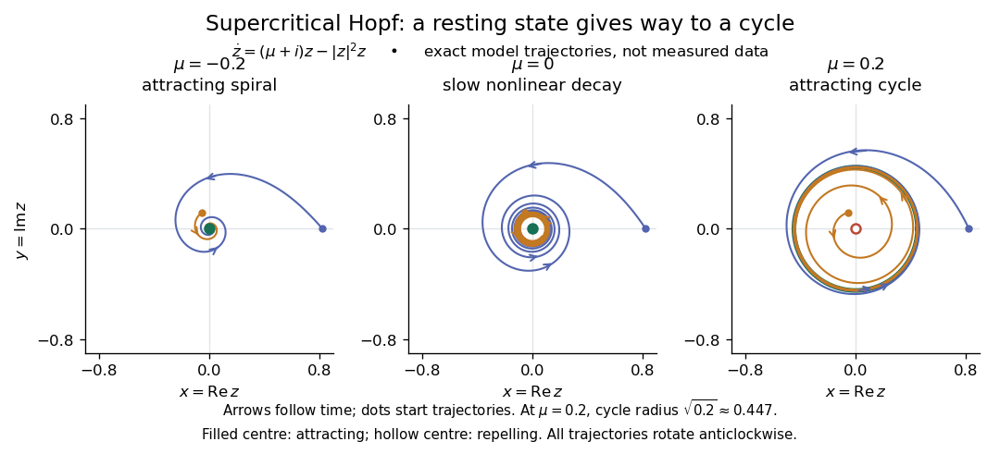

# Hopf bifurcation

↑ **Parent:** [Bifurcation theory](bifurcation-theory.md)  
ⓦ [Wiki](https://en.wikipedia.org/wiki/Hopf_bifurcation)

A Hopf bifurcation creates or destroys a small [periodic orbit](periodic-orbit.md) near an [equilibrium point](equilibrium-point-of-a-dynamical-system.md) as a pair of [complex conjugate](complex-conjugate.md) [eigenvalues](eigenvalue.md) crosses the imaginary axis. It explains how a resting state can give way to sustained [oscillations](oscillation.md): the [linearization of a dynamical system](linearization-of-a-dynamical-system.md) supplies rotation and growth, while a nonlinear term can saturate that growth at a nonzero [amplitude](wave-amplitude.md).

The simplest [supercritical Hopf bifurcation](supercritical-hopf-bifurcation.md) is the exact [Hopf normal form](hopf-normal-form.md)

$$
\dot z=(\mu+i\omega)z-|z|^2z,\qquad z=x+iy,\qquad \omega>0.
$$

Here $z$ is a [complex number](complex-number.md), $\mu$ is the [bifurcation parameter](bifurcation-parameter.md), and $\omega$ is the [angular frequency](angular-frequency.md). In [polar coordinates](polar-coordinates.md) $z=re^{i\theta}$, the equations become $\dot r=\mu r-r^3$ and $\dot\theta=\omega$ for $r>0$. At $\mu<0$, each turn shrinks towards the [equilibrium point](equilibrium-point-of-a-dynamical-system.md). At $\mu>0$, small radii grow and large radii shrink towards $r=\sqrt\mu$, producing a [limit cycle](limit-cycle.md). For example, $\mu=0.04$ and $\omega=2$ give radius $0.2$, period $\pi$, and [frequency](frequency.md) $1/\pi$ cycles per unit [time](time-in-physics.md). The limiting [angular frequency](angular-frequency.md) stays nonzero while the [amplitude](wave-amplitude.md) tends to zero: a tiny newborn [oscillation](oscillation.md) can still repeat at a finite rate.

**[Figure 3](#image-computed-phase-portraits-across-a-supercritical-hopf-bifurcation). Computed phase portraits across a supercritical Hopf bifurcation**. Exact [orbits](orbit-dynamical-system.md) of the displayed [Hopf normal form](hopf-normal-form.md) with $\omega=1$, at $\mu=-0.2,0,0.2$. Arrows follow increasing [time](time-in-physics.md); the two starting radii are $0.82$ and $0.13$. The green circle at $\mu=0.2$ has radius $\sqrt{0.2}$. At $\mu=0$, nonlinear decay still attracts [orbits](orbit-dynamical-system.md), despite purely imaginary linear [eigenvalues](eigenvalue.md). These are dimensionless model calculations, not measured data.

For a precise generic statement, consider a [smooth function](smooth-function.md) $f$ defining an [autonomous differential equation](autonomous-system-mathematics.md) $\dot x=f(x,\alpha)$ on $\mathbb R^n$, with a smooth branch of [equilibrium points](equilibrium-point-of-a-dynamical-system.md) $x_*(\alpha)$ and critical parameter $\alpha=0$. Require:
- the [Jacobian matrix](jacobian-matrix.md) $D_xf(x_*(\alpha),\alpha)$ to have a simple pair of [eigenvalues](eigenvalue.md) $\beta(\alpha)\pm i\omega(\alpha)$, with $\beta(0)=0$ and $\omega(0)>0$;
- every other [eigenvalue](eigenvalue.md) to have nonzero [real part](real-part.md) at $\alpha=0$;
- a transverse crossing, $\beta'(0)\ne0$;
- a nonzero cubic radial coefficient $a=\operatorname{Re}\ell(0)\ne0$ in the reduced [Hopf normal form](hopf-normal-form.md).
Then a locally unique branch of small [periodic orbits](periodic-orbit.md), up to [phase](phase-waves.md), emerges on the side $\beta a<0$. On the two-dimensional [centre manifold](center-manifold.md), the branch attracts for $a<0$ and repels for $a>0$. Attraction in the full [phase space](phase-space.md) additionally requires all remaining [eigenvalues](eigenvalue.md) to have negative [real part](real-part.md); any transverse unstable direction makes the [periodic orbit](periodic-orbit.md) unstable there.[Yuri A. Kuznetsov's authored account of the generic Hopf theorem](https://www.scholarpedia.org/article/Andronov-Hopf_bifurcation)

An [eigenvalue-crossing bifurcation test](eigenvalue-crossing-bifurcation-test.md) alone cannot establish these nonlinear conclusions. For example, the purely linear equation $\dot z=(\mu+i\omega)z$ has the same crossing but no isolated [periodic orbit](periodic-orbit.md): at $\mu=0$ every nonzero radius is constant, and at $\mu\ne0$ none is. If the cubic coefficient vanishes, higher-order terms must be examined; a [generalized Hopf bifurcation](generalized-hopf-bifurcation.md) is one possible degeneracy. The usefulness of the generic theorem is that a large system can have its small oscillatory onset understood through one [Hopf normal form](hopf-normal-form.md), subject to these hypotheses and local limits.

**Table of contents**

- [Reflection-symmetric one-to-one Hopf resonance](reflection-symmetric-one-to-one-hopf-resonance.md)
  - [Secondary steady and Hopf thresholds of a resonant pure mode](secondary-steady-and-hopf-thresholds-of-a-resonant-pure-mode.md)
- [Generalized Hopf bifurcation](generalized-hopf-bifurcation.md)
- [Hopf criticality for an asymmetric Lienard center](hopf-criticality-for-an-asymmetric-lienard-center.md)
- [Supercritical Hopf bifurcation](supercritical-hopf-bifurcation.md)
- [Hopf normal form](hopf-normal-form.md)
- [Subcritical Hopf bifurcation](subcritical-hopf-bifurcation.md)

## ↑ Ancestors (5)

1. [Bifurcation theory](bifurcation-theory.md)
2. [Dynamical systems](dynamical-systems-split.md)
3. [Branches of physics](branches-of-physics.md)
4. [Physics](physics-split.md)
5. [Codex Wiki](split.md)

## ← Incoming links (65)

- [Bogdanov–Takens bifurcation](bogdanov-takens-bifurcation.md)
- [Codimension-two bifurcation](codimension-two-bifurcation.md)
- [Counterpropagating Hopf amplitudes in rotating convection](counterpropagating-hopf-amplitudes-in-rotating-convection.md)
- [Equivariant Hopf theorem](equivariant-hopf-theorem.md)
- [Fold and Hopf thresholds of a directly forced cubic amplitude](fold-and-hopf-thresholds-of-a-directly-forced-cubic-amplitude.md)
- [Generalized Hopf bifurcation](generalized-hopf-bifurcation.md)
- [Hopf coefficient of the Brusselator](hopf-coefficient-of-the-brusselator.md)
- [Hopf criticality for an asymmetric Lienard center](hopf-criticality-for-an-asymmetric-lienard-center.md)
- [Hopf normal form](hopf-normal-form.md)
- [Oscillatory convection](oscillatory-convection.md)
- [Oscillatory neutral curve of rotating convection](oscillatory-neutral-curve-of-rotating-convection.md)
- [Oscillatory threshold of a thermosolutal Lorenz model](oscillatory-threshold-of-a-thermosolutal-lorenz-model.md)
- [Solution](past-exam-of-the-mathematics-course-of-the-university-of-cambridge/2001/iii/paper-51/1/c/solution.md)
- [Solution](past-exam-of-the-mathematics-course-of-the-university-of-cambridge/2001/iii/paper-51/1/d/solution.md)
- [Solution](past-exam-of-the-mathematics-course-of-the-university-of-cambridge/2001/iii/paper-51/2/b/solution.md)
- [Solution](past-exam-of-the-mathematics-course-of-the-university-of-cambridge/2001/iii/paper-54/3/b/solution.md)
- [Solution](past-exam-of-the-mathematics-course-of-the-university-of-cambridge/2001/iii/paper-54/3/solution.md)
- [Solution](past-exam-of-the-mathematics-course-of-the-university-of-cambridge/2002/iii/paper-43/3/solution.md)
- [Solution](past-exam-of-the-mathematics-course-of-the-university-of-cambridge/2002/iii/paper-56/1/a/solution.md)
- [Solution](past-exam-of-the-mathematics-course-of-the-university-of-cambridge/2002/iii/paper-56/1/e/solution.md)
- [Solution](past-exam-of-the-mathematics-course-of-the-university-of-cambridge/2002/iii/paper-56/4/b/solution.md)
- [Solution](past-exam-of-the-mathematics-course-of-the-university-of-cambridge/2002/iii/paper-58/1/iii/solution.md)
- [Solution](past-exam-of-the-mathematics-course-of-the-university-of-cambridge/2002/iii/paper-58/2/solution.md)
- [Solution](past-exam-of-the-mathematics-course-of-the-university-of-cambridge/2002/iii/paper-58/4/solution.md)
- [Solution](past-exam-of-the-mathematics-course-of-the-university-of-cambridge/2003/iii/paper-59/1/b/solution.md)
- [Solution](past-exam-of-the-mathematics-course-of-the-university-of-cambridge/2003/iii/paper-59/1/d/solution.md)
- [Solution](past-exam-of-the-mathematics-course-of-the-university-of-cambridge/2003/iii/paper-59/2/b/solution.md)
- [Solution](past-exam-of-the-mathematics-course-of-the-university-of-cambridge/2003/iii/paper-59/4/a/solution.md)
- [Solution](past-exam-of-the-mathematics-course-of-the-university-of-cambridge/2003/iii/paper-59/4/b/solution.md)
- [Solution](past-exam-of-the-mathematics-course-of-the-university-of-cambridge/2003/iii/paper-59/4/d/solution.md)
- [Solution](past-exam-of-the-mathematics-course-of-the-university-of-cambridge/2003/iii/paper-60/1/ii/solution.md)
- [Solution](past-exam-of-the-mathematics-course-of-the-university-of-cambridge/2003/iii/paper-60/2/ii/solution.md)
- [Solution](past-exam-of-the-mathematics-course-of-the-university-of-cambridge/2004/iii/paper-60/2/b/solution.md)
- [Solution](past-exam-of-the-mathematics-course-of-the-university-of-cambridge/2004/iii/paper-60/3/a/solution.md)
- [Solution](past-exam-of-the-mathematics-course-of-the-university-of-cambridge/2005/iii/paper-65/2/a/solution.md)
- [Solution](past-exam-of-the-mathematics-course-of-the-university-of-cambridge/2005/iii/paper-65/4/a/solution.md)
- [Solution](past-exam-of-the-mathematics-course-of-the-university-of-cambridge/2006/iii/paper-85/1/a/solution.md)
- [Solution](past-exam-of-the-mathematics-course-of-the-university-of-cambridge/2006/iii/paper-85/1/b/solution.md)
- [Solution](past-exam-of-the-mathematics-course-of-the-university-of-cambridge/2006/iii/paper-85/1/d/solution.md)
- [Solution](past-exam-of-the-mathematics-course-of-the-university-of-cambridge/2007/iii/paper-85/1/b/solution.md)
- [Solution](past-exam-of-the-mathematics-course-of-the-university-of-cambridge/2007/iii/paper-85/1/c/solution.md)
- [Solution](past-exam-of-the-mathematics-course-of-the-university-of-cambridge/2007/iii/paper-85/4/b/solution.md)
- [Solution](past-exam-of-the-mathematics-course-of-the-university-of-cambridge/2008/ii/paper-2/7a/solution.md)
- [Solution](past-exam-of-the-mathematics-course-of-the-university-of-cambridge/2008/iii/paper-78/1/a/solution.md)
- [Solution](past-exam-of-the-mathematics-course-of-the-university-of-cambridge/2009/ii/paper-2/6a/solution.md)
- [Solution](past-exam-of-the-mathematics-course-of-the-university-of-cambridge/2009/iii/paper-70/2/solution.md)
- [Solution](past-exam-of-the-mathematics-course-of-the-university-of-cambridge/2012/iii/paper-74/3/a/solution.md)
- [Solution](past-exam-of-the-mathematics-course-of-the-university-of-cambridge/2012/iii/paper-74/3/b/solution.md)
- [Solution](past-exam-of-the-mathematics-course-of-the-university-of-cambridge/2012/iii/paper-77/2/iii/solution.md)
- [Solution](past-exam-of-the-mathematics-course-of-the-university-of-cambridge/2014/iii/paper-76/3/solution.md)
- [Solution](past-exam-of-the-mathematics-course-of-the-university-of-cambridge/2015/ii/paper-3/28b/solution.md)
- [Solution](past-exam-of-the-mathematics-course-of-the-university-of-cambridge/2015/ii/paper-4/5e/i/solution.md)
- [Solution](past-exam-of-the-mathematics-course-of-the-university-of-cambridge/2017/iii/paper-337/4/solution.md)
- [Solution](past-exam-of-the-mathematics-course-of-the-university-of-cambridge/2018/ii/paper-3/32e/solution.md)
- [Solution](past-exam-of-the-mathematics-course-of-the-university-of-cambridge/2023/iii/paper-355/3/solution.md)
- [Quadratic Bogdanov–Takens unfolding](quadratic-bogdanov-takens-unfolding.md)
- [Quadratic-product flow with a double-zero bifurcation](quadratic-product-flow-with-a-double-zero-bifurcation.md)
- [Quasistatic vertical-field magnetoconvection](quasistatic-vertical-field-magnetoconvection.md)
- [Reflection-symmetric one-to-one Hopf resonance](reflection-symmetric-one-to-one-hopf-resonance.md)
- [Roll and hexagon spectra without reflection symmetry](roll-and-hexagon-spectra-without-reflection-symmetry.md)
- [Secondary steady and Hopf thresholds of a resonant pure mode](secondary-steady-and-hopf-thresholds-of-a-resonant-pure-mode.md)
- [Square-pattern interaction with a sign-changing scalar mode](square-pattern-interaction-with-a-sign-changing-scalar-mode.md)
- [Subcritical Hopf bifurcation](subcritical-hopf-bifurcation.md)
- [Supercritical Hopf bifurcation](supercritical-hopf-bifurcation.md)
- [Three-amplitude vertical-field magnetoconvection](three-amplitude-vertical-field-magnetoconvection.md)
