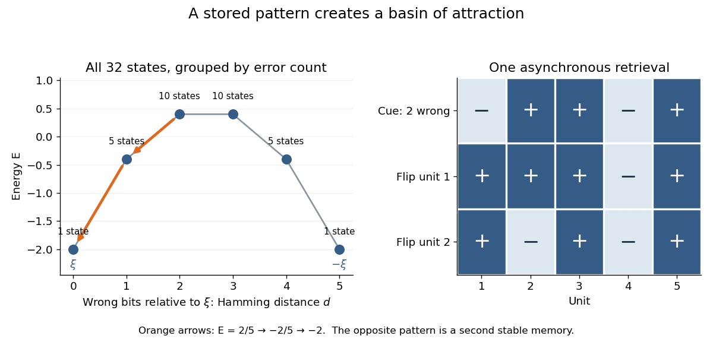

# Hopfield recall from a corrupted cue

↑ **Parent:** [Hebbian memory weights for a Hopfield network](hebbian-memory-weights-for-a-hopfield-network.md)

Store only $\xi=(1,-1,1,-1,1)$ with $M=5$, zero thresholds, and [Hebbian memory weights for a Hopfield network](hebbian-memory-weights-for-a-hopfield-network.md). If $d$ bits differ from $\xi$, their [Hamming distance](hamming-distance.md) is $d$ and $\sum_i\xi_ix_i=M-2d$. Squaring this sum and subtracting the $M$ diagonal terms yields the displayed [energy](energy-split.md). Thus $d=0,1,2,3,4,5$ gives $E=-2,-2/5,2/5,2/5,-2/5,-2$.

For the cue $x=(-1,1,1,-1,1)$, the first unit has input $h_1=2/5$ and flips to $1$. The second then has $h_2=-4/5$ and flips to $-1$, completing recall. The [energy](energy-split.md) drops $2/5\to-2/5\to-2$. Every cue with at most two wrong bits is corrected under a fair asynchronous schedule: a wrong bit sees the correct majority among the other four, while a correct bit either sees agreement or retains its value at a tie. The opposite pattern $-\xi$ is also stored implicitly, so cues with at least three errors retrieve it. This is a limitation of this symmetric one-pattern construction.

**[Figure 1](#image-an-exact-five-unit-memory-landscape-and-correction-of-two-wrong-bits). An exact five-unit memory landscape and correction of two wrong bits**. Each point represents every state at the indicated [Hamming distance](hamming-distance.md); multiplicities count the states. Arrows follow two actual updates of the illustrated cue under [asynchronous Hopfield energy descent](asynchronous-hopfield-energy-descent.md). This is an original finite calculation.

## ↑ Ancestors (10)

1. [Hebbian memory weights for a Hopfield network](hebbian-memory-weights-for-a-hopfield-network.md)
2. [Hopfield network](hopfield-network.md)
3. [Neural network](neural-network.md)
4. [Statistical learning](statistical-learning-split.md)
5. [Statistical modelling](statistical-modelling-split.md)
6. [Statistical model](statistical-model-split.md)
7. [Probability and statistics](probability-and-statistics-split.md)
8. [Area of mathematics](area-of-mathematics.md)
9. [Mathematics](mathematics-split.md)
10. [Codex Wiki](split.md)
