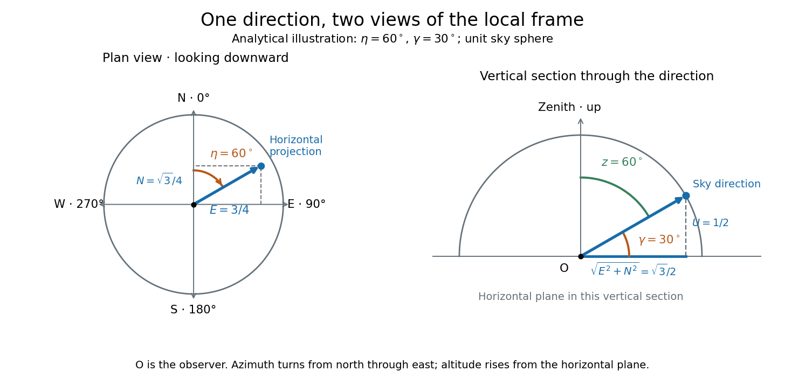

# Horizontal coordinate system

↑ **Parent:** [Astrophysics](astrophysics-split.md)  
ⓦ [Wiki](https://en.wikipedia.org/wiki/Horizontal_coordinate_system)

A [horizontal coordinate system](horizontal-coordinate-system.md) describes a viewing direction using [altitude](altitude.md) $\gamma$ above the observer's [astronomical horizon](astronomical-horizon.md) and [azimuth](azimuth.md) $\eta$ around it. Here [azimuth](azimuth.md) starts at true north and increases through east: north is $0^\circ$, east $90^\circ$, south $180^\circ$, and west $270^\circ$, with $0\leq\eta<360^\circ$. True north is the northward intersection of the [celestial meridian](celestial-meridian.md) with the [astronomical horizon](astronomical-horizon.md), rather than an uncorrected magnetic-compass reading. Other origins and directions are legitimate, but their formulae must be converted consistently. [Jeremy Tatum: Celestial mechanics, section 6.2, altazimuth coordinates and azimuth conventions](https://www.astro.uvic.ca/~tatum/celmechs/celm6.pdf).

Construct a local [orthonormal basis](orthonormal-basis.md) of east $\mathbf e_E$, north $\mathbf e_N$, and upward $\mathbf e_U$, with $\mathbf e_E\times\mathbf e_N=\mathbf e_U$. The upward [unit vector](unit-vector.md) points to the [zenith](zenith.md); the horizontal [plane](plane.md) is perpendicular to it. For a ground instrument, a freely hanging weight establishes the local vertical through [gravity](gravity.md). In an elementary spherical-[Earth](earth.md) model, this vertical is radial; precision work distinguishes it from the normal to a reference surface. With the observer as origin, write a direction's [unit vector](unit-vector.md) as

$$
\mathbf n=\cos\gamma\sin\eta\,\mathbf e_E+\cos\gamma\cos\eta\,\mathbf e_N+\sin\gamma\,\mathbf e_U.
$$

Its local components $(E,N,U)$ obey $E^2+N^2+U^2=1$. Conversely, $\gamma=\arcsin U$ and $\eta=\operatorname{atan2}(E,N)$ modulo one turn, except where $E=N=0$. The quadrant-aware [arctangent](inverse-tangent.md) takes east as its first argument and north as its second. A synthetic direction with $\eta=60^\circ$ and $\gamma=30^\circ$ has $(E,N,U)=(3/4,\sqrt3/4,1/2)$. Thus its horizontal component has [norm](norm.md) $\sqrt3/2$; its [altitude](altitude.md) is not the [angle](angle.md) of the projected arrow in the horizontal [plane](plane.md).

**[Figure 4](#image-analytical-illustration-of-north-through-east-azimuth-and-altitude-in-a-local-orthogonal-frame-synthetic-direction). Analytical illustration of north-through-east azimuth and altitude in a local orthogonal frame; synthetic direction**.

A [horizontal coordinate system](horizontal-coordinate-system.md) depends on the observer's site and the observation [time](time-in-physics.md). The [Earth](earth.md)'s [rotation](rotation-mathematics.md) changes the local axes relative to a fixed distant direction, while changing the site changes the [zenith](zenith.md) and the [astronomical horizon](astronomical-horizon.md). This makes the [horizontal coordinate system](horizontal-coordinate-system.md) directly useful for pointing an [optical telescope](optical-telescope.md) and checking whether terrain blocks a target. A pair of [angles](angle.md) without a site, [time](time-in-physics.md), [azimuth](azimuth.md) convention, and geometric or refracted interpretation is an incomplete pointing instruction.

For a check against an [equatorial coordinate system](equatorial-coordinate-system.md), let $\theta$ be the observer's [geographical latitude](geographical-latitude.md), $\delta$ the direction's [declination](declination.md), and $h$ its west-positive [hour angle](hour-angle.md), obtained from local [sidereal time](sidereal-time.md) minus [right ascension](right-ascension.md). In the spherical-[Earth](earth.md), unrefracted fixed-direction model, projection onto the local [orthonormal basis](orthonormal-basis.md) gives

$$
E=-\cos\delta\sin h,\qquad N=\cos\theta\sin\delta-\sin\theta\cos\delta\cos h,\qquad U=\sin\theta\sin\delta+\cos\theta\cos\delta\cos h.
$$

Taking the [dot product](dot-product.md) with the upward [unit vector](unit-vector.md) gives the last formula; the other two follow by the same projection. Recover [altitude](altitude.md) and [azimuth](azimuth.md) from $(E,N,U)$ as above, using [radians](radian.md) inside software [trigonometric functions](trigonometric-function.md). The minus sign in $E$ is essential: a negative [hour angle](hour-angle.md) puts this synthetic direction east of the [celestial meridian](celestial-meridian.md). [US Naval Observatory: Computing altitude and azimuth, local hour angle and quadrant-aware conversion](https://aa.usno.navy.mil/faq/alt_az).

For illustrative [geographical latitude](geographical-latitude.md) $\theta=45^\circ$ and invented [declination](declination.md) $\delta=15^\circ$, [hour angle](hour-angle.md) $h=-60^\circ$ gives $\gamma\simeq31.636^\circ$ and $\eta\simeq100.729^\circ$. At $h=+60^\circ$, the same [altitude](altitude.md) accompanies $\eta\simeq259.271^\circ$: the direction is now westward. At $h=0$, it is due south with [altitude](altitude.md) $60^\circ$, agreeing with $90^\circ-|\theta-\delta|$ at upper [meridian transit](meridian-transit.md). These are analytical checks, not present positions of any [star](star.md). For nearby objects, the direction must also be referred to the observer; simply rotating a geocentric direction omits the change of viewing position. Catalogue-to-observation refinements are described under [equatorial coordinate system](equatorial-coordinate-system.md).

**Table of contents**

- [Geographical latitude](geographical-latitude.md)
- [Azimuth](azimuth.md)
- [Altitude](altitude.md)
  - [Inclinometer](inclinometer.md)
- [Zenith](zenith.md)
  - [Zenith distance](zenith-distance.md)
- [Astronomical horizon](astronomical-horizon.md)

## ↑ Ancestors (4)

1. [Astrophysics](astrophysics-split.md)
2. [Branches of physics](branches-of-physics.md)
3. [Physics](physics-split.md)
4. [Codex Wiki](split.md)

## ← Incoming links (4)

- [Altitude](altitude.md)
- [Astronomical horizon](astronomical-horizon.md)
- [Horizontal coordinate system](horizontal-coordinate-system.md)
- [Zenith](zenith.md)
