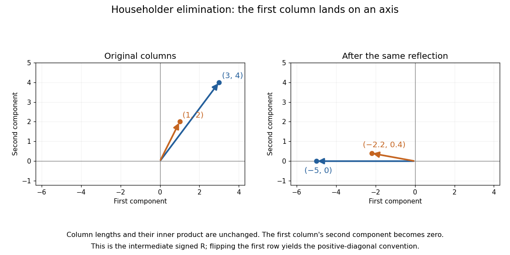

# Householder QR example in two dimensions

↑ **Parent:** [Householder transformation](householder-transformation.md)

Apply the preceding [Householder reflection](householder-transformation.md) to the columns of

$$
A=\begin{pmatrix}3&1\\4&2\end{pmatrix}.
$$

The first column becomes $(-5,0)^T$ and the second becomes $(-11/5,2/5)^T$:

$$
R=HA=\begin{pmatrix}-5&-11/5\\0&2/5\end{pmatrix},
\qquad
A=HR.
$$

Thus an [orthogonal matrix](orthogonal-matrix.md) multiplying an [upper triangular matrix](upper-triangular-matrix.md) reconstructs $A$. The zero below the diagonal came from a geometric operation that preserves [Euclidean norms](euclidean-norm.md) and [inner products](inner-product-split.md).

**[Figure 12](#image-a-single-householder-reflection-makes-a-two-column-matrix-upper-triangular). A single Householder reflection makes a two-column matrix upper triangular**. Both columns are reflected by the same [orthogonal transformation](orthogonal-transformation.md). The first lands on the first coordinate axis; the second retains a nonzero second component. The intermediate triangular factor has a negative first diagonal entry.

Our positive-diagonal convention for [QR decomposition](qr-decomposition.md) is obtained by a sign adjustment. With $D=\operatorname{diag}(-1,1)$, put

$$
Q=HD=\begin{pmatrix}3/5&-4/5\\4/5&3/5\end{pmatrix},
\qquad
R_+=DR=\begin{pmatrix}5&11/5\\0&2/5\end{pmatrix}.
$$

Then $Q^TQ=I$ and $\boxed{A=QR_+}$. The intermediate sign chooses an [orientation](orientation-of-a-simplex.md) for a [basis vector](basis-vector.md); the adjustment makes the diagonal positive.

For a larger [matrix](matrix.md), the next [Householder reflection](householder-transformation.md) acts only on the lower rows of the remaining columns, retaining the zeros already created. Store its defining [vector](vector.md) and apply $z\mapsto z-2u(u^Tz)$ instead of forming a dense reflection [matrix](matrix.md). This links a simple mirror operation to efficient [QR decomposition](qr-decomposition.md), including [least-squares solutions](least-squares-solution-of-a-linear-inverse-problem.md).

## ↑ Ancestors (6)

1. [Householder transformation](householder-transformation.md)
2. [Linear algebra](linear-algebra-split.md)
3. [Algebra](algebra-split.md)
4. [Area of mathematics](area-of-mathematics.md)
5. [Mathematics](mathematics-split.md)
6. [Codex Wiki](split.md)
