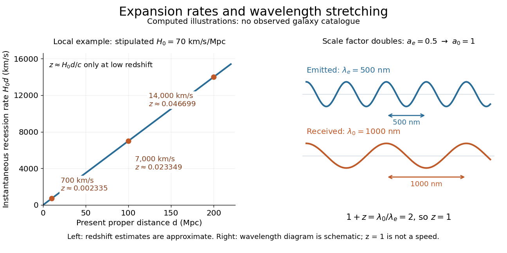

<h1 id="hubble-s-law">Hubble's law</h1>

↑ **Parent:** [Expansion of the universe](expansion-of-the-universe.md)  
ⓦ [Wiki](https://en.wikipedia.org/wiki/Hubble's_law)

[Hubble's law](hubble-s-law.md) states that the instantaneous rate of change of [proper distance in cosmology](proper-distance-in-cosmology.md) between [comoving observers](comoving-observer.md) is proportional to that distance:

$$
v_{\rm rec}(t):=\dot d(t)=H(t)d(t).
$$

This is exact for fixed [comoving distance](comoving-radial-distance.md) $\chi$ in an [FLRW metric](friedmann-lemaitre-robertson-walker-metric.md): differentiating $d=a\chi$ gives $\dot d=\dot a\chi=(\dot a/a)d$. The dot uses [cosmic time](cosmic-time.md), and both distances are compared on spatial slices at the same [cosmic time](cosmic-time.md). The rate $\dot d$ is not a relative [velocity](velocity.md) measured in a single [inertial frame](inertial-frame.md) of [special relativity](special-relativity-split.md). Thus the instantaneous relation is not an exact observed [redshift](redshift.md)-distance formula. The associated [Hubble flow](hubble-flow.md) describes the ideal expansion; [peculiar velocities](peculiar-velocity.md) describe departures from it.

For nearby sources, the observed [redshift](redshift.md) approximately satisfies

$$
cz\simeq H_0d
$$

when source and observer [peculiar velocities](peculiar-velocity.md) are small compared with $H_0d$, additional [gravitational redshift](gravitational-redshift.md) is negligible, and the changes in the [scale factor](scale-factor-cosmology.md) and [Hubble parameter](hubble-parameter.md) during light travel are small. Here $d$ can be taken as the present [proper distance in cosmology](proper-distance-in-cosmology.md); familiar distance conventions agree at leading order in small [redshift](redshift.md). Briefly, $a(t_e)\simeq a(t_0)[1-H_0(t_0-t_e)]$, while $d\simeq c(t_0-t_e)$, so [cosmological redshift](cosmological-redshift.md) gives $z\simeq H_0d/c$. At greater [redshift](redshift.md), use an expansion history and an explicit distance convention instead.

Stipulate the illustrative [Hubble constant](hubble-constant.md) $H_0=70\,\mathrm{km\,s^{-1}\,Mpc^{-1}}$ and [speed of light](speed-of-light.md) $c=299792.458\,\mathrm{km\,s^{-1}}$. A $\mathrm{Mpc}$ is a million [parsecs](parsec.md). The following are computed examples, not a catalogue of observed [galaxies](galaxy-split.md):

- At $d=10\,\mathrm{Mpc}$, $H_0d=700\,\mathrm{km\,s^{-1}}$ and the approximate [cosmological redshift](cosmological-redshift.md) is $z\simeq0.002335$.
- At $d=100\,\mathrm{Mpc}$, $H_0d=7000\,\mathrm{km\,s^{-1}}$ and the approximate [cosmological redshift](cosmological-redshift.md) is $z\simeq0.02335$.
- At $d=200\,\mathrm{Mpc}$, $H_0d=14000\,\mathrm{km\,s^{-1}}$ and the approximate [cosmological redshift](cosmological-redshift.md) is $z\simeq0.04670$.

The displayed $H_0d$ values are exact arithmetic under the stipulated [Hubble constant](hubble-constant.md); the [cosmological redshift](cosmological-redshift.md) estimates use the nearby approximation and become less accurate as distance grows.

**[Figure 2](#image-computed-hubble-s-law-examples-and-a-wavelength-doubling-from-cosmological-redshift). Computed Hubble's law examples and a wavelength doubling from cosmological redshift**. Left: the stipulated [Hubble constant](hubble-constant.md) gives the instantaneous rates $700,7000,14000\,\mathrm{km\,s^{-1}}$; the annotated [cosmological redshifts](cosmological-redshift.md) use $z\simeq H_0d/c$. Right: a schematic of successive [wave](wave.md) crests shows a [wavelength](wavelength.md) of $500\,\mathrm{nm}$ becoming $1000\,\mathrm{nm}$ when the [scale factor](scale-factor-cosmology.md) doubles. The right panel is not a [velocity](velocity.md) conversion or a continuation of the nearby approximation.

[Hubble's law](hubble-s-law.md) turns a nearby observed [redshift](redshift.md) into an approximate distance indicator and makes the uniformity of [cosmic expansion](expansion-of-the-universe.md) tangible: twice the [proper distance in cosmology](proper-distance-in-cosmology.md) means twice the instantaneous separation rate. Recentring the ideal [Hubble flow](hubble-flow.md) on another [comoving observer](comoving-observer.md) preserves the same proportionality, as illustrated under [scale factor](scale-factor-cosmology.md), so recession in every direction does not select a central observer.

In his 1929 PNAS paper, Edwin Hubble presented a relation between the distances and [radial velocities](radial-velocity.md) of extragalactic objects. His fits gave coefficients of $465$ and $513\,\mathrm{km\,s^{-1}\,Mpc^{-1}}$ for 24 individual objects and nine groups respectively, and he used about $500\,\mathrm{km\,s^{-1}\,Mpc^{-1}}$ as a rounded representative value. Those historical fits used the paper's distance estimates; they are distinct from the stipulated modern-scale illustration above. [Hubble (1929), original PNAS paper, pp. 170-171](https://www.astro.puc.cl/~rparra/tools/PAPERS/hubble_1929.pdf).

## ↑ Ancestors (6)

1. [Expansion of the universe](expansion-of-the-universe.md)
2. [Scale factor (cosmology)](scale-factor-cosmology.md)
3. [Cosmology](cosmology-split.md)
4. [Branches of physics](branches-of-physics.md)
5. [Physics](physics-split.md)
6. [Codex Wiki](split.md)

## ← Incoming links (6)

- [Cosmological redshift](cosmological-redshift.md)
- [Hubble constant](hubble-constant.md)
- [Hubble flow](hubble-flow.md)
- [Hubble's law](hubble-s-law.md)
- [Solution](past-exam-of-the-mathematics-course-of-the-university-of-cambridge/2001/iii/paper-41/1/ii/solution.md)
- [Scale factor (cosmology)](scale-factor-cosmology.md)
