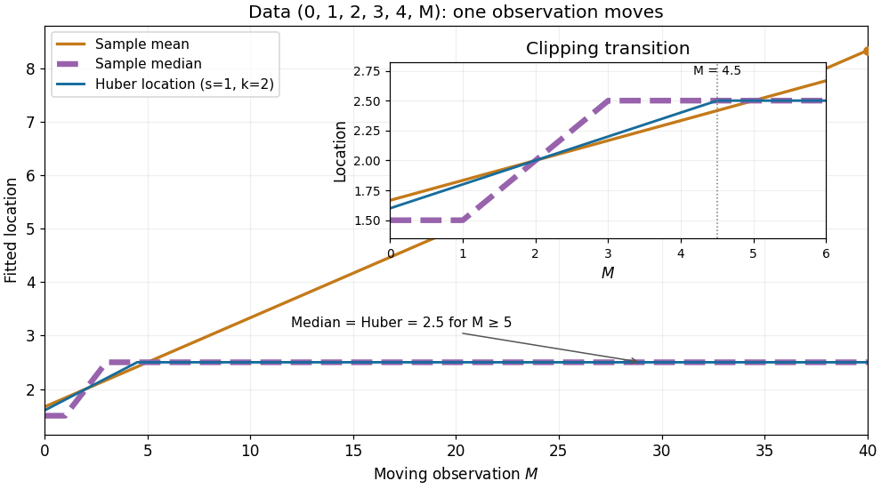

# Huber location response to one outlier

↑ **Parent:** [Huber location estimator](huber-location-estimator.md)

Hold $(0,1,2,3,4)$ fixed and move only the sixth observation $M$. For $M\geq5$, the [sample mean](sample-mean.md) is $(10+M)/6$, the [sample median](sample-median.md) is $2.5$, and the [Huber location estimator](huber-location-estimator.md) with fixed $s=1,k=2$ stays at $2.5$. Once $M-2.5\geq2$, its [Huber score](huber-score.md) is already $2$; moving it farther changes the [Huber loss](huber-loss.md) but leaves the root unchanged.

For a closer view of the transition, the exact [Huber location estimator](huber-location-estimator.md) over $0\leq M\leq40$ is

$$
T(M)=\begin{cases}(8+M)/5,&0\leq M\leq4.5,\\2.5,&4.5\leq M\leq40.\end{cases}
$$

To verify the first branch, when $0\leq M\leq2$ the score of $4$ is saturated and the other five scores sum with it to $8+M-5\theta$. When $2\leq M\leq4.5$, the score of $0$ is saturated instead, giving the same expression. At $M=4.5$, the moving observation saturates too, and the equation becomes $10-4\theta=0$. The piecewise formula is continuous at the transition.

**[Figure 3](#image-one-moving-observation-sample-mean-sample-median-and-fixed-scale-huber-location-estimator). One moving observation: sample mean, sample median, and fixed-scale Huber location estimator**. Original deterministic data $(0,1,2,3,4,M)$ with $s=1,k=2$. The inset resolves the region $0\leq M\leq6$, where the three [estimators](estimator.md) differ; the [Huber location estimator](huber-location-estimator.md) saturates at $M=4.5$. For $5\leq M\leq40$, it coincides with the [sample median](sample-median.md), while the [sample mean](sample-mean.md) continues to rise.

The rising [sample mean](sample-mean.md) comes from an unbounded linear score, the flat distant-outlier response from a bounded [Huber score](huber-score.md). This is a finite-data response curve with a specified scale and threshold, rather than a population [influence function](influence-function.md) or a general claim about arbitrary numbers of [outliers](outlier.md).

## ↑ Ancestors (7)

1. [Huber location estimator](huber-location-estimator.md)
2. [Robust statistics](robust-statistics-split.md)
3. [Statistical inference](statistical-inference-split.md)
4. [Probability and statistics](probability-and-statistics-split.md)
5. [Area of mathematics](area-of-mathematics.md)
6. [Mathematics](mathematics-split.md)
7. [Codex Wiki](split.md)
