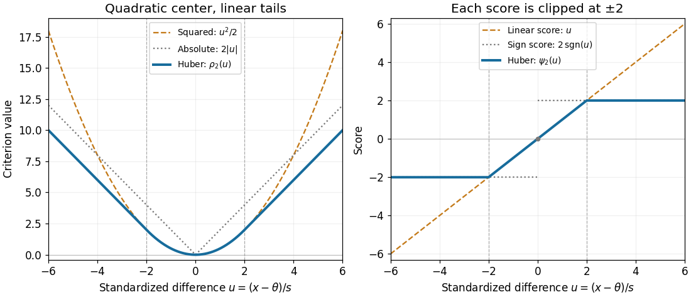

# Huber loss

↑ **Parent:** [Huber location estimator](huber-location-estimator.md)  
ⓦ [Wiki](https://en.wikipedia.org/wiki/Huber_loss)

The Huber loss is quadratic near zero and linear beyond a fixed cutoff; its derivative is the clipped Huber score.

For threshold $k>0$, the [Huber loss](huber-loss.md) is the [loss function](loss-function.md)

$$
\rho_k(u)=\begin{cases}\tfrac12u^2,&|u|\leq k,\\k|u|-\tfrac12k^2,&|u|>k.\end{cases}
$$

The subtraction $k^2/2$ makes the values meet at $|u|=k$; the slopes also meet, so the [Huber loss](huber-loss.md) is continuously [differentiable](differentiable-function.md) with [Huber score](huber-score.md) as its [derivative](derivative.md). It is a [convex function](convex-function.md), since that [derivative](derivative.md) is a [monotone function](monotonic-function.md). These quadratic and linear pieces define the original clipped location criterion.[§1, printed p. 75: piecewise criterion; §4(iii), printed p. 79: corresponding location estimator](robust-estimation-of-a-location-parameter-by-peter-j-huber.md)

**[Figure 4](#image-huber-loss-and-huber-score-for-threshold-k-2). Huber loss and Huber score for threshold $k=2$**. Original curves compare the [Huber loss](huber-loss.md) with $u^2/2$ and $2|u|$, then compare the [Huber score](huber-score.md) with the linear score $u$ and $2\operatorname{sgn}(u)$. The dashed vertical lines mark $u=\pm2$.

For $k=2$, $\rho_2(1)=1/2$, $\rho_2(2)=2$, and $\rho_2(5)=8$, whereas the squared criterion $u^2/2$ at $u=5$ is $12.5$. Increasing a standardized difference from $5$ to $6$ raises the [Huber loss](huber-loss.md) by $2$, but raises the squared criterion by $5.5$. The compromise preserves quadratic sensitivity to small differences while limiting the slope for large ones. This makes the [Huber loss](huber-loss.md) useful when ordinary observations should retain their detailed distances yet isolated [outliers](outlier.md) should exert limited pull.

For a fixed finite dataset and scale, taking $k$ large enough that every difference from the [sample mean](sample-mean.md) lies within $ks$ recovers that [sample mean](sample-mean.md). Toward the other extreme, for each fixed $u$, $\rho_k(u)/k\to|u|$ as $k\downarrow0$, connecting the criterion to [median minimizes expected absolute loss](median-minimizes-expected-absolute-loss.md). The normalization is essential: putting $k=0$ into the unscaled [Huber loss](huber-loss.md) gives zero everywhere, not a usable [median](median.md) criterion.

**Table of contents**

- [Huber gradient regularizer](huber-gradient-regularizer.md)

## ↑ Ancestors (7)

1. [Huber location estimator](huber-location-estimator.md)
2. [Robust statistics](robust-statistics-split.md)
3. [Statistical inference](statistical-inference-split.md)
4. [Probability and statistics](probability-and-statistics-split.md)
5. [Area of mathematics](area-of-mathematics.md)
6. [Mathematics](mathematics-split.md)
7. [Codex Wiki](split.md)

## ← Incoming links (11)

- [Convex conjugate of a constrained quadratic](convex-conjugate-of-a-constrained-quadratic.md)
- [Huber gradient regularizer](huber-gradient-regularizer.md)
- [Huber location estimator](huber-location-estimator.md)
- [Huber location response to one outlier](huber-location-response-to-one-outlier.md)
- [Huber loss](huber-loss.md)
- [Huber score](huber-score.md)
- [Infimal convolution](infimal-convolution.md)
- [Solution](past-exam-of-the-mathematics-course-of-the-university-of-cambridge/2014/iii/paper-65/1/c/solution.md)
- [Solution](past-exam-of-the-mathematics-course-of-the-university-of-cambridge/2017/iii/paper-326/3/2/b/solution.md)
- [Solution](past-exam-of-the-mathematics-course-of-the-university-of-cambridge/2022/iii/paper-223/2/a/solution.md)
- [Solution](past-exam-of-the-mathematics-course-of-the-university-of-cambridge/2026/iii/paper-223/2/a/solution.md)
