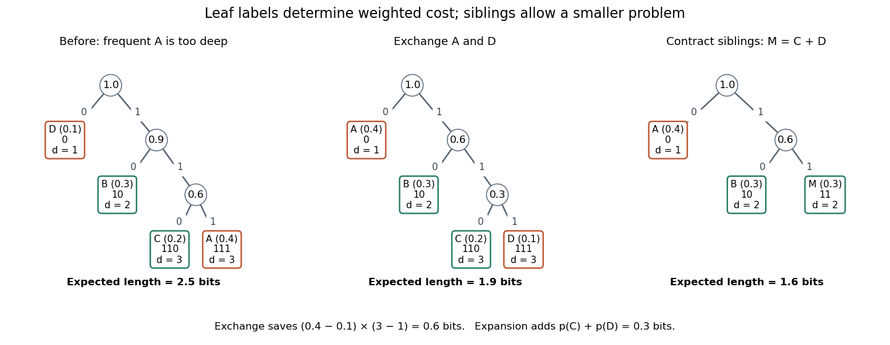

# Huffman sibling property

↑ **Parent:** [Huffman coding](huffman-coding.md)

For a finite source [alphabet](alphabet.md) of $n\geq2$ symbols with positive weights $w_x$, choose any two least weights, breaking ties arbitrarily. There exists an [optimal prefix code](optimal-prefix-code.md) over the binary output [alphabet](alphabet.md) $\{0,1\}$ whose chosen symbols occupy [sibling leaves in a code tree](sibling-leaves-in-a-code-tree.md) at maximum [leaf depth in a code tree](leaf-depth-in-a-code-tree.md). Weights may be counts or [probabilities](probability.md): dividing every weight by $W=\sum_xw_x$ gives the same minimizers. The existence statement is what makes the first merge of [Huffman coding](huffman-coding.md) safe. It does not say that every [optimal prefix code](optimal-prefix-code.md) already has the chosen pair together.[p. 1099: Derived Coding Requirements and Optimum Binary Code](a-method-for-the-construction-of-minimum-redundancy-codes-by-david-a-huffman.md)

An exchange makes the idea tangible. Take [probabilities](probability.md) $(p_A,p_B,p_C,p_D)=(0.4,0.3,0.2,0.1)$. The [prefix code](prefix-code.md) $D\mapsto0$, $B\mapsto10$, $C\mapsto110$, $A\mapsto111$ has [expected codeword length](expected-codeword-length.md) $2.5$ [bits](bit.md). Exchange only the symbols $A,D$ at their existing leaves: the available [codewords](codeword.md) and [code tree](prefix-tree-of-a-code.md) shape stay fixed, but the [codeword lengths](codeword-length.md) in symbol order become $(1,2,3,3)$. The new [expected codeword length](expected-codeword-length.md) is $1.9$ [bits](bit.md), and the two least [probabilities](probability.md), those of $C,D$, now occupy deepest [sibling leaves in a code tree](sibling-leaves-in-a-code-tree.md). The saving is $(0.4-0.1)(3-1)=0.6$ [bit](bit.md) per source symbol.

**[Figure 23](#prefix-tree-leaf-exchange-and-contraction). Exchanging two leaf labels reduces expected length from 2.5 to 1.9 bits; contracting the least-probability siblings leaves cost 1.6**.

Here is the short proof outline. An [optimal prefix code](optimal-prefix-code.md) with positive weights has a [full binary tree](full-binary-tree.md) as its [code tree](prefix-tree-of-a-code.md): suppressing a [vertex](vertex-graph-theory.md) with only one child shortens every [codeword](codeword.md) in that [subtree](subtree.md) and strictly reduces cost. A deepest leaf therefore has a leaf as its sibling, giving the [deepest sibling property of an optimal prefix code](deepest-sibling-property-of-an-optimal-prefix-code.md). Put the two chosen least weights at these positions by successive exchanges of leaf labels. Moving a weight $a$ from [leaf depth in a code tree](leaf-depth-in-a-code-tree.md) $d$ to a deepest position $D\geq d$, occupied by $b\geq a$, changes the weighted sum by

$$
\Delta C=aD+bd-(ad+bD)=(a-b)(D-d)\leq0.
$$

Fix one chosen weight there, then move the other into the neighbouring deepest position; if it is already there, no exchange is needed. The [prefix code](prefix-code.md) condition survives because the set of [codewords](codeword.md) is unchanged. Starting from an [optimal prefix code](optimal-prefix-code.md), the cost cannot decrease below the minimum, so these exchanges preserve optimality. Strictly unequal weights at unequal depths would give a strict decrease, explaining [probability monotonicity of optimal prefix-code lengths](probability-monotonicity-of-optimal-prefix-code-lengths.md). Equal weights or equal depths allow cost-neutral exchanges. [Symbol Codes by Ben Lynn](symbol-codes-by-ben-lynn.md)

**Table of contents**

- [Sibling leaves in a code tree](sibling-leaves-in-a-code-tree.md)
- [Huffman sibling contraction](huffman-sibling-contraction.md)

## ↑ Ancestors (6)

1. [Huffman coding](huffman-coding.md)
2. [Information theory](information-theory-split.md)
3. [Probability and statistics](probability-and-statistics-split.md)
4. [Area of mathematics](area-of-mathematics.md)
5. [Mathematics](mathematics-split.md)
6. [Codex Wiki](split.md)

## ← Incoming links (4)

- [Huffman sibling contraction](huffman-sibling-contraction.md)
- [Nonunique optimal prefix code](nonunique-optimal-prefix-code.md)
- [Optimal prefix code](optimal-prefix-code.md)
- [Sibling leaves in a code tree](sibling-leaves-in-a-code-tree.md)
