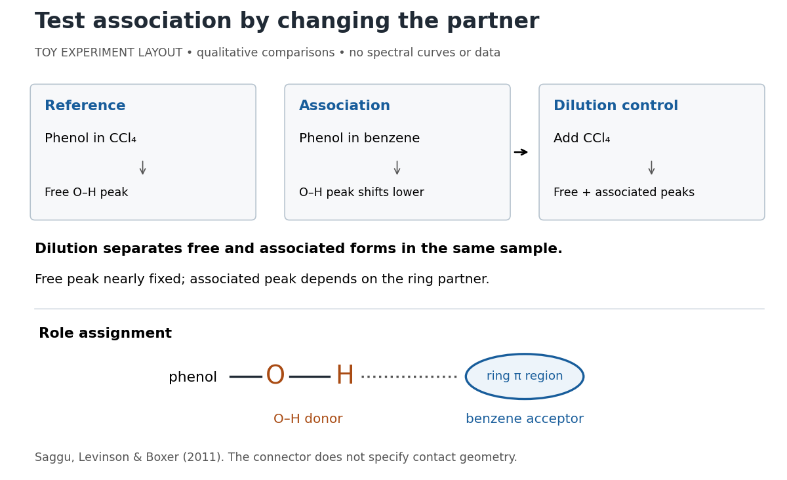

# Hydrogen bond acceptor

↑ **Parent:** [Hydrogen bond](hydrogen-bond.md)

A [hydrogen bond acceptor](hydrogen-bond-acceptor.md) supplies the electron-rich atom or group $Y$ interacting with the attached [hydrogen](hydrogen.md) of a [hydrogen bond donor](hydrogen-bond-donor.md) in $X-\mathrm H\cdots Y$. An [oxygen](oxygen.md) [lone pair](lone-pair.md) in [water](water.md) is the familiar example. Acceptance describes the association, not necessarily acquisition of a [proton](proton.md). A single [molecule](molecule.md), such as [water](water.md) or [ammonia](ammonia.md), can offer both [hydrogen bond donor](hydrogen-bond-donor.md) and [hydrogen bond acceptor](hydrogen-bond-acceptor.md) sites. See [Glasfeld: water and nitrogen-containing accepting sites](https://people.reed.edu/~glasfeld/Chem391/notes/ChIMF_2018.pdf).

A [lone pair](lone-pair.md) drawn in a [Lewis structure](lewis-structure.md) is a useful clue, not a universal test. At an ordinary neutral [amide](amide.md) [nitrogen](nitrogen.md), the nominal [lone pair](lone-pair.md) participates in [chemical resonance](resonance-chemistry.md) with the [carbonyl group](carbonyl-group.md), so this [nitrogen](nitrogen.md) is ordinarily excluded from lists of [hydrogen bond acceptors](hydrogen-bond-acceptor.md); the [carbonyl group](carbonyl-group.md)'s [oxygen](oxygen.md) remains an accepting site. [Protonation](protonation.md) changes the test again: $\mathrm{NH}_4^+$ has four N–H [covalent bonds](covalent-bond.md) and no [nitrogen](nitrogen.md) [lone pair](lone-pair.md), whereas [ammonia](ammonia.md) has three and one. These distinctions follow the actual chemical form, and accepting ability also depends on the partner and whether it can approach the site. See [McMurry: amide resonance and protonation](https://openstax.org/books/organic-chemistry/pages/24-3-basicity-of-amines) and [Glasfeld: limitations of nitrogen accepting sites](https://people.reed.edu/~glasfeld/Chem391/notes/ChIMF_2018.pdf).

Conversely, an accepting group need not supply an atom-centred [lone pair](lone-pair.md). The following [phenol](phenol.md)–[benzene](benzene.md) experiment probes an O–H donor interacting with the ring's distributed $\pi$ [electron density](electron-density.md).

**[Figure 24](#image-infrared-spectroscopy-distinguishes-free-and-associated-phenol-schematic-experimental-logic-no-plotted-or-simulated-spectra). Infrared spectroscopy distinguishes free and associated phenol: schematic experimental logic, no plotted or simulated spectra**. Original toy layout of the comparisons reported by Saggu, Levinson and Boxer (2011). The connector identifies an O–H donor and a ring accepting region; it does not specify a measured [bond length](bond-length.md) or the calculated contact geometry.

Saggu, Levinson and Boxer (2011) used [infrared spectroscopy](infrared-spectroscopy.md) to compare $200\,\mathrm{mmol\,L^{-1}}$ [phenol](phenol.md) in different [solvents](solvent.md). The O–H stretching peak was at $3611\,\mathrm{cm^{-1}}$ in $\mathrm{CCl}_4$ and $3555.9\,\mathrm{cm^{-1}}$ in [benzene](benzene.md). To distinguish association from a general [solvent](solvent.md) effect, they diluted the ring-containing [chemical solutions](solution-chemistry.md) with $\mathrm{CCl}_4$: two peaks appeared, with the free peak nearly fixed while the associated peak depended on the partner. Replacing the O–H [hydrogen](hydrogen.md) with [deuterium](deuterium.md) reproduced the ordering of shifts for different partners. Thus the perturbed O–H group identifies the [hydrogen bond donor](hydrogen-bond-donor.md); the ring supplies the [hydrogen bond acceptor](hydrogen-bond-acceptor.md). A peak shift alone does not specify a unique [molecular geometry](molecular-geometry.md). [Saggu, Levinson and Boxer, Direct measurements of electric fields in weak OH···π hydrogen bonds, JACS 133 (2011), Figure 1, Table 1 and dilution controls](https://pmc.ncbi.nlm.nih.gov/articles/PMC3202663/)

The roles make recognition between [molecules](molecule.md) intelligible: exposed [hydrogen bond donors](hydrogen-bond-donor.md) need compatible [hydrogen bond acceptors](hydrogen-bond-acceptor.md) in reachable positions. A count of sites is a starting description, not a prediction of binding strength. In [water](water.md), forming a contact between two partners can also replace their existing [hydrogen bonds](hydrogen-bond.md) to [water](water.md); the [Gibbs free energy](gibbs-free-energy.md) of association concerns the whole change. See [Glasfeld, pp. 15–16: competition with solvent interactions](https://people.reed.edu/~glasfeld/Chem391/notes/ChIMF_2018.pdf).

## ↑ Ancestors (4)

1. [Hydrogen bond](hydrogen-bond.md)
2. [Chemical bond](chemical-bond.md)
3. [Chemistry](chemistry-split.md)
4. [Codex Wiki](split.md)

## ← Incoming links (6)

- [Beta sheet](beta-sheet.md)
- [Hydrogen bond](hydrogen-bond.md)
- [Hydrogen bond acceptor](hydrogen-bond-acceptor.md)
- [Hydrogen bond donor](hydrogen-bond-donor.md)
- [Phenol](phenol.md)
- [Valence shell electron pair repulsion theory](valence-shell-electron-pair-repulsion-theory.md)
