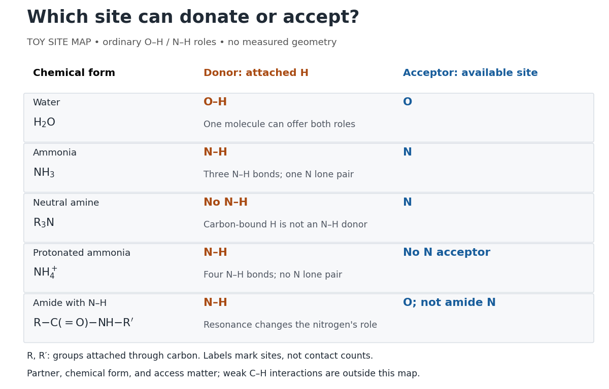

# Hydrogen bond donor

↑ **Parent:** [Hydrogen bond](hydrogen-bond.md)

A [hydrogen bond donor](hydrogen-bond-donor.md) is the $X-\mathrm H$ group supplying the attached [hydrogen](hydrogen.md) in a [hydrogen bond](hydrogen-bond.md) $X-\mathrm H\cdots Y$. The donor atom $X$, or the whole [molecule](molecule.md) containing it, may also be called the donor. The terminology does not imply transfer of a free [proton](proton.md): in the ordinary [water](water.md) pair, the O–H [covalent bond](covalent-bond.md) remains. Familiar donors include O–H groups in [water](water.md) and N–H groups in [ammonia](ammonia.md). See [Andrew Glasfeld, Intermolecular Attraction, pp. 12–13: donor and acceptor roles](https://people.reed.edu/~glasfeld/Chem391/notes/ChIMF_2018.pdf).

**[Figure 23](#image-hydrogen-bond-donor-and-hydrogen-bond-acceptor-roles-depend-on-attached-hydrogen-protonation-and-chemical-resonance). Hydrogen bond donor and hydrogen bond acceptor roles depend on attached hydrogen, protonation, and chemical resonance**. Toy site map for ordinary O–H and N–H associations, not measured geometry or an exhaustive list of [hydrogen bonds](hydrogen-bond.md). $R$ and $R'$ denote groups attached through [carbon](carbon.md). Coloured labels identify possible sites, rather than count the number of simultaneous contacts.

The attached [hydrogen](hydrogen.md) is essential to this role. At the [nitrogen](nitrogen.md) site, an unprotonated [amine](amine.md) $R_3\mathrm N$ can be a [hydrogen bond acceptor](hydrogen-bond-acceptor.md), but has no N–H [hydrogen bond donor](hydrogen-bond-donor.md). [Protonation](protonation.md) gives $R_3\mathrm{NH}^+$: the new N–H group can donate, while that [nitrogen](nitrogen.md) no longer has the accepting [lone pair](lone-pair.md). This is a change of chemical form, not a permanent label attached to a [chemical element](chemical-element.md). Here $R$ denotes a group attached through [carbon](carbon.md); the statement concerns the [nitrogen](nitrogen.md) site and does not rule out weaker C–H associations elsewhere. See [McMurry, Organic Chemistry, 24.3: amine protonation](https://openstax.org/books/organic-chemistry/pages/24-3-basicity-of-amines) and [Glasfeld: protonated amines as donors](https://people.reed.edu/~glasfeld/Chem391/notes/ChIMF_2018.pdf).

An [amide](amide.md) with an N–H [covalent bond](covalent-bond.md) can donate even though its [nitrogen](nitrogen.md) is ordinarily not an accepting site. For example, in $R-\mathrm C(=\mathrm O)-\mathrm{NH}-R'$, N–H is a [hydrogen bond donor](hydrogen-bond-donor.md) and the [carbonyl group](carbonyl-group.md)'s [oxygen](oxygen.md) is a [hydrogen bond acceptor](hydrogen-bond-acceptor.md). Replacing the remaining N–H by another group attached through [carbon](carbon.md) removes this N–H donor without removing the accepting [oxygen](oxygen.md). The analogous division of roles in a [peptide bond](peptide-bond.md) helps explain [protein](protein.md) structure. See [Glasfeld: amide roles and biological interactions](https://people.reed.edu/~glasfeld/Chem391/notes/ChIMF_2018.pdf). The useful question is therefore which site supplies the [hydrogen](hydrogen.md), rather than whether the whole substance is simply “hydrogen bonding”.

## ↑ Ancestors (4)

1. [Hydrogen bond](hydrogen-bond.md)
2. [Chemical bond](chemical-bond.md)
3. [Chemistry](chemistry-split.md)
4. [Codex Wiki](split.md)

## ← Incoming links (6)

- [Beta sheet](beta-sheet.md)
- [Hydrogen bond](hydrogen-bond.md)
- [Hydrogen bond acceptor](hydrogen-bond-acceptor.md)
- [Hydrogen bond donor](hydrogen-bond-donor.md)
- [Phenol](phenol.md)
- [Valence shell electron pair repulsion theory](valence-shell-electron-pair-repulsion-theory.md)
