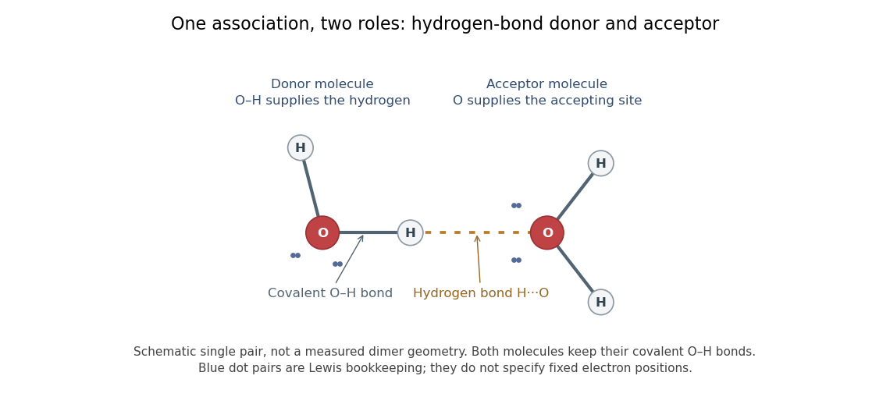

# Hydrogen bond

↑ **Parent:** [Chemical bond](chemical-bond-split.md)  
ⓦ [Wiki](https://en.wikipedia.org/wiki/Hydrogen_bond)

A [hydrogen bond](hydrogen-bond.md) is an attractive association involving a [hydrogen](hydrogen.md) attached to another [chemical atom](atom-physics.md), and an accepting atom or group. In the IUPAC 2011 definition, the atom $X$ in $X-\mathrm H$ is more [electronegative](electronegativity-split.md) than [hydrogen](hydrogen.md), and evidence of bond formation is required. The familiar strong examples use O–H or N–H groups, but restricting the concept to only nitrogen, oxygen and fluorine misses weaker cases. A short distance alone is not the entire definition.[Arunan et al., Definition of the hydrogen bond, IUPAC Recommendations 2011](https://publications.iupac.org/pac/pdf/2011/pdf/8308x1637.pdf)

**[Figure 3](#image-two-water-molecules-play-different-hydrogen-bond-roles-while-retaining-their-own-covalent-o-h-bonds). Two water molecules play different hydrogen-bond roles while retaining their own covalent O–H bonds**.

In the depicted [water](water.md) pair, one O–H group is the [hydrogen bond donor](hydrogen-bond-donor.md); the other [oxygen](oxygen.md) supplies the [hydrogen bond acceptor](hydrogen-bond-acceptor.md). The solid O–H line denotes a [covalent bond](covalent-bond-split.md) within a [water](water.md) [molecule](molecule-split.md); the dotted H···O line denotes the [hydrogen bond](hydrogen-bond.md) between them. One [water](water.md) [molecule](molecule-split.md) can play both roles in a larger arrangement because it has O–H groups and [lone pairs](lone-pair.md).

This makes [hydrogen bonds](hydrogen-bond.md) useful for understanding organization beyond a single [molecular formula](molecular-formula.md). They connect [water](water.md) [molecules](molecule-split.md) and contribute to [protein](protein-split.md) folding and recognition between [molecules](molecule-split.md). The same types of [chemical atoms](atom-physics.md) can support different associations depending on which donor and acceptor sites are exposed and how they are oriented. Alberts and colleagues discuss these noncovalent interactions in [Molecular Biology of the Cell, the chemical components of a cell](https://www.ncbi.nlm.nih.gov/books/NBK26883/).

[Hydrogen bonds](hydrogen-bond.md) are often directional, with an approximately straight donor–H–acceptor arrangement favourable in familiar cases; strength and preferred geometry depend on the system. The IUPAC definition uses converging experimental or theoretical evidence rather than one universal distance threshold. The author-hosted [2009 task-group draft, §§3.1–3.3](https://ipc.iisc.ac.in/~ea/iupac/iupac/IUPAC_finalreport_Nov_2009TG.pdf) explains the definition and typical criteria leading to the recommendation.

**Table of contents**

- [Aminopyridine hydrogen-bonded dimer](aminopyridine-hydrogen-bonded-dimer.md)
- [Carboxylic-acid hydrogen-bonded dimer](carboxylic-acid-hydrogen-bonded-dimer.md)
- [Water dimer](water-dimer.md)
- [Hydrogen-bond complementarity](hydrogen-bond-complementarity.md)
  - [Hydrogen-bond donor–acceptor matching](hydrogen-bond-donor-acceptor-matching.md)
- [Hydrogen bonding](hydrogen-bonding.md)
- [Functional group interaction profile](functional-group-interaction-profile.md)
- [Hydrogen bond donor](hydrogen-bond-donor.md)
  - [Hydrogen-bond donor parameter](hydrogen-bond-donor-parameter.md)
- [Hydrogen bond acceptor](hydrogen-bond-acceptor.md)
  - [Hydrogen-bond acceptor parameter](hydrogen-bond-acceptor-parameter.md)

## ↑ Ancestors (3)

1. [Chemical bond](chemical-bond-split.md)
2. [Chemistry](chemistry-split.md)
3. [Codex Wiki](split.md)

## ← Incoming links (60)

- [1,3-diketone](1-3-diketone.md)
- [Active site](active-site.md)
- [Backbone hydrogen bond](backbone-hydrogen-bond.md)
- [Base pair](base-pair.md)
- [Base pairing](base-pairing.md)
- [Carboxylic acid dimer](carboxylic-acid-dimer.md)
- [Carboxylic-acid hydrogen-bonded dimer](carboxylic-acid-hydrogen-bonded-dimer.md)
- [Demercuration](demercuration.md)
- [Disulfide bond](disulfide-bond.md)
- [Glutamine](glutamine.md)
- [Guanidinium](guanidinium.md)
- [Hamaker estimate of liquid surface tension](hamaker-estimate-of-liquid-surface-tension.md)
- [Hydrogen bond](hydrogen-bond.md)
- [Hydrogen bond acceptor](hydrogen-bond-acceptor.md)
- [Hydrogen-bond catalysis](hydrogen-bond-catalysis.md)
- [Hydrogen bond donor](hydrogen-bond-donor.md)
- [Hydrogen bonding](hydrogen-bonding.md)
- [Hydrogen-deuterium exchange mass spectrometry](hydrogen-deuterium-exchange-mass-spectrometry.md)
- [Hydrophilicity](hydrophilicity.md)
- [Hydroxyl-directed epoxidation](hydroxyl-directed-epoxidation.md)
- [Hydrozirconation](hydrozirconation.md)
- [Intermolecular force](intermolecular-force.md)
- [Ion-dipole attraction](ion-dipole-attraction.md)
- [Metachloroperbenzoic acid](metachloroperbenzoic-acid.md)
- [Paratope](paratope.md)
- [Solution](past-exam-of-the-biochemistry-and-molecular-biology-course-of-the-university-of-cambridge/2025/paper-1/section-a/2/solution.md)
- [Solution](past-exam-of-the-biochemistry-course-of-the-university-of-cambridge/2025/paper-1/section-i/2/solution.md)
- [Solution](past-exam-of-the-biochemistry-course-of-the-university-of-cambridge/2025/paper-1/section-ii/6/solution.md)
- [Solution](past-exam-of-the-biochemistry-course-of-the-university-of-cambridge/2025/paper-4/section-iii/7/solution.md)
- [Solution](past-exam-of-the-chemistry-b-course-of-the-university-of-cambridge/2021/paper-1/b5/b/iii/solution.md)
- [Solution](past-exam-of-the-chemistry-b-course-of-the-university-of-cambridge/2022/paper-1/b1/b/ii/solution.md)
- [Solution](past-exam-of-the-chemistry-b-course-of-the-university-of-cambridge/2022/paper-1/b5/a/i/solution.md)
- [Solution](past-exam-of-the-chemistry-b-course-of-the-university-of-cambridge/2023/paper-1/b5/a/ii/solution.md)
- [Solution](past-exam-of-the-chemistry-b-course-of-the-university-of-cambridge/2023/paper-1/b5/a/iii/solution.md)
- [Solution](past-exam-of-the-chemistry-b-course-of-the-university-of-cambridge/2024/paper-1/b5/a/ii/solution.md)
- [Solution](past-exam-of-the-chemistry-b-course-of-the-university-of-cambridge/2024/paper-1/b5/b/i/solution.md)
- [Solution](past-exam-of-the-chemistry-b-course-of-the-university-of-cambridge/2024/paper-2/b10/b/solution.md)
- [Solution](past-exam-of-the-chemistry-b-course-of-the-university-of-cambridge/2024/paper-2/b10/d/ii/solution.md)
- [Solution](past-exam-of-the-chemistry-b-course-of-the-university-of-cambridge/2025/paper-1/b5/b/solution.md)
- [Solution](past-exam-of-the-chemistry-b-course-of-the-university-of-cambridge/2025/paper-1/b5/d/solution.md)
- [Solution](past-exam-of-the-chemistry-b-course-of-the-university-of-cambridge/2025/paper-2/b10/a/iii/solution.md)
- [Solution](past-exam-of-the-chemistry-b-course-of-the-university-of-cambridge/2025/paper-2/b10/a/iv/solution.md)
- [Solution](past-exam-of-the-chemistry-b-course-of-the-university-of-cambridge/2025/paper-2/b10/b/iii/solution.md)
- [Solution](past-exam-of-the-chemistry-course-of-the-year-3-of-the-natural-sciences-course-of-the-university-of-cambridge/2022/paper-3/50/e/solution.md)
- [Solution](past-exam-of-the-chemistry-course-of-the-year-4-of-the-natural-sciences-course-of-the-university-of-cambridge/2022/paper-1/14/b/solution.md)
- [Solution](past-exam-of-the-mphil-in-micro-and-nanotechnology-enterprise-course-of-the-university-of-cambridge/2021/paper-1/10/ii/a/solution.md)
- [Solution](past-exam-of-the-mphil-in-micro-and-nanotechnology-enterprise-course-of-the-university-of-cambridge/2021/paper-1/10/ii/b/solution.md)
- [Solution](past-exam-of-the-mphil-in-micro-and-nanotechnology-enterprise-course-of-the-university-of-cambridge/2021/paper-1/5/i/solution.md)
- [Solution](past-exam-of-the-mphil-in-micro-and-nanotechnology-enterprise-course-of-the-university-of-cambridge/2021/paper-1/5/ii/solution.md)
- [Solution](past-exam-of-the-mphil-in-micro-and-nanotechnology-enterprise-course-of-the-university-of-cambridge/2022/paper-1/section-b/10/iii/solution.md)
- [Solution](past-exam-of-the-quantum-condensed-matter-course-of-the-university-of-cambridge/2006/section-a/a1/a/solution.md)
- [Solution](past-exam-of-the-quantum-condensed-matter-course-of-the-university-of-cambridge/2007/section-a/a4/a/solution.md)
- [Solution](past-exam-of-the-soft-condensed-matter-course-of-the-university-of-cambridge/2021/section-b/5/a/solution.md)
- [Solution](past-exam-of-the-systems-biology-course-of-the-university-of-cambridge/2024/paper-2/3/ii/solution.md)
- [Phosphodiester bond](phosphodiester-bond.md)
- [Solvation](solvation.md)
- [Solvent-specific stabilization](solvent-specific-stabilization.md)
- [Spectroscopic measurement of hydration dynamics](spectroscopic-measurement-of-hydration-dynamics.md)
- [Spin crossover](spin-crossover.md)
- [Water dimer](water-dimer.md)
