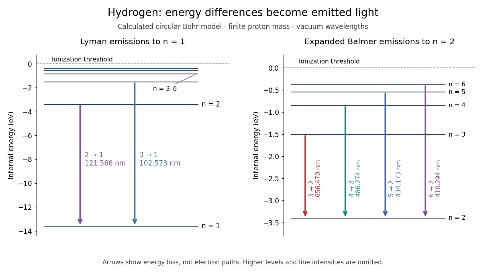

# Hydrogen transition wavelengths in the Bohr model

↑ **Parent:** [Bohr model](bohr-model.md)

For emission take integers $n_i>n_f\geq1$. Applying [conservation of energy](conservation-of-energy.md) to the model's internal [energy](energy-split.md) difference, while neglecting the much smaller whole-atom [photon](photon.md) recoil, gives

$$
\Delta E=E_{n_i}-E_{n_f}
=B_H\left(\frac{1}{n_f^2}-\frac{1}{n_i^2}\right),\qquad
B_H=\frac{\mu e^4}{2(4\pi\epsilon_0)^2\hbar^2},
$$

$$
\nu=\frac{\Delta E}{h},\qquad
\lambda=\frac{c}{\nu},\qquad
\frac{1}{\lambda}=R_H\left(\frac{1}{n_f^2}-\frac{1}{n_i^2}\right),\qquad
R_H=\frac{B_H}{hc}.
$$

Thus [Johannes Robert Rydberg](johannes-robert-rydberg.md)'s [Rydberg formula](rydberg-formula.md) is a difference of two [energy levels](energy-level.md) expressed as a [spectroscopic wavenumber](spectroscopic-wavenumber.md). The same constants determine every line; there is no new parameter for each [electronic transition](electronic-transition.md). With the chosen inputs, $R_H=1.096775834\times10^7\,\mathrm{m^{-1}}$. All [wavelengths](wavelength.md) below are calculated in vacuum, not air, and are rounded model predictions rather than historical measurements.

| [Electronic transition](electronic-transition.md) $n_i\to n_f$ | Series | [Photon](photon.md) [energy](energy-split.md) in [electronvolts](electronvolt.md) | Vacuum [wavelength](wavelength.md) in $\mathrm{nm}$ | $2\to1$ | [Lyman series](lyman-series.md) | $10.19872$ | $121.568$ | $3\to1$ | [Lyman series](lyman-series.md) | $12.08737$ | $102.573$ | $3\to2$ | [Balmer series](balmer-series.md) | $1.88865$ | $656.470$ | $4\to2$ | [Balmer series](balmer-series.md) | $2.54968$ | $486.274$ | $5\to2$ | [Balmer series](balmer-series.md) | $2.85564$ | $434.173$ | $6\to2$ | [Balmer series](balmer-series.md) | $3.02184$ | $410.294$ |
| --- | --- | --- | --- | --- | --- | --- | --- | --- | --- | --- | --- | --- | --- | --- | --- | --- | --- | --- | --- | --- | --- | --- | --- | --- | --- | --- | --- |

The conventional names commemorate [Theodore Lyman](theodore-lyman.md) and [Johann Jakob Balmer](johann-jakob-balmer.md). Fixing $n_f=1$ produces the ultraviolet [Lyman series](lyman-series.md), beginning with the [Lyman-alpha line](lyman-alpha-line.md); fixing $n_f=2$ produces the [Balmer series](balmer-series.md). As $n_i\to\infty$, the [wavelength](wavelength.md) approaches $n_f^2/R_H$: $91.1763\,\mathrm{nm}$ at the [Lyman limit](lyman-limit.md) and $364.705\,\mathrm{nm}$ for the [Balmer series](balmer-series.md). Crowding follows directly from $E_{n+1}-E_n\sim2B_H/n^3$. Discreteness therefore coexists with a series limit.

**[Figure 3](#image-calculated-hydrogen-atom-energy-levels-and-selected-lyman-series-and-balmer-series-emissions). Calculated hydrogen atom energy levels and selected Lyman series and Balmer series emissions**. Original [Bohr model](bohr-model.md) prediction using the stipulated finite nuclear [mass](mass.md). Left: the full [energy](energy-split.md) scale with the [ionization energy](ionization-energy.md) threshold at zero. Right: an expanded upper-level view makes the [Balmer series](balmer-series.md) arrows readable. Downward arrows mark internal [energy](energy-split.md) differences, not spatial [electron](electron.md) trajectories; their selection does not predict relative line strengths.

Correct line positions do not give [wave intensities](intensity-physics.md), lifetimes or [electric-dipole selection rules for hydrogen](electric-dipole-selection-rules-for-hydrogen.md). Those require a theory of the [wavefunctions](wave-function-split.md) and their coupling to [electromagnetic radiation](electromagnetic-radiation-split.md). The circular model also omits [spin](spin.md), relativistic corrections and the [Lamb shift](lamb-shift.md). Its successful gross [energy levels](energy-level.md) do not make its assumed [orbits](orbit-dynamical-system.md) modern [atomic orbitals](atomic-orbital.md).

## ↑ Ancestors (5)

1. [Bohr model](bohr-model.md)
2. [Hydrogen atom](hydrogen-atom.md)
3. [Mathematical physics](mathematical-physics-split.md)
4. [Physics](physics-split.md)
5. [Codex Wiki](split.md)
