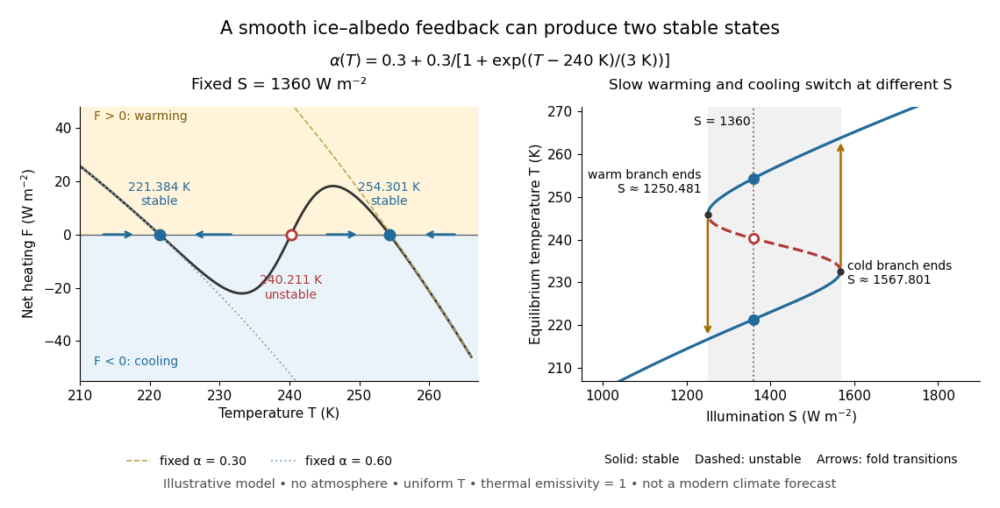

# Ice-ocean albedo feedback

↑ **Parent:** [Geophysics](geophysics-split.md)

[Ice-ocean albedo feedback](ice-ocean-albedo-feedback.md) is the ocean-surface case of [ice-albedo feedback](ice-albedo-feedback.md): loss of bright [sea ice](sea-ice.md), often covered by [snow](snow.md), exposes darker water, lowers [surface albedo](surface-albedo.md) and increases absorbed sunlight. The extra stored [ocean heat content](ocean-heat-content.md) can promote further melting and delay refreezing. Reversing the sequence can amplify cooling. This is a positive [climate feedback](climate-feedback.md), meaning that it reinforces the initial change; the word positive does not mean beneficial, and it does not guarantee runaway warming.

For unchanged downward solar [irradiance](irradiance.md) $S_\downarrow$ on a newly exposed opaque patch, the extra absorbed [heat flux](heat-flux-density.md) is

$$
\Delta F_{\rm abs}=(\alpha_{\rm ice}-\alpha_{\rm water})S_\downarrow.
$$

For illustrative local [surface albedos](surface-albedo.md) $0.60$ and $0.10$, and $S_\downarrow=200\,\mathrm{W\,m^{-2}}$, the patch absorbs an additional $100\,\mathrm{W\,m^{-2}}$. This is a local sunlight calculation, not a whole-planet [radiative forcing](radiative-forcing.md): newly exposed [area](surface-area.md), illumination, clouds and season determine its global contribution. With no incident sunlight this particular heating pathway vanishes. NASA's notes describe the contrast between reflective [ice](ice.md) and [snow](snow.md) and darker water. [NASA, Explore Albedo Activity](https://science.nasa.gov/learn/heat/resource/explore-albedo-activity/)

To isolate how a positive [climate feedback](climate-feedback.md) competes with [Planck feedback](planck-feedback.md), retain the assumptions of the [zero-dimensional planetary energy balance](zero-dimensional-planetary-energy-balance.md) and prescribe the smooth broadband [Bond albedo](bond-albedo.md)

$$
\alpha(T)=0.3+\frac{0.3}{1+\exp[(T-240\,\mathrm K)/(3\,\mathrm K)]}.
$$

The [exponential function](exponential-function.md) makes a smooth transition from a bright cold state near $0.6$ to a darker warm state near $0.3$. The midpoint $240\,\mathrm K$ and width $3\,\mathrm K$ are chosen to illustrate the dynamics. They are not a seawater freezing law, an observed global relation, or a calibration of modern [Earth](earth.md). No evolving ice thickness or [latent heat](latent-heat.md) is represented.

An [equilibrium](equilibrium-point-of-a-dynamical-system.md) satisfies $F(T_*)=0$. For a small perturbation $\delta T$, [linear stability](linear-stability.md) follows from

$$
C\frac{d\delta T}{dt}\simeq F'(T_*)\delta T,\qquad
F'(T)=-\frac S4\alpha'(T)-4\sigma T^3.
$$

Since $C>0$, $F'<0$ gives an [asymptotically stable](asymptotic-stability.md) [equilibrium](equilibrium-point-of-a-dynamical-system.md), while $F'>0$ gives an [unstable equilibrium](unstable-equilibrium.md). With $x=(T-240\,\mathrm K)/(3\,\mathrm K)$, the [derivative](derivative.md) is

$$
\alpha'(T)=-\frac{0.3}{3\,\mathrm K}\frac{e^x}{(1+e^x)^2}<0.
$$

Thus the optical term $-S\alpha'/4$ is destabilizing, while the [thermal radiation](thermal-radiation.md) term $-4\sigma T^3$ is stabilizing. Their sum, not the optical term alone, decides the [linear stability](linear-stability.md).

For the same $S=1360\,\mathrm{W\,m^{-2}}$ and [Stefan-Boltzmann constant](stefan-boltzmann-constant.md) used above, the [bisection method](bisection-method.md) on the intervals $(220,223)$, $(238,241)$ and $(253,255)$, with [temperature](temperature-split.md) in [kelvins](kelvin.md), gives:

| Equilibrium [temperature](temperature-split.md) ($\mathrm K$) | [Bond albedo](bond-albedo.md) $\alpha(T_*)$ | $F'(T_*)$ ($\mathrm{W\,m^{-2}\,K^{-1}}$) | Behavior |
| --- | --- | --- | --- |
| $221.384$ | $0.599396$ | $-2.392633$ | [Asymptotically stable](asymptotic-stability.md) cold [equilibrium](equilibrium-point-of-a-dynamical-system.md) |
| $240.211$ | $0.444731$ | $+5.345752$ | [Unstable equilibrium](unstable-equilibrium.md) |
| $254.301$ | $0.302530$ | $-3.445726$ | [Asymptotically stable](asymptotic-stability.md) warm [equilibrium](equilibrium-point-of-a-dynamical-system.md) |

Unrounded numerical [zeros of a function](zero-of-a-function.md) have $|F(T_*)|<10^{-10}\,\mathrm{W\,m^{-2}}$; the table rounds them for readability. In the positive-[temperature](temperature-split.md) domain the sign of $F$ alternates between heating, cooling, heating and cooling across these three [equilibria](equilibrium-point-of-a-dynamical-system.md). The middle [equilibrium](equilibrium-point-of-a-dynamical-system.md) separates the [basins of attraction](basin-of-attraction.md) of the two [stable equilibria](stable-equilibrium.md). For example, a starting [temperature](temperature-split.md) of $235\,\mathrm K$ cools toward the cold state, whereas $245\,\mathrm K$ warms toward the warm state: this is [bistability](bistability.md) at identical external illumination.

**[Figure 2](#image-two-stable-equilibria-and-one-unstable-equilibrium-in-an-illustrative-smooth-ice-albedo-model). Two stable equilibria and one unstable equilibrium in an illustrative smooth ice-albedo model**. Left: net heating versus temperature at fixed illumination, with arrows pointing toward the stable zeros. Right: the equilibrium curve as illumination varies; solid branches are stable and the dashed branch is unstable. The dotted vertical line selects the same three equilibria shown on the left.

The same model illustrates [hysteresis](hysteresis.md). Its [equilibrium](equilibrium-point-of-a-dynamical-system.md) curve can be written as $S(T)=4\sigma T^4/[1-\alpha(T)]$. The two turning points, where $4[1-\alpha(T)]+T\alpha'(T)=0$, are [saddle-node bifurcations](saddle-node-bifurcation.md): approximately $(T,S)=(232.637\,\mathrm K,1567.801\,\mathrm{W\,m^{-2}})$ and $(245.893\,\mathrm K,1250.481\,\mathrm{W\,m^{-2}})$. For illumination strictly between these thresholds there are two [stable equilibria](stable-equilibrium.md) and one [unstable equilibrium](unstable-equilibrium.md). Under sufficiently slow increase of $S$, the cold branch ends at the upper threshold; under sufficiently slow decrease, the warm branch ends at the lower threshold. The ensuing warming and cooling transitions differ, so the state depends on its history. Finite sweep rates can delay the transitions; these thresholds describe this model's static [equilibrium](equilibrium-point-of-a-dynamical-system.md) curve, not predicted tipping points for modern [Earth](earth.md).

The striking feature is that a smooth [albedo](albedo.md) law can produce distinct long-time states and abrupt transitions, although no discontinuity was inserted into the optical law. It is useful for understanding why positive [climate feedback](climate-feedback.md) can amplify a response while stabilizing [thermal radiation](thermal-radiation.md) still limits it. Here $0.3<\alpha(T)<0.6$ bounds the incoming heating, whereas outgoing [thermal radiation](thermal-radiation.md) grows as $T^4$; high enough [temperatures](temperature-split.md) therefore cool rather than run away indefinitely.

Historically, M. I. Budyko's 1969 paper coupled changing [albedo](albedo.md) from expanding [ice](ice.md) cover to a latitude-dependent [temperature](temperature-split.md) and [heat transfer](heat-transfer.md) calculation, showing how that coupling amplified the effect of changed sunlight. [M. I. Budyko, The effect of solar radiation variations on the climate of the Earth, Tellus 21(5), 611–619, 1969, pp. 614–616](https://cdn.repub.ch/s3/republik-assets/assets/pdf/budyko_1969.pdf) William D. Sellers's 1969 paper constructed an annual energy-budget model in 10-degree latitude belts, including planetary [albedo](albedo.md), atmospheric infrared transmission and atmospheric and oceanic exchange. [William D. Sellers, A Global Climatic Model Based on the Energy Balance of the Earth-Atmosphere System, Journal of Applied Meteorology 8, 392–400, 1969](https://acoustique.ec-lyon.fr/chaos/Sellers69.pdf) These primary papers provide historical examples of ice-sensitive energy-budget modeling; the smooth single-[temperature](temperature-split.md) example above is a separate illustration, not a reproduction of either paper's equations or predictions.

## ↑ Ancestors (4)

1. [Geophysics](geophysics-split.md)
2. [Branches of physics](branches-of-physics.md)
3. [Physics](physics-split.md)
4. [Codex Wiki](split.md)

## ← Incoming links (5)

- [Albedo](albedo.md)
- [Geophysics](geophysics-split.md)
- [Ice-ocean albedo feedback](ice-ocean-albedo-feedback.md)
- [Solution](past-exam-of-the-mathematics-course-of-the-university-of-cambridge/2010/iii/paper-69/1/solution.md)
- [Zero-dimensional planetary energy balance](zero-dimensional-planetary-energy-balance.md)
