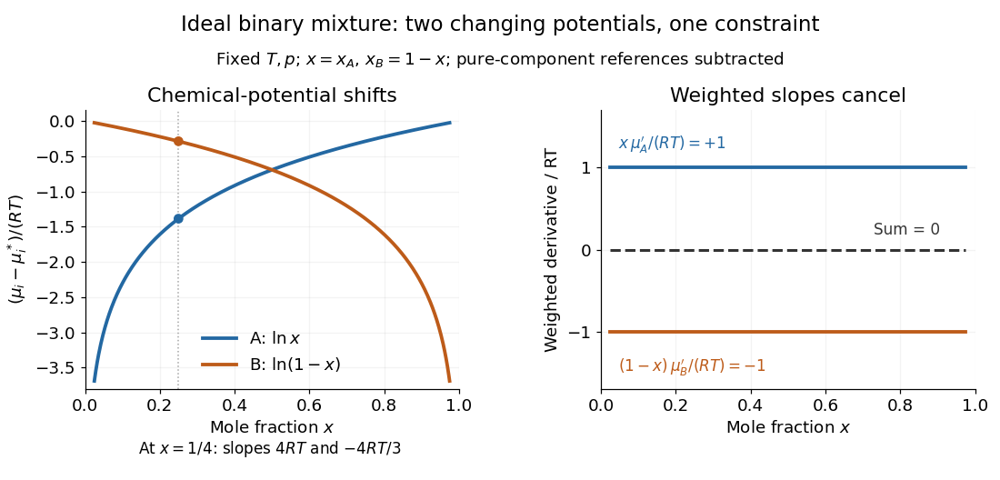
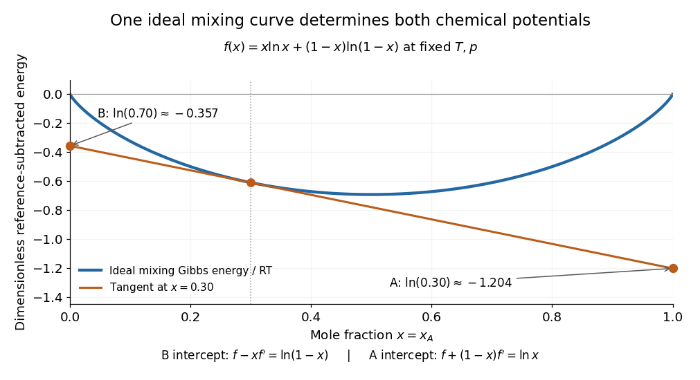

# Ideal binary Gibbs-Duhem cancellation

↑ **Parent:** [Gibbs-Duhem equation](gibbs-duhem-equation.md)

An [ideal solution](ideal-solution.md) has molar [chemical potentials](chemical-potential-split.md)

$$
\mu_A=\mu_A^*(T,p)+RT\ln x,
\qquad
\mu_B=\mu_B^*(T,p)+RT\ln(1-x),
$$

where $R$ is the [molar gas constant](molar-gas-constant.md) and the stars denote pure-component reference values at the same [temperature](temperature-split.md) and [pressure](pressure-split.md).[Thermodynamics and Chemistry, §9.4.2, printed pp. 249–250, equations 9.4.5 and 9.4.8; definition of an ideal mixture](thermodynamics-and-chemistry-by-howard-devoe.md)

Hold [temperature](temperature-split.md) and [pressure](pressure-split.md) fixed. The [derivatives](derivative.md) with respect to $x$ are $RT/x$ and $-RT/(1-x)$, so

$$
x\frac{d\mu_A}{dx}=RT,
\qquad
(1-x)\frac{d\mu_B}{dx}=-RT.
$$

Each [chemical potential](chemical-potential-split.md) changes, yet their composition-weighted slopes cancel exactly. At $x=1/4$, the two slopes are $4RT$ and $-4RT/3$; multiplying by $1/4$ and $3/4$ gives $RT$ and $-RT$. Near either pure-component endpoint the dilute component's slope diverges, but its weighted contribution remains finite. The endpoint [chemical potential](chemical-potential-split.md) itself requires a limiting interpretation because its [logarithm](logarithm.md) diverges.

**[Figure 23](#image-ideal-binary-chemical-potentials-change-while-their-weighted-slopes-cancel). Ideal binary chemical potentials change while their weighted slopes cancel**. Original ideal-solution calculations at fixed temperature and pressure. The left panel subtracts each pure-component chemical potential and divides by RT. The right panel shows the two weighted derivatives divided by RT; they sum to zero throughout the open composition interval.

The same constraint has a geometric explanation. Subtract the pure-component reference contribution from the molar [Gibbs free energy](gibbs-free-energy.md) and divide by $RT$ to obtain

$$
f(x)=x\ln x+(1-x)\ln(1-x).
$$

Its [derivative](derivative.md) is $f'(x)=\ln[x/(1-x)]$. At fixed total [amount of substance](amount-of-substance.md), exchanging a little B for A changes the [Gibbs free energy](gibbs-free-energy.md) with slope $\mu_A-\mu_B$. Consequently the tangent to $f$ at $x$ has intercepts

$$
f(x)-x f'(x)=\ln(1-x),
\qquad
f(x)+(1-x)f'(x)=\ln x
$$

at horizontal coordinates $0$ and $1$, respectively. The two [chemical potentials](chemical-potential-split.md) come from the same curve: choosing two unrelated functions would generally destroy this tangent construction.

**[Figure 24](#image-one-ideal-mixing-gibbs-energy-curve-determines-both-chemical-potentials). One ideal mixing Gibbs-energy curve determines both chemical potentials**. Original ideal-solution geometry with each pure-component reference subtracted. The tangent at x=0.30 reaches the B chemical-potential shift at x=0 and the A chemical-potential shift at x=1. The plotted curve and tangent are theoretical calculations, not experimental data.

## ↑ Ancestors (6)

1. [Gibbs-Duhem equation](gibbs-duhem-equation.md)
2. [Thermodynamics](thermodynamics-split.md)
3. [Statistical physics](statistical-physics-split.md)
4. [Branches of physics](branches-of-physics.md)
5. [Physics](physics-split.md)
6. [Codex Wiki](split.md)
