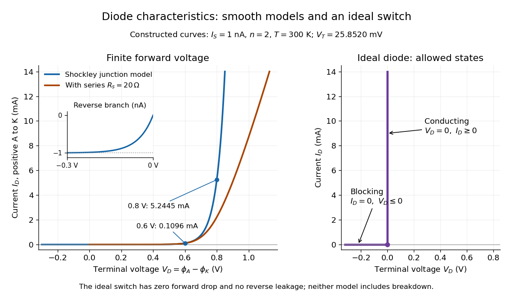

# Ideal diode model

↑ **Parent:** [Diode](diode.md)

The [ideal diode model](ideal-diode-model.md) sets the conducting [electric potential difference](electric-potential-difference.md) to zero and the blocking [electric current](electric-current.md) to zero. With the stated orientation,

$$
\begin{aligned}
\text{conducting:}&\quad V_D=0,\quad I_D\geq0,\\
\text{blocking:}&\quad I_D=0,\quad V_D\leq0.
\end{aligned}
$$

[The Junction Diode, §1.12.1, printed p. 30: zero forward voltage and zero reverse current idealization](the-junction-diode-by-w-marshall-leach-jr.md)

The surrounding [electrical circuit](electrical-circuit-split.md) chooses the state and remaining value. The two branches meet at $V_D=I_D=0$. Their product vanishes, so the ideal [diode](diode.md) dissipates no [power](power.md): $P_D=V_DI_D=0$.

The [ideal diode model](ideal-diode-model.md) omits forward drop, reverse leakage, [diode reverse breakdown](diode-reverse-breakdown.md) and switching delay.

**[Figure 1](#image-smooth-diode-models-and-the-ideal-diode-constraint). Smooth diode models and the ideal diode constraint**. Original calculated [current-voltage characteristics](current-voltage-characteristic.md), not device measurements. Left: the [Shockley diode equation](shockley-diode-equation.md) with $I_S=1\,\mathrm{nA}$, $n=2$, $T=300\,\mathrm K$, and a constructed extension with internal series [electrical resistance](electrical-resistance.md) $R_s=20\,\Omega$. The inset resolves reverse [electric current](electric-current.md) in nanoamperes. Right: the two allowed branches of the [ideal diode model](ideal-diode-model.md), using the same terminal orientation.

## ↑ Ancestors (6)

1. [Diode](diode.md)
2. [Electrical circuit](electrical-circuit-split.md)
3. [Electromagnetism](electromagnetism-split.md)
4. [Branches of physics](branches-of-physics.md)
5. [Physics](physics-split.md)
6. [Codex Wiki](split.md)

## ← Incoming links (5)

- [Diode](diode.md)
- [Diode anode](diode-anode.md)
- [Diode reverse breakdown](diode-reverse-breakdown.md)
- [Half-wave rectifier](half-wave-rectifier.md)
- [Ideal diode model](ideal-diode-model.md)
