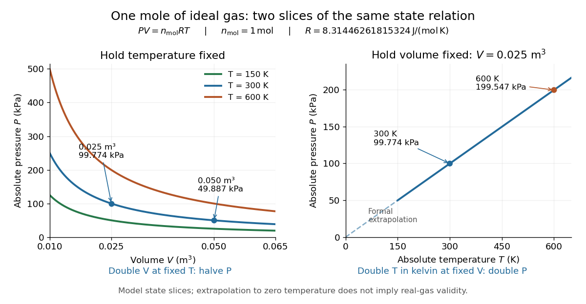

# Ideal gas law

↑ **Parent:** [Ideal gas](ideal-gas-split.md)  
ⓦ [Wiki](https://en.wikipedia.org/wiki/Ideal_gas_law)

The [ideal gas law](ideal-gas-law.md) is the [equation of state](equation-of-state.md) relating the absolute [pressure](pressure-split.md) $P$, [volume](volume-thermodynamics.md) $V$, particle count $N$, and absolute [thermodynamic temperature](thermodynamic-temperature.md) $T$ of a classical [ideal gas](ideal-gas-split.md):

$$
PV=Nk_BT=n_{\rm mol}RT,\qquad
N=n_{\rm mol}N_{\mathrm A},\qquad R=N_{\mathrm A}k_B.
$$

Here $k_B$ is the [Boltzmann constant](boltzmann-constant.md), $N_{\mathrm A}$ is the [Avogadro constant](avogadro-constant.md), $R$ is the [molar gas constant](molar-gas-constant.md), and $n_{\rm mol}$ is the [amount of substance](amount-of-substance.md) in [moles](mole-unit.md). The distinct symbol $n_{\rm mol}$ avoids confusing [amount of substance](amount-of-substance.md) with the [number density](number-density.md) $n=N/V$, measured in $\mathrm{m^{-3}}$: the same law can be written $P=nk_BT$. Use absolute [pressure](pressure-split.md), relative to a [vacuum](vacuum.md), rather than an unconverted [gauge pressure](gauge-pressure.md). [OpenStax University Physics Volume 2, section 2.1: particle-count and molar forms](university-physics-volume-2-by-samuel-j-ling-and-others/2-1-molecular-model-of-an-ideal-gas.md)

The exact [SI](international-system-of-units.md) definitions of the [Avogadro constant](avogadro-constant.md) and [Boltzmann constant](boltzmann-constant.md) give

$$
R=(6.02214076\times10^{23})(1.380649\times10^{-23})
\,\mathrm{J\,mol^{-1}\,K^{-1}}
=8.31446261815324\,\mathrm{J\,mol^{-1}\,K^{-1}}.
$$

This numerical value is exact; the applicability of the [ideal gas](ideal-gas-split.md) model to a [real gas](real-gas.md) is an approximation. [BIPM, exact Avogadro constant in the mole definition](https://www.bipm.org/en/si-base-units/mole) [BIPM, exact Boltzmann constant in the kelvin definition](https://www.bipm.org/en/si-base-units/kelvin)

For $n_{\rm mol}=1\,\mathrm{mol}$, $T=300\,\mathrm K$, and $V=0.025\,\mathrm{m^3}$, direct substitution gives

$$
RT=2494.338785445972\,\mathrm{J\,mol^{-1}},\qquad
P=\frac{n_{\rm mol}RT}{V}
=99773.55141783888\,\mathrm{Pa}
\approx99.774\,\mathrm{kPa}.
$$

At fixed [temperature](temperature-split.md) and particle count, doubling the [volume](volume-thermodynamics.md) to $0.050\,\mathrm{m^3}$ halves the [pressure](pressure-split.md) to approximately $49.887\,\mathrm{kPa}$: this is [Boyle's law](boyle-s-law.md). At fixed [volume](volume-thermodynamics.md) and particle count, doubling the [temperature](temperature-split.md) from $300\,\mathrm K$ to $600\,\mathrm K$ doubles the [pressure](pressure-split.md) to approximately $199.547\,\mathrm{kPa}$. These ratios use [kelvins](kelvin.md), not readings in the [degree Celsius](degree-celsius.md) scale: $300\,\mathrm K$ is $26.85\,{}^\circ\mathrm C$, and $600\,\mathrm K$ is $326.85\,{}^\circ\mathrm C$.

**[Figure 1](#image-ideal-gas-law-pressure-versus-volume-at-fixed-temperatures-and-pressure-versus-absolute-temperature-at-fixed-volume). Ideal gas law: pressure versus volume at fixed temperatures, and pressure versus absolute temperature at fixed volume**.

The curved slices show [Boyle's law](boyle-s-law.md) at three [temperatures](temperature-split.md); the straight slice shows proportionality to absolute [temperature](temperature-split.md) at one fixed [volume](volume-thermodynamics.md). They are relations among equilibrium states, rather than a prescribed process history. Compression could hold the [temperature](temperature-split.md) fixed through [heat transfer](heat-transfer.md), or raise it during [adiabatic compression](adiabatic-compression.md). To calculate a process's [heat](heat-split.md) or [work](work.md), supplement the [ideal gas law](ideal-gas-law.md) with the process constraint, the [first law of thermodynamics](first-law-of-thermodynamics-split.md), and the relevant [internal energy](internal-energy-split.md) or [heat capacity](heat-capacity.md) information. The graph's extrapolation toward $T=0$ is mathematical; it does not assert that a [real gas](real-gas.md) remains classical or gaseous there.

For a stellar [mixture](mixture-split.md) with fixed [mean molecular weight](mean-molecular-weight.md), the [ideal gas law](ideal-gas-law.md) can be written $P=\mathcal R\rho T/\mu$, where $\rho$ is [mass density](density.md) and $\mathcal R$ is the [stellar gas constant](stellar-gas-constant.md). It assumes negligible interaction corrections and a [nondegenerate gas](nondegenerate-gas.md); excitation or [ionization](ionization.md) can change the particle count and thermodynamic response.

In his 1834 memoir on the motive power of [heat](heat-split.md), Émile Clapeyron combined gas laws into a relation between [pressure](pressure-split.md), [volume](volume-thermodynamics.md), and [temperature](temperature-split.md) while analysing [heat engines](heat-engine.md) (printed page 164). The equation above uses modern [SI](international-system-of-units.md) notation and absolute [thermodynamic temperature](thermodynamic-temperature.md); it is not a transcription of his historical temperature convention. [Clapeyron, Mémoire sur la puissance motrice de la chaleur (1834), page 164](https://www3.nd.edu/~powers/ame.20231/clapeyron1834.pdf)

**Table of contents**

- [Ideal gas pressure from wall collisions](ideal-gas-pressure-from-wall-collisions.md)

## ↑ Ancestors (6)

1. [Ideal gas](ideal-gas-split.md)
2. [Thermodynamics](thermodynamics-split.md)
3. [Statistical physics](statistical-physics-split.md)
4. [Branches of physics](branches-of-physics.md)
5. [Physics](physics-split.md)
6. [Codex Wiki](split.md)

## ← Incoming links (75)

- [Adiabatic buoyancy frequency of an ideal gas](adiabatic-buoyancy-frequency-of-an-ideal-gas.md)
- [Adiabatic compression](adiabatic-compression.md)
- [Argon detection in a binary gas mixture](argon-detection-in-a-binary-gas-mixture.md)
- [Boyle's law](boyle-s-law.md)
- [Buoyancy exchange time of a cold-air enclosure](buoyancy-exchange-time-of-a-cold-air-enclosure.md)
- [Central stellar temperature](central-stellar-temperature.md)
- [Chemical potential and Helmholtz free energy](chemical-potential-and-helmholtz-free-energy.md)
- [Clément-Desormes experiment](clement-desormes-experiment.md)
- [Cloud-chamber expansion model](cloud-chamber-expansion-model.md)
- [Cluster hydrostatic mass estimator](cluster-hydrostatic-mass-estimator.md)
- [Compressibility](compressibility.md)
- [Entropy change in free expansion](entropy-change-in-free-expansion.md)
- [Flat-plate boundary-layer traverse experiment](flat-plate-boundary-layer-traverse-experiment.md)
- [Free expansion](free-expansion.md)
- [Gas thermometer](gas-thermometer.md)
- [Gas thermometer dead-space correction](gas-thermometer-dead-space-correction.md)
- [Heat capacity](heat-capacity.md)
- [Heat capacity ratio](heat-capacity-ratio.md)
- [Hydrostatic atmosphere with a constant temperature lapse rate](hydrostatic-atmosphere-with-a-constant-temperature-lapse-rate.md)
- [Ideal gas](ideal-gas-split.md)
- [Ideal gas law](ideal-gas-law.md)
- [Ideal gas pressure from wall collisions](ideal-gas-pressure-from-wall-collisions.md)
- [Ideal-vapor Clausius-Clapeyron approximation](ideal-vapor-clausius-clapeyron-approximation.md)
- [Intensive and extensive thermodynamic quantities](intensive-and-extensive-thermodynamic-quantities.md)
- [Internal energy at constant temperature](internal-energy-at-constant-temperature.md)
- [Internal energy of an ideal gas](internal-energy-of-an-ideal-gas.md)
- [Ionization-chamber charge-loss model](ionization-chamber-charge-loss-model.md)
- [Isobaric recombination-cooling stability with constant volumetric heating](isobaric-recombination-cooling-stability-with-constant-volumetric-heating.md)
- [Isothermal gas syringe experiment](isothermal-gas-syringe-experiment.md)
- [Isothermal ideal-gas work](isothermal-ideal-gas-work.md)
- [Isothermal process](isothermal-process.md)
- [Knudsen number](knudsen-number.md)
- [Lift (force)](lift-force-split.md)
- [Maxwell-Boltzmann distribution](maxwell-boltzmann-distribution.md)
- [Maxwell relations](maxwell-relations.md)
- [Mayer's relation](mayer-s-relation.md)
- [Molar gas constant](molar-gas-constant.md)
- [Molar mass measurement model](molar-mass-measurement-model.md)
- [Molar Van der Waals worked example](molar-van-der-waals-worked-example.md)
- [Osmotic pressure](osmotic-pressure.md)
- [Solution](past-exam-of-the-astrophysical-fluid-dynamics-course-of-the-university-of-cambridge/2013/paper-1/1/c/solution.md)
- [Solution](past-exam-of-the-astrophysical-fluid-dynamics-course-of-the-university-of-cambridge/2014/paper-1/4/solution.md)
- [Solution](past-exam-of-the-astrophysical-fluid-dynamics-course-of-the-university-of-cambridge/2015/paper-1/4/b/solution.md)
- [Solution](past-exam-of-the-astrophysical-fluid-dynamics-course-of-the-university-of-cambridge/2015/paper-1/4/e/solution.md)
- [Solution](past-exam-of-the-astrophysical-fluid-dynamics-course-of-the-university-of-cambridge/2017/1/a/solution.md)
- [Solution](past-exam-of-the-astrophysical-fluid-dynamics-course-of-the-university-of-cambridge/2017/3/b/solution.md)
- [Solution](past-exam-of-the-astrophysical-fluid-dynamics-course-of-the-university-of-cambridge/2017/4/e/solution.md)
- [Solution](past-exam-of-the-astrophysical-fluid-dynamics-course-of-the-university-of-cambridge/2019/section-a/1/solution.md)
- [Solution](past-exam-of-the-astrophysical-fluid-dynamics-course-of-the-university-of-cambridge/2022/section-b/4/a/solution.md)
- [Solution](past-exam-of-the-chemistry-course-of-the-year-1-of-the-natural-sciences-course-of-the-university-of-cambridge/2022/paper-1/4/a/i/solution.md)
- [Solution](past-exam-of-the-chemistry-course-of-the-year-1-of-the-natural-sciences-course-of-the-university-of-cambridge/2022/paper-1/4/a/ii/solution.md)
- [Solution](past-exam-of-the-formation-of-structure-in-the-universe-course-of-the-university-of-cambridge/2012/paper-1/3/solution.md)
- [Solution](past-exam-of-the-mathematics-course-of-the-university-of-cambridge/2001/iii/paper-41/4/iv/solution.md)
- [Solution](past-exam-of-the-mathematics-course-of-the-university-of-cambridge/2002/iii/paper-42/1/solution.md)
- [Solution](past-exam-of-the-mathematics-course-of-the-university-of-cambridge/2002/iii/paper-42/2/solution.md)
- [Solution](past-exam-of-the-mathematics-course-of-the-university-of-cambridge/2003/iii/paper-62/1/solution.md)
- [Solution](past-exam-of-the-mathematics-course-of-the-university-of-cambridge/2004/iii/paper-63/1/solution.md)
- [Solution](past-exam-of-the-mathematics-course-of-the-university-of-cambridge/2005/iii/paper-70/1/solution.md)
- [Solution](past-exam-of-the-physics-b-course-of-the-university-of-cambridge/2016/paper-2/section-c/c13/solution.md)
- [Solution](past-exam-of-the-physics-b-course-of-the-university-of-cambridge/2017/paper-1/section-a/a5/solution.md)
- [Solution](past-exam-of-the-physics-b-course-of-the-university-of-cambridge/2017/paper-2/section-c/c11/isotherms-and-excluded-volume/solution.md)
- [Solution](past-exam-of-the-physics-b-course-of-the-university-of-cambridge/2019/paper-2/section-c/c13/solution.md)
- [Solution](past-exam-of-the-physics-b-course-of-the-university-of-cambridge/2021/paper-2/section-a/a1/solution.md)
- [Solution](past-exam-of-the-physics-b-course-of-the-university-of-cambridge/2022/paper-2/section-c/c8/d/solution.md)
- [Solution](past-exam-of-the-physics-b-course-of-the-university-of-cambridge/2022/paper-2/section-c/c8/e/solution.md)
- [Pressure coefficient](pressure-coefficient.md)
- [Quasistatic process](quasistatic-process.md)
- [Respirometer gas balance](respirometer-gas-balance.md)
- [Second virial coefficient](second-virial-coefficient.md)
- [Thermal transpiration experiment with a glass microtube](thermal-transpiration-experiment-with-a-glass-microtube.md)
- [Thermodynamic state](thermodynamic-state.md)
- [Two reversible ideal-gas paths between the same states](two-reversible-ideal-gas-paths-between-the-same-states.md)
- [Van der Waals equation](van-der-waals-equation.md)
- [Vapor-density molar mass measurement](vapor-density-molar-mass-measurement.md)
- [Virial expansion](virial-expansion.md)
