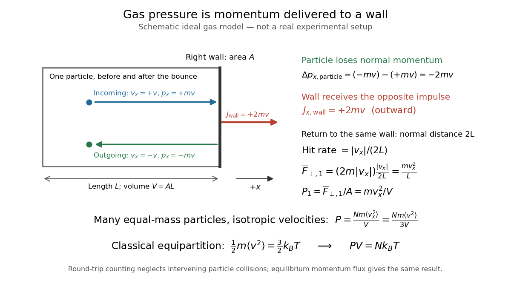

# Ideal gas pressure from wall collisions

↑ **Parent:** [Ideal gas law](ideal-gas-law.md)

Consider a particle of [mass](mass.md) $m$ in a rigid rectangular box of length $L$ along $x$ and wall [surface area](surface-area.md) $A$, so $V=AL$ is the [volume](volume-thermodynamics.md). Choose $+x$ toward the right wall. For an incoming normal [velocity](velocity.md) $v_x=v>0$, an [elastic collision](elastic-collision.md) reverses the normal [momentum](momentum-split.md):

$$
p_{x,\rm in}=mv,\qquad p_{x,\rm out}=-mv,\qquad
\Delta p_{x,\rm particle}=-2mv,\qquad
J_{x,\rm wall}=+2mv.
$$

The [impulse](impulse.md) delivered to the wall points outward, toward $+x$, by [Newton's third law](newton-s-third-law.md). The particle's opposite [momentum](momentum-split.md) change is not the wall's [impulse](impulse.md). A tangential [velocity](velocity.md) component is unchanged by the ideal smooth-wall [collision](collision.md).

**[Figure 2](#image-schematic-ideal-gas-model-an-elastic-bounce-transfers-outward-momentum-to-a-wall-this-is-not-a-real-experimental-setup). Schematic ideal gas model: an elastic bounce transfers outward momentum to a wall; this is not a real experimental setup**.

Ignoring intervening particle-particle [collisions](collision.md) in this counting model, the particle travels a normal distance $2L$ before hitting the same wall again. Its hit rate is $|v_x|/(2L)$; multiplying by the [impulse](impulse.md) per hit gives the time-averaged normal [force](force-split.md) and its contribution to [pressure](pressure-split.md):

$$
\overline F_{\perp,1}=(2m|v_x|)\frac{|v_x|}{2L}
=\frac{mv_x^2}{L},\qquad
P_1=\frac{\overline F_{\perp,1}}{A}=\frac{mv_x^2}{V}.
$$

For example, stipulate $m=4\times10^{-26}\,\mathrm{kg}$, $|v_x|=500\,\mathrm{m\,s^{-1}}$, $L=0.10\,\mathrm m$, and $A=0.010\,\mathrm{m^2}$. Then $V=0.0010\,\mathrm{m^3}$, the [impulse](impulse.md) per hit is $4\times10^{-23}\,\mathrm{N\,s}$, the hit rate is $2500\,\mathrm{s^{-1}}$, and $P_1=10^{-17}\,\mathrm{Pa}$. This is one particle's tiny time-averaged contribution to one wall's [pressure](pressure-split.md), not an [isotropic](isotropy.md) equilibrium [gas](gas.md) by itself.

For $N$ particles of equal [mass](mass.md), add their [force](force-split.md) contributions and define $\langle v_x^2\rangle=N^{-1}\sum_{i=1}^Nv_{x,i}^2$. In the [gas](gas.md)'s rest frame, [isotropy](isotropy.md) gives $\langle v_x^2\rangle=\langle v_y^2\rangle=\langle v_z^2\rangle=\langle v^2\rangle/3$, where $v^2=v_x^2+v_y^2+v_z^2$. Hence

$$
P=\frac{Nm\langle v_x^2\rangle}{V}
=\frac{Nm\langle v^2\rangle}{3V},\qquad
\frac12m\langle v^2\rangle=\frac32k_BT
\quad\Longrightarrow\quad PV=Nk_BT.
$$

The final equality uses the classical [equipartition theorem](equipartition-theorem.md). The [kinetic pressure of an isotropic gas](kinetic-pressure-of-an-isotropic-gas.md) therefore recovers the [ideal gas law](ideal-gas-law.md) from [momentum](momentum-split.md) transfers. Doubling the normal speed would double both the [impulse](impulse.md) per hit and the hit rate, giving four times the [pressure](pressure-split.md) contribution; [pressure](pressure-split.md) measures a mean squared speed. Interparticle [elastic collisions](elastic-collision.md) redistribute [velocities](velocity.md) and help establish [isotropy](isotropy.md); the individual round-trip times need not remain $2L/|v_x|$, but the equilibrium [momentum flux](momentum-flux.md) result survives. [OpenStax University Physics Volume 2, section 2.2: wall-collision pressure derivation](https://openstax.org/books/university-physics-volume-2/pages/2-2-pressure-temperature-and-rms-speed)

## ↑ Ancestors (7)

1. [Ideal gas law](ideal-gas-law.md)
2. [Ideal gas](ideal-gas-split.md)
3. [Thermodynamics](thermodynamics-split.md)
4. [Statistical physics](statistical-physics-split.md)
5. [Branches of physics](branches-of-physics.md)
6. [Physics](physics-split.md)
7. [Codex Wiki](split.md)

## ← Incoming links (5)

- [Boyle's law](boyle-s-law.md)
- [Gas thermometer](gas-thermometer.md)
- [Ideal gas](ideal-gas-split.md)
- [Kinetic theory](kinetic-theory-split.md)
- [Pressure](pressure-split.md)
