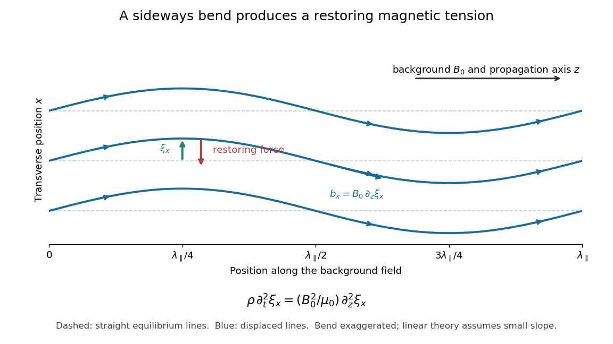
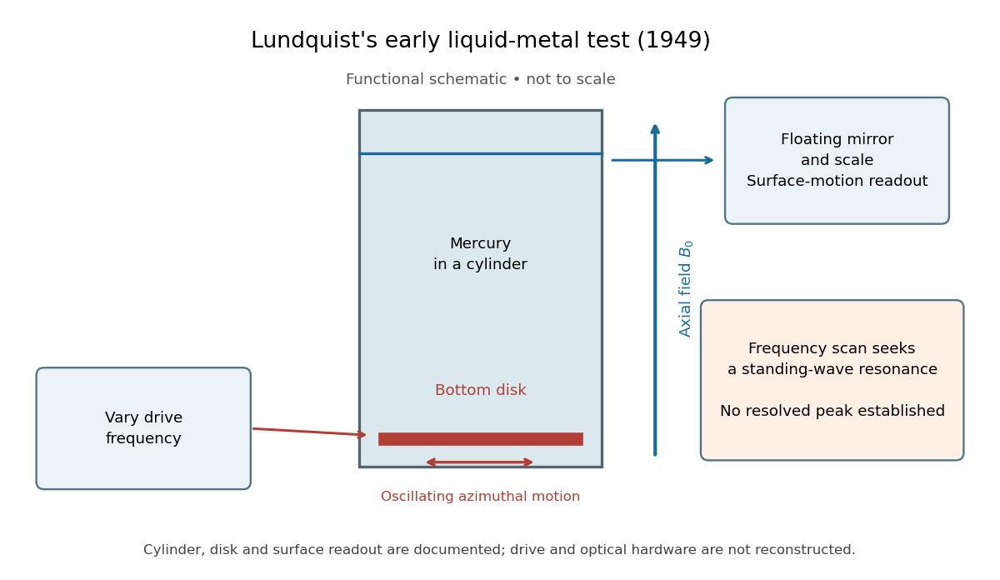

# Ideal magnetohydrodynamics

↑ **Parent:** [Magnetohydrodynamics](magnetohydrodynamics.md)  
ⓦ [Wiki](https://en.wikipedia.org/wiki/Ideal_magnetohydrodynamics)

Ideal magnetohydrodynamics assumes vanishing resistivity, so magnetic flux is frozen into the fluid and the electric field in the fluid rest frame vanishes.

**Table of contents**

- [Magnetic relaxation](#magnetic-relaxation)
  - [Single-molecule magnet](#single-molecule-magnet)
  - [Quantum tunnelling of magnetization](#quantum-tunnelling-of-magnetization)
  - [Collapse of a planar magnetic separatrix](#collapse-of-a-planar-magnetic-separatrix)
  - [Viscous magnetic-relaxation energy identity](#viscous-magnetic-relaxation-energy-identity)
- [Steady planar ideal-MHD field-line invariants](#steady-planar-ideal-mhd-field-line-invariants)
  - [Alfvénic degeneracy of steady planar MHD](#alfvenic-degeneracy-of-steady-planar-mhd)
  - [Planar ideal-MHD Bernoulli invariant](#planar-ideal-mhd-bernoulli-invariant)
- [Grad-Shafranov equation](#grad-shafranov-equation)
  - [Grad-Shafranov equation for a force-free magnetic field](#grad-shafranov-equation-for-a-force-free-magnetic-field)
- [Reduced magnetohydrodynamics](#reduced-magnetohydrodynamics)
  - [Five quadratic cascade invariants of anisotropic magnetohydrodynamic turbulence](#five-quadratic-cascade-invariants-of-anisotropic-magnetohydrodynamic-turbulence)
  - [Slow and entropy fluctuations in reduced magnetohydrodynamics](#slow-and-entropy-fluctuations-in-reduced-magnetohydrodynamics)
- [Ideal magnetohydrodynamic energy conservation](#ideal-magnetohydrodynamic-energy-conservation)
- [Ideal magnetohydrodynamic momentum equation](#ideal-magnetohydrodynamic-momentum-equation)
- [Plane-parallel magnetohydrodynamic flow with imposed shear](#plane-parallel-magnetohydrodynamic-flow-with-imposed-shear)
  - [Alfvén-point compatibility in a plane-parallel sheared flow](#alfven-point-compatibility-in-a-plane-parallel-sheared-flow)
  - [Magnetohydrodynamic shear work](#magnetohydrodynamic-shear-work)
- [Ideal magnetohydrodynamic equations](#ideal-magnetohydrodynamic-equations)
- [Magnetohydrodynamic energy principle](#magnetohydrodynamic-energy-principle)
  - [Incompressible magnetic displacement energy identity](#incompressible-magnetic-displacement-energy-identity)
    - [Interchange stability of an incompressible magnetized atmosphere](#interchange-stability-of-an-incompressible-magnetized-atmosphere)
  - [Linear displacement equations for a magnetized atmosphere](#linear-displacement-equations-for-a-magnetized-atmosphere)
- [Elsässer variable](#elsasser-variable)
  - [Elsässer energy invariant](#elsasser-energy-invariant)
- [Cross-helicity](#cross-helicity)
  - [Cross-helicity conservation law](#cross-helicity-conservation-law)
    - [Material conservation of cross-helicity density](#material-conservation-of-cross-helicity-density)
- [Magnetic flux freezing](#magnetic-flux-freezing)
  - [Material magnetic-flux transport theorem](#material-magnetic-flux-transport-theorem)
  - [Flux-surface preservation during magnetic-tube expansion](#flux-surface-preservation-during-magnetic-tube-expansion)
  - [Mass-to-flux ratio](#mass-to-flux-ratio)
    - [Critical mass-to-flux ratio](#critical-mass-to-flux-ratio)
- [Alfvén speed](#alfven-speed)
  - [Alfvén Mach number](#alfven-mach-number)
  - [Alfvén velocity](#alfven-velocity)
  - [Alfvén number](#alfven-number)
- [Magnetohydrodynamic wave](#magnetohydrodynamic-wave)
  - [Parallel-propagating ideal magnetohydrodynamic wave](#parallel-propagating-ideal-magnetohydrodynamic-wave)
  - [Ambipolar damping](#ambipolar-damping)
    - [Equal-density ion-neutral Alfvén dispersion relation](#equal-density-ion-neutral-alfven-dispersion-relation)
      - [Strong-collision ion-neutral Alfvén modes](#strong-collision-ion-neutral-alfven-modes)
  - [Entropy mode](#entropy-mode)
  - [Magnetohydrodynamic wave polarization](#magnetohydrodynamic-wave-polarization)
  - [Uniform-current rotating magnetohydrodynamic wave dispersion](#uniform-current-rotating-magnetohydrodynamic-wave-dispersion)
    - [Single-azimuthal-mode current-driven instability threshold](#single-azimuthal-mode-current-driven-instability-threshold)
  - [Alfvén wave](#alfven-wave)
    - [Linear Alfvén wave equations](#linear-alfven-wave-equations)
    - [Alfvén wave energy transport](#alfven-wave-energy-transport)
    - [Resistive damping of an Alfvén wave](#resistive-damping-of-an-alfven-wave)
    - [Lundquist liquid-metal Alfvén wave experiment](#lundquist-liquid-metal-alfven-wave-experiment)
    - [Alfvén-resonant vorticity in a parallel magnetic shear flow](#alfven-resonant-vorticity-in-a-parallel-magnetic-shear-flow)
    - [Kinetic Alfvén wave](#kinetic-alfven-wave)
    - [Magnetohydrodynamic phase mixing](#magnetohydrodynamic-phase-mixing)
    - [Torsional Alfvén wave](#torsional-alfven-wave)
      - [Pressure compatibility of nonlinear torsional Alfvén profiles](#pressure-compatibility-of-nonlinear-torsional-alfven-profiles)
      - [Cylinder-averaged torsional Alfvén wave](#cylinder-averaged-torsional-alfven-wave)
        - [Conserved energy of a cylinder-averaged torsional wave](#conserved-energy-of-a-cylinder-averaged-torsional-wave)
      - [Magnetic axial angular momentum flux](#magnetic-axial-angular-momentum-flux)
    - [Nonlinear Alfvén wave](#nonlinear-alfven-wave)
      - [Magnetic-pressure obstruction to a linearly polarized Alfvén wave](#magnetic-pressure-obstruction-to-a-linearly-polarized-alfven-wave)
      - [Circularly polarized nonlinear Alfvén wave](#circularly-polarized-nonlinear-alfven-wave)
    - [Alfvén characteristic eigenvector](#alfven-characteristic-eigenvector)
    - [Alfvén frequency](#alfven-frequency)
    - [Alfvén wing](#alfven-wing)
      - [Alfvénic Mach-cone slope](#alfvenic-mach-cone-slope)
  - [Magnetosonic wave](#magnetosonic-wave)
    - [High-pressure limit of magnetosonic waves](#high-pressure-limit-of-magnetosonic-waves)
      - [Pseudo-Alfvén wave](#pseudo-alfven-wave)
    - [Isothermal coplanar magnetohydrodynamic characteristic matrix](#isothermal-coplanar-magnetohydrodynamic-characteristic-matrix)
    - [Magnetosonic critical speed](#magnetosonic-critical-speed)
      - [Regularity at a magnetosonic point](#regularity-at-a-magnetosonic-point)
        - [Cold-limit degeneracy of a slow magnetosonic point](#cold-limit-degeneracy-of-a-slow-magnetosonic-point)
    - [Fast magnetosonic wave](#fast-magnetosonic-wave)
    - [Slow magnetosonic wave](#slow-magnetosonic-wave)
    - [Tube speed](#tube-speed)
  - [Magnetohydrodynamic interface wave](#magnetohydrodynamic-interface-wave)
    - [Magnetic stabilization of an equal-density vortex sheet](#magnetic-stabilization-of-an-equal-density-vortex-sheet)
- [Force-free magnetic field](#force-free-magnetic-field)
  - [Magnetic-energy injection by differential boundary rotation](#magnetic-energy-injection-by-differential-boundary-rotation)
  - [Force-free parameter](#force-free-parameter)
  - [Cylindrical force-free magnetic field](#cylindrical-force-free-magnetic-field)
- [Linearized ideal magnetohydrodynamic equations](#linearized-ideal-magnetohydrodynamic-equations)
  - [Displacement equation for a parallel magnetic shear flow](#displacement-equation-for-a-parallel-magnetic-shear-flow)
- [Ideal magnetohydrodynamic induction equation](#ideal-magnetohydrodynamic-induction-equation)
  - [Ideal magnetic response to a cylindrical cyclonic event](#ideal-magnetic-response-to-a-cylindrical-cyclonic-event)
  - [Cartesian magnetic flux function](#cartesian-magnetic-flux-function)
    - [Magnetic island](#magnetic-island)
    - [Cartesian magnetostatic flux-function equilibrium](#cartesian-magnetostatic-flux-function-equilibrium)
  - [Axisymmetric magnetic winding](#axisymmetric-magnetic-winding)
    - [Magnetic-pressure equality radius under Keplerian winding](#magnetic-pressure-equality-radius-under-keplerian-winding)
    - [Ferraro's law of isorotation](#ferraro-s-law-of-isorotation)
- [Entropy advection equation](#entropy-advection-equation)
- [Magnetohydrodynamic shock](#magnetohydrodynamic-shock)
  - [Perpendicular magnetohydrodynamic shock](#perpendicular-magnetohydrodynamic-shock)
    - [Compression ratio of a perpendicular magnetohydrodynamic shock](#compression-ratio-of-a-perpendicular-magnetohydrodynamic-shock)
  - [Parallel magnetohydrodynamic shock](#parallel-magnetohydrodynamic-shock)
  - [Ideal magnetohydrodynamic shock conditions](#ideal-magnetohydrodynamic-shock-conditions)
  - [de Hoffmann–Teller frame](#de-hoffmann-teller-frame)
  - [Rotational discontinuity in magnetohydrodynamics](#rotational-discontinuity-in-magnetohydrodynamics)
- [Axisymmetric magnetostatic Grad-Shafranov system](#axisymmetric-magnetostatic-grad-shafranov-system)
- [Axisymmetric magnetohydrodynamic wind](#axisymmetric-magnetohydrodynamic-wind)
  - [Cold radial magnetohydrodynamic wind integral](#cold-radial-magnetohydrodynamic-wind-integral)
  - [Sub-Alfvénic isorotation in a steady axisymmetric wind](#sub-alfvenic-isorotation-in-a-steady-axisymmetric-wind)
  - [Corotating energy invariant of an axisymmetric magnetic wind](#corotating-energy-invariant-of-an-axisymmetric-magnetic-wind)
  - [Field-line angular velocity of an axisymmetric wind](#field-line-angular-velocity-of-an-axisymmetric-wind)
  - [Poloidal magnetic flux function](#poloidal-magnetic-flux-function)
    - [Material advection of an axisymmetric magnetic flux function](#material-advection-of-an-axisymmetric-magnetic-flux-function)
    - [Axisymmetric magnetic flux surface](#axisymmetric-magnetic-flux-surface)
    - [Power-law poloidal field near a disk surface](#power-law-poloidal-field-near-a-disk-surface)
  - [Magnetohydrodynamic mass loading](#magnetohydrodynamic-mass-loading)
    - [Regular-axis alignment of steady poloidal ideal flow](#regular-axis-alignment-of-steady-poloidal-ideal-flow)
  - [Field-line angular velocity](#field-line-angular-velocity)
  - [Magnetohydrodynamic angular-momentum invariant](#magnetohydrodynamic-angular-momentum-invariant)
    - [Maxwell torque conservation in an axisymmetric wind](#maxwell-torque-conservation-in-an-axisymmetric-wind)
  - [Magnetohydrodynamic Bernoulli invariant](#magnetohydrodynamic-bernoulli-invariant)
    - [Isothermal magnetic Bernoulli integral](#isothermal-magnetic-bernoulli-integral)
  - [Alfvén surface](#alfven-surface)
    - [Alfvén radius](#alfven-radius)
    - [Alfvén-surface regularity condition for an axisymmetric wind](#alfven-surface-regularity-condition-for-an-axisymmetric-wind)
  - [Asymptotic energy of a radial magnetohydrodynamic wind](#asymptotic-energy-of-a-radial-magnetohydrodynamic-wind)
  - [Magnetocentrifugal acceleration](#magnetocentrifugal-acceleration)
    - [Thirty-degree magnetocentrifugal launching criterion](#thirty-degree-magnetocentrifugal-launching-criterion)
      - [Marginal straight-line launch at thirty degrees](#marginal-straight-line-launch-at-thirty-degrees)
    - [Magnetocentrifugal launching criterion in a flattened power-law potential](#magnetocentrifugal-launching-criterion-in-a-flattened-power-law-potential)

## Magnetic relaxation

↑ **Parent:** [Ideal magnetohydrodynamics](ideal-magnetohydrodynamics.md)

Magnetic relaxation converts [magnetic energy](electromagnetic-wave.md#magnetic-energy) into material motion through the [Lorentz force density](relativistic-electromagnetism.md#lorentz-force-density), and dissipates the resulting [kinetic energy](energy.md#kinetic-energy) through [viscosity](dynamic-viscosity.md). In a [perfect conductor](electromagnetic-wave.md#perfect-conductor), [magnetic flux freezing](#magnetic-flux-freezing) preserves field-line connectivity throughout every smooth stage. A regular limiting state has zero [velocity](classical-mechanics.md#velocity) and is a [magnetostatic equilibrium](magnetic-field.md#magnetostatic-equilibrium), but its [magnetic field](magnetic-field.md) can contain [current sheets](electric-charge.md#current-sheet). Conservation of one global [magnetic helicity](electromagnetism.md#magnetic-helicity) is weaker than preservation of the complete frozen field-line structure.

### Single-molecule magnet

↑ **Parent:** [Magnetic relaxation](#magnetic-relaxation)

A finite molecular [spin](angular-momentum-operator.md#spin) system exhibiting slow reversal of its magnetic moment on an experimental timescale. Blocking is timescale-dependent and does not require bulk long-range magnetic order.

### Quantum tunnelling of magnetization

↑ **Parent:** [Magnetic relaxation](#magnetic-relaxation)

Reversal between opposite magnetic orientations through quantum mixing rather than activation over the full classical anisotropy barrier.

### Collapse of a planar magnetic separatrix

↑ **Parent:** [Magnetic relaxation](#magnetic-relaxation)

For a planar [magnetic field](magnetic-field.md) $\mathbf B=(\psi_y,-\psi_x,0)$, ideal induction advects the [Cartesian magnetic flux function](#cartesian-magnetic-flux-function): $D_t\psi=0$. [Incompressible flow](fluid-mechanics.md#incompressible-flow) also preserves the area inside each material contour. During relaxation, the arms of a magnetic [separatrix](dynamical-systems.md#separatrix) can approach each other while their field-line connectivity remains fixed. A transition of width $\epsilon$ with a finite change of tangential field has [electric current density](electric-charge.md#current-density) of order $\epsilon^{-1}$ and can approach a [current sheet](electric-charge.md#current-sheet). This is a possible limiting mechanism, not a claim that every planar equilibrium is singular.

### Viscous magnetic-relaxation energy identity

↑ **Parent:** [Magnetic relaxation](#magnetic-relaxation)

For constant [mass density](fluid-mechanics.md#density) $\rho$, [kinematic viscosity](dynamic-viscosity.md#kinematic-viscosity) $\nu>0$, ideal induction, zero boundary [velocity](classical-mechanics.md#velocity) and tangent [magnetic field](magnetic-field.md), put $E=\int_D[\rho|\mathbf v|^2/2+|\mathbf B|^2/(2\mu_0)]dV$. Multiplying the momentum equation by $\mathbf v$ and integrating cancels pressure work and advective flux. The magnetic-energy derivative is minus the integral of [Lorentz force density](relativistic-electromagnetism.md#lorentz-force-density) dotted with [velocity](classical-mechanics.md#velocity), canceling the same work in the kinetic-energy equation. [Integration by parts](calculus.md#integration-by-parts) then gives the displayed identity. For [incompressible flow](fluid-mechanics.md#incompressible-flow) with zero boundary velocity, $\int|\nabla\mathbf v|^2=\int|\nabla\times\mathbf v|^2$.

## Steady planar ideal-MHD field-line invariants

↑ **Parent:** [Ideal magnetohydrodynamics](ideal-magnetohydrodynamics.md)

For a stationary, $z$-independent [ideal magnetohydrodynamics](ideal-magnetohydrodynamics.md) flow with $E_z=0$, nonzero horizontal [magnetic field](magnetic-field.md) and nonzero [magnetohydrodynamic mass loading](#magnetohydrodynamic-mass-loading) $k$, the displayed decomposition has $\mathbf B\cdot\nabla k=\mathbf B\cdot\nabla U=0$. The [continuity equation](mathematical-physics.md#continuity-equation) gives the first invariant, and the [ideal magnetohydrodynamic induction equation](#ideal-magnetohydrodynamic-induction-equation) gives the second. Entropy and $V=u_z-B_z/(\mu_0k)$ are also constant on each [magnetic field line](magnetic-field.md#magnetic-field-line). Stationarity alone permits constant nonzero $E_z$, so it does not imply this decomposition.

<h3 id="alfvenic-degeneracy-of-steady-planar-mhd">Alfvénic degeneracy of steady planar MHD</h3>

↑ **Parent:** [Steady planar ideal-MHD field-line invariants](#steady-planar-ideal-mhd-field-line-invariants)

The two axial invariants in [steady planar ideal-MHD field-line invariants](#steady-planar-ideal-mhd-field-line-invariants) give the displayed identity. When $V-U\ne0$, a finite smooth flow cannot reach horizontal [Alfvén speed](#alfven-speed). When $V=U$, an everywhere Alfvénic branch is possible even with $B_z\ne0$: constant $\rho$ and $\mathbf u=\mathbf B/\sqrt{\mu_0\rho}$ give an example. The nondegenerate exclusion must not be applied to this branch.

### Planar ideal-MHD Bernoulli invariant

↑ **Parent:** [Steady planar ideal-MHD field-line invariants](#steady-planar-ideal-mhd-field-line-invariants)

Under the hypotheses of [steady planar ideal-MHD field-line invariants](#steady-planar-ideal-mhd-field-line-invariants), the [specific enthalpy](enthalpy.md#specific-enthalpy) relation and the velocity projection of momentum give $\mathbf B\cdot\nabla Q=0$. The horizontal total energy flux, including the [Poynting vector](electromagnetic-wave.md#poynting-vector), is $k\mathbf B_h Q$. The magnetic correction accounts for work exchanged between the fluid and the field.

## Grad-Shafranov equation

↑ **Parent:** [Ideal magnetohydrodynamics](ideal-magnetohydrodynamics.md)  
ⓦ [Wiki](https://en.wikipedia.org/wiki/Grad–Shafranov_equation)

The Grad-Shafranov equation governs the poloidal magnetic flux of an axisymmetric magnetohydrostatic equilibrium. Pressure and toroidal-field contributions depend on the flux function. The [Grad-Shafranov equation for a force-free magnetic field](#grad-shafranov-equation-for-a-force-free-magnetic-field) is its zero-pressure-gradient reduction.

### Grad-Shafranov equation for a force-free magnetic field

↑ **Parent:** [Grad-Shafranov equation](#grad-shafranov-equation)

For an axisymmetric force-free field with $\mathbf B_p=\nabla\psi\times\nabla\phi$ and $rB_\phi=F(\psi)$, the flux function obeys

$$
-r\frac{\partial}{\partial r}\left(\frac1r\frac{\partial\psi}{\partial r}\right)
-\frac{\partial^2\psi}{\partial z^2}
=F\frac{dF}{d\psi}.
$$

## Reduced magnetohydrodynamics

↑ **Parent:** [Ideal magnetohydrodynamics](ideal-magnetohydrodynamics.md)

[Reduced magnetohydrodynamics](#reduced-magnetohydrodynamics) is the leading ideal-fluid description of small, anisotropic fluctuations about a strong uniform guide field, with $k_\parallel/k_\perp\sim\delta B_\perp/B_0\sim\delta u_\perp/v_A\ll1$. Its [solenoidal](multivariable-calculus.md#solenoidal-vector-field) perpendicular [Elsässer variables](#elsasser-variable) obey

$$
\partial_t\mathbf z^\pm_\perp\mp v_A\partial_z\mathbf z^\pm_\perp+(\mathbf z^\mp_\perp\cdot\nabla_\perp)\mathbf z^\pm_\perp=-\nabla_\perp\Pi.
$$

The parallel magnetic derivative includes bending of field lines: $\nabla_\parallel=\partial_z+(\delta\mathbf B_\perp/B_0)\cdot\nabla_\perp$. Slow compressive and [entropy mode](#entropy-mode) fluctuations are passively transported at this order. The system excludes the rapidly propagating [fast magnetosonic wave](#fast-magnetosonic-wave) sector rather than describing all possible [MHD](magnetohydrodynamics.md) perturbations.

### Five quadratic cascade invariants of anisotropic magnetohydrodynamic turbulence

↑ **Parent:** [Reduced magnetohydrodynamics](#reduced-magnetohydrodynamics)

For ideal [reduced magnetohydrodynamics](#reduced-magnetohydrodynamics) with periodic or vanishing-flux boundaries, the five quadratic cascade channels are $I_A^\pm=\int|\mathbf z_\perp^\pm|^2dV$, $I_S^\pm=\int(f^\pm)^2dV$ and $I_e=\int s^2dV$. The perpendicular [Elsässer variables](#elsasser-variable), slow-wave amplitudes $f^\pm$, and [entropy](entropy.md) fluctuation $s$ each obey an equation with [divergence-free](multivariable-calculus.md#solenoidal-vector-field) advection. Multiplying each equation by its own field and integrating makes both advection and propagation terms boundary fluxes, while the perpendicular [pressure](pressure.md) term vanishes by solenoidality. Each integral is therefore separately conserved. The two Alfvén cascades distort one another without exchanging their integrated invariants; the other three are passively cascaded by the Alfvénic motion without feedback at this order. This count concerns quadratic fluctuation-energy channels: an advected scalar also conserves arbitrary integrals $\int F(s)dV$, which are not extra independent quadratic modal channels.

### Slow and entropy fluctuations in reduced magnetohydrodynamics

↑ **Parent:** [Reduced magnetohydrodynamics](#reduced-magnetohydrodynamics)

In ideal [reduced magnetohydrodynamics](#reduced-magnetohydrodynamics) with constant background sound and [Alfvén speeds](#alfven-speed), perpendicular total-pressure balance gives $\delta p+\rho_0v_A^2\delta B_\parallel/B_0=0$. Put $s=\delta p/p_0-\gamma\delta\rho/\rho_0$, $r=\delta\rho/\rho_0+s/\gamma$, $c_T=v_Ac_s/(v_A^2+c_s^2)^{1/2}$ and $h=c_s^2r/c_T$. Then the parallel momentum, continuity and induction equations yield

$$
Du_\parallel=-c_T\nabla_\parallel h,\qquad Dh=-c_T\nabla_\parallel u_\parallel,\qquad Ds=0.
$$

Thus $f^\pm=u_\parallel\pm h$ satisfy $Df^\pm=\mp c_T\nabla_\parallel f^\pm$. The two slow-wave populations propagate along bent [magnetic field lines](magnetic-field.md#magnetic-field-line) and are mixed by the perpendicular [Alfvénic turbulence](turbulence.md#alfvenic-turbulence), while the [entropy](entropy.md) fluctuation is simply advected. They do not force the perpendicular Alfvénic system at this leading order.

## Ideal magnetohydrodynamic energy conservation

↑ **Parent:** [Ideal magnetohydrodynamics](ideal-magnetohydrodynamics.md)

For a fixed [Newtonian gravitational potential](newton-s-law-of-universal-gravitation.md#newtonian-gravitational-potential), total [energy density](statistical-physics.md#energy-density) is $\mathcal E=\rho(u^2/2+\Phi)+p/(\gamma-1)+B^2/(2\mu_0)$. Its flux combines advected kinetic/potential energy, [specific enthalpy](enthalpy.md#specific-enthalpy) and the [Poynting vector](electromagnetic-wave.md#poynting-vector). Dotting the [ideal magnetohydrodynamic momentum equation](#ideal-magnetohydrodynamic-momentum-equation) with [velocity](classical-mechanics.md#velocity), adding the adiabatic [internal energy](internal-energy.md) equation and the [magnetic energy](electromagnetic-wave.md#magnetic-energy) equation cancels the magnetic work. The [pressure](pressure.md) terms combine into $-\nabla\cdot(p\mathbf u)$, proving the conservation law. A time-dependent imposed potential instead contributes $\rho\partial_t\Phi$.

## Ideal magnetohydrodynamic momentum equation

↑ **Parent:** [Ideal magnetohydrodynamics](ideal-magnetohydrodynamics.md)

The inviscid [magnetohydrodynamic momentum equation](magnetohydrodynamics.md#magnetohydrodynamic-momentum-equation) balances inertia, [pressure](pressure.md), [gravitational acceleration](newton-s-law-of-universal-gravitation.md#gravitational-acceleration) and [Lorentz force density](relativistic-electromagnetism.md#lorentz-force-density). The magnetic force separates into [magnetic tension](magnetohydrodynamics.md#magnetic-tension) and [magnetic pressure](magnetohydrodynamics.md#magnetic-pressure). It is coupled to the [continuity equation](mathematical-physics.md#continuity-equation) and the [ideal magnetohydrodynamic induction equation](#ideal-magnetohydrodynamic-induction-equation).

## Plane-parallel magnetohydrodynamic flow with imposed shear

↑ **Parent:** [Ideal magnetohydrodynamics](ideal-magnetohydrodynamics.md)

A useful [ideal magnetohydrodynamics](ideal-magnetohydrodynamics.md) reduction has $\mathbf u=\mathbf v(z,t)+ax\mathbf e_y$, $\mathbf B=\mathbf B(z,t)$ and $\rho=\rho(z,t)$. The constant background [shear flow](fluid-mechanics.md#shear-flow) supplies $av_x$ in the axial momentum equation and $aB_x$ in axial magnetic induction. The solenoidal constraint and [MHD induction equation](#ideal-magnetohydrodynamic-induction-equation) together make $B_z$ constant.

<h3 id="alfven-point-compatibility-in-a-plane-parallel-sheared-flow">Alfvén-point compatibility in a plane-parallel sheared flow</h3>

↑ **Parent:** [Plane-parallel magnetohydrodynamic flow with imposed shear](#plane-parallel-magnetohydrodynamic-flow-with-imposed-shear)

At $w^2=v_{az}^2$, the transverse steady equations require $wB_xw'=0$ and $wB_yw'=a(wB_x-B_zv_x)$. These conditions can be lost by division when eliminating transverse magnetic derivatives. A scalar equation displaying the [magnetosonic critical speeds](#magnetosonic-critical-speed) need not display every compatibility condition at an [Alfvén speed](#alfven-speed).

### Magnetohydrodynamic shear work

↑ **Parent:** [Plane-parallel magnetohydrodynamic flow with imposed shear](#plane-parallel-magnetohydrodynamic-flow-with-imposed-shear)

The energy of the residual flow and [magnetic field](magnetic-field.md) in a maintained [shear flow](fluid-mechanics.md#shear-flow) has source $S=-aT_{xy}$, where $T_{xy}=\rho v_xv_y-B_xB_y/\mu_0$. The kinetic and magnetic stresses can exchange energy with the imposed background. The source vanishes when their off-diagonal contributions cancel.

## Ideal magnetohydrodynamic equations

↑ **Parent:** [Ideal magnetohydrodynamics](ideal-magnetohydrodynamics.md)

The smooth ideal-MHD system couples [mass conservation](continuum-mechanics.md#mass-conservation), [momentum](momentum.md), adiabatic [pressure](pressure.md) transport and the [ideal magnetohydrodynamic induction equation](#ideal-magnetohydrodynamic-induction-equation), subject to the [solenoidal magnetic-field constraint](magnetic-field.md#solenoidal-magnetic-field-constraint). Without gravity it is a [quasilinear partial differential equation](partial-differential-equation.md#quasilinear-partial-differential-equation) system. Across shocks, conservative total energy replaces smooth adiabatic [pressure](pressure.md) transport.

## Magnetohydrodynamic energy principle

↑ **Parent:** [Ideal magnetohydrodynamics](ideal-magnetohydrodynamics.md)

For a static smooth [ideal magnetohydrodynamics](ideal-magnetohydrodynamics.md) equilibrium with conservative external forces and surface terms eliminated by the [boundary conditions](differential-equation.md#boundary-condition), the linear displacement equation is $\rho\ddot{\boldsymbol\xi}=\mathcal F\boldsymbol\xi$, where the force operator is a [self-adjoint operator](linear-operator-theory.md#self-adjoint-operator) in the appropriate integral pairing. Its restoring [quadratic form](quadratic-form.md) $\delta W=-\tfrac12\int\boldsymbol\xi^*\cdot\mathcal F\boldsymbol\xi\,dV$ is real. Multiplying the [normal mode](wave-equation.md#normal-mode) equation by the [complex conjugate](complex-analysis.md#complex-conjugate) of the [displacement](classical-mechanics.md#displacement) and integrating gives $\omega^2\int\rho|\boldsymbol\xi|^2dV=2\delta W$. Hence squared frequencies are real, and a negative restoring form gives an unstable mode through the variational [Rayleigh quotient](linear-operator-theory.md#rayleigh-quotient), subject to the operator domain and spectral hypotheses. Background [fluid flow](fluid-mechanics.md#fluid-flow) adds terms to this argument; the static hypothesis is essential.

### Incompressible magnetic displacement energy identity

↑ **Parent:** [Magnetohydrodynamic energy principle](#magnetohydrodynamic-energy-principle)

For a static [ideal magnetohydrodynamics](ideal-magnetohydrodynamics.md) equilibrium in fixed gravity, let $\nabla\cdot\xi=0$ and $\Pi=p+B^2/(2\mu_0)$. Frozen flux gives $b=(B\cdot\nabla)\xi-(\xi\cdot\nabla)B$ and continuity gives $\rho'=-\xi\cdot\nabla\rho$. Multiplying the linear momentum equation by the conjugate displacement and integrating by parts gives the displayed identity when surface terms vanish. The two magnetic cross terms cancel; the remaining magnetic equilibrium derivative combines with the [mass density](fluid-mechanics.md#density)-gradient force to give the two [Hessian matrices](multivariable-calculus.md#hessian-matrix). Real symmetric [Hessian matrices](multivariable-calculus.md#hessian-matrix) and the nonnegative [magnetic tension](magnetohydrodynamics.md#magnetic-tension) term make $\sigma^2$ real.

#### Interchange stability of an incompressible magnetized atmosphere

↑ **Parent:** [Incompressible magnetic displacement energy identity](#incompressible-magnetic-displacement-energy-identity)

For a horizontal field $B(z)e_x$ in constant downward gravity, equilibrium obeys $(p+B^2/(2\mu_0))_z=-\rho g$. The displacement energy reduces to the displayed [quadratic form](quadratic-form.md). Perturbations independent of the field direction do not bend [magnetic field lines](magnetic-field.md#magnetic-field-line) and therefore have no [magnetic tension](magnetohydrodynamics.md#magnetic-tension) penalty: an increasing [mass density](fluid-mechanics.md#density) with height permits instability. A nonincreasing [mass density](fluid-mechanics.md#density) gives nonnegative energy for all admitted incompressible perturbations. Along-field variation adds [magnetic tension](magnetohydrodynamics.md#magnetic-tension) proportional to [wavenumber](wave-equation.md#wavenumber) squared, stabilizing sufficiently short waves when buoyancy is unfavorable.

### Linear displacement equations for a magnetized atmosphere

↑ **Parent:** [Magnetohydrodynamic energy principle](#magnetohydrodynamic-energy-principle)

For a static equilibrium and a [fluid Lagrangian displacement](fluid-mechanics.md#lagrangian-displacement-fluid-mechanics) $\xi$, [conservation of mass](continuum-mechanics.md#mass-conservation), adiabatic [entropy](entropy.md) and [magnetic flux freezing](#magnetic-flux-freezing) give $\delta p=-\xi\cdot\nabla p-\gamma p\nabla\cdot\xi$ together with the displayed relations. Linearizing the [pressure](pressure.md)/tension form of the momentum equation yields $\rho\ddot\xi=-\nabla\delta\Pi-g\delta\rho e_z+\mu_0^{-1}(\delta B\cdot\nabla B+B\cdot\nabla\delta B)$, where $\delta\Pi=\delta p+B\cdot\delta B/\mu_0$. Static force balance removes the zeroth-order terms; the [density](fluid-mechanics.md#density) multiplying acceleration is the equilibrium [density](fluid-mechanics.md#density).

<h2 id="elsasser-variable">Elsässer variable</h2>

↑ **Parent:** [Ideal magnetohydrodynamics](ideal-magnetohydrodynamics.md)

For an [incompressible flow](fluid-mechanics.md#incompressible-flow) with constant [mass density](fluid-mechanics.md#density), the [Elsässer variables](#elsasser-variable) are $\mathbf z^\pm=\mathbf u\pm\mathbf v_a$, where $\mathbf v_a$ is the [Alfvén velocity](#alfven-velocity). Adding and subtracting the [Euler momentum equation](euler-equations-for-an-inviscid-fluid.md) and [ideal magnetohydrodynamic induction equation](#ideal-magnetohydrodynamic-induction-equation) yields $\partial_t\mathbf z^\pm+(\mathbf z^\mp\cdot\nabla)\mathbf z^\pm=-\nabla\psi$, with $\psi=p/\rho+\Phi+|\mathbf v_a|^2/2$ and $\nabla\cdot\mathbf z^\pm=0$. Thus each field is transported by the other, a useful way to expose interactions of oppositely directed [Alfvén waves](#alfven-wave).

<h3 id="elsasser-energy-invariant">Elsässer energy invariant</h3>

↑ **Parent:** [Elsässer variable](#elsasser-variable)

For smooth [ideal magnetohydrodynamics](ideal-magnetohydrodynamics.md) of constant [mass density](fluid-mechanics.md#density), define $I_\pm=\int_V|\mathbf z^\pm|^2dV$. Taking the [dot product](inner-product.md#dot-product) of the [Elsässer variable](#elsasser-variable) equation with $2\mathbf z^\pm$ gives

$$
\partial_t|\mathbf z^\pm|^2+\nabla\cdot\left(|\mathbf z^\pm|^2\mathbf z^\mp+2\psi\mathbf z^\pm\right)=0.
$$

Therefore each integral is constant when its outward boundary flux vanishes, for example when both [velocity](classical-mechanics.md#velocity) and [magnetic field](magnetic-field.md) are tangent to the fixed boundary, or for [periodic boundary conditions](differential-equation.md#periodic-boundary-conditions). The [kinetic energy](energy.md#kinetic-energy) plus [magnetic energy](electromagnetic-wave.md#magnetic-energy) is $\rho(I_++I_-)/4$, while the [cross-helicity](#cross-helicity) is $\sqrt{\mu_0\rho}(I_+-I_-)/4$.

## Cross-helicity

↑ **Parent:** [Ideal magnetohydrodynamics](ideal-magnetohydrodynamics.md)

Cross-helicity measures alignment between velocity and magnetic field in a magnetized fluid. Its density is $h_c=\mathbf u\mathbin\cdot\mathbf B$.

### Cross-helicity conservation law

↑ **Parent:** [Cross-helicity](#cross-helicity)

Let $h_c=\mathbf u\mathbin\cdot\mathbf B$ be the [cross-helicity](#cross-helicity) density. The [ideal magnetohydrodynamic induction equation](#ideal-magnetohydrodynamic-induction-equation) implies $D\mathbf B/Dt=(\mathbf B\mathbin\cdot\nabla)\mathbf u-\mathbf B\nabla\mathbin\cdot\mathbf u$. Dotting the momentum equation with $\mathbf B$ eliminates the [Lorentz force density](relativistic-electromagnetism.md#lorentz-force-density), since it is perpendicular to the [magnetic field](magnetic-field.md). The [material derivative](continuum-mechanics.md#material-derivative) of $h_c$ is therefore

$$
\frac{Dh_c}{Dt}
=\mathbf B\mathbin\cdot\nabla\left(\frac{u^2}{2}-\Phi\right)
-\frac{\mathbf B\mathbin\cdot\nabla p}{\rho}
-h_c\nabla\mathbin\cdot\mathbf u.
$$

Using $dh=T\,ds+dp/\rho$ for [specific enthalpy](enthalpy.md#specific-enthalpy) $h$ and [specific entropy](entropy.md#specific-entropy) $s$, together with [Gauss's law for magnetism](maxwell-equations.md#gauss-s-law-for-magnetism), converts this to

$$
\partial_th_c+\nabla\mathbin\cdot\left[
\mathbf u h_c+\mathbf B\left(h+\Phi-\frac{u^2}{2}\right)
\right]
=T\mathbf B\mathbin\cdot\nabla s.
$$

The source vanishes when [magnetic field lines](magnetic-field.md#magnetic-field-line) lie in constant-[specific entropy](entropy.md#specific-entropy) surfaces, in particular in a [homentropic flow](compressible-flow.md#homentropic-flow). Integrating over a volume conserves its total [cross-helicity](#cross-helicity) only if the boundary flux also vanishes. This local law is derived in [Ogilvie's astrophysical fluid dynamics notes](https://arxiv.org/abs/1604.03835).

#### Material conservation of cross-helicity density

↑ **Parent:** [Cross-helicity conservation law](#cross-helicity-conservation-law)

In a [homentropic flow](compressible-flow.md#homentropic-flow), the [cross-helicity conservation law](#cross-helicity-conservation-law) gives

$$
\frac{Dh_c}{Dt}
=\mathbf B\mathbin\cdot\nabla\left(\frac{u^2}{2}-h-\Phi\right)
-h_c\nabla\mathbin\cdot\mathbf u.
$$

Consequently [cross-helicity](#cross-helicity) density is conserved along each trajectory exactly when the right-hand side vanishes. In a [steady state](dynamical-systems.md#steady-state), [mass conservation](continuum-mechanics.md#mass-conservation) gives $\nabla\mathbin\cdot\mathbf u=-\mathbf u\mathbin\cdot\nabla\log\rho$, so the criterion becomes

$$
\mathbf B\mathbin\cdot\nabla\left(h+\Phi-\frac{u^2}{2}\right)
=(\mathbf u\mathbin\cdot\mathbf B)\mathbf u\mathbin\cdot\nabla\log\rho.
$$

The absence of an [entropy](entropy.md) source in a conservation law does not alone make its density an advected scalar: compression and transport along the [magnetic field](magnetic-field.md) still change that density.

## Magnetic flux freezing

↑ **Parent:** [Ideal magnetohydrodynamics](ideal-magnetohydrodynamics.md)

Magnetic flux freezing states that every material loop in an ideal conducting fluid encloses constant magnetic flux. A deformation perpendicular to a uniform field that preserves mass per unit length therefore preserves $B/\rho$.

### Material magnetic-flux transport theorem

↑ **Parent:** [Magnetic flux freezing](#magnetic-flux-freezing)

Combine the [material surface element evolution](fluid-mechanics.md#material-surface-element-evolution) law with the [product rule](calculus.md#product-rule) for $\mathbf B\cdot d\mathbf S$. The result is

$$
\frac d{dt}\int_{S(t)}\mathbf B\cdot d\mathbf S
=\int_{S(t)}\left[\frac{D\mathbf B}{Dt}+\mathbf B\nabla\cdot\mathbf u-(\mathbf B\cdot\nabla)\mathbf u\right]\cdot d\mathbf S.
$$

Expanding the [curl](multivariable-calculus.md#curl) gives the equivalent title formula. The [ideal magnetohydrodynamic induction equation](#ideal-magnetohydrodynamic-induction-equation) and [Gauss's law for magnetism](maxwell-equations.md#gauss-s-law-for-magnetism) make the integrand zero and prove [magnetic flux freezing](#magnetic-flux-freezing), without requiring [incompressible flow](fluid-mechanics.md#incompressible-flow).

### Flux-surface preservation during magnetic-tube expansion

↑ **Parent:** [Magnetic flux freezing](#magnetic-flux-freezing)

Suppose the [Cartesian magnetic flux function](#cartesian-magnetic-flux-function) is advected, the initial axial velocity is zero, $B_y=f(\psi)$ initially, and $\nabla\cdot\mathbf u=g(\psi,t)$. Then $B_y=f(\psi)\exp[-\int_0^t g(\psi,s)\,ds]$ remains a function of the flux label and time. The axial [Lorentz force](relativistic-electromagnetism.md#lorentz-force) vanishes because its transverse derivative along a [magnetic field line](magnetic-field.md#magnetic-field-line) vanishes. Smooth ideal evolution therefore preserves zero axial motion.

### Mass-to-flux ratio

↑ **Parent:** [Magnetic flux freezing](#magnetic-flux-freezing)

The mass-to-flux ratio is the matter carried per unit magnetic flux by a bundle of field lines. Ideal magnetohydrodynamics preserves it for a material flux tube.

#### Critical mass-to-flux ratio

↑ **Parent:** [Mass-to-flux ratio](#mass-to-flux-ratio)

For fixed cloud shape, gravitational energy scales as $-C_gGM^2/L$ and [magnetic energy](electromagnetic-wave.md#magnetic-energy) as $C_B\Phi^2/(\mu_0L)$. The magnetic-criticality threshold for negligible [pressure](pressure.md) is $M/\Phi>\sqrt{C_B/C_g}/\sqrt{\mu_0G}$. Ideal flux freezing keeps this ratio fixed during homologous collapse; geometry determines the numerical coefficient.

<h2 id="alfven-speed">Alfvén speed</h2>

↑ **Parent:** [Ideal magnetohydrodynamics](ideal-magnetohydrodynamics.md)

The Alfvén speed associated with magnetic-field magnitude $B$ and density $\rho$ is $v_A=B/\sqrt{\mu_0\rho}$.

<h3 id="alfven-mach-number">Alfvén Mach number</h3>

↑ **Parent:** [Alfvén speed](#alfven-speed)

The Alfvén Mach number compares a characteristic flow speed with the [Alfvén speed](#alfven-speed) $v_A=B/\sqrt{\mu_0\rho}$. In an [axisymmetric magnetohydrodynamic wind](#axisymmetric-magnetohydrodynamic-wind), the relevant poloidal quantity is $M_{Ap}=|\mathbf u_p|\sqrt{\mu_0\rho}/|\mathbf B_p|$. With [magnetohydrodynamic mass loading](#magnetohydrodynamic-mass-loading) $\rho\mathbf u_p=\kappa\mathbf B_p$, its square is $\mu_0\kappa^2/\rho$. The [Alfvén surface](#alfven-surface) is the locus $M_{Ap}=1$, and a smooth crossing requires the corresponding [Alfvén-surface regularity condition for an axisymmetric wind](#alfven-surface-regularity-condition-for-an-axisymmetric-wind). The total-speed and poloidal-speed definitions should be distinguished when there is substantial rotation or a strong [toroidal magnetic field](magnetohydrodynamics.md#toroidal-magnetic-field).

<h3 id="alfven-velocity">Alfvén velocity</h3>

↑ **Parent:** [Alfvén speed](#alfven-speed)

The [Alfvén velocity](#alfven-velocity) is the signed vector $\mathbf v_a=\mathbf B/\sqrt{\mu_0\rho}$, whose magnitude is the [Alfvén speed](#alfven-speed). It follows the orientation of the [magnetic field](magnetic-field.md), unlike the nonnegative scalar [speed](classical-mechanics.md#speed).

<h3 id="alfven-number">Alfvén number</h3>

↑ **Parent:** [Alfvén speed](#alfven-speed)

An Alfvén number is the ratio of a flow speed to the corresponding Alfvén speed. For a poloidal flow parallel to a poloidal magnetic field, $A^2=\mu_0\rho u_p^2/B_p^2$.

## Magnetohydrodynamic wave

↑ **Parent:** [Ideal magnetohydrodynamics](ideal-magnetohydrodynamics.md)

A magnetohydrodynamic wave is a linear disturbance of a conducting fluid and its magnetic field. A uniform ideal plasma supports an Alfvén mode and fast and slow magnetosonic modes.

### Parallel-propagating ideal magnetohydrodynamic wave

↑ **Parent:** [Magnetohydrodynamic wave](#magnetohydrodynamic-wave)

In a uniform ideal-MHD [plasma](physics.md#plasma-physics) at rest, take the [wavevector](elasticity-physics.md#wavevector) parallel to a nonzero background field. Projecting the linear [velocity](classical-mechanics.md#velocity) equation along and perpendicular to the field gives two transverse Alfvén [polarizations](wave.md#polarization-waves) at speed $v_A$ and one longitudinal acoustic [polarization](wave.md#polarization-waves) at speed $c_s$. Compression does not bend field lines for the longitudinal branch. The general oblique fast/slow magnetosonic modes reduce to the corresponding faster/slower parallel branches, with degeneracies when their speeds agree.

### Ambipolar damping

↑ **Parent:** [Magnetohydrodynamic wave](#magnetohydrodynamic-wave)

[Ambipolar damping](#ambipolar-damping) is attenuation of magnetic disturbances by friction between the magnetically coupled charged fluid and a neutral fluid. In a strongly collisional mixture, the fluids nearly move together, but their small relative [velocity](classical-mechanics.md#velocity) dissipates [energy](energy.md). With drag coefficient $\rho_i\mu_{in}=\rho_n\mu_{ni}$, the frictional [energy](energy.md) loss is $-\rho_i\mu_{in}\int|\mathbf u_i-\mathbf u_n|^2dV$. Neglecting other dissipative processes does not remove this collisional loss.

<h4 id="equal-density-ion-neutral-alfven-dispersion-relation">Equal-density ion-neutral Alfvén dispersion relation</h4>

↑ **Parent:** [Ambipolar damping](#ambipolar-damping)

For equal [ion](chemistry.md#ion) and neutral mass densities, let $\mu=\mu_{in}=\mu_{ni}$, $a=k_\parallel B_0/\sqrt{4\pi\rho_i}$ and use Fourier time dependence $e^{-i\omega t}$. [Solenoidal](multivariable-calculus.md#solenoidal-vector-field) [displacements](classical-mechanics.md#displacement) obey $\ddot\xi_i=-a^2\xi_i-\mu(\dot\xi_i-\dot\xi_n)$ and $\ddot\xi_n=-\mu(\dot\xi_n-\dot\xi_i)$. For nonzero [frequency](wave.md#frequency), the neutral equation gives $\xi_i=(1-i\omega/\mu)\xi_n$. Substitution in the [ion](chemistry.md#ion) equation gives

$$
\omega^3+2i\mu\omega^2-a^2\omega-i\mu a^2=0.
$$

Equivalently, the [growth rate](dispersion-relation.md#growth-rate) $s=-i\omega$ obeys $s^3+2\mu s^2+a^2s+\mu a^2=0$. A time-independent neutral [displacement](classical-mechanics.md#displacement) with zero [velocity](classical-mechanics.md#velocity) is a relabeling of a uniform fluid, not an additional [wave](wave.md) root of the [velocity](classical-mechanics.md#velocity)/magnetic-field system.

<h5 id="strong-collision-ion-neutral-alfven-modes">Strong-collision ion-neutral Alfvén modes</h5>

↑ **Parent:** [Equal-density ion-neutral Alfvén dispersion relation](#equal-density-ion-neutral-alfven-dispersion-relation)

For $|a|\ll\mu$, the equal-density ion-neutral cubic has a rapidly damped mode $\omega_d=-2i\mu+ia^2/(4\mu)+O(a^4/\mu^3)$ and two propagating modes $\omega_\pm=\pm a/\sqrt2-ia^2/(8\mu)+O(a^3/\mu^2)$. The reduced [phase speed](dispersion-relation.md#phase-speed) uses the total [density](fluid-mechanics.md#density) $\rho_i+\rho_n=2\rho_i$. The exact [displacement](classical-mechanics.md#displacement) ratio is $\xi_n/\xi_i=\mu/(\mu-i\omega)$. It is nearly $-1$ for the rapidly damped counterflow and nearly $1\pm ia/(\sqrt2\mu)$ for the propagating modes. Thus the latter have small ion-neutral slippage of relative size $|a|/\mu$, responsible for [ambipolar damping](#ambipolar-damping).

### Entropy mode

↑ **Parent:** [Magnetohydrodynamic wave](#magnetohydrodynamic-wave)

An [entropy mode](#entropy-mode) is a perturbation of [entropy](entropy.md) and [density](fluid-mechanics.md#density) with no leading [pressure](pressure.md) or [velocity](classical-mechanics.md#velocity) perturbation in a uniform ideal fluid. For an [adiabatic equation of state](pressure.md#adiabatic-equation-of-state) define $s=\delta p/p_0-\gamma\delta\rho/\rho_0$. An [entropy](entropy.md) perturbation can have $\delta p=0$ and $\delta\rho/\rho_0=-s/\gamma$, so it has zero [frequency](wave.md#frequency) in the local fluid frame. In anisotropic [reduced magnetohydrodynamics](#reduced-magnetohydrodynamics), $Ds=0$ with $D=\partial_t+\mathbf u_\perp\cdot\nabla_\perp$, and [turbulence](turbulence.md) mixes its [variance](variance.md) as a [passive scalar](scalar-transport.md#passive-scalar).

### Magnetohydrodynamic wave polarization

↑ **Parent:** [Magnetohydrodynamic wave](#magnetohydrodynamic-wave)

A polarization specifies the direction or trajectory of the oscillating [velocity](classical-mechanics.md#velocity) and [magnetic field](magnetic-field.md) in a [magnetohydrodynamic wave](#magnetohydrodynamic-wave). The linear [Alfvén wave](#alfven-wave) has velocity perpendicular to the plane of the background [magnetic field](magnetic-field.md) and [wavevector](elasticity-physics.md#wavevector); the [magnetosonic waves](#magnetosonic-wave) have velocity in that plane. A real fixed polarization vector gives a linear oscillation. Two orthogonal components of equal amplitude in quadrature give a circular trajectory. For propagation parallel to a uniform field, combining the two degenerate transverse linear polarizations produces circular polarization; at finite amplitude its constant transverse magnetic-field magnitude removes the longitudinal [magnetic pressure](magnetohydrodynamics.md#magnetic-pressure) gradient.

### Uniform-current rotating magnetohydrodynamic wave dispersion

↑ **Parent:** [Magnetohydrodynamic wave](#magnetohydrodynamic-wave)

For an ideal [incompressible flow](fluid-mechanics.md#incompressible-flow) rotating about the axis of the field $\mathbf B=(J/2)s\widehat{\boldsymbol\phi}$, use cylindrical [Fourier modes](fourier-analysis.md#fourier-mode) $e^{\sigma t+im\phi}$. The [azimuthal derivative of a cylindrical vector Fourier mode](multivariable-calculus.md#azimuthal-derivative-of-a-cylindrical-vector-fourier-mode) reduces induction to $\sigma\mathbf b=imJ\mathbf u/2$. If the boundary eigenproblem gives $\lambda=i\delta\nu$, with real $|\delta|<1$, eliminating the perturbation gives the displayed [dispersion relation](dispersion-relation.md). Here $J=\nabla\times\mathbf B\cdot\widehat{\mathbf z}=\mu_0J_{\rm phys}$ for SI [current density](electric-charge.md#current-density); the formula is conditional on that boundary eigenrelation.

#### Single-azimuthal-mode current-driven instability threshold

↑ **Parent:** [Uniform-current rotating magnetohydrodynamic wave dispersion](#uniform-current-rotating-magnetohydrodynamic-wave-dispersion)

In the [uniform-current rotating magnetohydrodynamic wave dispersion](#uniform-current-rotating-magnetohydrodynamic-wave-dispersion), exponential growth requires $J^2(2m\delta-m^2)/(4\mu_0\rho)>\delta^2\Omega^2$. For integer $m$ and $|\delta|<1$ this is possible only for $|m|=1$ and $m\delta>1/2$. Positive and negative $m$ branches are related by [complex conjugation](complex-analysis.md#complex-conjugation). The equality case is a repeated frequency and requires separate analysis of possible algebraic growth.

<h3 id="alfven-wave">Alfvén wave</h3>

↑ **Parent:** [Magnetohydrodynamic wave](#magnetohydrodynamic-wave)  
ⓦ [Wiki](https://en.wikipedia.org/wiki/Alfvén_wave)

An [Alfvén wave](#alfven-wave) is a [magnetohydrodynamic wave](#magnetohydrodynamic-wave) in which [magnetic tension](magnetohydrodynamics.md#magnetic-tension) restores a sideways disturbance of a conducting [fluid](fluid-mechanics.md#fluid). In the small-[amplitude](wave.md#wave-amplitude), uniform-background [ideal magnetohydrodynamics](ideal-magnetohydrodynamics.md) model, its shear [polarization of waves](wave.md#polarization-waves) has [displacement](classical-mechanics.md#displacement) perpendicular to both the background [magnetic field](magnetic-field.md) and the [wavevector](elasticity-physics.md#wavevector). It is an [incompressible flow](fluid-mechanics.md#incompressible-flow) disturbance: the [mass density](fluid-mechanics.md#density) and gas [pressure](pressure.md) have no first-order fluctuation. Its [dispersion relation](dispersion-relation.md) is $\omega^2=(\mathbf k\mathbin\cdot\mathbf v_A)^2$, where $\mathbf v_A$ is the background [Alfvén velocity](#alfven-velocity).

The mechanism resembles a plucked taut string: [magnetic flux freezing](#magnetic-flux-freezing) makes sideways [fluid flow](fluid-mechanics.md#fluid-flow) bend [magnetic field lines](magnetic-field.md#magnetic-field-line), and their [magnetic tension](magnetohydrodynamics.md#magnetic-tension) accelerates neighboring fluid. The fluid supplies inertia and the bent [magnetic field](magnetic-field.md) supplies the restoring stress. This permits [energy](energy.md) transport without a first-order compression, unlike an [acoustic wave](fluid-mechanics.md#acoustic-wave). [Hannes Alfvén](physicist.md#hannes-olof-gosta-alfven)'s 1942 paper, Existence of Electromagnetic-Hydrodynamic Waves, considered precisely a uniform axial [magnetic field](magnetic-field.md), infinite [electrical conductivity](electric-charge.md#electrical-conductivity) and sideways [velocity](classical-mechanics.md#velocity) depending on axial position and time; it proposed a solar application. This was a theoretical prediction, followed by the distinct [Lundquist liquid-metal Alfvén wave experiment](#lundquist-liquid-metal-alfven-wave-experiment).[1942, pp. 405–406; ideal-conductor plane-wave argument, reproduced on slide 4 of Kinetic Alfvén waves in space plasmas](physics-bibliography.md#existence-of-electromagnetic-hydrodynamic-waves-by-hannes-olof-gosta-alfven)

**[Figure 1](#image-magnetic-tension-restores-a-transverse-alfven-wave-displacement). Magnetic tension restores a transverse Alfvén-wave displacement**. An original schematic of a small sideways bend in a uniform background [magnetic field](magnetic-field.md). The [displacement](classical-mechanics.md#displacement) and restoring [Lorentz force density](relativistic-electromagnetism.md#lorentz-force-density) point in opposite directions at the crest; the transverse [magnetic field](magnetic-field.md) follows the slope, so it vanishes at that crest. With [fluid Lagrangian displacement](fluid-mechanics.md#lagrangian-displacement-fluid-mechanics) $\boldsymbol\xi$, [magnetic flux freezing](#magnetic-flux-freezing) gives $\mathbf b_\perp=B_0\partial_z\boldsymbol\xi_\perp$. The drawing exaggerates the bend for readability.

For oblique propagation, the shear [Alfvén wave](#alfven-wave) has [velocity](classical-mechanics.md#velocity) normal to the plane containing the [wavevector](elasticity-physics.md#wavevector) and background [magnetic field](magnetic-field.md). The [fast magnetosonic wave](#fast-magnetosonic-wave) and [slow magnetosonic wave](#slow-magnetosonic-wave) instead have [velocity](classical-mechanics.md#velocity) in that plane and generally involve compression, with gas [pressure](pressure.md) and [magnetic pressure](magnetohydrodynamics.md#magnetic-pressure) contributing to their restoring forces. For exactly parallel propagation the plane is not unique: either transverse [polarization of waves](wave.md#polarization-waves) is allowed, and some modal speeds coincide. For $k_\parallel=0$ the shear branch has $\omega=0$, while the [fast magnetosonic wave](#fast-magnetosonic-wave) can still propagate perpendicular to the [magnetic field](magnetic-field.md). One should identify the [polarization of waves](wave.md#polarization-waves) as well as the [phase velocity](dispersion-relation.md#phase-velocity). The statement that the shear mode is incompressible concerns this linear mode; a finite linearly polarized disturbance can drive a quadratic compressive response, as in the [magnetic-pressure obstruction to a linearly polarized Alfvén wave](#magnetic-pressure-obstruction-to-a-linearly-polarized-alfven-wave).

<h4 id="linear-alfven-wave-equations">Linear Alfvén wave equations</h4>

↑ **Parent:** [Alfvén wave](#alfven-wave)

Take a static uniform [fluid](fluid-mechanics.md#fluid) of [mass density](fluid-mechanics.md#density) $\rho>0$, constant gas [pressure](pressure.md), and background [magnetic field](magnetic-field.md) $\mathbf B_0=B_0\mathbf e_z$ with $B_0>0$. Use SI units, [vacuum permeability](maxwell-equations.md#vacuum-permeability) $\mu_0$, zero [electrical resistivity](electric-charge.md#electrical-resistivity) and zero [viscosity](dynamic-viscosity.md). Write $\mathbf B=\mathbf B_0+\mathbf b_\perp(z,t)$ and $\mathbf u=\mathbf u_\perp(z,t)$, with both disturbances perpendicular to $\mathbf e_z$. Retain only [linear order](algebra.md#linear-order) in their [amplitudes](wave.md#wave-amplitude). There is no background [fluid flow](fluid-mechanics.md#fluid-flow), so the linear [material derivative](continuum-mechanics.md#material-derivative) is $\partial_t$.

The [continuity equation](mathematical-physics.md#continuity-equation) has $\nabla\cdot\mathbf u_\perp=0$, hence $\partial_t\delta\rho=0$; choosing no initial [mass density](fluid-mechanics.md#density) fluctuation gives $\delta\rho=0$. For this shear mode the gas [pressure](pressure.md) fluctuation is also zero. In the [ideal magnetohydrodynamic momentum equation](#ideal-magnetohydrodynamic-momentum-equation), the [Lorentz force density](relativistic-electromagnetism.md#lorentz-force-density) can be written

$$
\frac{(\nabla\times\mathbf B)\times\mathbf B}{\mu_0}
=\frac{(\mathbf B\cdot\nabla)\mathbf B}{\mu_0}
-\nabla\frac{B^2}{2\mu_0}.
$$

Because $\mathbf B_0\cdot\mathbf b_\perp=0$, the perturbed [magnetic pressure](magnetohydrodynamics.md#magnetic-pressure) starts at quadratic order. The surviving transverse [magnetic tension](magnetohydrodynamics.md#magnetic-tension) gives the first equation below. Expanding the [ideal magnetohydrodynamic induction equation](#ideal-magnetohydrodynamic-induction-equation) gives the second:

$$
\rho\,\partial_t\mathbf u_\perp=\frac{B_0}{\mu_0}\partial_z\mathbf b_\perp,
\qquad
\partial_t\mathbf b_\perp=B_0\partial_z\mathbf u_\perp.
$$

Differentiate the first in time and substitute the second. Both [velocity](classical-mechanics.md#velocity) and [magnetic field](magnetic-field.md) disturbances obey the [one-dimensional wave equation](wave-equation.md#one-dimensional-wave-equation):

$$
\partial_t^2\mathbf u_\perp=v_A^2\partial_z^2\mathbf u_\perp,
\qquad v_A=\frac{B_0}{\sqrt{\mu_0\rho}}.
$$

For a [plane wave](wave-function.md#plane-wave) proportional to $e^{i(k_\parallel z-\omega t)}$, this gives $\omega^2=k_\parallel^2v_A^2$, or $\omega=\pm k_\parallel v_A$. The magnetic and [velocity](classical-mechanics.md#velocity) [amplitudes](wave.md#wave-amplitude) satisfy $\mathbf b_\perp=-(B_0k_\parallel/\omega)\mathbf u_\perp$: they have opposite signs for propagation along $+\mathbf e_z$ and equal signs for propagation along $-\mathbf e_z$. The general uniform-background shear [polarization of waves](wave.md#polarization-waves), perpendicular to both $\mathbf k$ and $\mathbf B_0$, gives the same [dispersion relation](dispersion-relation.md) with $k_\parallel=\mathbf k\cdot\mathbf e_z$. Its [group velocity](dispersion-relation.md#group-velocity) is $\pm v_A\mathbf e_z$, whereas its [phase velocity](dispersion-relation.md#phase-velocity) normal to an oblique wavefront has magnitude $v_A|k_\parallel|/|\mathbf k|$.

<h4 id="alfven-wave-energy-transport">Alfvén wave energy transport</h4>

↑ **Parent:** [Alfvén wave](#alfven-wave)

Dot the two [Linear Alfvén wave equations](#linear-alfven-wave-equations) with $\mathbf u_\perp$ and $\mathbf b_\perp/\mu_0$, respectively, and add. The result is [conservation of energy](mathematical-physics.md#conservation-of-energy) with

$$
\mathcal E=\frac{\rho|\mathbf u_\perp|^2}{2}+\frac{|\mathbf b_\perp|^2}{2\mu_0},
\qquad F_z=-\frac{B_0}{\mu_0}\mathbf u_\perp\cdot\mathbf b_\perp.
$$

A single traveling [Alfvén wave](#alfven-wave) has equal [kinetic energy](energy.md#kinetic-energy) and perturbation [magnetic energy](electromagnetic-wave.md#magnetic-energy), and $F_z=\pm v_A\mathcal E$. This equality need not hold instantaneously at each point of a superposed [standing wave](mathematical-physics.md#standing-wave).

As an original ideal-model example, stipulate $B_0=1.00\,\mathrm T$, $\rho=10^4\,\mathrm{kg\,m^{-3}}$ and a uniform path $L=0.20\,\mathrm m$. Using $\mu_0\simeq4\pi\times10^{-7}\,\mathrm{H\,m^{-1}}$, the [Alfvén speed](#alfven-speed) is $8.92\,\mathrm{m\,s^{-1}}$ and the transit time $L/v_A$ is $22.4\,\mathrm{ms}$. Doubling the [magnetic field](magnetic-field.md) halves that time. A sinusoidal [velocity](classical-mechanics.md#velocity) with peak [amplitude](wave.md#wave-amplitude) $0.010\,\mathrm{m\,s^{-1}}$ has magnetic peak [amplitude](wave.md#wave-amplitude) $1.12\,\mathrm{mT}$ and mean [energy](energy.md) flux $\langle F_z\rangle=\rho v_AU^2/2=4.46\,\mathrm{W\,m^{-2}}$ in the positive direction. These are stipulated ideal parameters, not historical measurements or a prediction including vessel walls.

<h4 id="resistive-damping-of-an-alfven-wave">Resistive damping of an Alfvén wave</h4>

↑ **Parent:** [Alfvén wave](#alfven-wave)

Finite [electrical conductivity](electric-charge.md#electrical-conductivity) $\sigma$ allows [magnetic diffusion](magnetohydrodynamics.md#magnetic-diffusion), with [magnetic diffusivity](magnetohydrodynamics.md#magnetic-diffusivity) $\eta_m=1/(\mu_0\sigma)$. In the same uniform, unbounded geometry as the [Linear Alfvén wave equations](#linear-alfven-wave-equations), neglect [viscosity](dynamic-viscosity.md) but add $\eta_m\partial_z^2\mathbf b_\perp$ to induction. For real $k_\parallel$ and time dependence $e^{-i\omega t}$, elimination gives

$$
\omega^2+i\eta_m k_\parallel^2\omega-v_A^2k_\parallel^2=0,
\qquad
\omega=-\frac{i\eta_m k_\parallel^2}{2}\pm\sqrt{v_A^2k_\parallel^2-\frac{\eta_m^2k_\parallel^4}{4}}.
$$

Thus weak [magnetic diffusion](magnetohydrodynamics.md#magnetic-diffusion), $\eta_m|k_\parallel|\ll v_A$, gives an [amplitude](wave.md#wave-amplitude) decay rate $\eta_m k_\parallel^2/2$. For $\eta_m|k_\parallel|>2v_A$, both temporal roots are purely decaying; they no longer describe an oscillating traveling mode. This temporal calculation at fixed real [wavenumber](wave-equation.md#wavenumber) is different from a driven vessel at fixed real [frequency](wave.md#frequency), where a complex spatial [wavenumber](wave-equation.md#wavenumber) describes penetration and attenuation. [Viscosity](dynamic-viscosity.md) also dissipates [kinetic energy](energy.md#kinetic-energy), and walls introduce transverse gradients and additional losses.

For an axial length $L$, comparing the [magnetic diffusion](magnetohydrodynamics.md#magnetic-diffusion) time $L^2/\eta_m$ with the transit time $L/v_A$ gives the ratio $Lv_A/\eta_m$. A large value favors propagation before diffusion, but a narrow vessel can introduce a shorter transverse diffusion scale. In the actual 1949 analysis, finite [electrical conductivity](electric-charge.md#electrical-conductivity) and vessel dimensions restrict the useful [frequency](wave.md#frequency) interval; above its upper limit the response becomes a skin wave.[Abstract: finite-conductivity frequency interval, upper limit and geometrical lower limit](physics-bibliography.md#experimental-investigations-of-magneto-hydrodynamic-waves-by-stig-lundquist)

<h4 id="lundquist-liquid-metal-alfven-wave-experiment">Lundquist liquid-metal Alfvén wave experiment</h4>

↑ **Parent:** [Alfvén wave](#alfven-wave)

[Stig Lundquist](physicist.md#stig-lundquist), the author printed as S. Lundquist, reported an early laboratory test in 1949. The apparatus used [mercury](chemical-substance.md#mercury-element) in a stainless-steel cylinder, a vibrating disk, and a floating mirror to indicate the motion at the liquid surface. The reproduced apparatus drawing also shows a scale; the accompanying account gives an applied [magnetic field](magnetic-field.md) of $1.3\,\mathrm T$.[Andrey Sheyko, Numerical investigations of rotating MHD in a spherical shell (2014), p. 8, Figure 1.4 and following paragraph; reproduction of Lundquist's apparatus](physics-bibliography.md#numerical-investigations-of-rotating-mhd-in-a-spherical-shell-by-andrey-sheyko)

The imposed [magnetic field](magnetic-field.md) ran along the cylinder, while the bottom disk oscillated to excite azimuthal motion. Varying the drive [frequency](wave.md#frequency) sought a [standing wave](mathematical-physics.md#standing-wave) [resonance](dynamical-systems.md#resonance). A later authored experimental account describes this as an early hint: the [resonance](dynamical-systems.md#resonance) peak was not reached, and magnetic damping was substantial.[2019, Section 1, paragraph beginning “Only a few laboratory experiments”: mercury vessel, bottom crenelated disk, resonance search and unreached peak](physics-bibliography.md#torsional-alfven-waves-in-a-dipolar-magnetic-field-experiments-and-simulations-by-z-tigrine-and-others) The experiment therefore tested a bounded azimuthal shear disturbance, related to a [torsional Alfvén wave](#torsional-alfven-wave), rather than an infinite [plane wave](wave-function.md#plane-wave) or a compression-driven [magnetosonic wave](#magnetosonic-wave).

**[Figure 2](#image-functional-chain-of-lundquist-s-early-mercury-alfven-wave-test). Functional chain of Lundquist's early mercury Alfvén-wave test**. An original functional schematic of the [mercury](chemical-substance.md#mercury-element) vessel, axial [magnetic field](magnetic-field.md), bottom disk excitation and surface mirror readout. It is not a dimensional reconstruction. The [frequency](wave.md#frequency) scan sought a [standing wave](mathematical-physics.md#standing-wave) [resonance](dynamical-systems.md#resonance); the early experiment did not establish a resolved peak.

The [magnetic field](magnetic-field.md) provides the controlled physical parameter: the ideal [Alfvén wave](#alfven-wave) prediction makes a propagation speed proportional to its strength, while a [resonance](dynamical-systems.md#resonance) also depends on the vessel's [boundary conditions](differential-equation.md#boundary-condition). A quantitative test must compare the driven response with finite-[electrical conductivity](electric-charge.md#electrical-conductivity) theory and account for mechanical coupling and wall losses. An observed surface motion alone cannot distinguish all these mechanisms. The reproduced apparatus account gives neither a numerical drive [frequency](wave.md#frequency) nor a field-off comparison. Lundquist's paper itself calls the experiment preliminary and proposes further investigations.[Abstract, final sentence: preliminary experiment and proposed investigations](physics-bibliography.md#experimental-investigations-of-magneto-hydrodynamic-waves-by-stig-lundquist)

<h4 id="alfven-resonant-vorticity-in-a-parallel-magnetic-shear-flow">Alfvén-resonant vorticity in a parallel magnetic shear flow</h4>

↑ **Parent:** [Alfvén wave](#alfven-wave)

For an incompressible [shear flow](fluid-mechanics.md#shear-flow) $U(z)\mathbf e_x$ with uniform [magnetic field](magnetic-field.md) $B\mathbf e_x$, define $S=\sigma+k_xU$ for time dependence $e^{i\sigma t}$ and $\zeta=ik_xv-ik_yu$. Eliminating the magnetic perturbations from the horizontal [momentum](momentum.md) equations gives the displayed product for $S\ne0$. Away from the [Alfvén wave](#alfven-wave) resonance, it yields $\zeta=k_yU'w/S$. At resonance one must retain the original system: for constant $U$, $k_y=0$, $S^2=k_x^2B^2/\rho$, any smooth transverse amplitude $v(z)$ with $b_y=k_xBv/S$ and all other amplitudes zero is an [Alfvén wave](#alfven-wave). Its nonzero [vorticity](vorticity.md) disproves the unrestricted zero-vorticity reduction. Exponentially growing modes with real background coefficients cannot encounter these real-frequency resonances.

<h4 id="kinetic-alfven-wave">Kinetic Alfvén wave</h4>

↑ **Parent:** [Alfvén wave](#alfven-wave)

A kinetic Alfvén wave is a dispersive extension of the [Alfvén wave](#alfven-wave) in a [plasma](physics.md#plasma-physics) when perpendicular kinetic or two-fluid effects, including a pressure response, matter. Its particular [dispersion relation](dispersion-relation.md) depends on the ordering and plasma parameters. A similar product of parallel and perpendicular wavenumbers can occur in a [whistler wave](magnetohydrodynamics.md#whistler-wave), but agreement of a scaling power does not identify the underlying physical equations.

#### Magnetohydrodynamic phase mixing

↑ **Parent:** [Alfvén wave](#alfven-wave)

Neighboring magnetic surfaces with different [Alfvén speeds](#alfven-speed) carry the same axial waveform at different rates. For a traveling profile $f(R,z+v(R)t)$, differentiation produces the displayed term, so transverse gradients grow even without axial wave steepening. Small [magnetic diffusivity](magnetohydrodynamics.md#magnetic-diffusivity) or [viscosity](dynamic-viscosity.md) can eventually act strongly on these gradients. The ideal process redistributes phase rather than directly dissipating wave energy.

<h4 id="torsional-alfven-wave">Torsional Alfvén wave</h4>

↑ **Parent:** [Alfvén wave](#alfven-wave)

A torsional [Alfvén wave](#alfven-wave) couples azimuthal [velocity](classical-mechanics.md#velocity) to a [toroidal magnetic field](magnetohydrodynamics.md#toroidal-magnetic-field) around a fixed [poloidal magnetic field](magnetohydrodynamics.md#poloidal-magnetic-field). Axisymmetric induction gives $\partial_tB_\phi=R\mathbf B_p\cdot\nabla\Omega$ and magnetic tension gives $\rho R^2\mu_0\partial_t\Omega=\mathbf B_p\cdot\nabla(RB_\phi)$. Their combination is the displayed wave equation. Its local [dispersion relation](dispersion-relation.md) is $\omega^2=(\mathbf k\cdot\mathbf B_p)^2/(\mu_0\rho)$.

<h5 id="pressure-compatibility-of-nonlinear-torsional-alfven-profiles">Pressure compatibility of nonlinear torsional Alfvén profiles</h5>

↑ **Parent:** [Torsional Alfvén wave](#torsional-alfven-wave)

For uniform-density [incompressible flow](fluid-mechanics.md#incompressible-flow) with $u_\phi=f(R,z+vt)+g(R,z-vt)$, $B_\phi/\sqrt{\mu_0\rho}=f-g$ and $B_z/\sqrt{\mu_0\rho}=v(R)$, the azimuthal [magnetohydrodynamic momentum equation](magnetohydrodynamics.md#magnetohydrodynamic-momentum-equation) and [ideal magnetohydrodynamic induction equation](#ideal-magnetohydrodynamic-induction-equation) hold automatically. Let $\Pi=p/\rho+\Phi+[(f-g)^2+v^2]/2$. The remaining equations require $\Pi_z=0$ and $\Pi_R=4fg/R$, so $\partial_z(fg)=0$ is necessary and locally sufficient. A single traveling profile is unrestricted; two nonzero profiles on an unrestricted axial domain must be opposite exponentials or independent of their traveling arguments. Bounded profiles of both signs therefore reduce to steady solutions.

<h5 id="cylinder-averaged-torsional-alfven-wave">Cylinder-averaged torsional Alfvén wave</h5>

↑ **Parent:** [Torsional Alfvén wave](#torsional-alfven-wave)

For a rotating conducting sphere, a geostrophic azimuthal [velocity](classical-mechanics.md#velocity) $U=rV$ couples to the cylinder-integrated magnetic stress $T=\int B_rB_\phi\,dz$. Put $H=\int B_r^2\,dz$ and let $2z_b$ be the cylinder height. With an insulating boundary and no flow through it, cylindrical averaging removes the [Coriolis force](mathematical-physics.md#coriolis-force) and gives $U_t=(2z_b\mu_0\rho r^2)^{-1}\partial_r(r^2T)$, $T_t=Hr\partial_r(U/r)$. The local squared wave speed is $H/(2z_b\mu_0\rho)$, the cylinder average of $B_r^2/(\mu_0\rho)$.

###### Conserved energy of a cylinder-averaged torsional wave

↑ **Parent:** [Cylinder-averaged torsional Alfvén wave](#cylinder-averaged-torsional-alfven-wave)

For a [cylinder-averaged torsional Alfvén wave](#cylinder-averaged-torsional-alfven-wave) with time-independent $H>0$, differentiating this quadratic form gives $dE/dt=[rUT]_0^a$. Regularity at the axis and vanishing magnetic torque at the outer endpoint therefore imply conservation. By [Cauchy-Schwarz inequality](probability-and-statistics.md#cauchy-schwarz-inequality), $T^2/H\leq\int B_\phi^2\,dz$; equality holds for the torsional-wave magnetic component proportional to $B_r$ along each cylinder. A stationary magnetic component orthogonal to $B_r$ is invisible to $T$.

##### Magnetic axial angular momentum flux

↑ **Parent:** [Torsional Alfvén wave](#torsional-alfven-wave)

The [magnetic tension](magnetohydrodynamics.md#magnetic-tension) stress transports axial [angular momentum](momentum.md#angular-momentum) along a [poloidal magnetic field](magnetohydrodynamics.md#poloidal-magnetic-field). In purely azimuthal ideal flow the poloidal energy flux is $\mathbf F_{E,p}=\Omega\mathbf F_{J,p}$. This proportionality is valid even at vanishing flux, where an ordinary ratio is undefined. The coupled fluxes explain how a [torsional Alfvén wave](#torsional-alfven-wave) redistributes rotation.

<h4 id="nonlinear-alfven-wave">Nonlinear Alfvén wave</h4>

↑ **Parent:** [Alfvén wave](#alfven-wave)

A finite-amplitude ideal-MHD Alfvén wave can rotate the transverse [magnetic field](magnetic-field.md) at constant magnitude, with constant [mass density](fluid-mechanics.md#density), [pressure](pressure.md) and longitudinal components. Its transverse velocity obeys $\mathbf u_\perp=\mathbf C-s\mathbf B_\perp/\sqrt{\mu_0\rho}$ and its speed is constant along the wave. The constant [magnetic pressure](magnetohydrodynamics.md#magnetic-pressure) prevents compressive acceleration.

<h5 id="magnetic-pressure-obstruction-to-a-linearly-polarized-alfven-wave">Magnetic-pressure obstruction to a linearly polarized Alfvén wave</h5>

↑ **Parent:** [Nonlinear Alfvén wave](#nonlinear-alfven-wave)

A finite sinusoidal transverse field $B_x=aB_0\cos[k(z-v_at)]$, $B_y=0$, has varying [magnetic pressure](magnetohydrodynamics.md#magnetic-pressure). In a purely transverse traveling [Alfvén wave](#alfven-wave), longitudinal momentum requires $\partial_z[p+B_x^2/(2\mu_0)]=0$, but the adiabatic [pressure](pressure.md) equation with $u_z=0$ requires $\partial_t p=0$. A traveling compensating gas [pressure](pressure.md) cannot satisfy both conditions. The uncompensated force is quadratic in amplitude and drives a compressive response. A regular periodic one-dimensional traveling solution cannot evade this by varying [mass density](fluid-mechanics.md#density): its mass, transverse momentum and induction integrals force constant [mass density](fluid-mechanics.md#density) at the zeros of the transverse field and hence throughout the nontrivial wave.

<h5 id="circularly-polarized-nonlinear-alfven-wave">Circularly polarized nonlinear Alfvén wave</h5>

↑ **Parent:** [Nonlinear Alfvén wave](#nonlinear-alfven-wave)

In homogeneous [ideal magnetohydrodynamics](ideal-magnetohydrodynamics.md), a constant longitudinal field $B_0>0$ and transverse field $aB_0(\cos\zeta,\sin\zeta)$, $\zeta=k(z-v_at)$, give an exact traveling wave with constant [mass density](fluid-mechanics.md#density) and [pressure](pressure.md), $u_z=0$, $v_a=B_0/\sqrt{\mu_0\rho_0}$ and the displayed transverse [velocity](classical-mechanics.md#velocity). Induction and transverse momentum reduce to the same wave relation. Since $|\mathbf B_\perp|^2=a^2B_0^2$ is constant, there is no longitudinal [magnetic pressure](magnetohydrodynamics.md#magnetic-pressure) [gradient](multivariable-calculus.md#gradient). All nonlinear terms are compatible with the constant-density solution, even in a compressible fluid.

<h4 id="alfven-characteristic-eigenvector">Alfvén characteristic eigenvector</h4>

↑ **Parent:** [Alfvén wave](#alfven-wave)

For propagation along $x$, the Alfvén right [eigenvector](linear-operator-theory.md#eigenvector) has $\delta\rho=\delta p=\delta u_x=\delta B_x=0$, $\mathbf B_\perp\cdot\delta\mathbf u_\perp=0$ and $\delta\mathbf B_\perp=-s\sqrt{\mu_0\rho}\,\delta\mathbf u_\perp$. Its speed is $u_x+sB_x/\sqrt{\mu_0\rho}$, $s=\pm1$. When the transverse background field vanishes, both transverse polarizations are allowed.

<h4 id="alfven-frequency">Alfvén frequency</h4>

↑ **Parent:** [Alfvén wave](#alfven-wave)

The Alfvén frequency is the frequency of an [Alfvén wave](#alfven-wave) with [wavevector](elasticity-physics.md#wavevector) $\mathbf k$ in a uniform [magnetic field](magnetic-field.md) $\mathbf B$ and [mass density](fluid-mechanics.md#density) $\rho$. For a vertical field and vertical [wavenumber](wave-equation.md#wavenumber) $k$, its square is $\omega_a^2=k^2B_z^2/(\mu_0\rho)$. Its competition with orbital shear determines the [ideal magnetorotational dispersion relation](astrophysical-disk.md#ideal-magnetorotational-dispersion-relation).

<h4 id="alfven-wing">Alfvén wing</h4>

↑ **Parent:** [Alfvén wave](#alfven-wave)

An Alfvén wing is a stationary Alfvénic disturbance attached to a conducting obstacle moving through a magnetized plasma. In a super-Alfvénic flow its boundaries follow downstream characteristics.

<h5 id="alfvenic-mach-cone-slope">Alfvénic Mach-cone slope</h5>

↑ **Parent:** [Alfvén wing](#alfven-wing)

For a stationary cold-plasma disturbance with obstacle speed $u_0>u_A$, the characteristic slope is $m=\sqrt{u_0^2/u_A^2-1}$. It approaches $u_0/u_A$ in the strongly super-Alfvénic limit.

### Magnetosonic wave

↑ **Parent:** [Magnetohydrodynamic wave](#magnetohydrodynamic-wave)  
ⓦ [Wiki](https://en.wikipedia.org/wiki/Magnetosonic_wave)

A magnetosonic wave is a compressive MHD mode polarized in the plane of the wavevector and background magnetic field.

#### High-pressure limit of magnetosonic waves

↑ **Parent:** [Magnetosonic wave](#magnetosonic-wave)

For [sound speed](compressible-flow.md#speed-of-sound) $v_s$ much larger than [Alfvén speed](#alfven-speed) $v_a$, and angle $\theta$ between the [wavevector](elasticity-physics.md#wavevector) and [magnetic field](magnetic-field.md), the [fast magnetosonic wave](#fast-magnetosonic-wave) has $v_f^2=v_s^2+v_a^2\sin^2\theta+O(v_a^4/v_s^2)$. The [slow magnetosonic wave](#slow-magnetosonic-wave) has $v_{\rm slow}^2=v_a^2\cos^2\theta[1-(v_a^2/v_s^2)\sin^2\theta+O(v_a^4/v_s^4)]$. The fast mode is predominantly longitudinal sound. The slow mode becomes almost incompressible, polarized in the plane of the [wavevector](elasticity-physics.md#wavevector) and [magnetic field](magnetic-field.md); the [Alfvén wave](#alfven-wave) is polarized perpendicular to that plane. The latter two are predominantly magnetic-tension waves with equal leading [phase speeds](dispersion-relation.md#phase-speed).

<h5 id="pseudo-alfven-wave">Pseudo-Alfvén wave</h5>

↑ **Parent:** [High-pressure limit of magnetosonic waves](#high-pressure-limit-of-magnetosonic-waves)

The high-[pressure](pressure.md) limit of the [slow magnetosonic wave](#slow-magnetosonic-wave) approaches an incompressible polarization in the plane of the background [magnetic field](magnetic-field.md) and [wavevector](elasticity-physics.md#wavevector), perpendicular to the latter. It has the displayed leading [dispersion relation](dispersion-relation.md), the same as the out-of-plane [Alfvén wave](#alfven-wave). [Magnetic tension](magnetohydrodynamics.md#magnetic-tension) is the restoring force, and [pressure](pressure.md) balances the compressive component of the magnetic force. In exactly incompressible homogeneous [ideal magnetohydrodynamics](ideal-magnetohydrodynamics.md) it is one of the two transverse magnetic polarizations.

#### Isothermal coplanar magnetohydrodynamic characteristic matrix

↑ **Parent:** [Magnetosonic wave](#magnetosonic-wave)

For one-dimensional flow obeying an [isothermal equation of state](compressible-flow.md#globally-isothermal-equation-of-state) with $u_z=B_z=0$, the primitive variables $(\rho,u_x,u_y,B_y)$ form a four-variable hyperbolic system and $B_x$ is constant. The speeds relative to $u_x$ satisfy $c^4-(c_s^2+v_a^2)c^2+c_s^2v_{ax}^2=0$. These are the fast and slow [magnetosonic waves](#magnetosonic-wave). The independent out-of-plane [Alfvén wave](#alfven-wave) polarization and a freely advected entropy mode are absent from this reduced isothermal system.

#### Magnetosonic critical speed

↑ **Parent:** [Magnetosonic wave](#magnetosonic-wave)

For propagation in a direction with field component $v_{an}$ of the [Alfvén velocity](#alfven-velocity), the squared [fast magnetosonic wave](#fast-magnetosonic-wave) and [slow magnetosonic wave](#slow-magnetosonic-wave) speeds are the roots of $c^4-(c_s^2+v_a^2)c^2+c_s^2v_{an}^2=0$. They are real and nonnegative, and satisfy $c_{\mathrm s}^2\leq v_{an}^2\leq c_{\mathrm f}^2$. A steady acceleration equation can become singular when the flow equals either of these speeds.

##### Regularity at a magnetosonic point

↑ **Parent:** [Magnetosonic critical speed](#magnetosonic-critical-speed)

If a steady wind equation has the form $(w^2-c_{\mathrm f}^2)(w^2-c_{\mathrm s}^2)w'/w=\mathcal N$, a smooth nondegenerate crossing requires $\mathcal N=0$ at the corresponding [magnetosonic critical speed](#magnetosonic-critical-speed). Subsequent differentiation or the full system determines the admissible slope. The numerator condition alone does not prove that a global smooth wind exists.

###### Cold-limit degeneracy of a slow magnetosonic point

↑ **Parent:** [Regularity at a magnetosonic point](#regularity-at-a-magnetosonic-point)

In a strictly cold flow governed by [ideal magnetohydrodynamics](ideal-magnetohydrodynamics.md) the [sound speed](compressible-flow.md#speed-of-sound) vanishes, so the [slow magnetosonic wave](#slow-magnetosonic-wave) speed is zero. A nonzero-speed outflow therefore has no ordinary finite interior slow crossing. For the [cold radial magnetohydrodynamic wind integral](#cold-radial-magnetohydrodynamic-wind-integral), $f_y=-\alpha(x-x^{-1})^2/(y-1)^3-\beta/(x^4y^3)<0$ on the sub-Alfvénic branch $y>1$, assuming $\beta>0$. A small retained [specific enthalpy](enthalpy.md#specific-enthalpy) is needed to locate a finite slow point; the zero-temperature limit can move it to the launch boundary. The usual simultaneous numerator and denominator regularity conditions still apply to nondegenerate critical points.

#### Fast magnetosonic wave

↑ **Parent:** [Magnetosonic wave](#magnetosonic-wave)  
ⓦ [Wiki](https://en.wikipedia.org/wiki/Fast_magnetosonic_wave)

The fast magnetosonic mode uses gas and magnetic pressure as reinforcing restoring forces and is the faster root of the magnetosonic dispersion relation.

#### Slow magnetosonic wave

↑ **Parent:** [Magnetosonic wave](#magnetosonic-wave)  
ⓦ [Wiki](https://en.wikipedia.org/wiki/Slow_magnetosonic_wave)

The slow magnetosonic mode is the lower-frequency compressive root and is guided more strongly along the magnetic field.

#### Tube speed

↑ **Parent:** [Magnetosonic wave](#magnetosonic-wave)  
ⓦ [Wiki](https://en.wikipedia.org/wiki/Tube_speed)

The tube speed combines sound and Alfvén speeds according to

$$
v_T^2=\frac{v_s^2v_A^2}{v_s^2+v_A^2}.
$$

It is smaller than both constituent speeds.

### Magnetohydrodynamic interface wave

↑ **Parent:** [Magnetohydrodynamic wave](#magnetohydrodynamic-wave)

An MHD interface wave propagates along a discontinuity and decays away from it. Continuity of normal displacement and total pressure determines its dispersion relation.

#### Magnetic stabilization of an equal-density vortex sheet

↑ **Parent:** [Magnetohydrodynamic interface wave](#magnetohydrodynamic-interface-wave)

For two incompressible streams of equal density with a common tangential [magnetic field](magnetic-field.md) parallel to their velocities, decaying [normal modes](wave-equation.md#normal-mode) and interface [displacement](classical-mechanics.md#displacement)/total-pressure continuity give $\rho(\sigma+k_xU_1)^2+\rho(\sigma+k_xU_2)^2=2k_x^2B^2$ in units $\mu_0=1$. The displayed [dispersion relation](dispersion-relation.md) follows, with $v_A^2=B^2/\rho$. Thus $|\Delta U|<2v_A$ excludes exponential [Kelvin-Helmholtz instability](fluid-mechanics.md#kelvin-helmholtz-instability); equality is marginal. Above threshold the [growth rate](dispersion-relation.md#growth-rate) is $|k_x|\sqrt{(\Delta U)^2/4-v_A^2}$. The transverse horizontal [wavenumber](wave-equation.md#wavenumber) affects the decay length through $k=(k_x^2+k_y^2)^{1/2}$ but not this growth threshold. [Magnetic tension](magnetohydrodynamics.md#magnetic-tension) supplies the stabilizing restoring force.

## Force-free magnetic field

↑ **Parent:** [Ideal magnetohydrodynamics](ideal-magnetohydrodynamics.md)  
ⓦ [Wiki](https://en.wikipedia.org/wiki/Force-free_magnetic_field)

A force-free magnetic field obeys $(\nabla\times\mathbf B)\times\mathbf B=0$, so its electric current is locally parallel to the magnetic field.

### Magnetic-energy injection by differential boundary rotation

↑ **Parent:** [Force-free magnetic field](#force-free-magnetic-field)

The general ideal magnetic-energy balance has outward-surface contribution $\mu_0^{-1}\oint[(u\cdot B)B-B^2u]\cdot dS$ and volume contribution $-\int u\cdot(J\times B)dV$. The latter vanishes for a [force-free magnetic field](#force-free-magnetic-field). For an axisymmetric boundary rotating tangentially, $u\cdot B=\Omega f(\psi)$ and the directed flux of a thin tube is $2\pi d\psi$. Pair its exit and entry endpoints to obtain the displayed energy injection, counting each boundary endpoint once. Equal endpoint angular [velocities](classical-mechanics.md#velocity) inject no [magnetic energy](electromagnetic-wave.md#magnetic-energy).

### Force-free parameter

↑ **Parent:** [Force-free magnetic field](#force-free-magnetic-field)

Writing $\nabla\times\mathbf B=(4\pi/c)\alpha\mathbf B$ defines the force-free parameter $\alpha$. Since the divergence of a curl vanishes and $\nabla\mathbin\cdot\mathbf B=0$, it satisfies $\mathbf B\mathbin\cdot\nabla\alpha=0$.

### Cylindrical force-free magnetic field

↑ **Parent:** [Force-free magnetic field](#force-free-magnetic-field)

A cylindrical force-free magnetic field depends only on cylindrical radius and has current everywhere parallel to its magnetic field. Regularity on the axis often forces its radial component to vanish.

## Linearized ideal magnetohydrodynamic equations

↑ **Parent:** [Ideal magnetohydrodynamics](ideal-magnetohydrodynamics.md)

The linearized ideal magnetohydrodynamic equations retain terms first order in perturbations about a chosen ideal-MHD background. Around a uniform state they describe [Alfvén waves](#alfven-wave) and [magnetosonic waves](#magnetosonic-wave).

### Displacement equation for a parallel magnetic shear flow

↑ **Parent:** [Linearized ideal magnetohydrodynamic equations](#linearized-ideal-magnetohydrodynamic-equations)

For nonresonant incompressible [normal modes](wave-equation.md#normal-mode) of a uniform-density [shear flow](fluid-mechanics.md#shear-flow) with aligned uniform [magnetic field](magnetic-field.md), let $S=\sigma+k_xU(z)$, $k^2=k_x^2+k_y^2$ and $f=w/S$. The normal [displacement](classical-mechanics.md#displacement) is $f/i$. The linearized horizontal equations and incompressibility give $ik^2p_1=\rho(Sw'-S'w)=\rho S^2f'$. Substituting the [ideal magnetohydrodynamic induction equation](#ideal-magnetohydrodynamic-induction-equation) into normal [momentum](momentum.md) gives the displayed conservative equation. Across a zero-thickness [shear layer](fluid-mechanics.md#shear-layer), continuity of $f$ and of $(\rho S^2-k_x^2B^2)f'$ supplies the interface conditions. They express common normal [displacement](classical-mechanics.md#displacement) and continuous perturbed [magnetohydrodynamic total pressure](magnetohydrodynamics.md#magnetohydrodynamic-total-pressure), avoiding undefined products of distributional shear gradients.

## Ideal magnetohydrodynamic induction equation

↑ **Parent:** [Ideal magnetohydrodynamics](ideal-magnetohydrodynamics.md)

The ideal magnetohydrodynamic induction equation is $\partial_t\mathbf B=\nabla\times(\mathbf u\times\mathbf B)$. Together with $\nabla\mathbin\cdot\mathbf B=0$, it implies magnetic-flux freezing.

### Ideal magnetic response to a cylindrical cyclonic event

↑ **Parent:** [Ideal magnetohydrodynamic induction equation](#ideal-magnetohydrodynamic-induction-equation)

For an axisymmetric velocity $\mathbf u=(0,rf(r),g(r))$ independent of $z$, write $\mathbf B=B_z\widehat{\mathbf z}+\nabla\times(A\widehat{\mathbf z})$. Ideal induction becomes

$$
(\partial_t+f\partial_\phi)A=0,\qquad(\partial_t+f\partial_\phi)B_z=\frac{g'}r\partial_\phi A.
$$

The first equation expresses [magnetic flux freezing](#magnetic-flux-freezing) of the transverse flux function, while the second is axial stretching $B_rg'$. Starting from a uniform field $B_0\widehat{\mathbf x}$ gives $A(r,\phi,t)=B_0r\sin(\phi-f(r)t)$ and $B_z(r,\phi,t)=B_0t g'(r)\cos(\phi-f(r)t)$. In complex azimuthal-mode notation, $\widehat A=B_0r e^{-ift}$ and $\widehat B_z=iB_0t g'e^{-ift}$, obtained by elementary integrating factors. The transverse field has $B_r=r^{-1}A_\phi$ and $B_\phi=-A_r$, preserving zero [divergence](multivariable-calculus.md#divergence).

### Cartesian magnetic flux function

↑ **Parent:** [Ideal magnetohydrodynamic induction equation](#ideal-magnetohydrodynamic-induction-equation)

For a $y$-independent solenoidal [magnetic field](magnetic-field.md), the transverse components can be written $B_x=-\psi_z$ and $B_z=\psi_x$. Contours of $\psi$ are transverse [magnetic field lines](magnetic-field.md#magnetic-field-line). The independent axial component $B_y$ can twist the [flux tube](magnetic-field.md#flux-tube). Under the [MHD induction equation](#ideal-magnetohydrodynamic-induction-equation), an additive time-dependent gauge can be chosen so that $D\psi/Dt=0$.

#### Magnetic island

↑ **Parent:** [Cartesian magnetic flux function](#cartesian-magnetic-flux-function)

A magnetic island in a planar [magnetic field](magnetic-field.md) is a region of closed [magnetic field lines](magnetic-field.md#magnetic-field-line) surrounding an extremum of the [Cartesian magnetic flux function](#cartesian-magnetic-flux-function). A surrounding [separatrix](dynamical-systems.md#separatrix) can pass through a saddle of that function and separate the island from other flux regions. In ideal [incompressible flow](fluid-mechanics.md#incompressible-flow), the flux-function value carried by each fluid particle and the area enclosed by each material contour are conserved.

#### Cartesian magnetostatic flux-function equilibrium

↑ **Parent:** [Cartesian magnetic flux function](#cartesian-magnetic-flux-function)

In a $y$-independent [magnetostatic equilibrium](magnetic-field.md#magnetostatic-equilibrium) with no axial pressure or gravitational force, $\nabla\psi\times\nabla B_y=0$. Thus $B_y=b(\psi)$ on a regular connected flux region. The remaining balance is $[\nabla^2\psi+bb']\nabla\psi/\mu_0+\nabla p+\rho\nabla\Phi=0$. Constancy on separate components of a level set does not automatically give one global single-valued $b$.

### Axisymmetric magnetic winding

↑ **Parent:** [Ideal magnetohydrodynamic induction equation](#ideal-magnetohydrodynamic-induction-equation)

For prescribed axisymmetric [differential rotation](astrophysical-fluid-dynamics.md#differential-rotation) $\mathbf u=R\Omega\mathbf e_\phi$, the [ideal magnetohydrodynamic induction equation](#ideal-magnetohydrodynamic-induction-equation) and [Gauss's law for magnetism](maxwell-equations.md#gauss-s-law-for-magnetism) give

$$
\partial_t\mathbf B_p=0,\qquad\partial_tB_\phi=R\mathbf B_p\cdot\nabla\Omega.
$$

The poloidal field is unchanged while rotational shear generates a [toroidal magnetic field](magnetohydrodynamics.md#toroidal-magnetic-field). For time-independent $\Omega$, the toroidal component grows linearly until neglected dynamical feedback becomes relevant.

#### Magnetic-pressure equality radius under Keplerian winding

↑ **Parent:** [Axisymmetric magnetic winding](#axisymmetric-magnetic-winding)

For [Keplerian rotation](astrophysical-disk.md#keplerian-disk), initial $B_R\propto R^{-1}$ and thermal pressure $p\propto R^{-2}$, [axisymmetric magnetic winding](#axisymmetric-magnetic-winding) gives $B_\phi=-(3/2)\Omega tB_R$. If the initial [plasma beta](astrophysical-disk.md#plasma-beta) is $\beta_p>1$, the formal equality of [magnetic pressure](magnetohydrodynamics.md#magnetic-pressure) and gas pressure occurs at

$$
R_{\rm eq}^3=\frac{9GMt^2}{4(\beta_p-1)}.
$$

The magnetic-to-thermal pressure ratio decreases with radius, so magnetic pressure dominates inside this radius. In a disk with a finite radial range, an equality radius exists in the disk only when this formal radius lies within that range.

<h4 id="ferraro-s-law-of-isorotation">Ferraro's law of isorotation</h4>

↑ **Parent:** [Axisymmetric magnetic winding](#axisymmetric-magnetic-winding)

A stationary axisymmetric [magnetic field](magnetic-field.md) in ideal purely rotational flow requires constant angular velocity along the [magnetic field lines](magnetic-field.md#magnetic-field-line) of its [poloidal magnetic field](magnetohydrodynamics.md#poloidal-magnetic-field). Otherwise [axisymmetric magnetic winding](#axisymmetric-magnetic-winding) generates a time-dependent toroidal component.

## Entropy advection equation

↑ **Parent:** [Ideal magnetohydrodynamics](ideal-magnetohydrodynamics.md)

For an adiabatic ideal fluid, entropy is materially conserved away from shocks: $Ds/Dt=0$. For a perfect gas this is equivalent to $Dp/Dt+\gamma p\nabla\mathbin\cdot\mathbf u=0$.

## Magnetohydrodynamic shock

↑ **Parent:** [Ideal magnetohydrodynamics](ideal-magnetohydrodynamics.md)

A magnetohydrodynamic shock is a discontinuity satisfying conservation of mass, momentum, energy, normal magnetic field, and tangential electric field.

### Perpendicular magnetohydrodynamic shock

↑ **Parent:** [Magnetohydrodynamic shock](#magnetohydrodynamic-shock)

For a planar [magnetohydrodynamic shock](#magnetohydrodynamic-shock) with normal [velocity](classical-mechanics.md#velocity) and tangential [magnetic field](magnetic-field.md), [mass conservation](continuum-mechanics.md#mass-conservation) gives $\rho u=m$ and the [ideal magnetohydrodynamic induction equation](#ideal-magnetohydrodynamic-induction-equation) gives $uB$ constant across the front. Hence $B/\rho$ is unchanged, expressing [magnetic flux freezing](#magnetic-flux-freezing). Normal [momentum](momentum.md) flux is $\rho u^2+p+B^2/(2\mu_0)$, and energy flux per unit mass flux is $u^2/2+\gamma p/[(\gamma-1)\rho]+B^2/(\mu_0\rho)$, apart from a smooth common [gravitational potential](newton-s-law-of-universal-gravitation.md#newtonian-potential-of-a-point-mass). The amplified tangential field contributes both [magnetic pressure](magnetohydrodynamics.md#magnetic-pressure) and [magnetic energy](electromagnetic-wave.md#magnetic-energy) transport.

#### Compression ratio of a perpendicular magnetohydrodynamic shock

↑ **Parent:** [Perpendicular magnetohydrodynamic shock](#perpendicular-magnetohydrodynamic-shock)

Put $c_1^2=\gamma p_1/\rho_1$ and $v_{A1}^2=B_1^2/(\mu_0\rho_1)$. The mass, [momentum](momentum.md) and energy jump conditions for a [perpendicular magnetohydrodynamic shock](#perpendicular-magnetohydrodynamic-shock) factor into the unchanged state $x=1$ and

$$
(2-\gamma)v_{A1}^2x^2+[(\gamma-1)u_1^2+2c_1^2+\gamma v_{A1}^2]x-(\gamma+1)u_1^2=0.
$$

For the compressive physical branch $x>1$, positive downstream [pressure](pressure.md) implies $x<(\gamma+1)/(\gamma-1)$ when $\gamma>1$ and the upstream [sound speed](compressible-flow.md#speed-of-sound) or [Alfvén speed](#alfven-speed) is nonzero. Indeed the polynomial implies

$$
\frac{p_2}{\rho_1}=
\frac{c_1^2[(\gamma+1)x-(\gamma-1)]/\gamma
+(\gamma-1)v_{A1}^2(x-1)^3/2}
{(\gamma+1)-(\gamma-1)x}.
$$

It then gives $u_1^2>c_1^2+v_{A1}^2$: the upstream flow exceeds the perpendicular fast [magnetosonic wave](#magnetosonic-wave) speed. The exactly cold unmagnetized strong-shock limit reaches the upper compression bound.

### Parallel magnetohydrodynamic shock

↑ **Parent:** [Magnetohydrodynamic shock](#magnetohydrodynamic-shock)

In a planar [magnetohydrodynamic shock](#magnetohydrodynamic-shock) with both [velocity](classical-mechanics.md#velocity) and [magnetic field](magnetic-field.md) normal to the front, the normal [magnetic field](magnetic-field.md) is continuous. Its normal [Maxwell stress tensor](electromagnetism.md#maxwell-stress-tensor) contribution is consequently the same on both sides, and the [Poynting vector](electromagnetic-wave.md#poynting-vector) vanishes because $\mathbf u\times\mathbf B=0$. The remaining jump conditions are the ordinary [Rankine-Hugoniot conditions for a perfect gas](compressible-flow.md#rankine-hugoniot-conditions-for-a-perfect-gas). This is the purely parallel branch; an oblique or switch-on shock has additional transverse fields and is not covered by this reduction.

### Ideal magnetohydrodynamic shock conditions

↑ **Parent:** [Magnetohydrodynamic shock](#magnetohydrodynamic-shock)

The ideal magnetohydrodynamic shock conditions are the Rankine-Hugoniot jump conditions for mass, momentum, energy, and magnetic flux. For a dynamically weak magnetic field, the normal field is continuous while the tangential field is multiplied by the gas compression ratio.

<h3 id="de-hoffmann-teller-frame">de Hoffmann–Teller frame</h3>

↑ **Parent:** [Magnetohydrodynamic shock](#magnetohydrodynamic-shock)

The de Hoffmann-Teller frame is a tangentially boosted shock frame in which the electric field vanishes. Ideal MHD then makes the fluid velocity parallel to the magnetic field on both sides.

### Rotational discontinuity in magnetohydrodynamics

↑ **Parent:** [Magnetohydrodynamic shock](#magnetohydrodynamic-shock)

A rotational discontinuity changes the tangential direction of the magnetic field and velocity while leaving density, pressure, and normal components continuous. The normal flow is Alfvénic.

## Axisymmetric magnetostatic Grad-Shafranov system

↑ **Parent:** [Ideal magnetohydrodynamics](ideal-magnetohydrodynamics.md)

For an axisymmetric vector potential $\mathbf A=\nabla\alpha\times\nabla\phi+\beta\nabla\phi$, define

$$
L=-r\partial_r(r^{-1}\partial_r)-\partial_z^2.
$$

Magnetostatic azimuthal force balance gives $L\alpha=F(\beta)$. In a barotropic equilibrium the remaining balance integrates to

$$
L\beta=F(\beta)F'(\beta)+r^2\rho G(\beta)
$$

for flux functions $F$ and $G$.

## Axisymmetric magnetohydrodynamic wind

↑ **Parent:** [Ideal magnetohydrodynamics](ideal-magnetohydrodynamics.md)

A steady axisymmetric magnetohydrodynamic wind follows nested magnetic-flux surfaces and has conserved mass loading, field-line angular velocity, angular momentum, entropy, and Bernoulli quantities along each surface.

### Cold radial magnetohydrodynamic wind integral

↑ **Parent:** [Axisymmetric magnetohydrodynamic wind](#axisymmetric-magnetohydrodynamic-wind)

For a cold equatorial [axisymmetric magnetohydrodynamic wind](#axisymmetric-magnetohydrodynamic-wind) with $B_p=CR^{-2}$ in the gravity of a [point mass](classical-mechanics.md#point-mass) $M$, smooth crossing of the [Alfvén surface](#alfven-surface) gives $\rho_a=\mu_0k^2$ and $\ell=\omega R_a^2$. Put $x=R/R_a$, $y=\rho/\rho_a$, $\alpha=\omega^2R_a^3/(GM)$ and $\beta=C^2/(\mu_0\rho_a GM R_a^3)$. The corotating [energy](energy.md), scaled by $GM/R_a$, is

$$
f=\frac\alpha2\left[\frac{(x-x^{-1})^2}{(y-1)^2}-x^2\right]+\frac\beta{2x^4y^2}-\frac1x.
$$

The azimuthal [velocity](classical-mechanics.md#velocity) relative to field-line rotation is $\omega R_a(x-x^{-1})/(y-1)$ and the poloidal speed is $C/(\sqrt{\mu_0\rho_a}R_a^2x^2y)$. The apparent singularity at $x=y=1$ is interpreted through a smooth limiting slope. A nondegenerate magnetosonic crossing on a constant-$f$ curve requires $f_x=f_y=0$ and a real admissible tangent slope.

<h3 id="sub-alfvenic-isorotation-in-a-steady-axisymmetric-wind">Sub-Alfvénic isorotation in a steady axisymmetric wind</h3>

↑ **Parent:** [Axisymmetric magnetohydrodynamic wind](#axisymmetric-magnetohydrodynamic-wind)

Assume zero toroidal loop voltage in smooth steady [ideal magnetohydrodynamics](ideal-magnetohydrodynamics.md), so the poloidal flow aligns with the [poloidal magnetic field](magnetohydrodynamics.md#poloidal-magnetic-field). Write $\rho\mathbf u_p=\eta\mathbf B_p$. The [continuity equation](mathematical-physics.md#continuity-equation) makes $\eta$ constant along a magnetic line. The induction equation gives the conserved [field-line angular velocity](#field-line-angular-velocity) $\Omega_F=\Omega-\eta B_\phi/(\rho R)$. The azimuthal momentum equation is $\rho\mathbf u_p\cdot\nabla(R^2\Omega)=\mathbf B_p\cdot\nabla(RB_\phi)/\mu_0$; hence $L=R^2\Omega-RB_\phi/(\mu_0\eta)$ is also constant along the line.

With $M_{Ap}^2=\mu_0\eta^2/\rho=|\mathbf u_p|^2/v_{Ap}^2$, eliminating $B_\phi$ gives

$$
\Omega=\frac{\Omega_F-M_{Ap}^2L/R^2}{1-M_{Ap}^2}.
$$

For $M_{Ap}^2\ll1$ and nonsingular invariants, $\Omega=\Omega_F+O(M_{Ap}^2)$ and matter approximately corotates along a field line. With exactly zero poloidal flow, induction directly gives [Ferraro's law of isorotation](#ferraro-s-law-of-isorotation). The approximation requires the correction $M_{Ap}^2(\Omega_F-L/R^2)$ to be small on the segment in question.

### Corotating energy invariant of an axisymmetric magnetic wind

↑ **Parent:** [Axisymmetric magnetohydrodynamic wind](#axisymmetric-magnetohydrodynamic-wind)

For a pressure-free flowing [poloidal flux surface](#axisymmetric-magnetic-flux-surface), subtracting its angular [velocity](classical-mechanics.md#velocity) times the azimuthal momentum equation from the mechanical energy equation shows that $\epsilon_J$ is constant. It equals poloidal kinetic energy plus $(u_\phi-R\omega)^2/2+\Phi-R^2\omega^2/2$. This is the total [magnetohydrodynamic Bernoulli invariant](#magnetohydrodynamic-bernoulli-invariant) minus $\omega$ times the total [magnetohydrodynamic angular-momentum invariant](#magnetohydrodynamic-angular-momentum-invariant), not the total energy alone.

### Field-line angular velocity of an axisymmetric wind

↑ **Parent:** [Axisymmetric magnetohydrodynamic wind](#axisymmetric-magnetohydrodynamic-wind)

In steady axisymmetric [ideal magnetohydrodynamics](ideal-magnetohydrodynamics.md), induction makes $\omega$ constant on regular connected [poloidal flux surfaces](#axisymmetric-magnetic-flux-surface). It describes field-line rotation. The material angular [velocity](classical-mechanics.md#velocity) is $u_\phi/R=\omega+kB_\phi/(\rho R)$ and differs when the toroidal [magnetic field](magnetic-field.md) contributes. If the [poloidal magnetic field](magnetohydrodynamics.md#poloidal-magnetic-field) vanishes, the flux-surface integration requires separate treatment.

### Poloidal magnetic flux function

↑ **Parent:** [Axisymmetric magnetohydrodynamic wind](#axisymmetric-magnetohydrodynamic-wind)

For $\mathbf B_p=\nabla\psi\times\nabla\phi$, surfaces $\psi=\text{constant}$ are poloidal magnetic surfaces and $2\pi\psi$ is magnetic flux up to the choice of axial reference value.

#### Material advection of an axisymmetric magnetic flux function

↑ **Parent:** [Poloidal magnetic flux function](#poloidal-magnetic-flux-function)

For an axisymmetric [poloidal magnetic field](magnetohydrodynamics.md#poloidal-magnetic-field) $\mathbf B_p=\nabla\Psi\times\nabla\phi$, the [ideal magnetohydrodynamic induction equation](#ideal-magnetohydrodynamic-induction-equation) gives $\partial_t\Psi+\mathbf u_p\cdot\nabla\Psi=0$, after fixing the time-dependent additive constant in $\Psi$. A regular axial reference makes $2\pi\Psi$ the enclosed [magnetic flux](magnetic-field.md#magnetic-flux). This scalar statement of [magnetic flux freezing](#magnetic-flux-freezing) holds even when rotation also produces a [toroidal magnetic field](magnetohydrodynamics.md#toroidal-magnetic-field).

#### Axisymmetric magnetic flux surface

↑ **Parent:** [Poloidal magnetic flux function](#poloidal-magnetic-flux-function)

A regular level surface of the axisymmetric [poloidal magnetic flux function](#poloidal-magnetic-flux-function) contains both the poloidal and toroidal [magnetic field](magnetic-field.md) directions. Conservation along field lines can be expressed locally as a function of the flux label on connected regular surfaces. Degenerate points with no [poloidal magnetic field](magnetohydrodynamics.md#poloidal-magnetic-field) and disconnected branches with the same label require separate treatment.

#### Power-law poloidal field near a disk surface

↑ **Parent:** [Poloidal magnetic flux function](#poloidal-magnetic-flux-function)

If $\Psi(R,0)=\Psi_1+\Psi_0(R/R_0)^\delta$ and the surface inclination to the vertical is a radius-independent $\alpha$, then $B_z=\delta\Psi_0R^{\delta-2}/R_0^\delta$ and $B_R=B_z\tan\alpha$. The [solenoidal vector field](multivariable-calculus.md#solenoidal-vector-field) condition gives

$$
\left.\partial_zB_z\right|_{0}=-\frac{\delta-1}{R}B_z(R,0)\tan\alpha.
$$

The constant offset in the [poloidal magnetic flux function](#poloidal-magnetic-flux-function) has no effect on the [magnetic field](magnetic-field.md).

### Magnetohydrodynamic mass loading

↑ **Parent:** [Axisymmetric magnetohydrodynamic wind](#axisymmetric-magnetohydrodynamic-wind)

When $\rho\mathbf u_p=k\mathbf B_p$, the flux-surface function $k$ is the mass flux per unit poloidal magnetic flux.

#### Regular-axis alignment of steady poloidal ideal flow

↑ **Parent:** [Magnetohydrodynamic mass loading](#magnetohydrodynamic-mass-loading)

For steady axisymmetric ideal flow with only poloidal components, induction implies $\mathbf u\times\mathbf B=C\mathbf e_\phi/R$. Axis regularity, or zero toroidal [electromotive force](electric-charge.md#electromotive-force), sets $C=0$. Continuity then gives $\rho\mathbf u=k(\psi)\mathbf B$, locally on connected magnetic surfaces of the [poloidal magnetic flux function](#poloidal-magnetic-flux-function). Without the zero-circulation condition, annular domains can support steady cross-field flow.

### Field-line angular velocity

↑ **Parent:** [Axisymmetric magnetohydrodynamic wind](#axisymmetric-magnetohydrodynamic-wind)

Ideal induction in a steady axisymmetric flow makes each magnetic surface rotate with a constant field-line angular velocity $\omega(\psi)$.

### Magnetohydrodynamic angular-momentum invariant

↑ **Parent:** [Axisymmetric magnetohydrodynamic wind](#axisymmetric-magnetohydrodynamic-wind)

The total specific angular momentum transported by matter and magnetic stress is

$$
\ell=ru_\phi-\frac{rB_\phi}{\mu_0k},
$$

and is constant on each magnetic surface.

#### Maxwell torque conservation in an axisymmetric wind

↑ **Parent:** [Magnetohydrodynamic angular-momentum invariant](#magnetohydrodynamic-angular-momentum-invariant)

In a steady [axisymmetric magnetohydrodynamic wind](#axisymmetric-magnetohydrodynamic-wind), axisymmetric [pressure](pressure.md) and [Newtonian gravity](newton-s-law-of-universal-gravitation.md#gravitational-acceleration) exert no azimuthal [torque](momentum.md#torque). The azimuthal momentum equation is $\rho\mathbf u_p\cdot\nabla(su_\phi)=\mu_0^{-1}\mathbf B_p\cdot\nabla(sB_\phi)$. [Mass conservation](continuum-mechanics.md#mass-conservation) and the [solenoidal vector field](multivariable-calculus.md#solenoidal-vector-field) condition imply $\nabla\cdot\mathbf F_J=0$. With [magnetohydrodynamic mass loading](#magnetohydrodynamic-mass-loading) $\rho\mathbf u_p=\kappa\mathbf B_p$, the transported [angular momentum](momentum.md#angular-momentum) per unit poloidal [magnetic flux](magnetic-field.md#magnetic-flux) is $\ell=\kappa s u_\phi-sB_\phi/\mu_0$. It is constant on connected regular [poloidal flux surfaces](#axisymmetric-magnetic-flux-surface). The usual specific [magnetohydrodynamic angular-momentum invariant](#magnetohydrodynamic-angular-momentum-invariant) is $L=\ell/\kappa$, provided $\kappa\ne0$; confusing these two normalizations loses a factor of mass loading in the wind [torque](momentum.md#torque).

### Magnetohydrodynamic Bernoulli invariant

↑ **Parent:** [Axisymmetric magnetohydrodynamic wind](#axisymmetric-magnetohydrodynamic-wind)

Along a steady axisymmetric ideal-MHD wind, the total specific energy

$$
\epsilon=\frac12|\mathbf u|^2+\Phi+h
-\frac{r\omega B_\phi}{\mu_0k}
$$

is constant on each magnetic surface. The last term is the electromagnetic energy transported per unit mass flux.

#### Isothermal magnetic Bernoulli integral

↑ **Parent:** [Magnetohydrodynamic Bernoulli invariant](#magnetohydrodynamic-bernoulli-invariant)

In aligned steady ideal flow with $p=c_s^2\rho$ and constant [isothermal sound speed](compressible-flow.md#isothermal-sound-speed), the [Lorentz force density](relativistic-electromagnetism.md#lorentz-force-density) has no field-parallel component. Projecting momentum along the [magnetic field](magnetic-field.md) makes $u^2/2+\Phi+c_s^2\ln(\rho/\rho_0)$ constant on each connected magnetic surface. The arbitrary reference density changes only the additive constant.

<h3 id="alfven-surface">Alfvén surface</h3>

↑ **Parent:** [Axisymmetric magnetohydrodynamic wind](#axisymmetric-magnetohydrodynamic-wind)  
ⓦ [Wiki](https://en.wikipedia.org/wiki/Alfvén_surface)

An Alfvén surface is where the poloidal flow speed equals the poloidal Alfvén speed. Smooth passage through it imposes a regularity condition relating field-line angular velocity and angular momentum.

<h4 id="alfven-radius">Alfvén radius</h4>

↑ **Parent:** [Alfvén surface](#alfven-surface)

The Alfvén radius characterizes where a magnetized [stellar wind](stellar-astrophysics.md#stellar-wind) crosses its [Alfvén surface](#alfven-surface). For a roughly radial wind, $v_{\rm wind}\simeq B/\sqrt{\mu_0\rho}$ and $\dot M_w\simeq4\pi R_A^2\rho v_{\rm wind}$. The wind's angular-momentum lever arm is of order $R_A$: its torque is $\dot J\sim-\dot M_w\Omega R_A^2$, up to geometry factors. The precise wind invariant uses the cylindrical radius of the surface crossing, rather than necessarily its spherical radius.

<h4 id="alfven-surface-regularity-condition-for-an-axisymmetric-wind">Alfvén-surface regularity condition for an axisymmetric wind</h4>

↑ **Parent:** [Alfvén surface](#alfven-surface)

If $r_A$ is the cylindrical radius at which $M_A^2=\mu_0k^2/\rho=1$, finite azimuthal velocity and magnetic field require

$$
\ell=\omega r_A^2.
$$

This cancels the simultaneous numerator and denominator zeros in the wind's azimuthal integrals.

### Asymptotic energy of a radial magnetohydrodynamic wind

↑ **Parent:** [Axisymmetric magnetohydrodynamic wind](#axisymmetric-magnetohydrodynamic-wind)

If $r^2|B_p|\to F$ and $u_p\to u_\infty$ along an open magnetic surface, then

$$
B_\phi\sim-\frac{\omega F}{u_\infty r},
\qquad
|v_{A\phi}|\to\omega\sqrt{\frac{F}{\mu_0ku_\infty}}.
$$

When enthalpy and gravity vanish asymptotically, the Bernoulli invariant becomes

$$
\epsilon=\frac12u_\infty^2+\frac{\omega^2F}{\mu_0ku_\infty}.
$$

### Magnetocentrifugal acceleration

↑ **Parent:** [Axisymmetric magnetohydrodynamic wind](#axisymmetric-magnetohydrodynamic-wind)

Magnetocentrifugal acceleration occurs when matter tied to a rotating inclined magnetic field moves outward under the effective centrifugal force. For a Keplerian disc, cold launching is possible when the field tilts by more than $30^\circ$ from the vertical.

#### Thirty-degree magnetocentrifugal launching criterion

↑ **Parent:** [Magnetocentrifugal acceleration](#magnetocentrifugal-acceleration)

For a cold corotating field line anchored in a circular point-mass orbit, the [effective potential](mathematical-physics.md#effective-potential) has meridional Hessian $\omega^2\operatorname{diag}(-3,1)$. Along a straight line inclined by $\alpha$ to the vertical its quadratic curvature is $\omega^2(1-4\sin^2\alpha)$. Negative curvature gives the strict local launching criterion. Equality is marginal and global escape requires additional information.

##### Marginal straight-line launch at thirty degrees

↑ **Parent:** [Thirty-degree magnetocentrifugal launching criterion](#thirty-degree-magnetocentrifugal-launching-criterion)

At exactly thirty degrees the quadratic curvature vanishes, but the specified straight-line point-mass [effective potential](mathematical-physics.md#effective-potential) is downhill for small positive displacement at cubic order. Thus the strict negative-curvature criterion does not exclude every nonlinear one-sided marginal launch. An exactly stationary bead remains at equilibrium until displaced.

#### Magnetocentrifugal launching criterion in a flattened power-law potential

↑ **Parent:** [Magnetocentrifugal acceleration](#magnetocentrifugal-acceleration)

In a [flattened power-law gravitational potential](newton-s-law-of-universal-gravitation.md#flattened-power-law-gravitational-potential) $\Phi=\Phi_0R_0^\beta(R^2+\lambda^2z^2)^{-\beta/2}$, a magnetic surface corotating with its disk footpoint has an [effective potential](mathematical-physics.md#effective-potential) with meridional [Hessian matrix](multivariable-calculus.md#hessian-matrix) $\Omega_f^2\operatorname{diag}[-(\beta+2),\lambda^2]$ there. A cold outward displacement along a field inclined by $\alpha$ to the vertical is downhill when $\tan^2\alpha>\lambda^2/(\beta+2)$. Equality is marginal and can depend on higher derivatives and field-line curvature; this is a local launching criterion, not a guarantee of a global escaping wind.

## ↑ Ancestors (6)

1. [Magnetohydrodynamics](magnetohydrodynamics.md)
2. [Astrophysical fluid dynamics](astrophysical-fluid-dynamics.md)
3. [Fluid mechanics](fluid-mechanics.md)
4. [Branches of physics](physics.md#branches-of-physics)
5. [Physics](physics.md)
6. [Codex Wiki](README.md)

## ← Incoming links (42)

- [Alfvén wave](#alfven-wave)
- [Bernoulli invariant](euler-equations-for-an-inviscid-fluid.md#bernoulli-invariant)
- [Circularly polarized nonlinear Alfvén wave](#circularly-polarized-nonlinear-alfven-wave)
- [Cold-limit degeneracy of a slow magnetosonic point](#cold-limit-degeneracy-of-a-slow-magnetosonic-point)
- [Elsässer energy invariant](#elsasser-energy-invariant)
- [Field-line angular velocity of an axisymmetric wind](#field-line-angular-velocity-of-an-axisymmetric-wind)
- [Horizontally invariant magnetized shearing-sheet equations](astrophysical-disk.md#horizontally-invariant-magnetized-shearing-sheet-equations)
- [Incompressible magnetic displacement energy identity](#incompressible-magnetic-displacement-energy-identity)
- [Magnetic concentration by an incompressible stagnation flow](resistive-magnetohydrodynamics.md#magnetic-concentration-by-an-incompressible-stagnation-flow)
- [Magnetized-fluid tensor virial theorem](galaxy.md#magnetized-fluid-tensor-virial-theorem)
- [Magnetohydrodynamic energy principle](#magnetohydrodynamic-energy-principle)
- [Material curve](fluid-mechanics.md#material-curve)
- [Material transport of magnetic helicity density](electromagnetism.md#material-transport-of-magnetic-helicity-density)
- [Solution](past-exam-of-the-astrophysical-fluid-dynamics-course-of-the-university-of-cambridge/2012/paper-1.md#1/a/solution)
- [Solution](past-exam-of-the-astrophysical-fluid-dynamics-course-of-the-university-of-cambridge/2013/paper-1.md#2/a/solution)
- [Solution](past-exam-of-the-astrophysical-fluid-dynamics-course-of-the-university-of-cambridge/2015/paper-1.md#2/a/solution)
- [Solution](past-exam-of-the-astrophysical-fluid-dynamics-course-of-the-university-of-cambridge/2017.md#2/a/solution)
- [Solution](past-exam-of-the-astrophysical-fluid-dynamics-course-of-the-university-of-cambridge/2022.md#section-a/3/solution)
- [Solution](past-exam-of-the-mathematics-course-of-the-university-of-cambridge/2001/iii/paper-38.md#2/solution)
- [Solution](past-exam-of-the-mathematics-course-of-the-university-of-cambridge/2003/iii/paper-64.md#2/solution)
- [Solution](past-exam-of-the-mathematics-course-of-the-university-of-cambridge/2003/iii/paper-65.md#1/i/solution)
- [Solution](past-exam-of-the-mathematics-course-of-the-university-of-cambridge/2005/iii/paper-73.md#3/solution)
- [Solution](past-exam-of-the-mathematics-course-of-the-university-of-cambridge/2007/iii/paper-65.md#3/a/solution)
- [Solution](past-exam-of-the-mathematics-course-of-the-university-of-cambridge/2008/iii/paper-69.md#1/b/solution)
- [Solution](past-exam-of-the-mathematics-course-of-the-university-of-cambridge/2008/iii/paper-74.md#2/solution)
- [Solution](past-exam-of-the-mathematics-course-of-the-university-of-cambridge/2010/iii/paper-59.md#4/solution)
- [Solution](past-exam-of-the-mathematics-course-of-the-university-of-cambridge/2017/iii/paper-314.md#1/a/solution)
- [Solution](past-exam-of-the-mathematics-course-of-the-university-of-cambridge/2017/iii/paper-314.md#3/solution)
- [Solution](past-exam-of-the-mathematics-course-of-the-university-of-cambridge/2019/iii/paper-321.md#3/a/solution)
- [Solution](past-exam-of-the-mathematics-course-of-the-university-of-cambridge/2021/iii/paper-314.md#4/a/solution)
- [Solution](past-exam-of-the-mathematics-course-of-the-university-of-cambridge/2023/iii/paper-314.md#1/a/solution)
- [Solution](past-exam-of-the-mathematics-course-of-the-university-of-cambridge/2024/iii/paper-314.md#3/a/solution)
- [Solution](past-exam-of-the-mathematics-course-of-the-university-of-cambridge/2025/iii/paper-314.md#3/e/i/solution)
- [Solution](past-exam-of-the-mathematics-course-of-the-university-of-cambridge/2026/iii/paper-314.md#3/a/solution)
- [Solution](past-exam-of-the-mathematics-course-of-the-university-of-cambridge/2026/iii/paper-347.md#1/b/solution)
- [Plane-parallel magnetohydrodynamic flow with imposed shear](#plane-parallel-magnetohydrodynamic-flow-with-imposed-shear)
- [Pseudo-Alfvén wave](#pseudo-alfven-wave)
- [Resistive magnetohydrodynamics](resistive-magnetohydrodynamics.md)
- [Steady planar ideal-MHD field-line invariants](#steady-planar-ideal-mhd-field-line-invariants)
- [Sub-Alfvénic isorotation in a steady axisymmetric wind](#sub-alfvenic-isorotation-in-a-steady-axisymmetric-wind)
- [Toroidal magnetic-field winding equation](magnetohydrodynamics.md#toroidal-magnetic-field-winding-equation)
- [Uniform-current toroidal-field curl reduction](magnetohydrodynamics.md#uniform-current-toroidal-field-curl-reduction)
