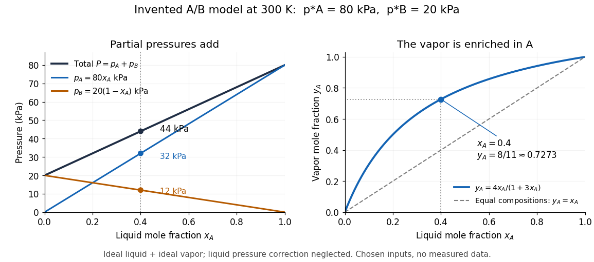

# Ideal solution

↑ **Parent:** [Solution (chemistry)](solution-chemistry.md)  
ⓦ [Wiki](https://en.wikipedia.org/wiki/Ideal_solution)

An ideal solution is a [chemical solution](solution-chemistry.md) whose component [chemical potentials](chemical-potential-split.md) depend on composition through

$$
\mu_i(T,P,\{x_j\})=\mu_i^*(T,P)+RT\ln x_i,
\qquad x_i=\frac{n_i}{\sum_j n_j}.
$$

Here $n_i$ is an [amount of substance](amount-of-substance.md), $x_i$ its [mole fraction](mole-fraction.md), $R$ the [molar gas constant](molar-gas-constant.md), and $\mu_i^*$ the pure-component [liquid](liquid.md) reference at the same [temperature](temperature-split.md) $T$ and [pressure](pressure-split.md) $P$. This model applies to every component across the composition range; it is stronger than an approximation valid only near a pure [solvent](solvent.md).[Second edition, version 10, §9.4.2, printed pp. 249–250, equations 9.4.5 and 9.4.8: pure-liquid reference and full composition range](thermodynamics-and-chemistry-by-howard-devoe.md)

With this pure-[liquid](liquid.md) [standard state](standard-state.md) convention, the [thermodynamic activity](thermodynamic-activity.md) satisfies $\mu_i=\mu_i^*+RT\ln a_i$, so an [ideal solution](ideal-solution.md) has $a_i=x_i$, or [activity coefficient](activity-coefficient.md) $\gamma_i=a_i/x_i=1$.[IUPAC Compendium of Chemical Terminology, fifth edition (Gold Book) by International Union of Pure and Applied Chemistry; Ideal mixture, definition: activities equal mole fractions, equivalently unit activity coefficients; I02938, online version 5.0.0](iupac-compendium-of-chemical-terminology-fifth-edition-gold-book-by-international-union-of-pure-and-applied-chemistry/ideal-mixture.md) This statement concerns the [liquid](liquid.md). Assuming that a coexisting [vapor](vapor.md) is an [ideal gas](ideal-gas-split.md) [mixture](mixture-split.md) is an additional approximation. Its [mole fractions](mole-fraction.md) $y_i$ generally differ from the [liquid](liquid.md) [mole fractions](mole-fraction.md) $x_i$.

For an original two-component example, stipulate $T=300\,\mathrm K$ and pure-component [vapor pressures](vapor-pressure.md) $p_A^*=80\,\mathrm{kPa}$ and $p_B^*=20\,\mathrm{kPa}$. A and B are invented distinguishable components; these numbers are chosen model inputs, not material data. Combine an [ideal solution](ideal-solution.md) with an [ideal gas](ideal-gas-split.md) [vapor](vapor.md), neglect the pure-[liquid](liquid.md) reference's [pressure](pressure-split.md) correction, and exclude other [gases](gas.md). At [liquid](liquid.md) [mole fractions](mole-fraction.md) $x_A=0.4$ and $x_B=0.6$, [Raoult's law](raoult-s-law.md) and addition of [partial pressures](partial-pressure.md) give

$$
p_A=0.4(80)=32\,\mathrm{kPa},\qquad
p_B=0.6(20)=12\,\mathrm{kPa},\qquad
P=p_A+p_B=44\,\mathrm{kPa},
$$

$$
y_A=\frac{p_A}{P}=\frac{32}{44}=\frac{8}{11},
\qquad y_B=\frac{3}{11}.
$$

Thus the coexisting [vapor](vapor.md) contains about $72.73\%$ A by [amount of substance](amount-of-substance.md), although the [liquid](liquid.md) contains only $40\%$. The total [pressure](pressure-split.md) is neither pure-component [vapor pressure](vapor-pressure.md), and $x_A$ cannot be substituted for $y_A$. This enrichment is the basis of [distillation](distillation.md).

**[Figure 3](#image-chosen-ideal-binary-model-partial-pressures-and-vapor-enrichment). Chosen ideal binary model: partial pressures and vapor enrichment**. At the stipulated [temperature](temperature-split.md) $300\,\mathrm K$, the invented pure-component [vapor pressures](vapor-pressure.md) are $80$ and $20\,\mathrm{kPa}$. Left: [partial pressures](partial-pressure.md) and their total versus the [liquid](liquid.md) [mole fraction](mole-fraction.md) $x_A$. Right: the coexisting [vapor](vapor.md) [mole fraction](mole-fraction.md) $y_A$; the diagonal marks equal compositions. Both panels highlight $x_A=0.4$, giving $P=44\,\mathrm{kPa}$ and $y_A=8/11$. These are model curves, with no measured data.

The usefulness of the [ideal solution](ideal-solution.md) is that one composition law connects [chemical potentials](chemical-potential-split.md), [vapor-liquid equilibrium](vapor-liquid-equilibrium.md), [entropy of mixing](entropy-of-mixing.md) and [Gibbs free energy of mixing](gibbs-free-energy-of-mixing.md). Its [liquid](liquid.md) components can interact strongly: the defining condition is their composition dependence, rather than the absence of all interactions as in an [ideal gas](ideal-gas-split.md) model.

**Table of contents**

- [Raoult's law](raoult-s-law.md)
  - [Ideal binary vapor composition](ideal-binary-vapor-composition.md)
- [Entropy of mixing](entropy-of-mixing.md)
  - [Entropy of a two-species classical ideal gas](entropy-of-a-two-species-classical-ideal-gas.md)
- [Gibbs free energy of mixing](gibbs-free-energy-of-mixing.md)
- [Ideal-solution vapor-liquid equilibrium test](ideal-solution-vapor-liquid-equilibrium-test.md)

## ↑ Ancestors (4)

1. [Solution (chemistry)](solution-chemistry.md)
2. [Mixture](mixture-split.md)
3. [Chemistry](chemistry-split.md)
4. [Codex Wiki](split.md)

## ← Incoming links (8)

- [Binary activity-coefficient consistency](binary-activity-coefficient-consistency.md)
- [Entropy of mixing](entropy-of-mixing.md)
- [Gibbs free energy of mixing](gibbs-free-energy-of-mixing.md)
- [Ideal binary Gibbs-Duhem cancellation](ideal-binary-gibbs-duhem-cancellation.md)
- [Ideal binary vapor composition](ideal-binary-vapor-composition.md)
- [Ideal solution](ideal-solution.md)
- [Ideal-solution vapor-liquid equilibrium test](ideal-solution-vapor-liquid-equilibrium-test.md)
- [Raoult's law](raoult-s-law.md)
