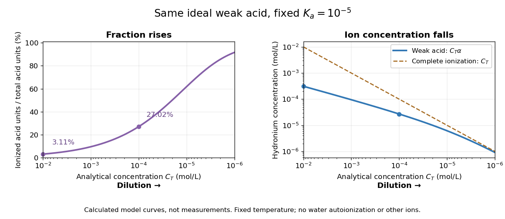

# Ideal weak electrolyte dilution law

↑ **Parent:** [Weak electrolyte](weak-electrolyte.md)

Consider a neutral [monoprotic acid](monoprotic-acid.md) $\mathrm{HA}$ dissolved in [water](water.md), with no added salts or other acids. Assume dilute ideal [thermodynamic activities](thermodynamic-activity.md), fixed [temperature](temperature-split.md), [water](water.md) [thermodynamic activity](thermodynamic-activity.md) one, and negligible [self-ionization of water](self-ionization-of-water.md). Write $C_T$ for its [analytical concentration](analytical-concentration.md), $c=C_T/c^\circ$ with $c^\circ=1\,\mathrm{mol\,L^{-1}}$, and $\alpha$ for its [weak acid dissociation fraction](weak-acid-dissociation-fraction.md). Conservation of acid units and [electric charge](electric-charge-split.md) gives

$$
[\mathrm{HA}]=C_T(1-\alpha),\qquad
[\mathrm A^-]=[\mathrm H_3\mathrm O^+]=C_T\alpha.
$$

Here $\mathrm A^-$ is the [conjugate base](conjugate-base.md), and $\mathrm H^+$ is conventional shorthand for hydrated [hydrogen ions](hydrogen-ion.md), represented by [hydronium](hydronium.md) in this model. Substitution into the [dimensionless](dimensionless-quantity.md) [acid dissociation constant](acid-dissociation-constant.md) gives

$$
K_a=\frac{[\mathrm H_3\mathrm O^+][\mathrm A^-]}{c^\circ[\mathrm{HA}]}
=\frac{c\alpha^2}{1-\alpha},\qquad
c\alpha^2+K_a\alpha-K_a=0.
$$

Solving this [quadratic equation](quadratic-equation.md) and rejecting its negative [root of a polynomial](root-of-a-polynomial.md) gives an exact result within the stated model:

$$
\alpha=\frac{\sqrt{K_a^2+4K_ac}-K_a}{2c}
=\frac{2K_a}{K_a+\sqrt{K_a^2+4K_ac}}.
$$

The second form avoids subtracting nearly equal numbers. Unlike the approximation $\alpha\approx\sqrt{K_a/c}$, it retains depletion of neutral [weak acid](weak-acid.md) and always satisfies $0<\alpha<1$ for positive $K_a,c$. The broader [weak acid mass and charge balances](weak-acid-mass-and-charge-balances.md) restore [self-ionization of water](self-ionization-of-water.md) when that omitted contribution matters.

**[Figure 7](#image-dilution-increases-the-ionized-fraction-while-decreasing-the-absolute-hydronium-concentration-in-an-ideal-weak-electrolyte-model). Dilution increases the ionized fraction while decreasing the absolute hydronium concentration in an ideal weak electrolyte model**. Original calculated curves for stipulated [dimensionless](dimensionless-quantity.md) [acid dissociation constant](acid-dissociation-constant.md) $K_a=10^{-5}$ at fixed [temperature](temperature-split.md), not measurements of a named [chemical acid](acid-chemistry.md). The shared horizontal [analytical concentration](analytical-concentration.md) axis decreases to the right. Separate panels show [weak acid dissociation fraction](weak-acid-dissociation-fraction.md) and $[\mathrm H_3\mathrm O^+]=C_T\alpha$; a dashed comparison shows a completely ionized [monoprotic acid](monoprotic-acid.md) at the same $C_T$. Both omit [self-ionization of water](self-ionization-of-water.md), other [ions](ion.md) and nonideal [thermodynamic activities](thermodynamic-activity.md).

For an original worked example, stipulate $K_a=10^{-5}$ without identifying a real substance. At $C_T=10^{-2}\,\mathrm{mol\,L^{-1}}$, the [weak acid dissociation fraction](weak-acid-dissociation-fraction.md) is approximately $0.0311267$, or $3.11267\%$, and $[\mathrm H_3\mathrm O^+]=3.11267\times10^{-4}\,\mathrm{mol\,L^{-1}}$. A hundredfold [dilution](dilution.md) to $C_T=10^{-4}\,\mathrm{mol\,L^{-1}}$ raises the fraction to $0.270156$, or $27.0156\%$, but lowers $[\mathrm H_3\mathrm O^+]$ to $2.70156\times10^{-5}\,\mathrm{mol\,L^{-1}}$. A completely ionized [strong acid](strong-acid.md) at $C_T=10^{-4}\,\mathrm{mol\,L^{-1}}$ would have $[\mathrm H_3\mathrm O^+]\approx10^{-4}\,\mathrm{mol\,L^{-1}}$: less than the more concentrated [weak acid](weak-acid.md) in the first calculation, despite its greater converted fraction.

The directions of both changes follow without relying on the plot. Put $x=[\mathrm H_3\mathrm O^+]/c^\circ=c\alpha$. Rearranging the [chemical equilibrium](chemical-equilibrium.md) relation gives

$$
c=x+\frac{x^2}{K_a},\qquad
\frac{\mathrm dc}{\mathrm dx}=1+\frac{2x}{K_a}>0,\qquad
\alpha=\frac{K_a}{K_a+x}.
$$

Thus smaller $c$ forces smaller $x$, which in turn makes $\alpha$ larger. The [derivative](derivative.md) proves that total [hydronium](hydronium.md) [concentration](concentration.md) and converted fraction move in opposite directions during [dilution](dilution.md). In this model, adding [solvent](solvent.md) also makes additional acid units ionize at fixed total acid [amount of substance](amount-of-substance.md), even though their [ions](ion.md) are spread over more [volume](volume-thermodynamics.md). That distinction explains why “more ionized” alone does not predict greater [electrical conductivity](electrical-conductivity.md).

Do not extend the no-background model to unlimited [dilution](dilution.md): its prediction $[\mathrm H_3\mathrm O^+]\to0$ omits [water](water.md)'s own [ions](ion.md). The [weak acid mass and charge balances](weak-acid-mass-and-charge-balances.md) include that background. Added salts, other acids or bases, and nonideal [activity coefficients](activity-coefficient.md) also change the relation between [analytical concentration](analytical-concentration.md), converted fraction and [hydronium](hydronium.md) [concentration](concentration.md).

## ↑ Ancestors (5)

1. [Weak electrolyte](weak-electrolyte.md)
2. [Electrolyte](electrolyte.md)
3. [Electrochemistry](electrochemistry-split.md)
4. [Chemistry](chemistry-split.md)
5. [Codex Wiki](split.md)

## ← Incoming links (1)

- [Weak electrolyte](weak-electrolyte.md)
