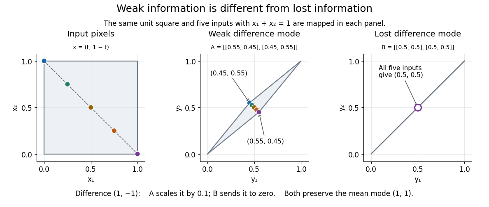

# Ill-posed inverse problem

↑ **Parent:** [Inverse problem](inverse-problem-split.md)

An [inverse problem](inverse-problem-split.md) is an [ill-posed problem](ill-posed-problem.md) if it fails any requirement of a [well-posed problem](well-posed-problem.md): existence for every admissible datum, uniqueness, or [continuity](continuous-function.md) of the reconstructed object as the data change. These requirements depend on the chosen spaces and [norms](norm.md), not just the equation. Clason's regularization notes formulate this distinction explicitly.[Christian Clason, Regularization of Inverse Problems, §3](https://arxiv.org/pdf/2001.00617)

Complete averaging illustrates lost information:

$$
B=\begin{pmatrix}0.5&0.5\\0.5&0.5\end{pmatrix},\qquad
B(t,1-t)^T=(0.5,0.5)^T\quad\hbox{for every }t.
$$

The difference mode $q_-=(1,-1)^T/\sqrt2$ belongs to the [null space](kernel-of-a-linear-map.md) because $Bq_-=0$. Even restricting both pixels to $[0,1]$ leaves infinitely many indistinguishable inputs. This is failure of uniqueness. Data such as $(0.51,0.49)^T$ also have no exact preimage under $B$, illustrating failure of existence when arbitrary two-component observations are admissible.

The two-pixel [matrix](matrix.md) $A$ in the [inverse problem](inverse-problem-split.md) example has a weakly observed difference mode, not a [null space](kernel-of-a-linear-map.md) mode. Its inverse is continuous: this finite-dimensional problem is a [well-posed problem](well-posed-problem.md) with noise-sensitive conditioning. Small positive [singular values](singular-value.md) alone do not imply mathematical ill-posedness. In infinite-dimensional problems, positive [singular values](singular-value.md) approaching zero can make inversion unbounded: unit solution modes then produce data tending to zero. This destroys [continuity](continuous-function.md) even without a [null space](kernel-of-a-linear-map.md). [Regularization of an inverse problem](regularization-of-an-inverse-problem.md) must distinguish missing information from information recoverable only at the cost of amplifying [measurement noise](measurement-noise.md).

**[Figure 1](#image-two-pixel-averaging-compresses-a-square-to-a-thin-diamond-or-collapses-it-to-a-line). Two-pixel averaging compresses a square to a thin diamond or collapses it to a line**.

## ↑ Ancestors (5)

1. [Inverse problem](inverse-problem-split.md)
2. [Analysis](analysis-split.md)
3. [Area of mathematics](area-of-mathematics.md)
4. [Mathematics](mathematics-split.md)
5. [Codex Wiki](split.md)

## ← Incoming links (1)

- [Solution](past-exam-of-the-mathematics-course-of-the-university-of-cambridge/2008/iii/paper-88/5/d/solution.md)
