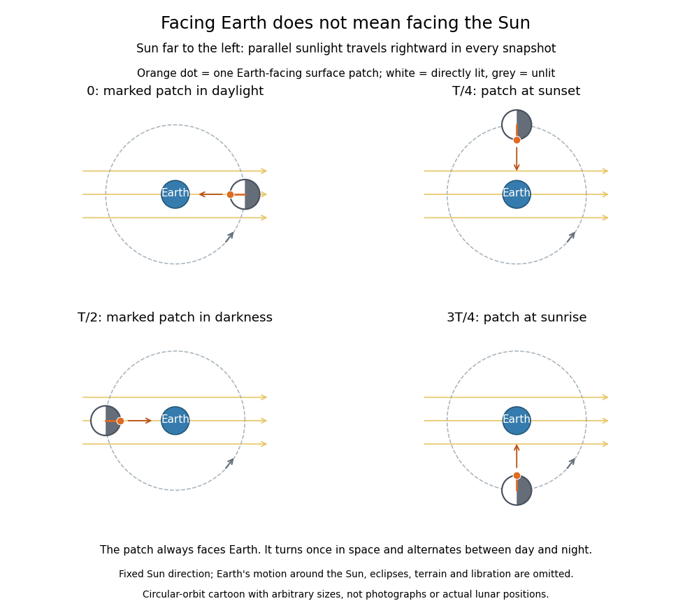

# Illumination of a synchronously rotating moon

↑ **Parent:** [Synchronous rotation](synchronous-rotation.md)

Facing a companion and facing the source of [light](light.md) are different relations. The [Moon](moon.md) keeps its [near side of the Moon](near-side-of-the-moon.md) approximately toward [Earth](earth.md), while the direction to the distant [Sun](sun.md) is nearly fixed during the idealized orbit shown below. A fixed surface patch therefore turns toward, across and away from sunlight. The [far side of the Moon](far-side-of-the-moon.md) has day and night too; its name does not mean permanent darkness. [NASA: changing lunar illumination](https://science.nasa.gov/moon/facts/).

**[Figure 4](#image-a-face-fixed-toward-earth-still-alternates-between-sunlight-and-darkness). A face fixed toward Earth still alternates between sunlight and darkness**. Four snapshots of one circular-orbit cartoon viewed from above the orbital plane. The orange dot marks the same Earth-facing surface patch in every snapshot; the Sun is far to the left and all rays travel rightward. White and grey show directly lit and unlit hemispheres. The diagram neglects Earth's motion around the Sun, lunar libration, eclipses, terrain and reflected light. Sizes and distances are arbitrary; this is a geometry cartoon, not an ephemeris or photograph.

If the [Sun](sun.md) direction has fixed angle $\alpha$ and the marked surface patch has outward [normal vector](normal-vector.md) at angle $\theta$, its direct illumination is proportional to $\max(0,\cos(\theta-\alpha))$. With [synchronous rotation](synchronous-rotation.md), $\theta=f+\pi$, so the patch goes through day and night even though it always faces [Earth](earth.md). In reality the [Earth](earth.md)-[Moon](moon.md) system advances around the [Sun](sun.md): the lunar spin and orbital cycle relative to distant [stars](star.md) is about $27.3$ Earth days, while the [lunar phase](lunar-phase.md) cycle has a [synodic period](synodic-period.md) of about $29.5$ Earth days. These numbers describe the actual system, not the fixed-sunlight cartoon. [NASA StarChild: sidereal and synodic lunar periods](https://starchild.gsfc.nasa.gov/docs/StarChild/questions/question32.html).

For a synchronously rotating [exoplanet](exoplanet-split.md) whose orbital companion is itself the illuminating [star](star.md), the direction to the [star](star.md) turns with the orbit. On an ideal [circular orbit](circular-orbit.md), with perpendicular spin axis and no additional oscillations, this direction is fixed relative to the surface, giving persistent day and night hemispheres. [Day-night heat redistribution](day-night-heat-redistribution.md) then helps determine the nightside [temperature](temperature-split.md); permanent lack of direct starlight does not imply zero [temperature](temperature-split.md). [Orbital eccentricity](orbital-eccentricity.md) and departures from this ideal spin geometry modify that simple picture.

## ↑ Ancestors (8)

1. [Synchronous rotation](synchronous-rotation.md)
2. [Tidal locking](tidal-locking.md)
3. [Planetary system dynamics](planetary-system-dynamics.md)
4. [Planetary science](planetary-science-split.md)
5. [Astrophysics](astrophysics-split.md)
6. [Branches of physics](branches-of-physics.md)
7. [Physics](physics-split.md)
8. [Codex Wiki](split.md)

## ← Incoming links (1)

- [Moon](moon.md)
