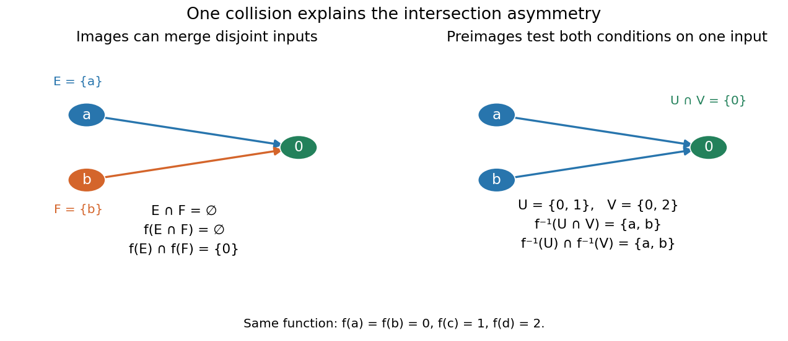

# Image of a function

↑ **Parent:** [Image and preimage of a function](image-and-preimage-of-a-function.md)  
ⓦ [Wiki](https://en.wikipedia.org/wiki/Image_(mathematics))

For a [function](function-split.md) $f:X\to Y$ and a [subset](subset.md) $E\subseteq X$, its image is

$$
f(E)=\{f(x):x\in E\}
=\{y\in Y:\text{ there exists }x\in E\text{ with }f(x)=y\}.
$$

The full [image of a function](image-of-a-function.md) is $f(X)$. The [set](set-split.md) notation ignores repeated outputs: in the finite example above, $f(\{a,b\})=\{0\}$, rather than a list containing zero twice. A [function collision](function-collision.md) can therefore reduce the [cardinality](cardinality.md) of an image.

[Images of a function](image-of-a-function.md) preserve [unions](set-union.md):

$$
f(E\cup F)=f(E)\cup f(F).
$$

An output reached from the [union](set-union.md) is reached from at least one of its two input [sets](set-split.md). For [intersections](set-intersection.md), however, only

$$
f(E\cap F)\subseteq f(E)\cap f(F)
$$

holds in general. In the finite example, take $E=\{a\}$ and $F=\{b\}$. Their [intersection](set-intersection.md) is the [empty set](empty-set.md), so $f(E\cap F)=\varnothing$. But $f(E)=f(F)=\{0\}$, giving $f(E)\cap f(F)=\{0\}$. Distinct witnesses in the two input [sets](set-split.md) can produce the same output.

**[Figure 6](#image-an-image-of-a-function-can-merge-disjoint-inputs-while-a-preimage-tests-both-output-conditions-on-the-same-input). An image of a function can merge disjoint inputs, while a preimage tests both output conditions on the same input**.

For an [injective function](injective-function.md), an output shared by $f(E)$ and $f(F)$ must come from the same input. That input lies in $E\cap F$, so equality holds. Conversely, preserving [intersections](set-intersection.md) for every pair of input [subsets](subset.md) forces [injectivity](injective-function.md): two distinct inputs with the same output would give the singleton counterexample above. The image and [preimage](preimage.md) laws are stated in [Jiří Lebl, Basic Analysis I, Propositions 0.3.15–0.3.16](https://www.jirka.org/ra/html/sec_basicset.html); the finite example makes the missing reverse inclusion visible.

## ↑ Ancestors (6)

1. [Image and preimage of a function](image-and-preimage-of-a-function.md)
2. [Set theory](set-theory-split.md)
3. [Foundations of mathematics](foundations-of-mathematics-split.md)
4. [Area of mathematics](area-of-mathematics.md)
5. [Mathematics](mathematics-split.md)
6. [Codex Wiki](split.md)

## ← Incoming links (25)

- [Codomain](codomain.md)
- [Constant function](constant-function.md)
- [Constant rank theorem](constant-rank-theorem.md)
- [Critical value](critical-value.md)
- [Essential range](essential-range.md)
- [Factorization through a surjection](factorization-through-a-surjection.md)
- [Fiber of a function](fiber-of-a-function.md)
- [Free group action](free-group-action.md)
- [Function](function-split.md)
- [Horizontal line test](horizontal-line-test.md)
- [Image and preimage of a function](image-and-preimage-of-a-function.md)
- [Image of a function](image-of-a-function.md)
- [Interval arithmetic](interval-arithmetic.md)
- [Interval dependency problem](interval-dependency-problem.md)
- [Interval enclosure](interval-enclosure.md)
- [Interval square range](interval-square-range.md)
- [Interval subdivision](interval-subdivision.md)
- [Monotonic function](monotonic-function.md)
- [Natural interval extension](natural-interval-extension.md)
- [Solution](past-exam-of-the-mathematics-course-of-the-university-of-cambridge/2008/ia/paper-4/1d/i/solution.md)
- [Solution](past-exam-of-the-mathematics-course-of-the-university-of-cambridge/2017/ii/paper-3/20f/i/solution.md)
- [Solution](past-exam-of-the-mathematics-course-of-the-university-of-cambridge/2017/ii/paper-3/2f/c/solution.md)
- [Strictly decreasing function](strictly-decreasing-function.md)
- [Strictly increasing function](strictly-increasing-function.md)
- [Subsequential limit](subsequential-limit.md)
