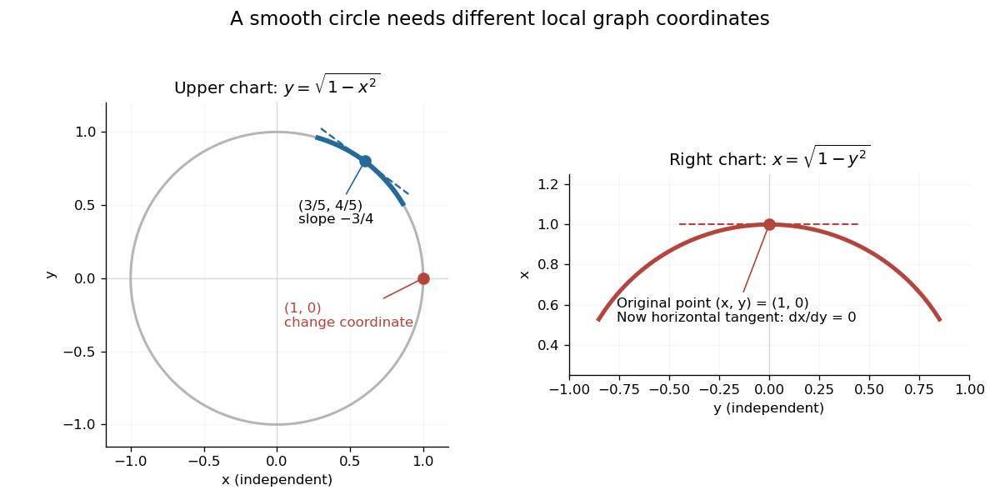

# Implicit function theorem

↑ **Parent:** [Inverse function theorem](inverse-function-theorem.md)  
ⓦ [Wiki](https://en.wikipedia.org/wiki/Implicit_function_theorem)

An equation can define a [function](function-split.md) without giving an explicit formula for it. The implicit function theorem tells us when the constraint $F(x,y)=0$ determines $y$ uniquely from nearby $x$, and makes the resulting [function](function-split.md) [continuously differentiable](continuously-differentiable-function.md). It is useful when solving an equation explicitly is cumbersome or impossible: the [partial derivatives](partial-derivative.md) already reveal whether local recovery is possible.

Let $F$ be a [continuously differentiable](continuously-differentiable-function.md) map from an [open subset](open-set.md) of $\mathbb R^m\times\mathbb R^n$ to $\mathbb R^n$. Suppose $F(x_0,y_0)=0$ and the [partial derivative](partial-derivative.md) $D_yF(x_0,y_0)$ is an [invertible linear map](invertible-linear-map.md). There are [open](open-set.md) [neighbourhoods](neighbourhood-mathematics.md) $U$ of $x_0$ and $V$ of $y_0$ and a unique [continuously differentiable](continuously-differentiable-function.md) [function](function-split.md) $g:U\to V$ such that, for $(x,y)\in U\times V$,

$$
F(x,y)=0\quad\Longleftrightarrow\quad y=g(x),\qquad g(x_0)=y_0.
$$

Thus the nearby [level set](level-set.md) is a [graph of a function](graph-of-a-function.md). The [derivative](derivative.md) of this graph is

$$
Dg(x)=-[D_yF(x,g(x))]^{-1}D_xF(x,g(x)).
$$

The [matrix inverse](matrix-inverse-split.md) acts on the left; the order matters in several dimensions.

For example, take the [unit circle](complex-unit-circle.md), written as the [level set](level-set.md) $F(x,y)=x^2+y^2-1=0$. At $(x_0,y_0)=(3/5,4/5)$, $F_y=2y_0=8/5\ne0$, so the local upper branch is $y=g(x)=\sqrt{1-x^2}$. [Implicit differentiation](implicit-differentiation.md) gives

$$
g'(x)=-\frac{F_x}{F_y}=-\frac{x}{y},\qquad
\boxed{g'(3/5)=-3/4.}
$$

This [tangent line](tangent-line.md) slope is available directly from the constraint. The negative [square root](square-root.md) branch is elsewhere on the same [circle](circle.md); it does not destroy uniqueness near the selected upper point.

**[Figure 14](#image-the-same-circle-uses-y-as-a-function-of-x-near-its-upper-arc-and-x-as-a-function-of-y-near-its-rightmost-point). The same circle uses y as a function of x near its upper arc and x as a function of y near its rightmost point**.

At $(1,0)$, however, $F_y=0$ and the [circle](circle.md) cannot be represented locally as one [function](function-split.md) $y=g(x)$: just to the left of $x=1$ there are two nearby values of $y$. The [circle](circle.md) is still smooth there. Since $F_x=2\ne0$, use the other coordinate instead: $x=h(y)=\sqrt{1-y^2}$, with $h'(0)=0$. A failed coordinate choice is different from a geometric singularity.

The derivative condition is sufficient, not necessary for every possible implicit graph. For $F(x,y)=y^3$, the entire zero set is the smooth graph $y=0$, even though $F_y$ vanishes there. In this case the defining equation itself has a degenerate [derivative](derivative.md); the theorem's test gives no conclusion.

The connection to the [inverse function theorem](inverse-function-theorem.md) is particularly elegant. Augment the constraint to the map $H(x,y)=(x,F(x,y))$, whose [Jacobian matrix](jacobian-matrix.md) is

$$
DH=
\begin{pmatrix}I&0\\D_xF&D_yF\end{pmatrix}.
$$

Its [determinant](determinant.md) is $\det D_yF$. When this is nonzero, locally invert $H$ and set its second output to zero. The recovered second input is $g(x)$. In this way an implicit constraint becomes an ordinary [inverse function](inverse-function.md) problem. [University of Toronto MAT237: the implicit theorem as a corollary of the inverse theorem](https://www.math.utoronto.ca/courses/mat237y1/20199/notes/Chapter3/S3.3.html)

**Table of contents**

- [Holomorphic implicit function theorem](holomorphic-implicit-function-theorem.md)
- [Implicit differentiation](implicit-differentiation.md)
  - [Reciprocity rule for constrained partial derivatives](reciprocity-rule-for-constrained-partial-derivatives.md)
  - [Cyclic partial derivative identity](cyclic-partial-derivative-identity.md)

## ↑ Ancestors (9)

1. [Inverse function theorem](inverse-function-theorem.md)
2. [Differentiable map](differentiable-map.md)
3. [Multivariable calculus](multivariable-calculus-split.md)
4. [Calculus](calculus-split.md)
5. [Real analysis](real-analysis-split.md)
6. [Analysis](analysis-split.md)
7. [Area of mathematics](area-of-mathematics.md)
8. [Mathematics](mathematics-split.md)
9. [Codex Wiki](split.md)

## ← Incoming links (52)

- [Close geodesic circles intersect twice](close-geodesic-circles-intersect-twice.md)
- [Critical value](critical-value.md)
- [Fold of a solution branch](fold-of-a-solution-branch.md)
- [Heteroclinic Melnikov function for a periodic planar flow](heteroclinic-melnikov-function-for-a-periodic-planar-flow.md)
- [Implicit differentiation](implicit-differentiation.md)
- [Implicit equation](implicit-equation.md)
- [Implicit function](implicit-function.md)
- [Implicit solution](implicit-solution.md)
- [Influence function of a Huber location estimator](influence-function-of-a-huber-location-estimator.md)
- [Level curve](level-curve.md)
- [Orthogonal unitary-gauge slice near a scalar vacuum](orthogonal-unitary-gauge-slice-near-a-scalar-vacuum.md)
- [Parameter continuation](parameter-continuation.md)
- [Solution](past-exam-of-the-mathematics-course-of-the-university-of-cambridge/2001/iii/paper-46/3/iii/solution.md)
- [Solution](past-exam-of-the-mathematics-course-of-the-university-of-cambridge/2001/iii/paper-56/4/solution.md)
- [Solution](past-exam-of-the-mathematics-course-of-the-university-of-cambridge/2001/iii/paper-63/1/solution.md)
- [Solution](past-exam-of-the-mathematics-course-of-the-university-of-cambridge/2002/iii/paper-59/6/solution.md)
- [Solution](past-exam-of-the-mathematics-course-of-the-university-of-cambridge/2003/iii/paper-17/6/solution.md)
- [Solution](past-exam-of-the-mathematics-course-of-the-university-of-cambridge/2004/iii/paper-60/1/b/solution.md)
- [Solution](past-exam-of-the-mathematics-course-of-the-university-of-cambridge/2005/ib/paper-1/2a/solution.md)
- [Solution](past-exam-of-the-mathematics-course-of-the-university-of-cambridge/2006/iii/paper-22/5/c/solution.md)
- [Solution](past-exam-of-the-mathematics-course-of-the-university-of-cambridge/2006/iii/paper-66/2/solution.md)
- [Solution](past-exam-of-the-mathematics-course-of-the-university-of-cambridge/2006/iii/paper-85/2/a/solution.md)
- [Solution](past-exam-of-the-mathematics-course-of-the-university-of-cambridge/2008/ii/paper-2/6b/solution.md)
- [Solution](past-exam-of-the-mathematics-course-of-the-university-of-cambridge/2008/iii/paper-77/2/solution.md)
- [Solution](past-exam-of-the-mathematics-course-of-the-university-of-cambridge/2009/ii/paper-1/23g/b/solution.md)
- [Solution](past-exam-of-the-mathematics-course-of-the-university-of-cambridge/2009/ii/paper-1/25h/iii/solution.md)
- [Solution](past-exam-of-the-mathematics-course-of-the-university-of-cambridge/2010/ii/paper-4/24h/iii/solution.md)
- [Solution](past-exam-of-the-mathematics-course-of-the-university-of-cambridge/2011/ia/paper-2/6a/a/solution.md)
- [Solution](past-exam-of-the-mathematics-course-of-the-university-of-cambridge/2011/ii/paper-4/7c/i/solution.md)
- [Solution](past-exam-of-the-mathematics-course-of-the-university-of-cambridge/2012/iii/paper-20/3/ii/solution.md)
- [Solution](past-exam-of-the-mathematics-course-of-the-university-of-cambridge/2014/ia/paper-2/2b/solution.md)
- [Solution](past-exam-of-the-mathematics-course-of-the-university-of-cambridge/2014/iii/paper-42/1/iii/solution.md)
- [Solution](past-exam-of-the-mathematics-course-of-the-university-of-cambridge/2017/ii/paper-3/21f/solution.md)
- [Solution](past-exam-of-the-mathematics-course-of-the-university-of-cambridge/2017/iii/paper-105/1/1/a/solution.md)
- [Solution](past-exam-of-the-mathematics-course-of-the-university-of-cambridge/2018/iii/paper-321/3/d/solution.md)
- [Solution](past-exam-of-the-mathematics-course-of-the-university-of-cambridge/2019/ii/paper-3/24f/b/solution.md)
- [Solution](past-exam-of-the-mathematics-course-of-the-university-of-cambridge/2022/ib/paper-2/10g/solution.md)
- [Solution](past-exam-of-the-mathematics-course-of-the-university-of-cambridge/2023/ib/paper-3/11g/solution.md)
- [Solution](past-exam-of-the-mathematics-course-of-the-university-of-cambridge/2025/iii/paper-118/3/solution.md)
- [Solution](past-exam-of-the-mathematics-course-of-the-year-1-of-the-natural-sciences-course-of-the-university-of-cambridge/2006/paper-2/4/a/solution.md)
- [Solution](past-exam-of-the-mathematics-course-of-the-year-1-of-the-natural-sciences-course-of-the-university-of-cambridge/2013/paper-2/18/a/solution.md)
- [Solution](past-exam-of-the-mathematics-course-of-the-year-1-of-the-natural-sciences-course-of-the-university-of-cambridge/2017/paper-1/12/a/i/solution.md)
- [Solution](past-exam-of-the-mathematics-course-of-the-year-1-of-the-natural-sciences-course-of-the-university-of-cambridge/2018/paper-2/20/b/solution.md)
- [Solution](past-exam-of-the-mathematics-course-of-the-year-1-of-the-natural-sciences-course-of-the-university-of-cambridge/2019/paper-1/13/a/solution.md)
- [Perturbation](perturbation.md)
- [Reciprocity rule for constrained partial derivatives](reciprocity-rule-for-constrained-partial-derivatives.md)
- [Reflection curve on a surface](reflection-curve-on-a-surface.md)
- [Regular perturbation](regular-perturbation.md)
- [Regular perturbation of a simple algebraic root](regular-perturbation-of-a-simple-algebraic-root.md)
- [Steady-state bifurcation](steady-state-bifurcation.md)
- [Tangent plane](tangent-plane.md)
- [Vector area element of an implicit surface](vector-area-element-of-an-implicit-surface.md)
