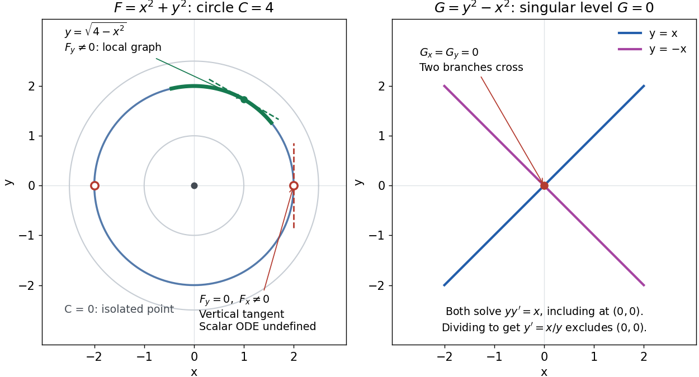

# Implicit solution

↑ **Parent:** [Ordinary differential equation](ordinary-differential-equation.md)

An [implicit solution](implicit-solution.md) describes a [solution of a differential equation](solution-of-a-differential-equation.md) through a relation $F(x,y)=C$, instead of isolating $y$ in an explicit formula. The relation describes a [level set](level-set.md); an actual scalar [solution of a differential equation](solution-of-a-differential-equation.md) must be a [differentiable function](differentiable-function.md) $y(x)$ on an [interval](interval-mathematics.md) whose [function graph](graph-of-a-function.md) lies in the equation's domain. A whole [level set](level-set.md) need not be one such [function graph](graph-of-a-function.md).

For example, consider

$$
y'=-\frac{x}{y},\qquad D=\{(x,y):y\ne0\}.
$$

[Implicit differentiation](implicit-differentiation.md) of $x^2+y^2=C$ gives $2x+2yy'=0$. For $C>0$, the [circle](circle.md) contains two [solutions of a differential equation](solution-of-a-differential-equation.md),

$$
y_+(x)=\sqrt{C-x^2},\qquad y_-(x)=-\sqrt{C-x^2},\qquad -\sqrt C<x<\sqrt C.
$$

Both satisfy the equation on the stated [open interval](open-interval.md), and their [function graphs](graph-of-a-function.md) stay in $D$. An [initial condition](initial-condition.md) $(x_0,y_0)\in D$ fixes $C=x_0^2+y_0^2$ and selects the sign of $y_0$. In particular, $y(0)=2$ gives $C=4$ and the upper branch on $(-2,2)$. The constant alone does not select the branch.[§1.3.2 Implicit solutions: implicit differentiation, multiple branches, and selection by an initial condition](notes-on-diffy-qs-differential-equations-for-engineers-by-jiri-lebl/1-3-separable-equations.md)

**[Figure 6](#image-a-circular-level-set-gives-local-solution-graphs-away-from-vertical-tangencies-while-a-singular-level-needs-separate-analysis). A circular level set gives local solution graphs away from vertical tangencies, while a singular level needs separate analysis**.

The precise local criterion uses the [implicit function theorem](implicit-function-theorem.md). Let $F$ be [continuously differentiable](continuously-differentiable-function.md) on an [open subset](open-set.md) of the plane, with $F(x_0,y_0)=C$. If its [partial derivative](partial-derivative.md) $F_y(x_0,y_0)\ne0$, the nearby [level set](level-set.md) is a unique [continuously differentiable](continuously-differentiable-function.md) [function graph](graph-of-a-function.md) $y=g(x)$ through that point. The [chain rule](chain-rule.md) gives

$$
F_x(x,g(x))+F_y(x,g(x))g'(x)=0,\qquad g'(x)=-\frac{F_x(x,g(x))}{F_y(x,g(x))}.
$$

This proves that the local [function graph](graph-of-a-function.md) solves $y'=-F_x/F_y$ there. For a different prescribed equation $y'=f(x,y)$, one must also check $F_x+F_yf=0$ along that branch and that it stays in the domain of $f$. A [level set](level-set.md) by itself does not verify an arbitrary [ordinary differential equation](ordinary-differential-equation.md).[§8.5.1, Theorem 8.5.6 and the preceding circle example: local existence, uniqueness and derivative of an implicit graph](basic-analysis-introduction-to-real-analysis-volume-ii-by-jiri-lebl/8-5-inverse-and-implicit-function-theorems.md)

For $F=x^2+y^2$, the upper branch through $(1,\sqrt3)$ has $F_y=2\sqrt3$ and [tangent line](tangent-line.md) [slope](slope.md) $-1/\sqrt3$. At $(2,0)$, however, $F_y=0$ and $F_x=4$. The [circle](circle.md) remains a smooth [regular level set](regular-level-set.md) with a vertical [tangent line](tangent-line.md): it can be written locally as $x=\sqrt{4-y^2}$, but not as a single [function graph](graph-of-a-function.md) $y=g(x)$ over an [open interval](open-interval.md) containing $2$. Moreover, $-x/y$ is undefined there, so the scalar [solution of a differential equation](solution-of-a-differential-equation.md) cannot include this point in its domain. Changing the parameter draws the curve through the point but does not extend that scalar [initial value problem](initial-value-problem.md).

When both [partial derivatives](partial-derivative.md) vanish, even the geometry needs separate inspection. The level $x^2+y^2=0$ is an isolated point, not a [function graph](graph-of-a-function.md) on any nonempty [open interval](open-interval.md). The zero [level set](level-set.md) of $G(x,y)=y^2-x^2$ instead consists of the two [lines](straight-line.md) $y=x$ and $y=-x$ crossing at the origin, where $\nabla G=0$. Each [line](straight-line.md) satisfies the implicit [ordinary differential equation](ordinary-differential-equation.md) $yy'=x$, including at the origin; the explicit form $y'=x/y$ excludes the origin. Thus algebraically dividing by a vanishing coefficient changes the domain and can change which [solutions of a differential equation](solution-of-a-differential-equation.md) are admissible. Vanishing $F_y$ alone is only failure of a sufficient test: $F(x,y)=y^3$ has the smooth zero [function graph](graph-of-a-function.md) $y=0$ despite $F_y=0$ everywhere on it.

[Implicit solutions](implicit-solution.md) are especially useful for [exact first-order ordinary differential equations](exact-first-order-ordinary-differential-equation.md) and for finding a [first integral of an ordinary differential equation](first-integral-of-an-ordinary-differential-equation.md): a conserved relation can reveal allowed states without an explicit formula. For the normalized [harmonic oscillator](simple-harmonic-motion.md) written as $\dot x=y$, $\dot y=-x$, the [energy](energy-split.md) $H=(x^2+y^2)/2$ has $\dot H=x\dot x+y\dot y=0$. Its positive [level sets](level-set.md) are the same [circles](circle.md). Where $y\ne0$, eliminating time gives $dy/dx=-x/y$ and the local [implicit solution](implicit-solution.md) above. The [harmonic oscillator](simple-harmonic-motion.md)'s [parametric curve](parametric-curve.md) continues through $y=0$ because its [vector field](vector-field.md) governing evolution in time is defined there; treating $x$ as the independent variable fails at that turn. The origin is an [equilibrium point](equilibrium-point-of-a-dynamical-system.md) of the [harmonic oscillator](simple-harmonic-motion.md), although it is excluded from the scalar equation $y'=-x/y$.

## ↑ Ancestors (6)

1. [Ordinary differential equation](ordinary-differential-equation.md)
2. [Differential equation](differential-equation-split.md)
3. [Analysis](analysis-split.md)
4. [Area of mathematics](area-of-mathematics.md)
5. [Mathematics](mathematics-split.md)
6. [Codex Wiki](split.md)

## ← Incoming links (4)

- [Implicit solution](implicit-solution.md)
- [Solution](past-exam-of-the-mathematics-course-of-the-university-of-cambridge/2014/ia/paper-2/2b/solution.md)
- [Solution](past-exam-of-the-mathematics-course-of-the-year-1-of-the-natural-sciences-course-of-the-university-of-cambridge/2001/paper-2/1/c/solution.md)
- [Separable differential equation](separable-differential-equation.md)
