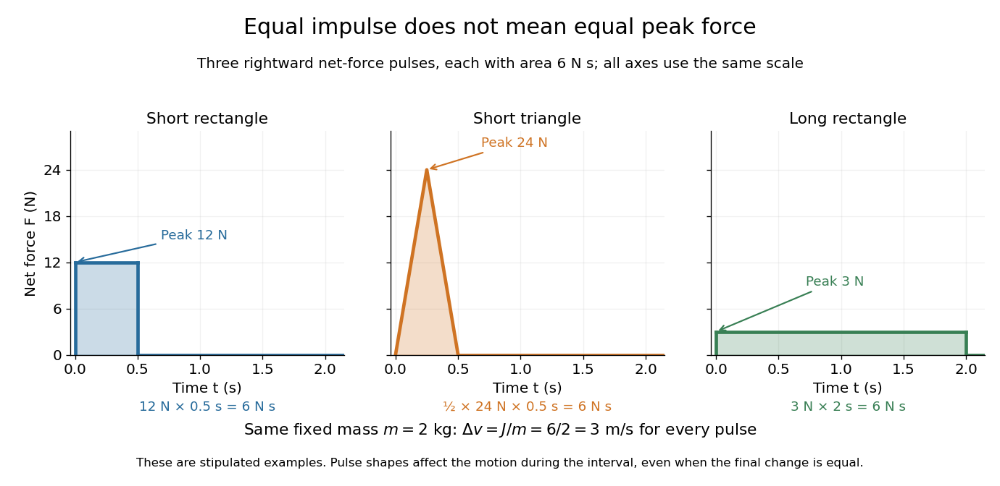

# Impulse

↑ **Parent:** [Collision mechanics](collision-mechanics.md)  
ⓦ [Wiki](https://en.wikipedia.org/wiki/Impulse)

The [impulse](impulse.md) of a [force](force-split.md) over a [time](time-in-physics.md) interval is its [vector](vector.md) [integral](integral-split.md):

$$
\mathbf J=\int_{t_i}^{t_f}\mathbf F(t)\,dt.
$$

Its [International System of Units](international-system-of-units.md) unit is $\mathrm{N\,s}=\mathrm{kg\,m/s}$. The [impulse-momentum theorem](impulse-momentum-theorem.md) equates the net [impulse](impulse.md) to the change in [momentum](momentum-split.md). For one fixed-[mass](mass.md) [point mass](point-mass.md), integrate its net [force](force-split.md); for a closed collection obeying [Newton's third law](newton-s-third-law.md), integrate the sum of external [forces](force-split.md). In one dimension, the signed area under the [force](force-split.md) versus [time](time-in-physics.md) graph gives the [impulse](impulse.md); negative [force](force-split.md) contributes negative area. [OpenStax University Physics Volume 1, section 9.2: Impulse and Collisions](https://openstax.org/books/university-physics-volume-1/pages/9-2-impulse-and-collisions)

Three stipulated rightward net [force](force-split.md) pulses illustrate the same $J=6\,\mathrm{N\,s}$: constant $12\,\mathrm N$ for $0.5\,\mathrm s$, a triangle rising from zero to $24\,\mathrm N$ at $0.25\,\mathrm s$ and falling to zero at $0.5\,\mathrm s$, and constant $3\,\mathrm N$ for $2\,\mathrm s$. Their areas are

$$
(12\,\mathrm N)(0.5\,\mathrm s)
=\frac12(24\,\mathrm N)(0.5\,\mathrm s)
=(3\,\mathrm N)(2\,\mathrm s)
=6\,\mathrm{N\,s}.
$$

Applied separately to the same fixed [mass](mass.md) $m=2\,\mathrm{kg}$, each gives $\Delta v=J/m=3\,\mathrm{m/s}$. Their peak [forces](force-split.md) differ: $12$, $24$, and $3\,\mathrm N$. Thus [impulse](impulse.md) fixes the final [momentum](momentum-split.md) change, while the [force](force-split.md) history determines how abruptly it occurs.

**[Figure 12](#image-three-force-pulses-have-the-same-impulse-but-different-durations-and-peak-forces). Three force pulses have the same impulse but different durations and peak forces**.

The mean net [force](force-split.md) over the chosen interval is $\overline{\mathbf F}=\mathbf J/(t_f-t_i)$. Extending the interval for a fixed [impulse](impulse.md) reduces this mean [force](force-split.md). A lower peak [force](force-split.md) additionally depends on the pulse shape: the two short pulses above have the same mean $12\,\mathrm N$ but different peaks. This explains why controlling the duration and shape of a stopping [impulse](impulse.md) matters in cushioning a [collision](collision.md).

**Table of contents**

- [Impulse-momentum theorem](impulse-momentum-theorem.md)

## ↑ Ancestors (6)

1. [Collision mechanics](collision-mechanics.md)
2. [Particle dynamics](particle-dynamics.md)
3. [Classical mechanics](classical-mechanics-split.md)
4. [Branches of physics](branches-of-physics.md)
5. [Physics](physics-split.md)
6. [Codex Wiki](split.md)

## ← Incoming links (46)

- [Balanced forces and constant velocity](balanced-forces-and-constant-velocity.md)
- [Calibrated Einstein-de Haas torsion response](calibrated-einstein-de-haas-torsion-response.md)
- [Centre of percussion](centre-of-percussion.md)
- [Conservation of angular momentum](conservation-of-angular-momentum.md)
- [Cue height for immediate rolling](cue-height-for-immediate-rolling.md)
- [Elastic eccentric impact of a thin disc](elastic-eccentric-impact-of-a-thin-disc.md)
- [Endpoint collision of two freely rotating equal rods](endpoint-collision-of-two-freely-rotating-equal-rods.md)
- [Equal interaction forces and unequal accelerations](equal-interaction-forces-and-unequal-accelerations.md)
- [Hinge impulse of an edge-pivoted square plate](hinge-impulse-of-an-edge-pivoted-square-plate.md)
- [Ideal gas pressure from wall collisions](ideal-gas-pressure-from-wall-collisions.md)
- [Impulse](impulse.md)
- [Impulse-driven slipping-to-rolling transition of a sphere](impulse-driven-slipping-to-rolling-transition-of-a-sphere.md)
- [Impulse-momentum theorem](impulse-momentum-theorem.md)
- [Impulse of magnetic braking](impulse-of-magnetic-braking.md)
- [Independent spin Barnett response](independent-spin-barnett-response.md)
- [Magnetomechanical angular momentum balance](magnetomechanical-angular-momentum-balance.md)
- [Momentum](momentum-split.md)
- [Momentum conservation](momentum-conservation.md)
- [Newton's second law](newton-s-second-law.md)
- [Normal-mode impulse projection](normal-mode-impulse-projection.md)
- [Solution](past-exam-of-the-mathematics-course-of-the-university-of-cambridge/2006/ia/paper-4/11c/solution.md)
- [Solution](past-exam-of-the-mathematics-course-of-the-university-of-cambridge/2008/ia/paper-4/9b/solution.md)
- [Solution](past-exam-of-the-mathematics-course-of-the-university-of-cambridge/2012/iii/paper-64/1/solution.md)
- [Solution](past-exam-of-the-mathematics-course-of-the-university-of-cambridge/2012/iii/paper-73/3/i/solution.md)
- [Solution](past-exam-of-the-mathematics-course-of-the-university-of-cambridge/2012/iii/paper-73/3/iii/solution.md)
- [Solution](past-exam-of-the-mathematics-course-of-the-university-of-cambridge/2012/iii/paper-73/3/iv/solution.md)
- [Solution](past-exam-of-the-mathematics-course-of-the-university-of-cambridge/2012/iii/paper-73/3/v/solution.md)
- [Solution](past-exam-of-the-mathematics-course-of-the-university-of-cambridge/2016/ia/paper-4/10b/solution.md)
- [Solution](past-exam-of-the-mathematics-course-of-the-university-of-cambridge/2019/ia/paper-4/3a/solution.md)
- [Solution](past-exam-of-the-mathematics-course-of-the-university-of-cambridge/2025/ia/paper-4/4b/solution.md)
- [Solution](past-exam-of-the-physics-b-course-of-the-university-of-cambridge/2010/paper-2a/section-d/d17/c/solution.md)
- [Solution](past-exam-of-the-physics-b-course-of-the-university-of-cambridge/2011/paper-2/section-c/c10/solution.md)
- [Solution](past-exam-of-the-physics-b-course-of-the-university-of-cambridge/2011/paper-2/section-c/c12/solution.md)
- [Solution](past-exam-of-the-physics-b-course-of-the-university-of-cambridge/2012/paper-1/section-c/c10/solution.md)
- [Solution](past-exam-of-the-physics-b-course-of-the-university-of-cambridge/2013/paper-1/section-c/c12/solution.md)
- [Solution](past-exam-of-the-physics-b-course-of-the-university-of-cambridge/2016/paper-1/section-b/b7/solution.md)
- [Solution](past-exam-of-the-physics-b-course-of-the-university-of-cambridge/2021/paper-1/section-b/b6/e/solution.md)
- [Solution](past-exam-of-the-physics-b-course-of-the-university-of-cambridge/2021/paper-1/section-b/b6/f/solution.md)
- [Solution](past-exam-of-the-physics-course-of-the-year-1-of-the-natural-sciences-course-of-the-university-of-cambridge/2013/paper-1/section-b/b7/solution.md)
- [Solution](past-exam-of-the-physics-course-of-the-year-1-of-the-natural-sciences-course-of-the-university-of-cambridge/2014/paper-1/b9/solution.md)
- [Solution](past-exam-of-the-physics-course-of-the-year-1-of-the-natural-sciences-course-of-the-university-of-cambridge/2015/paper-1/section-b/b7/solution.md)
- [Solution](past-exam-of-the-physics-course-of-the-year-4-of-the-natural-sciences-course-of-the-university-of-cambridge/2012/paper-1/section-a/a2/solution.md)
- [Reversed circularization burn in a Hohmann transfer](reversed-circularization-burn-in-a-hohmann-transfer.md)
- [Rough-disc collision data requirements](rough-disc-collision-data-requirements.md)
- [Smooth equal-disc oblique collision](smooth-equal-disc-oblique-collision.md)
- [Two-cart force-probe test of Newton's third law](two-cart-force-probe-test-of-newton-s-third-law.md)
