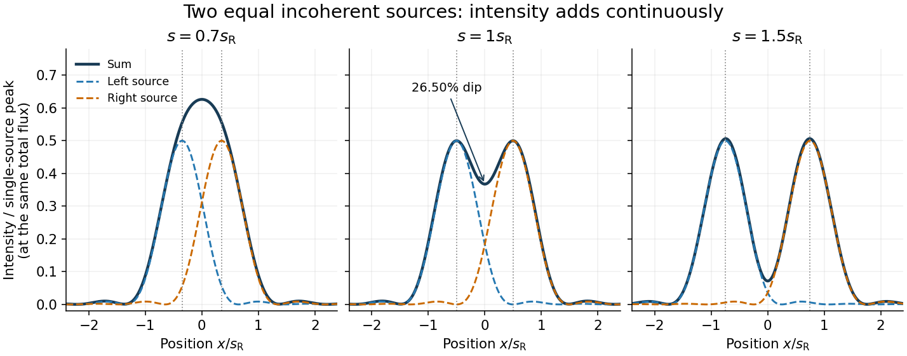

# Incoherent two-source Airy profile

↑ **Parent:** [Rayleigh criterion](rayleigh-criterion.md)

Let $x$ measure position along the line joining two mutually incoherent [optical point sources](optical-point-source.md) in the [focal plane](focal-plane.md), with equal detected [radiant fluxes](radiant-flux.md) and separation $s$. Extend the even [Airy disk](airy-disk.md) profile $P(u)$ to signed $u$, and put $b=\pi D/(\lambda f)$ as in [Airy disk normalization and encircled energy](airy-disk-normalization-and-encircled-energy.md). Relative to the peak of one source carrying the pair's total [radiant flux](radiant-flux.md), their summed [light intensity](light-intensity.md) is

$$
Q_s(x)=\frac12P\bigl(b(x-s/2)\bigr)+\frac12P\bigl(b(x+s/2)\bigr),\qquad bs_{\rm R}=j_{1,1}.
$$

The two-dimensional [point spread functions](point-spread-function-split.md) underlying these line profiles all have the same total [radiant flux](radiant-flux.md). The line-profile [integrals](integral-split.md) themselves need not equal one.

**[Figure 4](#image-equal-incoherent-sources-at-0-7-1-and-1-5-times-the-rayleigh-separation). Equal incoherent sources at 0.7, 1 and 1.5 times the Rayleigh separation**.

The dashed curves show individual contributions; the solid curve is their sum. All panels use the same brightness scale, and the vertical markers indicate the true source centres. At $s=s_{\rm R}$, the other source contributes zero at each centre, so $Q_{s_{\rm R}}(\pm s_{\rm R}/2)=1/2$. At the midpoint,

$$
Q_{s_{\rm R}}(0)=P(j_{1,1}/2)\simeq0.367515831.
$$

The midpoint is therefore about $26.50\%$ below the source-centre peak. This is a calculation for this particular [Airy disk](airy-disk.md) and equal-incoherent-source convention, not a universal experimental threshold. At $0.7s_{\rm R}$ the two central peaks merge; at $1.5s_{\rm R}$ the valley is deeper. Changing separation continuously changes the profile, without a discontinuity at the [Rayleigh criterion](rayleigh-criterion.md).

To see how information survives when the central peaks merge, set $z=bx$ and $\delta=bs$. A symmetric [Taylor expansion](taylor-expansion.md) gives

$$
Q_s(x)=P(z)+\frac{\delta^2}{8}P''(z)+O(\delta^4).
$$

The linear terms cancel because the source positions are symmetric. At the midpoint, the [Airy disk derivation](airy-disk-derivation.md) gives $Q_s(0)=1-\delta^2/16+O(\delta^4)$. Thus a close pair's shape differs from that of one source, but only quadratically at leading order. Detecting this small change becomes sensitive to [noise](noise-signal-processing.md) and response calibration. For unequal flux fractions $\alpha$ and $1-\alpha$, the intensity instead becomes $\alpha P(b(x-s/2))+(1-\alpha)P(b(x+s/2))$; its valley and peak positions need not match the equal-source example.

## ↑ Ancestors (9)

1. [Rayleigh criterion](rayleigh-criterion.md)
2. [Diffraction-limited resolution](diffraction-limited-resolution.md)
3. [Diffraction-limited system](diffraction-limited-system.md)
4. [Point spread function](point-spread-function-split.md)
5. [Physical optics](physical-optics-split.md)
6. [Optics](optics-split.md)
7. [Branches of physics](branches-of-physics.md)
8. [Physics](physics-split.md)
9. [Codex Wiki](split.md)

## ← Incoming links (1)

- [Rayleigh criterion](rayleigh-criterion.md)
