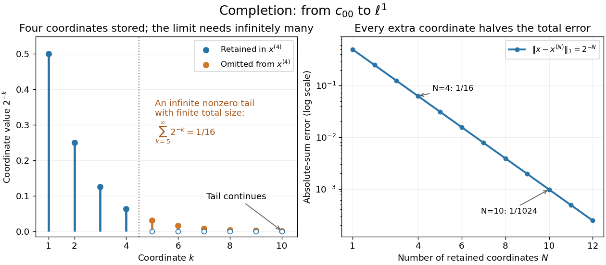

# Incompleteness of finitely supported sequences

↑ **Parent:** [Finitely supported sequence](finitely-supported-sequence.md)

Equip the [vector space](vector-space-split.md) $c_{00}$ of [finitely supported sequences](finitely-supported-sequence.md) with the [norm](norm.md) inherited from the [absolutely summable sequence space](absolutely-summable-sequence-space.md). Consider the truncations

$$
x^{(N)}=(2^{-1},2^{-2},\ldots,2^{-N},0,0,\ldots).
$$

For $M>N$, the [geometric series](geometric-series.md) gives

$$
\|x^{(M)}-x^{(N)}\|_1=\sum_{k=N+1}^{M}2^{-k}=2^{-N}-2^{-M}<2^{-N}.
$$

Therefore $(x^{(N)})$ is a [Cauchy sequence](cauchy-sequence.md). Any possible [norm](norm.md) limit must have coordinate $k$ equal to $2^{-k}$, since $|x_k-y_k|\leq\|x-y\|_1$. That forces infinitely many nonzero coordinates, so no limit lies in $c_{00}$. There is nothing wrong with the approximations: the space is missing their limit.

Inside the [absolutely summable sequence space](absolutely-summable-sequence-space.md), the limit is $x=(2^{-k})_{k\geq1}$ and its exact truncation error is $2^{-N}$. Four retained coordinates leave error $1/16$; ten leave $1/1024$. More generally, truncating any element of the [absolutely summable sequence space](absolutely-summable-sequence-space.md) leaves a tail whose [norm](norm.md) tends to zero. Together with [completeness](completeness.md), this identifies that [Banach space](banach-space-split.md) as the [completion of a normed space](completion-of-a-normed-space.md) $c_{00}$ with this [norm](norm.md). Finite storage and an infinite mathematical object fit together through a controlled error.

**[Figure 1](#image-finite-support-approximations-and-their-exact-absolute-sum-tail). Finite-support approximations and their exact absolute-sum tail**. For four retained coordinates, the omitted tail has total size $1/16$. Each extra coordinate halves the absolute-sum error, although every approximation still has finite support.

## ↑ Ancestors (9)

1. [Finitely supported sequence](finitely-supported-sequence.md)
2. [L-p sequence space](l-p-sequence-space.md)
3. [Banach space](banach-space-split.md)
4. [Normed vector space](normed-vector-space.md)
5. [Functional analysis](functional-analysis-split.md)
6. [Analysis](analysis-split.md)
7. [Area of mathematics](area-of-mathematics.md)
8. [Mathematics](mathematics-split.md)
9. [Codex Wiki](split.md)
