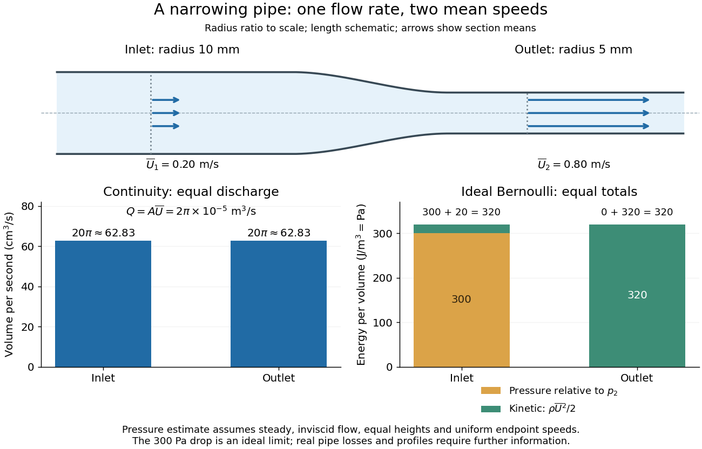

# Incompressible flow

↑ **Parent:** [Fluid mechanics](fluid-mechanics-split.md)  
ⓦ [Wiki](https://en.wikipedia.org/wiki/Incompressible_flow)

An [incompressible flow](incompressible-flow.md) preserves the [volume](volume.md) of each moving [fluid element](fluid-element.md). Its local condition is zero [velocity divergence](velocity-divergence.md), $\nabla\cdot\mathbf u=0$. Combined with [mass conservation](mass-conservation.md), it says that each parcel's [mass density](density.md) stays unchanged as it moves. This does not require every parcel to have the same [mass density](density.md): an initially nonuniform distribution can be transported without compression. Nor does [incompressibility](incompressible-flow.md) require a constant [velocity](velocity.md) or constant [pressure](pressure.md).

For positive [mass density](density.md), the [continuity equation](continuity-equation.md) makes the equivalence precise:

$$
\frac{\partial\rho}{\partial t}+\nabla\cdot(\rho\mathbf u)=0,
\qquad
\frac{D\rho}{Dt}+\rho\nabla\cdot\mathbf u=0,
\qquad
\frac{D}{Dt}=\frac{\partial}{\partial t}+\mathbf u\cdot\nabla.
$$

The [material derivative](material-derivative.md) follows a [fluid element](fluid-element.md). Thus $D\rho/Dt=0$ if and only if the [velocity field](velocity-field.md) is a [divergence-free vector field](divergence-free-vector-field.md). The distinction between following a parcel and observing a fixed position prevents confusing [incompressibility](incompressible-flow.md) with an unchanging [density](density.md) field. [UCL, Conservation law derivations, sections 30.1–30.2](https://uclnatsci.github.io/2021/Electromagnetism-Fluids-and-Waves/fluids/conservation.html)

For a rigid pipe with impermeable walls, no leaks and [steady flow](steady-flow.md), [mass conservation](mass-conservation.md) at constant [mass density](density.md) implies a constant [volumetric flow rate](volumetric-flow-rate.md):

$$
Q=\int_A\mathbf u\cdot\mathbf n\,dA=A\overline U,
\qquad A_1\overline U_1=A_2\overline U_2.
$$

Here $\mathbf n$ points downstream, $A$ is the section's [area](surface-area.md) and $\overline U$ is the mean normal [velocity](velocity.md), not necessarily the centreline speed. No assumption of [inviscid flow](inviscid-flow.md) or a uniform [velocity profile](velocity-profile.md) is needed. If unequal amounts entered and left a fixed segment, its [mass](mass.md) would accumulate, contradicting [steady flow](steady-flow.md).

For a worked example, take horizontal water flow with stipulated [mass density](density.md) $1000\,\mathrm{kg\,m^{-3}}$, inlet radius $R_1=0.010\,\mathrm m$, outlet radius $R_2=0.005\,\mathrm m$ and inlet mean [velocity](velocity.md) $\overline U_1=0.20\,\mathrm{m\,s^{-1}}$. The circular [areas](surface-area.md) give

$$
Q=\pi R_1^2\overline U_1=2\pi\times10^{-5}\,\mathrm{m^3\,s^{-1}},
\qquad
\overline U_2=\frac{Q}{\pi R_2^2}=0.80\,\mathrm{m\,s^{-1}}.
$$

The radius halves, the [area](surface-area.md) falls to one quarter, and the mean [velocity](velocity.md) quadruples. The [mass flow rate](mass-flow-rate.md) is $\rho Q=0.02\pi\,\mathrm{kg\,s^{-1}}$. The same amount of water passes both sections each second; narrowing changes its speed rather than compressing it. The [Reynolds number](reynolds-number.md) and [Bernoulli's principle](bernoulli-s-principle.md) discussions use this same example to examine viscous effects and the additional assumptions needed to calculate [pressure](pressure.md).

**[Figure 23](#image-continuity-fixes-the-mean-speeds-bernoulli-s-principle-gives-a-conditional-ideal-pressure-drop). Continuity fixes the mean speeds; Bernoulli's principle gives a conditional ideal pressure drop**. The pipe outline shows the radius ratio. Arrows represent section means, not a computed velocity field. The bars show the constant $Q$ and the ideal exchange between pressure and kinetic energy density at equal height; $p_2$ is the arbitrary pressure reference.

**Table of contents**

- [Rectilinear flow](rectilinear-flow.md)
- [Streamfunction advection bracket](streamfunction-advection-bracket.md)
- [Cartesian streamfunction](cartesian-streamfunction.md)
- [Divergence-free vector field](divergence-free-vector-field.md)

## ↑ Ancestors (4)

1. [Fluid mechanics](fluid-mechanics-split.md)
2. [Branches of physics](branches-of-physics.md)
3. [Physics](physics-split.md)
4. [Codex Wiki](split.md)

## ← Incoming links (193)

- [Airfoil](airfoil.md)
- [Axial strain rate](axial-strain-rate.md)
- [Bernoulli's principle](bernoulli-s-principle.md)
- [Betchov relation](betchov-relation.md)
- [Bi-axial strain](bi-axial-strain.md)
- [Blasius boundary layer](blasius-boundary-layer.md)
- [Cartesian streamfunction](cartesian-streamfunction.md)
- [Chaotic advection](chaotic-advection.md)
- [Collapse of a planar magnetic separatrix](collapse-of-a-planar-magnetic-separatrix.md)
- [Corner sink in a semi-infinite channel](corner-sink-in-a-semi-infinite-channel.md)
- [Couette flow with a slipping lower wall](couette-flow-with-a-slipping-lower-wall.md)
- [D'Alembert's paradox](d-alembert-s-paradox.md)
- [Darcy flow through a homogeneous slab](darcy-flow-through-a-homogeneous-slab.md)
- [Die swell](die-swell.md)
- [Diffusion](diffusion.md)
- [Dispersion relation](dispersion-relation.md)
- [Displacement thickness](displacement-thickness.md)
- [Drag coefficient](drag-coefficient.md)
- [Dynamic pressure](dynamic-pressure.md)
- [Elsässer variable](elsasser-variable.md)
- [Energy balance of the incompressible vertical-shear model](energy-balance-of-the-incompressible-vertical-shear-model.md)
- [Energy dissipation identity for Model H](energy-dissipation-identity-for-model-h.md)
- [Energy identity for free-surface disk waves](energy-identity-for-free-surface-disk-waves.md)
- [Enstrophy](enstrophy.md)
- [Flat-plate boundary-layer traverse experiment](flat-plate-boundary-layer-traverse-experiment.md)
- [Fluid mechanics](fluid-mechanics-split.md)
- [Flux expulsion](flux-expulsion.md)
- [Gravity-capillary wave](gravity-capillary-wave.md)
- [Hydrodynamic impulse](hydrodynamic-impulse.md)
- [Incompressible flow](incompressible-flow.md)
- [Inertial modes in a rigid rotating sphere](inertial-modes-in-a-rigid-rotating-sphere.md)
- [Irrotational flow](irrotational-flow.md)
- [Kelvin-Helmholtz dispersion relation with gravity](kelvin-helmholtz-dispersion-relation-with-gravity.md)
- [Kelvin stellar mode](kelvin-stellar-mode.md)
- [Kinematic viscosity](kinematic-viscosity.md)
- [Kinetic-energy inner product](kinetic-energy-inner-product.md)
- [Laminar flow](laminar-flow.md)
- [Landau angular-momentum argument for turbulent decay](landau-angular-momentum-argument-for-turbulent-decay.md)
- [Layered porous permeability](layered-porous-permeability.md)
- [Lift (force)](lift-force.md)
- [Line vortex](line-vortex.md)
- [Linear and second-order response of the differential pom-pom model](linear-and-second-order-response-of-the-differential-pom-pom-model.md)
- [Longitudinal velocity-gradient skewness](longitudinal-velocity-gradient-skewness.md)
- [Magnetic concentration by an incompressible stagnation flow](magnetic-concentration-by-an-incompressible-stagnation-flow.md)
- [Magnetic island](magnetic-island.md)
- [Material conservation of kinetic helicity density](material-conservation-of-kinetic-helicity-density.md)
- [Mean enstrophy balance](mean-enstrophy-balance.md)
- [Newtonian fluid stress tensor](newtonian-fluid-stress-tensor.md)
- [Newtonian velocity preservation in a second-order fluid](newtonian-velocity-preservation-in-a-second-order-fluid.md)
- [Particle stresslet tensor](particle-stresslet-tensor.md)
- [Solution](past-exam-of-the-mathematics-course-of-the-university-of-cambridge/2001/ib/paper-3/18g/solution.md)
- [Solution](past-exam-of-the-mathematics-course-of-the-university-of-cambridge/2001/iii/paper-36/1/a/solution.md)
- [Solution](past-exam-of-the-mathematics-course-of-the-university-of-cambridge/2001/iii/paper-36/2/a/solution.md)
- [Solution](past-exam-of-the-mathematics-course-of-the-university-of-cambridge/2001/iii/paper-42/2/solution.md)
- [Solution](past-exam-of-the-mathematics-course-of-the-university-of-cambridge/2001/iii/paper-42/3/solution.md)
- [Solution](past-exam-of-the-mathematics-course-of-the-university-of-cambridge/2001/iii/paper-46/3/ii/solution.md)
- [Solution](past-exam-of-the-mathematics-course-of-the-university-of-cambridge/2001/iii/paper-48/1/solution.md)
- [Solution](past-exam-of-the-mathematics-course-of-the-university-of-cambridge/2001/iii/paper-49/1/solution.md)
- [Solution](past-exam-of-the-mathematics-course-of-the-university-of-cambridge/2001/iii/paper-49/2/solution.md)
- [Solution](past-exam-of-the-mathematics-course-of-the-university-of-cambridge/2002/ib/paper-1/6c/solution.md)
- [Solution](past-exam-of-the-mathematics-course-of-the-university-of-cambridge/2002/ib/paper-4/16c/solution.md)
- [Solution](past-exam-of-the-mathematics-course-of-the-university-of-cambridge/2002/iii/paper-49/1/solution.md)
- [Solution](past-exam-of-the-mathematics-course-of-the-university-of-cambridge/2002/iii/paper-53/3/b/solution.md)
- [Solution](past-exam-of-the-mathematics-course-of-the-university-of-cambridge/2003/ib/paper-3/18c/solution.md)
- [Solution](past-exam-of-the-mathematics-course-of-the-university-of-cambridge/2003/ib/paper-4/16c/solution.md)
- [Solution](past-exam-of-the-mathematics-course-of-the-university-of-cambridge/2004/ib/paper-1/9c/solution.md)
- [Solution](past-exam-of-the-mathematics-course-of-the-university-of-cambridge/2004/ib/paper-4/18c/solution.md)
- [Solution](past-exam-of-the-mathematics-course-of-the-university-of-cambridge/2004/ib/paper-4/8c/solution.md)
- [Solution](past-exam-of-the-mathematics-course-of-the-university-of-cambridge/2004/iii/paper-64/3/solution.md)
- [Solution](past-exam-of-the-mathematics-course-of-the-university-of-cambridge/2004/iii/paper-64/4/solution.md)
- [Solution](past-exam-of-the-mathematics-course-of-the-university-of-cambridge/2004/iii/paper-68/3/solution.md)
- [Solution](past-exam-of-the-mathematics-course-of-the-university-of-cambridge/2004/iii/paper-77/3/ii/solution.md)
- [Solution](past-exam-of-the-mathematics-course-of-the-university-of-cambridge/2005/ib/paper-1/5e/solution.md)
- [Solution](past-exam-of-the-mathematics-course-of-the-university-of-cambridge/2005/iii/paper-71/4/solution.md)
- [Solution](past-exam-of-the-mathematics-course-of-the-university-of-cambridge/2005/iii/paper-73/2/i/solution.md)
- [Solution](past-exam-of-the-mathematics-course-of-the-university-of-cambridge/2005/iii/paper-73/2/ii/solution.md)
- [Solution](past-exam-of-the-mathematics-course-of-the-university-of-cambridge/2005/iii/paper-75/1/1/solution.md)
- [Solution](past-exam-of-the-mathematics-course-of-the-university-of-cambridge/2005/iii/paper-77/1/solution.md)
- [Solution](past-exam-of-the-mathematics-course-of-the-university-of-cambridge/2005/iii/paper-78/5/a/solution.md)
- [Solution](past-exam-of-the-mathematics-course-of-the-university-of-cambridge/2005/iii/paper-80/1/solution.md)
- [Solution](past-exam-of-the-mathematics-course-of-the-university-of-cambridge/2005/iii/paper-80/4/solution.md)
- [Solution](past-exam-of-the-mathematics-course-of-the-university-of-cambridge/2005/iii/paper-81/2/i/solution.md)
- [Solution](past-exam-of-the-mathematics-course-of-the-university-of-cambridge/2005/iii/paper-81/3/solution.md)
- [Solution](past-exam-of-the-mathematics-course-of-the-university-of-cambridge/2005/iii/paper-84/1/solution.md)
- [Solution](past-exam-of-the-mathematics-course-of-the-university-of-cambridge/2006/ib/paper-1/5a/solution.md)
- [Solution](past-exam-of-the-mathematics-course-of-the-university-of-cambridge/2006/ib/paper-4/18a/solution.md)
- [Solution](past-exam-of-the-mathematics-course-of-the-university-of-cambridge/2006/iii/paper-75/2/solution.md)
- [Solution](past-exam-of-the-mathematics-course-of-the-university-of-cambridge/2007/ib/paper-1/5d/ii/solution.md)
- [Solution](past-exam-of-the-mathematics-course-of-the-university-of-cambridge/2007/ib/paper-3/18d/solution.md)
- [Solution](past-exam-of-the-mathematics-course-of-the-university-of-cambridge/2007/ib/paper-4/18d/solution.md)
- [Solution](past-exam-of-the-mathematics-course-of-the-university-of-cambridge/2007/iii/paper-68/2/i/solution.md)
- [Solution](past-exam-of-the-mathematics-course-of-the-university-of-cambridge/2007/iii/paper-83/3/a/solution.md)
- [Solution](past-exam-of-the-mathematics-course-of-the-university-of-cambridge/2008/ii/paper-3/36a/solution.md)
- [Solution](past-exam-of-the-mathematics-course-of-the-university-of-cambridge/2008/iii/paper-69/1/b/solution.md)
- [Solution](past-exam-of-the-mathematics-course-of-the-university-of-cambridge/2008/iii/paper-81/1/solution.md)
- [Solution](past-exam-of-the-mathematics-course-of-the-university-of-cambridge/2008/iii/paper-81/2/solution.md)
- [Solution](past-exam-of-the-mathematics-course-of-the-university-of-cambridge/2008/iii/paper-87/1/iii/solution.md)
- [Solution](past-exam-of-the-mathematics-course-of-the-university-of-cambridge/2008/iii/paper-87/1/iv/solution.md)
- [Solution](past-exam-of-the-mathematics-course-of-the-university-of-cambridge/2008/iii/paper-87/3/iii/solution.md)
- [Solution](past-exam-of-the-mathematics-course-of-the-university-of-cambridge/2009/iii/paper-67/1/solution.md)
- [Solution](past-exam-of-the-mathematics-course-of-the-university-of-cambridge/2010/iii/paper-59/4/solution.md)
- [Solution](past-exam-of-the-mathematics-course-of-the-university-of-cambridge/2010/iii/paper-74/2/solution.md)
- [Solution](past-exam-of-the-mathematics-course-of-the-university-of-cambridge/2010/iii/paper-74/3/solution.md)
- [Solution](past-exam-of-the-mathematics-course-of-the-university-of-cambridge/2010/iii/paper-74/4/solution.md)
- [Solution](past-exam-of-the-mathematics-course-of-the-university-of-cambridge/2012/iii/paper-73/1/ii/solution.md)
- [Solution](past-exam-of-the-mathematics-course-of-the-university-of-cambridge/2012/iii/paper-73/1/iii/solution.md)
- [Solution](past-exam-of-the-mathematics-course-of-the-university-of-cambridge/2012/iii/paper-73/3/i/solution.md)
- [Solution](past-exam-of-the-mathematics-course-of-the-university-of-cambridge/2012/iii/paper-77/1/solution.md)
- [Solution](past-exam-of-the-mathematics-course-of-the-university-of-cambridge/2013/ib/paper-1/5a/solution.md)
- [Solution](past-exam-of-the-mathematics-course-of-the-university-of-cambridge/2013/ib/paper-4/18a/solution.md)
- [Solution](past-exam-of-the-mathematics-course-of-the-university-of-cambridge/2013/iii/paper-68/1/solution.md)
- [Solution](past-exam-of-the-mathematics-course-of-the-university-of-cambridge/2013/iii/paper-68/2/solution.md)
- [Solution](past-exam-of-the-mathematics-course-of-the-university-of-cambridge/2013/iii/paper-68/3/solution.md)
- [Solution](past-exam-of-the-mathematics-course-of-the-university-of-cambridge/2015/iii/paper-60/4/solution.md)
- [Solution](past-exam-of-the-mathematics-course-of-the-university-of-cambridge/2015/iii/paper-74/1/a/solution.md)
- [Solution](past-exam-of-the-mathematics-course-of-the-university-of-cambridge/2016/ib/paper-1/17c/c/i/solution.md)
- [Solution](past-exam-of-the-mathematics-course-of-the-university-of-cambridge/2016/ib/paper-3/18c/a/solution.md)
- [Solution](past-exam-of-the-mathematics-course-of-the-university-of-cambridge/2016/ib/paper-4/18c/a/solution.md)
- [Solution](past-exam-of-the-mathematics-course-of-the-university-of-cambridge/2016/iii/paper-318/1/i/solution.md)
- [Solution](past-exam-of-the-mathematics-course-of-the-university-of-cambridge/2016/iii/paper-329/1/solution.md)
- [Solution](past-exam-of-the-mathematics-course-of-the-university-of-cambridge/2017/iii/paper-329/2/a/solution.md)
- [Solution](past-exam-of-the-mathematics-course-of-the-university-of-cambridge/2017/iii/paper-329/2/b/solution.md)
- [Solution](past-exam-of-the-mathematics-course-of-the-university-of-cambridge/2017/iii/paper-331/1/a/i/solution.md)
- [Solution](past-exam-of-the-mathematics-course-of-the-university-of-cambridge/2017/iii/paper-331/2/b/i/solution.md)
- [Solution](past-exam-of-the-mathematics-course-of-the-university-of-cambridge/2017/iii/paper-331/4/a/solution.md)
- [Solution](past-exam-of-the-mathematics-course-of-the-university-of-cambridge/2017/iii/paper-331/4/b/solution.md)
- [Solution](past-exam-of-the-mathematics-course-of-the-university-of-cambridge/2017/iii/paper-332/1/solution.md)
- [Solution](past-exam-of-the-mathematics-course-of-the-university-of-cambridge/2017/iii/paper-332/4/solution.md)
- [Solution](past-exam-of-the-mathematics-course-of-the-university-of-cambridge/2017/iii/paper-337/1/i/solution.md)
- [Solution](past-exam-of-the-mathematics-course-of-the-university-of-cambridge/2017/iii/paper-337/1/ii/solution.md)
- [Solution](past-exam-of-the-mathematics-course-of-the-university-of-cambridge/2017/iii/paper-344/2/a/solution.md)
- [Solution](past-exam-of-the-mathematics-course-of-the-university-of-cambridge/2017/iii/paper-345/1/solution.md)
- [Solution](past-exam-of-the-mathematics-course-of-the-university-of-cambridge/2018/iii/paper-314/1/c/solution.md)
- [Solution](past-exam-of-the-mathematics-course-of-the-university-of-cambridge/2018/iii/paper-331/1/a/iii/solution.md)
- [Solution](past-exam-of-the-mathematics-course-of-the-university-of-cambridge/2018/iii/paper-344/2/b/solution.md)
- [Solution](past-exam-of-the-mathematics-course-of-the-university-of-cambridge/2019/ib/paper-1/17c/solution.md)
- [Solution](past-exam-of-the-mathematics-course-of-the-university-of-cambridge/2019/ib/paper-2/7c/solution.md)
- [Solution](past-exam-of-the-mathematics-course-of-the-university-of-cambridge/2020/ib/paper-1/17c/a/solution.md)
- [Solution](past-exam-of-the-mathematics-course-of-the-university-of-cambridge/2020/ii/paper-3/38b/a/solution.md)
- [Solution](past-exam-of-the-mathematics-course-of-the-university-of-cambridge/2021/ib/paper-3/7a/a/solution.md)
- [Solution](past-exam-of-the-mathematics-course-of-the-university-of-cambridge/2021/ib/paper-4/16a/a/solution.md)
- [Solution](past-exam-of-the-mathematics-course-of-the-university-of-cambridge/2021/ii/paper-3/38a/b/solution.md)
- [Solution](past-exam-of-the-mathematics-course-of-the-university-of-cambridge/2021/iii/paper-331/1/a/solution.md)
- [Solution](past-exam-of-the-mathematics-course-of-the-university-of-cambridge/2021/iii/paper-332/1/solution.md)
- [Solution](past-exam-of-the-mathematics-course-of-the-university-of-cambridge/2022/ib/paper-2/5c/a/solution.md)
- [Solution](past-exam-of-the-mathematics-course-of-the-university-of-cambridge/2022/ib/paper-3/16c/a/solution.md)
- [Solution](past-exam-of-the-mathematics-course-of-the-university-of-cambridge/2022/ib/paper-3/7c/a/solution.md)
- [Solution](past-exam-of-the-mathematics-course-of-the-university-of-cambridge/2022/iii/paper-345/1/a/solution.md)
- [Solution](past-exam-of-the-mathematics-course-of-the-university-of-cambridge/2023/ib/paper-3/16c/b/i/solution.md)
- [Solution](past-exam-of-the-mathematics-course-of-the-university-of-cambridge/2023/ii/paper-4/38c/b/solution.md)
- [Solution](past-exam-of-the-mathematics-course-of-the-university-of-cambridge/2024/iii/paper-331/1/i/solution.md)
- [Solution](past-exam-of-the-mathematics-course-of-the-university-of-cambridge/2024/iii/paper-333/1/a/solution.md)
- [Solution](past-exam-of-the-mathematics-course-of-the-university-of-cambridge/2024/iii/paper-333/2/b/solution.md)
- [Solution](past-exam-of-the-mathematics-course-of-the-university-of-cambridge/2024/iii/paper-333/3/b/solution.md)
- [Solution](past-exam-of-the-mathematics-course-of-the-university-of-cambridge/2024/iii/paper-344/2/a/solution.md)
- [Solution](past-exam-of-the-mathematics-course-of-the-university-of-cambridge/2024/iii/paper-344/2/b/solution.md)
- [Solution](past-exam-of-the-mathematics-course-of-the-university-of-cambridge/2024/iii/paper-345/2/a/solution.md)
- [Solution](past-exam-of-the-mathematics-course-of-the-university-of-cambridge/2024/iii/paper-345/3/a/solution.md)
- [Solution](past-exam-of-the-mathematics-course-of-the-university-of-cambridge/2024/iii/paper-355/2/c/solution.md)
- [Solution](past-exam-of-the-mathematics-course-of-the-university-of-cambridge/2025/iii/paper-329/2/b/solution.md)
- [Planar Poiseuille flow with equal wall slip](planar-poiseuille-flow-with-equal-wall-slip.md)
- [Porous-media flow](porous-media-flow-split.md)
- [Pressure compatibility of nonlinear torsional Alfvén profiles](pressure-compatibility-of-nonlinear-torsional-alfven-profiles.md)
- [Pressure-work energy balance for a spherical bubble](pressure-work-energy-balance-for-a-spherical-bubble.md)
- [Principal strain rates](principal-strain-rates.md)
- [Quasistatic gyrotactic balance with half-rate reorientation](quasistatic-gyrotactic-balance-with-half-rate-reorientation.md)
- [Radially symmetric incompressible flow in a planar annulus](radially-symmetric-incompressible-flow-in-a-planar-annulus.md)
- [Resistive induction equation](resistive-induction-equation.md)
- [Reversible stress of a polar liquid crystal](reversible-stress-of-a-polar-liquid-crystal.md)
- [Reynolds number](reynolds-number.md)
- [Rotating-flow pressure potential](rotating-flow-pressure-potential.md)
- [Scalar transport](scalar-transport.md)
- [Scalar variance](scalar-variance.md)
- [Spherically symmetric incompressible radial flow](spherically-symmetric-incompressible-radial-flow.md)
- [Steady planar vorticity as a local function of stream function](steady-planar-vorticity-as-a-local-function-of-stream-function.md)
- [Stokes equation](stokes-equation.md)
- [Stokes flow](stokes-flow-split.md)
- [Stokes's law](stokes-s-law.md)
- [Streamline](streamline.md)
- [Strict geostrophic balance](strict-geostrophic-balance.md)
- [Surface gravity perturbation of a uniform-density sphere](surface-gravity-perturbation-of-a-uniform-density-sphere.md)
- [Toroidal-velocity anti-dynamo theorem](toroidal-velocity-anti-dynamo-theorem.md)
- [Turbulent energy spectrum](turbulent-energy-spectrum.md)
- [Two-dimensional vortex dynamics](two-dimensional-vortex-dynamics.md)
- [Uniform-current rotating magnetohydrodynamic wave dispersion](uniform-current-rotating-magnetohydrodynamic-wave-dispersion.md)
- [Velocity gradient tensor](velocity-gradient-tensor.md)
- [Velocity potential](velocity-potential.md)
- [Vertical shear instability](vertical-shear-instability.md)
- [Vertical velocity](vertical-velocity.md)
- [Viscous dissipation potential](viscous-dissipation-potential.md)
- [Viscous magnetic-relaxation energy identity](viscous-magnetic-relaxation-energy-identity.md)
- [Viscous stress tensor](viscous-stress-tensor.md)
- [Vortex line](vortex-line.md)
