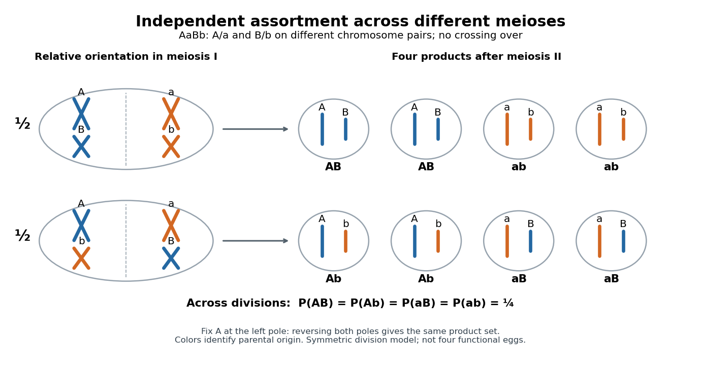

# Independent assortment

↑ **Parent:** [Mendelian segregation](mendelian-segregation.md)

[Independent assortment](independent-assortment.md) means that transmission at different [genetic loci](genetic-locus.md) has [conditional independence](conditional-independence.md) given the parental [genotype](genotype.md). With fair [Mendelian segregation](mendelian-segregation.md), a parent [heterozygous](heterozygosity.md) at two [genetic loci](genetic-locus.md), $AaBb$, produces $AB,Ab,aB,ab$ [gametes](gamete.md) with [probability](probability.md) $1/4$ each. For example,

$$
P(A,B\mid AaBb)=P(A\mid AaBb)P(B\mid AaBb)=\frac12\frac12=\frac14.
$$

Here $AB$ labels an [allele](allele.md) combination; it does not assert that the two [genetic loci](genetic-locus.md) lie on the same [chromosome](chromosome.md).

The physical model is stochastic orientation of different [homologous chromosome](homologous-chromosome.md) pairs toward the two poles of the [spindle apparatus](spindle-apparatus.md) in [meiosis I](meiosis-i.md). One pair's orientation does not determine another's. For two pairs, one division can send $A,B$ together and $a,b$ together; another can send $A,b$ together and $a,B$ together. See [The Process of Meiosis](biology-2e-by-mary-ann-clark-and-others/the-process-of-meiosis.md) (§11.1, Metaphase I and Figure 11.5: random orientation of chromosome pairs).

**[Figure 83](#image-two-relative-homologous-chromosome-orientations-generate-four-allele-combinations-across-meioses). Two relative homologous chromosome orientations generate four allele combinations across meioses**. Original $AaBb$ schematic for two separate [chromosome](chromosome.md) pairs, fair independent orientations, no [chromosomal crossover](chromosomal-crossover.md), and symmetric divisions. Fixing $A$ at the left pole removes the duplicate obtained by reversing both poles. Each displayed orientation has [probability](probability.md) $1/2$. A single division gives two copies each of two complementary combinations; all four equally likely combinations appear across divisions.

With $k$ distinguishable [homologous chromosome](homologous-chromosome.md) pairs, there are $2^k$ choices of parental [homologous chromosome](homologous-chromosome.md) origin for a product at a specified pole, each with [probability](probability.md) $2^{-k}$ under this model. For $k=3$, enumerate $MMM,MMP,MPM,MPP,PMM,PMP,PPM,PPP$, where M and P mark parental origins. Whole-pole reversal pairs complementary choices, leaving $2^{k-1}$ unordered partitions for $k\geq1$. For $k=2$ there are four choices for a specified pole but only the two relative orientations drawn. This counts possible products across [meioses](meiosis.md), not eight different products of one division when $k=3$. Identical [alleles](allele.md) at scored [genetic loci](genetic-locus.md) can also make different parental-origin choices observationally indistinguishable.

[Independent assortment](independent-assortment.md) of different [chromosome](chromosome.md) pairs does not imply independence of every pair of [genes](gene.md). Nearby [genetic loci](genetic-locus.md) on the same [chromosome](chromosome.md) can show [genetic linkage](genetic-linkage.md). [Chromosomal crossover](chromosomal-crossover.md) can create new [haplotypes](haplotype.md), but does not automatically erase [genetic linkage](genetic-linkage.md). See [Laws of Inheritance](biology-2e-by-mary-ann-clark-and-others/laws-of-inheritance.md) (§12.3, Law of Independent Assortment and Linked Genes Violate the Law of Independent Assortment). In the ordinary fair two-locus model with parental [haplotypes](haplotype.md) $AB/ab$ and [recombination fraction](recombination-fraction.md) $r$,

$$
P(AB)=P(ab)=\frac{1-r}{2},\qquad P(Ab)=P(aB)=\frac r2.
$$

Thus $r=0$ gives only the two parental [haplotypes](haplotype.md), while $r=1/2$ gives four equal [probabilities](probability.md). A [recombination fraction](recombination-fraction.md) of $1/2$ alone does not establish that the [genetic loci](genetic-locus.md) lie on different [chromosomes](chromosome.md).

A motivating experiment appears in [Experiments in Plant Hybridization by Gregor Mendel](experiments-in-plant-hybridization-by-gregor-mendel.md) (§9, “The Reproductive Cells of the Hybrids”). In [peas](pea.md), hybrids for round versus wrinkled [seeds](seed.md) and yellow versus green [seeds](seed.md) were crossed reciprocally with constant wrinkled-green [plants](plant.md). The readout was visible [seed](seed.md) shape and color: hybrid seed parents gave 31 round-yellow, 26 round-green, 27 wrinkled-yellow and 26 wrinkled-green; the reciprocal cross gave 24, 25, 22 and 27.

The apparatus was controlled [pollination](pollination.md): opening immature [flowers](flower.md), removing [stamens](stamen.md) with forceps, and applying selected [pollen](pollen.md) to the [stigma](stigma-botany.md). Two-year trials established constant parental characters; greenhouse pots checked interference from insects in outdoor beds. Reciprocal crosses tested both transmission directions. These procedures are described in [Experiments in Plant Hybridization by Gregor Mendel](experiments-in-plant-hybridization-by-gregor-mendel.md) (§§2–3).

With [complete dominance](complete-dominance.md) at both [genetic loci](genetic-locus.md), this [test cross](test-cross.md) makes each [phenotype](phenotype.md) report one hybrid [gamete](gamete.md) combination. The ideal [expected values](expected-value.md) are $110/4=27.5$ and $98/4=24.5$ per class. The observations support four transmitted combinations, approximately equally frequent. They do not directly image [chromosome](chromosome.md) orientation or prove independence for all [genes](gene.md); failed development and [seed](seed.md) germination also limit the inference, as §9 notes.

## ↑ Ancestors (4)

1. [Mendelian segregation](mendelian-segregation.md)
2. [Genetics](genetics.md)
3. [Biology](biology-split.md)
4. [Codex Wiki](split.md)

## ← Incoming links (8)

- [Genetic linkage](genetic-linkage.md)
- [Independent assortment](independent-assortment.md)
- [Linkage-disequilibrium decay under recombination](linkage-disequilibrium-decay-under-recombination.md)
- [Meiosis](meiosis.md)
- [Solution](past-exam-of-the-mathematics-course-of-the-university-of-cambridge/2002/iii/paper-57/6/a/solution.md)
- [Solution](past-exam-of-the-mathematics-course-of-the-university-of-cambridge/2003/iii/paper-40/5/i/solution.md)
- [Solution](past-exam-of-the-mathematics-course-of-the-university-of-cambridge/2006/iii/paper-45/2/a/solution.md)
- [Recombination fraction](recombination-fraction.md)
