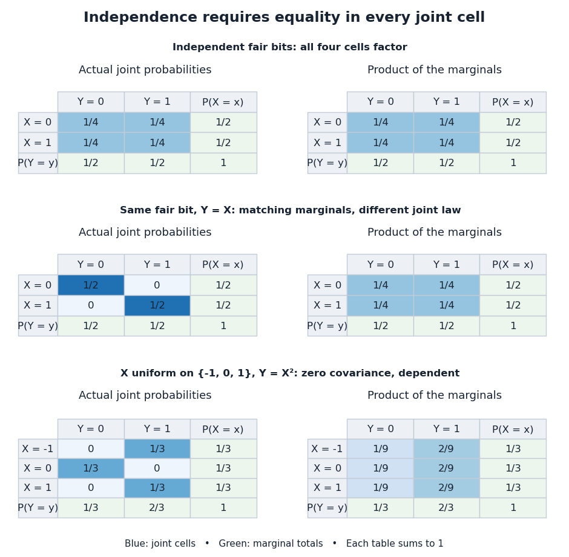

# Independent random variables

↑ **Parent:** [Random variable](random-variable-split.md)

[Random variables](random-variable-split.md) $X_1,\ldots,X_n$ are independent when, for every choice of [Borel sets](borel-set.md) $A_1,\ldots,A_n$,

$$
\mathbb P\!\left(\bigcap_{i=1}^n\{X_i\in A_i\}\right)
=\prod_{i=1}^n\mathbb P(X_i\in A_i).
$$

The requirement covers all these [events](event.md), not only one selected combination of values. Equivalently, the generated [sigma-algebras](sigma-algebra.md) are [independent sigma-algebras](independent-sigma-algebras.md), or the [joint probability distribution](joint-probability-distribution.md) is the [product measure](product-measure.md) of the [marginal distributions](marginal-distribution.md). For an infinite family, the same condition must hold for every finite subfamily. For [random elements](random-element.md), replace [Borel sets](borel-set.md) by [measurable sets](measurable-set.md) in their specified target spaces.

For [discrete random variables](discrete-random-variable.md), checking every entry of the [joint probability mass function](joint-probability-mass-function.md) is enough:

$$
p_{X_1,\ldots,X_n}(x_1,\ldots,x_n)=\prod_{i=1}^n p_{X_i}(x_i).
$$

Summing this identity over the desired sets proves the event formulation. For general real-valued [random variables](random-variable-split.md), checking point [probabilities](probability.md) alone can say nothing: a pair with no point masses has $\mathbb P(X=x,Y=y)=\mathbb P(X=x)\mathbb P(Y=y)=0$ even when $Y=X$. The all-set definition avoids that trap. See [Gautam Iyer, Conditional Probability and Independence, definitions 12, 16 and 18 and proposition 19](https://www.math.cmu.edu/~gautam/c/2026-425/notes/independence.html), with the continuous case treated in his [Continuous Random Variables notes](https://www.math.cmu.edu/~gautam/c/2026-425/notes/cts-rvs.html).

For a concrete comparison, let $X,Y$ be [independent](independent-random-variables.md) fair [bits](bit.md): each has a [Bernoulli distribution](bernoulli-distribution.md) with parameter $1/2$. Their [joint probability mass function](joint-probability-mass-function.md), with rows $X=0,1$ and columns $Y=0,1$, is

$$
J_{\mathrm{ind}}=\begin{pmatrix}1/4&1/4\\1/4&1/4\end{pmatrix}.
$$

All four entries equal the product of the corresponding row and column totals, $(1/2)(1/2)$. For example, $\mathbb P(Y=1\mid X=0)=1/2$: learning one [bit](bit.md) leaves the other one's [probability distribution](probability-distribution.md) unchanged.

Now keep a fair $X$ but set $Y=X$. The same [marginal distributions](marginal-distribution.md) give the same product table, yet the actual [joint probability mass function](joint-probability-mass-function.md) is

$$
J_{\mathrm{same}}=\begin{pmatrix}1/2&0\\0&1/2\end{pmatrix}.
$$

Here $\mathbb P(X=0,Y=1)=0$ differs from $(1/2)(1/2)=1/4$, and $\mathbb P(Y=1\mid X=1)=1$. Thus matching [marginal distributions](marginal-distribution.md) does not establish [independence](independent-random-variables.md). Grinstead and Snell formulate the discrete product criterion in [Introduction to Probability, section 4.1, definition 4.4, printed page 143](https://chance.dartmouth.edu/teaching_aids/books_articles/probability_book/Chapter4.pdf).

**[Figure 2](#image-independence-compares-every-joint-probability-with-the-product-of-the-marginals). Independence compares every joint probability with the product of the marginals**. Each row compares an actual [joint probability mass function](joint-probability-mass-function.md) with its product of [marginal distributions](marginal-distribution.md). Marginal totals are shown at the right and bottom of every table; each whole table sums to one. The last example has zero [covariance](covariance.md) but a visibly different joint table.

[Independence](independent-random-variables.md) is stronger than zero [covariance](covariance.md). For [square-integrable](square-integrable-function.md) [independent random variables](independent-random-variables.md), $\mathbb E[XY]=\mathbb E[X]\mathbb E[Y]$, so they are [uncorrelated random variables](uncorrelated-random-variables.md). The converse fails: take $X$ with a [discrete uniform distribution](discrete-uniform-distribution.md) on $\{-1,0,1\}$ and $Y=X^2$. Direct calculation gives

$$
\mathbb E[X]=0,\qquad \mathbb E[Y]=2/3,\qquad
\mathbb E[XY]=\mathbb E[X^3]=0,\qquad
\operatorname{Cov}(X,Y)=0.
$$

Nevertheless, $Y$ is a nonconstant [function](function-split.md) determined by $X$. The [event](event.md) $X=0$ is exactly the [event](event.md) $Y=0$, so $\mathbb P(X=0,Y=0)=1/3$, whereas $\mathbb P(X=0)\mathbb P(Y=0)=1/9$. The positive and negative contributions to the [covariance](covariance.md) cancel without erasing the [statistical dependence](statistical-dependence.md).

The usefulness of [independence](independent-random-variables.md) is that a large [joint probability distribution](joint-probability-distribution.md) can be assembled from small pieces. For $n$ fair [independent](independent-random-variables.md) [bits](bit.md), each of the $2^n$ patterns has [probability](probability.md) $2^{-n}$. Products also simplify [expected values](expected-value.md), and vanishing cross [covariances](covariance.md) simplify the [variance of a sum](variance-of-a-sum.md). Separate [measurable functions](measurable-function.md) of [independent random variables](independent-random-variables.md) remain [independent](independent-random-variables.md): each output [event](event.md) is already an input [event](event.md), so the defining product rule still applies. These are consequences of a model's [independence](independent-random-variables.md) assumption; whether the assumption describes actual observations is a question for [statistical inference](statistical-inference-split.md).

**Table of contents**

- [Pairwise independent random variables](pairwise-independent-random-variables.md)
  - [Pairwise independence does not imply joint independence](pairwise-independence-does-not-imply-joint-independence.md)
- [Conditional independence](conditional-independence.md)
  - [Conditioning can destroy independence](conditioning-can-destroy-independence.md)
  - [Covariance induced by a shared latent variable](covariance-induced-by-a-shared-latent-variable.md)
  - [Conditional independence graph](conditional-independence-graph.md)
    - [Nodewise regression](nodewise-regression.md)
      - [Profiling intercepts in nodewise regression](profiling-intercepts-in-nodewise-regression.md)
      - [AND rule for nodewise graph selection](and-rule-for-nodewise-graph-selection.md)
      - [OR rule for nodewise graph selection](or-rule-for-nodewise-graph-selection.md)
    - [Gaussian graphical model](gaussian-graphical-model.md)
    - [Neighbourhood selection](neighbourhood-selection.md)
    - [Moral graph equals the conditional independence graph under faithfulness](moral-graph-equals-the-conditional-independence-graph-under-faithfulness.md)
  - [Contraction axiom for conditional independence](contraction-axiom-for-conditional-independence.md)
  - [Decomposition axiom for conditional independence](decomposition-axiom-for-conditional-independence.md)
  - [Generalized covariance measure statistic](generalized-covariance-measure-statistic.md)
    - [Studentization of the generalized covariance measure statistic](studentization-of-the-generalized-covariance-measure-statistic.md)
- [Orthogonality of independent centered Hilbert-space random variables](orthogonality-of-independent-centered-hilbert-space-random-variables.md)
- [Independent and identically distributed random variables](independent-and-identically-distributed-random-variables.md)

## ↑ Ancestors (6)

1. [Random variable](random-variable-split.md)
2. [Probability theory](probability-theory-split.md)
3. [Probability and statistics](probability-and-statistics-split.md)
4. [Area of mathematics](area-of-mathematics.md)
5. [Mathematics](mathematics-split.md)
6. [Codex Wiki](split.md)

## ← Incoming links (195)

- [Asymptotic equipartition property](asymptotic-equipartition-property.md)
- [Autocorrelation](autocorrelation.md)
- [Bernstein polynomial](bernstein-polynomial.md)
- [Beta-gamma independence](beta-gamma-independence.md)
- [Binomial distribution](binomial-distribution.md)
- [Birthday probability for hash outputs](birthday-probability-for-hash-outputs.md)
- [Bond percolation](bond-percolation-split.md)
- [Causally minimal nonfaithful Gaussian model](causally-minimal-nonfaithful-gaussian-model.md)
- [Completely noisy binary symmetric channel](completely-noisy-binary-symmetric-channel.md)
- [Conditional entropy](conditional-entropy.md)
- [Conditional mutual information](conditional-mutual-information.md)
- [Conditioning reduces entropy](conditioning-reduces-entropy.md)
- [Convolution](convolution.md)
- [Coupling characterization of total variation distance](coupling-characterization-of-total-variation-distance.md)
- [Covariance](covariance.md)
- [Covariance of two uniform order statistics](covariance-of-two-uniform-order-statistics.md)
- [Data processing inequality](data-processing-inequality.md)
- [Distance between two uniform points in a three-dimensional ball](distance-between-two-uniform-points-in-a-three-dimensional-ball.md)
- [Ellenberg–Gijswijt cap-set bound](ellenberg-gijswijt-cap-set-bound.md)
- [Entropy monotonicity under independent addition](entropy-monotonicity-under-independent-addition.md)
- [Entropy of a sum of independent finite-group variables](entropy-of-a-sum-of-independent-finite-group-variables.md)
- [Equality in the entropy conditioning inequality](equality-in-the-entropy-conditioning-inequality.md)
- [Exchangeable random variables](exchangeable-random-variables.md)
- [Fano's inequality](fano-s-inequality.md)
- [Fano's inequality via an error indicator](fano-s-inequality-via-an-error-indicator.md)
- [Finite-set example of the Johnson–Lindenstrauss lemma](finite-set-example-of-the-johnson-lindenstrauss-lemma.md)
- [Fixed exponential perturbation of a Gaussian empirical mean](fixed-exponential-perturbation-of-a-gaussian-empirical-mean.md)
- [Gaussian Johnson–Lindenstrauss concentration argument](gaussian-johnson-lindenstrauss-concentration-argument.md)
- [Gaussian Johnson–Lindenstrauss transform](gaussian-johnson-lindenstrauss-transform.md)
- [Genetic map](genetic-map.md)
- [Haldane mapping function](haldane-mapping-function.md)
- [Incoming-edge coupling of site and bond percolation](incoming-edge-coupling-of-site-and-bond-percolation.md)
- [Independent and identically distributed random variables](independent-and-identically-distributed-random-variables.md)
- [Independent censoring](independent-censoring.md)
- [Independent mutation counts in coalescent epochs](independent-mutation-counts-in-coalescent-epochs.md)
- [Independent random variables](independent-random-variables.md)
- [Independent relative ranks of a uniform random permutation](independent-relative-ranks-of-a-uniform-random-permutation.md)
- [Independent revelation of a binary variable](independent-revelation-of-a-binary-variable.md)
- [Information entropy](information-entropy.md)
- [Inverse transform sampling](inverse-transform-sampling.md)
- [Jackknife resampling](jackknife-resampling.md)
- [Kolmogorov's zero–one law](kolmogorov-s-zero-one-law.md)
- [Large-deviation rate of a minimum of independent copies](large-deviation-rate-of-a-minimum-of-independent-copies.md)
- [Large-deviation speed](large-deviation-speed.md)
- [Linear combination of independent normal random variables](linear-combination-of-independent-normal-random-variables.md)
- [Linkage disequilibrium](linkage-disequilibrium.md)
- [M/M/∞ queue](m-m-%E2%88%9E-queue.md)
- [McDiarmid's inequality](mcdiarmid-s-inequality.md)
- [Moment-generating function of a chi-squared distribution](moment-generating-function-of-a-chi-squared-distribution.md)
- [Multinomial distribution](multinomial-distribution.md)
- [Mutual information](mutual-information.md)
- [Noise sensitivity of a quadrature rule](noise-sensitivity-of-a-quadrature-rule.md)
- [One-time pad](one-time-pad.md)
- [P-biased product measure](p-biased-product-measure.md)
- [Pairwise independence does not imply joint independence](pairwise-independence-does-not-imply-joint-independence.md)
- [Pairwise independent random variables](pairwise-independent-random-variables.md)
- [Parity decomposition of a lag-two ARCH process](parity-decomposition-of-a-lag-two-arch-process.md)
- [Solution](past-exam-of-the-mathematics-course-of-the-university-of-cambridge/2001/iii/paper-71/1/solution.md)
- [Solution](past-exam-of-the-mathematics-course-of-the-university-of-cambridge/2002/ia/paper-2/10f/a/solution.md)
- [Solution](past-exam-of-the-mathematics-course-of-the-university-of-cambridge/2002/ia/paper-2/11f/a/solution.md)
- [Solution](past-exam-of-the-mathematics-course-of-the-university-of-cambridge/2002/iii/paper-51/2/solution.md)
- [Solution](past-exam-of-the-mathematics-course-of-the-university-of-cambridge/2003/ia/paper-2/3f/b/solution.md)
- [Solution](past-exam-of-the-mathematics-course-of-the-university-of-cambridge/2004/ia/paper-2/9f/solution.md)
- [Solution](past-exam-of-the-mathematics-course-of-the-university-of-cambridge/2005/ia/paper-2/10f/solution.md)
- [Solution](past-exam-of-the-mathematics-course-of-the-university-of-cambridge/2005/ia/paper-2/4f/solution.md)
- [Solution](past-exam-of-the-mathematics-course-of-the-university-of-cambridge/2005/ii/paper-1/25j/solution.md)
- [Solution](past-exam-of-the-mathematics-course-of-the-university-of-cambridge/2005/iii/paper-33/2/solution.md)
- [Solution](past-exam-of-the-mathematics-course-of-the-university-of-cambridge/2006/ii/paper-1/25j/a/solution.md)
- [Solution](past-exam-of-the-mathematics-course-of-the-university-of-cambridge/2006/iii/paper-30/1/a/solution.md)
- [Solution](past-exam-of-the-mathematics-course-of-the-university-of-cambridge/2006/iii/paper-30/1/c/solution.md)
- [Solution](past-exam-of-the-mathematics-course-of-the-university-of-cambridge/2006/iii/paper-30/2/solution.md)
- [Solution](past-exam-of-the-mathematics-course-of-the-university-of-cambridge/2006/iii/paper-32/6/a/solution.md)
- [Solution](past-exam-of-the-mathematics-course-of-the-university-of-cambridge/2006/iii/paper-38/4/solution.md)
- [Solution](past-exam-of-the-mathematics-course-of-the-university-of-cambridge/2006/iii/paper-41/3/solution.md)
- [Solution](past-exam-of-the-mathematics-course-of-the-university-of-cambridge/2008/ii/paper-3/5j/solution.md)
- [Solution](past-exam-of-the-mathematics-course-of-the-university-of-cambridge/2008/iii/paper-34/1/solution.md)
- [Solution](past-exam-of-the-mathematics-course-of-the-university-of-cambridge/2009/ia/paper-2/9f/a/solution.md)
- [Solution](past-exam-of-the-mathematics-course-of-the-university-of-cambridge/2009/ii/paper-2/26j/solution.md)
- [Solution](past-exam-of-the-mathematics-course-of-the-university-of-cambridge/2009/iii/paper-15/1/i/solution.md)
- [Solution](past-exam-of-the-mathematics-course-of-the-university-of-cambridge/2009/iii/paper-15/1/ii/solution.md)
- [Solution](past-exam-of-the-mathematics-course-of-the-university-of-cambridge/2010/iii/paper-12/1/i/solution.md)
- [Solution](past-exam-of-the-mathematics-course-of-the-university-of-cambridge/2010/iii/paper-30/1/b/solution.md)
- [Solution](past-exam-of-the-mathematics-course-of-the-university-of-cambridge/2010/iii/paper-32/1/solution.md)
- [Solution](past-exam-of-the-mathematics-course-of-the-university-of-cambridge/2010/iii/paper-32/2/solution.md)
- [Solution](past-exam-of-the-mathematics-course-of-the-university-of-cambridge/2011/ii/paper-1/5j/solution.md)
- [Solution](past-exam-of-the-mathematics-course-of-the-university-of-cambridge/2012/iii/paper-9/1/ii/solution.md)
- [Solution](past-exam-of-the-mathematics-course-of-the-university-of-cambridge/2012/iii/paper-9/2/ii/solution.md)
- [Solution](past-exam-of-the-mathematics-course-of-the-university-of-cambridge/2012/iii/paper-9/3/i/solution.md)
- [Solution](past-exam-of-the-mathematics-course-of-the-university-of-cambridge/2013/iii/paper-30/1/a/solution.md)
- [Solution](past-exam-of-the-mathematics-course-of-the-university-of-cambridge/2013/iii/paper-30/2/b/solution.md)
- [Solution](past-exam-of-the-mathematics-course-of-the-university-of-cambridge/2013/iii/paper-37/1/i/solution.md)
- [Solution](past-exam-of-the-mathematics-course-of-the-university-of-cambridge/2013/iii/paper-37/3/solution.md)
- [Solution](past-exam-of-the-mathematics-course-of-the-university-of-cambridge/2015/iii/paper-12/1/ii/solution.md)
- [Solution](past-exam-of-the-mathematics-course-of-the-university-of-cambridge/2015/iii/paper-34/1/solution.md)
- [Solution](past-exam-of-the-mathematics-course-of-the-university-of-cambridge/2015/iii/paper-36/3/solution.md)
- [Solution](past-exam-of-the-mathematics-course-of-the-university-of-cambridge/2015/iii/paper-37/1/a/i/solution.md)
- [Solution](past-exam-of-the-mathematics-course-of-the-university-of-cambridge/2015/iii/paper-37/4/c/ii/solution.md)
- [Solution](past-exam-of-the-mathematics-course-of-the-university-of-cambridge/2016/ia/paper-2/4f/solution.md)
- [Solution](past-exam-of-the-mathematics-course-of-the-university-of-cambridge/2016/iii/paper-112/3/ii/solution.md)
- [Solution](past-exam-of-the-mathematics-course-of-the-university-of-cambridge/2016/iii/paper-205/1/solution.md)
- [Solution](past-exam-of-the-mathematics-course-of-the-university-of-cambridge/2016/iii/paper-208/4/a/solution.md)
- [Solution](past-exam-of-the-mathematics-course-of-the-university-of-cambridge/2016/iii/paper-208/4/b/solution.md)
- [Solution](past-exam-of-the-mathematics-course-of-the-university-of-cambridge/2016/iii/paper-208/5/c/solution.md)
- [Solution](past-exam-of-the-mathematics-course-of-the-university-of-cambridge/2016/iii/paper-208/6/d/solution.md)
- [Solution](past-exam-of-the-mathematics-course-of-the-university-of-cambridge/2016/iii/paper-209/1/a/solution.md)
- [Solution](past-exam-of-the-mathematics-course-of-the-university-of-cambridge/2016/iii/paper-210/1/a/solution.md)
- [Solution](past-exam-of-the-mathematics-course-of-the-university-of-cambridge/2016/iii/paper-210/1/b/solution.md)
- [Solution](past-exam-of-the-mathematics-course-of-the-university-of-cambridge/2016/iii/paper-210/2/a/solution.md)
- [Solution](past-exam-of-the-mathematics-course-of-the-university-of-cambridge/2016/iii/paper-210/2/b/solution.md)
- [Solution](past-exam-of-the-mathematics-course-of-the-university-of-cambridge/2017/iii/paper-129/4/solution.md)
- [Solution](past-exam-of-the-mathematics-course-of-the-university-of-cambridge/2017/iii/paper-206/1/c/solution.md)
- [Solution](past-exam-of-the-mathematics-course-of-the-university-of-cambridge/2017/iii/paper-206/2/a/solution.md)
- [Solution](past-exam-of-the-mathematics-course-of-the-university-of-cambridge/2018/ii/paper-4/27j/solution.md)
- [Solution](past-exam-of-the-mathematics-course-of-the-university-of-cambridge/2018/iii/paper-201/3/a/solution.md)
- [Solution](past-exam-of-the-mathematics-course-of-the-university-of-cambridge/2018/iii/paper-201/5/d/solution.md)
- [Solution](past-exam-of-the-mathematics-course-of-the-university-of-cambridge/2019/ia/paper-2/11f/a/iii/solution.md)
- [Solution](past-exam-of-the-mathematics-course-of-the-university-of-cambridge/2019/ib/paper-4/19h/b/solution.md)
- [Solution](past-exam-of-the-mathematics-course-of-the-university-of-cambridge/2019/ib/paper-4/9h/b/solution.md)
- [Solution](past-exam-of-the-mathematics-course-of-the-university-of-cambridge/2019/ii/paper-1/13j/a/solution.md)
- [Solution](past-exam-of-the-mathematics-course-of-the-university-of-cambridge/2019/ii/paper-2/26k/b/solution.md)
- [Solution](past-exam-of-the-mathematics-course-of-the-university-of-cambridge/2019/ii/paper-3/3g/ii/solution.md)
- [Solution](past-exam-of-the-mathematics-course-of-the-university-of-cambridge/2019/ii/paper-4/13j/a/solution.md)
- [Solution](past-exam-of-the-mathematics-course-of-the-university-of-cambridge/2019/ii/paper-4/27k/a/solution.md)
- [Solution](past-exam-of-the-mathematics-course-of-the-university-of-cambridge/2019/iii/paper-147/4/solution.md)
- [Solution](past-exam-of-the-mathematics-course-of-the-university-of-cambridge/2020/ii/paper-1/27k/b/solution.md)
- [Solution](past-exam-of-the-mathematics-course-of-the-university-of-cambridge/2020/ii/paper-1/31j/a/solution.md)
- [Solution](past-exam-of-the-mathematics-course-of-the-university-of-cambridge/2020/ii/paper-3/26k/b/solution.md)
- [Solution](past-exam-of-the-mathematics-course-of-the-university-of-cambridge/2020/ii/paper-4/3i/a/solution.md)
- [Solution](past-exam-of-the-mathematics-course-of-the-university-of-cambridge/2020/ii/paper-4/3i/b/solution.md)
- [Solution](past-exam-of-the-mathematics-course-of-the-university-of-cambridge/2021/ib/paper-1/6h/c/solution.md)
- [Solution](past-exam-of-the-mathematics-course-of-the-university-of-cambridge/2021/ib/paper-3/18h/ii/solution.md)
- [Solution](past-exam-of-the-mathematics-course-of-the-university-of-cambridge/2021/ib/paper-4/7h/solution.md)
- [Solution](past-exam-of-the-mathematics-course-of-the-university-of-cambridge/2021/ii/paper-3/26h/solution.md)
- [Solution](past-exam-of-the-mathematics-course-of-the-university-of-cambridge/2021/iii/paper-223/4/a/solution.md)
- [Solution](past-exam-of-the-mathematics-course-of-the-university-of-cambridge/2022/ib/paper-2/18h/b/solution.md)
- [Solution](past-exam-of-the-mathematics-course-of-the-university-of-cambridge/2022/ii/paper-1/27g/a/solution.md)
- [Solution](past-exam-of-the-mathematics-course-of-the-university-of-cambridge/2022/ii/paper-2/31j/a/solution.md)
- [Solution](past-exam-of-the-mathematics-course-of-the-university-of-cambridge/2022/iii/paper-207/5/a/i/solution.md)
- [Solution](past-exam-of-the-mathematics-course-of-the-university-of-cambridge/2022/iii/paper-219/1/b/solution.md)
- [Solution](past-exam-of-the-mathematics-course-of-the-university-of-cambridge/2023/ii/paper-2/12i/a/solution.md)
- [Solution](past-exam-of-the-mathematics-course-of-the-university-of-cambridge/2023/ii/paper-2/5j/solution.md)
- [Solution](past-exam-of-the-mathematics-course-of-the-university-of-cambridge/2023/ii/paper-3/27j/b/solution.md)
- [Solution](past-exam-of-the-mathematics-course-of-the-university-of-cambridge/2023/ii/paper-4/13j/i/solution.md)
- [Solution](past-exam-of-the-mathematics-course-of-the-university-of-cambridge/2023/ii/paper-4/26k/a/solution.md)
- [Solution](past-exam-of-the-mathematics-course-of-the-university-of-cambridge/2023/ii/paper-4/27j/a/solution.md)
- [Solution](past-exam-of-the-mathematics-course-of-the-university-of-cambridge/2023/iii/paper-203/4/b/solution.md)
- [Solution](past-exam-of-the-mathematics-course-of-the-university-of-cambridge/2023/iii/paper-208/1/c/solution.md)
- [Solution](past-exam-of-the-mathematics-course-of-the-university-of-cambridge/2023/iii/paper-208/3/a/solution.md)
- [Solution](past-exam-of-the-mathematics-course-of-the-university-of-cambridge/2023/iii/paper-218/3/b/solution.md)
- [Solution](past-exam-of-the-mathematics-course-of-the-university-of-cambridge/2023/iii/paper-224/1/a/solution.md)
- [Solution](past-exam-of-the-mathematics-course-of-the-university-of-cambridge/2023/iii/paper-225/3/a/i/solution.md)
- [Solution](past-exam-of-the-mathematics-course-of-the-university-of-cambridge/2024/iii/paper-202/1/a/iii/solution.md)
- [Solution](past-exam-of-the-mathematics-course-of-the-university-of-cambridge/2024/iii/paper-356/1/a/solution.md)
- [Solution](past-exam-of-the-mathematics-course-of-the-university-of-cambridge/2024/iii/paper-356/2/b/solution.md)
- [Solution](past-exam-of-the-mathematics-course-of-the-university-of-cambridge/2025/iii/paper-164/1/iii/solution.md)
- [Solution](past-exam-of-the-mathematics-course-of-the-university-of-cambridge/2025/iii/paper-164/3/i/solution.md)
- [Solution](past-exam-of-the-mathematics-course-of-the-university-of-cambridge/2025/iii/paper-164/4/ii/solution.md)
- [Solution](past-exam-of-the-mathematics-course-of-the-university-of-cambridge/2026/iii/paper-168/4/ii/solution.md)
- [Solution](past-exam-of-the-mathematics-course-of-the-university-of-cambridge/2026/iii/paper-201/2/c/solution.md)
- [Solution](past-exam-of-the-mathematics-course-of-the-university-of-cambridge/2026/iii/paper-201/6/a/solution.md)
- [Solution](past-exam-of-the-mathematics-course-of-the-university-of-cambridge/2026/iii/paper-210/1/e/solution.md)
- [Solution](past-exam-of-the-mathematics-course-of-the-university-of-cambridge/2026/iii/paper-210/3/solution.md)
- [Perfect secrecy](perfect-secrecy.md)
- [Permanent as probability of distinct independent choices](permanent-as-probability-of-distinct-independent-choices.md)
- [Poisson binomial distribution](poisson-binomial-distribution.md)
- [Poisson characterization by independent binomial splitting](poisson-characterization-by-independent-binomial-splitting.md)
- [Poisson process](poisson-process.md)
- [Probability generating function](probability-generating-function.md)
- [Probability theory](probability-theory-split.md)
- [Product large-deviation principle](product-large-deviation-principle.md)
- [Random variable](random-variable-split.md)
- [Running minimum of an independent sequence is Markov](running-minimum-of-an-independent-sequence-is-markov.md)
- [Second moment of a mixture likelihood ratio](second-moment-of-a-mixture-likelihood-ratio.md)
- [Shared-uniform counterexample to the second Borel-Cantelli lemma](shared-uniform-counterexample-to-the-second-borel-cantelli-lemma.md)
- [Simple random walk](simple-random-walk.md)
- [Simple random walk on the integer line](simple-random-walk-on-the-integer-line.md)
- [Simultaneous returns of independent simple random walks](simultaneous-returns-of-independent-simple-random-walks.md)
- [Stochastic block model](stochastic-block-model.md)
- [Strong stationary time](strong-stationary-time.md)
- [Strongly universal hash family](strongly-universal-hash-family.md)
- [Subadditivity of information entropy](subadditivity-of-information-entropy.md)
- [Summable and harmonic event probabilities](summable-and-harmonic-event-probabilities.md)
- [Tail measurability of limits of sample averages](tail-measurability-of-limits-of-sample-averages.md)
- [Tensorization of entropy](tensorization-of-entropy.md)
- [Time series](time-series-split.md)
- [Total correlation](total-correlation.md)
- [Tribes function](tribes-function.md)
- [Truncated Euler-product lower bound](truncated-euler-product-lower-bound.md)
- [Unbiased likelihood estimator](unbiased-likelihood-estimator.md)
- [Uncorrelated random variables](uncorrelated-random-variables.md)
- [Uniform labelled tree generation](uniform-labelled-tree-generation.md)
- [Universal hash family](universal-hash-family.md)
- [Variance bound for a weakly self-bounding function](variance-bound-for-a-weakly-self-bounding-function.md)
- [Weak white noise](weak-white-noise.md)
- [Weakly stationary process](weakly-stationary-process.md)
