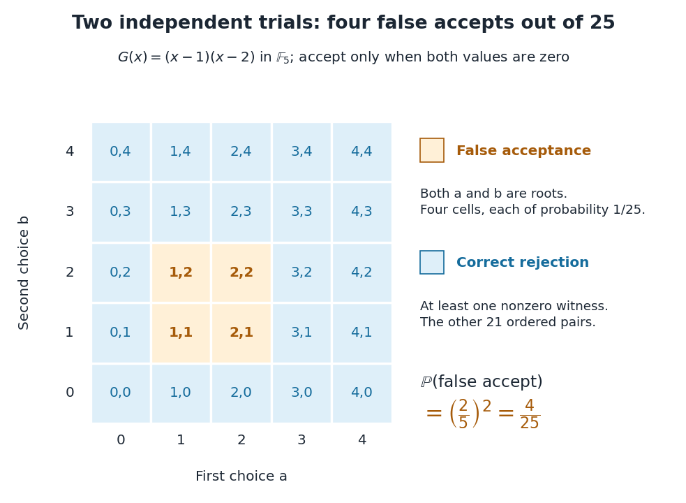

# Independent repetition of a polynomial identity test

↑ **Parent:** [Polynomial identity testing](polynomial-identity-testing.md)

Repeat the [random evaluation test for a polynomial identity](random-evaluation-test-for-a-polynomial-identity.md) with fresh [independent random variables](independent-random-variables.md), keeping the same fixed [polynomial](polynomial-split.md). Reject as soon as any [polynomial evaluation](polynomial-evaluation.md) is nonzero; accept only if all $k$ values vanish. An identity is always accepted, preserving [one-sided error](one-sided-error.md). If a nonzero [polynomial](polynomial-split.md) has single-trial false acceptance [probability](probability.md) $p_1$, [independence](independent-random-variables.md) gives $p_k=p_1^k$. The [Schwartz-Zippel lemma](schwartz-zippel-lemma.md) bounds this by $(d/|S|)^k$ when $d<|S|$.

For $G(x)=(x-1)(x-2)$ over the [finite field](finite-field.md) $\mathbb F_5$, two uniform [independent](independent-random-variables.md) choices $(a,b)$ have $25$ equally likely ordered outcomes, each with [probability](probability.md) $1/25$. Both [polynomial evaluations](polynomial-evaluation.md) are zero only at $(1,1),(1,2),(2,1),(2,2)$. Hence false acceptance falls from $2/5$ in one trial to $4/25$ in two trials, and correct rejection rises from $3/5$ to $21/25$.

**[Figure 32](#image-four-of-the-twenty-five-independent-pairs-falsely-accept-the-nonidentity). Four of the twenty-five independent pairs falsely accept the nonidentity**. The orange cells have both coordinates among the [polynomial roots](root-of-a-polynomial.md) one and two of $G(x)=(x-1)(x-2)$ in the [finite field](finite-field.md) $\mathbb F_5$. Every blue cell supplies at least one nonzero witness. The full grid enumerates exact outcomes under [independence](independent-random-variables.md) and a [uniform distribution on a finite set](discrete-uniform-distribution.md); it is not a simulation.

If the second choice reuses the first, the pair is $(a,a)$ and only five diagonal outcomes are possible. Two still falsely accept, so the error remains $2/5$. Choosing fresh [independent](independent-random-variables.md) points is precisely what makes the full $25$-cell grid and the product of [probabilities](probability.md) valid. For a target error $0<\varepsilon<1$, this example needs

$$
k\ge\left\lceil\frac{\log(1/\varepsilon)}{\log(5/2)}\right\rceil.
$$

The [ceiling function](ceiling-function.md) makes the trial count an [integer](integer-split.md). Four trials give $(2/5)^4=16/625>1/100$, while six give $64/15625<1/100$; five still give $32/3125>1/100$, so six is the first count below one percent. This is an exact error guarantee for each run on $G$, rather than an observed success rate.

## ↑ Ancestors (5)

1. [Polynomial identity testing](polynomial-identity-testing.md)
2. [Randomized algorithm](randomized-algorithm.md)
3. [Algorithm](algorithm-split.md)
4. [Computer science](computer-science-split.md)
5. [Codex Wiki](split.md)

## ← Incoming links (1)

- [Error reduction for a randomized algorithm](error-reduction-for-a-randomized-algorithm.md)
