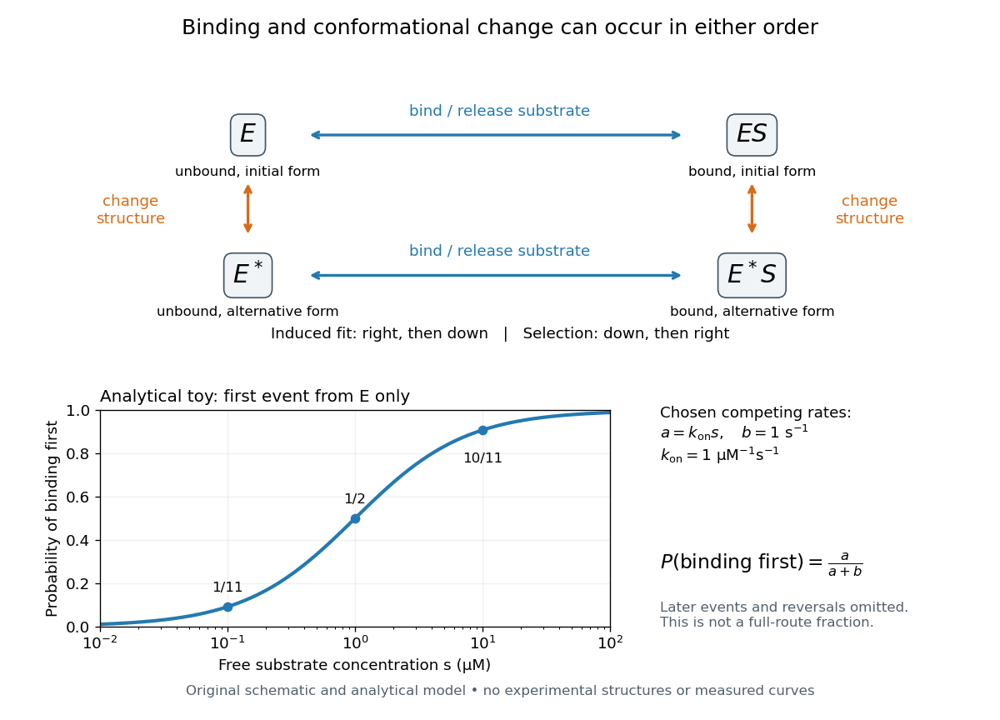

# Induced fit

↑ **Parent:** [Active site](active-site.md)

In [induced fit](induced-fit.md), a [substrate](substrate-biochemistry.md) binds to an [enzyme](enzyme-split.md) and the resulting [enzyme-substrate complex](enzyme-substrate-complex.md) subsequently changes its [protein structure](protein-structure.md). This adjustment can position interacting groups at the [active site](active-site.md) for [catalysis](catalysis.md). The mechanistic claim concerns order: binding precedes the relevant change. In [conformational selection](conformational-selection.md), the unbound [enzyme](enzyme-split.md) already visits an alternative [protein structure](protein-structure.md), which the [substrate](substrate-biochemistry.md) preferentially binds. Both processes can occur in one system. Let $E$ and $E^*$ denote two structures of the same [enzyme](enzyme-split.md), and $S$ a [substrate](substrate-biochemistry.md). The limiting routes are

$$
\begin{aligned}
\text{induced fit:}\quad &E+S\rightleftharpoons ES\rightleftharpoons E^*S,\\
\text{conformational selection:}\quad &E\rightleftharpoons E^*,\qquad E^*+S\rightleftharpoons E^*S.
\end{aligned}
$$

The star labels a structure, not a different [protein primary structure](protein-primary-structure.md), and does not by itself mean catalytic activity. Each reversible arrow abbreviates a step, not the whole catalytic cycle. See [Gordon G. Hammes, Yu-Chu Chang and Terrence G. Oas, Conformational selection or induced fit: a flux description of reaction mechanism, PNAS 106 (2009), 13737–13741](https://pmc.ncbi.nlm.nih.gov/articles/PMC2728963/).

A rigid lock-and-key cartoon usefully suggests selective [substrate](substrate-biochemistry.md) recognition, but it suppresses movement of the [protein](protein-split.md) and chemical changes at the [active site](active-site.md). Replacing it with two static drawings, “open” and “closed”, still does not establish [induced fit](induced-fit.md): both routes above can end at $E^*S$. Also, if complete closure prevents a [substrate](substrate-biochemistry.md) entering, the pre-existing structure selected in [conformational selection](conformational-selection.md) might be partly open and undergo further [induced fit](induced-fit.md) after binding. The usefulness of the distinction is that it turns an attractive shape story into questions about [enzyme kinetics](enzyme-kinetics.md). Relative traffic through the routes depends on populations, [rate constants](rate-constant.md) and free [substrate](substrate-biochemistry.md) [concentration](concentration.md), rather than affinity alone. See [Hammes, Chang and Oas, 2009: coupled pathways, their concentrations and the limitations of endpoint structures](https://pmc.ncbi.nlm.nih.gov/articles/PMC2728963/).

**[Figure 6](#image-induced-fit-and-conformational-selection-two-orders-one-bound-endpoint). Induced fit and conformational selection: two orders, one bound endpoint**. Original reaction-order schematic and an analytical first-event model, not a [hexokinase](hexokinase.md) structure or measured data. In the upper square, horizontal steps bind or release a [substrate](substrate-biochemistry.md); vertical steps change [protein structure](protein-structure.md). In the lower plot, an initially unbound $E$ can bind with rate $a=k_{\mathrm{on}}s$ or change structure with rate $b$, for chosen $k_{\mathrm{on}}=1\,\mathrm{\mu M^{-1}s^{-1}}$ and $b=1\,\mathrm{s^{-1}}$. The plotted [probability](probability.md) $a/(a+b)$ concerns only the first event from $E$, not the fraction completing either full route. Subsequent binding, reversals and [catalysis](catalysis.md) are not modelled by that curve.

For this analytical illustration, hold the free [substrate](substrate-biochemistry.md) [concentration](concentration.md) $s$ constant and assume independent waiting times with [exponential distributions](exponential-distribution.md) of constant rates. The [law of mass action](law-of-mass-action.md) gives the binding rate $a=k_{\mathrm{on}}s$; the competing change has rate $b$. The [probability density function](probability-density-function.md) for binding to happen first at time $t$ is $a e^{-(a+b)t}$, because neither event has happened earlier. Its integral is

$$
P(\text{binding first})=\int_0^\infty a e^{-(a+b)t}\,dt=\frac{a}{a+b}.
$$

With the stated invented [rate constants](rate-constant.md), $s=0.1,1,10\,\mathrm{\mu M}$ gives $1/11,1/2,10/11$, respectively. Raising free [substrate](substrate-biochemistry.md) [concentration](concentration.md) makes binding more likely to win this initial competition. This [probability](probability.md) is deliberately narrower than a full-route fraction: returns to $E$, later changes and the binding properties of $E^*$ would all matter for the latter. The illustration explains why timing and [concentration](concentration.md) must accompany structural evidence, without assigning a binding mechanism to a real [enzyme](enzyme-split.md).

A motivating experiment tested the crystal interpretation in solution. McDonald, Steitz and Engelman prepared solutions of monomeric [yeast](yeast.md) [hexokinase](hexokinase.md) B and compared the unbound preparation with sugar-bound preparations. Their apparatus measured small-angle scattering of [X-rays](x-ray.md); the spatial extent inferred from that readout was the [radius of gyration](radius-of-gyration.md), rather than a catalytic [reaction rate](reaction-rate.md). Binding [glucose](glucose.md) reduced the [radius of gyration](radius-of-gyration.md) by $0.95\pm0.24\,\mathrm{\mathring A}$; binding the phosphorylated [glucose](glucose.md) product reduced it by $1.25\pm0.28\,\mathrm{\mathring A}$, as reported by the authors. The [glucose](glucose.md) change agreed with the reduction calculated from the crystal coordinates. See [Robert C. McDonald, Thomas A. Steitz and Donald M. Engelman, Yeast hexokinase in solution exhibits a large conformational change upon binding glucose or glucose 6-phosphate, Biochemistry 18 (1979), 338–342: primary abstract](https://pubmed.ncbi.nlm.nih.gov/369601/).

The comparison without added [substrate](substrate-biochemistry.md) supplies a baseline within the same form of [hexokinase](hexokinase.md); the second bound preparation tests another binding condition. Together with the crystal comparison, solution compaction supports closure beyond crystal packing. It still gives an average spatial readout, not a movie of individual binding events, and product-associated compaction does not demonstrate ongoing [catalysis](catalysis.md). Neither experiment alone proves that binding precedes movement. To distinguish [induced fit](induced-fit.md) from [conformational selection](conformational-selection.md), structural comparisons must be combined with measurements sensitive to timing and with a model of the relevant populations and [enzyme kinetics](enzyme-kinetics.md).

## ↑ Ancestors (4)

1. [Active site](active-site.md)
2. [Enzyme](enzyme-split.md)
3. [Biology](biology-split.md)
4. [Codex Wiki](split.md)

## ← Incoming links (6)

- [Active site](active-site.md)
- [Enzyme](enzyme-split.md)
- [Induced fit](induced-fit.md)
- [Solution](past-exam-of-the-biochemistry-course-of-the-university-of-cambridge/2024/paper-1/section-ii/6/solution.md)
- [Solution](past-exam-of-the-biochemistry-course-of-the-university-of-cambridge/2025/paper-1/section-i/2/solution.md)
- [Protein](protein-split.md)
