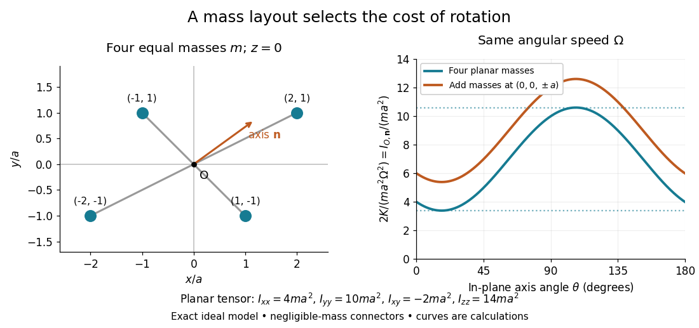

# Inertia tensor of paired point masses

↑ **Parent:** [Inertia tensor](inertia-tensor.md)

An exact planar example makes the off-diagonal entries tangible. Join four equal [point masses](point-mass.md) $m$ with negligible-mass rigid connectors at $a(2,1,0)$, $a(-2,-1,0)$, $a(1,-1,0)$ and $a(-1,1,0)$, where $a>0$ is a length. Their [centre of mass](center-of-mass.md) is $O=(0,0,0)$. Summing $x^2$, $y^2$ and $xy$ gives $10a^2$, $4a^2$ and $2a^2$, respectively, so

$$
\mathbf I_{\mathrm{planar}}=ma^2\begin{pmatrix}4&-2&0\\-2&10&0\\0&0&14\end{pmatrix}.
$$

The $z$ axis is a [principal axis](principal-axis.md), and $I_{zz}=I_{xx}+I_{yy}$ illustrates the [perpendicular axis theorem](perpendicular-axis-theorem.md). The $x$ axis is not a [principal axis](principal-axis.md): [angular velocity](angular-velocity.md) $\boldsymbol\omega=(\Omega,0,0)$ gives [angular momentum](angular-momentum.md) $ma^2\Omega(4,-2,0)$, which points in a different direction. A bearing can enforce fixed-axis rotation despite this difference, supplying the necessary transverse [torque](torque.md).

**[Figure 38](#image-paired-point-masses-and-direction-dependent-rotational-kinetic-energy). Paired point masses and direction-dependent rotational kinetic energy**. Original exact model. Four equal [point masses](point-mass.md) lie in the $xy$ plane with negligible-mass connectors. The curves use [angular velocity](angular-velocity.md) $\boldsymbol\omega=\Omega(\cos\theta,\sin\theta,0)$ and plot $2K/(ma^2\Omega^2)$. Adding two more equal [point masses](point-mass.md) at $a(0,0,\pm1)$ raises this curve by two. Markers depict ideal [point masses](point-mass.md), not finite-sized weights; no experimental data are plotted.

For an in-plane [unit vector](unit-vector.md) $\mathbf n=(\cos\theta,\sin\theta,0)$, the planar model has

$$
\frac{I_{O,\mathbf n}}{ma^2}=4\cos^2\theta+10\sin^2\theta-4\sin\theta\cos\theta.
$$

Its extrema are the [principal moments of inertia](principal-moment-of-inertia.md) $(7-\sqrt{13})ma^2$ and $(7+\sqrt{13})ma^2$; the remaining [principal moment of inertia](principal-moment-of-inertia.md) is $14ma^2$. These values follow from the two-by-two [characteristic polynomial](characteristic-polynomial.md) $(4-\lambda)(10-\lambda)-4$, so they can be checked without trusting a numerical [eigenvalue](eigenvalue.md) routine. At a stipulated [angular speed](angular-speed.md) $\Omega=1\,\mathrm{rad/s}$, with $m=1\,\mathrm{kg}$ and $a=1\,\mathrm m$, rotation about $x$, $y$ or $z$ has [rotational kinetic energy](rotational-kinetic-energy.md) $2$, $5$ or $7\,\mathrm J$, respectively.

A truly three-dimensional example adds two more equal [point masses](point-mass.md) at $a(0,0,1)$ and $a(0,0,-1)$. Each contributes $ma^2\operatorname{diag}(1,1,0)$ to the [inertia tensor](inertia-tensor.md), giving

$$
\mathbf I_{\mathrm{3D}}=ma^2\begin{pmatrix}6&-2&0\\-2&12&0\\0&0&14\end{pmatrix},
\qquad
(I_1,I_2,I_3)=ma^2(9-\sqrt{13},9+\sqrt{13},14).
$$

The in-plane [principal axes](principal-axis.md) stay the same while their [principal moments of inertia](principal-moment-of-inertia.md) each increase by $2ma^2$. The $z$ [moment of inertia](moment-of-inertia.md) stays unchanged because the added [point masses](point-mass.md) lie on that axis. This comparison changes the total [mass](mass.md) from $4m$ to $6m$; it holds the original four [point masses](point-mass.md) fixed rather than redistributing a fixed total [mass](mass.md).

## ↑ Ancestors (7)

1. [Inertia tensor](inertia-tensor.md)
2. [Moment of inertia](moment-of-inertia.md)
3. [Rigid body dynamics](rigid-body-dynamics.md)
4. [Classical mechanics](classical-mechanics-split.md)
5. [Branches of physics](branches-of-physics.md)
6. [Physics](physics-split.md)
7. [Codex Wiki](split.md)

## ← Incoming links (2)

- [Principal moment of inertia](principal-moment-of-inertia.md)
- [Rotational energy ellipsoid](rotational-energy-ellipsoid.md)
