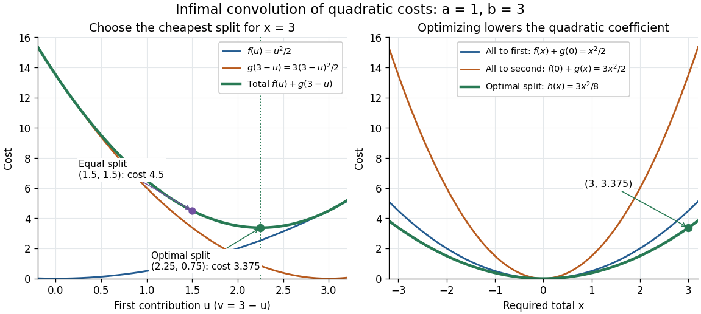
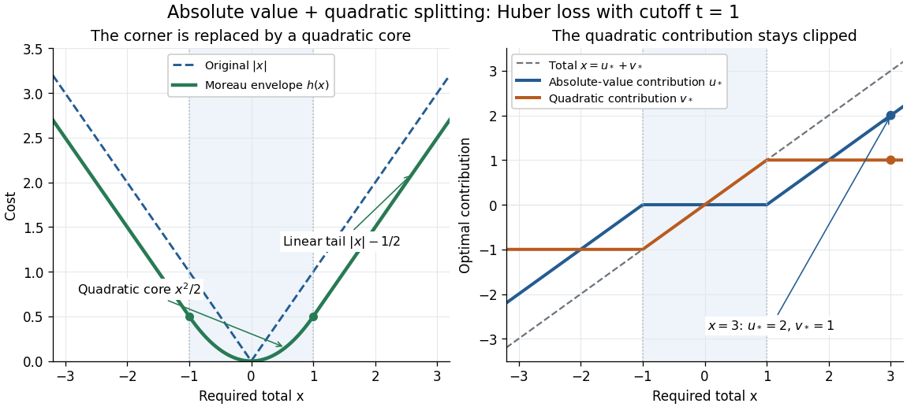

# Infimal convolution

↑ **Parent:** [Convex analysis](convex-analysis.md)

An [infimal convolution](infimal-convolution.md) is the cheapest way to split a prescribed total between two costs. Suppose two activities contribute $u$ and $v$ to a required total $x$, costing $f(u)$ and $g(v)$. Their combined cost is optimized over all splits $u+v=x$, rather than charging both activities for the entire total.

For [proper extended-real functions](proper-extended-real-function.md) $f,g:X\to\mathbb R\cup\{+\infty\}$ on a [real vector space](real-vector-space.md) $X$, define

$$
h(x)=(f\mathbin\square g)(x)=\inf_{u\in X}\{f(u)+g(x-u)\}=\inf_{u+v=x}\{f(u)+g(v)\}.
$$

The definition does not require [convexity](convex-function.md). An infinite cost forbids that contribution, as with an [indicator functional of a constraint set](indicator-functional-of-a-constraint-set.md). If no split has two finite costs, set $h(x)=+\infty$; if the costs of admissible splits are unbounded below, $h(x)=-\infty$. Thus proper inputs need not produce a [proper extended-real function](proper-extended-real-function.md). The notation $E\mathbin\square F$ denotes the same operation. See [Parikh and Boyd, Proximal Algorithms, §3.1](https://web.stanford.edu/~boyd/papers/pdf/prox_algs.pdf#page=17) for the standard [convex analysis](convex-analysis.md) definition and its connection to the [Moreau envelope](moreau-envelope.md).

An [infimum](infimum.md) is a best lower bound, whereas a [minimum](minimum-of-a-subset-of-a-total-order.md) is a value realized by some split. Writing $\min$ in place of $\inf$ requires an attaining pair $(u_*,v_*)$. For [convex functions](convex-function.md), mixing two nearly optimal splits and applying [convexity](convex-function.md) to each cost proves that their [infimal convolution](infimal-convolution.md) is [convex](convex-function.md) whenever it is proper; one must use nearly optimal splits because exact minimizers need not exist. Its [convex conjugate](convex-conjugate.md) is $f^*+g^*$ whenever the [extended real number](extended-real-number-line.md) arithmetic is well defined; see [conjugate of an infimal convolution](conjugate-of-an-infimal-convolution.md) for the precise identity. This turns the optimization over splits into addition in the conjugate variables.

**Two quadratic costs: share the load according to its price.** Let $X=\mathbb R$ and let the [convex quadratic functions](convex-quadratic-function.md) be

$$
f(u)=\frac a2u^2,\qquad g(v)=\frac b2v^2,\qquad a,b>0.
$$

For fixed $x$, eliminate $v=x-u$. The [derivative](derivative.md) of the total cost is $au-b(x-u)$, so equal marginal costs give

$$
u_* =\frac b{a+b}x,\qquad v_* =\frac a{a+b}x,\qquad au_*=bv_*.
$$

The cheaper activity receives more of a positive total: when $a<b$ and $x>0$, $u_*>v_*$. Completing the square gives an exact certificate for every competing split:

$$
\frac a2u^2+\frac b2(x-u)^2
=\frac{ab}{2(a+b)}x^2+\frac{a+b}{2}\left(u-\frac b{a+b}x\right)^2.
$$

Consequently the [infimum](infimum.md) is a unique [minimum](minimum-of-a-subset-of-a-total-order.md), and

$$
(f\mathbin\square g)(x)=\frac12\frac{ab}{a+b}x^2.
$$

The effective quadratic coefficient is $c=ab/(a+b)$, with $1/c=1/a+1/b$. It is smaller than either $a$ or $b$: allowing both activities reduces the cost compared with assigning everything to either one. If $a=b$, each receives half the total and $c=a/2$. This is a simple [quadratic optimization](quadratic-optimization.md) problem whose answer preserves the form of the original costs.

**[Figure 7](#image-optimizing-the-split-of-two-quadratic-costs-gives-a-cheaper-quadratic-total-cost). Optimizing the split of two quadratic costs gives a cheaper quadratic total cost**. An exact illustrative calculation, not measured data: $a=1$, $b=3$ and $x=3$ give $(u_*,v_*)=(2.25,0.75)$ and cost $3.375$, compared with cost $4.5$ for an equal split. The right panel compares the optimized cost $3x^2/8$ with assigning the whole total to either activity.

**Smoothing a corner by splitting its cost.** Take the [absolute value function](absolute-value.md) $f(u)=|u|$ and the [convex quadratic function](convex-quadratic-function.md) $g(v)=v^2/(2t)$, with $t>0$. This [infimal convolution](infimal-convolution.md) is the [Moreau envelope](moreau-envelope.md) of the [absolute value function](absolute-value.md):

$$
u_*=\operatorname{sgn}(x)\max(|x|-t,0),\qquad v_*=x-u_*,\qquad
(f\mathbin\square g)(x)=\begin{cases}x^2/(2t),&|x|\leq t,\\|x|-t/2,&|x|>t.\end{cases}
$$

Here $\operatorname{sgn}$ is the [sign function](sign-function.md), with $\operatorname{sgn}(0)=0$. The optimal $u_*$ is [soft thresholding](soft-thresholding.md). In the central region, the [quadratic function](quadratic-function.md) carries the whole total; outside it, $v_*$ stays at $t\operatorname{sgn}(x)$ and the [absolute value function](absolute-value.md) carries the excess. At $t=1$ the result is the [Huber loss](huber-loss.md) in the normalization $x^2/2$ near zero and $|x|-1/2$ outside. Its [derivative](derivative.md) is $x$ for $|x|\leq1$ and $\operatorname{sgn}(x)$ outside, so the corner becomes a continuous change of slope. Parikh and Boyd's [§3.1 discussion of Moreau smoothing](https://web.stanford.edu/~boyd/papers/pdf/prox_algs.pdf#page=18) uses twice this normalization for the [Huber loss](huber-loss.md); the explicit formula here fixes the convention. This is also the one-dimensional case of the existing [Moreau envelope of the Euclidean norm](moreau-envelope-of-the-euclidean-norm.md).

**[Figure 8](#image-splitting-absolute-value-and-quadratic-costs-produces-a-smooth-huber-loss). Splitting absolute-value and quadratic costs produces a smooth Huber loss**. Exact illustrative curves with $t=1$, not measured data. The left panel compares $|x|$ with its [Moreau envelope](moreau-envelope.md); the right shows the optimal contributions $u_*$ and $v_*$, whose sum is $x$. Beyond the cutoffs $x=\pm1$, the quadratic contribution remains clipped while the absolute-value contribution grows.

**Table of contents**

- [Finite-valued infimal convolution](finite-valued-infimal-convolution.md)
  - [Infimal-convolution dual subgradients](infimal-convolution-dual-subgradients.md)
- [Conjugate of an infimal convolution](conjugate-of-an-infimal-convolution.md)

## ↑ Ancestors (6)

1. [Convex analysis](convex-analysis.md)
2. [Convex optimization](convex-optimization-split.md)
3. [Mathematical optimization](mathematical-optimization-split.md)
4. [Area of mathematics](area-of-mathematics.md)
5. [Mathematics](mathematics-split.md)
6. [Codex Wiki](split.md)

## ← Incoming links (14)

- [Conjugate of an infimal convolution](conjugate-of-an-infimal-convolution.md)
- [Conjugate of the squared distance to a convex set](conjugate-of-the-squared-distance-to-a-convex-set.md)
- [Finite-valued infimal convolution](finite-valued-infimal-convolution.md)
- [Fixed exponential perturbation of a Gaussian empirical mean](fixed-exponential-perturbation-of-a-gaussian-empirical-mean.md)
- [Hurstiness of independent sums](hurstiness-of-independent-sums.md)
- [Infimal convolution](infimal-convolution.md)
- [Infimal-convolution dual subgradients](infimal-convolution-dual-subgradients.md)
- [Solution](past-exam-of-the-mathematics-course-of-the-university-of-cambridge/2003/iii/paper-79/1/c/solution.md)
- [Solution](past-exam-of-the-mathematics-course-of-the-university-of-cambridge/2004/iii/paper-31/2/c/solution.md)
- [Solution](past-exam-of-the-mathematics-course-of-the-university-of-cambridge/2014/iii/paper-65/1/c/solution.md)
- [Solution](past-exam-of-the-mathematics-course-of-the-university-of-cambridge/2016/iii/paper-325/1/ii/solution.md)
- [Solution](past-exam-of-the-mathematics-course-of-the-university-of-cambridge/2018/iii/paper-326/3/2/b/solution.md)
- [Solution](past-exam-of-the-mathematics-course-of-the-university-of-cambridge/2018/iii/paper-326/3/2/c/solution.md)
- [Solution](past-exam-of-the-mathematics-course-of-the-university-of-cambridge/2018/iii/paper-326/3/2/d/solution.md)
