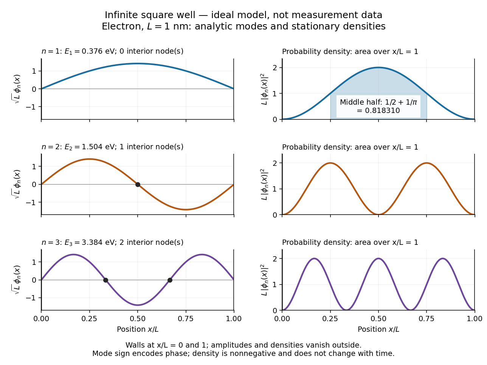
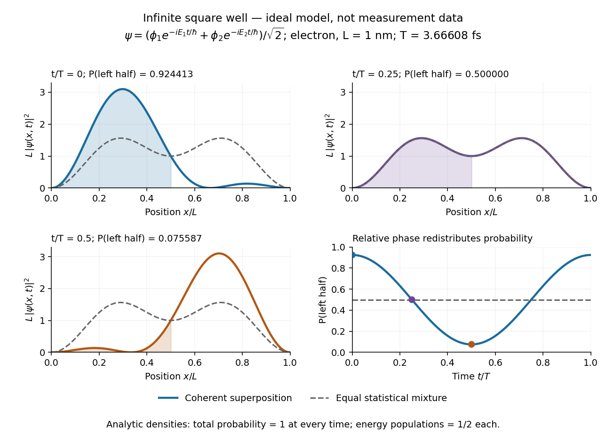

# Infinite square well

↑ **Parent:** [Quantum mechanics](quantum-mechanics-split.md)  
ⓦ [Wiki](https://en.wikipedia.org/wiki/Particle_in_a_box)

The [infinite square well](infinite-square-well.md) is an ideal confinement model with [potential energy](potential-energy.md) $V(x)=0$ for $0<x<L$ and infinite walls outside. The walls impose [Dirichlet boundary conditions](dirichlet-boundary-condition.md) $\phi(0)=\phi(L)=0$ and a vanishing exterior [wavefunction](wave-function-split.md). Inside, the time-independent [Schrödinger equation](schrodinger-equation.md) is

$$
-\frac{\hbar^2}{2m}\frac{d^2\phi}{dx^2}=E\phi,\qquad \phi_n(x)=\sqrt{\frac2L}\sin\frac{n\pi x}{L},\qquad E_n=\frac{n^2\pi^2\hbar^2}{2mL^2},\quad n=1,2,\ldots.
$$

The first wall removes the [cosine](cosine.md) term; the second requires $\sin(kL)=0$, hence $k=n\pi/L$. The $n=0$ solution is identically zero and cannot satisfy [wavefunction normalization](wavefunction-normalization.md). Each [energy eigenstate](energy-eigenstate.md) has $n-1$ interior [nodes of a standing wave](node-physics.md), at $x=jL/n$ for $j=1,\ldots,n-1$. More curvature costs more [kinetic energy](kinetic-energy.md), explaining the $n^2$ growth. The positive [ground-state energy](ground-state-energy.md) is a confinement effect: a constant zero-energy [wavefunction](wave-function-split.md) cannot satisfy both walls and remain normalized.

For an [electron](electron.md) with mass $m_e=9.1093837139\times10^{-31}\,\mathrm{kg}$ in a box of length $L=1\,\mathrm{nm}$, use $h=6.62607015\times10^{-34}\,\mathrm{J\,s}$ and $1\,\mathrm{eV}=1.602176634\times10^{-19}\,\mathrm J$. These constants are from the 2022 CODATA adjustment. [Fundamental Physical Constants — Complete Listing by National Institute of Standards and Technology and others](fundamental-physical-constants-complete-listing-by-national-institute-of-standards-and-technology-and-others.md). Substitution gives

$$
E_1=\frac{h^2}{8m_eL^2}=6.024667\times10^{-20}\,\mathrm J\approx0.376030\,\mathrm{eV},\qquad E_2=4E_1\approx1.504121\,\mathrm{eV}.
$$

Doubling $L$ quarters every [energy eigenvalue](energy-eigenvalue-split.md); doubling $m$ halves them. This scaling makes the [particle in a box](infinite-square-well.md) useful for estimating confinement energies before attempting a more realistic calculation. A [finite square well](finite-square-well.md) permits exterior tails for [bound states](bound-state.md) and has only finitely many bound [energy eigenstates](energy-eigenstate.md). For an [electron](electron.md), the scalar box calculation assumes fixed [spin](spin.md) and no spin-dependent interactions.

For the [ground state](ground-state.md), the probability of finding the particle in the middle half of the box is fully computable:

$$
\Pr\left(\frac L4<x<\frac{3L}4\right)=\int_{L/4}^{3L/4}\frac2L\sin^2\frac{\pi x}{L}\,dx=\left[\frac xL-\frac{\sin(2\pi x/L)}{2\pi}\right]_{L/4}^{3L/4}=\frac12+\frac1\pi\approx0.818310.
$$

Thus half the available length contains about $81.8\%$ of the probability. The figure contrasts the signed [wavefunctions](wave-function-split.md) with their nonnegative [probability densities](probability-density.md): a negative lobe is an amplitude with opposite [quantum phase](quantum-phase.md), not negative probability.

**[Figure 19](#image-ideal-infinite-square-well-normalized-modes-nodes-and-analytic-position-densities). Ideal infinite square well: normalized modes, nodes, and analytic position densities**.

An equal [quantum superposition](quantum-superposition.md) of the first two [energy eigenstates](energy-eigenstate.md) gives a simple example of moving density:

$$
\psi(x,t)=\frac{\phi_1(x)e^{-iE_1t/\hbar}+\phi_2(x)e^{-iE_2t/\hbar}}{\sqrt2},\qquad |\psi|^2=\frac{\phi_1^2+\phi_2^2}{2}+\phi_1\phi_2\cos\frac{(E_2-E_1)t}{\hbar}.
$$

Its density period is $T=h/(E_2-E_1)\approx3.66608\,\mathrm{fs}$ for the [electron](electron.md) box above. At $t=0$ the cross term enhances the left side; at $T/4$ it vanishes; at $T/2$ it enhances the right side. More quantitatively,

$$
\Pr(0<x<L/2)=\frac12+\frac4{3\pi}\cos\frac{2\pi t}{T},
$$

which takes the values $0.924413$, $0.5$, and $0.075587$ at those times. [Orthogonality](orthogonal-vectors.md) keeps the total probability one throughout. An [energy measurement](energy-measurement.md) still returns $E_1$ or $E_2$ with equal probabilities: changing position density arises from relative [quantum phase](quantum-phase.md), not changing populations. A [mixed state](mixed-state.md) describing a statistical mixture with those populations has the constant [probability density](probability-density.md) $(\phi_1^2+\phi_2^2)/2$; it lacks this [matter-wave interference](matter-wave-interference.md) term.

**[Figure 20](#image-ideal-box-superposition-relative-phase-changes-analytic-density-while-total-probability-stays-one). Ideal box superposition: relative phase changes analytic density while total probability stays one**.

**Table of contents**

- [Infinite-well ground-state uncertainty product](infinite-well-ground-state-uncertainty-product.md)
- [Common diagonal dipole phase in an infinite well](common-diagonal-dipole-phase-in-an-infinite-well.md)
- [Wavevector distribution of an infinite-well ground state](wavevector-distribution-of-an-infinite-well-ground-state.md)
- [Moving-wall derivative coupling](moving-wall-derivative-coupling.md)
  - [First-order excitation in a linearly expanding infinite well](first-order-excitation-in-a-linearly-expanding-infinite-well.md)
- [Parabolic variational trial for a particle in a box](parabolic-variational-trial-for-a-particle-in-a-box.md)
- [Ground state at the top of a central rectangular barrier](ground-state-at-the-top-of-a-central-rectangular-barrier.md)
- [Boundary force in an infinite square well](boundary-force-in-an-infinite-square-well.md)
- [Equal superposition of the first two box states](equal-superposition-of-the-first-two-box-states.md)
- [Position matrix elements in a symmetric infinite square well](position-matrix-elements-in-a-symmetric-infinite-square-well.md)
- [Energy form of a half-well sine state](energy-form-of-a-half-well-sine-state.md)
- [Ramp-state expansion in a symmetric infinite well](ramp-state-expansion-in-a-symmetric-infinite-well.md)
- [Particle in a rectangular box](particle-in-a-rectangular-box.md)
  - [Two-dimensional infinite square well](two-dimensional-infinite-square-well.md)
    - [Third-level degeneracy in a rectangular quantum box](third-level-degeneracy-in-a-rectangular-quantum-box.md)

## ↑ Ancestors (4)

1. [Quantum mechanics](quantum-mechanics-split.md)
2. [Branches of physics](branches-of-physics.md)
3. [Physics](physics-split.md)
4. [Codex Wiki](split.md)

## ← Incoming links (55)

- [Confinement energy bound from position support](confinement-energy-bound-from-position-support.md)
- [Degenerate orbital exchange splitting from a product perturbation](degenerate-orbital-exchange-splitting-from-a-product-perturbation.md)
- [Energy eigenspace](energy-eigenspace.md)
- [Energy eigenstate](energy-eigenstate.md)
- [Energy eigenvalue](energy-eigenvalue-split.md)
- [Energy form of a half-well sine state](energy-form-of-a-half-well-sine-state.md)
- [Equal superposition of the first two box states](equal-superposition-of-the-first-two-box-states.md)
- [Erwin Schrödinger](erwin-schrodinger.md)
- [Excited state](excited-state.md)
- [Ground state of a finite square well](ground-state-of-a-finite-square-well.md)
- [Ground-state overlap after sudden expansion of a square well](ground-state-overlap-after-sudden-expansion-of-a-square-well.md)
- [Infinite square well](infinite-square-well.md)
- [Infinite-well interband selection rule](infinite-well-interband-selection-rule.md)
- [One-sided sudden expansion of an infinite square well](one-sided-sudden-expansion-of-an-infinite-square-well.md)
- [Parabolic variational trial for a particle in a box](parabolic-variational-trial-for-a-particle-in-a-box.md)
- [Particle in a rectangular box](particle-in-a-rectangular-box.md)
- [Solution](past-exam-of-the-advanced-quantum-condensed-matter-physics-course-of-the-university-of-cambridge/2016/paper-1/1/a/solution.md)
- [Solution](past-exam-of-the-advanced-quantum-physics-course-of-the-university-of-cambridge/2012/paper-1/4/solution.md)
- [Solution](past-exam-of-the-advanced-quantum-physics-course-of-the-university-of-cambridge/2013/paper-1/1/c/solution.md)
- [Solution](past-exam-of-the-advanced-quantum-physics-course-of-the-university-of-cambridge/2021/section-b/6/a/solution.md)
- [Solution](past-exam-of-the-advanced-quantum-physics-course-of-the-university-of-cambridge/2022/section-b/5/a/solution.md)
- [Solution](past-exam-of-the-advanced-quantum-physics-course-of-the-university-of-cambridge/2022/section-b/5/b/solution.md)
- [Solution](past-exam-of-the-chemistry-a-course-of-the-university-of-cambridge/2024/paper-1/a1/a/i/solution.md)
- [Solution](past-exam-of-the-chemistry-course-of-the-year-3-of-the-natural-sciences-course-of-the-university-of-cambridge/2022/paper-2b/section-a/26/a/solution.md)
- [Solution](past-exam-of-the-chemistry-course-of-the-year-3-of-the-natural-sciences-course-of-the-university-of-cambridge/2022/paper-2b/section-a/26/b/solution.md)
- [Solution](past-exam-of-the-mathematics-course-of-the-university-of-cambridge/2001/ib/paper-1/18f/a/solution.md)
- [Solution](past-exam-of-the-mathematics-course-of-the-university-of-cambridge/2003/ib/paper-1/9a/solution.md)
- [Solution](past-exam-of-the-mathematics-course-of-the-university-of-cambridge/2005/ib/paper-1/15g/solution.md)
- [Solution](past-exam-of-the-mathematics-course-of-the-university-of-cambridge/2014/ib/paper-1/15a/i/solution.md)
- [Solution](past-exam-of-the-mathematics-course-of-the-university-of-cambridge/2015/iii/paper-81/3/a/solution.md)
- [Solution](past-exam-of-the-mathematics-course-of-the-university-of-cambridge/2016/ib/paper-1/15b/a/i/solution.md)
- [Solution](past-exam-of-the-mathematics-course-of-the-university-of-cambridge/2017/ib/paper-3/8b/a/solution.md)
- [Solution](past-exam-of-the-mathematics-course-of-the-university-of-cambridge/2019/ib/paper-3/16b/solution.md)
- [Solution](past-exam-of-the-mathematics-course-of-the-university-of-cambridge/2020/ib/paper-1/15a/solution.md)
- [Solution](past-exam-of-the-mathematics-course-of-the-university-of-cambridge/2022/ib/paper-2/15b/a/solution.md)
- [Solution](past-exam-of-the-mathematics-course-of-the-year-2-of-the-natural-sciences-course-of-the-university-of-cambridge/2016/paper-1/10/b/solution.md)
- [Solution](past-exam-of-the-mphil-in-micro-and-nanotechnology-enterprise-course-of-the-university-of-cambridge/2020/paper-2/section-a-ii/16/ii/solution.md)
- [Solution](past-exam-of-the-mphil-in-micro-and-nanotechnology-enterprise-course-of-the-university-of-cambridge/2020/paper-2/section-b/20/iii/solution.md)
- [Solution](past-exam-of-the-physics-a-course-of-the-university-of-cambridge/2010/paper-2/section-a/1/solution.md)
- [Solution](past-exam-of-the-physics-a-course-of-the-university-of-cambridge/2012/paper-1/section-b/b7/solution.md)
- [Solution](past-exam-of-the-physics-a-course-of-the-university-of-cambridge/2015/paper-1/section-b/b7/solution.md)
- [Solution](past-exam-of-the-physics-a-course-of-the-university-of-cambridge/2018/paper-1/section-a/a2/solution.md)
- [Solution](past-exam-of-the-physics-a-course-of-the-university-of-cambridge/2019/paper-1/section-a/1/solution.md)
- [Solution](past-exam-of-the-physics-a-course-of-the-university-of-cambridge/2019/paper-1/section-b/b8/a/solution.md)
- [Solution](past-exam-of-the-physics-a-course-of-the-university-of-cambridge/2021/paper-1/section-a/1/solution.md)
- [Solution](past-exam-of-the-physics-course-of-the-year-1-of-the-natural-sciences-course-of-the-university-of-cambridge/2018/section-d/13/solution.md)
- [Solution](past-exam-of-the-physics-course-of-the-year-4-of-the-natural-sciences-course-of-the-university-of-cambridge/2013/paper-1/section-a/a5/solution.md)
- [Polynomial Rayleigh-Ritz trial space for a one-dimensional box](polynomial-rayleigh-ritz-trial-space-for-a-one-dimensional-box.md)
- [Quantum mechanics](quantum-mechanics-split.md)
- [Thermal occupation of a quantum well](thermal-occupation-of-a-quantum-well.md)
- [Time-independent Schrödinger equation](time-independent-schrodinger-equation.md)
- [Unfolding a reflected interval trajectory](unfolding-a-reflected-interval-trajectory.md)
- [Wave function](wave-function-split.md)
- [Wavefunction normalization](wavefunction-normalization.md)
- [Wavevector distribution of an infinite-well ground state](wavevector-distribution-of-an-infinite-well-ground-state.md)
