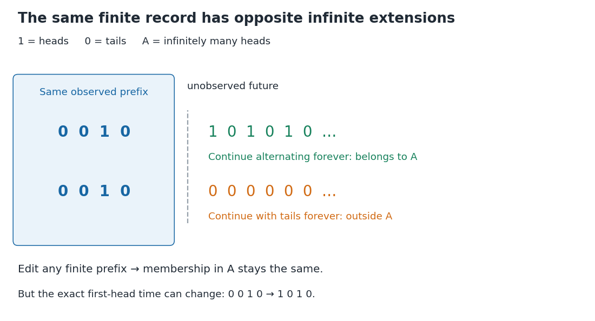

# Infinitely many heads as a tail event

↑ **Parent:** [Tail event](tail-event.md)

On $\{0,1\}^{\mathbb N}$, the [event](event.md) of infinitely many heads is

$$
A=\bigcap_{m=1}^{\infty}\bigcup_{j\geq m}\{X_j=1\}.
$$

It says that after every index there is another head. For each $n$, the same [intersection](set-intersection.md) can start at $m=n$, so $A\in\sigma(X_n,X_{n+1},\ldots)$; therefore $A$ is a [tail event](tail-event.md). This verifies [measurability](measurability.md) directly using countable [unions](set-union.md) and [intersections](set-intersection.md).

**[Figure 7](#image-a-finite-prefix-admits-both-infinitely-many-heads-and-only-finitely-many-heads). A finite prefix admits both infinitely many heads and only finitely many heads**. The two illustrated extensions have the same initial observations. An alternating continuation belongs to the [tail event](tail-event.md) of infinitely many heads; an all-tails continuation does not. Changing the highlighted finite prefix cannot change that infinite property, but it can change the exact first-head time.

Assume now that the coordinates are fair [independent](independent-random-variables.md) [Bernoulli trials](bernoulli-trial.md). For fixed $m$, let $B_{m,r}$ be the [event](event.md) of at least one head among $X_m,\ldots,X_{m+r-1}$. Its [complement](complement-of-a-set.md) requires $r$ tails, so

$$
\mathbb P(B_{m,r})=1-2^{-r},\qquad
B_m=\bigcup_{r\geq1}B_{m,r},\qquad
\mathbb P(B_m)=1.
$$

The last equality follows from [continuity of probability](continuity-of-probability.md). Now $A=\bigcap_{m\geq1}B_m$, a countable [intersection](set-intersection.md) of [almost sure events](almost-sure-event.md), and hence $\mathbb P(A)=1$. This determines which of the two possibilities in [Kolmogorov's zero–one law](kolmogorov-s-zero-one-law.md) occurs. Equivalently, the [Borel-Cantelli second lemma](borel-cantelli-second-lemma.md) applies to the [independent events](independent-events.md) $\{X_j=1\}$.

Nevertheless, no finite prefix certifies membership in $A$: every finite record can be extended by all tails or by alternating heads and tails. Under the fair [independent](independent-random-variables.md) model, conditioning on any exact finite prefix leaves $\mathbb P(A)=1$, since $A$ is independent of the initial [sigma-algebra](sigma-algebra.md). The excluded all-tails continuation has [probability](probability.md) zero, but remains a possible member of the [sample space](sample-space.md). Logical determination by a finite record and a conclusion holding [almost surely](almost-sure-convergence.md) are different statements.

## ↑ Ancestors (8)

1. [Tail event](tail-event.md)
2. [Tail sigma-algebra](tail-sigma-algebra.md)
3. [Independent sigma-algebras](independent-sigma-algebras.md)
4. [Probability theory](probability-theory-split.md)
5. [Probability and statistics](probability-and-statistics-split.md)
6. [Area of mathematics](area-of-mathematics.md)
7. [Mathematics](mathematics-split.md)
8. [Codex Wiki](split.md)

## ← Incoming links (2)

- [A shared coin prevents a zero-one conclusion](a-shared-coin-prevents-a-zero-one-conclusion.md)
- [Kolmogorov's zero–one law](kolmogorov-s-zero-one-law.md)
