# Information theory

↑ **Parent:** [Probability and statistics](probability-and-statistics.md)  
ⓦ [Wiki](https://en.wikipedia.org/wiki/Information_theory)

Information theory quantifies how much uncertainty messages contain, how efficiently they can be represented, and how reliably they can pass through a noisy [channel](#communication-channel). Its central quantities connect three questions: [information entropy](#information-entropy) measures uncertainty in a source, [conditional entropy](#conditional-entropy) measures what remains after an observation, and [mutual information](#mutual-information) measures what that observation reveals. These are properties of a specified [probability distribution](probability-theory.md#probability-distribution), rather than measures of a message's importance or truth.

For a concrete source, suppose symbols $A,B,C,D$ have [probabilities](probability-theory.md#probability) $1/2,1/4,1/8,1/8$. A fixed-length binary representation needs two [bits](#bit) per symbol. Instead assign the [prefix code](coding-theory.md#prefix-code) $A\mapsto0$, $B\mapsto10$, $C\mapsto110$, $D\mapsto111$. Reading from left to right gives an unambiguous decoding because no codeword begins another. The [expected value](probability-theory.md#expected-value) of the length is

$$
\frac12\cdot1+\frac14\cdot2+\frac18\cdot3+\frac18\cdot3=\frac74.
$$

This saves an average of $1/4$ of a [bit](#bit) per symbol, or $12.5\%$ of the fixed-length representation, with no loss of symbols. The lengths are exactly $-\log_2 p$, so the average equals the source's [Shannon entropy](#information-entropy). For [independent and identically distributed](random-variable.md#independent-and-identically-distributed-random-variables) repetitions, this code works without storing the whole message first. This example shows the appeal of [lossless source coding](#lossless-source-coding): unequal [probabilities](probability-theory.md#probability) become shorter descriptions for more frequent outcomes.

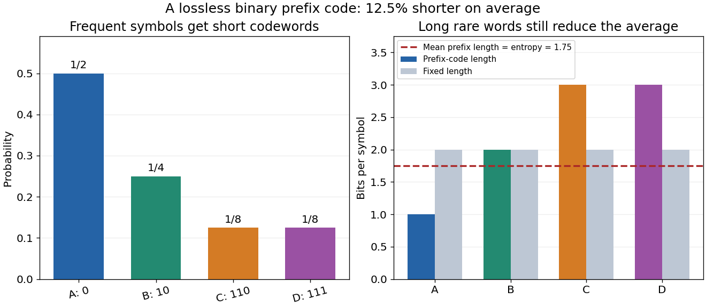

**[Figure 1](#image-a-four-symbol-source-reaches-its-entropy-with-a-binary-prefix-code). A four-symbol source reaches its entropy with a binary prefix code**.

[Channel coding](coding-theory.md#channel-coding) addresses a different problem: errors during transmission. A shorter representation removes predictable structure; an error-correcting representation adds carefully chosen structure that helps recover corrupted symbols. [Shannon's source coding theorem](coding-theory.md#shannon-s-source-coding-theorem) and the [Shannon second coding theorem](coding-theory.md#noisy-channel-coding-theorem) identify limits for these respective tasks under their hypotheses. The beauty is that source details and hardware details can meet through a small number of mathematical quantities, notably [information entropy](#information-entropy) and [channel capacity](#channel-capacity).

Claude E. Shannon's _A Mathematical Theory of Communication_ appeared in the _Bell System Technical Journal_ in July and October 1948. Its introduction separates the engineering problem of reproducing messages from their semantic meaning; subsequent sections develop probabilistic source models, noiseless coding, and transmission with noise. It also acknowledges earlier work by Harry Nyquist and Ralph Hartley.[A Mathematical Theory of Communication by Claude Shannon](mathematics-bibliography.md#a-mathematical-theory-of-communication-by-claude-shannon)

**Table of contents**

- [Bhattacharyya coefficient](#bhattacharyya-coefficient)
  - [Bhattacharyya distance](#bhattacharyya-distance)
- [Communication channel](#communication-channel)
- [Bit](#bit)
- [Nat (unit)](#nat-unit)
- [Memoryless classical information source](#memoryless-classical-information-source)
- [Alphabet](#alphabet)
  - [Finite alphabet](#finite-alphabet)
- [Conditional entropy](#conditional-entropy)
  - [Equality in the entropy conditioning inequality](#equality-in-the-entropy-conditioning-inequality)
  - [Chain rule for conditional entropy](#chain-rule-for-conditional-entropy)
  - [Conditional entropy under a deterministic change of variables](#conditional-entropy-under-a-deterministic-change-of-variables)
  - [Conditioning reduces entropy](#conditioning-reduces-entropy)
    - [An observation can increase entropy](#an-observation-can-increase-entropy)
    - [Independent revelation of a binary variable](#independent-revelation-of-a-binary-variable)
    - [Additional conditioning reduces entropy](#additional-conditioning-reduces-entropy)
    - [Conditioning and differential entropy](#conditioning-and-differential-entropy)
  - [Fano's inequality](#fano-s-inequality)
    - [Fano's inequality via an error indicator](#fano-s-inequality-via-an-error-indicator)
    - [List-decoding Fano inequality](#list-decoding-fano-inequality)
  - [Entropy of a sum of independent finite-group variables](#entropy-of-a-sum-of-independent-finite-group-variables)
- [Mutual information](#mutual-information)
  - [Entropy submodularity](#entropy-submodularity)
    - [Compression of an entropy sum](#compression-of-an-entropy-sum)
      - [Balister–Bollobás entropy inequality](#balister-bollobas-entropy-inequality)
        - [Madiman–Tetali entropy inequality](#madiman-tetali-entropy-inequality)
    - [Shearer's inequality](#shearer-s-inequality)
      - [Entropy bound for graphs with isolated-vertex-free intersections](#entropy-bound-for-graphs-with-isolated-vertex-free-intersections)
  - [Conditional mutual information](#conditional-mutual-information)
  - [Chain rule for mutual information](#chain-rule-for-mutual-information)
  - [Data processing inequality](#data-processing-inequality)
    - [Equality in data processing inequality](#equality-in-data-processing-inequality)
    - [Conditional data-processing inequality](#conditional-data-processing-inequality)
  - [Incremental information in a twofold binary repetition code](#incremental-information-in-a-twofold-binary-repetition-code)
- [Entropic Ruzsa distance](#entropic-ruzsa-distance)
  - [Conditional entropic Ruzsa distance](#conditional-entropic-ruzsa-distance)
    - [Simultaneous conditional entropic Ruzsa distance](#simultaneous-conditional-entropic-ruzsa-distance)
    - [Conditioned entropic Ruzsa distance of a summand](#conditioned-entropic-ruzsa-distance-of-a-summand)
  - [Entropic Ruzsa triangle inequality](#entropic-ruzsa-triangle-inequality)
  - [Entropic Ruzsa sum-difference inequality](#entropic-ruzsa-sum-difference-inequality)
  - [Entropic Balog-Szemerédi-Gowers theorem](#entropic-balog-szemeredi-gowers-theorem)
  - [C-relevant pair of random variables](#c-relevant-pair-of-random-variables)
    - [Relevance of independent self-sums](#relevance-of-independent-self-sums)
- [Entropy submodularity for three independent sums](#entropy-submodularity-for-three-independent-sums)
- [Entropy submodularity for sums](#entropy-submodularity-for-sums)
- [Binary hypothesis testing in information theory](#binary-hypothesis-testing-in-information-theory)
  - [Error exponents in hypothesis testing](#error-exponents-in-hypothesis-testing)
  - [Type I and type II errors](#type-i-and-type-ii-errors)
  - [Chernoff information](#chernoff-information)
    - [Chernoff affinity](#chernoff-affinity)
    - [Finite-sample Chernoff error bound](#finite-sample-chernoff-error-bound)
    - [Chernoff information for complementary Bernoulli distributions](#chernoff-information-for-complementary-bernoulli-distributions)
    - [Historical source for Chernoff information](#historical-source-for-chernoff-information)
  - [Stein's lemma (information theory)](#stein-s-lemma-information-theory)
  - [Neyman-Pearson decision region](#neyman-pearson-decision-region)
- [Total correlation](#total-correlation)
  - [Parity constraint and total correlation](#parity-constraint-and-total-correlation)
    - [Noisy parity total correlation](#noisy-parity-total-correlation)
  - [Chain decomposition of total correlation](#chain-decomposition-of-total-correlation)
  - [Relative entropy to a product law](#relative-entropy-to-a-product-law)
  - [Scope and scale of total correlation](#scope-and-scale-of-total-correlation)
  - [Historical source for total correlation](#historical-source-for-total-correlation)
- [Type (information theory)](#type-information-theory)
  - [Type class](#type-class)
    - [Size of a type class](#size-of-a-type-class)
    - [Indexing within a type class](#indexing-within-a-type-class)
  - [Method of types](#method-of-types)
    - [Number of empirical types](#number-of-empirical-types)
    - [Entropy bounds for a type class](#entropy-bounds-for-a-type-class)
    - [Probability of a type class](#probability-of-a-type-class)
    - [Development of the method of types](#development-of-the-method-of-types)
    - [Sanov theorem](#sanov-theorem)
    - [Information projection](#information-projection)
      - [Information projection on three outcomes](#information-projection-on-three-outcomes)
        - [Information projection and Euclidean projection](#information-projection-and-euclidean-projection)
      - [Uniform-reference information projection maximizes entropy](#uniform-reference-information-projection-maximizes-entropy)
      - [Pythagorean inequality for information projection](#pythagorean-inequality-for-information-projection)
      - [Relative entropy minimization under a mean constraint](#relative-entropy-minimization-under-a-mean-constraint)
        - [Information projection and rare sample means](#information-projection-and-rare-sample-means)
      - [Historical source for information projection](#historical-source-for-information-projection)
- [Rate-distortion theory](#rate-distortion-theory)
  - [Rate-distortion function](#rate-distortion-function)
    - [Distortion measure (information theory)](#distortion-measure-information-theory)
      - [Reconstruction alphabet](#reconstruction-alphabet)
      - [Expected distortion](#expected-distortion)
      - [Separable distortion](#separable-distortion)
    - [Test channel (information theory)](#test-channel-information-theory)
    - [Hamming distortion](#hamming-distortion)
      - [Three-bit lossy Hamming code](#three-bit-lossy-hamming-code)
      - [Binary rate-distortion function](#binary-rate-distortion-function)
    - [Fixed-length lossy code](#fixed-length-lossy-code)
    - [Shannon's rate-distortion theorem](#shannon-s-rate-distortion-theorem)
    - [Zero-rate distortion threshold](#zero-rate-distortion-threshold)
- [Channel capacity](#channel-capacity)
  - [Weakly symmetric channel capacity](#weakly-symmetric-channel-capacity)
    - [Cyclic ternary channel capacity](#cyclic-ternary-channel-capacity)
    - [Binary symmetric channel capacity](#binary-symmetric-channel-capacity)
      - [Input distribution optimization for a binary symmetric channel](#input-distribution-optimization-for-a-binary-symmetric-channel)
      - [Flips versus erasures in a binary channel](#flips-versus-erasures-in-a-binary-channel)
    - [Ternary symmetric channel capacity](#ternary-symmetric-channel-capacity)
- [Information entropy](#information-entropy)
  - [Joint entropy](#joint-entropy)
  - [Cross-entropy](#cross-entropy)
    - [Cross-entropy equals entropy plus relative entropy](#cross-entropy-equals-entropy-plus-relative-entropy)
    - [Mismatch penalty in lossless coding](#mismatch-penalty-in-lossless-coding)
    - [Binary cross-entropy](#binary-cross-entropy)
    - [Empirical cross-entropy](#empirical-cross-entropy)
      - [Cross-entropy and maximum likelihood](#cross-entropy-and-maximum-likelihood)
  - [Entropy monotonicity under independent addition](#entropy-monotonicity-under-independent-addition)
  - [Entropy function for a q-ary alphabet](#entropy-function-for-a-q-ary-alphabet)
  - [Information content](#information-content)
  - [Graph entropy](#graph-entropy)
  - [Entropy bound with one prescribed probability](#entropy-bound-with-one-prescribed-probability)
  - [Epsilon-sufficient set](#epsilon-sufficient-set)
    - [Minimum size of a sufficient set for an IID source](#minimum-size-of-a-sufficient-set-for-an-iid-source)
  - [Differential entropy](#differential-entropy)
    - [Differential entropy of a uniform law](#differential-entropy-of-a-uniform-law)
    - [Differential entropy of a Gaussian law](#differential-entropy-of-a-gaussian-law)
    - [Differential entropy under an increasing transformation](#differential-entropy-under-an-increasing-transformation)
      - [Differential entropy of a squared uniform variable](#differential-entropy-of-a-squared-uniform-variable)
    - [Differential entropy under affine rescaling](#differential-entropy-under-affine-rescaling)
    - [Equal-width bin entropy](#equal-width-bin-entropy)
    - [Relative entropy and coordinate dependence](#relative-entropy-and-coordinate-dependence)
    - [Shannon's continuous-entropy coordinate convention](#shannon-s-continuous-entropy-coordinate-convention)
    - [Entropy power](#entropy-power)
      - [Entropy power inequality](#entropy-power-inequality)
        - [Multiplicative entropy power inequality](#multiplicative-entropy-power-inequality)
  - [Min-entropy](#min-entropy)
    - [Information entropy dominates min-entropy](#information-entropy-dominates-min-entropy)
  - [Varentropy](#varentropy)
  - [Binary entropy](#binary-entropy)
  - [Chain rule for information entropy](#chain-rule-for-information-entropy)
  - [Subadditivity of information entropy](#subadditivity-of-information-entropy)
  - [Concavity of information entropy](#concavity-of-information-entropy)
  - [Maximum entropy distribution on a finite set](#maximum-entropy-distribution-on-a-finite-set)
    - [Maximum entropy on a finite alphabet](#maximum-entropy-on-a-finite-alphabet)
  - [Maximum entropy distribution on the nonnegative integers](#maximum-entropy-distribution-on-the-nonnegative-integers)
- [One-to-one source code](#one-to-one-source-code)
  - [Optimal one-to-one binary code](#optimal-one-to-one-binary-code)
- [Huffman coding](#huffman-coding)
  - [Huffman code](#huffman-code)
    - [Uniform-source Huffman length distribution](#uniform-source-huffman-length-distribution)
  - [Huffman sibling property](#huffman-sibling-property)
    - [Sibling leaves in a code tree](#sibling-leaves-in-a-code-tree)
    - [Huffman sibling contraction](#huffman-sibling-contraction)
  - [Optimal prefix code](#optimal-prefix-code)
    - [Leaf depth in a code tree](#leaf-depth-in-a-code-tree)
    - [Balancing exchange for a uniform optimal prefix code](#balancing-exchange-for-a-uniform-optimal-prefix-code)
    - [Expected codeword length](#expected-codeword-length)
    - [Probability monotonicity of optimal prefix-code lengths](#probability-monotonicity-of-optimal-prefix-code-lengths)
    - [Deepest sibling property of an optimal prefix code](#deepest-sibling-property-of-an-optimal-prefix-code)
    - [Nonunique optimal prefix code](#nonunique-optimal-prefix-code)
  - [Huffman codeword length bounds](#huffman-codeword-length-bounds)
- [Bernoulli source](#bernoulli-source)
- [Entropy rate](#entropy-rate)
  - [Conditional entropy rate](#conditional-entropy-rate)
  - [Entropy rate and coding length](#entropy-rate-and-coding-length)
  - [Shannon's block-entropy approximations](#shannon-s-block-entropy-approximations)
  - [Reliable source encoding at a rate](#reliable-source-encoding-at-a-rate)
    - [Strong converse for fixed-rate source coding](#strong-converse-for-fixed-rate-source-coding)
  - [Information rate under fixed-length blocking](#information-rate-under-fixed-length-blocking)
- [Markov information source](#markov-information-source)
  - [Fully observed Markov source](#fully-observed-markov-source)
    - [Entropy rate of a fully observed Markov source](#entropy-rate-of-a-fully-observed-markov-source)
    - [Binary Markov source](#binary-markov-source)
      - [Innovations in a binary Markov source](#innovations-in-a-binary-markov-source)
- [Asymptotic equipartition property](#asymptotic-equipartition-property)
  - [Bernoulli typical-set example](#bernoulli-typical-set-example)
    - [Typical-set concentration for a biased coin](#typical-set-concentration-for-a-biased-coin)
    - [Typical-set indexing example](#typical-set-indexing-example)
  - [Stationarity without ergodicity in an information source](#stationarity-without-ergodicity-in-an-information-source)
  - [Shannon's typical-message formulation](#shannon-s-typical-message-formulation)
  - [Typical set](#typical-set)
    - [Typical sequence theorem](#typical-sequence-theorem)
    - [Weakly typical sequence](#weakly-typical-sequence)
    - [Typical-set cardinality bounds](#typical-set-cardinality-bounds)
      - [Minimal high-probability source-set exponent](#minimal-high-probability-source-set-exponent)
  - [Strongly typical sequence](#strongly-typical-sequence)
- [Lossless source coding](#lossless-source-coding)
  - [Code-distribution correspondence](#code-distribution-correspondence)
  - [Fixed-rate source-coding error exponent](#fixed-rate-source-coding-error-exponent)
- [Unicity distance](#unicity-distance)
  - [Key equivocation](#key-equivocation)
  - [Source redundancy in cryptanalysis](#source-redundancy-in-cryptanalysis)
  - [Infinite unicity distance from a source symmetry](#infinite-unicity-distance-from-a-source-symmetry)

## Bhattacharyya coefficient

↑ **Parent:** [Information theory](information-theory.md)

For [probability distributions](probability-theory.md#probability-distribution) $p,q$ on the same finite alphabet, the Bhattacharyya coefficient measures their square-root overlap:

$$
B(p,q)=\sum_i\sqrt{p_iq_i}.
$$

The vectors $(\sqrt{p_i})_i$ and $(\sqrt{q_i})_i$ have unit [Euclidean norm](functional-analysis.md#euclidean-norm), so the [Cauchy-Schwarz inequality](probability-and-statistics.md#cauchy-schwarz-inequality) gives $0\leq B\leq1$. Equality $B=1$ holds exactly when the distributions agree; $B=0$ holds exactly when they assign positive [probability](probability-theory.md#probability) to disjoint outcomes. For $p=(0.9,0.1)$ and $q=(0.6,0.4)$, $B=\sqrt{0.54}+0.2\approx0.934847$. This overlap is not the probability that two independent draws agree, which here is $0.58$.

The [fidelity of commuting mixed states](quantum-information-theory.md#fidelity-of-commuting-mixed-states) reduces to this coefficient. More generally, the [measurement characterization of quantum fidelity](quantum-information-theory.md#measurement-characterization-of-quantum-fidelity) minimizes it over outcome distributions of a common [measurement in quantum mechanics](quantum-measurement.md), connecting classical overlap to the [unsquared quantum fidelity](quantum-information-theory.md#fidelity-of-quantum-states).

### Bhattacharyya distance

↑ **Parent:** [Bhattacharyya coefficient](#bhattacharyya-coefficient)

The [Bhattacharyya distance](#bhattacharyya-distance) is the negative [natural logarithm](calculus.md#natural-logarithm) of the [Bhattacharyya coefficient](#bhattacharyya-coefficient), with $-\ln0=\infty$. It is zero for identical [probability distributions](probability-theory.md#probability-distribution) and infinite for disjoint [probability supports](probability-theory.md#support-of-a-probability-distribution). Despite the name, it need not satisfy the [triangle inequality](topological-analysis.md#triangle-inequality) required of a [metric](topological-analysis.md#metric).

## Communication channel

↑ **Parent:** [Information theory](information-theory.md)

A communication channel describes how transmitted inputs become received outputs. In a probabilistic model, [conditional probabilities](probability-theory.md#conditional-probability) specify which outputs each input can produce. A [discrete memoryless channel](coding-theory.md#discrete-memoryless-channel) uses the same finite transition law independently on successive symbols; [channel capacity](#channel-capacity) quantifies its optimal reliable transmission rate.

## Bit

↑ **Parent:** [Information theory](information-theory.md)  
ⓦ [Wiki](https://en.wikipedia.org/wiki/Bit)

A [bit](#bit) is a binary classical symbol with two distinguishable values, zero and one. A uniform random [bit](#bit) has one [bit](#bit) of [information entropy](#information-entropy), while a biased binary symbol has less. Sending one [bit](#bit) means transmitting one symbol from this binary alphabet; the [mutual information](#mutual-information) it carries about a particular input need not be one.

## Nat (unit)

↑ **Parent:** [Information theory](information-theory.md)  
ⓦ [Wiki](https://en.wikipedia.org/wiki/Nat_(unit))

The unit for [information content](#information-content) or [information entropy](#information-entropy) computed with [natural logarithms](calculus.md#natural-logarithm). Converting to [bits](#bit) divides the numerical value by $\log2$, so $1\,\mathrm{nat}=(1/\log2)\,\mathrm{bits}$.

## Memoryless classical information source

↑ **Parent:** [Information theory](information-theory.md)

A memoryless classical source emits [independent and identically distributed random variables](random-variable.md#independent-and-identically-distributed-random-variables) from a fixed finite alphabet. Its block [probability mass function](probability-theory.md#probability-mass-function) factors as shown, and its information per symbol is the [Shannon entropy](#information-entropy) $H(U)=-\sum_up(u)\log_2p(u)$. Zero-probability symbols never occur and contribute zero to the entropy. The [typical sequence theorem](#typical-sequence-theorem) describes the size and probability of the high-probability block set used for reliable compression.

## Alphabet

↑ **Parent:** [Information theory](information-theory.md)  
ⓦ [Wiki](https://en.wikipedia.org/wiki/Alphabet_(formal_languages))

An alphabet is a finite nonempty set of symbols from which strings or source outputs are formed.

### Finite alphabet

↑ **Parent:** [Alphabet](#alphabet)

A [finite alphabet](#finite-alphabet) is an [alphabet](#alphabet) whose symbols form a [finite set](set.md#finite-set). The binary [alphabet](#alphabet) $\{0,1\}$ and a finite vocabulary of possible messages are examples.

## Conditional entropy

↑ **Parent:** [Information theory](information-theory.md)  
ⓦ [Wiki](https://en.wikipedia.org/wiki/Conditional_entropy)

For finite [discrete random variables](random-variable.md#discrete-random-variable), conditional entropy is the average remaining [information entropy](#information-entropy) of $Y$ after the value of $X$ is known:

$$
H(Y\mid X)=\sum_{x:p_X(x)>0}p_X(x)H(Y\mid X=x).
$$

Each observation $X=x$ changes the [probability distribution](probability-theory.md#probability-distribution) used to describe $Y$; the average weights that uncertainty by how often the observation occurs. An observation can increase uncertainty for one particular outcome, even though [conditioning reduces entropy](#conditioning-reduces-entropy) on average for finite variables.

For example, let $Y$ choose $A,B,C,D$ with [probabilities](probability-theory.md#probability) $1/2,1/4,1/8,1/8$, and let $X$ report whether $Y=A$. If it reports yes, there is no remaining uncertainty. Otherwise the conditional [probabilities](probability-theory.md#probability) are $1/2,1/4,1/4$, whose [information entropy](#information-entropy) is $3/2$ [bits](#bit). The two reports each occur with [probability](probability-theory.md#probability) $1/2$, so $H(Y\mid X)=3/4$ of a [bit](#bit). The original uncertainty was $7/4$ [bits](#bit): this observation removes exactly one [bit](#bit) on average.

If $Y$ is a [function](function.md) of $X$, then $H(Y\mid X)=0$: the observation determines the answer. If $X$ and $Y$ are [independent random variables](random-variable.md#independent-random-variables), then $H(Y\mid X)=H(Y)$: the observation gives no improvement. These endpoints make [conditional entropy](#conditional-entropy) useful for separating relevant observations from irrelevant ones. They also lead to the [chain rule for information entropy](#chain-rule-for-information-entropy), $H(X,Y)=H(X)+H(Y\mid X)$, which counts the first uncertainty and the remaining uncertainty without double counting.

### Equality in the entropy conditioning inequality

↑ **Parent:** [Conditional entropy](#conditional-entropy)

For [discrete random variables](random-variable.md#discrete-random-variable) with finite [information entropy](#information-entropy) $H(X)$, [Gibbs inequality](probability-and-statistics.md#gibbs-inequality) gives

$$
H(X)-H(X\mid Y)=\sum_y p_Y(y)D(p_{X\mid y}\Vert p_X)\geq0.
$$

Equality holds exactly when $X$ and $Y$ are [independent random variables](random-variable.md#independent-random-variables). Finiteness matters: if $A$ has infinite [information entropy](#information-entropy) and is independent of a fair bit $B$, then $X=(A,B)$ and $Y=B$ are dependent but $H(X)=H(X\mid Y)=+\infty$.

// Target: probability-and-statistics.bigb

### Chain rule for conditional entropy

↑ **Parent:** [Conditional entropy](#conditional-entropy)

For classical finite random variables, $H(X,Z\mid Y)=H(X\mid Y)+H(Z\mid X,Y)=H(Z\mid Y)+H(X\mid Z,Y)$. Each identity follows by inserting the corresponding joint entropy into $H(X,Z,Y)-H(Y)$. The two orders are particularly useful when one variable is a deterministic function of the others, as in [Fano's inequality via an error indicator](#fano-s-inequality-via-an-error-indicator).

### Conditional entropy under a deterministic change of variables

↑ **Parent:** [Conditional entropy](#conditional-entropy)

If $f(x,z)$ is a [bijection](function.md#bijection) of $x$ for every fixed $z$, then

$$
H(f(X,Z)\mid Z)=H(X\mid Z).
$$

In particular, translating a random variable in a finite group by a value determined by the conditioning variable does not change its conditional entropy.

### Conditioning reduces entropy

↑ **Parent:** [Conditional entropy](#conditional-entropy)

For finite [discrete random variables](random-variable.md#discrete-random-variable) $X,Y$, knowing $Y$ reduces the [information entropy](#information-entropy) of $X$ on average:

$$
H(X\mid Y)=\sum_{y:p_Y(y)>0}p_Y(y)H(X\mid Y=y)\leq H(X).
$$

Equality holds exactly when $X$ and $Y$ are [independent random variables](random-variable.md#independent-random-variables). The average over observations is essential: $H(X\mid Y=y)$ can exceed $H(X)$ for a particular $y$. All [logarithms](calculus.md#logarithm) here have base two, giving [bits](#bit), and zero-probability terms contribute zero.[Definition 1.3, printed p. 8; Theorem 1.1(4), printed p. 10](mathematics-bibliography.md#6-441-information-theory-spring-2016-lecture-notes-by-yury-polyanskiy-and-others/chapter-1-information-measures-entropy-and-divergence)

For [Bayesian inference](statistical-inference.md#bayesian-statistics), this compares a [prior distribution](statistical-inference.md#prior-probability) with the [posterior distributions](statistical-inference.md#bayesian-posterior) produced by possible observations. An unexpected report can make previously unlikely alternatives plausible, while useful reports reduce uncertainty overall. For [lossless source coding](#lossless-source-coding), an observation shared by [encoder](coding-theory.md#channel-encoder) and [decoder](coding-theory.md#channel-decoder) lets them choose descriptions for the appropriate [conditional distribution](probability-theory.md#conditional-distribution); sending that observation also has a cost. The example below makes both the saving and that cost explicit.

In [A Mathematical Theory of Communication by Claude Shannon](mathematics-bibliography.md#a-mathematical-theory-of-communication-by-claude-shannon) (1948), the definition of [conditional entropy](#conditional-entropy) is already an average over observations, followed by the inequality and its [independence](random-variable.md#independent-random-variables) condition in section 6, property 6. The phrase “knowledge reduces uncertainty” must be read with that averaging convention.[p. 12; title page identifies C. E. Shannon and the 1948 journal publication](mathematics-bibliography.md#a-mathematical-theory-of-communication-by-claude-shannon)

#### An observation can increase entropy

↑ **Parent:** [Conditioning reduces entropy](#conditioning-reduces-entropy)

Consider a binary state $X$ and a report $Y$ with the following [joint probability mass function](random-variable.md#joint-probability-mass-function):

$$
\begin{array}{c|cc|c}
&Y=0&Y=1&p_X(x)\\\hline
X=0&4/5&1/10&9/10\\
X=1&0&1/10&1/10\\\hline
p_Y(y)&4/5&1/5&1
\end{array}
$$

Before the report, $X=0$ is strongly favored: its [information entropy](#information-entropy) is $H(X)=h_2(1/10)\approx0.468996$ [bits](#bit), where $h_2$ is [binary entropy](#binary-entropy). A report $Y=1$ makes the two states equally likely, so $H(X\mid Y=1)=1$ [bit](#bit), strictly larger than before. This report occurs with [probability](probability-theory.md#probability) $1/5$. The more common report $Y=0$ determines $X=0$, giving $H(X\mid Y=0)=0$. Therefore the averaged [conditional entropy](#conditional-entropy) is

$$
H(X\mid Y)=\frac45\cdot0+\frac15\cdot1=\frac15<h_2(1/10)=H(X).
$$

The resulting [mutual information](#mutual-information) is $I(X;Y)=h_2(1/10)-1/5\approx0.268996$ [bits](#bit). The rare report increases uncertainty about the state; that increase does not make the report useless. Together the reports remove uncertainty on average. These are stipulated [probabilities](probability-theory.md#probability) in an exact model, not measured frequencies.

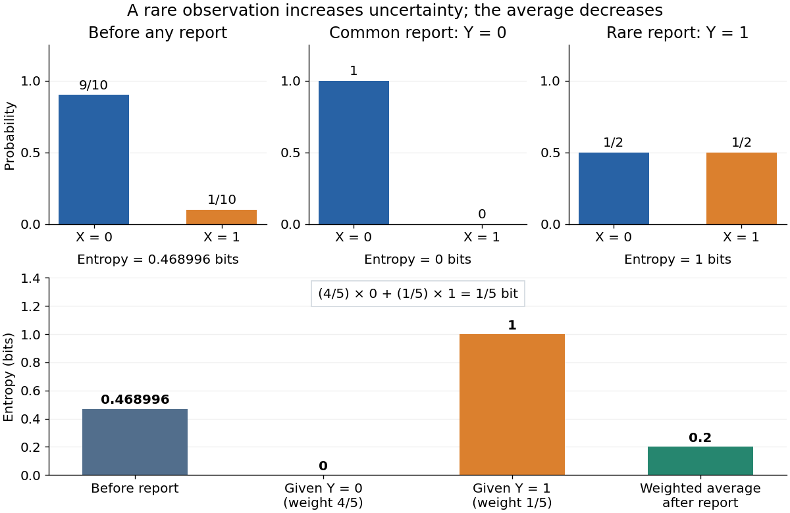

**[Figure 2](#image-a-rare-report-raises-entropy-although-the-weighted-average-falls). A rare report raises entropy although the weighted average falls**.

#### Independent revelation of a binary variable

↑ **Parent:** [Conditioning reduces entropy](#conditioning-reduces-entropy)

Let $X$ be a [Bernoulli random variable](discrete-probability-distribution.md#bernoulli-distribution) with $\Pr(X=1)=p$. Independently of $X$, a [Bernoulli random variable](discrete-probability-distribution.md#bernoulli-distribution) $R$ with $\Pr(R=1)=r$ decides whether to reveal it:

$$
Y=\begin{cases}X,&R=1,\\\bot,&R=0.\end{cases}
$$

The symbol $\bot$ means “hidden” and is distinct from both binary states. This is a [binary erasure channel](coding-theory.md#binary-erasure-channel) with erasure [probability](probability-theory.md#probability) $1-r$. The hidden report leaves the [posterior distribution](statistical-inference.md#bayesian-posterior) equal to the [prior distribution](statistical-inference.md#prior-probability), because hiding is independent of the state. Either visible report determines $X$. Weighting these three reports gives the exact [conditional entropy](#conditional-entropy) and [mutual information](#mutual-information):

$$
H(X)=h_2(p),\qquad H(X\mid Y)=(1-r)h_2(p),\qquad I(X;Y)=rh_2(p).
$$

For $p=1/4$ and $r=1/2$, $H(X)=h_2(1/4)=2-(3/4)\log_2 3\approx0.811278$ [bits](#bit), while $H(X\mid Y)=I(X;Y)\approx0.405639$ [bits](#bit). With $r=0$ the report tells us nothing; with $r=1$ it reveals the state completely. If $0<p<1$, every positive reveal [probability](probability-theory.md#probability) makes the conditioning inequality strict. At $p=0$ or $p=1$, the state was already known and every value of $r$ gives equality.

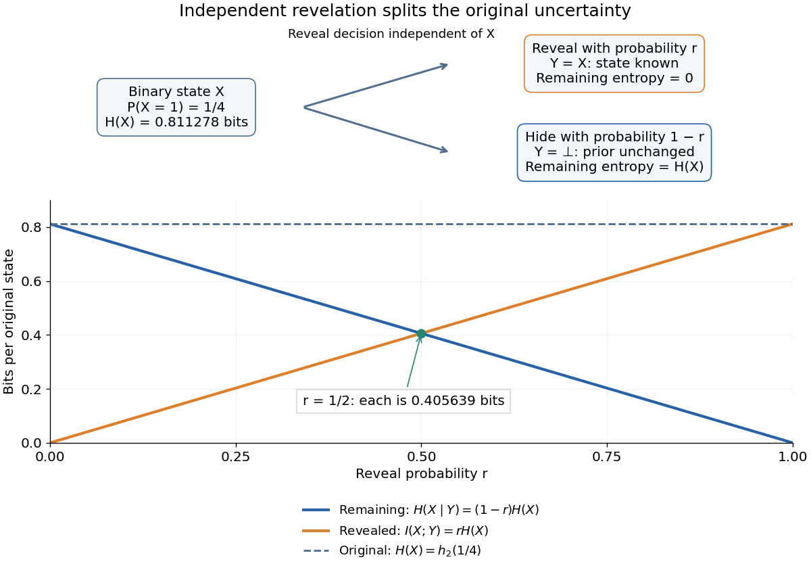

**[Figure 3](#image-independent-revelation-divides-binary-entropy-into-remaining-uncertainty-and-revealed-information). Independent revelation divides binary entropy into remaining uncertainty and revealed information**.

For a [Bayesian inference](statistical-inference.md#bayesian-statistics) problem, this model distinguishes an uninformative missing report from a decisive observed state. If hiding depended on $X$, even $Y=\bot$ could carry [mutual information](#mutual-information), and the displayed calculation would change. In [lossless source coding](#lossless-source-coding), suppose both [encoder](coding-theory.md#channel-encoder) and [decoder](coding-theory.md#channel-decoder) already know the reveal pattern for repeated [independent and identically distributed](random-variable.md#independent-and-identically-distributed-random-variables) pairs. Only the hidden states require descriptions. Applying [Shannon's source coding theorem](coding-theory.md#shannon-s-source-coding-theorem) to those states gives an asymptotic average rate $(1-r)h_2(p)$ [bits](#bit) per original state. A single hidden state need not have a [codeword](coding-theory.md#codeword) of that fractional length.

The reveal pattern itself has [information entropy](#information-entropy) $H(R)=h_2(r)$. If that pattern must also be sent, the [chain rule for information entropy](#chain-rule-for-information-entropy) gives $H(R,X)=h_2(r)+h_2(p)$, since $R$ and $X$ are [independent random variables](random-variable.md#independent-random-variables). Equivalently, $H(Y)=h_2(r)+rh_2(p)$ and $H(X,Y)=H(Y)+H(X\mid Y)=h_2(r)+h_2(p)$. Thus a saving in the description of $X$ given $Y$ assumes that $Y$ is already available; it is not a free saving in the description of the whole pair.

#### Additional conditioning reduces entropy

↑ **Parent:** [Conditioning reduces entropy](#conditioning-reduces-entropy)

For finite [discrete random variables](random-variable.md#discrete-random-variable) $X,Y,Z$, retaining $Y$ and also observing $Z$ gives

$$
H(X\mid Y)-H(X\mid Y,Z)=I(X;Z\mid Y)\geq0.
$$

Equality means [conditional independence](random-variable.md#conditional-independence) of $X$ and $Z$ given $Y$. Both sides average over reports; the additional observation is retained alongside $Y$.[Definition 2.4 and Theorem 2.5(1), printed pp. 26–27](mathematics-bibliography.md#6-441-information-theory-spring-2016-lecture-notes-by-yury-polyanskiy-and-others/chapter-2-information-measures-mutual-information)

A short proof of the original inequality uses [Kullback-Leibler divergence](probability-and-statistics.md#kullback-leibler-divergence):

$$
H(X)-H(X\mid Y)=I(X;Y)=\sum_{y:p_Y(y)>0}p_Y(y)D(p_{X\mid Y=y}\Vert p_X)\geq0.
$$

[Gibbs inequality](probability-and-statistics.md#gibbs-inequality) makes each term nonnegative, vanishing exactly when $p_{X\mid Y=y}=p_X$: [independence](random-variable.md#independent-random-variables) for every possible report. Applying this within each $Y=y$ and averaging proves the additional-conditioning inequality.[Theorem 2.1, printed p. 20; Theorem 2.3(1,3), printed p. 23; Theorem 2.4(2) and Corollary 2.4, printed p. 24](mathematics-bibliography.md#6-441-information-theory-spring-2016-lecture-notes-by-yury-polyanskiy-and-others/chapter-2-information-measures-mutual-information)

#### Conditioning and differential entropy

↑ **Parent:** [Conditioning reduces entropy](#conditioning-reduces-entropy)

With appropriate [probability density functions](continuous-probability-distribution.md#probability-density-function) and finite [differential entropies](#differential-entropy), $h(X)-h(X\mid Y)=I(X;Y)\geq0$, with equality iff [independence](random-variable.md#independent-random-variables). [Differential entropy](#differential-entropy) does not reverse the inequality; infinite or undefined quantities cannot justify subtraction.[Theorem 2.4(3), printed p. 24: density and finiteness hypotheses for the differential-entropy identity](mathematics-bibliography.md#6-441-information-theory-spring-2016-lecture-notes-by-yury-polyanskiy-and-others/chapter-2-information-measures-mutual-information)

However, [differential entropy](#differential-entropy) can be negative and depends on the choice of coordinates. For $X$ with a [uniform distribution](continuous-probability-distribution.md#continuous-uniform-distribution) on an interval of length $a>0$, $h(X)=\log_2a$; in particular $a=1/2$ gives $-1$. Rescaling $X$ by a constant $c>0$ adds $\log_2c$ to both $h(X)$ and $h(X\mid Y)$, whenever they are finite, leaving the [mutual information](#mutual-information) unchanged.[pp. 37–38: coordinate dependence, negative entropy, and linear rescaling](mathematics-bibliography.md#a-mathematical-theory-of-communication-by-claude-shannon)

If a continuously distributed $X$ is revealed exactly, its [conditional distribution](probability-theory.md#conditional-distribution) is a [Dirac measure](measure-theory.md#dirac-measure) with no ordinary [probability density function](continuous-probability-distribution.md#probability-density-function). The discrete identity $H(X\mid X)=0$ has no finite [differential entropy](#differential-entropy) counterpart. [Mutual information](#mutual-information), defined through [relative entropy](probability-and-statistics.md#kullback-leibler-divergence), is infinite here.[Theorem 2.4(1) and its proof, printed p. 24: I(X;X) is infinite for a non-discrete distribution](mathematics-bibliography.md#6-441-information-theory-spring-2016-lecture-notes-by-yury-polyanskiy-and-others/chapter-2-information-measures-mutual-information)

<h3 id="fano-s-inequality">Fano's inequality</h3>

↑ **Parent:** [Conditional entropy](#conditional-entropy)  
ⓦ [Wiki](https://en.wikipedia.org/wiki/Fano's_inequality)

Fano's inequality turns remaining uncertainty into a constraint on decision errors. If an observation leaves many plausible answers, a [decoder](coding-theory.md#channel-decoder) cannot usually recover the answer reliably. Its elegant idea is to separate two uncertainties: whether the guess was wrong, and which alternative was correct when it was wrong.

Let $X,Y$ be [discrete random variables](random-variable.md#discrete-random-variable), with $X$ taking values in a finite [alphabet](#alphabet) $\mathcal X$ of [cardinality](set-theory.md#cardinality) $M\geq2$. Choose any deterministic [decoder](coding-theory.md#channel-decoder) $\widehat X=f(Y)$ whose output lies in $\mathcal X$, and define its average error [probability](probability-theory.md#probability) $p_e=\mathbb P\{\widehat X\ne X\}$. With base-two [logarithms](calculus.md#logarithm), [Fano's inequality](#fano-s-inequality) states

$$
H(X\mid Y)\leq h_2(p_e)+p_e\log_2(M-1),\qquad 0\leq p_e\leq1.
$$

Here $H(X\mid Y)$ is [conditional entropy](#conditional-entropy) and $h_2$ is [binary entropy](#binary-entropy), with $0\log_2 0=0$ at the endpoints. Both sides are measured in [bits](#bit); using [natural logarithms](calculus.md#natural-logarithm) throughout gives the same inequality in [nats](#nat-unit). No uniform source, independence of $X,Y$, or optimality of the [decoder](coding-theory.md#channel-decoder) is assumed. Requiring its output to belong to the same [alphabet](#alphabet) is what leaves at most $M-1$ alternatives after an error.[Polyanskiy and Wu, MIT 6.441 course notes, Section 5.3, Theorem 5.3](mathematics-bibliography.md#6-441-information-theory-spring-2016-lecture-notes-by-yury-polyanskiy-and-others)

For an exact toy example, give $X$ the [discrete uniform distribution](discrete-probability-distribution.md#discrete-uniform-distribution) on $\{A,B,C,D\}$. A [channel](#communication-channel) reports $Y=X$ with [probability](probability-theory.md#probability) $1-q$ and reports each of the other three symbols with [probability](probability-theory.md#probability) $q/3$, where $0\leq q\leq1$. Use the [decoder](coding-theory.md#channel-decoder) $f(y)=y$. The output is uniform, and the [conditional probabilities](probability-theory.md#conditional-probability) after any report $y$ are

$$
\mathbb P(X=x\mid Y=y)=
\begin{cases}
1-q,&x=y,\\
q/3,&x\ne y.
\end{cases}
$$

Thus $p_e=q$ and direct calculation of the [conditional entropy](#conditional-entropy) gives

$$
H(X\mid Y)=-(1-q)\log_2(1-q)-3\frac q3\log_2\frac q3
=h_2(q)+q\log_2 3.
$$

This is equality in [Fano's inequality](#fano-s-inequality) for every $q\in[0,1]$. At $q=0.3$, each report leaves [probabilities](probability-theory.md#probability) $(0.7,0.1,0.1,0.1)$, up to their order, and $H(X\mid Y)\approx1.3568$ [bits](#bit). The two contributions are $h_2(0.3)\approx0.8813$ [bits](#bit) for the error flag and $0.3\log_2 3\approx0.4755$ [bits](#bit) for identifying the correct alternative after an error. These are theoretical [probabilities](probability-theory.md#probability), not measured data.

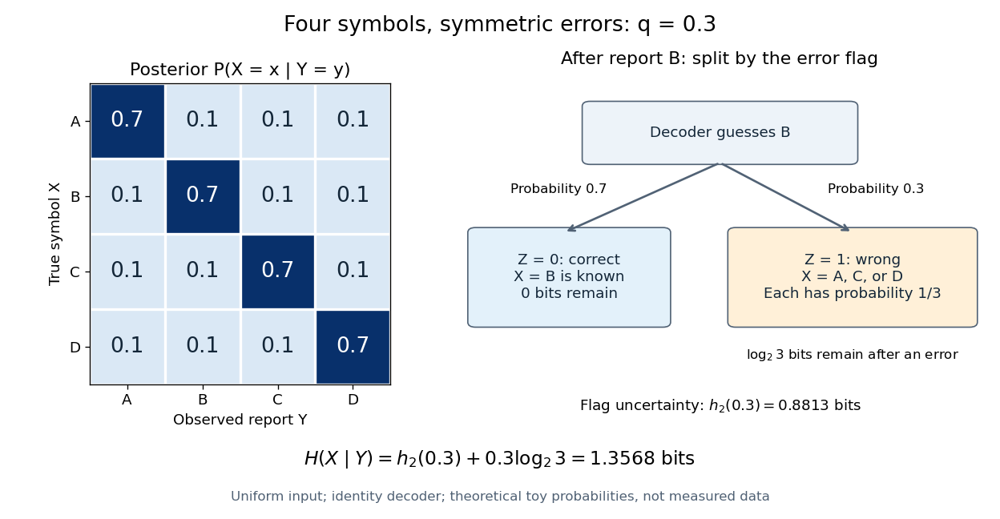

**[Figure 4](#image-a-symmetric-four-symbol-toy-channel-makes-every-step-of-fano-s-bound-an-equality). A symmetric four-symbol toy channel makes every step of Fano's bound an equality**.

The identity [decoder](coding-theory.md#channel-decoder) in this example minimizes error only for $0\leq q\leq3/4$: its guessed symbol has the largest [posterior probability](statistical-inference.md#posterior-probability) exactly when $1-q\geq q/3$. At $q=3/4$, $X,Y$ are [independent random variables](random-variable.md#independent-random-variables) and all four guesses tie. For $q>3/4$, guessing any one of the three other symbols has error [probability](probability-theory.md#probability) $1-q/3<q$. Equality in [Fano's inequality](#fano-s-inequality) therefore does not certify an optimal [decoder](coding-theory.md#channel-decoder).

For usefulness, combine $h_2(p_e)\leq1$ with $\log_2(M-1)\leq\log_2 M$ to obtain the simpler consequence

$$
p_e\geq\max\!\left\{0,\frac{H(X\mid Y)-1}{\log_2 M}\right\}.
$$

For a uniform $X$, $H(X\mid Y)=\log_2 M-I(X;Y)$, so this becomes $p_e\geq\max\{0,1-(I(X;Y)+1)/\log_2 M\}$. This connects [mutual information](#mutual-information) to unavoidable decision error in [channel coding](coding-theory.md#channel-coding) or [classification in statistical learning](statistical-learning.md#classification-in-statistical-learning); it can rule out reliable recovery regardless of the chosen [decoder](coding-theory.md#channel-decoder).[Weissman, Ochoa and Tatwawadi, EE376A course notes, Sections 5.7–5.8](https://web.stanford.edu/class/ee376a/files/lecture_notes.pdf)

The sharper right-hand side $F_M(p)=h_2(p)+p\log_2(M-1)$ increases from zero to $\log_2 M$ on $0\leq p\leq1-1/M$, then decreases: in the interior, $F_M'(p)=\log_2((M-1)(1-p)/p)$. When interpreting the inequality by inverting a curve, use its increasing branch to obtain a lower error threshold. A [decoder](coding-theory.md#channel-decoder) that chooses a largest [posterior probability](statistical-inference.md#posterior-probability), as in [maximum a posteriori decoding](coding-theory.md#maximum-a-posteriori-decoding), always has $p_e\leq1-1/M$, since the largest of $M$ conditional [probabilities](probability-theory.md#probability) is at least $1/M$. Arbitrary [decoders](coding-theory.md#channel-decoder) can have larger error. In particular, low [conditional entropy](#conditional-entropy) does not force every [decoder](coding-theory.md#channel-decoder) to work well: with a fair binary $X$ and $Y=X$, the rule $f(Y)=1-Y$ has $p_e=1$ even though $H(X\mid Y)=0$. [Fano's inequality](#fano-s-inequality) supplies a constraint, not an exact error prediction for each rule.

<h4 id="fano-s-inequality-via-an-error-indicator">Fano's inequality via an error indicator</h4>

↑ **Parent:** [Fano's inequality](#fano-s-inequality)

Under the hypotheses of [Fano's inequality](#fano-s-inequality), let $J_X=\mathcal X$, $M=|J_X|$, and let $Z=\mathbf1_{\{X\ne f(Y)\}}$ be the [indicator random variable](probability-theory.md#indicator-random-variable) of an error. Its [probability](probability-theory.md#probability) of being one is $p_e$. The $h$ in the displayed bound denotes [binary entropy](#binary-entropy) $h_2$ in [bits](#bit). Since $Z$ is a deterministic [function](function.md) of $(X,Y)$, $H(Z\mid X,Y)=0$. Applying the [chain rule for conditional entropy](#chain-rule-for-conditional-entropy) in both orders gives the exact decomposition

$$
\begin{aligned}
H(X\mid Y)
&=H(X,Z\mid Y)\\
&=H(Z\mid Y)+H(X\mid Z,Y).
\end{aligned}
$$

The first term is bounded by $H(Z)=h_2(p_e)$, because [conditioning reduces entropy](#conditioning-reduces-entropy). For the second term, fix a report $Y=y$: if $Z=0$, then $X=f(y)$ is known; if $Z=1$, then $X$ lies among at most $M-1$ other symbols. [Maximum entropy on a finite alphabet](#maximum-entropy-on-a-finite-alphabet) bounds the latter uncertainty by $\log_2(M-1)$. Averaging over the reports and the error flag gives

$$
H(X\mid Z,Y)\leq(1-p_e)\cdot0+p_e\log_2(M-1).
$$

This proves [Fano's inequality](#fano-s-inequality). Events of zero [probability](probability-theory.md#probability) contribute zero to this average, so the proof also covers $p_e=0,1$ without assigning a conditional distribution to an impossible event.[Weissman, Ochoa and Tatwawadi, EE376A course notes, Section 5.7, proof of Theorem 46](https://web.stanford.edu/class/ee376a/files/lecture_notes.pdf)

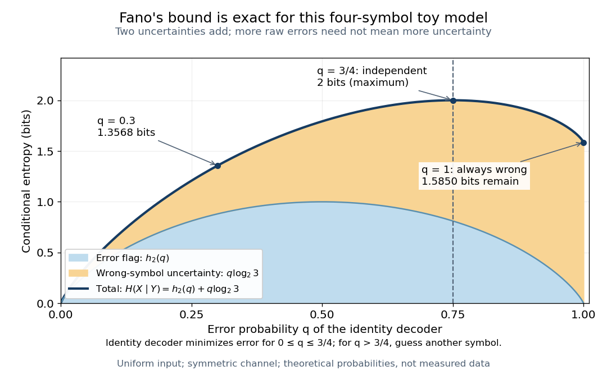

**[Figure 5](#image-the-four-symbol-entropy-budget-peaks-at-chance-level-error-and-separates-the-error-flag-from-the-three-alternatives). The four-symbol entropy budget peaks at chance-level error and separates the error flag from the three alternatives**.

The decomposition also explains equality. The first bound is exact when the [indicator random variable](probability-theory.md#indicator-random-variable) $Z$ and $Y$ are [independent random variables](random-variable.md#independent-random-variables): knowing the report does not change the error [probability](probability-theory.md#probability). The second is exact when, for every report with positive error [probability](probability-theory.md#probability), the wrong-symbol [conditional distribution](probability-theory.md#conditional-distribution) is uniform on all $M-1$ alternatives. Both conditions hold in the four-symbol toy [channel](#communication-channel) of [Fano's inequality](#fano-s-inequality). At $q=0$, the second condition is vacuous; at $q=1$, the flag is constant but three alternatives remain, giving $H(X\mid Y)=\log_2 3$. For $M=2$, there is just one alternative after an error, so the second term vanishes: all remaining uncertainty is whether the single alternative must replace the guess.

#### List-decoding Fano inequality

↑ **Parent:** [Fano's inequality](#fano-s-inequality)

If a uniform index $J$ has $N$ possibilities and every proposed success neighbourhood contains at most $B<N$ possibilities, then any estimator has failure [probability](probability-theory.md#probability) at least the displayed expression. Condition on its success indicator: [conditional entropy](#conditional-entropy) is at most $\log2+(1-p_e)\log B+p_e\log N$. Subtract this from $\log N$ to bound the [mutual information](#mutual-information) and rearrange. A metric [Hamming ball](coding-theory.md#hamming-ball) gives approximate recovery rather than exact index decoding.

### Entropy of a sum of independent finite-group variables

↑ **Parent:** [Conditional entropy](#conditional-entropy)

If [independent random variables](random-variable.md#independent-random-variables) $X,Y$ take values in a [finite additive group](group.md#finite-additive-group), then

$$
H(X+Y)\geq\max\{H(X),H(Y)\}.
$$

Indeed, $H(X+Y)\geq H(X+Y\mid Y)=H(X)$, and symmetrically for $Y$. Independence is essential: taking $Y=-X$ makes the sum constant.

## Mutual information

↑ **Parent:** [Information theory](information-theory.md)  
ⓦ [Wiki](https://en.wikipedia.org/wiki/Mutual_information)

For finite [discrete random variables](random-variable.md#discrete-random-variable), mutual information is the reduction of [information entropy](#information-entropy) provided by observing the other variable:

$$
I(X;Y)=H(Y)-H(Y\mid X)
=H(X)+H(Y)-H(X,Y).
$$

The last expression makes the symmetry $I(X;Y)=I(Y;X)$ visible. It is nonnegative and is zero exactly when $X$ and $Y$ are [independent random variables](random-variable.md#independent-random-variables). One way to see both facts is

$$
I(X;Y)=\sum_{x,y:p(x,y)>0}p(x,y)\log_2\frac{p(x,y)}{p_X(x)p_Y(y)}
=D(p_{X,Y}\Vert p_Xp_Y),
$$

where $D$ is the [Kullback-Leibler divergence](probability-and-statistics.md#kullback-leibler-divergence) with base-two [logarithms](calculus.md#logarithm). The [Gibbs inequality](probability-and-statistics.md#gibbs-inequality) gives nonnegativity; equality means that the joint [probability distribution](probability-theory.md#probability-distribution) factors. The statement extends to more general distributions via [relative entropy](probability-and-statistics.md#kullback-leibler-divergence), but differences of infinite [information entropies](#information-entropy) must not be used as if they were finite numbers.

A [binary symmetric channel](coding-theory.md#binary-symmetric-channel) gives a useful example. Let $X$ be a fair [bit](#bit), let $N$ be an [independent](random-variable.md#independent-random-variables) [Bernoulli random variable](discrete-probability-distribution.md#bernoulli-distribution) with error [probability](probability-theory.md#probability) $q$, and set $Y=X\oplus N$, where $\oplus$ is [exclusive or](computer-science.md#exclusive-or). The output is also a fair [bit](#bit), but knowing the input leaves just the error uncertainty:

$$
H(Y)=1,\qquad H(Y\mid X)=h_2(q),\qquad I(X;Y)=1-h_2(q).
$$

Here $h_2$ is [binary entropy](#binary-entropy). At $q=0.1$, $h_2(q)\approx0.469$, so the output carries about $0.531$ [bits](#bit) of [mutual information](#mutual-information) about the input per use. This is an average uncertainty reduction, not a claim that each observed symbol can be divided into fractional physical [bits](#bit).

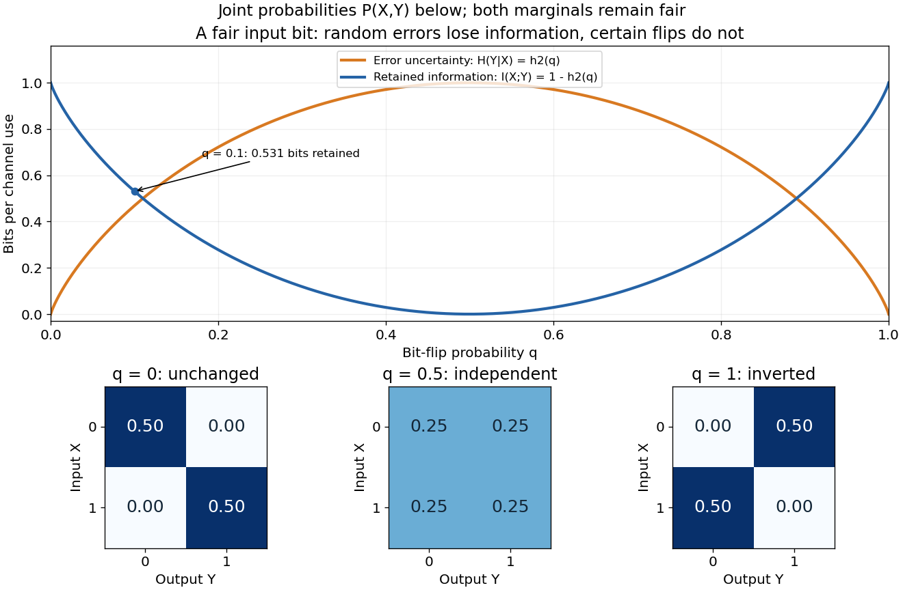

**[Figure 6](#image-binary-entropy-and-retained-information-distinguish-noisy-transmission-from-predictable-bit-inversion). Binary entropy and retained information distinguish noisy transmission from predictable bit inversion**.

At $q=1/2$, every output is equally likely for either input, so $I(X;Y)=0$. At $q=1$, the output is always the inverted input: knowing this rule lets the receiver recover the input exactly, so $I(X;Y)=1$ again. A high raw error rate need not mean low [mutual information](#mutual-information) when the errors are predictable. For this particular channel the fair input is optimal, giving the [binary symmetric channel capacity](#binary-symmetric-channel-capacity) $1-h_2(q)$.

[Mutual information](#mutual-information) detects dependence that ordinary [correlation](variance.md#pearson-correlation-coefficient) can miss. Let $X$ be uniform on $\{-1,0,1\}$ and $Y=X^2$. Symmetry gives $\mathbb E[X]=\mathbb E[XY]=0$, hence zero [covariance](variance.md#covariance) and zero [correlation](variance.md#pearson-correlation-coefficient), while $Y$ is completely determined by $X$. Thus $I(X;Y)=H(Y)=h_2(1/3)>0$. This distinction is useful whenever a relationship is nonlinear: knowing one variable can reveal another without a linear trend.

### Entropy submodularity

↑ **Parent:** [Mutual information](#mutual-information)

For discrete [random variables](random-variable.md) $X,Y,Z$,

$$
H(X,Y)+H(Y,Z)\geq H(Y)+H(X,Y,Z).
$$

The difference between the left- and right-hand sides is the nonnegative [conditional mutual information](#conditional-mutual-information) $I(X;Z\mid Y)$.

#### Compression of an entropy sum

↑ **Parent:** [Entropy submodularity](#entropy-submodularity)

A [union-intersection compression](extremal-set-theory.md#union-intersection-compression) can only decrease the sum of [information entropies](#information-entropy) $\sum_{A\in\mathcal A}H(X_A)$ for a finite-valued [random vector](random-variable.md#random-vector) $X$. Each elementary step follows from [entropy submodularity](#entropy-submodularity); iteration proves the assertion with [multiset](set.md#multiset) multiplicities. Uniform coordinate multiplicity gives [Shearer inequality](#shearer-s-inequality) by compressing to repeated full sets and empty sets.

<h5 id="balister-bollobas-entropy-inequality">Balister–Bollobás entropy inequality</h5>

↑ **Parent:** [Compression of an entropy sum](#compression-of-an-entropy-sum)

Let $\mathcal A$ be a finite multiset of subsets and let $r_i$ count its occurrences of coordinate $i$. Its nested compression consists of $L_j=\{i:r_i\geq j\}$. Then $\sum_jH(X_{L_j})\leq\sum_{A\in\mathcal A}H(X_A)$, by repeated [entropy submodularity](#entropy-submodularity). This is the compression formulation in [Balister and Bollobás, "Projections, Entropy and Sumsets"](https://arxiv.org/abs/0711.1151).

<h6 id="madiman-tetali-entropy-inequality">Madiman–Tetali entropy inequality</h6>

↑ **Parent:** [Balister–Bollobás entropy inequality](#balister-bollobas-entropy-inequality)

For a nonempty ordered coordinate set $A$, write $A^-=[\min A-1]$ and $A^+=[\max A-1]\setminus A$. An exact $k$-cover satisfies $\sum_AH(X_A\mid X_{A^+})\leq kH(X)\leq\sum_AH(X_A\mid X_{A^-})$. A short proof uses the [chain rule for information entropy](#chain-rule-for-information-entropy) contributions $h_i=H(X_i\mid X_{[i-1]})$: each conditional subset entropy bounds $\sum_{i\in A}h_i$ on the appropriate side, by [conditioning reduces entropy](#conditioning-reduces-entropy). Weighting gives the lower inequality for a fractional packing and the upper inequality for a fractional cover. See [Madiman and Tetali, "Information Inequalities for Joint Distributions"](https://arxiv.org/abs/0901.0044).

<h4 id="shearer-s-inequality">Shearer's inequality</h4>

↑ **Parent:** [Entropy submodularity](#entropy-submodularity)  
ⓦ [Wiki](https://en.wikipedia.org/wiki/Shearer's_inequality)

Let $X=(X_1,\ldots,X_n)$ be a discrete [random vector](random-variable.md#random-vector), and let $\mathcal S$ be a collection of subsets of $[n]$ in which every index occurs at least $r$ times. Then

$$
rH(X)\leq\sum_{S\in\mathcal S}H(X_S).
$$

Apply the [chain rule for information entropy](#chain-rule-for-information-entropy) to each projection $X_S$ and use [conditioning reduces entropy](#conditioning-reduces-entropy) to compare every term with the corresponding conditional entropy in the full chain rule.

##### Entropy bound for graphs with isolated-vertex-free intersections

↑ **Parent:** [Shearer's inequality](#shearer-s-inequality)

If every pair of [graphs](graph.md) in a family on $[n]$ has a [graph intersection](graph-theory.md#graph-intersection) without an [isolated vertex](graph-theory.md#isolated-vertex), the family has at most $2^{n(n-2)/2}$ members. At each [vertex](graph.md#vertex-graph-theory), its possible [graph neighbourhoods](graph-theory.md#graph-neighbourhood) form an [intersecting family](extremal-set-theory.md#intersecting-family), of size at most $2^{n-2}$. Every [edge](graph-theory.md#edge-of-a-graph) occurs in two such neighbourhood projections. [Shearer inequality](#shearer-s-inequality) bounds twice the full [information entropy](#information-entropy) by the sum of their [information entropies](#information-entropy).

### Conditional mutual information

↑ **Parent:** [Mutual information](#mutual-information)  
ⓦ [Wiki](https://en.wikipedia.org/wiki/Conditional_mutual_information)

For finite [discrete random variables](random-variable.md#discrete-random-variable), conditional mutual information measures the average reduction in uncertainty about $X$ from observing $Y$, when $Z$ is already known. With base-two [logarithms](calculus.md#logarithm), it is measured in [bits](#bit):

$$
I(X;Y\mid Z)=H(X\mid Z)-H(X\mid Y,Z)
=H(X\mid Z)+H(Y\mid Z)-H(X,Y\mid Z).
$$

The second expression follows from the [chain rule for conditional entropy](#chain-rule-for-conditional-entropy) and makes the symmetry in $X,Y$ visible. Equivalently, compute the [mutual information](#mutual-information) separately in each conditional [probability distribution](probability-theory.md#probability-distribution) and then average:

$$
\begin{aligned}
I(X;Y\mid Z)
&=\sum_{z:p_Z(z)>0}p_Z(z)I(X;Y\mid Z=z)\\
&=\sum_{z:p_Z(z)>0}p_Z(z)
D\!\left(p_{X,Y\mid z}\,\middle\Vert\,p_{X\mid z}p_{Y\mid z}\right)\\
&=\sum_{x,y,z:p(x,y,z)>0}p(x,y,z)
\log_2\frac{p(x,y\mid z)}{p(x\mid z)p(y\mid z)}.
\end{aligned}
$$

Here $D$ is the [Kullback-Leibler divergence](probability-and-statistics.md#kullback-leibler-divergence), also computed with base-two [logarithms](calculus.md#logarithm); zero-probability terms contribute zero. The [Gibbs inequality](probability-and-statistics.md#gibbs-inequality) gives $I(X;Y\mid Z)\geq0$, with equality exactly when $X$ and $Y$ have [conditional independence](random-variable.md#conditional-independence) given $Z$: the conditional joint [probability mass function](probability-theory.md#probability-mass-function) factors for every $z$ of positive [probability](probability-theory.md#probability).[Definition 2.4 and Theorem 2.5(1)](mathematics-bibliography.md#6-441-information-theory-spring-2016-lecture-notes-by-yury-polyanskiy-and-others/chapter-2-information-measures-mutual-information)

For a fully computed example, take [independent random variables](random-variable.md#independent-random-variables) $X,Y$ that are fair [bits](#bit), and let $Z=X\oplus Y$, where $\oplus$ is [exclusive or](computer-science.md#exclusive-or). The complete joint [probability distribution](probability-theory.md#probability-distribution) has only these four positive entries:

| $X$ | $Y$ | $Z=X\oplus Y$ | $p(x,y,z)$ |
| --- | --- | --- | --- |
| $0$ | $0$ | $0$ | $1/4$ |
| $0$ | $1$ | $1$ | $1/4$ |
| $1$ | $0$ | $1$ | $1/4$ |
| $1$ | $1$ | $0$ | $1/4$ |

Every pair $(x,y)$ has [probability](probability-theory.md#probability) $1/4=p_X(x)p_Y(y)$, so $I(X;Y)=4(1/4)\log_2 1=0$. But $p_Z(0)=p_Z(1)=1/2$. Given $Z=0$, the pairs $(0,0),(1,1)$ each have conditional [probability](probability-theory.md#probability) $1/2$, while both conditional marginals are fair. Thus

$$
I(X;Y\mid Z=0)
=\frac12\log_2\frac{1/2}{(1/2)(1/2)}
+\frac12\log_2\frac{1/2}{(1/2)(1/2)}=1.
$$

Given $Z=1$, the pairs $(0,1),(1,0)$ give the same calculation. Therefore

$$
I(X;Y\mid Z)=\frac12\cdot1+\frac12\cdot1=1.
$$

The [conditional entropy](#conditional-entropy) calculation tells the same story: $H(X\mid Z)=1$ because either value of $Z$ leaves $X$ fair, whereas $H(X\mid Y,Z)=0$ because $X=Y\oplus Z$. Learning the [exclusive or](computer-science.md#exclusive-or) does not reveal either [bit](#bit) alone; it reveals whether they agree, so learning one then determines the other.

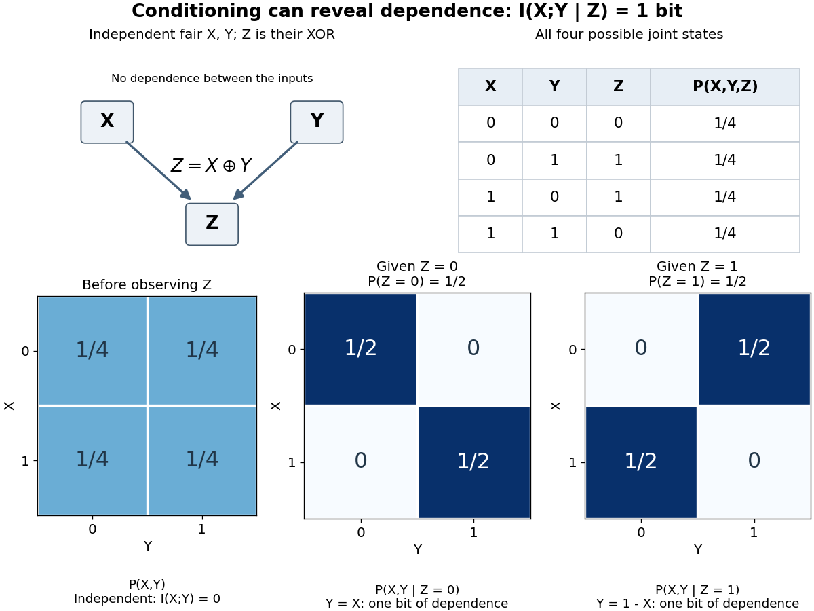

**[Figure 7](#image-conditioning-on-the-exclusive-or-reveals-one-bit-of-dependence-between-independent-fair-bits). Conditioning on the exclusive or reveals one bit of dependence between independent fair bits**.

This example distinguishes [conditional independence](random-variable.md#conditional-independence) from ordinary [independence](random-variable.md#independent-random-variables). It also disproves the claim that conditioning always reduces [mutual information](#mutual-information), despite [conditioning reduces entropy](#conditioning-reduces-entropy). There is no general ordering between $I(X;Y\mid Z)$ and $I(X;Y)$: the example above increases it from zero to one, while taking $Y=X$ and $Z=X$ for a fair [bit](#bit) decreases it from one to zero. The [chain rule for mutual information](#chain-rule-for-mutual-information) explains why both are possible.[Theorem 2.5](mathematics-bibliography.md#6-441-information-theory-spring-2016-lecture-notes-by-yury-polyanskiy-and-others/chapter-2-information-measures-mutual-information)

[Conditional mutual information](#conditional-mutual-information) is useful for asking whether an additional observation tells us anything after information already available has been accounted for. Its zero case expresses [conditional independence](random-variable.md#conditional-independence) exactly; in a [Markov chain](markov-process.md#markov-chain), this is the step that turns the [chain rule for mutual information](#chain-rule-for-mutual-information) into the [data processing inequality](#data-processing-inequality).

### Chain rule for mutual information

↑ **Parent:** [Mutual information](#mutual-information)

For finite [discrete random variables](random-variable.md#discrete-random-variable), the [mutual information](#mutual-information) supplied by two observations equals the information supplied by the first plus the additional [conditional mutual information](#conditional-mutual-information) supplied by the second:

$$
\begin{aligned}
I(X;Y,Z)&=I(X;Y)+I(X;Z\mid Y)\\
&=I(X;Z)+I(X;Y\mid Z).
\end{aligned}
$$

The order changes the individual contributions but leaves the total unchanged.[Stanford EE376A/STATS376A, Lecture 3, Definition 7 and equations (48)–(51)](https://web.stanford.edu/class/ee376a/files/lecture_3.pdf) To prove the first identity, add and subtract the intermediate [conditional entropy](#conditional-entropy):

$$
\begin{aligned}
I(X;Y,Z)&=H(X)-H(X\mid Y,Z)\\
&=\bigl[H(X)-H(X\mid Y)\bigr]
+\bigl[H(X\mid Y)-H(X\mid Y,Z)\bigr].
\end{aligned}
$$

With base-two [logarithms](calculus.md#logarithm), all contributions are in [bits](#bit). Repeatedly inserting intermediate [conditional entropies](#conditional-entropy) makes them cancel, as in a [telescoping series](real-analysis.md#telescoping-series), and gives the rule for any finite list of observations:

$$
I(X;Y_1,\ldots,Y_n)=\sum_{j=1}^{n}I(X;Y_j\mid Y_1,\ldots,Y_{j-1}),
$$

where the $j=1$ term is $I(X;Y_1)$. The same calculation with $W$ already known gives $I(X;Y,Z\mid W)=I(X;Y\mid W)+I(X;Z\mid Y,W)$.

For the fair-[bit](#bit) [exclusive or](computer-science.md#exclusive-or) example in [conditional mutual information](#conditional-mutual-information), observing $Y$ alone tells nothing about $X$, but observing $Z$ after $Y$ tells everything:

$$
I(X;Y,Z)=I(X;Y)+I(X;Z\mid Y)=0+(1-0)=1.
$$

Here $H(X\mid Y)=1$ by [independence](random-variable.md#independent-random-variables) and $H(X\mid Y,Z)=0$ because $X=Y\oplus Z$. In the reverse order, $H(X\mid Z)=1$, so $I(X;Z)=0$ and $I(X;Y\mid Z)=1$: the two observations are individually uninformative but jointly reveal one [bit](#bit). Simply adding their separate [mutual informations](#mutual-information) would miss all of it.

The chain rule is useful for measuring the value of each new observation without double counting information already supplied. It also guarantees $I(X;Y,Z)\geq I(X;Y)$ by nonnegativity of [conditional mutual information](#conditional-mutual-information). Keeping $Y$ and adding $Z$ can help, even though discarding $Y$ and retaining only a processed $Z$ is constrained by the [data processing inequality](#data-processing-inequality). Equating the two observation orders gives the precise identity

$$
I(X;Y\mid Z)-I(X;Y)=I(X;Z\mid Y)-I(X;Z),
$$

which explains why there is no general rule that conditioning decreases [mutual information](#mutual-information).

### Data processing inequality

↑ **Parent:** [Mutual information](#mutual-information)  
ⓦ [Wiki](https://en.wikipedia.org/wiki/Data_processing_inequality)

For finite [discrete random variables](random-variable.md#discrete-random-variable), suppose $X\to Y\to Z$ is a [Markov chain](markov-process.md#markov-chain): the final [channel](#communication-channel) uses only $Y$, so $X$ and $Z$ have [conditional independence](random-variable.md#conditional-independence) given $Y$. In terms of the joint [probability mass function](probability-theory.md#probability-mass-function),

$$
p(x,y,z)=p_X(x)p(y\mid x)p(z\mid y),
$$

and hence $I(X;Z\mid Y)=0$. Then the two data processing inequalities are

$$
I(X;Z)\leq I(X;Y),
\qquad
I(X;Z)\leq I(Y;Z).
$$

All [mutual informations](#mutual-information) here use base-two [logarithms](calculus.md#logarithm). Thus deterministic or randomized processing cannot increase the information shared with an unprocessed variable.[Stanford CS229T/STATS231, Theorem 2.1 and its chain-rule proof](https://web.stanford.edu/class/cs229t/scribe_notes/12_05_final.pdf)

For a concrete cascade, take a fair [bit](#bit) $X$ and [Bernoulli random variables](discrete-probability-distribution.md#bernoulli-distribution) $N_q,N_r$ with [probabilities](probability-theory.md#probability) $q=0.1$, $r=0.2$ of being one. Assume $X,N_q,N_r$ are jointly [independent random variables](random-variable.md#independent-random-variables), and pass through two [binary symmetric channels](coding-theory.md#binary-symmetric-channel):

$$
Y=X\oplus N_q,\qquad Z=Y\oplus N_r.
$$

The second noise is independent of both $X$ and $Y$, so this is a [Markov chain](markov-process.md#markov-chain). Both $Y$ and $Z$ are fair [bits](#bit). The net [exclusive or](computer-science.md#exclusive-or) error is one exactly when one noise flips the [bit](#bit) and the other does not:

$$
s=\mathbb P(N_q\oplus N_r=1)
=q(1-r)+(1-q)r=q+r-2qr=0.26.
$$

Using the [binary entropy](#binary-entropy) $h_2(t)=-t\log_2t-(1-t)\log_2(1-t)$, the three [mutual informations](#mutual-information) are fully determined:

$$
\begin{aligned}
I(X;Y)&=1-h_2(0.1)\approx1-0.4689955936\approx0.5310044064,\\
I(Y;Z)&=1-h_2(0.2)\approx1-0.7219280949\approx0.2780719051,\\
I(X;Z)&=1-h_2(0.26)\approx1-0.8267463725\approx0.1732536275.
\end{aligned}
$$

All numbers are in [bits](#bit). The two losses are $I(X;Y\mid Z)\approx0.3577507789$ and $I(Y;Z\mid X)\approx0.1048182776$. Thus the cascade retains less information about the original source than either individual [channel](#communication-channel) shares between its own input and output.

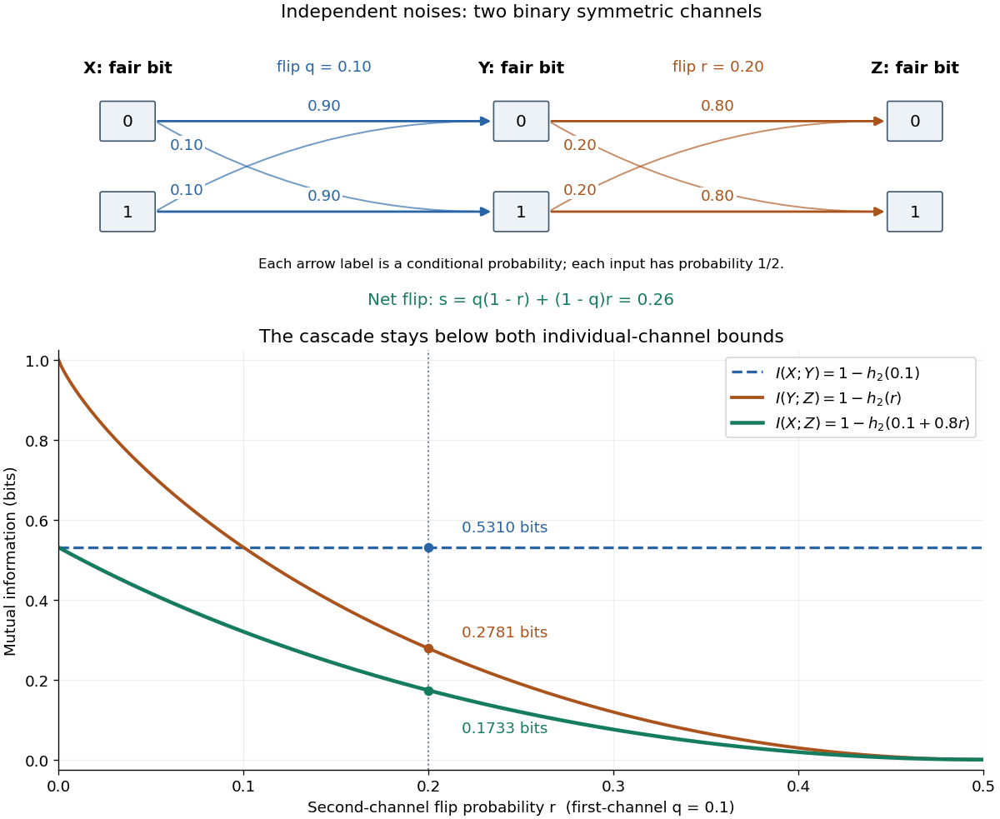

**[Figure 8](#image-two-noisy-binary-channels-compose-to-a-noisier-channel-and-obey-both-data-processing-bounds). Two noisy binary channels compose to a noisier channel and obey both data processing bounds**.

With $q=0.1$ fixed and $0\leq r\leq1/2$, the effective error is $s=0.1+0.8r$. At $r=0$, $Z=Y$ and $I(X;Z)=I(X;Y)$; at $r=1/2$, $Z$ is independent of the previous variables and $I(X;Z)=I(Y;Z)=0$. The diagram plots these endpoints and the computed $r=0.2$ example.

The [data processing inequality](#data-processing-inequality) is useful for testing what a proposed decoder or data summary could possibly reveal: if its only input is $Y$, even randomized processing cannot provide more [mutual information](#mutual-information) about $X$ than $Y$ already contains. The [Markov chain](markov-process.md#markov-chain) hypothesis matters. In the [exclusive or](computer-science.md#exclusive-or) example from [conditional mutual information](#conditional-mutual-information), allowing a processor to use both $Y$ and $Z$ reveals $X$ exactly; that processor has additional input, so the conclusion for processing $Y$ alone does not apply.

The [chain rule for mutual information](#chain-rule-for-mutual-information) proves both inequalities and identifies their exact gaps. First expand the information about $X$ in the two observation orders:

$$
\begin{aligned}
I(X;Y,Z)&=I(X;Y)+\underbrace{I(X;Z\mid Y)}_{0}\\
&=I(X;Z)+I(X;Y\mid Z).
\end{aligned}
$$

Therefore $I(X;Y)-I(X;Z)=I(X;Y\mid Z)\geq0$. Next use $Z$ as the variable being learned:

$$
\begin{aligned}
I(Z;X,Y)&=I(Z;Y)+\underbrace{I(Z;X\mid Y)}_{0}\\
&=I(Z;X)+I(Z;Y\mid X).
\end{aligned}
$$

Symmetry of [mutual information](#mutual-information) gives $I(Y;Z)-I(X;Z)=I(Y;Z\mid X)\geq0$. Both signs follow from the nonnegativity of [conditional mutual information](#conditional-mutual-information); the first gap also gives [equality in data processing inequality](#equality-in-data-processing-inequality).

#### Equality in data processing inequality

↑ **Parent:** [Data processing inequality](#data-processing-inequality)

Under the finite [Markov chain](markov-process.md#markov-chain) hypothesis $X\to Y\to Z$, the gap identity in the [data processing inequality](#data-processing-inequality) gives

$$
I(X;Z)=I(X;Y)\quad\Longleftrightarrow\quad I(X;Y\mid Z)=0.
$$

By the zero criterion for [conditional mutual information](#conditional-mutual-information), equality means that $X$ and $Y$ have [conditional independence](random-variable.md#conditional-independence) given $Z$. After seeing the processed output, the original observation provides no additional information about $X$. Similarly, equality in the other bound, $I(X;Z)=I(Y;Z)$, holds exactly when $I(Y;Z\mid X)=0$.

Equality does not require retaining every detail of $Y$. Let $X,W$ be [independent](random-variable.md#independent-random-variables) fair [bits](#bit), put $Y=(X,W)$, and let the processed output be $Z=X$, the first coordinate of $Y$. This is a [Markov chain](markov-process.md#markov-chain), and

$$
I(X;Y)=H(X)-H(X\mid X,W)=1-0=1,
\qquad I(X;Z)=I(X;X)=1.
$$

Also $I(X;Y\mid Z)=H(X\mid X)-H(X\mid X,W)=0$. The output discards the entire unrelated [bit](#bit) $W$, reducing $H(Y)=2$ to $H(Z)=1$, while preserving all [mutual information](#mutual-information) about $X$. This is what makes equality useful for choosing a compact observation that retains all information about the quantity of interest.

#### Conditional data-processing inequality

↑ **Parent:** [Data processing inequality](#data-processing-inequality)

If $X\to Y\to Z$ is a Markov chain conditionally on $W$, then

$$
I(X;Z\mid W)\leq I(X;Y\mid W).
$$

It follows by applying ordinary data processing inside every conditional distribution and averaging over $W$.

### Incremental information in a twofold binary repetition code

↑ **Parent:** [Mutual information](#mutual-information)

Send a uniform bit twice through independent binary symmetric channels of crossover probability $p$. The first received bit supplies $1-h_2(p)$ bits. Since the received bits disagree with probability $2p(1-p)$, the additional information in the second bit is

$$
h_2(2p(1-p))-h_2(p).
$$

## Entropic Ruzsa distance

↑ **Parent:** [Information theory](information-theory.md)

For finitely supported random variables $X,Y$ in a [finite additive group](group.md#finite-additive-group), let $X',Y'$ be independent variables with their respective marginal distributions. The entropic Ruzsa distance is

$$
d_R(X,Y)=H(X'-Y')-\frac12H(X')-\frac12H(Y').
$$

It is symmetric and nonnegative, but can have $d_R(X,X)>0$.

### Conditional entropic Ruzsa distance

↑ **Parent:** [Entropic Ruzsa distance](#entropic-ruzsa-distance)

For finitely supported random variables, the conditional entropic Ruzsa distance is

$$
d_R(X\mid U;Y\mid V)
=\sum_{u,v}\mathbb P(U=u)\mathbb P(V=v)
d_R(X\mid U=u,Y\mid V=v).
$$

Thus the two conditioning values are sampled independently. If only one variable is conditioned, write $d_R(X\mid U;Y)$.

#### Simultaneous conditional entropic Ruzsa distance

↑ **Parent:** [Conditional entropic Ruzsa distance](#conditional-entropic-ruzsa-distance)

The simultaneous conditional distance samples one value of the conditioning variable for both arguments:

$$
d_R(X;Y\mathbin\Vert U)
=\sum_u\mathbb P(U=u)d_R(X\mid U=u,Y\mid U=u).
$$

It differs in general from $d_R(X\mid U;Y\mid U)$, which uses two independently sampled conditioning values.

#### Conditioned entropic Ruzsa distance of a summand

↑ **Parent:** [Conditional entropic Ruzsa distance](#conditional-entropic-ruzsa-distance)

If $U,V,X$ are independent random variables in $\mathbb F_2^n$, then

$$
d_R(U\mid U+V;X)
\leq\frac12\bigl(d_R(U;X)+d_R(V;X)+d_R(U;V)\bigr).
$$

Indeed, [conditioning reduces entropy](#conditioning-reduces-entropy) and independence give

$$
d_R(U\mid U+V;X)
\leq H(U+X)-\frac12H(U)-\frac12H(V)
+\frac12H(U+V)-\frac12H(X).
$$

In $\mathbb F_2^n$, $V=U+(U+V)$, so [conditional entropy under a deterministic change of variables](#conditional-entropy-under-a-deterministic-change-of-variables) shows that the left-hand side is unchanged when $U$ and $V$ are exchanged. Averaging the displayed bound with its exchanged version gives the result.

### Entropic Ruzsa triangle inequality

↑ **Parent:** [Entropic Ruzsa distance](#entropic-ruzsa-distance)

The entropic Ruzsa distance satisfies

$$
d_R(X,Z)\leq d_R(X,Y)+d_R(Y,Z).
$$

For independent representatives this is equivalent to

$$
H(X-Z)+H(Y)\leq H(X-Y)+H(Y-Z).
$$

### Entropic Ruzsa sum-difference inequality

↑ **Parent:** [Entropic Ruzsa distance](#entropic-ruzsa-distance)

For finitely supported random variables,

$$
d_R(X,-Y)\leq3d_R(X,Y).
$$

Equivalently, independent $X,Y$ satisfy

$$
H(X+Y)+H(X)+H(Y)\leq3H(X-Y).
$$

<h3 id="entropic-balog-szemeredi-gowers-theorem">Entropic Balog-Szemerédi-Gowers theorem</h3>

↑ **Parent:** [Entropic Ruzsa distance](#entropic-ruzsa-distance)

For finitely supported random variables $A,B$ in an [abelian group](group.md#abelian-group),

$$
d_R(A;B\mathbin\Vert A+B)
\leq 3I(A;B)+2H(A+B)-H(A)-H(B).
$$

To prove it, take two conditionally independent copies $(A_1,B_1)$ and $(A_2,B_2)$ of $(A,B)$ given $A+B$. Since $A_1+B_1=A_2+B_2$, [entropy submodularity](#entropy-submodularity) gives

$$
H(A_1-B_2)
\leq H(A_1-B_2,A_1)+H(A_1-B_2,B_1)-H(A_1-B_2,A_1,B_1).
$$

The first two terms are at most $H(A)+H(B)$. The last joint entropy is

$$
2H(A,B)-H(A+B).
$$

Consequently $H(A_1-B_2)\leq H(A+B)+2I(A;B)$. Subtracting

$$
H(A\mid A+B)=H(B\mid A+B)
=H(A)+H(B)-I(A;B)-H(A+B)
$$

from this bound proves the theorem.

### C-relevant pair of random variables

↑ **Parent:** [Entropic Ruzsa distance](#entropic-ruzsa-distance)

A pair $(U,V)$ is $C$-relevant to $(X,Y)$ when

$$
d_R(U;X)+d_R(V;Y)\leq C d_R(X;Y).
$$

#### Relevance of independent self-sums

↑ **Parent:** [C-relevant pair of random variables](#c-relevant-pair-of-random-variables)

If $(U,V)$ is $C$-relevant to $(X,Y)$ and $U_1,U_2,V_1,V_2$ are mutually independent copies, then $(U_1+U_2,V_1+V_2)$ is $2C$-relevant to $(X,Y)$. The [entropy submodularity for three independent sums](#entropy-submodularity-for-three-independent-sums) implies

$$
d_R(U_1+U_2;X)
\leq\frac12\bigl(2d_R(U;X)+d_R(U;U)\bigr),
$$

and similarly for $V$. The [Entropic Ruzsa triangle inequality](#entropic-ruzsa-triangle-inequality) bounds

$$
d_R(U;U)\leq2d_R(U;X),
\qquad
d_R(V;V)\leq2d_R(V;Y),
$$

which proves the claim after addition.

## Entropy submodularity for three independent sums

↑ **Parent:** [Information theory](information-theory.md)

For independent finitely supported random variables $X,Y,Z$ in a [finite additive group](group.md#finite-additive-group),

$$
H(X+Y+Z)+H(Y)\leq H(X+Y)+H(Y+Z).
$$

This is the [data processing inequality for mutual information](#data-processing-inequality) applied to the [Markov chain](markov-process.md#markov-chain) $X\to X+Y\to X+Y+Z$.

## Entropy submodularity for sums

↑ **Parent:** [Information theory](information-theory.md)

For independent $U,V,V'$ with $V$ and $V'$ identically distributed,

$$
H(V+V')+H(U)\leq H(U+V)+H(U+V').
$$

This additive form of entropy submodularity follows from data processing and invariance of conditional entropy under translations.

## Binary hypothesis testing in information theory

↑ **Parent:** [Information theory](information-theory.md)

For two [probability mass functions](probability-theory.md#probability-mass-function) $P,Q$, a decision region $B_n$ accepts $P^{\otimes n}$. Its two error probabilities are $P^{\otimes n}(B_n^c)$ and $Q^{\otimes n}(B_n)$.

### Error exponents in hypothesis testing

↑ **Parent:** [Binary hypothesis testing in information theory](#binary-hypothesis-testing-in-information-theory)  
ⓦ [Wiki](https://en.wikipedia.org/wiki/Error_exponents_in_hypothesis_testing)

An error exponent is the limiting exponential decay rate of an error probability $p_n$ as sample size $n$ grows. Different constraints on the [Type I error](#type-i-and-type-ii-errors) and [Type II error](#type-i-and-type-ii-errors) give different optimal rates. The [Chernoff information](#chernoff-information) describes the optimal average-error rate for simple Bayesian hypotheses; [Stein's lemma](#stein-s-lemma-information-theory) gives the optimal type-II rate when type-I error is held below a fixed nontrivial bound.

### Type I and type II errors

↑ **Parent:** [Binary hypothesis testing in information theory](#binary-hypothesis-testing-in-information-theory)  
ⓦ [Wiki](https://en.wikipedia.org/wiki/Type_I_and_type_II_errors)

For a null hypothesis $H_0$, a Type I error rejects $H_0$ when it is true, while a Type II error accepts $H_0$ when the alternative is true. If a test accepts $H_0$ on an event $A$, their conditional probabilities are $\alpha=P_0(A^c)$ and $\beta=P_1(A)$.

### Chernoff information

↑ **Parent:** [Binary hypothesis testing in information theory](#binary-hypothesis-testing-in-information-theory)

[Chernoff information](#chernoff-information) measures how quickly repeated independent evidence can distinguish two fixed [probability distributions](probability-theory.md#probability-distribution). Suppose a [statistical hypothesis test](statistical-modelling.md#statistical-hypothesis-test) observes $n$ [independent and identically distributed random variables](random-variable.md#independent-and-identically-distributed-random-variables), with common law $P$ under one [simple hypothesis](statistical-modelling.md#simple-hypothesis) and $Q$ under the other. Give the two hypotheses fixed positive [prior probabilities](statistical-inference.md#prior-probability), and let $p_n^*$ be the smallest achievable average error probability. For distinct positive [probability mass functions](probability-theory.md#probability-mass-function) on a common [finite alphabet](#finite-alphabet),

$$
\lim_{n\to\infty}-\frac1n\ln p_n^*=C(P,Q),\qquad
C(P,Q)=-\min_{0\leq s\leq1}\ln\sum_xP(x)^sQ(x)^{1-s}.
$$

Here $\ln$ is the [natural logarithm](calculus.md#natural-logarithm), so the [error exponent](#error-exponents-in-hypothesis-testing) is measured in [nats](#nat-unit) per observation. This optimal rate is unchanged by choosing different fixed positive [prior probabilities](statistical-inference.md#prior-probability); the best decision rule and finite-sample error can still change.[§16.1, Corollary 16.2 and equation (16.2), printed pp. 261–262: fixed-prior Bayesian error exponent](mathematics-bibliography.md#information-theory-from-coding-to-learning-october-2022-draft-by-yury-polyanskiy-and-others)

The interpretation is $p_n^*=\exp(-nC(P,Q)+o(n))$: a larger [Chernoff information](#chernoff-information) means fewer observations are needed at the leading exponential scale. It does not assert the exact finite-sample identity $p_n^*=e^{-nC(P,Q)}$. The [finite-sample Chernoff error bound](#finite-sample-chernoff-error-bound) and the explicit [Chernoff information for complementary Bernoulli distributions](#chernoff-information-for-complementary-bernoulli-distributions) make this distinction concrete. This is useful when designing repeated measurements or comparing sensors whose output [probability distributions](probability-theory.md#probability-distribution) differ under two candidate conditions.

For [probability mass functions](probability-theory.md#probability-mass-function) with zero entries, define the affinity for $0<s<1$ and use $C(P,Q)=-\ln\inf_{0<s<1}\sum_xP(x)^sQ(x)^{1-s}$, taking endpoint limits when needed. This avoids an ambiguous $0^0$ convention. Identical laws give $C=0$; disjoint [probability supports](probability-theory.md#support-of-a-probability-distribution) give $C=\infty$, because one observation separates them perfectly. The displayed finite-rate theorem concerns fixed laws with common positive support, not laws that change with $n$ or arbitrarily dependent repeated observations.

#### Chernoff affinity

↑ **Parent:** [Chernoff information](#chernoff-information)

For [probability mass functions](probability-theory.md#probability-mass-function) $P,Q$, their [Chernoff affinity](#chernoff-affinity) at $0<s<1$ is the [sum](arithmetic.md#sum) $Z(s)=\sum_xP(x)^sQ(x)^{1-s}$. It weights pointwise agreement between the two laws. The [weighted arithmetic-geometric mean inequality](mathematical-optimization.md#weighted-arithmetic-geometric-mean-inequality) gives $P(x)^sQ(x)^{1-s}\leq sP(x)+(1-s)Q(x)$, hence $Z(s)\leq1$. With positive common support, $Z(0)=Z(1)=1$. Smaller affinity means a stronger separation at that weighting.

At $s=1/2$, $Z(1/2)=\sum_x\sqrt{P(x)Q(x)}$ is the [Bhattacharyya coefficient](#bhattacharyya-coefficient). The quantity $-\ln Z(1/2)$ is the [Bhattacharyya distance](#bhattacharyya-distance). Allowing all weights $s$ gives [Chernoff information](#chernoff-information) at least this large. Symmetry under exchanging $P,Q$ sends $s$ to $1-s$, so [Chernoff information](#chernoff-information) is symmetric even though an optimizing weight need not be $1/2$.

#### Finite-sample Chernoff error bound

↑ **Parent:** [Chernoff information](#chernoff-information)

For equal [prior probabilities](statistical-inference.md#prior-probability) and [independent and identically distributed](random-variable.md#independent-and-identically-distributed-random-variables) observations on a [finite alphabet](#finite-alphabet), [minimum sum of errors in a simple hypothesis test](statistical-modelling.md#minimum-sum-of-errors-in-a-simple-hypothesis-test) gives

$$
p_n^*=\frac12\sum_{x_1,\ldots,x_n}\min\{P^{\otimes n}(x_1,\ldots,x_n),Q^{\otimes n}(x_1,\ldots,x_n)\}.
$$

For nonnegative $a,b$ and $0<s<1$, $\min(a,b)\leq a^sb^{1-s}$. Applying this termwise and using the [independence of random variables](random-variable.md#independent-random-variables) to factor the sum yields

$$
p_n^*\leq\frac12\left(\sum_xP(x)^sQ(x)^{1-s}\right)^n.
$$

Optimizing $s$, with an [infimum](real-analysis.md#infimum) if needed, proves $p_n^*\leq\tfrac12e^{-nC(P,Q)}$. This short argument gives a bound for every $n$. The theorem identifying the optimal [error exponent](#error-exponents-in-hypothesis-testing) also needs the converse: no decision rule can achieve a strictly larger limiting exponent. A [log-likelihood ratio](statistical-modelling.md#log-likelihood-ratio) is a sum of independent contributions, so [large deviation principle](convergence-of-random-variables.md#large-deviation-principle) supplies the relevant converse idea.

#### Chernoff information for complementary Bernoulli distributions

↑ **Parent:** [Chernoff information](#chernoff-information)

Let $P$ be the [Bernoulli distribution](discrete-probability-distribution.md#bernoulli-distribution) with success probability $0.2$ and $Q$ the [Bernoulli distribution](discrete-probability-distribution.md#bernoulli-distribution) with success probability $0.8$. For $0\leq s\leq1$,

$$
Z(s)=0.2^s0.8^{1-s}+0.8^s0.2^{1-s}.
$$

The two summands have product $0.16$. Their [arithmetic mean](arithmetic.md#arithmetic-mean) is at least their [geometric mean](arithmetic.md#geometric-mean), with equality at $s=1/2$. Thus

$$
\boxed{C(P,Q)=-\ln0.8\simeq0.22314355\ \text{nats per observation}.}
$$

The same argument gives $C=-\ln(2\sqrt{p(1-p)})$ for complementary parameters $0<p<1$. At $p=1/2$ the laws agree and $C=0$.

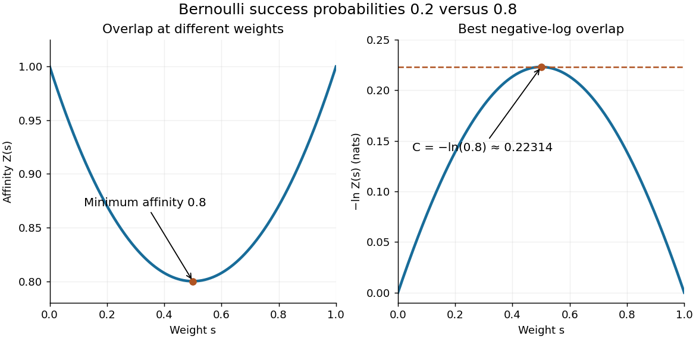

**[Figure 9](#image-chernoff-complementary-coin-affinity). Chernoff affinity and Chernoff information for two complementary coin laws**. Original computed example, with success probabilities $0.2$ and $0.8$. The affinity is minimized at $s=1/2$; the best negative-log affinity is $-\ln0.8$.

With equal [prior probabilities](statistical-inference.md#prior-probability), count the successes $K$ among $n$ observations. The [likelihood ratio](statistical-modelling.md#likelihood-ratio) is $Q^{\otimes n}/P^{\otimes n}=4^{2K-n}$, so choose $Q$ when $K>n/2$ and $P$ when $K<n/2$. If $n$ is even, either decision or a fair tie randomization gives the same average error at $K=n/2$. Under $P$, $K$ has the [binomial distribution](discrete-probability-distribution.md#binomial-distribution) with parameters $n,0.2$. Symmetry therefore gives the exact optimal average error

$$
p_n^*=\sum_{k>n/2}\binom nk0.2^k0.8^{n-k}
+\frac12\mathbf1_{\{n\text{ even}\}}\binom n{n/2}0.2^{n/2}0.8^{n/2}.
$$

The last term applies only for even $n$; it represents half the tie probability. Direct finite [sums](arithmetic.md#sum) give $p_1^*=0.2$, $p_5^*=0.05792$ and $p_{20}^*\simeq0.00157912$. **Twenty observations reduce the optimal average error to about 0.158%.** The [finite-sample Chernoff error bound](#finite-sample-chernoff-error-bound) at $n=20$ is $\tfrac12(0.8)^{20}\simeq0.00576461$, a guarantee rather than the exact error.

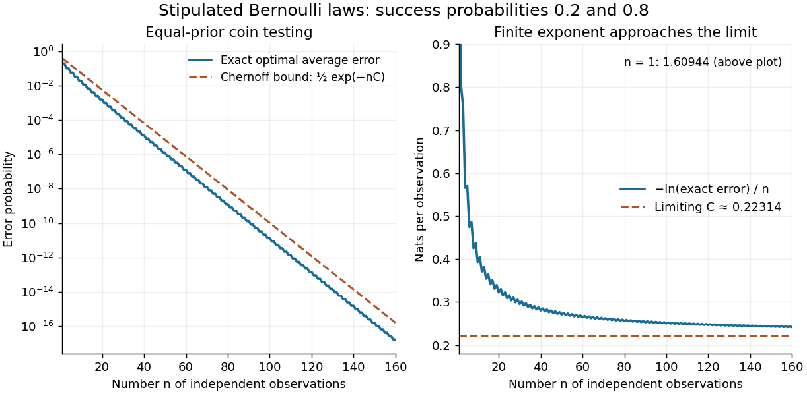

**[Figure 10](#image-chernoff-coin-testing-error-decay). Exact repeated-coin error, the finite-sample Chernoff error bound, and the limiting error exponent**. Original finite-binomial calculations under two fixed independent coin laws with equal priors. The first panel uses a [logarithmic scale](calculus.md#logarithmic-scale). The normalized negative log error approaches $C(P,Q)$; finite-sample error need not equal the simple exponential.

Reducing the exact error from $p_{20}^*$ to $p_{50}^*\simeq1.29363\times10^{-6}$ illustrates the value of repeated evidence. The example assumes a single fixed coin law throughout the experiment. If repeated sensor readings share an unmodelled common error, increasing their number need not supply this much independent information.

#### Historical source for Chernoff information

↑ **Parent:** [Chernoff information](#chernoff-information)

Stanford's archive records a technical report by [Herman Chernoff](mathematics-author.md#herman-chernoff), dated November 1951, on asymptotic efficiency of hypothesis tests based on sums of observations.[Stanford Statistics technical-report record: SOL ONR 6, author H. Chernoff, report date November 1951](mathematics-bibliography.md#a-measure-of-asymptotic-efficiency-for-tests-of-an-hypothesis-based-on-the-sum-of-observations-technical-report-by-herman-chernoff) This is historical source metadata, rather than a claim to have inspected the report's full proof. The modern theorem cited above connects that efficiency question to the [log-likelihood ratio](statistical-modelling.md#log-likelihood-ratio) accumulated across repeated observations.

<h3 id="stein-s-lemma-information-theory">Stein's lemma (information theory)</h3>

↑ **Parent:** [Binary hypothesis testing in information theory](#binary-hypothesis-testing-in-information-theory)

For distinct [probability distributions](probability-theory.md#probability-distribution) $P,Q$, the optimal [error exponents in hypothesis testing](#error-exponents-in-hypothesis-testing) give type-II error $Q^{\otimes n}(B_n)$ decay rate $D(P\Vert Q)$ among tests whose type-I error $P^{\otimes n}(B_n^c)$ stays below any fixed number in $(0,1)$.

### Neyman-Pearson decision region

↑ **Parent:** [Binary hypothesis testing in information theory](#binary-hypothesis-testing-in-information-theory)

The [Neyman-Pearson lemma](statistical-modelling.md#neyman-pearson-lemma) says that an optimal region accepting $P$ has the likelihood-ratio form

$$
B_n=\left\{x_1^n:\frac{P^{\otimes n}(x_1^n)}{Q^{\otimes n}(x_1^n)}\geq t\right\},
$$

with possible randomization on the boundary.

## Total correlation

↑ **Parent:** [Information theory](information-theory.md)  
ⓦ [Wiki](https://en.wikipedia.org/wiki/Total_correlation)

[Total correlation](#total-correlation) measures how much dependence is lost when a joint [probability distribution](probability-theory.md#probability-distribution) is replaced by the product of its marginal [probability distributions](probability-theory.md#probability-distribution). It compares the uncertainty of the separate coordinates with the uncertainty of the whole [random vector](random-variable.md#random-vector). The distinction matters because an exact relation can involve three variables while leaving every pair [independent](random-variable.md#independent-random-variables).

For [random variables](random-variable.md) $X_1,\ldots,X_n$ with finite [alphabets](#alphabet), define

$$
\boxed{\operatorname{TC}(X_1,\ldots,X_n)
=\sum_{i=1}^n H(X_i)-H(X_1,\ldots,X_n)
=D\!\left(P_{X_1,\ldots,X_n}\middle\Vert\bigotimes_{i=1}^n P_{X_i}\right).}
$$

Here $H$ is [information entropy](#information-entropy), the entropy of the full [random vector](random-variable.md#random-vector) is [joint entropy](#joint-entropy), and $D$ is [relative entropy](probability-and-statistics.md#kullback-leibler-divergence). Base-two [logarithms](calculus.md#logarithm) give [bits](#bit); [natural logarithms](calculus.md#natural-logarithm) give [nats](#nat-unit). The product law retains every marginal [probability distribution](probability-theory.md#probability-distribution) but discards their dependence.[Abstract, printed p. 66: total correlation for the partition into individual variables](mathematics-bibliography.md#information-theoretical-analysis-of-multivariate-correlation-by-satosi-watanabe) A positive joint [probability](probability-theory.md#probability) guarantees positive marginal [probabilities](probability-theory.md#probability) at that outcome, so the displayed [relative entropy](probability-and-statistics.md#kullback-leibler-divergence) is finite in this finite-alphabet setting.

For two variables, [total correlation](#total-correlation) is exactly [mutual information](#mutual-information). For three or more, it can detect a constraint that all pairwise [mutual informations](#mutual-information) miss. [Relative entropy nonnegativity](probability-and-statistics.md#relative-entropy-nonnegativity) gives $\operatorname{TC}\geq0$, with equality exactly when the coordinates are jointly [independent random variables](random-variable.md#independent-random-variables).

As the simplest contrast, three [independent](random-variable.md#independent-random-variables) fair [bits](#bit) have three [bits](#bit) of [joint entropy](#joint-entropy) and zero [total correlation](#total-correlation). If all three coordinates instead copy the same fair [bit](#bit), their separate [information entropies](#information-entropy) still sum to three [bits](#bit), but their [joint entropy](#joint-entropy) is only one [bit](#bit). Their [total correlation](#total-correlation) is therefore two [bits](#bit). The separate uncertainties count the same underlying choice three times.

### Parity constraint and total correlation

↑ **Parent:** [Total correlation](#total-correlation)

Let $X,Y$ be [independent](random-variable.md#independent-random-variables) fair [bits](#bit) and set $Z=X\mathbin\oplus Y$, their [exclusive or](computer-science.md#exclusive-or). The four possible triples are $000,011,101,110$, each with [probability](probability-theory.md#probability) $1/4$. Every coordinate is fair, and every pair has all four outcomes with equal [probability](probability-theory.md#probability). Thus each pair's [mutual information](#mutual-information) is zero, as in [pairwise independence does not imply joint independence](random-variable.md#pairwise-independence-does-not-imply-joint-independence).

The full [random vector](random-variable.md#random-vector) has [joint entropy](#joint-entropy) $\log_2 4=2$ [bits](#bit), while the marginal [information entropies](#information-entropy) sum to three [bits](#bit). Consequently

$$
\boxed{\operatorname{TC}(X,Y,Z)=3-2=1\text{ bit}.}
$$

The product of the marginals predicts [probability](probability-theory.md#probability) $1/8$ for every triple, including the four impossible ones. On each possible triple, the ratio of true to product [probability](probability-theory.md#probability) is $(1/4)/(1/8)=2$; averaging its base-two [logarithm](calculus.md#logarithm) gives the same one [bit](#bit) of [relative entropy](probability-and-statistics.md#kullback-leibler-divergence).

The example gives a concrete use for joint information measures. A [lossless source coding](#lossless-source-coding) scheme that treats the three coordinates separately needs three [bits](#bit) here. If the [decoder](coding-theory.md#channel-decoder) knows the [integer parity](number-theory.md#parity-mathematics) rule, the [encoder](coding-theory.md#channel-encoder) can send just $X,Y$ and let the [decoder](coding-theory.md#channel-decoder) reconstruct $Z$ exactly. Pairwise [independence](random-variable.md#independent-random-variables) does not reveal that saving. This is a stipulated source law and an explicit two-[bit](#bit) code, rather than a promise that arbitrary data can be shortened.

#### Noisy parity total correlation

↑ **Parent:** [Parity constraint and total correlation](#parity-constraint-and-total-correlation)

Keep $X,Y$ as [independent](random-variable.md#independent-random-variables) fair [bits](#bit), introduce an [independent](random-variable.md#independent-random-variables) [Bernoulli random variable](discrete-probability-distribution.md#bernoulli-distribution) $N$ with $\mathbb P(N=1)=\varepsilon$, and set $Z=X\mathbin\oplus Y\mathbin\oplus N$. The extra [bit](#bit) flips the [integer parity](number-theory.md#parity-mathematics) rule with [probability](probability-theory.md#probability) $\varepsilon$. For each even-[integer parity](number-theory.md#parity-mathematics) triple the [probability](probability-theory.md#probability) is $(1-\varepsilon)/4$; for each odd-[integer parity](number-theory.md#parity-mathematics) triple it is $\varepsilon/4$.

Every coordinate remains fair, and every pair remains [independent](random-variable.md#independent-random-variables) for every $0\leq\varepsilon\leq1$. For example, after fixing $X$, the fair independent $Y$ makes $Y\mathbin\oplus N$ fair regardless of $\varepsilon$. A pair's [joint probability distribution](probability-theory.md#joint-probability-distribution) therefore does not change as noise destroys the three-way relation.

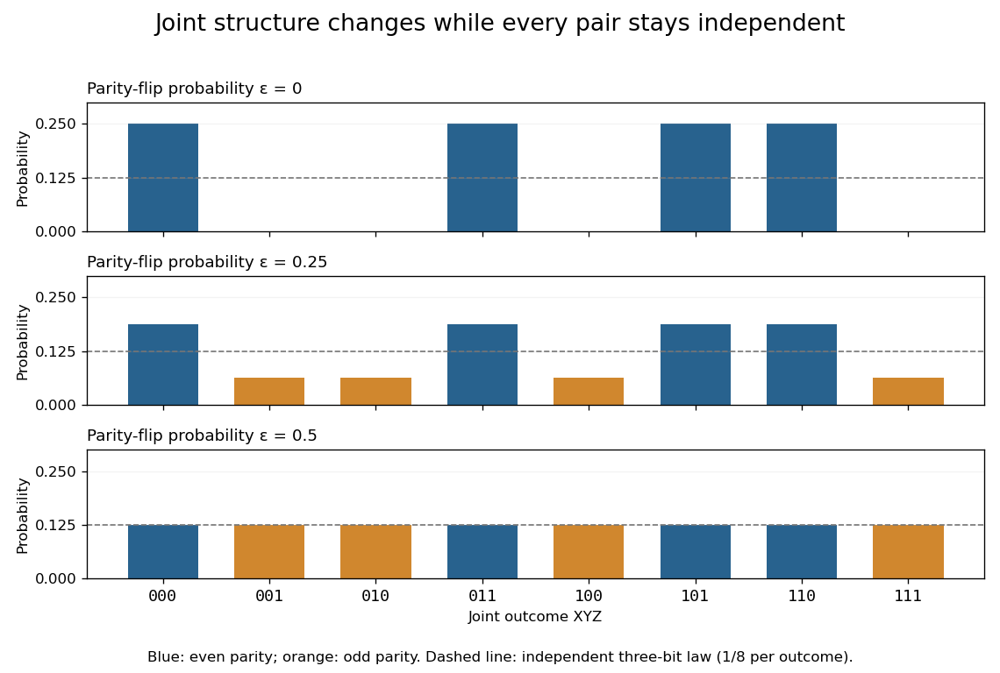

**[Figure 11](#image-noise-changes-the-joint-parity-distribution-without-changing-any-pair-s-independence). Noise changes the joint parity distribution without changing any pair's independence**. Calculated [probability mass functions](probability-theory.md#probability-mass-function) for the stipulated three-[bit](#bit) model at $\varepsilon=0,1/4,1/2$. Even-[integer parity](number-theory.md#parity-mathematics) and odd-[integer parity](number-theory.md#parity-mathematics) triples have different colors. The dashed line is the product of the three fair marginal [probability distributions](probability-theory.md#probability-distribution). These are theoretical [probabilities](probability-theory.md#probability), not measurements.

Knowing $X,Y$, uncertainty in $Z$ is exactly the uncertainty in $N$. The [chain rule for information entropy](#chain-rule-for-information-entropy) gives

$$
H(X,Y,Z)=H(X,Y)+H(Z\mid X,Y)=2+h_2(\varepsilon),
$$

where $h_2$ is [binary entropy](#binary-entropy). Hence

$$
\boxed{\operatorname{TC}(X,Y,Z)=1-h_2(\varepsilon).}
$$

At $\varepsilon=1/4$, the result is approximately $0.188722$ [bits](#bit), although all three pairwise [mutual informations](#mutual-information) are zero. At $\varepsilon=1/2$, all eight triples have [probability](probability-theory.md#probability) $1/8$, giving joint [independence](random-variable.md#independent-random-variables) and zero [total correlation](#total-correlation). At $\varepsilon=1$, the complementary [integer parity](number-theory.md#parity-mathematics) rule is deterministic again, so [total correlation](#total-correlation) returns to one [bit](#bit).

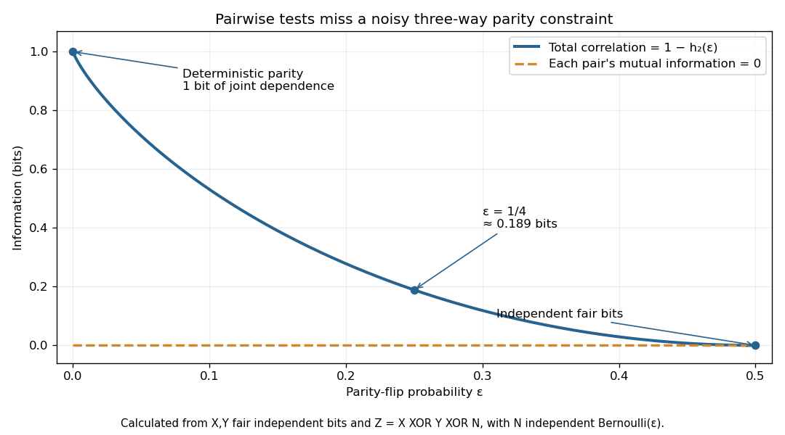

**[Figure 12](#image-total-correlation-detects-a-noisy-three-way-constraint-missed-by-pairwise-mutual-information). Total correlation detects a noisy three-way constraint missed by pairwise mutual information**. The exact formula $1-h_2(\varepsilon)$ for the stipulated [noisy parity total correlation](#noisy-parity-total-correlation), plotted over $0\leq\varepsilon\leq1/2$. The [mutual information](#mutual-information) of each pair is identically zero; joint [independence](random-variable.md#independent-random-variables) occurs only at the right endpoint of this interval.

The example distinguishes "there is a dependence" from "a pair reveals it." Once $X,Y$ are known together, $Z$ is predictable at zero noise; knowing either one alone leaves a fair [bit](#bit). [Total correlation](#total-correlation) detects the joint departure from [independence](random-variable.md#independent-random-variables), but does not by itself specify which variables cause which others.

### Chain decomposition of total correlation

↑ **Parent:** [Total correlation](#total-correlation)

For finite [alphabets](#alphabet), expanding [joint entropy](#joint-entropy) with the [chain rule for information entropy](#chain-rule-for-information-entropy) gives

$$
\operatorname{TC}(X_1,\ldots,X_n)
=\sum_{i=2}^n\bigl[H(X_i)-H(X_i\mid X_1,\ldots,X_{i-1})\bigr]
=\sum_{i=2}^n I(X_i;X_1,\ldots,X_{i-1}).
$$

Each term is [mutual information](#mutual-information) with an entire preceding block, rather than necessarily with one preceding variable. Changing the order changes these individual terms but leaves their sum unchanged.

For the noiseless [parity constraint and total correlation](#parity-constraint-and-total-correlation), $I(Y;X)=0$ and $I(Z;X,Y)=1$ [bit](#bit). The conditional block term supplies exactly the dependence that the pairwise comparisons missed. For three identical copies of a fair [bit](#bit), the two block terms are both one [bit](#bit). Thus [total correlation](#total-correlation) counts total departure from the product law, not merely the presence of a single irreducible multiway relation.

### Relative entropy to a product law

↑ **Parent:** [Total correlation](#total-correlation)

Let $P$ be a joint [probability distribution](probability-theory.md#probability-distribution) on a finite product [alphabet](#alphabet), with marginals $P_i$. Compare it with a product model $Q=\bigotimes_iQ_i$, assuming $Q_i(x_i)>0$ wherever $P_i(x_i)>0$. Adding and subtracting the [logarithm](calculus.md#logarithm) of $\prod_iP_i(x_i)$ gives

$$
\boxed{D(P\Vert Q)=\operatorname{TC}(P)+\sum_i D(P_i\Vert Q_i).}
$$

The first term is the unavoidable error from discarding dependence; the other terms are errors in the individual marginal [probability distributions](probability-theory.md#probability-distribution). Averaging a term that depends only on $x_i$ under $P$ is the same as averaging it under $P_i$, which proves the identity directly.

Among product laws, the choice $Q_i=P_i$ minimizes this [relative entropy](probability-and-statistics.md#kullback-leibler-divergence), leaving exactly [total correlation](#total-correlation). The related [cross-entropy equals entropy plus relative entropy](#cross-entropy-equals-entropy-plus-relative-entropy) identity interprets this as extra average [logarithmic loss](foundations-of-mathematics.md#logarithmic-loss) from using the independent model. It is a statement about a specified joint law and loss function, not a claim that fitting a finite sample automatically recovers that law.

### Scope and scale of total correlation

↑ **Parent:** [Total correlation](#total-correlation)

For finite [alphabets](#alphabet), $H(X_1,\ldots,X_n)\geq\max_iH(X_i)$, so

$$
0\leq\operatorname{TC}(X_1,\ldots,X_n)
\leq\sum_iH(X_i)-\max_iH(X_i).
$$

For $n$ identical copies of one fair [bit](#bit), the upper bound is attained and [total correlation](#total-correlation) is $n-1$ [bits](#bit). Adding another copy increases the result without introducing a new underlying random choice. The choice of coordinates and their grouping therefore matters when comparing systems of different sizes.

For more general [random variables](random-variable.md), the [relative entropy](probability-and-statistics.md#kullback-leibler-divergence) against the product of the marginals supplies a definition of [total correlation](#total-correlation) that may be infinite. Subtracting [differential entropies](#differential-entropy) is justified only when those quantities are finite and the entropy identity is valid; an undefined difference of infinities is not a definition. The finite-[alphabet](#alphabet) examples above avoid that problem entirely.

### Historical source for total correlation

↑ **Parent:** [Total correlation](#total-correlation)

The abstract of [Information Theoretical Analysis of Multivariate Correlation by Satosi Watanabe](mathematics-bibliography.md#information-theoretical-analysis-of-multivariate-correlation-by-satosi-watanabe) (1960, printed p. 66) names the sum of individual [information entropies](#information-entropy) minus [joint entropy](#joint-entropy) "total correlation." It presents this as the finest grouping of the variables and identifies applications to geometric pattern recognition and shuffling cards marked zero or one. The name therefore connects the uncertainty of a system with the structure linking its parts; the worked [integer parity](number-theory.md#parity-mathematics) and noisy-[integer parity](number-theory.md#parity-mathematics) models here are separate examples calculated from their stated laws.

## Type (information theory)

↑ **Parent:** [Information theory](information-theory.md)  
ⓦ [Wiki](https://en.wikipedia.org/wiki/Type_(information_theory))

A [type](#type-information-theory) summarizes a string by how often each symbol occurs. Fix a finite [alphabet](#alphabet) $\mathcal A$ of [cardinality](set-theory.md#cardinality) $m$ and a positive length $n$. For a string $x^n=(x_1,\ldots,x_n)$, its [empirical distribution](#type-information-theory) is the [probability mass function](probability-theory.md#probability-mass-function)

$$
\widehat q_{x^n}(a)=\frac{\#\{j:x_j=a\}}{n},\qquad a\in\mathcal A.
$$

The [empirical distribution](#type-information-theory) forgets order. The strings $0011$ and $1010$ both assign [probability](probability-theory.md#probability) $1/2$ to each binary symbol; $0001$ assigns $3/4$ to zero and $1/4$ to one. Thus a long string can have a short summary even though that summary does not reconstruct the original order.

For [independent and identically distributed](random-variable.md#independent-and-identically-distributed-random-variables) symbols, this loss of order has a useful consequence: all strings with the same [empirical distribution](#type-information-theory) have the same [probability](probability-theory.md#probability). The [method of types](#method-of-types) uses this symmetry to turn questions about exponentially many strings into counting questions about relatively few frequency profiles.[§I, printed p. 2505: partition by empirical distribution and equiprobability under a memoryless model](mathematics-bibliography.md#the-method-of-types-by-imre-csiszar)

### Type class

↑ **Parent:** [Type (information theory)](#type-information-theory)

The [type class](#type-class) $T_n(q)$ contains all length-$n$ strings with [empirical distribution](#type-information-theory) $q$. Each $nq(a)$ must be a nonnegative [integer](number-theory.md#integer) and the counts must sum to $n$; otherwise the class is empty. Distinct [type classes](#type-class) partition $\mathcal A^n$: every string belongs to exactly one class.

For four binary symbols there are five [type classes](#type-class), indexed by the number $k$ of ones. Their [cardinalities](set-theory.md#cardinality) are $1,4,6,4,1$, which sum to $16=2^4$. The balanced class contains exactly $0011,0101,0110,1001,1010,1100$. These are six different strings, not six different [empirical distributions](#type-information-theory).

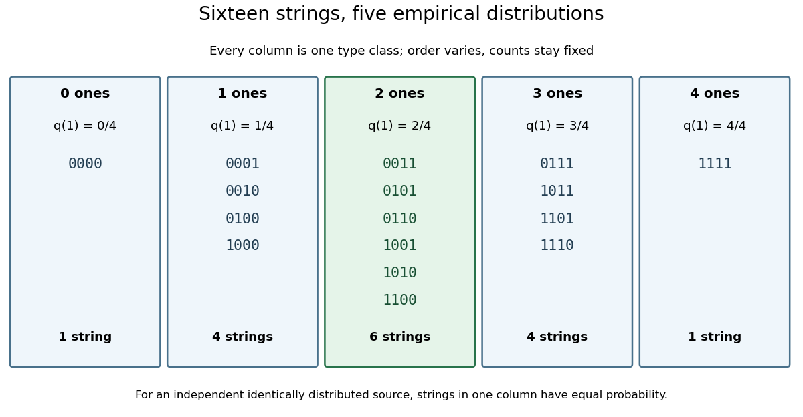

**[Figure 13](#image-sixteen-binary-strings-form-five-type-classes). Sixteen binary strings form five type classes**. An exact enumeration of all four-symbol strings. Each column fixes the number of ones; the central column has six orderings of the same [empirical distribution](#type-information-theory).

#### Size of a type class

↑ **Parent:** [Type class](#type-class)

Write $n_a=nq(a)$. Arranging $n_a$ copies of each symbol gives the [multinomial coefficient](combinatorics.md#multinomial-coefficient)

$$
\boxed{|T_n(q)|=\frac{n!}{\prod_{a\in\mathcal A}n_a!}.}
$$

The division by the [factorials](combinatorics.md#factorial) removes permutations among identical copies. In the balanced four-symbol example, $|T_4(q)|=4!/(2!2!)=6$. For binary symbols this becomes the [binomial coefficient](combinatorics.md#binomial-coefficient) $\binom nk$; for three symbols with counts $(2,1,1)$, the class contains $4!/(2!1!1!)=12$ strings.

#### Indexing within a type class

↑ **Parent:** [Type class](#type-class)

If a [decoder](coding-theory.md#channel-decoder) already knows the length, [alphabet](#alphabet) and [empirical distribution](#type-information-theory), it only needs to distinguish $|T_n(q)|$ possible strings. A fixed-length index therefore needs $\lceil\log_2|T_n(q)|\rceil$ [bits](#bit). List the six balanced four-symbol strings in increasing lexicographic order and number them $0$ through $5$. A three-[bit](#bit) index identifies any one of them, whereas writing the original binary string directly takes four [bits](#bit).

Knowing the [empirical distribution](#type-information-theory) is essential to that calculation. If it must also be sent, a simple fixed-length description of which of the five classes was used costs another $\lceil\log_2 5\rceil=3$ [bits](#bit). That naive balanced-string message totals six [bits](#bit) and is longer than the raw four-[bit](#bit) string. The example demonstrates the benefit of shared constraints, rather than a free [lossless source coding](#lossless-source-coding) scheme for every input. For long strings over a fixed [alphabet](#alphabet), the overhead for identifying a class grows only logarithmically with length, while the [information entropy](#information-entropy) of its frequency profile controls the leading cost within the class.

### Method of types

↑ **Parent:** [Type (information theory)](#type-information-theory)  
ⓦ [Wiki](https://en.wikipedia.org/wiki/Method_of_types)

The [method of types](#method-of-types) combines two facts: there are few possible [empirical distributions](#type-information-theory), and strings within each [type class](#type-class) are equiprobable under an [independent and identically distributed](random-variable.md#independent-and-identically-distributed-random-variables) source. [Information entropy](#information-entropy) determines how many strings share a frequency profile; [relative entropy](probability-and-statistics.md#kullback-leibler-divergence) determines how unlikely that profile is under a specified source law. The connection is useful both for [lossless source coding](#lossless-source-coding) and for understanding rare observations.

The following formulas use [natural logarithms](calculus.md#natural-logarithm), so [information entropy](#information-entropy) and [relative entropy](probability-and-statistics.md#kullback-leibler-divergence) are measured in [nats](#nat-unit). Define

$$
H_e(q)=-\sum_a q(a)\ln q(a),\qquad
D_e(q\Vert p)=\sum_a q(a)\ln\frac{q(a)}{p(a)}.
$$

Here $p$ is the source [probability mass function](probability-theory.md#probability-mass-function) and $q$ is an attainable [empirical distribution](#type-information-theory). Use $0\ln0=0$; first assume every $p(a)>0$. Base-two [logarithms](calculus.md#logarithm) give the equivalent formulas with $2^{nH_2(q)}$ and $2^{-nD_2(q\Vert p)}$.

#### Number of empirical types

↑ **Parent:** [Method of types](#method-of-types)

A possible [empirical distribution](#type-information-theory) corresponds to nonnegative [integer](number-theory.md#integer) counts $(n_1,\ldots,n_m)$ with sum $n$. [Stars and bars](combinatorics.md#stars-and-bars-combinatorics) therefore gives

$$
\#\{\text{length-}n\text{ types}\}=\binom{n+m-1}{m-1}\leq(n+1)^m.
$$

The bound also follows by letting each count independently range from zero to $n$, which overcounts tuples whose sum is wrong. With the [alphabet](#alphabet) fixed, the count grows polynomially in $n$, whereas there are $m^n$ strings when $m\geq2$. For binary symbols there are exactly $n+1$ profiles: the number of ones can be any [integer](number-theory.md#integer) from zero through $n$.

This reduces a rare-event calculation to a sum over profiles when the event depends only on counts. An event that depends on order may instead require counting the relevant subset inside each [type class](#type-class). A source with [statistical dependence](random-variable.md#statistical-dependence) need not make strings of the same [empirical distribution](#type-information-theory) equiprobable; the memoryless assumption cannot simply be dropped.

#### Entropy bounds for a type class

↑ **Parent:** [Method of types](#method-of-types)

For an attainable [empirical distribution](#type-information-theory) $q$ on a fixed finite [alphabet](#alphabet) of size $m$,

$$
(n+1)^{-m}e^{nH_e(q)}\leq |T_n(q)|\leq e^{nH_e(q)}.
$$

Thus $\ln|T_n(q)|$ differs from $nH_e(q)$ by at most $m\ln(n+1)$, uniformly over attainable profiles. [Information entropy](#information-entropy) is the leading logarithmic count; the polynomial factor matters at short lengths.[§II, Lemma II.2, equation (II.4), printed pp. 2506–2507: type-class cardinality bounds](mathematics-bibliography.md#the-method-of-types-by-imre-csiszar)

The upper bound has a short explanation. Under an [independent and identically distributed](random-variable.md#independent-and-identically-distributed-random-variables) source whose law is $q$ itself, each string in $T_n(q)$ has [probability](probability-theory.md#probability) $e^{-nH_e(q)}$. Multiplying by the number of such strings cannot give a [probability](probability-theory.md#probability) above one. A corresponding polynomial lower bound follows from the [multinomial coefficient](combinatorics.md#multinomial-coefficient); the [Stirling's approximation](real-analysis.md#stirling-formula) gives sharper prefactors when needed.

For the balanced four-symbol class, $H_e(q)=\ln2$, so the upper bound is $e^{4\ln2}=16$, while the exact size is six. [Information entropy](#information-entropy) is not an exact count for a short string. On the leading scale it becomes precise: the difference divided by $n$ tends to zero as $n$ grows with the [alphabet](#alphabet) fixed.

#### Probability of a type class

↑ **Parent:** [Method of types](#method-of-types)

For a string of [empirical distribution](#type-information-theory) $q$, [independence](random-variable.md#independent-random-variables) gives

$$
\mathbb P_p(x^n)=\prod_a p(a)^{nq(a)}
=e^{-n[H_e(q)+D_e(q\Vert p)]}.
$$

Multiplying this by the [size of a type class](#size-of-a-type-class) gives its exact [probability](probability-theory.md#probability). The [entropy bounds for a type class](#entropy-bounds-for-a-type-class) then imply

$$
(n+1)^{-m}e^{-nD_e(q\Vert p)}\leq
\mathbb P_p(T_n(q))\leq e^{-nD_e(q\Vert p)}.
$$

These bounds apply to one attainable [empirical distribution](#type-information-theory), not automatically to a tail event containing many classes.[§II, equation (II.1) and Lemma II.2, equation (II.5), printed pp. 2506–2507](mathematics-bibliography.md#the-method-of-types-by-imre-csiszar) If $p(a)=0$ but $q(a)>0$, every string in that class is impossible and $D_e(q\Vert p)=+\infty$.

As an exact example, take an [independent and identically distributed](random-variable.md#independent-and-identically-distributed-random-variables) binary source with $p(1)=1/4$. Each balanced four-symbol string has [probability](probability-theory.md#probability) $(1/4)^2(3/4)^2=9/256$. There are six such strings, so

$$
\boxed{\mathbb P_p(T_4(1/2,1/2))=\frac{54}{256}=0.2109375.}
$$

The [relative entropy](probability-and-statistics.md#kullback-leibler-divergence) is $D_e((1/2,1/2)\Vert(3/4,1/4))=\tfrac12\ln(4/3)$. The exponential upper bound is $e^{-4D_e}=9/16=0.5625$, visibly larger than the exact [probability](probability-theory.md#probability). It captures the cost of an atypical frequency without supplying the exact finite-length prefactor.

For $n=40$, the exact [probability](probability-theory.md#probability) of twenty ones is

$$
\binom{40}{20}(1/4)^{20}(3/4)^{20}\approx0.000397577,
$$

while the exponential upper bound is approximately $0.00317121$. At the source frequency $q(1)=1/4$, [relative entropy](probability-and-statistics.md#kullback-leibler-divergence) is zero and the upper bound is one; the exact [probability](probability-theory.md#probability) of ten ones is only about $0.144364$. A likely neighborhood of frequencies need not give a large [probability](probability-theory.md#probability) to a single exact profile.

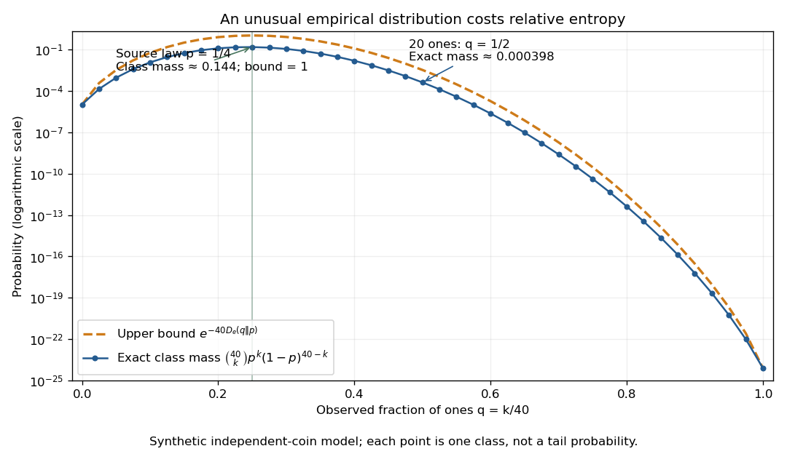

**[Figure 14](#image-relative-entropy-controls-the-rarity-of-an-empirical-frequency). Relative entropy controls the rarity of an empirical frequency**. Exact [probabilities](probability-theory.md#probability) from the [binomial distribution](discrete-probability-distribution.md#binomial-distribution) for each possible number of ones in forty [independent and identically distributed](random-variable.md#independent-and-identically-distributed-random-variables) trials with $p(1)=1/4$, compared with the exponential [relative entropy](probability-and-statistics.md#kullback-leibler-divergence) upper bound. The curves are calculated from a stipulated model, not observed data; the vertical scale is logarithmic.

The striking cancellation is that there are about $e^{nH_e(q)}$ strings in a class, but each costs about $e^{-n[H_e(q)+D_e(q\Vert p)]}$. The [information entropy](#information-entropy) terms cancel, leaving [relative entropy](probability-and-statistics.md#kullback-leibler-divergence) as the rarity exponent. Summing over polynomially many classes preserves that leading exponential scale. This is the elementary counting mechanism behind finite-alphabet versions of [Sanov theorem](#sanov-theorem) and many [error exponents in hypothesis testing](#error-exponents-in-hypothesis-testing).

#### Development of the method of types

↑ **Parent:** [Method of types](#method-of-types)

In his 1998 retrospective, [Imre Csiszár](mathematics-author.md#imre-csiszar) describes the [method of types](#method-of-types) as a 1970s refinement of the [typical set](#typical-set) approach, with older counting ingredients. He credits his research group with turning those ingredients into a general tool, while explicitly declining to give a complete discovery history.[§I, printed pp. 2505–2506: the refinement in the 1970s and the author's qualified historical account](mathematics-bibliography.md#the-method-of-types-by-imre-csiszar) The useful shift is from an approximately typical collection to exact frequency classes: the latter retain enough structure to study how fast error [probabilities](probability-theory.md#probability) decay.

#### Sanov theorem

↑ **Parent:** [Method of types](#method-of-types)  
ⓦ [Wiki](https://en.wikipedia.org/wiki/Sanov_theorem)

Sanov's theorem is the [large deviation principle](convergence-of-random-variables.md#large-deviation-principle) for empirical distributions of independent identically distributed observations. On a finite alphabet with sampling law $Q$, its rate function is $D_e(R\Vert Q)$.

#### Information projection

↑ **Parent:** [Method of types](#method-of-types)  
ⓦ [Wiki](https://en.wikipedia.org/wiki/Information_projection)

An [information projection](#information-projection) chooses the [probability distribution](probability-theory.md#probability-distribution) that satisfies a constraint while departing least from a reference law in [relative entropy](probability-and-statistics.md#kullback-leibler-divergence). The constraint might specify an [expected value](probability-theory.md#expected-value), several marginal [probability distributions](probability-theory.md#probability-distribution), or another [convex set](mathematical-optimization.md#convex-set) of permissible laws. The reference is held fixed: the variable is the first argument of $D(q\Vert p)$. Reversing the arguments gives a different minimization problem.

For a finite [alphabet](#alphabet) $\mathcal A$, take a positive reference [probability mass function](probability-theory.md#probability-mass-function) $p(a)>0$ and a nonempty closed [convex set](mathematical-optimization.md#convex-set) $\mathcal C$ in the [probability simplex](algebraic-topology.md#probability-simplex). Then

$$
\boxed{q^*=\arg\min_{q\in\mathcal C}D(q\Vert p),\qquad
D(q\Vert p)=\sum_{a:q(a)>0}q(a)\ln\frac{q(a)}{p(a)}.}
$$

The minimum exists and its minimizing [probability distribution](probability-theory.md#probability-distribution) is unique. In this article, [natural logarithms](calculus.md#natural-logarithm) give [nats](#nat-unit). Using base-two [logarithms](calculus.md#logarithm) rescales the objective without changing the minimizer.[§3, printed pp. 440–441: finite-alphabet information projection onto a closed convex set](mathematics-bibliography.md#information-theory-and-statistics-a-tutorial-by-imre-csiszar-and-paul-c-shields)

If $p$ already meets the constraint, its [information projection](#information-projection) is $p$ itself by [relative entropy nonnegativity](probability-and-statistics.md#relative-entropy-nonnegativity). If not, a constraint can change the relative weights of outcomes without specifying every weight individually. [Relative entropy minimization under a mean constraint](#relative-entropy-minimization-under-a-mean-constraint) gives an especially useful example: it tilts the reference law rather than choosing an arbitrary distribution with the right average.

##### Information projection on three outcomes

↑ **Parent:** [Information projection](#information-projection)

Let the possible numerical outcomes be $-1,0,1$, and give the reference law $p$ [uniform distribution on a finite set](discrete-probability-distribution.md#discrete-uniform-distribution): $p=(1/3,1/3,1/3)$. We want a law $q$ with [expected value](probability-theory.md#expected-value) $1/2$. Write the three [probabilities](probability-theory.md#probability) in outcome order as $(q_-,q_0,q_+)$. The [mean](probability-theory.md#expected-value) constraint is $q_+-q_-=1/2$, while normalization requires $q_-+q_0+q_+=1$.

These conditions leave a whole line of possible [probability distributions](probability-theory.md#probability-distribution):

$$
q=(x,1/2-2x,1/2+x),\qquad 0\leq x\leq1/4.
$$

For example, $(0,1/2,1/2)$ and $(1/4,0,3/4)$ both have the required [mean](probability-theory.md#expected-value). The constraint alone does not choose between them. [Information projection](#information-projection) selects the point on this line with the smallest [relative entropy](probability-and-statistics.md#kullback-leibler-divergence) from the reference.

[Exponential tilting](probability-theory.md#exponential-tilting) gives weights proportional to $e^{-\theta},1,e^\theta$. Set $t=e^\theta>0$ and multiply these weights by $t$ to obtain $q^*=(1,t,t^2)/(1+t+t^2)$. Enforcing the [mean](probability-theory.md#expected-value) gives

$$
\frac{t^2-1}{1+t+t^2}=\frac12
\quad\Longleftrightarrow\quad t^2-t-3=0.
$$

The positive root is $t=(1+\sqrt{13})/2$, hence

$$
\boxed{q^*\approx(0.116204,0.267592,0.616204),\qquad
D(q^*\Vert p)\approx0.197378\text{ nats}.}
$$

The most favored outcome becomes $1$, but all three remain possible. This is an exact constructed example with a stipulated reference law and constraint, not a fitted distribution from measurements.

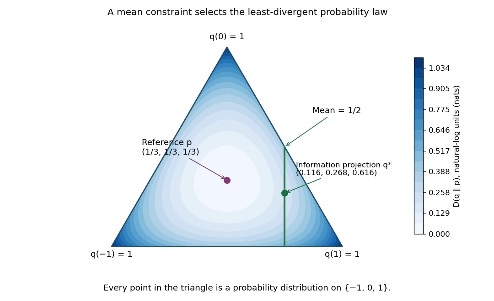

**[Figure 15](#image-a-mean-constraint-selects-the-least-divergent-law-in-a-probability-simplex). A mean constraint selects the least-divergent law in a probability simplex**. Each point represents a [probability distribution](probability-theory.md#probability-distribution) on $\{-1,0,1\}$. The color is [relative entropy](probability-and-statistics.md#kullback-leibler-divergence) from the uniform reference, in [nats](#nat-unit). The green segment fixes [expected value](probability-theory.md#expected-value) $1/2$, and its marked point is the exact [information projection on three outcomes](#information-projection-on-three-outcomes). The diagram is calculated from the stated model.

###### Information projection and Euclidean projection

↑ **Parent:** [Information projection on three outcomes](#information-projection-on-three-outcomes)

The word "projection" does not mean ordinary perpendicular projection in the plotted [Euclidean space](functional-analysis.md#euclidean-norm). For the same reference and [mean](probability-theory.md#expected-value) constraint, minimizing the squared [Euclidean distance](topological-analysis.md#euclidean-distance) in the three [probability](probability-theory.md#probability) coordinates instead gives

$$
\sum_i(q_i-1/3)^2=6x^2-x+\frac16,
\qquad x_{\mathrm E}=\frac1{12}.
$$

Thus the Euclidean minimizer is $q_{\mathrm E}=(1/12,1/3,7/12)$, whereas the [information projection](#information-projection) has $q_-^*\approx0.116204$. The squared Euclidean objective at its own minimum is $1/8$; its [relative entropy](probability-and-statistics.md#kullback-leibler-divergence) is approximately $0.210918$ [nats](#nat-unit), larger than the optimum $0.197378$ [nats](#nat-unit). Both distributions satisfy the same constraint.

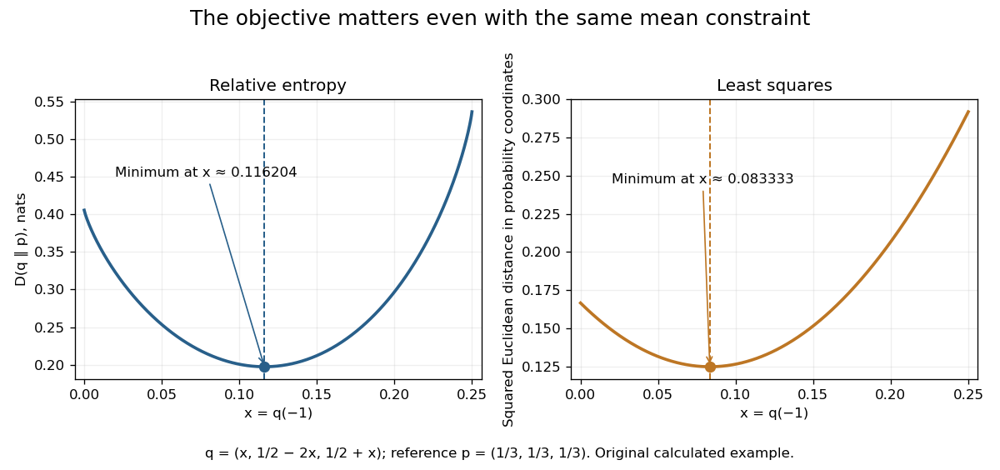

**[Figure 16](#image-relative-entropy-and-least-squares-select-different-laws-under-the-same-mean-constraint). Relative entropy and least squares select different laws under the same mean constraint**. Both plots use the feasible laws $q=(x,1/2-2x,1/2+x)$ and the same uniform reference. The left plot minimizes [relative entropy](probability-and-statistics.md#kullback-leibler-divergence); the right plot minimizes squared [Euclidean distance](topological-analysis.md#euclidean-distance) in the three probability coordinates. Their different marked minima explain why the choice of objective matters.

The reference and objective encode what "least change" means. [Relative entropy](probability-and-statistics.md#kullback-leibler-divergence) is asymmetric and is not a [metric](topological-analysis.md#metric); its minimization answers a different question from [linear least squares](probability-and-statistics.md#linear-least-squares). The useful geometric analogy comes from a [Pythagorean inequality for information projection](#pythagorean-inequality-for-information-projection), rather than from an assertion that the colored contours are circles.

##### Uniform-reference information projection maximizes entropy

↑ **Parent:** [Information projection](#information-projection)

For a [uniform distribution on a finite set](discrete-probability-distribution.md#discrete-uniform-distribution) of $m$ outcomes, direct expansion of [relative entropy](probability-and-statistics.md#kullback-leibler-divergence) gives

$$
D(q\Vert u)=\sum_i q_i\ln(mq_i)=\ln m-H_e(q),
$$

where $H_e$ is [information entropy](#information-entropy) in [nats](#nat-unit). Therefore minimizing [relative entropy](probability-and-statistics.md#kullback-leibler-divergence) from this particular reference is equivalent to maximizing [information entropy](#information-entropy) subject to the same constraint. This statement depends on the uniform reference; an arbitrary reference contributes its own weights.

In the three-outcome example, $H_e(q^*)=\ln3-D(q^*\Vert p)\approx0.901235$ [nats](#nat-unit). The [mean](probability-theory.md#expected-value) fixes one aggregate quantity, and [information projection](#information-projection) chooses how to distribute the remaining uncertainty. This extends [maximum entropy on a finite alphabet](#maximum-entropy-on-a-finite-alphabet), whose unconstrained maximizer is the uniform law itself.

##### Pythagorean inequality for information projection

↑ **Parent:** [Information projection](#information-projection)

Under the finite-[alphabet](#alphabet), positive-reference, closed-[convex set](mathematical-optimization.md#convex-set) assumptions above, every feasible law $r\in\mathcal C$ satisfies

$$
\boxed{D(r\Vert p)\geq D(r\Vert q^*)+D(q^*\Vert p).}
$$

Thus a feasible law's excess [relative entropy](probability-and-statistics.md#kullback-leibler-divergence) above the optimum is at least its [relative entropy](probability-and-statistics.md#kullback-leibler-divergence) from the optimizer. The [information projection](#information-projection) supplies a quantitative comparison with every other feasible law, not merely the location of a minimum.[§12.2, Theorem 12.2, printed p. 133](mathematics-bibliography.md#6-441-information-theory-spring-2016-lecture-notes-by-yury-polyanskiy-and-others/chapter-12-information-projection-and-large-deviation)

For affine [expected value](probability-theory.md#expected-value) constraints, the result becomes a [Pythagorean identity for relative entropy](probability-and-statistics.md#pythagorean-identity-for-relative-entropy). In [relative entropy minimization under a mean constraint](#relative-entropy-minimization-under-a-mean-constraint), the [logarithm](calculus.md#logarithm) of $q_i^*/p_i$ is an affine function of the outcome $a_i$. Any feasible $r$ has the same normalization and [mean](probability-theory.md#expected-value) as $q^*$, making the residual in the [three-point identity for relative entropy](probability-and-statistics.md#three-point-identity-for-relative-entropy) zero.[§3, Theorem 3.2 and equation (3.2), printed pp. 442–443](mathematics-bibliography.md#information-theory-and-statistics-a-tutorial-by-imre-csiszar-and-paul-c-shields)

##### Relative entropy minimization under a mean constraint

↑ **Parent:** [Information projection](#information-projection)

Let $p_i>0$ be a [probability mass function](probability-theory.md#probability-mass-function) on a finite [alphabet](#alphabet) with numerical outcomes $a_i$. Prescribe a [mean](probability-theory.md#expected-value) $m$ strictly between the smallest and largest outcomes. [Exponential tilting](probability-theory.md#exponential-tilting) gives

$$
q_i^*=\frac{p_i e^{\theta a_i}}{Z(\theta)},\qquad
Z(\theta)=\sum_jp_j e^{\theta a_j},
$$

with $\theta$ chosen so that $\sum_iq_i^*a_i=m$. For any other feasible law $r$, direct substitution yields

$$
D(r\Vert p)=D(r\Vert q^*)+\theta m-\ln Z(\theta),\qquad
D(q^*\Vert p)=\theta m-\ln Z(\theta).
$$

[Relative entropy nonnegativity](probability-and-statistics.md#relative-entropy-nonnegativity) therefore proves optimality and uniqueness. At an extreme prescribed [mean](probability-theory.md#expected-value), feasible laws may have zero [probabilities](probability-theory.md#probability); a finite tilting parameter need not realize them, although a limit can.

###### Information projection and rare sample means

↑ **Parent:** [Relative entropy minimization under a mean constraint](#relative-entropy-minimization-under-a-mean-constraint)

Take [independent and identically distributed](random-variable.md#independent-and-identically-distributed-random-variables) draws from the uniform three-outcome reference above. An observed sample [mean](probability-theory.md#expected-value) at least $1/2$ is unusual because the source [expected value](probability-theory.md#expected-value) is zero. For two draws, the only successful ordered pairs are $(0,1),(1,0),(1,1)$, giving [probability](probability-theory.md#probability) $3/9=1/3$.

For long samples, the relevant [empirical distributions](#type-information-theory) have [mean](probability-theory.md#expected-value) at least $1/2$. The [method of types](#method-of-types) assigns a profile $q$ a leading probability cost $e^{-nD(q\Vert p)}$. The least costly admissible profile is the [information projection on three outcomes](#information-projection-on-three-outcomes): in this example the minimizing [mean](probability-theory.md#expected-value) is on the boundary $1/2$, and the leading exponent is approximately $0.197378$ [nats](#nat-unit) per draw. The exponential scale is not an exact finite-sample probability formula.[§12.1, Theorem 12.1, equation (12.2), printed p. 131; §12.2, Theorem 12.3, printed p. 134](mathematics-bibliography.md#6-441-information-theory-spring-2016-lecture-notes-by-yury-polyanskiy-and-others/chapter-12-information-projection-and-large-deviation)

The attraction of this connection is that a constrained optimization problem predicts the most probable way an unusual aggregate observation can occur. It links [relative entropy](probability-and-statistics.md#kullback-leibler-divergence), [expected value](probability-theory.md#expected-value) constraints and rare [empirical distributions](#type-information-theory) without identifying a rare event with just one exact attainable [type class](#type-class).

##### Historical source for information projection

↑ **Parent:** [Information projection](#information-projection)

In [Information Theory and Statistics: A Tutorial by Imre Csiszár and Paul C. Shields](mathematics-bibliography.md#information-theory-and-statistics-a-tutorial-by-imre-csiszar-and-paul-c-shields) (2004, Historical Notes, §3, printed p. 522), the authors connect systematic studies of [information projection](#information-projection) with earlier [relative entropy](probability-and-statistics.md#kullback-leibler-divergence) minimization principles and geometric work, including [Imre Csiszár](mathematics-author.md#imre-csiszar)'s [I-Divergence Geometry of Probability Distributions and Minimization Problems by Imre Csiszár](mathematics-bibliography.md#i-divergence-geometry-of-probability-distributions-and-minimization-problems-by-imre-csiszar) (1975). This is the tutorial's historical account, rather than a claim of one isolated invention. Its finite-[alphabet](#alphabet) treatment makes the projection identities available without the additional machinery needed for general [probability spaces](probability-theory.md#probability-space).

## Rate-distortion theory

↑ **Parent:** [Information theory](information-theory.md)  
ⓦ [Wiki](https://en.wikipedia.org/wiki/Rate–distortion_theory)

[Rate-distortion theory](#rate-distortion-theory) asks how much [mutual information](#mutual-information) must survive when a representation may lose detail. [Lossy compression](computer-science.md#lossy-compression) groups different inputs into one reconstruction; a [distortion measure](#distortion-measure-information-theory) specifies which differences matter. The [rate-distortion function](#rate-distortion-function) then gives a quantitative tradeoff between allowed [expected distortion](#expected-distortion) and the required number of [bits](#bit). A smaller file is useful only if its reconstruction retains the distinctions that the application needs.

### Rate-distortion function

↑ **Parent:** [Rate-distortion theory](#rate-distortion-theory)

Fix a finite source [alphabet](#alphabet) $\mathcal X$, a [probability mass function](probability-theory.md#probability-mass-function) $p_X$, a finite [reconstruction alphabet](#reconstruction-alphabet) $\widehat{\mathcal X}$, and a nonnegative [distortion measure](#distortion-measure-information-theory) $d(x,\hat x)$. The information rate-distortion function is

$$
R(D)=\inf_{p_{\widehat X\mid X}:\,\mathbb E[d(X,\widehat X)]\leq D} I(X;\widehat X).
$$

The source [probability distribution](probability-theory.md#probability-distribution) stays fixed; the [conditional distribution](probability-theory.md#conditional-distribution) of the reconstruction is what we optimize. Each feasible [test channel](#test-channel-information-theory) must keep [expected distortion](#expected-distortion) at most $D$. The objective is [mutual information](#mutual-information), measured in [bits](#bit) when the [logarithms](calculus.md#logarithm) have base two. If no [test channel](#test-channel-information-theory) satisfies the constraint, the [infimum](real-analysis.md#infimum) is $+\infty$.[§23.2, Theorem 23.2, printed p. 243](mathematics-bibliography.md#6-441-information-theory-spring-2016-lecture-notes-by-yury-polyanskiy-and-others/chapter-23-rate-distortion-theory)

Consider [independent and identically distributed](random-variable.md#independent-and-identically-distributed-random-variables) fair [bits](#bit) and [Hamming distortion](#hamming-distortion), which charges one for an incorrect [bit](#bit). At zero [expected distortion](#expected-distortion), every [bit](#bit) must be reconstructed correctly, and $R(0)=1$. If an average fraction $D=1/4$ of incorrect [bits](#bit) is allowed, the [binary rate-distortion function](#binary-rate-distortion-function) gives

$$
\boxed{R(1/4)=1-h_2(1/4)\approx0.18872\text{ bits per source symbol}.}
$$

Here $h_2$ is [binary entropy](#binary-entropy). This is an asymptotic limit for long [block codes](coding-theory.md#block-code), rather than a claim that a single [bit](#bit) can be stored in $0.18872$ physical [bits](#bit). The [three-bit lossy Hamming code](#three-bit-lossy-hamming-code) gives a small, fully explicit version of the same tradeoff, with rate $1/3$ and [expected distortion](#expected-distortion) $1/4$.

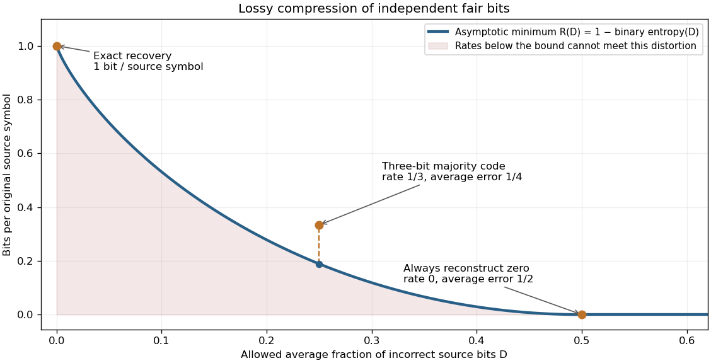

**[Figure 17](#image-allowing-more-incorrect-fair-bits-lowers-the-asymptotic-information-rate). Allowing more incorrect fair bits lowers the asymptotic information rate**. The curve is the exact [binary rate-distortion function](#binary-rate-distortion-function). The marked three-symbol code has rate $1/3$ at [expected distortion](#expected-distortion) $1/4$; its gap above the curve shows that a small explicit [block code](coding-theory.md#block-code) need not attain the asymptotic bound. Rates count [bits](#bit) per original source symbol.

[Rate-distortion theory](#rate-distortion-theory) separates the question of what is possible from the design of a practical [encoder](coding-theory.md#channel-encoder) and [decoder](coding-theory.md#channel-decoder). It also forces the fidelity criterion to be explicit. [Hamming distortion](#hamming-distortion) treats all symbol mismatches alike; [mean squared error](statistical-modelling.md#mean-squared-error) instead penalizes larger numerical errors more strongly. Those objectives can favor different reconstructions of the same data. An average error criterion does not by itself control the error on every individual input.

[Claude Shannon](mathematics-author.md#claude-shannon)'s [Coding Theorems for a Discrete Source With a Fidelity Criterion by Claude Shannon](mathematics-bibliography.md#coding-theorems-for-a-discrete-source-with-a-fidelity-criterion-by-claude-shannon) was published in 1959. Its formulation fixes a cost for replacing one source letter by another and studies the communication rate compatible with the allowed average cost. The important shift is to quantify which distinctions may be discarded, rather than requiring exact recovery of every letter.[Coding Theorems for a Discrete Source With a Fidelity Criterion by Claude Shannon](mathematics-bibliography.md#coding-theorems-for-a-discrete-source-with-a-fidelity-criterion-by-claude-shannon)

#### Distortion measure (information theory)

↑ **Parent:** [Rate-distortion function](#rate-distortion-function)

A [distortion measure](#distortion-measure-information-theory) assigns a nonnegative cost to replacing a source symbol $x$ by a reconstruction $\hat x$. It need not be a [metric](topological-analysis.md#metric): the two [alphabets](#alphabet) may differ, and neither symmetry nor the [triangle inequality](topological-analysis.md#triangle-inequality) is required. Choosing the cost is part of the model. For numerical symbols, $d(x,\hat x)=(x-\hat x)^2$ gives [mean squared error](statistical-modelling.md#mean-squared-error) after averaging; for exact symbol agreement, use [Hamming distortion](#hamming-distortion).

##### Reconstruction alphabet

↑ **Parent:** [Distortion measure (information theory)](#distortion-measure-information-theory)

The [reconstruction alphabet](#reconstruction-alphabet) is the set of values that the [decoder](coding-theory.md#channel-decoder) may output. It need not equal the source [alphabet](#alphabet). A restricted [reconstruction alphabet](#reconstruction-alphabet) can prevent zero [expected distortion](#expected-distortion), even if the representation is allowed arbitrarily many [bits](#bit).

##### Expected distortion

↑ **Parent:** [Distortion measure (information theory)](#distortion-measure-information-theory)

[Expected distortion](#expected-distortion) is the [expectation](probability-theory.md#expected-value) of the reconstruction cost under the joint [probability distribution](probability-theory.md#probability-distribution) of $X$ and $\widehat X$. It weights common source outcomes more strongly than rare ones. A bound on [expected distortion](#expected-distortion) is therefore different from a bound on the cost for every input, or on the [probability](probability-theory.md#probability) of exceeding a specified cost.

##### Separable distortion

↑ **Parent:** [Distortion measure (information theory)](#distortion-measure-information-theory)

For a [block code](coding-theory.md#block-code), [separable distortion](#separable-distortion) is the average of the individual symbol costs. With [Hamming distortion](#hamming-distortion) it is the fraction of incorrectly reconstructed symbols, rather than the unnormalized number of mismatches. This normalization makes [expected distortion](#expected-distortion) comparable across different block lengths.[§23.2, Definition 23.1, printed pp. 242–243](mathematics-bibliography.md#6-441-information-theory-spring-2016-lecture-notes-by-yury-polyanskiy-and-others/chapter-23-rate-distortion-theory)

#### Test channel (information theory)

↑ **Parent:** [Rate-distortion function](#rate-distortion-function)

A [test channel](#test-channel-information-theory) is a proposed [conditional distribution](probability-theory.md#conditional-distribution) of a reconstruction given the source symbol. It describes a candidate joint [probability distribution](probability-theory.md#probability-distribution) for evaluating [mutual information](#mutual-information) and [expected distortion](#expected-distortion). It need not be a physical transmission [channel](#communication-channel), or an implementable one-symbol [encoder](coding-theory.md#channel-encoder); the [Shannon rate-distortion theorem](#shannon-s-rate-distortion-theorem) relates this optimization to long [block codes](coding-theory.md#block-code).

#### Hamming distortion

↑ **Parent:** [Rate-distortion function](#rate-distortion-function)

[Hamming distortion](#hamming-distortion) is zero for a correctly reconstructed symbol and one for a mismatch. Its [expected distortion](#expected-distortion) is the symbol-error [probability](probability-theory.md#probability):

$$
\mathbb E[d(X,\widehat X)]=\mathbb P(X\ne\widehat X).
$$

For strings of length $n$, [separable distortion](#separable-distortion) divides their [Hamming distance](coding-theory.md#hamming-distance) by $n$. Thus $001$ reconstructed as $000$ has [Hamming distance](coding-theory.md#hamming-distance) one and average [Hamming distortion](#hamming-distortion) $1/3$. Counting only whether the whole string is correct would give a different criterion.

##### Three-bit lossy Hamming code

↑ **Parent:** [Hamming distortion](#hamming-distortion)

Let $X_1,X_2,X_3$ be [independent](random-variable.md#independent-random-variables) fair [bits](#bit). The [encoder](coding-theory.md#channel-encoder) sends their majority [bit](#bit): zero when at least two inputs are zero, and one otherwise. The [decoder](coding-theory.md#channel-decoder) reconstructs $000$ or $111$ by repeating that received [bit](#bit) three times. This is [lossy compression](computer-science.md#lossy-compression): different original strings deliberately share a reconstruction.

There are eight equally likely inputs. The strings $000$ and $111$ have zero [Hamming distance](coding-theory.md#hamming-distance) from their reconstructions; each of the other six has [Hamming distance](coding-theory.md#hamming-distance) one. One transmitted [bit](#bit) represents three source symbols, so

$$
\boxed{R=\frac13,\qquad D=\frac{2\cdot0+6\cdot1}{8\cdot3}=\frac14.}
$$

Every input has average [Hamming distortion](#hamming-distortion) at most $1/3$, whereas the population average is $1/4$. The actual [block code](coding-theory.md#block-code) therefore obeys $R\geq R(D)\approx0.18872$, but does not reach the optimal long-block rate.

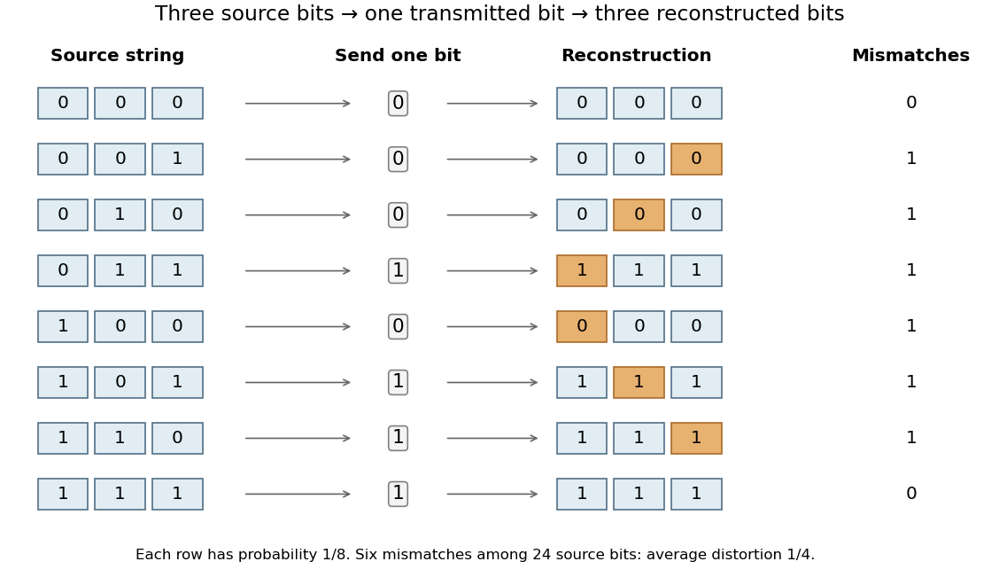

**[Figure 18](#image-eight-equally-likely-source-strings-become-two-reconstructions-using-one-transmitted-bit). Eight equally likely source strings become two reconstructions using one transmitted bit**. The [encoder](coding-theory.md#channel-encoder) sends the majority [bit](#bit). Orange highlights a reconstructed [bit](#bit) that differs from its input. Six source strings have one mismatch and two have none, giving average [Hamming distortion](#hamming-distortion) $1/4$ per source symbol. No errors occur in the transmission model; the loss is introduced deliberately by the [encoder](coding-theory.md#channel-encoder).

This construction uses the same reconstruction strings as the threefold [binary repetition code](coding-theory.md#binary-repetition-code), but the tasks differ. An error-correcting [encoder](coding-theory.md#channel-encoder) expands one source [bit](#bit) into three transmitted [bits](#bit); this [lossy compression](computer-science.md#lossy-compression) example compresses three source [bits](#bit) into one transmitted [bit](#bit). The source distribution and the direction of the mapping matter.

##### Binary rate-distortion function

↑ **Parent:** [Hamming distortion](#hamming-distortion)

For a stationary source of [independent and identically distributed](random-variable.md#independent-and-identically-distributed-random-variables) fair [bits](#bit), with [Hamming distortion](#hamming-distortion) and binary [reconstruction alphabet](#reconstruction-alphabet),

$$
\boxed{R(D)=\begin{cases}1-h_2(D),&0\leq D\leq1/2,\\0,&D\geq1/2.\end{cases}}
$$

The [binary entropy](#binary-entropy) convention is $0\log_2 0=0$. Once $D\geq1/2$, always reconstructing zero meets the distortion constraint without sending any [bits](#bit). The formula $1-h_2(D)$ must not be extended to $D>1/2$: a looser constraint cannot increase the required rate.[§25.1.1, Bernoulli Source, printed p. 255](mathematics-bibliography.md#6-441-information-theory-spring-2016-lecture-notes-by-yury-polyanskiy-and-others/chapter-25-evaluating-r-d-lossy-source-channel-separation)

The short argument identifies both sides of the optimum. For any feasible binary reconstruction, put $E=X\oplus\widehat X$, using [exclusive or](computer-science.md#exclusive-or). Knowing $\widehat X$ makes $X$ and $E$ determine one another, so the [conditional entropy](#conditional-entropy) obeys

$$
H(X\mid\widehat X)=H(E\mid\widehat X)\leq H(E)=h_2(\mathbb P(E=1))\leq h_2(D)
$$

when $0\leq D\leq1/2$. The last step uses the increase of [binary entropy](#binary-entropy) on that interval. Hence $I(X;\widehat X)=1-H(X\mid\widehat X)\geq1-h_2(D)$. Conversely, choose $\widehat X=X\oplus N$ with an [independent](random-variable.md#independent-random-variables) [Bernoulli random variable](discrete-probability-distribution.md#bernoulli-distribution) $N$ of parameter $D$. This [binary symmetric channel](coding-theory.md#binary-symmetric-channel) has [expected distortion](#expected-distortion) $D$ and [mutual information](#mutual-information) $1-h_2(D)$, attaining the bound.

#### Fixed-length lossy code

↑ **Parent:** [Rate-distortion function](#rate-distortion-function)

A [fixed-length lossy code](#fixed-length-lossy-code) maps a block of $n$ source symbols to one of $M_n$ messages, then maps that message to a reconstruction block. The [encoder](coding-theory.md#channel-encoder) and [decoder](coding-theory.md#channel-decoder) together define the reconstruction. Its rate is $\log_2 M_n/n$ [bits](#bit) per source symbol; an implementation using a fixed binary message needs $\lceil\log_2 M_n\rceil$ transmitted [bits](#bit) per block. Its performance also depends on [expected distortion](#expected-distortion), block length, and the chosen [distortion measure](#distortion-measure-information-theory).

<h4 id="shannon-s-rate-distortion-theorem">Shannon's rate-distortion theorem</h4>

↑ **Parent:** [Rate-distortion function](#rate-distortion-function)

For a finite [alphabet](#alphabet) source with [independent and identically distributed](random-variable.md#independent-and-identically-distributed-random-variables) symbols, a finite [reconstruction alphabet](#reconstruction-alphabet), and a bounded nonnegative [separable distortion](#separable-distortion), the [rate-distortion function](#rate-distortion-function) is the asymptotic limit for [fixed-length lossy codes](#fixed-length-lossy-code). In particular, for a distortion target in the interior of the feasible range and every $\varepsilon>0$, sufficiently long [block codes](coding-theory.md#block-code) exist with rate at most $R(D)+\varepsilon$ and [expected distortion](#expected-distortion) at most $D+\varepsilon$. Every such $n$-symbol code obeys $R_n\geq R(D_n)$, where $D_n$ is its actual [expected distortion](#expected-distortion).[§24.1, Theorem 24.1, printed pp. 246–247; §24.2, Theorem 24.2, printed p. 247](mathematics-bibliography.md#6-441-information-theory-spring-2016-lecture-notes-by-yury-polyanskiy-and-others/chapter-24-rate-distortion-achievability-bounds)

The outline is instructive. The [data processing inequality](#data-processing-inequality) bounds the [mutual information](#mutual-information) in a reconstruction by the [information entropy](#information-entropy) of the transmitted message, which is at most $\log_2 M_n$. [Independence](random-variable.md#independent-random-variables) and the [convexity](real-analysis.md#convex-function) of the [rate-distortion function](#rate-distortion-function) then give the per-symbol lower bound. For achievability, choose many reconstruction blocks using a suitable [probability distribution](probability-theory.md#probability-distribution), so that the source's typical blocks are likely to have an acceptable nearby reconstruction. This is a covering argument; it does not require recovering the original block exactly.

#### Zero-rate distortion threshold

↑ **Parent:** [Rate-distortion function](#rate-distortion-function)

For the finite [alphabets](#alphabet) considered here, the [zero-rate distortion threshold](#zero-rate-distortion-threshold) is the smallest [expected distortion](#expected-distortion) obtainable by always outputting one fixed reconstruction. Such a reconstruction is [independent](random-variable.md#independent-random-variables) of the source, so its [mutual information](#mutual-information) is zero. A randomized output that is [independent](random-variable.md#independent-random-variables) of the source averages the costs of fixed reconstructions and cannot improve their minimum. Thus $R(D)=0$ exactly when $D\geq D_{\mathrm{zero}}$. For a fair [bit](#bit) under [Hamming distortion](#hamming-distortion), $D_{\mathrm{zero}}=1/2$; for a [Bernoulli random variable](discrete-probability-distribution.md#bernoulli-distribution) of parameter $p$, it is $\min\{p,1-p\}$. The threshold depends on the source [probability distribution](probability-theory.md#probability-distribution), rather than only the [alphabet](#alphabet).

## Channel capacity

↑ **Parent:** [Information theory](information-theory.md)  
ⓦ [Wiki](https://en.wikipedia.org/wiki/Channel_capacity)

[Channel capacity](#channel-capacity) is the best reliable information rate available through a specified [communication channel](#communication-channel). For a [discrete memoryless channel](coding-theory.md#discrete-memoryless-channel) with finite input and output [alphabets](#alphabet), fixed [transition probabilities](markov-process.md#transition-probability) $W(y\mid x)$, and no input-cost constraint, it is

$$
C=\max_{P_X}I(X;Y)
$$

in [bits](#bit) per channel use, when the [mutual information](#mutual-information) uses base-two [logarithms](calculus.md#logarithm). The maximization varies the input [probability distribution](probability-theory.md#probability-distribution), while keeping the [communication channel](#communication-channel) fixed. A large input [alphabet](#alphabet) or a large output [information entropy](#information-entropy) alone does not determine how much information gets through: the receiver needs information about the input, rather than merely unpredictable output.

The operational meaning comes from the [Shannon second coding theorem](coding-theory.md#noisy-channel-coding-theorem). A [block code](coding-theory.md#block-code) represents one of $M$ possible messages by a word of length $n$, giving a rate $\log_2 M/n$ [bits](#bit) per use. Take the message label from the [uniform distribution on a finite set](discrete-probability-distribution.md#discrete-uniform-distribution) of those $M$ choices when measuring average decoding-error [probability](probability-theory.md#probability). For every fixed rate $R<C$, there are sequences of such [block codes](coding-theory.md#block-code) whose decoding-error [probability](probability-theory.md#probability) tends to zero as $n$ grows; a rate above $C$ cannot have vanishing decoding-error [probability](probability-theory.md#probability). This is an asymptotic limit, rather than a promise that an arbitrary finite [block code](coding-theory.md#block-code) at a rate below $C$ works well. See [MIT 18.310, Shannon's Noisy Coding Theorem, sections 1–2](https://ocw.mit.edu/courses/18-310-principles-of-discrete-applied-mathematics-fall-2013/12c7d786302979771e10a8fd31e07405_MIT18_310F13_Ch21.pdf).

For a [binary symmetric channel](coding-theory.md#binary-symmetric-channel) with crossover [probability](probability-theory.md#probability) $p=0.1$, the [binary symmetric channel capacity](#binary-symmetric-channel-capacity) is approximately $0.53100441$ [bits](#bit) per use. Thus a binary [code rate](coding-theory.md#code-rate) $R=1/2$ lies below the limit, while $R=3/4$ lies above it. At $R=1/2$, two transmitted symbols represent one message [bit](#bit) on average; the redundancy helps distinguish messages after noise. This does not split individual physical symbols into fractional pieces.

The result is useful because it separates two tasks. Computing [channel capacity](#channel-capacity) establishes the target imposed by the [transition probabilities](markov-process.md#transition-probability); constructing an effective [block code](coding-theory.md#block-code) attempts to approach that target with acceptable delay and decoding effort. The surprise is that reliability can improve indefinitely without forcing every positive rate to disappear. In his 1948 paper, Shannon defines noisy [channel capacity](#channel-capacity) in section 12 and develops its operational significance in section 13, Theorem 11. His original formulation uses information per unit time; the fixed-duration channel-use convention here expresses the same rate question per symbol. [A Mathematical Theory of Communication by Claude Shannon](mathematics-bibliography.md#a-mathematical-theory-of-communication-by-claude-shannon).

### Weakly symmetric channel capacity

↑ **Parent:** [Channel capacity](#channel-capacity)

For a [discrete memoryless channel](coding-theory.md#discrete-memoryless-channel) with $m$ output symbols, suppose every row of the [transition matrix](markov-process.md#stochastic-matrix) is a [permutation](combinatorics.md#permutation) of every other row and all column sums agree. Such a [communication channel](#communication-channel) has

$$
C=\log_2m-H(\text{one row}).
$$

The row [Shannon entropy](#information-entropy) is the same for every input, so $H(Y\mid X)$ has that fixed value for every input [probability distribution](probability-theory.md#probability-distribution). The remaining term $H(Y)$ is at most $\log_2m$ by [maximum entropy on a finite alphabet](#maximum-entropy-on-a-finite-alphabet).

A uniform input attains the bound. If there are $\ell$ input symbols, the total of all [transition probabilities](markov-process.md#transition-probability) in the [matrix](vector-space.md#matrix) is $\ell$; equal column sums must therefore each be $\ell/m$. Multiplication by the uniform input mass $1/\ell$ gives output mass $1/m$ in each column. Hence $H(Y)=\log_2m$, which proves the displayed formula. The [cyclic ternary channel capacity](#cyclic-ternary-channel-capacity), [binary symmetric channel capacity](#binary-symmetric-channel-capacity), and [ternary symmetric channel capacity](#ternary-symmetric-channel-capacity) are concrete applications of this symmetry calculation.

#### Cyclic ternary channel capacity

↑ **Parent:** [Weakly symmetric channel capacity](#weakly-symmetric-channel-capacity)

A [discrete memoryless channel](coding-theory.md#discrete-memoryless-channel) on the additive [group](group.md) $\mathbb Z/3\mathbb Z$ maps $x$ to $x$ with [probability](probability-theory.md#probability) $1-q$ and to $x+1$ with [probability](probability-theory.md#probability) $q$. Every input gives the same [conditional entropy](#conditional-entropy) $h_2(q)$, whereas the output [Shannon entropy](#information-entropy) is at most $\log_2 3$. A uniform input produces a uniform output since every column of the transition [matrix](vector-space.md#matrix) sums to one. Hence the [channel capacity](#channel-capacity) is $\log_2 3-h_2(q)$ [bits](#bit) per use. This cyclic-error channel differs from a channel distributing its error probability equally over both other output symbols.

#### Binary symmetric channel capacity

↑ **Parent:** [Weakly symmetric channel capacity](#weakly-symmetric-channel-capacity)

A [binary symmetric channel](coding-theory.md#binary-symmetric-channel) independently flips each transmitted [bit](#bit) with crossover [probability](probability-theory.md#probability) $p$. Its [channel capacity](#channel-capacity) is

$$
C=1-h_2(p),\qquad 0\leq p\leq1,
$$

in [bits](#bit) per use, where $h_2$ is [binary entropy](#binary-entropy) and the endpoint convention is $0\log_2 0=0$. Knowing the input leaves just the uncertainty of the flip, so $H(Y\mid X)=h_2(p)$ for every input [probability distribution](probability-theory.md#probability-distribution). Since the output is a [bit](#bit), $H(Y)\leq1$, and thus $I(X;Y)\leq1-h_2(p)$. A fair input produces a fair output and reaches the bound. This is the two-symbol case of [weakly symmetric channel capacity](#weakly-symmetric-channel-capacity); [Eytan Modiano, MIT 16.36, Channel Capacity and Coding, slides 4–5](https://ocw.mit.edu/courses/16-36-communication-systems-engineering-spring-2009/a49d9e2954b440def3794fe73e79756c_MIT16_36s09_lec13_14.pdf) gives this calculation.

For crossover [probabilities](probability-theory.md#probability) $p=0.01,0.1,0.25$, the resulting [channel capacities](#channel-capacity) are approximately $0.91920686$, $0.53100441$, and $0.18872188$ [bits](#bit) per use. At $p=0$, the [communication channel](#communication-channel) is noiseless; at $p=1/2$, the output is [independent](random-variable.md#independent-random-variables) of the input and the capacity is zero. At $p=1$, every [bit](#bit) is inverted, a known reversible rule, and capacity is one again. More generally $C(p)=C(1-p)$, because inverting every received [bit](#bit) exchanges the two crossover [probabilities](probability-theory.md#probability). The existing [mutual information](#mutual-information) figure shows this full symmetric curve.

An uncoded transmission illustrates why the raw bit-error [probability](probability-theory.md#probability) is not itself [channel capacity](#channel-capacity). At $p=0.1$, transmitting 100 uncoded [bits](#bit) succeeds on all of them with [probability](probability-theory.md#probability) $0.9^{100}\approx0.00002656$. The [probability](probability-theory.md#probability) of at least one error is therefore approximately $0.99997344$. A suitable [block code](coding-theory.md#block-code) changes which received words count as recoverable evidence of a message; simply repeating uncoded transmission at rate one does not obtain the reliability promised at rates below $C$.

##### Input distribution optimization for a binary symmetric channel

↑ **Parent:** [Binary symmetric channel capacity](#binary-symmetric-channel-capacity)

Let $q=\Pr(X=1)$ for the input [bit](#bit) of a [binary symmetric channel](coding-theory.md#binary-symmetric-channel) with crossover [probability](probability-theory.md#probability) $p$. The [law of total probability](probability-theory.md#law-of-total-probability) gives

$$
\Pr(Y=1)=(1-q)p+q(1-p)=p+(1-2p)q.
$$

Consequently its [mutual information](#mutual-information) is

$$
I(X;Y)=h_2\!\left(p+(1-2p)q\right)-h_2(p).
$$

Here $p$ specifies the noise and $q$ specifies the input bias; they are different choices. At $p=0.1$ and $q=0.2$, the output has $\Pr(Y=1)=0.26$, giving $H(Y)\approx0.82674637$ and $I(X;Y)\approx0.35775078$ [bits](#bit). With the same noise and the fair input $q=1/2$, the output becomes fair and $I(X;Y)\approx0.53100441$ [bits](#bit), attaining [binary symmetric channel capacity](#binary-symmetric-channel-capacity).

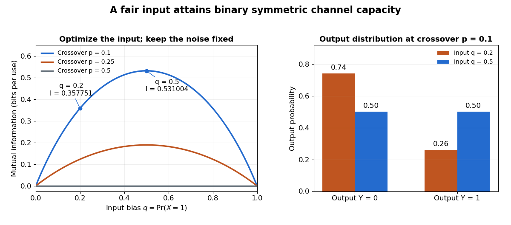

**[Figure 19](#image-a-fair-input-maximizes-retained-information-through-a-binary-symmetric-channel). A fair input maximizes retained information through a binary symmetric channel**. The left panel holds the crossover [probability](probability-theory.md#probability) fixed and varies $q=\Pr(X=1)$. The right panel shows the output [probability distributions](probability-theory.md#probability-distribution) for $p=0.1$ with input biases $q=0.2$ and $q=0.5$. More output [Shannon entropy](#information-entropy) helps here because the conditional noise [information entropy](#information-entropy) stays fixed.

For $p\ne1/2$, [binary entropy](#binary-entropy) reaches one only at output mass $1/2$, and the equation $p+(1-2p)q=1/2$ forces $q=1/2$. Thus the maximizing input is unique in those cases. For $p=1/2$, every input produces the same fair output and zero [mutual information](#mutual-information), so every input bias is optimal and none transmits information. A fixed input $q=0$ or $q=1$ also carries zero [mutual information](#mutual-information) for every $p$: noise can make its output unpredictable without creating an unknown message to recover.

##### Flips versus erasures in a binary channel

↑ **Parent:** [Binary symmetric channel capacity](#binary-symmetric-channel-capacity)

A [binary erasure channel](coding-theory.md#binary-erasure-channel) marks its failed transmissions with a special output symbol, whereas a [binary symmetric channel](coding-theory.md#binary-symmetric-channel) changes a [bit](#bit) without announcing whether it changed. At the same nominal failure [probability](probability-theory.md#probability) $p=0.1$, the two [communication channels](#communication-channel) therefore leave different uncertainty. With a fair input, an unerased output determines the input exactly, while the erasure flag leaves one [bit](#bit) of [conditional entropy](#conditional-entropy). Thus $H(X\mid Y)=p$ and $I(X;Y)=1-p=0.9$ for the [binary erasure channel](coding-theory.md#binary-erasure-channel). This is the binary case of [capacity of a finite-alphabet erasure channel](coding-theory.md#capacity-of-a-finite-alphabet-erasure-channel).

For the [binary symmetric channel](coding-theory.md#binary-symmetric-channel) at $p=0.1$, neither possible received symbol rules out either input, and $H(X\mid Y)=h_2(0.1)\approx0.46899559$. Its [channel capacity](#channel-capacity) is only $1-h_2(0.1)\approx0.53100441$. A receiver benefits from knowing _where_ information was lost, even when the fraction of affected transmissions is the same.

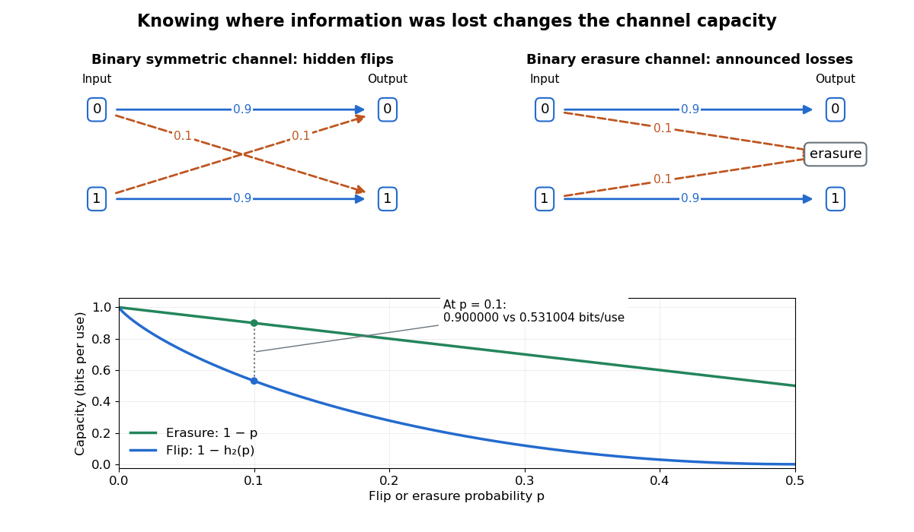

**[Figure 20](#image-announced-erasures-preserve-more-information-than-hidden-bit-flips-at-the-same-low-failure-probability). Announced erasures preserve more information than hidden bit flips at the same low failure probability**. Solid arrows carry [probability](probability-theory.md#probability) $0.9$ and dashed arrows carry [probability](probability-theory.md#probability) $0.1$ in the two illustrated laws of [transition probabilities](markov-process.md#transition-probability). The erasure flag is distinct from both [bits](#bit). The lower plot compares [channel capacity](#channel-capacity) for $0\leq p\leq1/2$, using $1-p$ for the [binary erasure channel](coding-theory.md#binary-erasure-channel) and $1-h_2(p)$ for the [binary symmetric channel](coding-theory.md#binary-symmetric-channel).

This comparison concerns the specified [transition probabilities](markov-process.md#transition-probability), rather than a general ordering of every error mechanism. In particular, at $p=1$, an erasure flag conveys no input information, while deterministic inversion still conveys a full [bit](#bit). Reporting only an error percentage loses the distinction between hidden corruption, announced loss, and a predictable reversible transformation.

#### Ternary symmetric channel capacity

↑ **Parent:** [Weakly symmetric channel capacity](#weakly-symmetric-channel-capacity)

For diagonal transition probability $1-2\alpha$ and each off-diagonal probability $\alpha$,

$$
C=\log_2 3
 +(1-2\alpha)\log_2(1-2\alpha)
 +2\alpha\log_2\alpha,
$$

with $0\log 0=0$.

## Information entropy

↑ **Parent:** [Information theory](information-theory.md)

For a finite [discrete random variable](random-variable.md#discrete-random-variable) with [probability mass function](probability-theory.md#probability-mass-function) $p$, its information entropy is the [expected value](probability-theory.md#expected-value) of its [information content](#information-content):

$$
H(X)=-\sum_{x:p(x)>0}p(x)\log_2p(x)
=\mathbb E[-\log_2p(X)].
$$

Base-two [logarithms](calculus.md#logarithm) give [bits](#bit); choosing a different base rescales the units. The convention $0\log_2 0=0$ is justified by a [limit](calculus.md#limit-of-a-function), so outcomes of zero [probability](probability-theory.md#probability) contribute nothing. The definition also applies to countable distributions, but the sum may be infinite.

A fair [bit](#bit) has $H=1$. A certain outcome has $H=0$. A [Bernoulli random variable](discrete-probability-distribution.md#bernoulli-distribution) that is one with [probability](probability-theory.md#probability) $0.1$ has $H=h_2(0.1)\approx0.469$ [bits](#bit), because most of its outcomes are predictable. A rare outcome still has large [information content](#information-content): the outcome of [probability](probability-theory.md#probability) $0.1$ contributes $-\log_2(0.1)\approx3.322$ [bits](#bit) of surprise when it occurs. **Entropy is the average surprise, rather than the surprise of each outcome.**

For $m$ possible outcomes, $0\leq H(X)\leq\log_2m$, with the upper bound attained exactly by the [uniform distribution on a finite set](discrete-probability-distribution.md#discrete-uniform-distribution). The [Gibbs inequality](probability-and-statistics.md#gibbs-inequality) proves this by comparing $p$ with the uniform distribution: $D(p\Vert u)=\log_2m-H(X)\geq0$. Thus increasing predictability reduces the required average description length. The four-symbol [prefix code](coding-theory.md#prefix-code) in [information theory](information-theory.md) attains $H=7/4$ [bits](#bit) exactly; for general probabilities, integer codeword lengths prevent such a perfect match for every individual symbol. [Shannon's source coding theorem](coding-theory.md#shannon-s-source-coding-theorem) explains how coding sufficiently long independent blocks approaches the entropy per symbol.

The [logarithm](calculus.md#logarithm) is especially natural because [independent](random-variable.md#independent-random-variables) outcomes have additive surprise: $-\log_2(pq)=-\log_2p-\log_2q$. Taking [expected values](probability-theory.md#expected-value) gives additive [information entropy](#information-entropy) for [independent random variables](random-variable.md#independent-random-variables); for dependent ones, the [chain rule for information entropy](#chain-rule-for-information-entropy) replaces the second term by [conditional entropy](#conditional-entropy). This is why the same quantity can govern both a single observation and a long message.

### Joint entropy

↑ **Parent:** [Information entropy](#information-entropy)

[Joint entropy](#joint-entropy) is the [information entropy](#information-entropy) of an entire [random vector](random-variable.md#random-vector), treating its coordinates together as one outcome. For [random variables](random-variable.md) with finite [alphabets](#alphabet) and joint [probability mass function](probability-theory.md#probability-mass-function) $p$,

$$
H(X_1,\ldots,X_n)=-\sum_{x_1,\ldots,x_n:p(x_1,\ldots,x_n)>0}p(x_1,\ldots,x_n)\log_2 p(x_1,\ldots,x_n).
$$

It is measured in [bits](#bit). The distinction from separate [information entropies](#information-entropy) is whether shared uncertainty is counted once or repeatedly. Two copies of the same fair [bit](#bit) have [joint entropy](#joint-entropy) one [bit](#bit), since only $00$ and $11$ can occur. Two [independent](random-variable.md#independent-random-variables) fair [bits](#bit) have [joint entropy](#joint-entropy) two [bits](#bit), since all four pairs are possible and equiprobable.

For a less symmetric example, assign [probabilities](probability-theory.md#probability) $1/2,1/4,1/4$ to $(X,Y)=(0,0),(1,0),(1,1)$ respectively. Then

$$
\boxed{H(X,Y)=\tfrac12\cdot1+\tfrac14\cdot2+\tfrac14\cdot2=\tfrac32\text{ bits}.}
$$

Here $X$ is fair, while $\mathbb P(Y=1)=1/4$. Thus $H(X)=1$ and $H(Y)=h_2(1/4)\approx0.811278$ [bits](#bit), where $h_2$ is [binary entropy](#binary-entropy). Adding the separate [information entropies](#information-entropy) would give approximately $1.811278$ [bits](#bit), overcounting by the [mutual information](#mutual-information) $I(X;Y)\approx0.311278$ [bits](#bit).

The [chain rule for information entropy](#chain-rule-for-information-entropy) makes the shared information explicit:

$$
H(X,Y)=H(X)+H(Y\mid X).
$$

In this example $Y$ is certain given $X=0$ and fair given $X=1$, so its average [conditional entropy](#conditional-entropy) is $H(Y\mid X)=\tfrac12\cdot0+\tfrac12\cdot1=1/2$ [bit](#bit). Sending the first coordinate changes how much uncertainty remains in the second. A [prefix code](coding-theory.md#prefix-code) with codewords `0`, `10`, `11` for the three possible pairs has average length $3/2$ [bits](#bit), exactly the [joint entropy](#joint-entropy) in this stipulated law.

For finite [alphabets](#alphabet),

$$
\max_iH(X_i)\leq H(X_1,\ldots,X_n)\leq\sum_iH(X_i).
$$

The lower bound follows because knowing the full [random vector](random-variable.md#random-vector) determines every coordinate; the upper bound follows from [conditioning reduces entropy](#conditioning-reduces-entropy) in the [chain rule for information entropy](#chain-rule-for-information-entropy). Equality in the upper bound means joint [independence](random-variable.md#independent-random-variables). The difference from that upper bound is [total correlation](#total-correlation), whose [noisy parity total correlation](#noisy-parity-total-correlation) example shows why separate pairwise comparisons need not find all the dependence.

### Cross-entropy

↑ **Parent:** [Information entropy](#information-entropy)  
ⓦ [Wiki](https://en.wikipedia.org/wiki/Cross-entropy)

[Cross-entropy](#cross-entropy) measures the average [logarithmic loss](foundations-of-mathematics.md#logarithmic-loss) incurred when outcomes follow one [probability distribution](probability-theory.md#probability-distribution) $P$, but a model assigns [probabilities](probability-theory.md#probability) using another [probability distribution](probability-theory.md#probability-distribution) $Q$. For a finite [alphabet](#alphabet), write their [probability mass functions](probability-theory.md#probability-mass-function) as $p_i$ and $q_i$. With base-two [logarithms](calculus.md#logarithm),

$$
H(P,Q)=-\sum_{i:p_i>0}p_i\log_2 q_i=\mathbb E_P[-\log_2 q(X)].
$$

The expectation is under the true or stipulated source law $P$, rather than the model $Q$. Terms with $p_i=0$ contribute nothing. If $p_i>0$ but $q_i=0$ for any outcome, the [cross-entropy](#cross-entropy) is $+\infty$: the model rules out an event that can occur. The result is measured in [bits](#bit); [natural logarithms](calculus.md#natural-logarithm) give [nats](#nat-unit).

The useful identity is [cross-entropy equals entropy plus relative entropy](#cross-entropy-equals-entropy-plus-relative-entropy):

$$
\boxed{H(P,Q)=H(P)+D_{\mathrm{KL}}(P\Vert Q).}
$$

The source's [information entropy](#information-entropy) $H(P)$ is the baseline uncertainty. The [Kullback-Leibler divergence](probability-and-statistics.md#kullback-leibler-divergence) is the extra average cost of a mismatched model, with the true law first and model second. Thus optimizing $Q$ for a fixed $P$ reduces the mismatch, rather than changing the source's own uncertainty. For finite [alphabets](#alphabet), the minimum is $H(P)$, attained exactly at $Q=P$.

Take a three-symbol source with $P=(1/2,1/4,1/4)$. A matched binary [prefix code](coding-theory.md#prefix-code) assigns $A\mapsto0$, $B\mapsto10$, $C\mapsto11$, with lengths $(1,2,2)$. A mismatched [prefix code](coding-theory.md#prefix-code) instead assigns $A\mapsto10$, $B\mapsto11$, $C\mapsto0$, with lengths $(2,2,1)$, corresponding to $Q=(1/4,1/4,1/2)$. Both [prefix codes](coding-theory.md#prefix-code) decode exactly, but the most common symbol is shorter in the matched code. Under the same source $P$,

$$
\begin{aligned}
H(P)&=\tfrac12\cdot1+\tfrac14\cdot2+\tfrac14\cdot2=\tfrac32,\\
H(P,Q)&=\tfrac12\cdot2+\tfrac14\cdot2+\tfrac14\cdot1=\tfrac74,\\
D_{\mathrm{KL}}(P\Vert Q)&=\tfrac12\log_2 2+\tfrac14\log_2 1+\tfrac14\log_2(1/2)=\tfrac14.
\end{aligned}
$$

**The mismatched code costs an extra (1/4) bit per source symbol on average.** No information is lost; the penalty is inefficient representation of this source. The [mismatch penalty in lossless coding](#mismatch-penalty-in-lossless-coding) explains when this coding interpretation is exact.

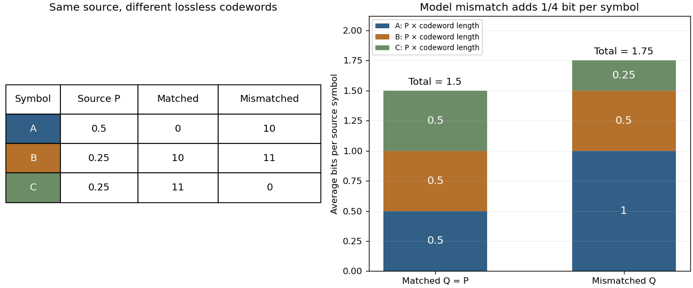

**[Figure 21](#image-two-lossless-prefix-codes-have-different-average-lengths-for-the-same-source). Two lossless prefix codes have different average lengths for the same source**. Both sets of [codewords](coding-theory.md#codeword) are [prefix codes](coding-theory.md#prefix-code). The source [probabilities](probability-theory.md#probability) are fixed at $(1/2,1/4,1/4)$. Each colored contribution is source [probability](probability-theory.md#probability) times [codeword length](coding-theory.md#codeword-length); changing which symbol receives the shortest word increases the total from $3/2$ to $7/4$ [bits](#bit) per source symbol.

[Cross-entropy](#cross-entropy) is also useful when evaluating a [predictive distribution](probability-theory.md#predictive-distribution). A report that places tiny [probability](probability-theory.md#probability) on the realized outcome receives a large [logarithmic loss](foundations-of-mathematics.md#logarithmic-loss), even when it usually predicts the most common outcome correctly. The loss convention is the negative of the reward convention in the [logarithmic scoring rule](statistical-inference.md#logarithmic-scoring-rule). Its expected loss is uniquely minimized by the correct [probability distribution](probability-theory.md#probability-distribution), making it a [strictly proper scoring rule](statistical-inference.md#strictly-proper-scoring-rule). [Strictly Proper Scoring Rules, Prediction, and Estimation by Tilmann Gneiting and others](mathematics-bibliography.md#strictly-proper-scoring-rules-prediction-and-estimation-by-tilmann-gneiting-and-others) treats this connection in §3.1, Example 3; its discussion uses rewards, so the signs are reversed for the losses here.[Strictly Proper Scoring Rules, Prediction, and Estimation by Tilmann Gneiting and others](mathematics-bibliography.md#strictly-proper-scoring-rules-prediction-and-estimation-by-tilmann-gneiting-and-others)

[I. J. Good](mathematics-author.md#i-j-good)'s [Rational Decisions by I. J. Good](mathematics-bibliography.md#rational-decisions-by-i-j-good) appeared in 1952. Its published summary describes a method for encouraging accurate [probability](probability-theory.md#probability) estimates and a connection with [information theory](information-theory.md). [Strictly Proper Scoring Rules, Prediction, and Estimation by Tilmann Gneiting and others](mathematics-bibliography.md#strictly-proper-scoring-rules-prediction-and-estimation-by-tilmann-gneiting-and-others) traces the [logarithmic scoring rule](statistical-inference.md#logarithmic-scoring-rule) at least as far back as this 1952 paper.[Rational Decisions by I. J. Good](mathematics-bibliography.md#rational-decisions-by-i-j-good)

#### Cross-entropy equals entropy plus relative entropy

↑ **Parent:** [Cross-entropy](#cross-entropy)

For finite [probability mass functions](probability-theory.md#probability-mass-function), with $q_i>0$ whenever $p_i>0$, subtract the two [expectations](probability-theory.md#expected-value) of [logarithmic loss](foundations-of-mathematics.md#logarithmic-loss):

$$
\begin{aligned}
H(P,Q)-H(P)
&=\sum_{i:p_i>0}p_i(\log_2 p_i-\log_2 q_i)\\
&=\sum_{i:p_i>0}p_i\log_2\frac{p_i}{q_i}
=D_{\mathrm{KL}}(P\Vert Q).
\end{aligned}
$$

The [Gibbs inequality](probability-and-statistics.md#gibbs-inequality) makes the difference nonnegative and zero exactly when $P=Q$. If $Q$ assigns zero [probability](probability-theory.md#probability) to an outcome with positive [probability](probability-theory.md#probability) under $P$, both the [cross-entropy](#cross-entropy) and the [Kullback-Leibler divergence](probability-and-statistics.md#kullback-leibler-divergence) are infinite. The finite [information entropy](#information-entropy) still leaves the displayed identity valid in the extended sense. In more general settings, undefined differences such as $\infty-\infty$ cannot be used as a derivation.

#### Mismatch penalty in lossless coding

↑ **Parent:** [Cross-entropy](#cross-entropy)

Suppose a binary [prefix code](coding-theory.md#prefix-code) has integer [codeword lengths](coding-theory.md#codeword-length) $\ell_i=-\log_2 q_i$. Under a source with [probability mass function](probability-theory.md#probability-mass-function) $p_i$, its average [codeword length](coding-theory.md#codeword-length) is exactly [cross-entropy](#cross-entropy), $\sum_i p_i\ell_i=H(P,Q)$. The [Kraft inequality](coding-theory.md#kraft-mcmillan-inequality) is satisfied because $\sum_i2^{-\ell_i}=\sum_iq_i=1$. This exact interpretation requires suitable [dyadic rational](arithmetic.md#dyadic-rational) [probabilities](probability-theory.md#probability); a general $-\log_2q_i$ is not an integer [codeword length](coding-theory.md#codeword-length). For positive $q_i$, a [prefix code](coding-theory.md#prefix-code) with lengths $\lceil-\log_2q_i\rceil$ exists by the [Kraft inequality](coding-theory.md#kraft-mcmillan-inequality) and has average length between $H(P,Q)$ and $H(P,Q)+1$. The [ceiling function](calculus.md#ceiling-function) causes the one-symbol rounding overhead. The cross-entropy term describes mismatch overhead; those are distinct costs.

#### Binary cross-entropy

↑ **Parent:** [Cross-entropy](#cross-entropy)

Let $Y$ follow a [Bernoulli distribution](discrete-probability-distribution.md#bernoulli-distribution) with true event [probability](probability-theory.md#probability) $r$, and let the model report event [probability](probability-theory.md#probability) $q$. The [binary cross-entropy](#binary-cross-entropy) is its expected [logarithmic loss](foundations-of-mathematics.md#logarithmic-loss):

$$
H(r,q)=-r\log_2q-(1-r)\log_2(1-q).
$$

For $0<r<1$, it is minimized at $q=r$, where the value is [binary entropy](#binary-entropy) $h_2(r)$. An individual outcome has loss $-\log_2q$ when $Y=1$ and $-\log_2(1-q)$ when $Y=0$; the [binary cross-entropy](#binary-cross-entropy) averages those two cases using the true [probabilities](probability-theory.md#probability).

For $r=1/4$, truthful reporting gives $h_2(1/4)\approx0.811278$ [bits](#bit). Reporting $q=1/2$ gives one [bit](#bit). Reporting $q=0.01$ gives

$$
H(1/4,0.01)=\tfrac14\log_2 100-\tfrac34\log_2 0.99\approx1.671839\text{ bits}.
$$

Both $q=1/4$ and $q=0.01$ select zero if one predicts only the more likely binary outcome. Their predicted [probabilities](probability-theory.md#probability) are very different, however, and [cross-entropy](#cross-entropy) reveals the cost of underestimating the event that occurs a quarter of the time. Endpoint losses are computed using the realized outcome rather than multiplying zero by an undefined [logarithm](calculus.md#logarithm).

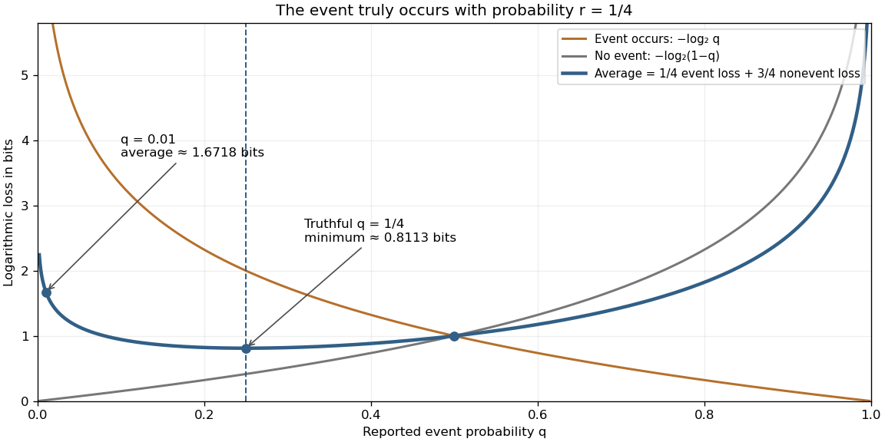

**[Figure 22](#image-the-expected-logarithmic-loss-is-minimized-by-reporting-the-true-event-probability). The expected logarithmic loss is minimized by reporting the true event probability**. The true [Bernoulli distribution](discrete-probability-distribution.md#bernoulli-distribution) has parameter $r=1/4$. The blue curve averages the orange event loss and gray nonevent loss with weights $1/4$ and $3/4$. Its minimum is at $q=r$, while both endpoint limits diverge because both outcomes have positive [probability](probability-theory.md#probability). These are calculated expectations, rather than measurements.

#### Empirical cross-entropy

↑ **Parent:** [Cross-entropy](#cross-entropy)

For observations $X_1,\ldots,X_n$ of a [categorical variable](statistical-modelling.md#categorical-variable), [empirical cross-entropy](#empirical-cross-entropy) is the average [logarithmic loss](foundations-of-mathematics.md#logarithmic-loss) under the reported [probability mass function](probability-theory.md#probability-mass-function) $q$. Writing the [empirical distribution](#type-information-theory) as $\hat p_i=n^{-1}\#\{t:X_t=i\}$ gives

$$
\widehat H_n(Q)=-\frac1n\sum_{t=1}^n\log_2q(X_t)
=-\sum_{i:\hat p_i>0}\hat p_i\log_2q_i=H(\widehat P_n,Q).
$$

Under [independent and identically distributed](random-variable.md#independent-and-identically-distributed-random-variables) observations from $P$ and a fixed model with positive [probability](probability-theory.md#probability) for each possible outcome, the [law of large numbers](convergence-of-random-variables.md#law-of-large-numbers) gives convergence to $H(P,Q)$. A finite [empirical distribution](#type-information-theory) is an estimate of $P$, rather than the true source law; unobserved outcomes need not be impossible. If the same data are used to choose $Q$, evaluating the resulting [empirical cross-entropy](#empirical-cross-entropy) on that data need not estimate its prediction performance on fresh observations without [bias](statistical-modelling.md#bias-of-an-estimator).

##### Cross-entropy and maximum likelihood

↑ **Parent:** [Empirical cross-entropy](#empirical-cross-entropy)

For a [parametric statistical model](statistical-model.md#parametric-statistical-model) with [probability mass function](probability-theory.md#probability-mass-function) $q_\theta$ and an [independent and identically distributed](random-variable.md#independent-and-identically-distributed-random-variables) model, minimizing [empirical cross-entropy](#empirical-cross-entropy) is [maximum likelihood estimation](statistical-modelling.md#maximum-likelihood-estimation). The [logarithm](calculus.md#logarithm) is strictly increasing, so maximizing $\prod_tq_\theta(X_t)$ is equivalent to maximizing $\sum_t\log_2q_\theta(X_t)$. Negating and dividing by $n$ gives the displayed minimization. Restricting the model family can prevent the optimum from matching the [empirical distribution](#type-information-theory), and a finite optimizing parameter need not exist. This algebra does not by itself establish accuracy on new data.[§1, printed p. 360: optimum-score estimation and maximum likelihood](mathematics-bibliography.md#strictly-proper-scoring-rules-prediction-and-estimation-by-tilmann-gneiting-and-others)

### Entropy monotonicity under independent addition

↑ **Parent:** [Information entropy](#information-entropy)

If $U,V$ are [independent random variables](random-variable.md#independent-random-variables) taking values in a countable additive group, conditioning on $V$ makes $U+V$ a translate of $U$. Consequently $H(U+V\mid V)=H(U)$, and [conditional entropy](#conditional-entropy) gives $H(U+V)\geq H(U)$. If the two [information entropies](#information-entropy) are finite, equality holds exactly when $U+V$ and $V$ are independent.

// Target: probability-and-statistics.bigb

### Entropy function for a q-ary alphabet

↑ **Parent:** [Information entropy](#information-entropy)

This is the entropy in base $q$ of the distribution with one symbol of probability $1-x$ and each of the other $q-1$ symbols of probability $x/(q-1)$. It increases on $[0,1-1/q]$ from zero to one, and governs the exponential volume of a [Hamming ball](coding-theory.md#hamming-ball). For $q=2$ it is the [binary entropy](#binary-entropy) function.

// Target: algebra.bigb

### Information content

↑ **Parent:** [Information entropy](#information-entropy)  
ⓦ [Wiki](https://en.wikipedia.org/wiki/Information_content)

The self-information of a positive-probability outcome is the negative logarithm of its probability. Independent outcomes have additive self-information. Its expectation is [Shannon entropy](#information-entropy).

// Target: probability-and-statistics.bigb

### Graph entropy

↑ **Parent:** [Information entropy](#information-entropy)  
ⓦ [Wiki](https://en.wikipedia.org/wiki/Graph_entropy)

For a vertex law $P$ on a graph, choose $X\sim P$ and an [independent set](graph-theory.md#independent-set-graph-theory) valued random variable $Y$ containing $X$ almost surely. Minimize their [mutual information](#mutual-information) over all such joint laws. This defines graph entropy. It differs from the entropy of a proper coloring, because the random independent set need not be a deterministic color class.

### Entropy bound with one prescribed probability

↑ **Parent:** [Information entropy](#information-entropy)

If one probability in a $k$-point distribution equals $t$, normalize the remaining $k-1$ probabilities to $q$. Then $H=h(t)+(1-t)H(q)\leq h(t)+(1-t)\log_2(k-1)$. Equality for $t<1$ means that the remaining probabilities are equal. This combines the [binary entropy](#binary-entropy) of the distinguished event with the largest residual [Shannon entropy](#information-entropy).

### Epsilon-sufficient set

↑ **Parent:** [Information entropy](#information-entropy)

For a finite-valued [random variable](random-variable.md), an epsilon-sufficient set $S$ retains probability at least $1-\epsilon$. This notion is about covering probability mass and is unrelated to a [sufficient statistic](probability-and-statistics.md#sufficient-statistic). For an [IID random variable](random-variable.md#independent-and-identically-distributed-random-variables) source, any such set of words with fixed $\epsilon<1$ requires exponentially many words at a rate approaching the [Shannon entropy](#information-entropy).

#### Minimum size of a sufficient set for an IID source

↑ **Parent:** [Epsilon-sufficient set](#epsilon-sufficient-set)

For finite-alphabet [independent and identically distributed random variables](random-variable.md#independent-and-identically-distributed-random-variables), fixed $0\leq\epsilon<1$ and $\delta>0$, every [epsilon-sufficient set](#epsilon-sufficient-set) $S_n$ of length-$n$ words satisfies $|S_n|\geq(1-\epsilon)2^{n(H-\delta)}/2$ for sufficiently large $n$. Intersect $S_n$ with a [typical set](#typical-set) whose excluded mass is at most $(1-\epsilon)/2$. The intersection retains that much probability and each word has probability at most $2^{-n(H-\delta)}$.

### Differential entropy

↑ **Parent:** [Information entropy](#information-entropy)  
ⓦ [Wiki](https://en.wikipedia.org/wiki/Differential_entropy)

[Differential entropy](#differential-entropy) describes the spread of a continuous [probability distribution](probability-theory.md#probability-distribution) relative to the volume scale of its coordinates. For a real [random variable](random-variable.md) $X$ with [probability density function](continuous-probability-distribution.md#probability-density-function) $f$, use [natural logarithms](calculus.md#natural-logarithm) and write

$$
\boxed{h_e(X)=-\int_{\mathbb R} f(x)\ln f(x)\,dx=-\mathbb E[\ln f(X)].}
$$

The convention is $0\ln0=0$. For a finite value, require $\int f|\ln f|<\infty$; if both positive and negative contributions are infinite, the expression is undefined. Unlike a [probability](probability-theory.md#probability), a [probability density](quantum-mechanics.md#probability-density) can exceed one. Consequently [differential entropy](#differential-entropy) can be negative. Base-two [logarithms](calculus.md#logarithm) give $h_2=h_e/\ln2$, in [bits](#bit) instead of [nats](#nat-unit).[§1.3, Definition 1.5, equation (1.19) and warning, printed p. 18](mathematics-bibliography.md#6-441-information-theory-spring-2016-lecture-notes-by-yury-polyanskiy-and-others/chapter-1-information-measures-entropy-and-divergence)

This quantity does not give the exact number of [bits](#bit) needed to store a real number. A recording device supplies a resolution; [equal-width bin entropy](#equal-width-bin-entropy) connects that resolution to discrete [information entropy](#information-entropy). The useful continuous quantity is what remains after removing the increasing cost of specifying finer bins. Its dependence on coordinates is visible already in [differential entropy of a uniform law](#differential-entropy-of-a-uniform-law).

#### Differential entropy of a uniform law

↑ **Parent:** [Differential entropy](#differential-entropy)

For a [continuous uniform distribution](continuous-probability-distribution.md#continuous-uniform-distribution) on an interval of length $L>0$, the [probability density](quantum-mechanics.md#probability-density) is $1/L$. Direct integration gives

$$
h_e(X)=-\int_a^{a+L}\frac1L\ln\frac1L\,dx=\ln L.
$$

Thus **a uniform law on an interval of length $1/2$ has differential entropy $-\ln2$**, while length two gives $\ln2$. Both laws have total [probability](probability-theory.md#probability) one. The shorter interval has larger [probability density](quantum-mechanics.md#probability-density), making $-\ln f(X)$ negative; this is neither a negative [probability](probability-theory.md#probability) nor a negative discrete [information entropy](#information-entropy).

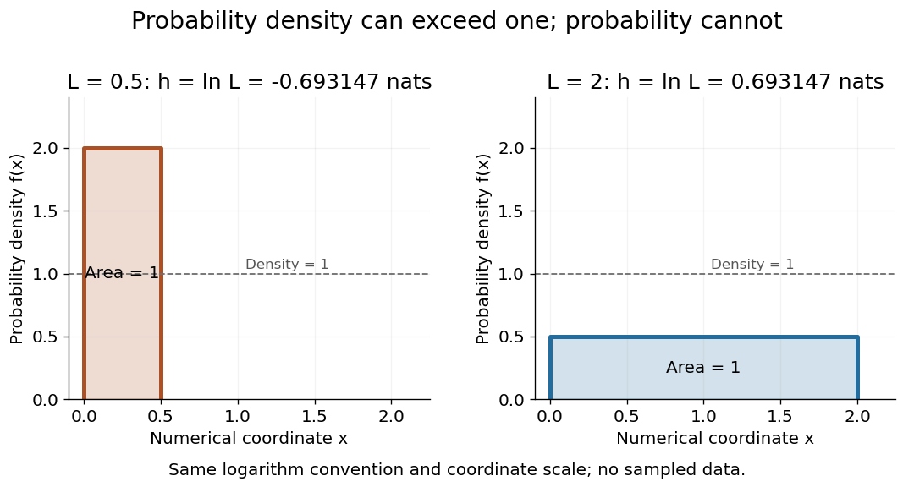

**[Figure 23](#image-uniform-densities-can-have-negative-or-positive-differential-entropy). Uniform densities can have negative or positive differential entropy**. The two stipulated [continuous uniform distributions](continuous-probability-distribution.md#continuous-uniform-distribution) have density two on an interval of length $1/2$ and density $1/2$ on an interval of length two. Each rectangle has area one. The reported [differential entropy](#differential-entropy) is in [nats](#nat-unit), using the displayed numerical coordinates.

#### Differential entropy of a Gaussian law

↑ **Parent:** [Differential entropy](#differential-entropy)

For a [normal distribution](probability-theory.md#normal-distribution) with [mean](probability-theory.md#expected-value) $m$ and positive [variance](variance.md) $\sigma^2$, expand the [logarithm](calculus.md#logarithm) of its [probability density function](continuous-probability-distribution.md#probability-density-function):

$$
-\ln f(X)=\frac12\ln(2\pi\sigma^2)+\frac{(X-m)^2}{2\sigma^2}.
$$

The second term has [expected value](probability-theory.md#expected-value) $1/2$, hence $h_e(X)=\tfrac12\ln(2\pi e\sigma^2)$. Translation of the [mean](probability-theory.md#expected-value) has no effect, while shrinking the [standard deviation](variance.md#standard-deviation) lowers [differential entropy](#differential-entropy). A [standard normal distribution](probability-theory.md#standard-normal-distribution) has approximately $1.41894$ [nats](#nat-unit). This connects the continuous spread calculation with [entropy power](#entropy-power), whose normalization matches a [Gaussian distribution](probability-theory.md#normal-distribution)'s [variance](variance.md).

#### Differential entropy under an increasing transformation

↑ **Parent:** [Differential entropy](#differential-entropy)

Let $X$ have a [probability density function](continuous-probability-distribution.md#probability-density-function) on an open interval, and let $g$ be continuously [differentiable](analysis.md#differentiable-function), strictly increasing there, with $g'(x)>0$. The [change of variables formula](calculus.md#change-of-variables-formula) gives

$$
f_{g(X)}(g(x))=\frac{f_X(x)}{g'(x)}.
$$

If the [differential entropy](#differential-entropy) and the expected absolute [logarithm](calculus.md#logarithm) of $g'(X)$ are finite, taking the [expectation](probability-theory.md#expected-value) of the negative [logarithm](calculus.md#logarithm) proves the displayed formula, for a fixed base $b>1$. Local stretching reduces [probability density](quantum-mechanics.md#probability-density); its contribution to [differential entropy](#differential-entropy) is the expected logarithmic stretch. The map is invertible, so this change does not mean that the transformation destroyed information about $X$.

##### Differential entropy of a squared uniform variable

↑ **Parent:** [Differential entropy under an increasing transformation](#differential-entropy-under-an-increasing-transformation)

Take $X$ with [continuous uniform distribution](continuous-probability-distribution.md#continuous-uniform-distribution) on $(0,1)$ and set $Y=X^2$. This is an increasing invertible transformation on that interval. Its [cumulative distribution function](probability-theory.md#cumulative-distribution-function) is $F_Y(y)=\sqrt y$, giving

$$
f_Y(y)=\frac1{2\sqrt y},\qquad 0<y<1.
$$

Although the [probability density](quantum-mechanics.md#probability-density) diverges near zero, it is [integrable](measure-theory.md#integrability). The logarithmic stretch is integrable too:

$$
h_e(Y)=h_e(X)+\int_0^1\ln(2x)\,dx
=\boxed{\ln2-1\approx-0.306853\text{ nats}.}
$$

The [inverse function](function.md#inverse-function) $X=\sqrt Y$ recovers every input in the interval. The changed [differential entropy](#differential-entropy) records a changed coordinate volume, rather than a failure of recovery.

// Target: probability-and-statistics.bigb

#### Differential entropy under affine rescaling

↑ **Parent:** [Differential entropy](#differential-entropy)

For real $a\ne0$ and $b$, the [change of variables formula](calculus.md#change-of-variables-formula) gives $f_{aX+b}(ax+b)=f_X(x)/|a|$. Therefore

$$
\boxed{h_e(aX+b)=h_e(X)+\ln|a|.}
$$

The absolute value also covers a decreasing transformation. If a numerical length changes from metres to centimetres, $a=100$ and the [differential entropy](#differential-entropy) changes by $\ln100\approx4.60517$ [nats](#nat-unit), although the physical uncertainty is the same. The reference coordinate scale must therefore accompany an absolute [differential entropy](#differential-entropy) value.

#### Equal-width bin entropy

↑ **Parent:** [Differential entropy](#differential-entropy)

Partition $(0,1)$ into $n$ bins of width $\delta=1/n$, and let the [discrete random variable](random-variable.md#discrete-random-variable) $Q_n$ record the bin containing $X$. This is a [quantization](computer-science.md#quantization-signal-processing) of $X$. Its [probability mass function](probability-theory.md#probability-mass-function) is

$$
p_j=\int_{j/n}^{(j+1)/n}f(x)\,dx,\qquad 0\leq j<n,
$$

and its discrete [information entropy](#information-entropy) is $H_e(Q_n)=-\sum_jp_j\ln p_j$. Let $\bar f_j=p_j/\delta$ be the average [probability density](quantum-mechanics.md#probability-density) within bin $j$. Rearrangement gives the exact finite-bin identity

$$
H_e(Q_n)+\ln\delta=-\sum_j\delta\bar f_j\ln\bar f_j.
$$

For a [continuous](calculus.md#continuous-function) [probability density](quantum-mechanics.md#probability-density) on $[0,1]$, [uniform continuity](topological-analysis.md#uniform-continuity) makes the bin averages converge uniformly to the density. Since $t\ln t$ is [continuous](calculus.md#continuous-function) at zero with the stated convention, the right-hand side converges to $h_e(X)$. Thus the increasing resolution cost is $\ln n$; [differential entropy](#differential-entropy) is the remaining offset, rather than the entire discrete encoding cost.

For a [continuous uniform distribution](continuous-probability-distribution.md#continuous-uniform-distribution), every bin has [probability](probability-theory.md#probability) $1/n$, and $H_e(Q_n)=\ln n$ exactly. For the [continuous uniform distribution](continuous-probability-distribution.md#continuous-uniform-distribution)'s squared transformation above, the exact bin probabilities are

$$
p_j=\sqrt{\frac{j+1}{n}}-\sqrt{\frac jn}.
$$

The diagram computes these masses directly, including the bin next to the integrable singularity. It compares their corrected [information entropy](#information-entropy) with the analytic [differential entropy](#differential-entropy) $\ln2-1$.

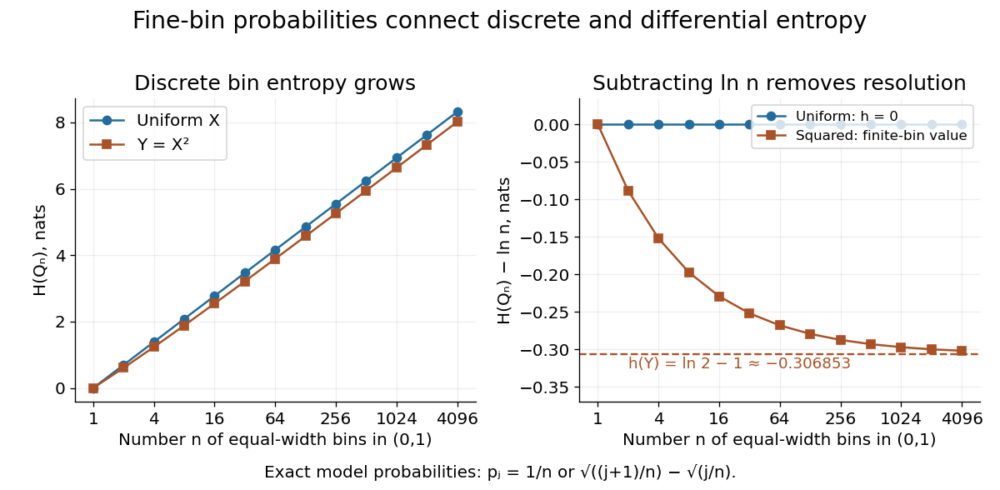

**[Figure 24](#image-removing-the-bin-resolution-cost-reveals-differential-entropy). Removing the bin-resolution cost reveals differential entropy**. The left plot shows discrete [information entropy](#information-entropy) increasing with the number of equal-width bins. The right subtracts $\ln n$ and compares with the exact [differential entropy](#differential-entropy) of a uniform input and its squared transformation. Every plotted point comes from the stated exact [probability mass functions](probability-theory.md#probability-mass-function); no observations are fitted.

#### Relative entropy and coordinate dependence

↑ **Parent:** [Differential entropy](#differential-entropy)

Apply the same invertible differentiable transformation to two [probability distributions](probability-theory.md#probability-distribution) with densities $f$ and $r$. Both transformed densities acquire the same [Jacobian determinant](calculus.md#jacobian-determinant) factor. Write their transformed densities as $f_g$ and $r_g$. Their ratio is unchanged, and the integration measure transforms with the numerator density. Consequently their [relative entropy](probability-and-statistics.md#kullback-leibler-divergence) is unchanged:

$$
D(f_g\Vert r_g)=D(f\Vert r).
$$

The densities describe two alternative laws in the same coordinate, with a nonzero [Jacobian determinant](calculus.md#jacobian-determinant) on their common domain, and the expression is assumed well defined. This explains why comparing two laws can survive a change of measurement units even though either law's [differential entropy](#differential-entropy) changes. [Mutual information](#mutual-information), formulated as [relative entropy](probability-and-statistics.md#kullback-leibler-divergence) from a product of marginals, has the same invariance under invertible changes to either observed coordinate.

[Differential entropy](#differential-entropy) is also the entropy term in the [evidence lower bound](statistical-inference.md#evidence-lower-bound) for continuous [variational inference](statistical-inference.md#variational-inference). Its coordinate dependence must be combined consistently with that of the model density; changing units does not justify changing only one term of the objective.

<h4 id="shannon-s-continuous-entropy-coordinate-convention">Shannon's continuous-entropy coordinate convention</h4>

↑ **Parent:** [Differential entropy](#differential-entropy)

In [A Mathematical Theory of Communication by Claude Shannon](mathematics-bibliography.md#a-mathematical-theory-of-communication-by-claude-shannon) (1948), section 20 extends the discrete entropy formula to continuous densities. Properties 8–9 explicitly discuss coordinate dependence, possible negative values and linear rescaling. [Claude Shannon](mathematics-author.md#claude-shannon) relates this coordinate convention to the engineering use of entropy differences, rather than treating an isolated continuous entropy as an invariant count of messages.[section 20, definition and properties 8–9, reprint pp. 35 and 37–38](mathematics-bibliography.md#a-mathematical-theory-of-communication-by-claude-shannon)

#### Entropy power

↑ **Parent:** [Differential entropy](#differential-entropy)

The [entropy power](#entropy-power) of an $n$-dimensional [random vector](random-variable.md#random-vector) with finite [differential entropy](#differential-entropy) in bits is the [variance](variance.md) per coordinate of an isotropic [Gaussian distribution](probability-theory.md#normal-distribution) with the same [differential entropy](#differential-entropy). The normalization makes $N(X)=\sigma^2$ when $X$ has [covariance matrix](variance.md#covariance-matrix) $\sigma^2I_n$.

// Target: probability-and-statistics.bigb

##### Entropy power inequality

↑ **Parent:** [Entropy power](#entropy-power)  
ⓦ [Wiki](https://en.wikipedia.org/wiki/Entropy_power_inequality)

For independent $n$-dimensional [random vectors](random-variable.md#random-vector) with densities and finite [differential entropies](#differential-entropy), the [entropy power inequality](#entropy-power-inequality) states

$$
2^{2h(X+Y)/n}\geq2^{2h(X)/n}+2^{2h(Y)/n}.
$$

The sum's [differential entropy](#differential-entropy) is required to be defined; a value $+\infty$ makes the inequality immediate. Equality for finite nondegenerate densities occurs for [Gaussian distributions](probability-theory.md#normal-distribution) with proportional [covariance matrices](variance.md#covariance-matrix).

// Target: probability-and-statistics.bigb

###### Multiplicative entropy power inequality

↑ **Parent:** [Entropy power inequality](#entropy-power-inequality)

For independent positive [random variables](random-variable.md) $Y_1,Y_2$ with densities, finite [differential entropies](#differential-entropy) and finite $\mu_i=\mathbb E\log_2Y_i$, applying the [entropy power inequality](#entropy-power-inequality) to $Z_i=\ln Y_i$ gives

$$
2^{2h(Y_1Y_2)}\geq2^{2\mu_2}2^{2h(Y_1)}+2^{2\mu_1}2^{2h(Y_2)}.
$$

Indeed $h(Z_i)=h(Y_i)-\mu_i$, while $h(Y_1Y_2)=h(Z_1+Z_2)+\mu_1+\mu_2$, provided the sum's [differential entropy](#differential-entropy) is defined. Positivity alone does not ensure these expressions exist: $Y=e^T$ with $T$ having [Cauchy distribution](probability-theory.md#cauchy-distribution) has undefined $\mathbb E\log_2Y$.

// Target: algebra.bigb

### Min-entropy

↑ **Parent:** [Information entropy](#information-entropy)  
ⓦ [Wiki](https://en.wikipedia.org/wiki/Min-entropy)

For a [discrete random variable](random-variable.md#discrete-random-variable) $X$ with a finite or countable [alphabet](#alphabet) and [probability mass function](probability-theory.md#probability-mass-function) $p_x=\mathbb P(X=x)$, define $p_{\max}=\max_xp_x$. Its [min-entropy](#min-entropy), using base-two [logarithms](calculus.md#logarithm), is

$$
H_\infty(X)=-\log_2p_{\max}
=\min_{x:p_x>0}(-\log_2p_x).
$$

The unit is the [bit](#bit). This is the smallest [information content](#information-content) of any possible outcome: it records the easiest outcome to predict, whereas [Shannon entropy](#information-entropy) averages [information content](#information-content) over all outcomes. A normalized countable [probability mass function](probability-theory.md#probability-mass-function) has an attained positive maximum, so $H_\infty(X)$ is finite even when [Shannon entropy](#information-entropy) is infinite. Outcomes of zero [probability](probability-theory.md#probability) cannot minimize the surprise and are omitted from the minimum; including extra impossible symbols changes neither quantity.[Pass and shelat, A Course in Cryptography, Section 8.3.2, Definition 148.1](https://www.cs.cornell.edu/courses/cs6830/2009fa/lecnotes.pdf)

Suppose someone knows the [probability mass function](probability-theory.md#probability-mass-function) but receives no observation correlated with $X$, and must name exactly one outcome. Naming $x$ succeeds with [probability](probability-theory.md#probability) $p_x$, so naming a most likely outcome is optimal:

$$
p_{\mathrm{guess}}(X)=\max_x\mathbb P(X=x)=2^{-H_\infty(X)}.
$$

Tied maxima give equally good guesses. Randomizing independently among guesses cannot improve success: if the guess has [probability mass function](probability-theory.md#probability-mass-function) $q_x$, its success [probability](probability-theory.md#probability) is $\sum_xq_xp_x\leq p_{\max}\sum_xq_x=p_{\max}$. This is the simplest instance of [maximum a posteriori decoding](coding-theory.md#maximum-a-posteriori-decoding). The identity gives [min-entropy](#min-entropy) an operational meaning: $H_\infty(X)\geq k$ [bits](#bit) means every single guess succeeds with [probability](probability-theory.md#probability) at most $2^{-k}$, under these information assumptions.[König, Renner and Schaffner, The operational meaning of min- and max-entropy, Section I.3.1, equation (18) and the no-side-information case](https://arxiv.org/html/0807.1338)

For an exact analytical example on symbols $A,B,C,D,E$, compare the two [probability mass functions](probability-theory.md#probability-mass-function)

$$
u=(1/4,1/4,1/4,1/4,0),\qquad b=(1/2,1/8,1/8,1/8,1/8).
$$

Under $u$, each possible outcome has [information content](#information-content) $2$ [bits](#bit); under $b$, $A$ has [information content](#information-content) $1$ [bit](#bit) and each other outcome has $3$ [bits](#bit). Consequently their [Shannon entropies](#information-entropy) agree exactly,

$$
H(u)=4\frac14\cdot2=2,\qquad H(b)=\frac12\cdot1+4\frac18\cdot3=2,
$$

but $H_\infty(u)=2$ and $H_\infty(b)=1$ [bits](#bit). A best single guess therefore succeeds with [probability](probability-theory.md#probability) $1/4$ under $u$ and $1/2$ under $b$. The same average surprise can hide a factor of two in immediate predictability. The zero entry in $u$ contributes zero to [Shannon entropy](#information-entropy), using $0\log_2 0=0$.

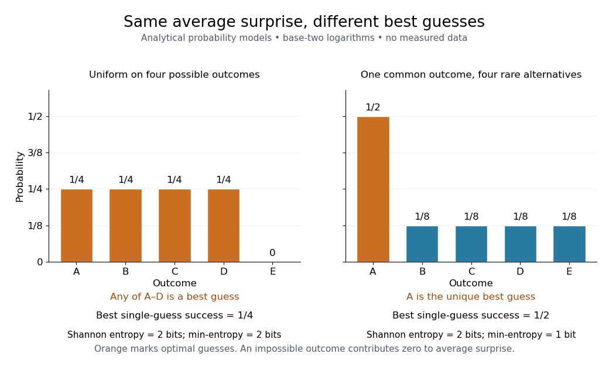

**[Figure 25](#image-two-exact-probability-models-have-the-same-average-surprise-but-different-best-single-guesses). Two exact probability models have the same average surprise but different best single guesses**.

For the [discrete uniform distribution](discrete-probability-distribution.md#discrete-uniform-distribution) on $m$ possible outcomes, $H_\infty=\log_2m$ [bits](#bit) and the best single guess succeeds with [probability](probability-theory.md#probability) $1/m$. A certain outcome has $H_\infty=0$ and success [probability](probability-theory.md#probability) one. Thus [min-entropy](#min-entropy) is useful when a common outcome could defeat an attempt to make outputs unpredictable, even if rare alternatives raise [Shannon entropy](#information-entropy).

For [cryptography](computer-science.md#cryptography), this unconditional calculation alone does not certify security: an observer might know $X$ already. If a report $Y=X$ reveals a uniform four-outcome source, its unconditional [min-entropy](#min-entropy) remains $2$ [bits](#bit) but guessing after the report succeeds with [probability](probability-theory.md#probability) one. For finite classical reports, the appropriate success calculation uses [conditional probabilities](probability-theory.md#conditional-probability) and [maximum a posteriori decoding](coding-theory.md#maximum-a-posteriori-decoding):

$$
p_{\mathrm{guess}}(X\mid Y)=\sum_{y:p_Y(y)>0}p_Y(y)\max_x\mathbb P(X=x\mid Y=y).
$$

The [conditional entropy](#conditional-entropy) $H(X\mid Y)$ instead averages remaining surprise. A security argument must specify the observer's information and the protocol's required guarantee; neither unconditional [min-entropy](#min-entropy) nor [Shannon entropy](#information-entropy) supplies those assumptions.

#### Information entropy dominates min-entropy

↑ **Parent:** [Min-entropy](#min-entropy)

For a [discrete random variable](random-variable.md#discrete-random-variable) $X$ with [probability mass function](probability-theory.md#probability-mass-function) $p_x$, using base-two [logarithms](calculus.md#logarithm) for both [Shannon entropy](#information-entropy) and [min-entropy](#min-entropy),

$$
H(X)\geq H_\infty(X)\geq0.
$$

The first inequality says that average [information content](#information-content) cannot be below the least [information content](#information-content) of a possible outcome. For a finite [alphabet](#alphabet), equality $H(X)=H_\infty(X)$ holds exactly when the [probability mass function](probability-theory.md#probability-mass-function) is uniform on its positive-probability outcomes. Impossible outcomes do not need to share that positive [probability](probability-theory.md#probability). In particular, $(1/2,1/2,0)$ has both quantities equal to $1$ [bit](#bit), while $(1,0,0)$ has both zero. The same equality characterization holds for a countable [alphabet](#alphabet): equality forces only finitely many positive-probability outcomes, because all must have the same positive mass. The uniform maximum of [Shannon entropy](#information-entropy) is discussed in Shannon's original treatment.[Shannon, A Mathematical Theory of Communication, Section 6, definition of H and properties 1–2](mathematics-bibliography.md#a-mathematical-theory-of-communication-by-claude-shannon)

For the proof, $0<p_x\leq p_{\max}$ gives $-\log_2p_x\geq-\log_2p_{\max}$; taking the [expected value](probability-theory.md#expected-value) proves [information entropy dominates min-entropy](#information-entropy-dominates-min-entropy). More precisely, the nonnegative gap is

$$
H(X)-H_\infty(X)
=\sum_{x:p_x>0}p_x\log_2\frac{p_{\max}}{p_x}\geq0.
$$

It vanishes precisely when every positive term vanishes, namely $p_x=p_{\max}$ for every possible outcome. With $m$ such outcomes, normalization forces $p_{\max}=1/m$. If [Shannon entropy](#information-entropy) is infinite, the inequality still holds and is strict, because [min-entropy](#min-entropy) of a countable [probability mass function](probability-theory.md#probability-mass-function) is finite. No subtraction of two infinite quantities is needed.

An analytical family makes the gap visible. Give $A$ [probability](probability-theory.md#probability) $q$ and each of $B,C,D,E$ [probability](probability-theory.md#probability) $(1-q)/4$, with $1/5\leq q\leq1$. Then $A$ is a most likely outcome, so its [probability](probability-theory.md#probability) is also the best single-guess success [probability](probability-theory.md#probability), and

$$
H_\infty(q)=-\log_2q,\qquad H(q)=h_2(q)+2(1-q),
$$

where $h_2$ is [binary entropy](#binary-entropy). The [entropy bound with one prescribed probability](#entropy-bound-with-one-prescribed-probability) explains the second expression: it separates whether $A$ occurred from which of four equally likely alternatives occurred. At $q=1/5$, all five outcomes are uniform and both quantities are $\log_2 5\approx2.3219$ [bits](#bit). At $q=1/2$, [Shannon entropy](#information-entropy) is $2$ [bits](#bit) while [min-entropy](#min-entropy) is $1$ [bit](#bit), reproducing the biased example in [min-entropy](#min-entropy). At $q=1$, both are zero; the four impossible alternatives contribute nothing. For every $1/5<q<1$, the [probability mass function](probability-theory.md#probability-mass-function) is nonuniform on its possible outcomes and the gap is strictly positive.

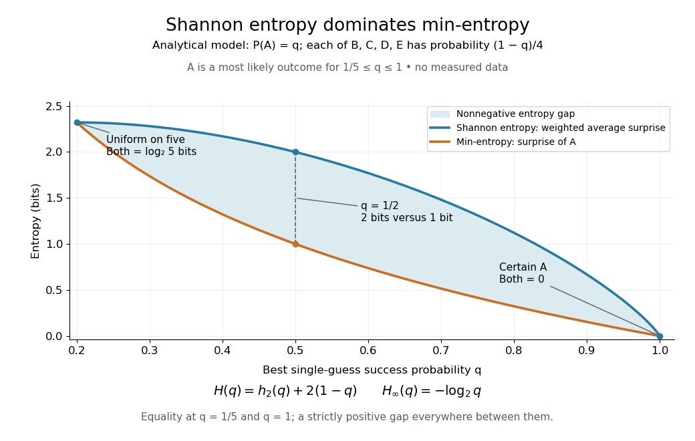

**[Figure 26](#image-an-analytical-five-outcome-model-separates-average-surprise-from-the-surprise-of-the-most-likely-outcome). An analytical five-outcome model separates average surprise from the surprise of the most likely outcome**.

For finite [Shannon entropy](#information-entropy), exponentiating the inequality gives the useful but potentially loose bound $p_{\mathrm{guess}}(X)\geq2^{-H(X)}$. Equality holds exactly for a [discrete uniform distribution](discrete-probability-distribution.md#discrete-uniform-distribution) on the possible outcomes. Thus [Shannon entropy](#information-entropy) alone supplies a lower bound on optimal success, not the upper bound needed to promise that every guess is unlikely. [Shannon's source coding theorem](coding-theory.md#shannon-s-source-coding-theorem) concerns average compression under its hypotheses, while [min-entropy](#min-entropy) answers the single-guess question directly. The two quantities serve different tasks even when both are expressed in [bits](#bit).

### Varentropy

↑ **Parent:** [Information entropy](#information-entropy)  
ⓦ [Wiki](https://en.wikipedia.org/wiki/Varentropy)

The varentropy of a discrete random variable with mass function $P$ is the variance of its information content:

$$
V_H(X)=\operatorname{Var}[-\log P(X)].
$$

### Binary entropy

↑ **Parent:** [Information entropy](#information-entropy)

The binary entropy function is the [information entropy](#information-entropy) of a [Bernoulli random variable](discrete-probability-distribution.md#bernoulli-distribution):

$$
h_2(p)=-p\log_2p-(1-p)\log_2(1-p),\qquad 0\leq p\leq1,
$$

with endpoint values zero. It is symmetric under $p\mapsto1-p$, reaches one [bit](#bit) at $p=1/2$, and has

$$
h_2'(p)=\log_2\frac{1-p}{p},\qquad h_2''(p)=-\frac1{(\ln2)p(1-p)}<0
$$

in the interior. Its strict [concavity](real-analysis.md#concave-function) expresses why an even mixture of two outcomes has more uncertainty than a strong bias toward either one. The curve in [mutual information](#mutual-information) also shows how this same uncertainty becomes the loss term in [binary symmetric channel capacity](#binary-symmetric-channel-capacity).

### Chain rule for information entropy

↑ **Parent:** [Information entropy](#information-entropy)

For discrete random variables,

$$
H(X,Y)=H(X)+H(Y\mid X).
$$

Iterating gives $H(X_1,\ldots,X_n)=\sum_iH(X_i\mid X_1,\ldots,X_{i-1})$.

### Subadditivity of information entropy

↑ **Parent:** [Information entropy](#information-entropy)

The [chain rule for information entropy](#chain-rule-for-information-entropy) and [conditioning reduces entropy](#conditioning-reduces-entropy) give

$$
H(X,Y)\leq H(X)+H(Y),
$$

with equality exactly when $X$ and $Y$ are [independent](random-variable.md#independent-random-variables).

### Concavity of information entropy

↑ **Parent:** [Information entropy](#information-entropy)

For probability mass functions $P_1,\ldots,P_m$ and convex weights $\alpha_i$, information entropy satisfies

$$
H\!\left(\sum_i\alpha_iP_i\right)\geq\sum_i\alpha_iH(P_i).
$$

This follows from the [concavity](real-analysis.md#concave-function) of $-t\log t$.

### Maximum entropy distribution on a finite set

↑ **Parent:** [Information entropy](#information-entropy)

Among [probability distributions](probability-theory.md#probability-distribution) on a finite set of $m$ elements, the [uniform distribution](continuous-probability-distribution.md#continuous-uniform-distribution) uniquely maximizes [information entropy](#information-entropy), attaining $\log m$.

#### Maximum entropy on a finite alphabet

↑ **Parent:** [Maximum entropy distribution on a finite set](#maximum-entropy-distribution-on-a-finite-set)

An [information entropy](#information-entropy) on at most $m$ outcomes is at most $\log_2m$, with equality for the uniform distribution on all $m$ outcomes. For the uniform reference $u$, the [Kullback-Leibler divergence](probability-and-statistics.md#kullback-leibler-divergence) is $D(p\|u)=\log_2m-H(p)\geq0$, proving the bound.

### Maximum entropy distribution on the nonnegative integers

↑ **Parent:** [Information entropy](#information-entropy)

Among distributions on $\{0,1,2,\ldots\}$ with fixed [expected value](probability-theory.md#expected-value) $\mu$, the [geometric distribution](discrete-probability-distribution.md#geometric-distribution) with success probability $1/(1+\mu)$ uniquely maximizes [information entropy](#information-entropy). Its entropy is

$$
(1+\mu)h_2\!\left(\frac1{1+\mu}\right).
$$

## One-to-one source code

↑ **Parent:** [Information theory](information-theory.md)

A one-to-one source code is an [injective function](algebra.md#injective-function) from source symbols to finite codewords. Unlike a [prefix code](coding-theory.md#prefix-code), it need not permit instantaneous decoding of concatenated codewords.

### Optimal one-to-one binary code

↑ **Parent:** [One-to-one source code](#one-to-one-source-code)

Order source symbols by decreasing probability and assign the $i$th symbol a binary word of length $\lfloor\log_2i\rfloor$. This minimizes expected length among one-to-one binary codes because the available shortest words are assigned to the most probable symbols.

## Huffman coding

↑ **Parent:** [Information theory](information-theory.md)  
ⓦ [Wiki](https://en.wikipedia.org/wiki/Huffman_coding)

Huffman coding makes frequent symbols cheap to store by giving them short [codewords](coding-theory.md#codeword), while allowing rare symbols longer [codewords](coding-theory.md#codeword). For a known [probability distribution](probability-theory.md#probability-distribution) on a finite [alphabet](#alphabet) with at least two positive-probability symbols, binary Huffman coding constructs a [prefix code](coding-theory.md#prefix-code) minimizing [expected codeword length](#expected-codeword-length) among binary [prefix codes](coding-theory.md#prefix-code) that encode one source symbol at a time. The objective is an average under that [probability distribution](probability-theory.md#probability-distribution); it does not promise to shorten every message. Encoder and decoder must agree on the resulting [Huffman code](#huffman-code). [Symbol Codes by Ben Lynn](mathematics-bibliography.md#symbol-codes-by-ben-lynn)

The construction grows a [binary tree](computer-science.md#binary-tree) from its leaves towards its [root of a tree](combinatorics.md#root-of-a-tree). Start with one leaf per symbol, weighted by its [probability](probability-theory.md#probability). Repeatedly join the two currently smallest weights beneath a new [parent in a rooted tree](combinatorics.md#parent-in-a-rooted-tree), whose weight is their sum, and replace the pair by that [subtree](computer-science.md#subtree). Include newly formed [subtrees](computer-science.md#subtree) when choosing the next pair. When one [tree](combinatorics.md#tree-graph-theory) remains, label the two outgoing [edges](graph-theory.md#edge-of-a-graph) at every internal [vertex](graph.md#vertex-graph-theory) with $0$ and $1$; the labels on the [graph path](graph-theory.md#path-in-a-graph) from the [root of a tree](combinatorics.md#root-of-a-tree) to a symbol give its [codeword](coding-theory.md#codeword). This is a [greedy algorithm](computer-science.md#greedy-algorithm): each step makes a locally cheapest merge, yet the result is an [optimal prefix code](#optimal-prefix-code).

For a concrete example, use [probabilities](probability-theory.md#probability) $p_A=0.4$, $p_B=0.3$, $p_C=0.2$, $p_D=0.1$. First join $D$ and $C$, creating weight $0.3$. The remaining weights are $0.3$ for $B$, $0.3$ for the $CD$ [subtree](computer-science.md#subtree), and $0.4$ for $A$. Join the two $0.3$ weights to make $0.6$, then join $A$ with that $0.6$ [subtree](computer-science.md#subtree) to make $1$. The merge weights are therefore $0.3,0.6,1$. Each merge adds one [bit](#bit) to every [codeword](coding-theory.md#codeword) below it, so their sum is the [expected codeword length](#expected-codeword-length): $0.3+0.6+1=1.9$ [bits](#bit) per source symbol. The diagram fixes the [edge](graph-theory.md#edge-of-a-graph) labels to produce the [Huffman code](#huffman-code) used below.

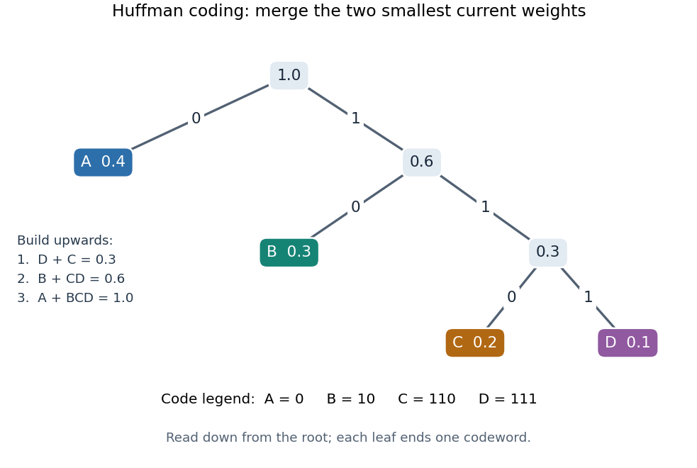

**[Figure 27](#image-huffman-merges-for-probabilities-0-4-0-3-0-2-0-1-and-their-binary-codewords). Huffman merges for probabilities 0.4, 0.3, 0.2, 0.1 and their binary codewords**.

The useful insight is that choosing short [codewords](coding-theory.md#codeword) is a resource allocation problem: the [prefix code](coding-theory.md#prefix-code) condition constrains the available [codeword lengths](coding-theory.md#codeword-length) through the [Kraft inequality](coding-theory.md#kraft-mcmillan-inequality). Huffman coding solves this one-symbol problem exactly for the supplied [probability distribution](probability-theory.md#probability-distribution). For repeated emissions of a [memoryless classical information source](#memoryless-classical-information-source), the same [Huffman code](#huffman-code) can be applied symbol by symbol. More general compression can exploit dependencies or encode groups of symbols; the one-symbol optimality statement does not compare all such methods.

### Huffman code

↑ **Parent:** [Huffman coding](#huffman-coding)

A Huffman code is the [prefix code](coding-theory.md#prefix-code) returned by [Huffman coding](#huffman-coding); the [algorithm](computer-science.md#algorithm) chooses a [code tree](coding-theory.md#prefix-tree-of-a-code), while the code specifies the actual symbol-to-[codeword](coding-theory.md#codeword) assignment. For the [probability distribution](probability-theory.md#probability-distribution) $(0.4,0.3,0.2,0.1)$ in symbol order $A,B,C,D$, the illustrated [binary tree](computer-science.md#binary-tree) gives

$$
c(A)=0,\qquad c(B)=10,\qquad c(C)=110,\qquad c(D)=111.
$$

The [codeword lengths](coding-theory.md#codeword-length) are $1,2,3,3$. This is a [prefix code](coding-theory.md#prefix-code) because no complete [codeword](coding-theory.md#codeword) is an initial segment of another complete [codeword](coding-theory.md#codeword). Thus a decoder can start at the [root of a tree](combinatorics.md#root-of-a-tree), follow one [edge](graph-theory.md#edge-of-a-graph) per [bit](#bit), emit a symbol on reaching its leaf, then restart at the [root of a tree](combinatorics.md#root-of-a-tree). In particular, `011010111` splits as `0 | 110 | 10 | 111` and decodes to $A,C,B,D$. No separators are transmitted: the leaf tells the decoder where a [codeword](coding-theory.md#codeword) ends.

The [expected codeword length](#expected-codeword-length) is

$$
L(c)=\sum_xp_x\,|c(x)|=0.4\cdot1+0.3\cdot2+0.2\cdot3+0.1\cdot3=1.9
$$

[bits](#bit) per source symbol. Four symbols would require $2$ [bits](#bit) each if all [codewords](coding-theory.md#codeword) had the same length, so this [Huffman code](#huffman-code) saves $0.1$ [bit](#bit) per symbol on average, or $5\%$ of that fixed-length payload. A particular message can grow: $A,C,B,D$ uses nine [bits](#bit) here instead of eight. These lengths count the encoded symbols only; transmitting a code description or message framing can add further cost.

The [Kraft inequality](coding-theory.md#kraft-mcmillan-inequality) is saturated by this [Huffman code](#huffman-code):

$$
2^{-1}+2^{-2}+2^{-3}+2^{-3}=1.
$$

Its [Shannon entropy](#information-entropy) is

$$
H(X)=-\sum_xp_x\log_2p_x\approx1.846439
$$

[bits](#bit) per symbol, slightly below the [expected codeword length](#expected-codeword-length) $1.9$. The [entropy lower bound for prefix codes](coding-theory.md#entropy-lower-bound-for-prefix-codes) applies to every binary [prefix code](coding-theory.md#prefix-code) for this [probability distribution](probability-theory.md#probability-distribution). It need not be attainable with integer [codeword lengths](coding-theory.md#codeword-length) for individual symbols; [Huffman coding](#huffman-coding) reaches the best mean within that class. [David J. C. MacKay, Information Theory, Inference, and Learning Algorithms, chapter 5, section 5.4: symbol-code bounds](https://web.iitd.ac.in/~sumeet/mackay.pdf)

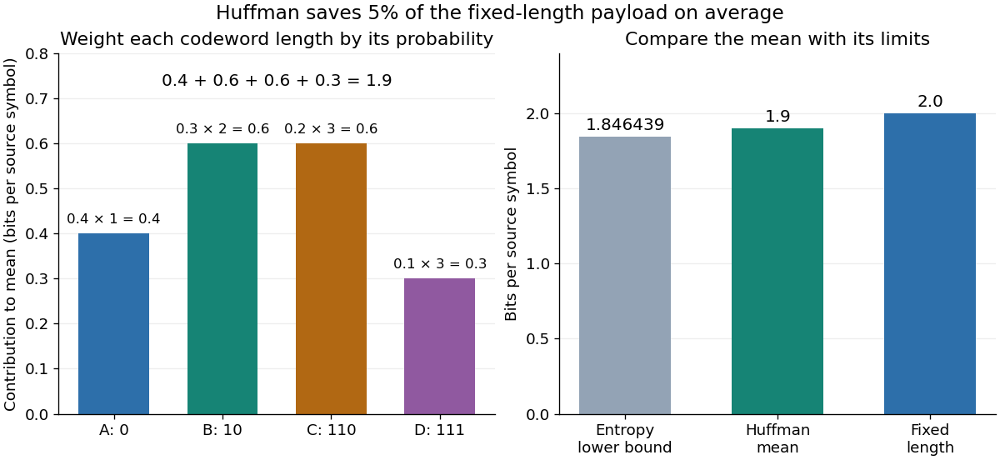

**[Figure 28](#image-probability-weighted-codeword-lengths-sum-to-1-9-bits-per-symbol-between-entropy-and-fixed-length). Probability-weighted codeword lengths sum to 1.9 bits per symbol, between entropy and fixed length**.

A [Huffman code](#huffman-code) need not be unique. In the first example, the tied $B$ and $CD$ weights can exchange their $0/1$ [edge](graph-theory.md#edge-of-a-graph) labels, changing [codewords](coding-theory.md#codeword) but preserving their [codeword lengths](coding-theory.md#codeword-length). Ties can also change the lengths themselves. For a second [probability distribution](probability-theory.md#probability-distribution) $(0.4,0.2,0.2,0.2)$, first merge $C,D$ to weight $0.4$. The next merge can join $B$ with either $A$ or the $CD$ [subtree](computer-science.md#subtree), since both have weight $0.4$. Joining $B$ with $A$ permits $A\mapsto00,B\mapsto01,C\mapsto10,D\mapsto11$, with all lengths $2$. Joining $B$ with the $CD$ [subtree](computer-science.md#subtree) permits $A\mapsto0,B\mapsto10,C\mapsto110,D\mapsto111$, with lengths $1,2,3,3$. Both are [optimal prefix codes](#optimal-prefix-code) with [expected codeword length](#expected-codeword-length) $2$: for the latter, $0.4\cdot1+0.2\cdot2+0.2\cdot3+0.2\cdot3=2$. Tie choices can change the [code tree](coding-theory.md#prefix-tree-of-a-code) without changing the minimum mean.

// Target: algebra.bigb

#### Uniform-source Huffman length distribution

↑ **Parent:** [Huffman code](#huffman-code)

For $m\ge2$ equiprobable symbols, the maximum [codeword length](coding-theory.md#codeword-length) of a binary [Huffman code](#huffman-code) is $s=\lceil\log_2m\rceil$. Exactly $2^s-m$ codewords have length $s-1$ and $2m-2^s$ have length $s$. The [balancing exchange for a uniform optimal prefix code](#balancing-exchange-for-a-uniform-optimal-prefix-code) restricts the depths to these two levels; counting leaves and using equality in the [Kraft inequality](coding-theory.md#kraft-mcmillan-inequality) determine the numbers.

// Target: probability-and-statistics.bigb

### Huffman sibling property

↑ **Parent:** [Huffman coding](#huffman-coding)

For a finite source [alphabet](#alphabet) of $n\geq2$ symbols with positive weights $w_x$, choose any two least weights, breaking ties arbitrarily. There exists an [optimal prefix code](#optimal-prefix-code) over the binary output [alphabet](#alphabet) $\{0,1\}$ whose chosen symbols occupy [sibling leaves in a code tree](#sibling-leaves-in-a-code-tree) at maximum [leaf depth in a code tree](#leaf-depth-in-a-code-tree). Weights may be counts or [probabilities](probability-theory.md#probability): dividing every weight by $W=\sum_xw_x$ gives the same minimizers. The existence statement is what makes the first merge of [Huffman coding](#huffman-coding) safe. It does not say that every [optimal prefix code](#optimal-prefix-code) already has the chosen pair together.[p. 1099: Derived Coding Requirements and Optimum Binary Code](mathematics-bibliography.md#a-method-for-the-construction-of-minimum-redundancy-codes-by-david-a-huffman)

An exchange makes the idea tangible. Take [probabilities](probability-theory.md#probability) $(p_A,p_B,p_C,p_D)=(0.4,0.3,0.2,0.1)$. The [prefix code](coding-theory.md#prefix-code) $D\mapsto0$, $B\mapsto10$, $C\mapsto110$, $A\mapsto111$ has [expected codeword length](#expected-codeword-length) $2.5$ [bits](#bit). Exchange only the symbols $A,D$ at their existing leaves: the available [codewords](coding-theory.md#codeword) and [code tree](coding-theory.md#prefix-tree-of-a-code) shape stay fixed, but the [codeword lengths](coding-theory.md#codeword-length) in symbol order become $(1,2,3,3)$. The new [expected codeword length](#expected-codeword-length) is $1.9$ [bits](#bit), and the two least [probabilities](probability-theory.md#probability), those of $C,D$, now occupy deepest [sibling leaves in a code tree](#sibling-leaves-in-a-code-tree). The saving is $(0.4-0.1)(3-1)=0.6$ [bit](#bit) per source symbol.

**[Figure 29](#prefix-tree-leaf-exchange-and-contraction). Exchanging two leaf labels reduces expected length from 2.5 to 1.9 bits; contracting the least-probability siblings leaves cost 1.6**.

Here is the short proof outline. An [optimal prefix code](#optimal-prefix-code) with positive weights has a [full binary tree](computer-science.md#full-binary-tree) as its [code tree](coding-theory.md#prefix-tree-of-a-code): suppressing a [vertex](graph.md#vertex-graph-theory) with only one child shortens every [codeword](coding-theory.md#codeword) in that [subtree](computer-science.md#subtree) and strictly reduces cost. A deepest leaf therefore has a leaf as its sibling, giving the [deepest sibling property of an optimal prefix code](#deepest-sibling-property-of-an-optimal-prefix-code). Put the two chosen least weights at these positions by successive exchanges of leaf labels. Moving a weight $a$ from [leaf depth in a code tree](#leaf-depth-in-a-code-tree) $d$ to a deepest position $D\geq d$, occupied by $b\geq a$, changes the weighted sum by

$$
\Delta C=aD+bd-(ad+bD)=(a-b)(D-d)\leq0.
$$

Fix one chosen weight there, then move the other into the neighbouring deepest position; if it is already there, no exchange is needed. The [prefix code](coding-theory.md#prefix-code) condition survives because the set of [codewords](coding-theory.md#codeword) is unchanged. Starting from an [optimal prefix code](#optimal-prefix-code), the cost cannot decrease below the minimum, so these exchanges preserve optimality. Strictly unequal weights at unequal depths would give a strict decrease, explaining [probability monotonicity of optimal prefix-code lengths](#probability-monotonicity-of-optimal-prefix-code-lengths). Equal weights or equal depths allow cost-neutral exchanges. [Symbol Codes by Ben Lynn](mathematics-bibliography.md#symbol-codes-by-ben-lynn)

#### Sibling leaves in a code tree

↑ **Parent:** [Huffman sibling property](#huffman-sibling-property)

Two leaves of a [code tree](coding-theory.md#prefix-tree-of-a-code) with the same [parent in a rooted tree](combinatorics.md#parent-in-a-rooted-tree). Their [codewords](coding-theory.md#codeword) have a common initial segment $u$ and differ only in the final [bit](#bit): $u0,u1$. Their [leaf depth in a code tree](#leaf-depth-in-a-code-tree) is equal. The [Huffman sibling property](#huffman-sibling-property) places two chosen least weights at such leaves in some [optimal prefix code](#optimal-prefix-code).

#### Huffman sibling contraction

↑ **Parent:** [Huffman sibling property](#huffman-sibling-property)

Replace [sibling leaves in a code tree](#sibling-leaves-in-a-code-tree) labelled $a,b$ by their common [parent in a rooted tree](combinatorics.md#parent-in-a-rooted-tree), now a leaf labelled $m$ of weight $w_m=w_a+w_b$. All other [codewords](coding-theory.md#codeword) stay fixed; each of $a,b$ loses one [bit](#bit). For any such [code tree](coding-theory.md#prefix-tree-of-a-code) $T$ and the contracted [code tree](coding-theory.md#prefix-tree-of-a-code) $T'$, their weighted costs satisfy

$$
C(T)=C(T')+w_a+w_b.
$$

If $a,b$ have two least weights, the [Huffman sibling property](#huffman-sibling-property) gives an [optimal prefix code](#optimal-prefix-code) containing this pair. Its contracted [prefix code](coding-theory.md#prefix-code) must be optimal for the reduced weights $w'$: any cheaper reduced [prefix code](coding-theory.md#prefix-code) could be expanded at $m$ by appending $0,1$, giving a cheaper original [prefix code](coding-theory.md#prefix-code). Conversely, expanding any optimal reduced [prefix code](coding-theory.md#prefix-code) adds precisely $w_a+w_b$ and attains the original minimum. This is [optimal substructure](mathematical-optimization.md#optimal-substructure), the justification for repeating the merge in [Huffman coding](#huffman-coding). [Symbol Codes by Ben Lynn](mathematics-bibliography.md#symbol-codes-by-ben-lynn)

In the exchange diagram, $C,D$ contract to weight $0.3$ at [leaf depth in a code tree](#leaf-depth-in-a-code-tree) $2$. The reduced [expected codeword length](#expected-codeword-length) is $0.4\cdot1+0.3\cdot2+0.3\cdot2=1.6$ [bits](#bit); expanding restores $1.6+0.3=1.9$ [bits](#bit). For $n=2$, the reduction leaves one symbol: allow its temporary [codeword](coding-theory.md#codeword) to be empty, of cost zero, so expansion gives the two one-[bit](#bit) [codewords](coding-theory.md#codeword). This convention is only the terminal reduced problem; the original source has at least two symbols.

### Optimal prefix code

↑ **Parent:** [Huffman coding](#huffman-coding)

An optimal prefix code minimizes [expected codeword length](#expected-codeword-length) for a fixed source [probability distribution](probability-theory.md#probability-distribution). Here the source [alphabet](#alphabet) is finite, has $n\geq2$ symbols, and has $p_x>0$ for every symbol; each source symbol receives one [codeword](coding-theory.md#codeword) over the binary output [alphabet](#alphabet) $\{0,1\}$. Its [code tree](coding-theory.md#prefix-tree-of-a-code) puts the symbols at leaves. Reading the [edges](graph-theory.md#edge-of-a-graph) along the [graph path](graph-theory.md#path-in-a-graph) from the [root of a tree](combinatorics.md#root-of-a-tree) to a leaf produces its [codeword](coding-theory.md#codeword), so the [leaf depth in a code tree](#leaf-depth-in-a-code-tree) $d_x$ is exactly its [codeword length](coding-theory.md#codeword-length). Thus

$$
L(c)=\sum_xp_xd_x,\qquad
L^*(p)=\min_{c\text{ a binary prefix code}}L(c).
$$

For unnormalized positive weights, minimize $C(T)=\sum_xw_xd_x$ instead; the corresponding [expected codeword length](#expected-codeword-length) is $C(T)/\sum_xw_x$. This connects the abstract optimization to storage or transmission: $d_x$ counts the [bits](#bit) charged when symbol $x$ occurs. [Huffman coding](#huffman-coding) attains this minimum; the [Huffman sibling property](#huffman-sibling-property) and [Huffman sibling contraction](#huffman-sibling-contraction) explain why. [Symbol Codes by Ben Lynn](mathematics-bibliography.md#symbol-codes-by-ben-lynn)

For $(p_A,p_B,p_C,p_D)=(0.4,0.3,0.2,0.1)$, a balanced [code tree](coding-theory.md#prefix-tree-of-a-code) charges every symbol two [bits](#bit), giving $L=2$. The [codeword lengths](coding-theory.md#codeword-length) $(1,2,3,3)$ charge the most frequent symbol only one [bit](#bit), giving $L=1.9$. The choice concerns weighted cost, not just the greatest [codeword length](coding-theory.md#codeword-length): increasing that maximum from two to three can improve the average.

The search over [prefix codes](coding-theory.md#prefix-code) looks infinite, but positivity reduces it to finitely many [full binary trees](computer-science.md#full-binary-tree) with $n$ leaves. A [vertex](graph.md#vertex-graph-theory) with one child can be suppressed to improve cost, and a [full binary tree](computer-science.md#full-binary-tree) with $n$ leaves has $n-1$ internal [vertices](graph.md#vertex-graph-theory). There are consequently finitely many such shapes and symbol assignments, so the minimum exists. For four leaves, the only possible sorted [codeword lengths](coding-theory.md#codeword-length) in a [full binary tree](computer-science.md#full-binary-tree) are $(2,2,2,2)$ and $(1,2,3,3)$. [Probability monotonicity of optimal prefix-code lengths](#probability-monotonicity-of-optimal-prefix-code-lengths) assigns larger [probabilities](probability-theory.md#probability) to shallower leaves, giving respective minimum costs $2$ and $1.9$ in this example. This is an independent small-instance check of the [Huffman code](#huffman-code).

These hypotheses matter. With zero weights, suppressing a [subtree](computer-science.md#subtree) carrying only zero weight need not strictly improve cost, so an [optimal prefix code](#optimal-prefix-code) need not have a [full binary tree](computer-science.md#full-binary-tree). A one-symbol source raises the convention of whether an empty [codeword](coding-theory.md#codeword) is allowed. Both cases are outside the original statement here. Encoding groups of symbols changes the source [alphabet](#alphabet) and the optimization problem; the minimum here concerns one source symbol per [codeword](coding-theory.md#codeword).

#### Leaf depth in a code tree

↑ **Parent:** [Optimal prefix code](#optimal-prefix-code)

The number of [edges](graph-theory.md#edge-of-a-graph) on the [graph path](graph-theory.md#path-in-a-graph) from the [root of a tree](combinatorics.md#root-of-a-tree) to the leaf for symbol $x$ in a [code tree](coding-theory.md#prefix-tree-of-a-code). The [root of a tree](combinatorics.md#root-of-a-tree) has depth zero. Each [edge](graph-theory.md#edge-of-a-graph) contributes one [bit](#bit) to a binary [codeword](coding-theory.md#codeword), so this depth equals the [codeword length](coding-theory.md#codeword-length); weighting these depths by [probabilities](probability-theory.md#probability) gives [expected codeword length](#expected-codeword-length).

#### Balancing exchange for a uniform optimal prefix code

↑ **Parent:** [Optimal prefix code](#optimal-prefix-code)

For an equiprobable source, an optimal binary prefix tree has leaf depths differing by at most one. If one leaf has depth $t$ and a deepest sibling pair has depth $s\ge t+2$, split the shallow leaf into two children and collapse the deep pair into its parent. The number of leaves is unchanged and their total depth decreases by $s-t-1>0$, contradicting optimality.

// Target: probability-and-statistics.bigb

#### Expected codeword length

↑ **Parent:** [Optimal prefix code](#optimal-prefix-code)

For a source symbol $X$ and a code $c$, the expected codeword length is

$$
L(c)=\mathbb E[|c(X)|]=\sum_xP(X=x)|c(x)|.
$$

#### Probability monotonicity of optimal prefix-code lengths

↑ **Parent:** [Optimal prefix code](#optimal-prefix-code)

If symbols of probabilities $p_i>p_j$ have codeword lengths $l_i$ and $l_j$ in an optimal prefix code, then $l_i\leq l_j$. Otherwise, exchanging their codewords preserves the prefix property and changes the expected length by

$$
(p_i-p_j)(l_j-l_i)<0,
$$

contradicting optimality.

#### Deepest sibling property of an optimal prefix code

↑ **Parent:** [Optimal prefix code](#optimal-prefix-code)

Every optimal binary prefix code has two codewords of maximal length that differ only in their final bit. Indeed, choose a deepest leaf in the prefix tree. If its sibling were not a codeword, maximality of the depth would make that sibling subtree empty, so the chosen word could be shortened by deleting its final bit. This would preserve prefix-freeness and reduce expected length.

#### Nonunique optimal prefix code

↑ **Parent:** [Optimal prefix code](#optimal-prefix-code)

An [optimal prefix code](#optimal-prefix-code) can be nonunique in several different senses. Exchanging the $0,1$ labels on the outgoing [edges](graph-theory.md#edge-of-a-graph) of an internal [vertex](graph.md#vertex-graph-theory) changes [codewords](coding-theory.md#codeword) while preserving every symbol's [codeword length](coding-theory.md#codeword-length), the [code tree](coding-theory.md#prefix-tree-of-a-code) shape, and [expected codeword length](#expected-codeword-length). This freedom exists even with strictly unequal [probabilities](probability-theory.md#probability). Exchanging equal-probability symbols between leaves also preserves [expected codeword length](#expected-codeword-length); if their [leaf depths in a code tree](#leaf-depth-in-a-code-tree) differ, their individual [codeword lengths](coding-theory.md#codeword-length) change, though the set of leaf depths does not. For example, three equiprobable symbols have optimal [codeword lengths](coding-theory.md#codeword-length) $(1,2,2)$: any of the three can receive the one-[bit](#bit) [codeword](coding-theory.md#codeword).[p. 1099, Derived Coding Requirements: equal-probability messages may have unequal lengths and may exchange codes without changing the mean](mathematics-bibliography.md#a-method-for-the-construction-of-minimum-redundancy-codes-by-david-a-huffman)

Ties between weights of entire [subtrees](computer-science.md#subtree) during [Huffman coding](#huffman-coding) can go further and change the [code tree](coding-theory.md#prefix-tree-of-a-code) shape and its collection of [codeword lengths](coding-theory.md#codeword-length). Take $(p_A,p_B,p_C,p_D)=(0.4,0.2,0.2,0.2)$ and first merge $C,D$, creating weight $0.4$. Next, $B$ of weight $0.2$ can merge either with $A$ or with the $CD$ [subtree](computer-science.md#subtree), both of weight $0.4$. The two resulting [prefix codes](coding-theory.md#prefix-code) are

$$
\begin{array}{c|cccc|c}
&c(A)&c(B)&c(C)&c(D)&L(c)\\\hline
\text{balanced}&00&01&10&11&2\\
\text{unequal depths}&0&10&110&111&2
\end{array}
$$

For the second [prefix code](coding-theory.md#prefix-code), $L=0.4\cdot1+0.2\cdot2+0.2\cdot3+0.2\cdot3=2$ [bits](#bit). Both merge sequences add weights $0.4,0.6,1$, whose sum is $2$. Enumerating the [full binary trees](computer-science.md#full-binary-tree) with four leaves also proves optimality independently: $(2,2,2,2)$ costs $2$, while the least cost of $(1,2,3,3)$ is again $2$. The two [code trees](coding-theory.md#prefix-tree-of-a-code) cannot be obtained from each other merely by relabelling leaves or exchanging [edge](graph-theory.md#edge-of-a-graph) labels: their collections of [leaf depths in a code tree](#leaf-depth-in-a-code-tree) differ.

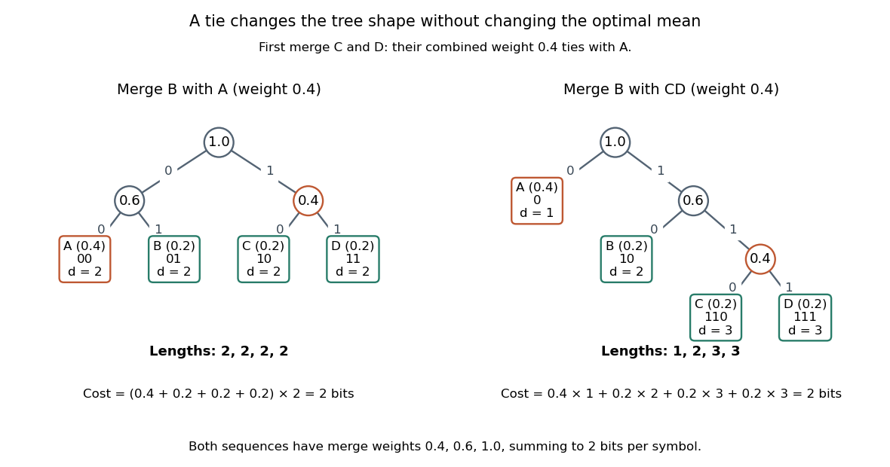

**[Figure 30](#tied-huffman-weights-distinct-optimal-trees). A tie between a symbol and a merged subtree gives two optimal prefix trees, with depths 2,2,2,2 and 1,2,3,3**.

The quantifier in the [Huffman sibling property](#huffman-sibling-property) is visible here too. Choose $B,C$ as two least-probability symbols. In the displayed balanced [optimal prefix code](#optimal-prefix-code), they are not [sibling leaves in a code tree](#sibling-leaves-in-a-code-tree). Exchanging $B,D$, which have equal [probabilities](probability-theory.md#probability), produces another balanced [optimal prefix code](#optimal-prefix-code) in which $B,C$ are deepest [sibling leaves in a code tree](#sibling-leaves-in-a-code-tree). Thus the proof supplies an optimal representative with the chosen pair together. It does not force that labelling on every optimum. An implementation can make its tie choices and $0/1$ [edge](graph-theory.md#edge-of-a-graph) assignments deterministic when encoder and decoder need to reproduce the same [codewords](coding-theory.md#codeword); optimal mean length alone does not specify them.

### Huffman codeword length bounds

↑ **Parent:** [Huffman coding](#huffman-coding)

For a largest binary-symbol probability $p_1$, $p_1<1/3$ prevents a length-one word, while $p_1>2/5$ forces one in a Huffman tree.

## Bernoulli source

↑ **Parent:** [Information theory](information-theory.md)

A Bernoulli information source emits [independent symbols with one fixed probability distribution](random-variable.md#independent-and-identically-distributed-random-variables).

## Entropy rate

↑ **Parent:** [Information theory](information-theory.md)  
ⓦ [Wiki](https://en.wikipedia.org/wiki/Entropy_rate)

The [entropy rate](#entropy-rate) measures average new uncertainty per emitted symbol of a [stochastic process](stochastic-process.md). Predictability from earlier symbols can make this much smaller than the [information entropy](#information-entropy) of one symbol. For example, a [binary Markov source](#binary-markov-source) can emit a fair [bit](#bit) at every time while repeating its previous [bit](#bit) with [probability](probability-theory.md#probability) $7/8$: each individual symbol has one [bit](#bit) of uncertainty, but the [entropy rate](#entropy-rate) is only about $0.544$ [bits](#bit) per symbol.

For a [finite alphabet](#finite-alphabet) source $X=(X_1,X_2,\ldots)$, define

$$
h(X)=\lim_{n\to\infty}\frac{H(X_1,\ldots,X_n)}n
$$

when the [limit](calculus.md#limit-of-a-function) exists. Base-two [logarithms](calculus.md#logarithm) give [bits](#bit) per symbol. Multiplying by a fixed emission frequency $f$ gives $fh(X)$ [bits](#bit) per unit time; the symbol rate and the uncertainty of the sequence are different inputs. A [strictly stationary process](time-series.md#strictly-stationary-process) on a [finite alphabet](#finite-alphabet) always has an [entropy rate](#entropy-rate), equal to its [conditional entropy rate](#conditional-entropy-rate).[§5.5, Definition 5.1 and Theorem 5.5, printed p. 57: block entropy and stationary conditional-entropy limit](mathematics-bibliography.md#6-441-information-theory-spring-2016-lecture-notes-by-yury-polyanskiy-and-others)

For an [independent and identically distributed](random-variable.md#independent-and-identically-distributed-random-variables) source, the [chain rule for information entropy](#chain-rule-for-information-entropy) gives $H(X_1,\ldots,X_n)=nH(X_1)$, hence $h(X)=H(X_1)$. With dependence, [conditioning reduces entropy](#conditioning-reduces-entropy) and makes the past useful. The examples under [Markov information source](#markov-information-source) show this benefit using exact finite-block calculations.

### Conditional entropy rate

↑ **Parent:** [Entropy rate](#entropy-rate)

For a [strictly stationary process](time-series.md#strictly-stationary-process) on a [finite alphabet](#finite-alphabet), put $a_1=H(X_1)$ and $a_n=H(X_n\mid X_1,\ldots,X_{n-1})$ for $n\geq2$. Each $a_n$ is the average remaining uncertainty in the next symbol after its history is known. More history can improve prediction, so this sequence is nonincreasing:

$$
a_{n+1}=H(X_{n+1}\mid X_1,\ldots,X_n)
\leq H(X_{n+1}\mid X_2,\ldots,X_n)=a_n.
$$

The inequality uses [conditioning reduces entropy](#conditioning-reduces-entropy); the last equality uses [strict stationarity](time-series.md#strictly-stationary-process). Nonnegative $a_n$ therefore have a [limit](calculus.md#limit-of-a-function). By the [chain rule for information entropy](#chain-rule-for-information-entropy),

$$
\frac{H(X_1,\ldots,X_n)}n=\frac1n\sum_{j=1}^n a_j.
$$

The [Cesàro mean](real-analysis.md#cesaro-mean) converges to the same [limit](calculus.md#limit-of-a-function), proving the equality with the [entropy rate](#entropy-rate). This is a statement about average [information entropy](#information-entropy). A constant almost-sure limit of the realized [information content](#information-content) requires the further hypotheses in the [Shannon-McMillan-Breiman theorem](measure-theory.md#shannon-mcmillan-breiman-theorem); [stationarity without ergodicity in an information source](#stationarity-without-ergodicity-in-an-information-source) explains the distinction.

### Entropy rate and coding length

↑ **Parent:** [Entropy rate](#entropy-rate)

Consider a [binary Markov source](#binary-markov-source) with fair initial [bit](#bit) and flip [probability](probability-theory.md#probability) $q=1/8$. Its exact $n$-symbol [information entropy](#information-entropy) is $H_n=1+(n-1)h_2(1/8)$. At $n=16$,

$$
H_{16}\simeq9.15346665\ \text{bits},\qquad H_{16}/16\simeq0.57209167\ \text{bits per symbol}.
$$

This includes the uncertainty of the initial [bit](#bit); the [entropy rate](#entropy-rate) itself is $h_2(1/8)\simeq0.54356444$ [bits](#bit) per symbol. The finite-block difference is $(1-h_2(1/8))/n$.

For any finite block distribution, the [entropy lower bound for prefix codes](coding-theory.md#entropy-lower-bound-for-prefix-codes) gives [expected codeword length](#expected-codeword-length) $L_n\geq H_n$, while [Shannon coding](coding-theory.md#shannon-coding) achieves $L_n<H_n+1$. These bounds apply to each block as one source symbol, without requiring consecutive blocks to be independent. Here [Huffman coding](#huffman-coding) on all $2^{16}$ possible 16-symbol words gives the independently calculated value $L_{16}\simeq9.19511361$ [bits](#bit) per block, or $0.57469460$ [bits](#bit) per symbol. The noninteger value is an [expected value](probability-theory.md#expected-value); each actual [codeword](coding-theory.md#codeword) has an integer length. As the block length grows, the [prefix code](coding-theory.md#prefix-code) bounds squeeze $L_n/n$ towards the [entropy rate](#entropy-rate) when an optimal code is used.

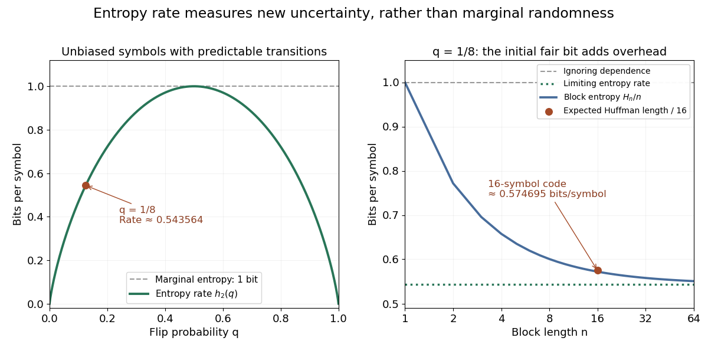

**[Figure 31](#image-fair-marginal-bits-can-have-a-lower-entropy-rate-with-a-finite-block-initial-cost). Fair marginal bits can have a lower entropy rate, with a finite-block initial cost**. The left panel shows the exact [binary entropy](#binary-entropy) $h_2(q)$ for the symmetric [binary Markov source](#binary-markov-source); each individual symbol still has one [bit](#bit) of [information entropy](#information-entropy). Both near-persistence $q\approx0$ and near-alternation $q\approx1$ make the next symbol predictable. The right panel uses $q=1/8$ and plots $H_n/n=h_2(q)+(1-h_2(q))/n$, rather than literal fractional [codeword lengths](coding-theory.md#codeword-length). The [Huffman coding](#huffman-coding) point is the exact expected length over all 16-symbol words.

An [entropy rate](#entropy-rate) below one does not allow every word to fit into a shorter fixed binary word with zero error. For $0<q<1$, all $2^n$ binary words are possible, so an injective fixed-length code needs at least $n$ [bits](#bit). Compression instead exploits variable [codeword lengths](coding-theory.md#codeword-length), or the vanishing-error convention in [reliable source encoding at a rate](#reliable-source-encoding-at-a-rate). These are different guarantees.

<h3 id="shannon-s-block-entropy-approximations">Shannon's block-entropy approximations</h3>

↑ **Parent:** [Entropy rate](#entropy-rate)

In [A Mathematical Theory of Communication by Claude Shannon](mathematics-bibliography.md#a-mathematical-theory-of-communication-by-claude-shannon), [Claude Shannon](mathematics-author.md#claude-shannon) compares block uncertainty per symbol, denoted $G_N$, with conditional uncertainty given the preceding symbols, denoted $F_N$. Theorems 5 and 6 connect both decreasing approximations to the source's limiting uncertainty. He uses symbol statistics at increasing block lengths to expose structure missed by single-letter counts.[§7, Theorems 5–6 and discussion, printed p. 14; Appendix 3, printed p. 30: block and conditional entropy approximations](mathematics-bibliography.md#a-mathematical-theory-of-communication-by-claude-shannon) The fair marginal [bits](#bit) of the [binary Markov source](#binary-markov-source) provide a small exact example of that distinction.

### Reliable source encoding at a rate

↑ **Parent:** [Entropy rate](#entropy-rate)

A source is reliably encodable at rate $r$ if there are block encoders with at most $2^{nr}$ outputs and corresponding decoders whose probability of reconstructing the first $n$ source symbols incorrectly tends to zero as $n\to\infty$.

#### Strong converse for fixed-rate source coding

↑ **Parent:** [Reliable source encoding at a rate](#reliable-source-encoding-at-a-rate)

For a finite-alphabet IID source of entropy $H$, fixed-length block codes of rate $R<H$ have reconstruction success probability tending to zero. At most $2^{nR}$ strings can be correctly reconstructed. Their typical probability is at most $2^{nR}2^{-n(H-\delta)}$, and the atypical probability tends to zero; choose $0<\delta<H-R$.

// Target: algebra.bigb

### Information rate under fixed-length blocking

↑ **Parent:** [Entropy rate](#entropy-rate)

For a source $(X_n)$ and fixed positive integer $N$, form the block source $Y_i=(X_{(i-1)N+1},\ldots,X_{iN})$. Whenever the original information rate $h$ exists, the blocked source has information rate $Nh$, because

$$
\frac1mH(Y_1,\ldots,Y_m)
=N\frac1{mN}H(X_1,\ldots,X_{mN}).
$$

## Markov information source

↑ **Parent:** [Information theory](information-theory.md)  
ⓦ [Wiki](https://en.wikipedia.org/wiki/Markov_information_source)

A [Markov information source](#markov-information-source) uses a stationary [finite Markov chain](markov-process.md#finite-markov-chain) to emit symbols. The emitted symbol can be a [function](function.md) of the state. If it does not identify that state, the observed sequence need not itself be a [Markov chain](markov-process.md#markov-chain). The examples here use a [fully observed Markov source](#fully-observed-markov-source), which makes the next-symbol uncertainty directly computable from the [transition matrix](markov-process.md#stochastic-matrix).

### Fully observed Markov source

↑ **Parent:** [Markov information source](#markov-information-source)

Each emitted symbol identifies the state of a stationary [finite Markov chain](markov-process.md#finite-markov-chain). Here the [alphabet](#alphabet) is the [state space](dynamical-systems.md#state-space) itself. Its [transition matrix](markov-process.md#stochastic-matrix) $P$ and [stationary distribution](markov-process.md#stationary-distribution) $\pi$ determine the [entropy rate of a fully observed Markov source](#entropy-rate-of-a-fully-observed-markov-source).

#### Entropy rate of a fully observed Markov source

↑ **Parent:** [Fully observed Markov source](#fully-observed-markov-source)

For a [fully observed Markov source](#fully-observed-markov-source), the [Markov property](markov-process.md#markov-property) makes the last state sufficient for the next symbol's [conditional distribution](probability-theory.md#conditional-distribution). With [stationary distribution](markov-process.md#stationary-distribution) $\pi$, the [conditional entropy](#conditional-entropy) is therefore

$$
h=H(X_2\mid X_1)=-\sum_i\pi_i\sum_jP_{ij}\log_2P_{ij},
$$

using $0\log_2 0=0$. The [chain rule for information entropy](#chain-rule-for-information-entropy) gives the exact finite-block identity

$$
H(X_1,\ldots,X_n)=H(\pi)+(n-1)h.
$$

Dividing by $n$ proves the displayed [entropy rate](#entropy-rate). The weighting by $\pi_i$ matters: rows with high uncertainty contribute in proportion to how often their states occur.

For an original asymmetric example, take

$$
P=\begin{pmatrix}7/8&1/8\\3/8&5/8\end{pmatrix},\qquad \pi=(3/4,1/4).
$$

The equality $\pi P=\pi$ verifies the [stationary distribution](markov-process.md#stationary-distribution). The single-symbol [information entropy](#information-entropy) is $h_2(1/4)\simeq0.81127812$, whereas

$$
\boxed{h=\frac34h_2(1/8)+\frac14h_2(3/8)\simeq0.64628183\ \text{bits per symbol}.}
$$

This formula describes observed states. If several states emit the same symbol, calculating the output [entropy rate](#entropy-rate) requires accounting for the hidden-state uncertainty; it is not generally the same row average.

#### Binary Markov source

↑ **Parent:** [Fully observed Markov source](#fully-observed-markov-source)

Take the [alphabet](#alphabet) $\{0,1\}$, fair initial [bit](#bit) $X_1$, and [transition matrix](markov-process.md#stochastic-matrix)

$$
P=\begin{pmatrix}1-q&q\\q&1-q\end{pmatrix},\qquad 0\leq q\leq1.
$$

The [stationary distribution](markov-process.md#stationary-distribution) is $(1/2,1/2)$. Every emitted symbol is a fair [bit](#bit), while the next symbol flips the previous one with [probability](probability-theory.md#probability) $q$. For $q<1/2$, repeating the previous symbol is the better one-step prediction; for $q>1/2$, predicting its opposite is better. The resulting minimum next-symbol error [probability](probability-theory.md#probability) is $\min(q,1-q)$, compared with $1/2$ when no history is used.

Given either state, the next-symbol [information entropy](#information-entropy) is $h_2(q)$. Thus

$$
H(X_n)=1,\qquad H(X_n\mid X_1,\ldots,X_{n-1})=h_2(q)\quad(n\geq2),\qquad
\boxed{h(X)=h_2(q).}
$$

At $q=1/8$, the best next-symbol prediction succeeds with [probability](probability-theory.md#probability) $7/8$, and the [entropy rate](#entropy-rate) is about $0.54356444$ [bits](#bit) per symbol. The adjacent symbols share [mutual information](#mutual-information) $I(X_1;X_2)=1-h_2(q)\simeq0.45643556$ [bits](#bit). This is useful structure even though the single-symbol counts reveal no bias.

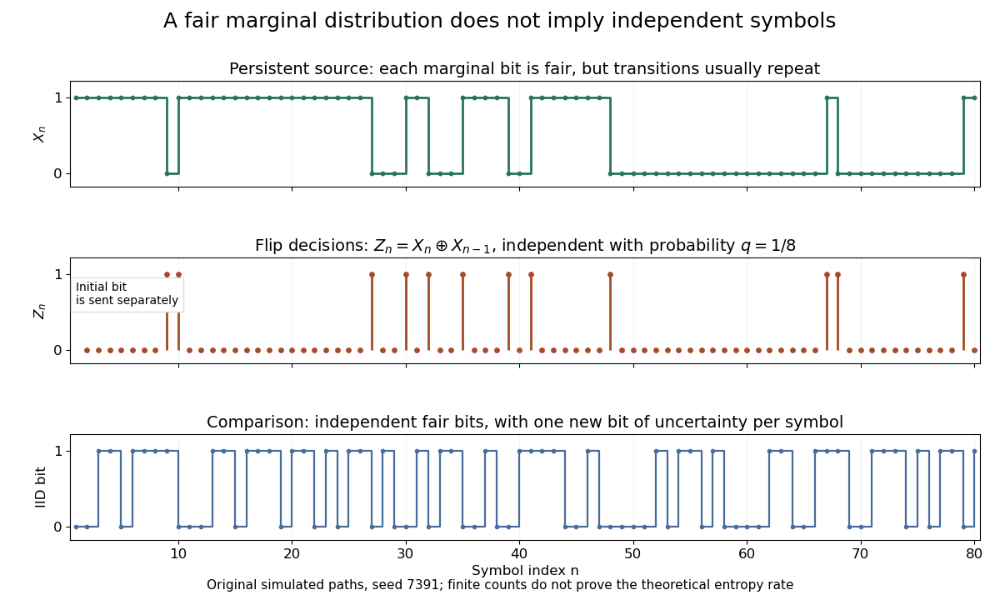

**[Figure 32](#image-a-persistent-fair-bit-source-reveals-its-new-randomness-through-the-flip-sequence). A persistent fair-bit source reveals its new randomness through the flip sequence**. Original simulated [sample paths](stochastic-process.md#sample-path) with a fixed random seed. The top row is a stationary [binary Markov source](#binary-markov-source) with $q=1/8$; the middle row records [innovations in a binary Markov source](#innovations-in-a-binary-markov-source), marking whether each symbol differs from its predecessor. The bottom row is an independent fair-bit comparison. The marginal theoretical [probabilities](probability-theory.md#probability) are $1/2$ for both displayed source processes; finite empirical counts need not be exactly equal. These traces illustrate the stipulated models and are not measured data or a proof of the [entropy rate](#entropy-rate).

At $q=0$, the random initial [bit](#bit) is repeated forever; at $q=1$, it alternates forever. Both have $H(X_1,\ldots,X_n)=1$ and zero [entropy rate](#entropy-rate). At $q=1/2$, the symbols are [independent and identically distributed](random-variable.md#independent-and-identically-distributed-random-variables) fair [bits](#bit), giving [entropy rate](#entropy-rate) one. Zero rate therefore need not mean that the initial choice was deterministic.

##### Innovations in a binary Markov source

↑ **Parent:** [Binary Markov source](#binary-markov-source)

Generate the [binary Markov source](#binary-markov-source) by taking [independent and identically distributed](random-variable.md#independent-and-identically-distributed-random-variables) [Bernoulli random variables](discrete-probability-distribution.md#bernoulli-distribution) $Z_2,Z_3,\ldots$ of parameter $q$, independent of a fair initial [bit](#bit), and setting $X_n=X_{n-1}\oplus Z_n$. Here $\oplus$ is [exclusive or](computer-science.md#exclusive-or). Each $Z_n$ is the unpredictable flip decision.

The transformation between $(X_1,\ldots,X_n)$ and $(X_1,Z_2,\ldots,Z_n)$ is a [bijection](function.md#bijection). It preserves [information entropy](#information-entropy), so

$$
H(X_1,\ldots,X_n)=H(X_1,Z_2,\ldots,Z_n)=1+(n-1)h_2(q).
$$

Sending the initial [bit](#bit) and encoding the innovation sequence describes every source word exactly. This does not by itself specify a practical compressor, but it identifies the uncertainty which a [prefix code](coding-theory.md#prefix-code) or other [lossless source coding](#lossless-source-coding) method must handle.

For a word with $k$ flips among its $n-1$ transitions,

$$
\mathbb P(X_1=x_1,\ldots,X_n=x_n)=\frac12q^k(1-q)^{n-1-k}.
$$

There are $2\binom{n-1}{k}$ such words: choose the initial [bit](#bit) and the flip positions. At $q=1/8$ and $n=16$, each constant word has [probability](probability-theory.md#probability) $(1/2)(7/8)^{15}\simeq0.06746691$, whereas an independent fair source gives each word [probability](probability-theory.md#probability) $2^{-16}$. Equal marginal [probabilities](probability-theory.md#probability) plainly do not imply equal word [probabilities](probability-theory.md#probability).

## Asymptotic equipartition property

↑ **Parent:** [Information theory](information-theory.md)  
ⓦ [Wiki](https://en.wikipedia.org/wiki/Asymptotic_equipartition_property)

The [asymptotic equipartition property](#asymptotic-equipartition-property) explains why a long message from a source can usually be described using its [information entropy](#information-entropy) per symbol. Individual messages can have very different [probabilities](probability-theory.md#probability), but the messages carrying almost all the total [probability](probability-theory.md#probability) have similar logarithmic costs per symbol. The [Bernoulli typical-set example](#bernoulli-typical-set-example) makes the distinction between an individual message and a large collection explicit.

For [independent and identically distributed random variables](random-variable.md#independent-and-identically-distributed-random-variables) $X_1,X_2,\ldots$ on a [finite alphabet](#finite-alphabet), let $p$ be their [probability mass function](probability-theory.md#probability-mass-function) and $H=\mathbb E[-\log_2p(X_1)]$. Then

$$
\boxed{-\frac1n\log_2P(X_1,\ldots,X_n)\longrightarrow H\quad\text{almost surely}.}
$$

Here $P(X_1,\ldots,X_n)$ means the [probability mass](probability-theory.md#probability-mass) of the realized word, evaluated under the source law. The product rule for [independent random variables](random-variable.md#independent-random-variables) turns its [information content](#information-content) into a sum:

$$
-\frac1n\log_2P(X_1,\ldots,X_n)
=\frac1n\sum_{j=1}^n[-\log_2p(X_j)].
$$

The [strong law of large numbers](convergence-of-random-variables.md#strong-law-of-large-numbers) gives the limit. Zero-probability symbols do not occur; on the positive-probability support of a [finite alphabet](#finite-alphabet), these information costs are finite. The corresponding [typical set](#typical-set) consists of words whose cost per symbol is within a chosen tolerance of $H$.

For a [strictly stationary process](time-series.md#strictly-stationary-process) with a [finite alphabet](#finite-alphabet), the constant-limit extension requires [ergodicity](measure-theory.md#ergodicity). The [Shannon-McMillan-Breiman theorem](measure-theory.md#shannon-mcmillan-breiman-theorem) then replaces the one-symbol [information entropy](#information-entropy) with the [information rate](#entropy-rate). [Stationarity without ergodicity in an information source](#stationarity-without-ergodicity-in-an-information-source) shows why stationarity alone is insufficient.[§8, Theorem 8.1 and Corollary 8.2, printed p. 90: stationary ergodic sources and typical sets](mathematics-bibliography.md#6-441-information-theory-spring-2016-lecture-notes-by-yury-polyanskiy-and-others)

### Bernoulli typical-set example

↑ **Parent:** [Asymptotic equipartition property](#asymptotic-equipartition-property)

Take an [IID random variable](random-variable.md#independent-and-identically-distributed-random-variables) source of [bits](#bit) with $P(X_j=1)=1/4$. Its [binary entropy](#binary-entropy) is

$$
H=h_2(1/4)=-\frac14\log_2\frac14-\frac34\log_2\frac34
\approx0.811278\text{ bits per symbol}.
$$

A word of length $n$ containing $k$ ones has [probability](probability-theory.md#probability) $(1/4)^k(3/4)^{n-k}$. Its [information content](#information-content) per symbol is

$$
\frac{\imath(k)}n=\log_2\frac43+\frac kn\log_2 3.
$$

Thus [weakly typical sequences](#weakly-typical-sequence) for this biased source have $k/n$ near $1/4$. With tolerance $\varepsilon=0.1$ [bits](#bit) per symbol, the exact condition is

$$
\left|\frac kn-\frac14\right|\leq\frac{0.1}{\log_2 3}.
$$

For $n=40$, this includes exactly $k=8,9,10,11,12$. There are $\binom{40}{k}$ words with each count: a [type class](#type-class) with that many possible orderings. Summing the counts and their [probability masses](probability-theory.md#probability-mass) gives

$$
\boxed{|T_{0.1}^{(40)}|=9\,096\,659\,013,\qquad
P(T_{0.1}^{(40)})\approx0.638912.}
$$

These are fewer than one percent of the $2^{40}$ possible words, yet they carry nearly 64 percent of the [probability](probability-theory.md#probability). The most likely individual word is all zeros, with [probability](probability-theory.md#probability) $(3/4)^{40}\approx1.006\times10^{-5}$; it is outside this [typical set](#typical-set). No contradiction is involved: the [type classes](#type-class) near ten ones each contain many more individual words.

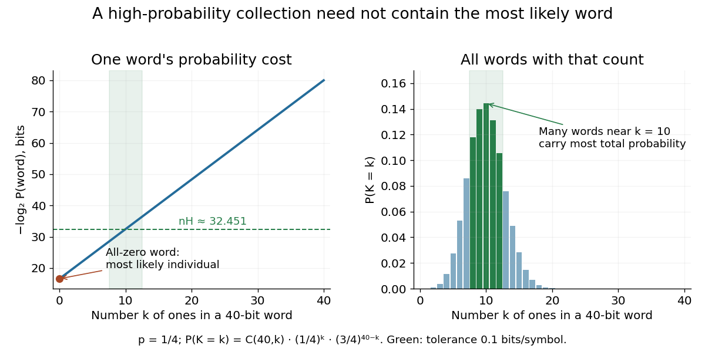

**[Figure 33](#image-the-most-likely-individual-word-differs-from-the-counts-carrying-most-probability). The most likely individual word differs from the counts carrying most probability**. The left plot gives the [information content](#information-content) of one word with each number of ones. The right includes the [binomial coefficient](combinatorics.md#binomial-coefficient) counting every such word, giving the exact [binomial distribution](discrete-probability-distribution.md#binomial-distribution) of the count. Both use $n=40$, $p=1/4$; the green band marks the [typical set](#typical-set) with tolerance $0.1$ [bits](#bit) per symbol.

#### Typical-set concentration for a biased coin

↑ **Parent:** [Bernoulli typical-set example](#bernoulli-typical-set-example)

The count $K_n$ has [binomial distribution](discrete-probability-distribution.md#binomial-distribution) with [mean](probability-theory.md#expected-value) $n/4$ and [variance](variance.md) $3n/16$. The [information content](#information-content) per symbol is an affine function of $K_n/n$, so its [variance](variance.md) is

$$
\operatorname{Var}\left(\frac{\imath(K_n)}n\right)
=\frac{3(\log_2 3)^2}{16n}.
$$

[Chebyshev's inequality](probability-inequality.md#chebyshev-s-inequality) therefore gives the finite-sample lower bound

$$
P(T_\varepsilon^{(n)})\geq
\max\left(0,1-\frac{3(\log_2 3)^2}{16n\varepsilon^2}\right).
$$

The bound is often loose, but it proves that every fixed positive tolerance eventually captures nearly all the [probability](probability-theory.md#probability). Direct summation of the [binomial distribution](discrete-probability-distribution.md#binomial-distribution)'s [probability masses](probability-theory.md#probability-mass) gives $P(T_{0.1}^{(640)})\approx0.999779$. A finite sample does not need to have a nearly full [typical set](#typical-set): the 40-symbol example above captures only about $0.639$.

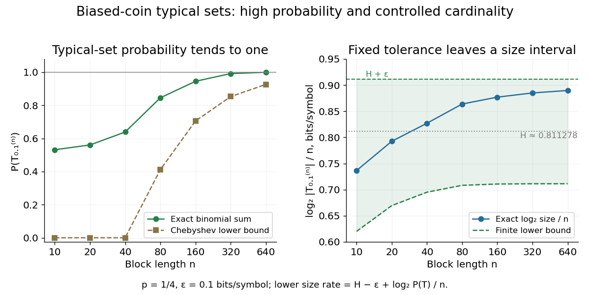

**[Figure 34](#image-longer-biased-coin-messages-concentrate-in-typical-sets-with-controlled-size). Longer biased-coin messages concentrate in typical sets with controlled size**. The left plot compares exact [typical set](#typical-set) probabilities with the lower bound from [Chebyshev's inequality](probability-inequality.md#chebyshev-s-inequality). The right shows $n^{-1}\log_2|T_{0.1}^{(n)}|$ and its finite-sample bounds. The tolerance stays fixed; the curve is not asserted to converge to exactly $H$. All points are exact finite-model calculations.

#### Typical-set indexing example

↑ **Parent:** [Bernoulli typical-set example](#bernoulli-typical-set-example)

The [typical sequence theorem](#typical-sequence-theorem) turns a probability concentration into a coding construction. Assign one [binary number](arithmetic.md#binary-number) index to each [weakly typical sequence](#weakly-typical-sequence), plus a reserved index for every word outside the set. The [decoder](coding-theory.md#channel-decoder) recovers every typical word exactly; the reserved index has one predetermined output. The [block code](coding-theory.md#block-code) uses

$$
L_n=\left\lceil\log_2(|T_\varepsilon^{(n)}|+1)\right\rceil
$$

[bits](#bit) and has reconstruction-error [probability](probability-theory.md#probability) at most $1-P(T_\varepsilon^{(n)})$.

For this example and $\varepsilon=0.1$, $n=40$ needs 34 [bits](#bit) but permits error up to about $0.3611$. At $n=640$, 570 [bits](#bit) suffice and the error bound is about $0.0002215$. These are existence calculations for an explicitly enumerated collection, rather than claims about an efficient practical [encoder](coding-theory.md#channel-encoder). The reduction comes from protecting the whole high-probability collection, rather than just its single most likely member.

### Stationarity without ergodicity in an information source

↑ **Parent:** [Asymptotic equipartition property](#asymptotic-equipartition-property)

Choose one of two regimes once, with equal [probability](probability-theory.md#probability): a source of [independent and identically distributed random variables](random-variable.md#independent-and-identically-distributed-random-variables) with one-bit probability $1/10$, or one with one-bit probability $1/2$. Keep the chosen regime forever. The resulting source is a [strictly stationary process](time-series.md#strictly-stationary-process), because shifting a block does not change either component law. It is not an [ergodic stationary process](time-series.md#ergodic-stationary-process): its limiting empirical frequency identifies the regime.

The source's [information rate](#entropy-rate) is

$$
\frac12h_2(1/10)+\frac12h_2(1/2)\approx0.734498.
$$

Conditioning on the single regime bit changes any block's [information entropy](#information-entropy) by at most one [bit](#bit), so dividing by the block length proves this rate. However, the limiting realized [information content](#information-content) per symbol is approximately $0.468996$ in the first regime and one in the second. The alternative component's [likelihood ratio](statistical-modelling.md#likelihood-ratio) decays exponentially along a typical path from the chosen component, at a rate given by the positive [relative entropy](probability-and-statistics.md#kullback-leibler-divergence) between the two [Bernoulli distributions](discrete-probability-distribution.md#bernoulli-distribution). The mixture therefore has two possible pathwise limits, not one limit equal to the averaged [information rate](#entropy-rate).

<h3 id="shannon-s-typical-message-formulation">Shannon's typical-message formulation</h3>

↑ **Parent:** [Asymptotic equipartition property](#asymptotic-equipartition-property)

In [A Mathematical Theory of Communication by Claude Shannon](mathematics-bibliography.md#a-mathematical-theory-of-communication-by-claude-shannon) (1948, section 7), [Claude Shannon](mathematics-author.md#claude-shannon) explains that the common symbol counts in a long independent message make its negative logarithmic probability approximately the message length times the source entropy. Theorem 3 separates an exceptional collection of small total probability from messages with this normalized information cost; Theorem 4 relates the number needed to accumulate a fixed probability to the entropy. The finite-state source setting matters to the historical statement.[section 7, Theorems 3–4, reprint pp. 13–14; Appendix 3](mathematics-bibliography.md#a-mathematical-theory-of-communication-by-claude-shannon)

### Typical set

↑ **Parent:** [Asymptotic equipartition property](#asymptotic-equipartition-property)

For an IID source, the epsilon-typical set consists of words $u^n$ satisfying $|-(1/n)\log p(u^n)-H(U)|\leq\varepsilon$. Its probability tends to one, and its cardinality is at most $2^{n(H(U)+\varepsilon)}$.

#### Typical sequence theorem

↑ **Parent:** [Typical set](#typical-set)

For a [memoryless classical information source](#memoryless-classical-information-source), the [typical set](#typical-set) consists of positive-probability words with $|-(1/n)\log_2p(u^n)-H(U)|\leq\varepsilon$. The [weak law of large numbers](convergence-of-random-variables.md#weak-law-of-large-numbers) applied to $-\log_2p(U_j)$ proves its probability tends to one. Every typical word has probability between $2^{-n(H+\varepsilon)}$ and $2^{-n(H-\varepsilon)}$. Summing the lower bound gives the displayed cardinality upper bound; if the set has probability at least $1-\delta$, summing the upper bound gives cardinality at least $(1-\delta)2^{n(H-\varepsilon)}$.

To compress at any rate $R>H(U)$, choose $0<\varepsilon<R-H(U)$, assign one fixed-length binary index to each typical word, and reserve one additional index for all atypical words. At most $\lceil nR\rceil$ bits suffice for all large $n$. Decoding inverts the typical-word indices and makes an arbitrary output for the reserved index. The reconstruction error is at most the probability of the atypical set and tends to zero.

#### Weakly typical sequence

↑ **Parent:** [Typical set](#typical-set)

For an [IID random variable](random-variable.md#independent-and-identically-distributed-random-variables) source with [probability mass function](probability-theory.md#probability-mass-function) $p$, a word $x^n$ is weakly typical when $|-(1/n)\log_2p(x^n)-H(X)|\leq\varepsilon$. It has probability on the scale $2^{-nH(X)}$. The [weak law of large numbers](convergence-of-random-variables.md#weak-law-of-large-numbers) makes the [typical set](#typical-set) probable, but does not make every word in it representative: for a uniform source every possible word is weakly typical.

#### Typical-set cardinality bounds

↑ **Parent:** [Typical set](#typical-set)

For a [typical set](#typical-set) of probability at least $1-\delta$,

$$
(1-\delta)2^{n(H-\varepsilon)}\leq|T_\varepsilon^{(n)}|\leq2^{n(H+\varepsilon)}.
$$

The upper bound sums the lower probability bound for each word; the lower bound sums the upper probability bound and uses the set's total probability. These bounds turn the [asymptotic equipartition property](#asymptotic-equipartition-property) into exponential estimates of source-coding dimension.

##### Minimal high-probability source-set exponent

↑ **Parent:** [Typical-set cardinality bounds](#typical-set-cardinality-bounds)

For a finite-alphabet IID source and fixed $0<\varepsilon<1$, the smallest set of length-$n$ strings carrying probability at least $1-\varepsilon$ has size $2^{n(H(U)+o(1))}$. The [typical set](#typical-set) bounds give the upper estimate. For the lower estimate, any such set intersects the typical set in probability bounded away from zero, while each typical string has probability at most $2^{-n(H(U)-\delta)}$.

// Target: probability-and-statistics.bigb

### Strongly typical sequence

↑ **Parent:** [Asymptotic equipartition property](#asymptotic-equipartition-property)

For a finite-alphabet [IID random variable](random-variable.md#independent-and-identically-distributed-random-variables) source, a strongly typical word has empirical symbol frequencies within the chosen tolerance of every $p(x)$, and contains no zero-probability symbols. Unlike a [weakly typical sequence](#weakly-typical-sequence), this definition controls the individual symbol counts. Both definitions give sets whose probability tends to one for fixed positive tolerance.

## Lossless source coding

↑ **Parent:** [Information theory](information-theory.md)

[Lossless source coding](#lossless-source-coding) encodes source messages so they can be recovered exactly. [Shannon's source coding theorem](coding-theory.md#shannon-s-source-coding-theorem) relates its achievable average code length to [information entropy](#information-entropy).

### Code-distribution correspondence

↑ **Parent:** [Lossless source coding](#lossless-source-coding)

Lengths of a binary prefix code satisfy $K=\sum_x2^{-L(x)}\leq1$ and therefore define the probability mass function $R(x)=2^{-L(x)}/K$. Conversely, a mass function gives ideal lengths $-\log_2R(x)$ and integer prefix lengths after rounding.

### Fixed-rate source-coding error exponent

↑ **Parent:** [Lossless source coding](#lossless-source-coding)

For an IID finite-alphabet source $Q$ encoded at rate $R>H(Q)$, the optimal block error probability has exponential rate

$$
\min_{P:H(P)\geq R}D(P\Vert Q).
$$

## Unicity distance

↑ **Parent:** [Information theory](information-theory.md)  
ⓦ [Wiki](https://en.wikipedia.org/wiki/Unicity_distance)

Unicity distance is the ciphertext length at which key equivocation reaches zero and the key becomes uniquely determined under the source model.

### Key equivocation

↑ **Parent:** [Unicity distance](#unicity-distance)

Key equivocation is the conditional entropy $H(K\mid C^n)$ remaining about a key after observing $n$ ciphertext symbols.

### Source redundancy in cryptanalysis

↑ **Parent:** [Unicity distance](#unicity-distance)

For ciphertext alphabet $\Sigma$ and source entropy $H$, each symbol has redundancy $\log|\Sigma|-H$, leading in Shannon's ideal model to $U=\log|K|/(\log|\Sigma|-H)$.

### Infinite unicity distance from a source symmetry

↑ **Parent:** [Unicity distance](#unicity-distance)

If distinct keys transform every ciphertext into equally probable plaintexts through a probability-preserving source symmetry, key equivocation never vanishes and unicity distance is infinite.

## ↑ Ancestors (4)

1. [Probability and statistics](probability-and-statistics.md)
2. [Area of mathematics](mathematics.md#area-of-mathematics)
3. [Mathematics](mathematics.md)
4. [Codex Wiki](README.md)

## ← Incoming links (3)

- [Cross-entropy](#cross-entropy)
- [Information entropy](#information-entropy)
- [Rational Decisions by I. J. Good](mathematics-bibliography.md#rational-decisions-by-i-j-good)
