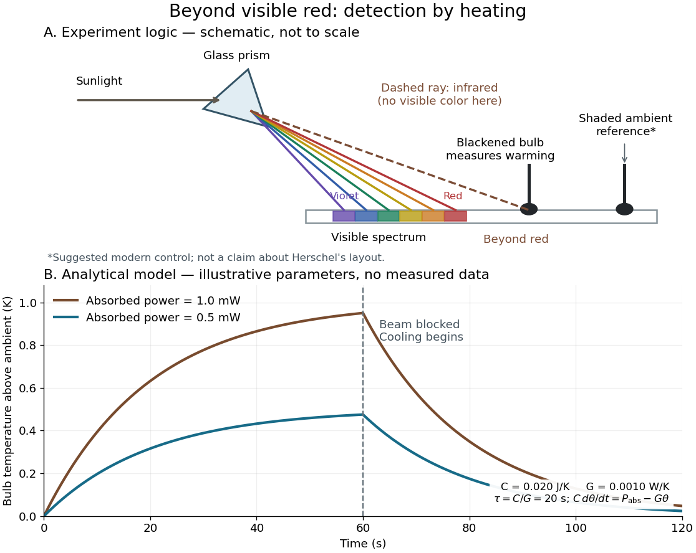

# Infrared

↑ **Parent:** [Optics](optics-split.md)  
ⓦ [Wiki](https://en.wikipedia.org/wiki/Infrared)

[Infrared](infrared.md) is [electromagnetic radiation](electromagnetic-radiation.md) with [wavelengths](wavelength.md) longer than the red end of ordinarily visible [light](light.md). A useful named convention is the CIE range $780\,\mathrm{nm}$ to $1\,\mathrm{mm}$; the approximate visible range $400$–$700\,\mathrm{nm}$ used in some teaching texts puts the boundary nearer $700\,\mathrm{nm}$. [Andrew Fraknoi, David Morrison and Sidney C. Wolff, Astronomy 2e, §5.2: approximate visible range](https://openstax.org/books/astronomy-2e/pages/5-2-the-electromagnetic-spectrum). Neither number is a sharp physical cutoff of human vision. The CIE divisions IR-A, IR-B and IR-C are respectively $0.78$–$1.4\,\mathrm{\mu m}$, $1.4$–$3\,\mathrm{\mu m}$ and $3$–$1000\,\mathrm{\mu m}$; the boundaries of near-, middle- and far-[infrared](infrared.md) vary between applications. [CIE, International Lighting Vocabulary (2020), infrared radiation: ranges and boundary caveats](https://cie.co.at/eilvterm/17-21-004).

Use [vacuum](vacuum.md) [wavelength](wavelength.md) $\lambda$ when comparing these ranges. With [frequency](frequency.md) $\nu$, [speed of light](speed-of-light.md) $c$, [Planck constant](planck-constant.md) $h$ and [photon](photon.md) [energy](energy.md) $E$,

$$
\nu=\frac{c}{\lambda},\qquad E=h\nu=\frac{hc}{\lambda}.
$$

Thus the CIE [infrared](infrared.md) interval corresponds approximately to $3.00\times10^{11}$–$3.84\times10^{14}\,\mathrm{Hz}$ and $1.99\times10^{-22}$–$2.55\times10^{-19}\,\mathrm J$ per [photon](photon.md), with the smaller [energy](energy.md) at the longer [wavelength](wavelength.md). A $940\,\mathrm{nm}$ [infrared](infrared.md) [photon](photon.md) has $E\simeq2.11\times10^{-19}\,\mathrm J$, whereas a $254\,\mathrm{nm}$ [ultraviolet](ultraviolet.md) [photon](photon.md) has $E\simeq7.82\times10^{-19}\,\mathrm J$. These are calculations from $hc/\lambda$, not measurements of a particular source. A television remote is a familiar approximately $940\,\mathrm{nm}$ source; its information is carried by variations in the emitted [radiant flux](radiant-flux.md). [NASA Science Mission Directorate, Infrared Waves: remote controls and thermal imaging](https://science.nasa.gov/ems/07_infraredwaves/).

Detection and visual perception answer different questions. A [photodetector](photodetector.md) can respond to [infrared](infrared.md) even when an observer perceives no [light](light.md); a [thermometer](thermometer.md) detects an increase in [temperature](temperature.md) after [photon absorption](photon-absorption.md). Conversely, a small readout can reflect a small [spectral responsivity](spectral-responsivity.md), rather than absence of incident [electromagnetic radiation](electromagnetic-radiation.md). Images made from [infrared](infrared.md) readouts use display colors chosen by the imaging system; those colors are not the colors of the incoming [infrared](infrared.md).

The important microscopic mechanisms also differ. In [infrared spectroscopy](infrared-spectroscopy.md), [photon absorption](photon-absorption.md) often increases the [energy](energy.md) of a [normal mode](normal-mode.md) in which [chemical bonds](chemical-bond.md) stretch or bend. The corresponding [optical spectrum](optical-spectrum.md) helps distinguish [molecules](molecule.md) by their motions. For the usual [electric dipole](electric-dipole.md) mechanism, the motion must change the [electric dipole moment](electric-dipole-moment.md); matching the [frequency](frequency.md) alone is not sufficient. [MIT 5.35, Fundamentals of Spectroscopy, p. 6: electric-dipole condition for infrared absorption](https://ocw.mit.edu/courses/5-35-introduction-to-experimental-chemistry-fall-2012/3f54ecef6f159a0a11dd60251491e075_MIT5_35F12_Mod1_Background.pdf). Electronic processes can also emit or absorb [infrared](infrared.md), so it is not exclusively radiation from molecular motion. [John McMurry, Organic Chemistry, §12.6: molecular motions and infrared absorption](https://openstax.org/books/organic-chemistry/pages/12-6-infrared-spectroscopy); [Paul Peter Urone and Roger Hinrichs, College Physics 2e, §24.3: sources of infrared radiation](https://openstax.org/books/college-physics-2e/pages/24-3-the-electromagnetic-spectrum).

[Infrared](infrared.md) is especially useful for observing [thermal radiation](thermal-radiation.md) from objects near everyday [temperatures](temperature.md). For an ideal $300\,\mathrm K$ [blackbody](blackbody.md), [Wien's displacement law](wien-s-displacement-law.md) gives a [wavelength](wavelength.md) peak near $9.66\,\mathrm{\mu m}$. A thermal camera's readout nevertheless depends on [emissivity](emissivity.md), reflected surroundings and transmission along the path, as well as [temperature](temperature.md). [Teledyne FLIR, How Does Emissivity Affect Thermal Imaging?: emitted and reflected contributions](https://www.flir.com/discover/professional-tools/how-does-emissivity-affect-thermal-imaging/). A source emitting [infrared](infrared.md) need not be hot: an [infrared](infrared.md) remote is useful precisely because a [photodetector](photodetector.md) can distinguish its signal from a background. Visible [light](light.md) and [ultraviolet](ultraviolet.md) can also cause heating when absorbed; “infrared” names a [wavelength](wavelength.md) range, not a unique form of [heat](heat.md).

Herschel's 1800 discovery made the distinction between sight and detection experimentally concrete. His report describes a [optical prism](prism-optics.md) spreading sunlight across a white, ruled receiving surface, with three [thermometers](thermometer.md) at different positions near the end of the visible [optical spectrum](optical-spectrum.md). He observed heating beyond the red edge where no visible color appeared. The result established that sunlight contained invisible radiation less strongly refracted by that [optical prism](prism-optics.md) than the visible red; it did not measure a [photon](photon.md) [energy](energy.md) or establish today's [infrared](infrared.md) boundaries. [William Herschel, Experiments on the refrangibility of the invisible rays of the sun (1800), Royal Society manuscript record](https://makingscience.royalsociety.org/items/l-and-p_11_125/paper-experiments-on-the-refrangibility-of-the-invisible-rays-of-the-sun-by-william-herschel); [Royal Society proceedings, contemporary abstract of Herschel's experiment: apparatus and observations](https://en.wikisource.org/wiki/Page:Proceedings_of_the_Royal_Society_of_London_Vol_1.djvu/42).

A documented modern version by Caltech/IPAC uses a glass [optical prism](prism-optics.md), white paper in a shaded box and three blackened liquid-filled [thermometers](thermometer.md). Initial readings in shade provide each [thermometer](thermometer.md)'s baseline; subsequent readings compare blue, yellow and just beyond red after the bulbs have had time to warm. The measured quantity is the rise in [temperature](temperature.md), not a “temperature of a color”. The lesson reports the expected largest rise beyond visible red and specifically discusses matching the bulb coatings and [thermometer calibration](thermometer-calibration.md). Clouds and changes in the projected [optical spectrum](optical-spectrum.md) affect the comparison. [Caltech/IPAC Cool Cosmos, The Herschel Experiment (2022): apparatus, readout and calibration controls](https://coolcosmos.ipac.caltech.edu/page/lesson_herschel_experiment).

For a stronger modern interpretation, an additional shaded [thermometer](thermometer.md) would monitor ambient drift, exchanging bulbs between positions would test differences between [thermometers](thermometer.md), and blocking the incident beam would distinguish beam-dependent heating from warmed supports or air. These are suggested controls, not claims about Herschel's historical procedure. [Thermal conduction](thermal-conduction.md) through the mounting and [convection](convection.md) can change the readout. A broad bulb also samples a range of [wavelengths](wavelength.md); the [optical prism](prism-optics.md)'s transmission and [optical dispersion](dispersion-optics.md), the bulb's absorption and heat loss all affect the position of the largest rise. In particular, the result does not show that an [infrared](infrared.md) [photon](photon.md) carries more [energy](energy.md) than a visible [photon](photon.md).

A simple analytical illustration makes those limitations explicit. Let $\theta=T-T_{\mathrm{amb}}$ be the bulb's excess [temperature](temperature.md), $C$ its [heat capacity](heat-capacity.md), $G$ its effective heat-loss coefficient in $\mathrm{W\,K^{-1}}$, and $P_{\mathrm{abs}}$ the absorbed [power](power.md). Assume one uniform bulb [temperature](temperature.md), constant ambient [temperature](temperature.md), constant $C,G$, and losses linear in $\theta$. Then

$$
C\frac{d\theta}{dt}=P_{\mathrm{abs}}-G\theta,\qquad
\theta(t)=\frac{P_{\mathrm{abs}}}{G}\left(1-e^{-t/\tau}\right),\qquad \tau=\frac{C}{G},
$$

for a beam switched on at $t=0$ with $\theta(0)=0$. After switching the beam off at $t=t_s$, $\theta(t)=\theta(t_s)e^{-(t-t_s)/\tau}$. The [exponential function](exponential-function.md) follows by solving this [linear differential equation](linear-differential-equation.md). The steady excess [temperature](temperature.md) measures $P_{\mathrm{abs}}/G$; it is not a direct measurement of the [optical spectrum](optical-spectrum.md). With illustrative $C=0.020\,\mathrm{J\,K^{-1}}$ and $G=0.0010\,\mathrm{W\,K^{-1}}$, $\tau=20\,\mathrm s$. Absorbed [powers](power.md) of $1.0$ and $0.5\,\mathrm{mW}$ give steady rises of $1.0$ and $0.5\,\mathrm K$, regardless of which [wavelengths](wavelength.md) supplied that absorbed [power](power.md).

**[Figure 17](#image-detecting-infrared-by-a-temperature-rise-a-herschel-style-schematic-and-an-analytical-thermal-response-model). Detecting infrared by a temperature rise: a Herschel-style schematic and an analytical thermal-response model**.

The upper schematic represents the logic of the [optical prism](prism-optics.md) experiment; its [light ray](light-ray.md) positions are not a calibrated [wavelength](wavelength.md) scale. The lower curves use the illustrative heat-balance model, with the beam blocked at $60\,\mathrm s$; they are not historical or modern measured data. The beauty of the experiment is that a simple change of detector extends observation beyond what the eye can perceive.

## ↑ Ancestors (4)

1. [Optics](optics-split.md)
2. [Branches of physics](branches-of-physics.md)
3. [Physics](physics-split.md)
4. [Codex Wiki](split.md)

## ← Incoming links (12)

- [Infrared](infrared.md)
- [Infrared spectroscopy](infrared-spectroscopy.md)
- [Laser flash analysis](laser-flash-analysis.md)
- [Light](light.md)
- [Optical tweezers](optical-tweezers.md)
- [Solution](past-exam-of-the-mathematics-course-of-the-university-of-cambridge/2002/iii/paper-66/4/b/solution.md)
- [Solution](past-exam-of-the-mathematics-course-of-the-university-of-cambridge/2009/iii/paper-65/3/iv/solution.md)
- [Solution](past-exam-of-the-mathematics-course-of-the-university-of-cambridge/2013/iii/paper-72/4/c/solution.md)
- [Solution](past-exam-of-the-mathematics-course-of-the-university-of-cambridge/2015/iii/paper-59/2/a/solution.md)
- [Solution](past-exam-of-the-mathematics-course-of-the-university-of-cambridge/2015/iii/paper-59/4/i/solution.md)
- [Spectroscopic measurement of hydration dynamics](spectroscopic-measurement-of-hydration-dynamics.md)
- [Ultraviolet](ultraviolet.md)
