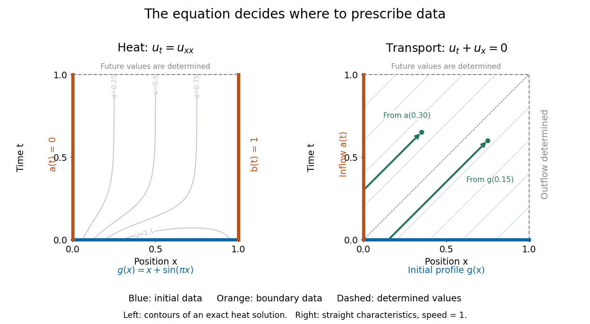

# Initial and boundary data for evolution equations

↑ **Parent:** [Partial differential equation](partial-differential-equation-split.md)

On $0<x<L$, $t>0$, an [initial condition](initial-condition.md) $u(x,0)=g(x)$ gives the starting profile. For the [heat equation](heat-equation.md), [Dirichlet boundary conditions](dirichlet-boundary-condition.md) $u(0,t)=a(t)$, $u(L,t)=b(t)$ can model ends held at prescribed [temperatures](temperature-split.md). Alternatively, zero [Neumann boundary conditions](neumann-boundary-condition.md) describe insulated ends in the constant-conductivity model. These choices can produce different evolutions from the same [initial condition](initial-condition.md).

For a continuous [classical solution](classical-solution.md) reaching the corners, the [Dirichlet boundary data](dirichlet-boundary-data.md) must satisfy $g(0)=a(0)$ and $g(L)=b(0)$; higher smoothness can require further compatibility. In dimensionless variables, a complete worked [heat equation](heat-equation.md) problem is

$$
u_t=u_{xx},\quad 0<x<1,\quad t>0,\qquad u(x,0)=x+\sin(\pi x),\quad u(0,t)=0,\quad u(1,t)=1.
$$

Its exact [classical solution](classical-solution.md) is $u(x,t)=x+e^{-\pi^2t}\sin(\pi x)$. The straight profile $x$ is the equilibrium; the extra bump decays. Substituting verifies the equation and every datum, and the [energy estimate](energy-estimate.md) proves uniqueness among smooth solutions with these data.

For the [transport equation](transport-equation-split.md) with $c>0$ on the same [interval](interval-mathematics.md), prescribe an [inflow transport boundary condition](inflow-transport-boundary-condition.md) only at $x=0$. Backtracking a [characteristic curve](characteristic-curve.md) gives $g(x-ct)$ if $x\geq ct$, and $a(t-x/c)$ otherwise. Values at $x=L$ are determined by this formula; independently prescribing them can make the problem inconsistent.[Victor Ivrii, First order PDEs, initial-boundary value problems](https://www.math.utoronto.ca/ivrii/PDE-textbook/Chapter2/S2.1.html)

**[Figure 1](#image-heat-flow-uses-initial-and-both-endpoint-data-rightward-transport-uses-initial-and-inflow-data). Heat flow uses initial and both endpoint data; rightward transport uses initial and inflow data**.

**Table of contents**

- [Source term in a partial differential equation](source-term-in-a-partial-differential-equation.md)

## ↑ Ancestors (5)

1. [Partial differential equation](partial-differential-equation-split.md)
2. [Analysis](analysis-split.md)
3. [Area of mathematics](area-of-mathematics.md)
4. [Mathematics](mathematics-split.md)
5. [Codex Wiki](split.md)
